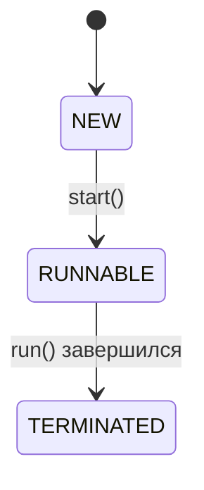

# Стиль страниц

Правила для всех страниц в `docs/`. Эталон по тону и плотности — «конспект»: [concurrency/jmm.md](docs/concurrency/jmm.md) и [system-design/building-blocks.md](docs/system-design/building-blocks.md). Пример страницы, целиком собранной по этим правилам, — [collections.md](docs/java/collections.md).

## Структура страницы

1. Front matter с тегами — см. [Теги](#теги).
2. Заголовок `#` — название темы.
3. Вступление в 2–3 строки: о чём страница и что по ней обычно спрашивают на собесе.
4. Разделы `##` группируют темы (например, «Списки», «HashMap»).
5. Темы `###` оформлены по шаблону ниже.
6. Последний раздел — `## Шпаргалка` с таблицей.

## Шаблон темы

Каждая тема идёт в одном и том же порядке:

1. **Заголовок-вопрос** — так, как его задают на собесе: `### Как HashMap находит бакет по ключу?`
2. **Метка уровня** — отдельной строкой сразу под заголовком.
3. **Ответ вслух** — 2–3 предложения, которые можно произнести на собесе без подготовки.
4. **Разбор** — как это устроено, с кодом.
5. **Ловушки** — в `!!! warning`.
6. **Проверь себя** — свёрнутый блок `??? question` с 2–3 вопросами.

````markdown
### Как HashMap находит бакет по ключу?

**Уровень:** Middle

!!! abstract "Ответ вслух"
    Берётся `hashCode()` ключа, старшие биты подмешиваются к младшим,
    а индекс считается как `(n - 1) & hash`. Это работает только при
    ёмкости — степени двойки, поэтому она всегда степень двойки.

Разбор: текст, код, схемы.

```java
int index = (n - 1) & hash;
```

!!! warning "Ловушка: отрицательный индекс"
    Что сломается, если сделать иначе, и почему.

??? question "Проверь себя"
    1. Первый вопрос?
    2. Второй вопрос?
````

### Метка уровня

Пиши строго `**Уровень:** Junior`, `**Уровень:** Middle` или `**Уровень:** Senior`.

| Уровень | Что проверяет |
|---|---|
| **Junior** | Что это, зачем и как этим пользоваться |
| **Middle** | Как устроено внутри, сложность операций, типичные ошибки |
| **Senior** | Граничные случаи, производительность, железо, многопоточность |

### Ответ вслух

Блок `!!! abstract "Ответ вслух"`, 2–3 предложения. Только суть и ключевые цифры, без кода и подробностей — они идут в разборе.

### Разбор

Объясняй **почему**, а не только **что**. Код — на Java, с комментариями, что происходит; плохой и хороший варианты помечай `// ❌` и `// ✅`.

Каждый пример должен компилироваться на актуальном JDK (сейчас 25). Preview-фичи помечай явно и указывай флаг `--enable-preview`.

### Ловушки

Всё, на чём валят на собесе или ломается прод, — в `!!! warning "Название ловушки"`. Одна ловушка — один блок.

### Проверь себя

Свёрнутый блок `??? question "Проверь себя"` с 2–3 вопросами по теме. Ответы на них должны находиться в самой теме.

### Длинная тема: вкладки «Коротко / Подробно»

Если разбор темы длиннее 50 строк, «Ответ вслух» и разбор разносятся по вкладкам `pymdownx.tabbed`. Ловушки и «Проверь себя» остаются под вкладками, их видно при любой выбранной вкладке. Всё содержимое вкладки сдвинуто на 4 пробела.

````markdown
### Как устроен `enum`? { #enum }

**Уровень:** Junior

=== "Коротко"

    !!! abstract "Ответ вслух"
        2–3 предложения.

=== "Подробно"

    Разбор: текст, код, схемы.

    ```java
    enum Color { RED, GREEN }
    ```

!!! warning "Ловушка"
    Текст ловушки.

??? question "Проверь себя"
    1. Вопрос?
````

Вкладки с одинаковыми названиями связаны (`content.tabs.link`): читатель выбирает «Подробно» один раз, и выбор действует на всех страницах. Поэтому названия вкладок пиши ровно так: «Коротко» и «Подробно».

## Текст

- Абзац — не больше 3 предложений.
- Обращение на «ты», как в живом разговоре.
- Без эпитетов: «секрет», «магия», «сеньорский», «суперсила», «шедевр», «молниеносно», «со скоростью света». Вместо оценки — факт или цифра: не «молниеносно», а «O(1)».
- Термин при первом упоминании — по-русски и по-английски в скобках: «бакет (bucket)».

## Один дом у темы

У каждой темы ровно одна страница, где она разобрана подробно. На других страницах — 1–2 предложения и ссылка на дом.

Ссылайся на конкретный якорь. Если заголовок на русском, дай ему явный id через `attr_list`, иначе якорь сгенерируется нечитаемым или пустым:

```markdown
## Итераторы { #iterators }

Коллекции для многопоточного кода — в [Потокобезопасные коллекции → ConcurrentHashMap](../concurrency/concurrent-collections.md#concurrenthashmap).
```

| Тема | Дом |
|---|---|
| Контракт `equals()` и `hashCode()`, `enum`, `static`, порядок инициализации | [java/basics.md](docs/java/basics.md) |
| `String`, `StringBuilder`, String Pool | [java/strings.md](docs/java/strings.md) |
| `var`, `record`, `switch`, pattern matching, `sealed` | [java/modern-java.md](docs/java/modern-java.md) |
| `finally`, `try-with-resources` | [java/exceptions.md](docs/java/exceptions.md) |
| `List`, `Set`, `Queue`, `ArrayDeque`, `PriorityQueue`, `ConcurrentModificationException` | [java/collections.md](docs/java/collections.md) |
| `HashMap`, `LinkedHashMap`, `TreeMap`: бакеты, коллизии, расширение | [java/hashmap.md](docs/java/hashmap.md) |
| Функциональные интерфейсы, лямбды, `Optional` | [java/functional.md](docs/java/functional.md) |
| JVM, GC, Stack и Heap, Metaspace, `OutOfMemoryError` | [java/jvm.md](docs/java/jvm.md) |
| Потоки, их состояния и остановка, `ThreadLocal` | [concurrency/threads.md](docs/concurrency/threads.md) |
| `synchronized`, `wait`/`notify`, `ReentrantLock`, синхронизаторы, AQS | [concurrency/locks.md](docs/concurrency/locks.md) |
| JMM, happens-before, `volatile`, атомики, CAS, false sharing | [concurrency/jmm.md](docs/concurrency/jmm.md) |
| Пулы потоков, `ForkJoinPool`, `CompletableFuture` | [concurrency/executors.md](docs/concurrency/executors.md) |
| Потокобезопасные коллекции и `BlockingQueue` | [concurrency/concurrent-collections.md](docs/concurrency/concurrent-collections.md) |
| Композиция против наследования, cohesion и coupling | [design/composition.md](docs/design/composition.md) |
| Принципы SOLID | [design/solid.md](docs/design/solid.md) |
| Паттерны GoF (в том числе Enum Singleton, Strategy, Decorator) | [design/creational-patterns.md](docs/design/creational-patterns.md), [design/structural-patterns.md](docs/design/structural-patterns.md), [design/behavioral-patterns.md](docs/design/behavioral-patterns.md) |
| Самовызов прокси (`this.method()` мимо AOP) | [spring/spring-core.md](docs/spring/spring-core.md) |
| `@ControllerAdvice`, `@ExceptionHandler`, WebFlux | [spring/spring-mvc.md](docs/spring/spring-mvc.md) |
| `@Transactional`, propagation, последствия самовызова для транзакций | [spring/spring-transactions.md](docs/spring/spring-transactions.md) |
| `@Cacheable`, ручной Cache-Aside на Redis | [spring/spring-caching.md](docs/spring/spring-caching.md) |
| Actuator, Micrometer | [spring/spring-actuator.md](docs/spring/spring-actuator.md) |
| Сессии и JWT, `SecurityContext` | [spring/spring-security.md](docs/spring/spring-security.md) |
| Аномалии чтения, уровни изоляции, MVCC | [database/transactions.md](docs/database/transactions.md) |
| Lost update, write skew, оптимистичная и пессимистичная блокировки (`@Version`, `@Lock`) | [database/locking.md](docs/database/locking.md) |
| SQL или NoSQL, кластер Redis, polyglot persistence | [database/nosql.md](docs/database/nosql.md) |
| Коммит оффсетов, идемпотентный консьюмер, DLQ в Kafka | [kafka/kafka-reliability.md](docs/kafka/kafka-reliability.md) |
| Стратегии кэширования, cache stampede, очереди сообщений | [system-design/building-blocks.md](docs/system-design/building-blocks.md) |
| Репликация, шардирование, CAP, PACELC, консенсус | [system-design/distributed-data.md](docs/system-design/distributed-data.md) |
| Rate limiting, circuit breaker, retry | [architecture/microservices.md](docs/architecture/microservices.md) |
| Гарантии доставки в общем виде, 2PC, Saga, Outbox | [architecture/distributed-transactions.md](docs/architecture/distributed-transactions.md) |
| Пробы liveness и readiness, sidecar | [infrastructure/kubernetes.md](docs/infrastructure/kubernetes.md) |
| Метрики, логи, трейсы | [infrastructure/observability.md](docs/infrastructure/observability.md) |
| Красно-чёрное дерево | [algorithms/algorithms.md](docs/algorithms/algorithms.md) |

## Схемы

Схемы потоков, алгоритмов и жизненных циклов — только [Mermaid](https://mermaid.js.org/), не ASCII-графика. Mermaid включён в `mkdocs.yml`:

````markdown

````

Статичные картинки (иерархии классов, скриншоты) — PNG в `docs/assets/`.

## Шпаргалка

Последний раздел страницы — `## Шпаргалка { #cheatsheet }`: таблица из двух колонок, одна строка на тему. Таблицу оборачивают маркеры секции `pymdownx.snippets` — по ним шпаргалка подключается на страницу [«За час до собеса»](docs/prep/last-hour.md). Маркеры в оригинале не видны.

```markdown
## Шпаргалка { #cheatsheet }

<!-- --8<-- [start:cheatsheet] -->
| Тема | Запомнить |
|---|---|
| **HashMap** | 16 бакетов, load factor 0.75, индекс `(n - 1) & hash` |

<!-- --8<-- [end:cheatsheet] -->
```

Шпаргалку показывают и на другой странице, поэтому ссылки в ней пиши от корня `docs/` через `../`: `[Кэширование](../spring/spring-caching.md#cacheable)`, а не `spring-caching.md#cacheable` и не `#cacheable`.

## Теги

Каждая страница темы начинается с front matter:

```yaml
---
tags:
  - Junior
  - Middle
  - Java
  - Многопоточность
---
```

- **Уровень** — `Junior`, `Middle`, `Senior`: ставь тег, если на странице есть хотя бы два вопроса этого уровня.
- **Тема** — раздел (`Java`, `Spring`, `Базы данных`, `Kafka`, `Алгоритмы`, `Сети`, `System Design`, `Архитектура`, `DevOps`) и сквозные темы (`Многопоточность`, `Транзакции`, `Кэширование`, `Микросервисы`, `Безопасность`, `Тестирование`).

Словарь закрыт списком `tags_allowed` в `mkdocs.yml`: тег не из списка роняет сборку. Новый тег добавляй в `tags_allowed` и в список тем на [странице тегов](docs/prep/tags.md).

## Глоссарий

Сокращения расшифровываются подсказкой при наведении: расширение `abbr` берёт определения из [includes/abbreviations.md](includes/abbreviations.md), а `pymdownx.snippets` подключает этот файл ко всем страницам. Встретил новое сокращение, которое на собесе произносят без расшифровки, — добавь строку:

```markdown
*[MVCC]: Multi-Version Concurrency Control — читатели видят снимок версий строк и не блокируют писателей
```

Общеизвестные слова вроде HTTP или API в глоссарий не добавляй: подсказка на каждом втором слове мешает читать.

## Сгенерированные страницы

[«Вопросы собеса»](docs/prep/questions.md) и [«За час до собеса»](docs/prep/last-hour.md) собирает скрипт `scripts/prep_pages.py` из навигации `mkdocs.yml` и заголовков `###`. Руками их не правь: добавил страницу или вопрос — перезапусти скрипт.

```bash
python scripts/prep_pages.py
```

Поэтому каждый заголовок `###` обязан иметь явный id и метку уровня, иначе скрипт остановится с ошибкой.

## Проверка перед PR

```bash
pip install -r requirements.txt
python scripts/prep_pages.py
mkdocs build --strict
```

Сборка падает на любом предупреждении: битый якорь, тег не из словаря, устаревшие сгенерированные страницы.
