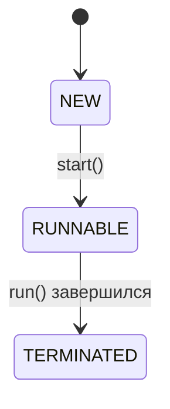

# Стиль страниц

Правила для всех страниц в `docs/`. Эталон по тону и плотности — «конспект»: [multithreading.md](docs/java/multithreading.md) и [system-design.md](docs/system-design/system-design.md). Пример страницы, целиком собранной по этим правилам, — [collections.md](docs/java/collections.md).

## Структура страницы

1. Заголовок `#` — название темы.
2. Вступление в 2–3 строки: о чём страница и что по ней обычно спрашивают на собесе.
3. Разделы `##` группируют темы (например, «Списки», «HashMap»).
4. Темы `###` оформлены по шаблону ниже.
5. Последний раздел — `## Шпаргалка` с таблицей.

## Шаблон темы

Каждая тема идёт в одном и том же порядке:

1. **Заголовок-вопрос** — так, как его задают на собесе: `### Как HashMap находит бакет по ключу?`
2. **Метка уровня** — отдельной строкой сразу под заголовком.
3. **Ответ вслух** — 2–3 предложения, которые можно произнести на собесе без подготовки.
4. **Разбор** — как это устроено, с кодом.
5. **Ловушки** — в `!!! warning`.
6. **Проверь себя** — свёрнутый блок `??? question` с 2–3 вопросами.

````markdown
### Как HashMap находит бакет по ключу?

**Уровень:** Middle

!!! abstract "Ответ вслух"
    Берётся `hashCode()` ключа, старшие биты подмешиваются к младшим,
    а индекс считается как `(n - 1) & hash`. Это работает только при
    ёмкости — степени двойки, поэтому она всегда степень двойки.

Разбор: текст, код, схемы.

```java
int index = (n - 1) & hash;
```

!!! warning "Ловушка: отрицательный индекс"
    Что сломается, если сделать иначе, и почему.

??? question "Проверь себя"
    1. Первый вопрос?
    2. Второй вопрос?
````

### Метка уровня

Пиши строго `**Уровень:** Junior`, `**Уровень:** Middle` или `**Уровень:** Senior`.

| Уровень | Что проверяет |
|---|---|
| **Junior** | Что это, зачем и как этим пользоваться |
| **Middle** | Как устроено внутри, сложность операций, типичные ошибки |
| **Senior** | Граничные случаи, производительность, железо, многопоточность |

### Ответ вслух

Блок `!!! abstract "Ответ вслух"`, 2–3 предложения. Только суть и ключевые цифры, без кода и подробностей — они идут в разборе.

### Разбор

Объясняй **почему**, а не только **что**. Код — на Java, с комментариями, что происходит; плохой и хороший варианты помечай `// ❌` и `// ✅`.

Каждый пример должен компилироваться на актуальном JDK (сейчас 25). Preview-фичи помечай явно и указывай флаг `--enable-preview`.

### Ловушки

Всё, на чём валят на собесе или ломается прод, — в `!!! warning "Название ловушки"`. Одна ловушка — один блок.

### Проверь себя

Свёрнутый блок `??? question "Проверь себя"` с 2–3 вопросами по теме. Ответы на них должны находиться в самой теме.

## Текст

- Абзац — не больше 3 предложений.
- Обращение на «ты», как в живом разговоре.
- Без эпитетов: «секрет», «магия», «сеньорский», «суперсила», «шедевр», «молниеносно», «со скоростью света». Вместо оценки — факт или цифра: не «молниеносно», а «O(1)».
- Термин при первом упоминании — по-русски и по-английски в скобках: «бакет (bucket)».

## Один дом у темы

У каждой темы ровно одна страница, где она разобрана подробно. На других страницах — 1–2 предложения и ссылка на дом.

Ссылайся на конкретный якорь. Если заголовок на русском, дай ему явный id через `attr_list`, иначе якорь сгенерируется нечитаемым или пустым:

```markdown
## Итераторы и потокобезопасные коллекции { #concurrent-collections }

Разобраны в [Коллекции → Потокобезопасные коллекции](collections.md#concurrent-collections).
```

| Тема | Дом |
|---|---|
| Контракт `equals()` и `hashCode()` | [java/basics.md](docs/java/basics.md) |
| Коллекции, включая потокобезопасные | [java/collections.md](docs/java/collections.md) |
| Потоки, JMM, синхронизаторы, executors | [java/multithreading.md](docs/java/multithreading.md) |
| Паттерны GoF (в том числе Strategy) | [java/patterns.md](docs/java/patterns.md) |
| Принципы SOLID | [java/solid.md](docs/java/solid.md) |

## Схемы

Схемы потоков, алгоритмов и жизненных циклов — только [Mermaid](https://mermaid.js.org/), не ASCII-графика. Mermaid включён в `mkdocs.yml`:

````markdown

````

Статичные картинки (иерархии классов, скриншоты) — PNG в `docs/assets/`.

## Шпаргалка

Последний раздел страницы — `## Шпаргалка`: таблица из двух колонок, одна строка на тему.

```markdown
| Тема | Запомнить |
|---|---|
| **HashMap** | 16 бакетов, load factor 0.75, индекс `(n - 1) & hash` |
```

## Проверка перед PR

```bash
pip install -r requirements.txt
mkdocs build --strict
```

Сборка падает на любом предупреждении, в том числе на битом якоре.
