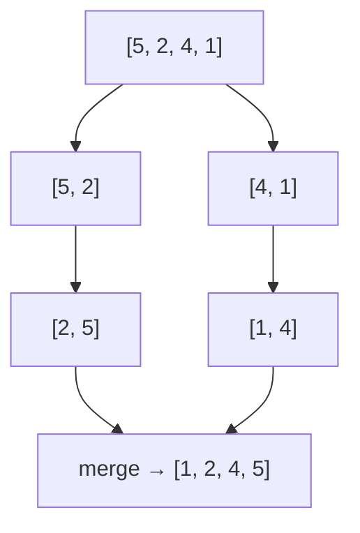

---
tags:
  - Junior
  - Middle
  - Алгоритмы
---

# Алгоритмы и структуры данных

Теория, без которой не решить задачу на собесе: Big O, сложность операций основных структур, деревья, сортировки и графы. Спрашивают, как оценить сложность кода, чем BFS отличается от DFS, почему Quick Sort бывает O(N²) и какую сортировку использует Java. Приёмы решения задач — два указателя, окно, префиксные суммы, ДП — разобраны в [Паттернах задач](leetcode-patterns.md).

## Big O { #big-o }

### Что такое Big O? { #big-o-basics }

**Уровень:** Junior

!!! abstract "Ответ вслух"
    Big O описывает, как растёт время выполнения или объём памяти при росте входных данных. Интересует худший случай и поведение при больших N, а не точное число операций. Основная шкала: O(1), O(log N), O(N), O(N log N), O(N²), O(2^N), O(N!).

| Сложность | Название | Пример |
|---|---|---|
| **O(1)** | Константа | Доступ к элементу массива по индексу |
| **O(log N)** | Логарифм | Бинарный поиск, операции с BST |
| **O(N)** | Линейная | Обход массива, поиск в списке |
| **O(N log N)** | Линлог | Merge Sort, Quick Sort (в среднем) |
| **O(N²)** | Квадратичная | Bubble Sort, два вложенных цикла |
| **O(2^N)** | Экспонента | Перебор всех подмножеств |
| **O(N!)** | Факториал | Перебор всех перестановок |

```java
// O(1) — не зависит от размера входа
int first = array[0];

// O(N) — один проход
for (int x : array) { process(x); }

// O(N²) — два вложенных прохода по тому же массиву
for (int i = 0; i < n; i++)
    for (int j = 0; j < n; j++)
        process(i, j);

// O(log N) — делим задачу пополам на каждом шаге
int binarySearch(int[] arr, int target) {
    int left = 0, right = arr.length - 1;
    while (left <= right) {
        int mid = left + (right - left) / 2; // не (left+right)/2 — риск overflow!
        if (arr[mid] == target) return mid;
        if (arr[mid] < target) left = mid + 1;
        else right = mid - 1;
    }
    return -1;
}
```

!!! warning "Ловушка: `(left + right) / 2`"
    Если `left` и `right` близки к `Integer.MAX_VALUE`, их сумма переполняет `int` и становится отрицательной — индекс `mid` выйдет за границы массива. Середину считают как `left + (right - left) / 2`.

??? question "Проверь себя"
    1. Что описывает Big O и какой случай обычно оценивают?
    2. Почему бинарный поиск работает за O(log N)?
    3. Как правильно посчитать середину в бинарном поиске и почему?

### Как упрощать Big O? { #simplification }

**Уровень:** Junior

!!! abstract "Ответ вслух"
    Константы отбрасываются: O(2N) — это O(N). Из суммы остаётся доминирующий член: O(N + N²) — это O(N²). А разные переменные не упрощаются: O(N + M) остаётся O(N + M).

| Было | Стало | Правило |
|---|---|---|
| O(2N) | O(N) | Константы отбрасываем |
| O(N + N²) | O(N²) | Оставляем доминирующий член |
| O(N + M) | O(N + M) | Разные переменные не упрощаем |

!!! warning "Ловушка: O(N + M) → O(N)"
    `O(N + M)` нельзя упростить до `O(N)` или `O(M)` — мы не знаем соотношение N и M. Упрощение возможно, только если одно заведомо больше другого.

??? question "Проверь себя"
    1. Чему равно O(3N + 5)?
    2. Чему равно O(N² + N log N)?
    3. Почему O(N + M) нельзя упростить?

### Что такое сложность по памяти? { #space-complexity }

**Уровень:** Junior

!!! abstract "Ответ вслух"
    Space complexity — сколько дополнительной памяти использует алгоритм в зависимости от N. Несколько переменных — O(1), структура размером N — O(N). Рекурсия тоже тратит память: глубина N — это N кадров на стеке, то есть O(N).

```java
// O(1) — константная память: только переменные
int sum(int[] arr) {
    int total = 0;
    for (int x : arr) total += x;
    return total;
}

// O(N) — линейная память: создаём структуру размером N
int[] copy = Arrays.copyOf(arr, arr.length);

// O(N) — стек рекурсии при глубине N
void recurse(int n) {
    if (n == 0) return;
    recurse(n - 1); // N вызовов на стеке одновременно
}
```

Как устроен стек потока и почему глубокая рекурсия заканчивается `StackOverflowError`, разобрано в [JVM и память → Stack и Heap](../java/jvm.md#stack-heap).

!!! warning "Ловушка: «рекурсия без массивов — значит, O(1) памяти»"
    Каждый рекурсивный вызов кладёт кадр на стек, и при глубине N это O(N) памяти, даже если алгоритм не создаёт ни одной структуры. При большой глубине стек переполняется, поэтому глубокую рекурсию переписывают итеративно.

??? question "Проверь себя"
    1. Какая сложность по памяти у суммы элементов массива?
    2. Сколько памяти тратит рекурсия глубины N?
    3. Почему рекурсию иногда переписывают в цикл?

## Структуры данных { #data-structures }

### Какая сложность у массива и связного списка? { #array-linkedlist }

**Уровень:** Junior

!!! abstract "Ответ вслух"
    У массива доступ по индексу — O(1), вставка в конец `ArrayList` — O(1) амортизированно, а вставка и удаление в середине — O(N) из-за сдвига. У связного списка доступ по индексу и поиск — O(N), а вставка в начало и вставка или удаление при известном узле — O(1). Найти узел для вставки — всё равно O(N).

**Массив (Array):**

| Операция | Сложность |
|---|---|
| Доступ по индексу | O(1) |
| Поиск | O(N) |
| Вставка в конец | O(1) амортизированно (`ArrayList`) |
| Вставка в середину | O(N) — нужен сдвиг элементов |
| Удаление | O(N) — нужен сдвиг элементов |

```java
// В Java — ArrayList под капотом это массив с автоувеличением ×1.5
List<Integer> list = new ArrayList<>();
list.add(42);         // O(1) амортизированно
list.get(0);          // O(1)
list.add(0, 42);      // O(N) — сдвиг всех элементов
list.remove(0);       // O(N) — сдвиг всех элементов
```

**Связный список (LinkedList):**

| Операция | Сложность |
|---|---|
| Доступ по индексу | O(N) — нет прямого доступа, нужен обход |
| Поиск | O(N) |
| Вставка в начало | O(1) |
| Вставка или удаление при известном узле | O(1) |
| Поиск узла для вставки | O(N) |

```java
// В Java LinkedList — двусвязный список
LinkedList<Integer> list = new LinkedList<>();
list.addFirst(1);    // O(1)
list.addLast(2);     // O(1)
list.get(1);         // O(N) — обход!
```

Как устроены `ArrayList` и `LinkedList` внутри, разобрано в [Коллекции → ArrayList](../java/collections.md#arraylist) и [Коллекции → LinkedList](../java/collections.md#linkedlist).

!!! warning "Ловушка: `LinkedList` в реальном коде"
    В Java `LinkedList` проигрывает `ArrayList` почти везде из-за плохой cache locality: узлы разбросаны по памяти. Для очереди и стека вместо него используют `ArrayDeque`. Подробно — в [Коллекции → cache locality](../java/collections.md#cache-locality).

??? question "Проверь себя"
    1. Почему вставка в середину массива — O(N)?
    2. Когда вставка в связный список действительно O(1)?
    3. Чем заменить `LinkedList` для очереди или стека?

### Как оценивать HashMap и HashSet в задачах? { #hash-structures }

**Уровень:** Junior

!!! abstract "Ответ вслух"
    `put`, `get` и `containsKey` у `HashMap` — O(1) в среднем и O(N) в худшем случае, когда все ключи попали в один бакет. `HashSet` устроен так же: `add`, `remove`, `contains` — O(1) в среднем. В задачах `HashSet` отвечает на вопрос «уже видели?», а `HashMap` хранит частоты и индексы.

**HashMap:**

| Операция | Сложность |
|---|---|
| `put` / `get` / `containsKey` | O(1) в среднем, O(N) в худшем (все коллизии в одном бакете) |
| Итерация | O(N) |

```java
Map<String, Integer> map = new HashMap<>();
map.put("key", 1);          // O(1)
map.getOrDefault("key", 0); // O(1)
map.containsKey("key");     // O(1)

// Удобные методы
map.merge("key", 1, Integer::sum);              // добавить или суммировать

Map<String, List<Integer>> groups = new HashMap<>();
groups.computeIfAbsent("key", k -> new ArrayList<>()).add(value); // создать список при первом обращении
```

**HashSet** — `add` / `remove` / `contains` за O(1) в среднем:

```java
// Типичное применение — проверка уникальности или «уже видели?»
Set<Integer> seen = new HashSet<>();
for (int x : arr) {
    if (!seen.add(x)) {
        System.out.println("Дубликат: " + x);
    }
}
```

Как `HashMap` находит бакет и что происходит при коллизиях, разобрано в [Коллекции → HashMap](../java/collections.md#hashmap-internals) и [Коллекции → коллизии](../java/collections.md#collisions).

!!! warning "Ловушка: O(1) — только в среднем"
    Если у ключей плохой `hashCode()`, все они попадают в один бакет, и операции деградируют. С Java 8 длинная цепочка превращается в дерево, но при плохом хэше это всё равно медленнее O(1). Контракт `equals()` и `hashCode()` — в [Основы языка](../java/basics.md#equals-hashcode).

??? question "Проверь себя"
    1. Какая сложность у `get` в `HashMap` в среднем и в худшем случае?
    2. Что вернёт `seen.add(x)`, если элемент уже есть?
    3. Что делает `map.merge("key", 1, Integer::sum)`?

### Чем пользоваться для стека и очереди? { #stack-queue }

**Уровень:** Junior

!!! abstract "Ответ вслух"
    Стек — LIFO (Last In, First Out), очередь — FIFO (First In, First Out), и в Java для обоих берут `ArrayDeque`. Все основные операции — O(1). Стек нужен для DFS, проверки скобок и отмены операций, очередь — для BFS и обработки задач по порядку.

**Стек (Stack)** — LIFO:

```java
Deque<Integer> stack = new ArrayDeque<>();
stack.push(1);       // добавить на вершину  O(1)
stack.peek();        // посмотреть вершину   O(1)
stack.pop();         // снять с вершины      O(1)
stack.isEmpty();     // O(1)
```

Применение: обход в глубину (DFS), проверка скобочных последовательностей, отмена операций.

**Очередь (Queue)** — FIFO:

```java
Deque<Integer> queue = new ArrayDeque<>();
queue.offer(1);      // добавить в хвост     O(1)
queue.peek();        // посмотреть голову    O(1)
queue.poll();        // снять из головы      O(1)
```

Применение: обход в ширину (BFS), обработка задач по порядку.

!!! warning "Ловушка: класс `Stack`"
    `java.util.Stack` наследует `Vector`, синхронизирован на каждую операцию и позволяет обращаться к элементам по индексу мимо LIFO. Для стека берут `ArrayDeque`. Почему `Stack` устарел — в [Коллекции → Stack и ArrayDeque](../java/collections.md#stack-arraydeque).

??? question "Проверь себя"
    1. Чем LIFO отличается от FIFO?
    2. Какие методы `ArrayDeque` использовать для стека, а какие — для очереди?
    3. В каких алгоритмах нужен стек, а в каких — очередь?

### Как работает куча (PriorityQueue)? { #heap }

**Уровень:** Middle

!!! abstract "Ответ вслух"
    `PriorityQueue` в Java — двоичная куча: `peek` за O(1), `add` и `poll` за O(log N). По умолчанию это min-heap — наверху наименьший элемент, а max-heap получают через `Comparator.reverseOrder()`. Применение: Top-K, алгоритм Дейкстры, планировщик задач.

| Операция | Сложность |
|---|---|
| `add` / `poll` | O(log N) |
| `peek` | O(1) |

```java
// Min-heap по умолчанию (наименьший элемент наверху)
PriorityQueue<Integer> minHeap = new PriorityQueue<>();

// Max-heap
PriorityQueue<Integer> maxHeap = new PriorityQueue<>(Comparator.reverseOrder());

minHeap.offer(5);
minHeap.offer(1);
minHeap.offer(3);
minHeap.poll(); // вернёт 1 (минимум)

// Куча объектов
PriorityQueue<int[]> pq = new PriorityQueue<>((a, b) -> a[1] - b[1]); // по второму элементу
```

Внутреннее устройство кучи — в [Коллекции → PriorityQueue](../java/collections.md#priorityqueue).

!!! warning "Ловушка: компаратор через вычитание"
    `(a, b) -> a[1] - b[1]` работает, пока значения небольшие. Если разность выходит за пределы `int`, она переполняется, меняет знак, и куча упорядочивает элементы неверно. Для произвольных значений сравнивают через `Integer.compare`:

    ```java
    PriorityQueue<int[]> bad  = new PriorityQueue<>((a, b) -> a[1] - b[1]);                 // ❌ переполнение
    PriorityQueue<int[]> good = new PriorityQueue<>((a, b) -> Integer.compare(a[1], b[1])); // ✅
    PriorityQueue<int[]> same = new PriorityQueue<>(Comparator.comparingInt(a -> a[1]));    // ✅
    ```

??? question "Проверь себя"
    1. Какая сложность у `peek`, `offer` и `poll` в `PriorityQueue`?
    2. Как сделать max-heap?
    3. Почему компаратор `a[1] - b[1]` опасен?

## Деревья { #trees }

### Как устроено BST и как обходить дерево? { #tree-traversal }

**Уровень:** Junior

!!! abstract "Ответ вслух"
    В бинарном дереве поиска (BST) слева от узла меньшие значения, справа — большие. Поиск, вставка и удаление — O(log N) в среднем и O(N) в худшем случае, если дерево выродилось в цепочку. Рекурсивные обходы — inorder (левый, корень, правый) даёт отсортированный порядок, preorder нужен для копирования, postorder — для удаления.

| Операция | Среднее | Худшее |
|---|---|---|
| Поиск / вставка / удаление | O(log N) | O(N) — вырожденное дерево (все в одну сторону) |

```java
// Рекурсивный обход
void inorder(TreeNode node) {        // Левый → Корень → Правый
    if (node == null) return;        // даёт отсортированный порядок для BST
    inorder(node.left);
    process(node.val);
    inorder(node.right);
}

void preorder(TreeNode node) {       // Корень → Левый → Правый
    if (node == null) return;        // используется для копирования дерева
    process(node.val);
    preorder(node.left);
    preorder(node.right);
}

void postorder(TreeNode node) {      // Левый → Правый → Корень
    if (node == null) return;        // используется для удаления дерева
    postorder(node.left);
    postorder(node.right);
    process(node.val);
}
```

**Глубина дерева** — та же рекурсия: глубина узла — это 1 плюс максимум из глубин поддеревьев.

```java
int maxDepth(TreeNode root) {
    if (root == null) return 0;
    return 1 + Math.max(maxDepth(root.left), maxDepth(root.right));
}
```

Задача на проверку валидности BST — в [Паттерны задач → Validate BST](leetcode-patterns.md#validate-bst).

!!! warning "Ловушка: вырожденное дерево"
    Если вставлять в обычное BST уже отсортированные значения, каждый новый узел уходит вправо, и дерево превращается в список — операции становятся O(N). Гарантию O(log N) дают только самобалансирующиеся деревья, например [красно-чёрное](#red-black-tree).

??? question "Проверь себя"
    1. Какой обход BST выдаёт значения в отсортированном порядке?
    2. Когда операции с BST становятся O(N)?
    3. Как рекурсивно посчитать глубину дерева?

### Как обойти дерево по уровням? { #tree-bfs }

**Уровень:** Junior

!!! abstract "Ответ вслух"
    Обход в ширину (BFS) делается итеративно через очередь: кладём корень, достаём узел, кладём его детей. Чтобы различать уровни, перед обработкой запоминают размер очереди — это ровно число узлов текущего уровня. Сложность — O(N).

```java
void bfs(TreeNode root) {
    if (root == null) return;
    Queue<TreeNode> queue = new ArrayDeque<>();
    queue.offer(root);

    while (!queue.isEmpty()) {
        int levelSize = queue.size();         // размер текущего уровня

        for (int i = 0; i < levelSize; i++) {
            TreeNode node = queue.poll();
            process(node.val);

            if (node.left != null)  queue.offer(node.left);
            if (node.right != null) queue.offer(node.right);
        }
        // Здесь — конец одного уровня дерева
    }
}
```

!!! warning "Ловушка: `queue.size()` в условии цикла"
    Если написать `for (int i = 0; i < queue.size(); i++)`, размер будет меняться прямо во время обхода, потому что в очередь добавляются дети. Уровни смешаются. Размер уровня сохраняют в переменную до цикла.

??? question "Проверь себя"
    1. Какая структура данных нужна для обхода в ширину?
    2. Как в BFS понять, где заканчивается уровень дерева?
    3. Почему размер уровня сохраняют в переменную до цикла?

### Что такое красно-чёрное дерево? { #red-black-tree }

**Уровень:** Middle

!!! abstract "Ответ вслух"
    Красно-чёрное дерево (Red-Black Tree) — самобалансирующееся BST, которое гарантирует O(log N) на поиск, вставку и удаление даже в худшем случае. В Java на нём построены `TreeMap` и `TreeSet`. Оно же используется в `HashMap` с Java 8, когда цепочка в бакете становится слишком длинной.

| Операция | Сложность |
|---|---|
| Поиск / вставка / удаление | O(log N) гарантированно |

В `HashMap` с Java 8 связный список в бакете превращается в красно-чёрное дерево, когда вырастает до 8 элементов. Точные условия — 8 узлов в бакете и не меньше 64 бакетов в таблице — разобраны в [Коллекции → деревья в бакетах](../java/collections.md#treeify).

!!! warning "Ловушка: «TreeMap быстрее HashMap, раз там дерево»"
    У `TreeMap` операции — O(log N), у `HashMap` — O(1) в среднем. `TreeMap` берут не ради скорости, а когда нужен порядок ключей: сортировка, диапазоны, ближайший больший ключ. Выбор между мапами — в [Коллекции → выбор Map](../java/collections.md#map-choice).

??? question "Проверь себя"
    1. Какую гарантию даёт красно-чёрное дерево по сравнению с обычным BST?
    2. Какие коллекции Java построены на красно-чёрном дереве?
    3. Когда бакет `HashMap` превращается в дерево?

## Сортировки { #sorting }

### Какие сортировки нужно знать? { #sorting-overview }

**Уровень:** Middle

!!! abstract "Ответ вслух"
    Простые сортировки — Bubble, Selection, Insertion — работают за O(N²), эффективные — Merge, Quick, Heap, Tim — за O(N log N). Merge Sort и Tim Sort стабильны, но требуют O(N) памяти, Quick Sort в худшем случае деградирует до O(N²). В Java `Arrays.sort` для объектов и `Collections.sort` используют Tim Sort, а для примитивов — Quick Sort.

| Алгоритм | Лучшее | Среднее | Худшее | Память | Стабильна |
|---|---|---|---|---|---|
| **Bubble Sort** | O(N) | O(N²) | O(N²) | O(1) | ✅ |
| **Selection Sort** | O(N²) | O(N²) | O(N²) | O(1) | ❌ |
| **Insertion Sort** | O(N) | O(N²) | O(N²) | O(1) | ✅ |
| **Merge Sort** | O(N log N) | O(N log N) | O(N log N) | O(N) | ✅ |
| **Quick Sort** | O(N log N) | O(N log N) | O(N²) | O(log N) | ❌ |
| **Heap Sort** | O(N log N) | O(N log N) | O(N log N) | O(1) | ❌ |
| **Tim Sort** | O(N) | O(N log N) | O(N log N) | O(N) | ✅ |

- **Tim Sort** — используется в Java для объектов (`Arrays.sort` для объектов, `Collections.sort`). Гибрид Merge Sort и Insertion Sort.
- **Quick Sort** — используется в Java для примитивов (`Arrays.sort(int[])`). Нестабильна, но очень быстра на практике.

!!! warning "Ловушка: стабильность"
    Стабильная сортировка сохраняет порядок равных элементов. Это важно, когда объекты сортируют по нескольким полям по очереди: например, сначала по имени, потом по отделу — нестабильная сортировка перемешает имена внутри отдела. Для примитивов стабильность не нужна: равные числа неотличимы.

??? question "Проверь себя"
    1. Какие сортировки работают за O(N log N) в худшем случае?
    2. Какую сортировку Java использует для объектов, а какую — для примитивов?
    3. Что значит «стабильная сортировка» и когда это важно?

### Как работает Merge Sort? { #merge-sort }

**Уровень:** Middle

!!! abstract "Ответ вслух"
    Merge Sort — «разделяй и властвуй»: массив делится пополам, каждая половина сортируется рекурсивно, затем отсортированные половины сливаются. Слияние двух отсортированных частей идёт за O(N) двумя указателями. Итог — O(N log N) всегда, стабильно, но с O(N) дополнительной памяти.



```java
void mergeSort(int[] arr, int left, int right) {
    if (left >= right) return;

    int mid = left + (right - left) / 2;
    mergeSort(arr, left, mid);       // сортируем левую половину
    mergeSort(arr, mid + 1, right);  // сортируем правую половину
    merge(arr, left, mid, right);    // сливаем
}

void merge(int[] arr, int left, int mid, int right) {
    int[] temp = new int[right - left + 1];
    int i = left, j = mid + 1, k = 0;

    while (i <= mid && j <= right) {
        if (arr[i] <= arr[j]) temp[k++] = arr[i++];
        else                   temp[k++] = arr[j++];
    }
    while (i <= mid)    temp[k++] = arr[i++];
    while (j <= right)  temp[k++] = arr[j++];

    System.arraycopy(temp, 0, arr, left, temp.length);
}
```

!!! warning "Ловушка: `<` вместо `<=` при слиянии"
    Условие `arr[i] <= arr[j]` берёт равный элемент из левой половины первым — это и делает Merge Sort стабильным. Если написать `<`, при равенстве первым уйдёт элемент из правой половины, и порядок равных элементов нарушится.

??? question "Проверь себя"
    1. Из каких шагов состоит Merge Sort?
    2. Почему Merge Sort требует O(N) дополнительной памяти?
    3. Какое условие при слиянии делает сортировку стабильной?

### Как работает Quick Sort? { #quick-sort }

**Уровень:** Middle

!!! abstract "Ответ вслух"
    Quick Sort выбирает опорный элемент (pivot) и переставляет массив так, чтобы слева оказались элементы не больше него, справа — больше. Затем рекурсивно сортирует обе части. В среднем O(N log N) и O(log N) памяти на стек, но при неудачном выборе pivot — O(N²).

```java
void quickSort(int[] arr, int left, int right) {
    if (left >= right) return;

    int pivot = partition(arr, left, right);
    quickSort(arr, left, pivot - 1);
    quickSort(arr, pivot + 1, right);
}

int partition(int[] arr, int left, int right) {
    int pivot = arr[right]; // выбираем последний элемент как пивот
    int i = left - 1;

    for (int j = left; j < right; j++) {
        if (arr[j] <= pivot) {
            i++;
            int temp = arr[i]; arr[i] = arr[j]; arr[j] = temp; // swap
        }
    }
    int temp = arr[i+1]; arr[i+1] = arr[right]; arr[right] = temp;
    return i + 1;
}
```

!!! warning "Ловушка: худший случай Quick Sort"
    Если массив уже отсортирован и pivot всегда выбирается крайним, каждое разбиение отрезает один элемент — получается O(N²). Решение: случайный pivot (`arr[random.nextInt(right - left + 1) + left]`) или медиана из трёх.

??? question "Проверь себя"
    1. Что делает функция `partition`?
    2. Когда Quick Sort деградирует до O(N²)?
    3. Как выбрать pivot, чтобы избежать худшего случая?

## Графы { #graphs }

### Как хранить граф? { #graph-representation }

**Уровень:** Junior

!!! abstract "Ответ вслух"
    Чаще всего — списком смежности: для каждой вершины хранится список соседей, в Java это `Map<Integer, List<Integer>>`. Для плотных графов используют матрицу смежности `int[n][n]`, где `matrix[i][j]` — наличие или вес ребра. Список экономит память на разреженных графах, матрица проверяет ребро за O(1).

```java
// 1. Список смежности (чаще всего)
Map<Integer, List<Integer>> graph = new HashMap<>();
graph.computeIfAbsent(0, k -> new ArrayList<>()).add(1);
graph.computeIfAbsent(0, k -> new ArrayList<>()).add(2);
graph.computeIfAbsent(1, k -> new ArrayList<>()).add(3);

// 2. Матрица смежности (для плотных графов)
int[][] matrix = new int[n][n];
matrix[0][1] = 1; // ребро 0 → 1
```

!!! warning "Ловушка: матрица для разреженного графа"
    Матрица занимает O(V²) памяти независимо от числа рёбер. Для графа на миллион вершин с несколькими соседями у каждой это триллион ячеек. Для разреженных графов — только список смежности.

??? question "Проверь себя"
    1. Как представить граф списком смежности в Java?
    2. Когда выгоднее матрица смежности?
    3. Сколько памяти занимает матрица смежности?

### Как найти кратчайший путь в невзвешенном графе? { #graph-bfs }

**Уровень:** Middle

!!! abstract "Ответ вслух"
    Обходом в ширину (BFS): он идёт от старта слоями, поэтому первый раз, когда BFS достигает вершины, — это кратчайший путь до неё по числу рёбер. Нужны очередь и множество посещённых вершин. Сложность — O(V + E).

```java
int bfs(Map<Integer, List<Integer>> graph, int start, int target) {
    Queue<Integer> queue = new ArrayDeque<>();
    Set<Integer> visited = new HashSet<>();
    queue.offer(start);
    visited.add(start);
    int steps = 0;

    while (!queue.isEmpty()) {
        int size = queue.size();

        for (int i = 0; i < size; i++) {
            int node = queue.poll();
            if (node == target) return steps;

            for (int neighbor : graph.getOrDefault(node, List.of())) {
                if (!visited.contains(neighbor)) {
                    visited.add(neighbor);
                    queue.offer(neighbor);
                }
            }
        }
        steps++;
    }
    return -1; // не нашли
}
```

Задача про кратчайший путь в лабиринте — в [Паттерны задач → BFS](leetcode-patterns.md#maze).

!!! warning "Ловушка: помечать вершину при извлечении из очереди"
    Если добавлять в `visited` только при `poll()`, одна вершина может попасть в очередь много раз — через разных соседей одного слоя. Обход станет медленнее, а на плотных графах очередь разрастётся. Вершину помечают в момент добавления в очередь, как в коде выше.

??? question "Проверь себя"
    1. Почему BFS находит кратчайший путь в невзвешенном графе?
    2. Зачем нужно множество `visited`?
    3. В какой момент помечать вершину посещённой?

### Как работает DFS? { #graph-dfs }

**Уровень:** Middle

!!! abstract "Ответ вслух"
    Обход в глубину (DFS) идёт по одной ветке до конца, потом возвращается и пробует следующую. Его пишут рекурсивно или итеративно через стек; итеративный вариант нужен, когда рекурсия слишком глубокая. Применение — обход, поиск циклов, топологическая сортировка; сложность — O(V + E).

```java
// Рекурсивный DFS
void dfs(Map<Integer, List<Integer>> graph, int node, Set<Integer> visited) {
    visited.add(node);
    process(node);

    for (int neighbor : graph.getOrDefault(node, List.of())) {
        if (!visited.contains(neighbor)) {
            dfs(graph, neighbor, visited);
        }
    }
}

// Итеративный DFS (через стек — когда рекурсия глубокая и есть риск StackOverflow)
void dfsIterative(Map<Integer, List<Integer>> graph, int start) {
    Deque<Integer> stack = new ArrayDeque<>();
    Set<Integer> visited = new HashSet<>();
    stack.push(start);

    while (!stack.isEmpty()) {
        int node = stack.pop();
        if (visited.contains(node)) continue;
        visited.add(node);
        process(node);

        for (int neighbor : graph.getOrDefault(node, List.of())) {
            if (!visited.contains(neighbor)) {
                stack.push(neighbor);
            }
        }
    }
}
```

Задачи на DFS — валидность BST и количество островов — в [Паттерны задач → DFS](leetcode-patterns.md#dfs).

!!! warning "Ловушка: `StackOverflowError` на большом графе"
    Рекурсивный DFS по цепочке из сотен тысяч вершин создаёт столько же кадров на стеке потока, и он переполняется. Для глубоких графов DFS переписывают итеративно с явным `ArrayDeque`, который живёт в куче.

??? question "Проверь себя"
    1. Чем DFS отличается от BFS по порядку обхода?
    2. Когда рекурсивный DFS заменяют итеративным?
    3. Для каких задач применяют DFS?

### Как работает алгоритм Дейкстры? { #dijkstra }

**Уровень:** Senior

!!! abstract "Ответ вслух"
    Дейкстра ищет кратчайшие пути от одной вершины во взвешенном графе без отрицательных весов. Он каждый раз берёт из min-кучи вершину с наименьшей известной дистанцией и пытается улучшить через неё дистанции соседей (релаксация). С `PriorityQueue` сложность — O((V + E) log V).

```java
int[] dijkstra(int[][] graph, int src) {  // graph[i][j] = вес ребра или 0
    int n = graph.length;
    int[] dist = new int[n];
    Arrays.fill(dist, Integer.MAX_VALUE);
    dist[src] = 0;

    // [дистанция, вершина]
    PriorityQueue<int[]> pq = new PriorityQueue<>((a, b) -> a[0] - b[0]);
    pq.offer(new int[]{0, src});

    while (!pq.isEmpty()) {
        int[] curr = pq.poll();
        int d = curr[0], u = curr[1];

        if (d > dist[u]) continue; // устаревшая запись

        for (int v = 0; v < n; v++) {
            if (graph[u][v] > 0) { // есть ребро
                int newDist = dist[u] + graph[u][v];
                if (newDist < dist[v]) {
                    dist[v] = newDist;
                    pq.offer(new int[]{newDist, v});
                }
            }
        }
    }
    return dist;
}
```

**Сложность:** O((V + E) log V) с `PriorityQueue`. В этой реализации граф — матрица смежности, поэтому перебор соседей добавляет O(V) на каждую вершину.

!!! warning "Ловушка: отрицательные веса"
    Дейкстра считает дистанцию вершины окончательной, как только достаёт её из кучи. С отрицательным ребром позже может найтись более короткий путь, и ответ окажется неверным. Для графов с отрицательными весами используют другие алгоритмы, например Беллмана — Форда.

??? question "Проверь себя"
    1. Для каких графов подходит алгоритм Дейкстры?
    2. Зачем проверка `if (d > dist[u]) continue`?
    3. Какая сложность у Дейкстры с `PriorityQueue`?

## Техники решения задач { #techniques }

Два указателя, скользящее окно, префиксные суммы и динамическое программирование разобраны с кодом в [Паттерны задач](leetcode-patterns.md): [два указателя](leetcode-patterns.md#two-pointers-basics), [скользящее окно](leetcode-patterns.md#sliding-window-basics), [префиксные суммы](leetcode-patterns.md#prefix-sum-basics), [ДП](leetcode-patterns.md#dp-basics).

## Сводные таблицы { #summary }

### Какая сложность у операций основных структур? { #structures-complexity }

**Уровень:** Junior

!!! abstract "Ответ вслух"
    Массив даёт доступ по индексу за O(1), а вставку и удаление — за O(N). Хэш-структуры ищут, вставляют и удаляют за O(1), деревья — за O(log N). Стек и очередь на `ArrayDeque` вставляют и удаляют за O(1), а куча отдаёт минимум за O(1) и вставляет за O(log N).

| Структура | Доступ | Поиск | Вставка | Удаление |
|---|---|---|---|---|
| **Array / ArrayList** | O(1) | O(N) | O(N) | O(N) |
| **LinkedList** | O(N) | O(N) | O(1)* | O(1)* |
| **HashMap / HashSet** | — | O(1) | O(1) | O(1) |
| **TreeMap / TreeSet** | — | O(log N) | O(log N) | O(log N) |
| **Stack / Queue (ArrayDeque)** | O(N) | O(N) | O(1) | O(1) |
| **PriorityQueue** | O(1) peek | O(N) | O(log N) | O(log N) |

_*При наличии указателя на узел._

!!! warning "Ловушка: вставка в `ArrayList` — O(N) или O(1)?"
    В таблице вставка в массив — O(N), потому что имеется в виду вставка в произвольное место со сдвигом. Вставка в конец `ArrayList` — O(1) амортизированно. Отвечая, уточняй, о какой позиции речь.

??? question "Проверь себя"
    1. Какая сложность поиска в `HashMap` и в `TreeMap`?
    2. Когда вставка и удаление в `LinkedList` — O(1)?
    3. Какая сложность у `peek` и `poll` в `PriorityQueue`?

### Какую сложность у основных алгоритмов назвать сразу? { #algorithms-complexity }

**Уровень:** Junior

!!! abstract "Ответ вслух"
    Бинарный поиск — O(log N) на отсортированном массиве. BFS и DFS — O(V + E), Дейкстра — O((V + E) log V) для графов без отрицательных весов. Merge Sort и Quick Sort — O(N log N), но Quick Sort — только в среднем.

| Алгоритм | Сложность | Когда |
|---|---|---|
| **Бинарный поиск** | O(log N) | Отсортированный массив |
| **BFS** | O(V + E) | Кратчайший путь, обход уровнями |
| **DFS** | O(V + E) | Обход, поиск циклов, топологическая сортировка |
| **Дейкстра** | O((V+E) log V) | Кратчайший путь, взвешенный граф (без отрицательных весов) |
| **Merge Sort** | O(N log N) | Стабильная сортировка, внешняя сортировка |
| **Quick Sort** | O(N log N) | Быстрая сортировка примитивов |

!!! warning "Ловушка: BFS для взвешенного графа"
    BFS считает путь в рёбрах, а не в весах: путь из трёх дешёвых рёбер он посчитает длиннее, чем одно дорогое. Для взвешенного графа нужен Дейкстра.

??? question "Проверь себя"
    1. Какая сложность у BFS и DFS?
    2. Почему для взвешенного графа BFS не подходит?
    3. Какая сортировка подходит для внешней сортировки?

## Шпаргалка { #cheatsheet }

<!-- --8<-- [start:cheatsheet] -->
| Тема | Запомнить |
|---|---|
| **Big O** | Рост времени или памяти при росте N; худший случай; O(1) < O(log N) < O(N) < O(N log N) < O(N²) |
| **Упрощение** | Константы отбрасываем, оставляем доминирующий член, O(N + M) не упрощаем |
| **Память** | Рекурсия глубины N — O(N) на стеке |
| **Массив vs список** | Массив: доступ O(1), вставка в середину O(N). Список: доступ O(N), вставка у узла O(1) |
| **HashMap / HashSet** | O(1) в среднем, O(N) в худшем при коллизиях |
| **Стек и очередь** | `ArrayDeque`: push/pop и offer/poll за O(1) |
| **PriorityQueue** | Min-heap: peek O(1), offer/poll O(log N); компаратор — через `Integer.compare` |
| **BST** | O(log N) в среднем, O(N) у вырожденного; inorder — отсортированный порядок |
| **BFS по дереву** | Очередь + размер уровня, сохранённый до цикла |
| **Красно-чёрное дерево** | O(log N) гарантированно; `TreeMap`, `TreeSet`, бакеты `HashMap` с Java 8 |
| **Сортировки** | O(N log N): Merge, Quick (в среднем), Heap, Tim. Java: Tim Sort для объектов, Quick Sort для примитивов |
| **Merge Sort** | Делим пополам, сливаем за O(N); стабильна, O(N) памяти |
| **Quick Sort** | Partition вокруг pivot; O(N²) на отсортированном с крайним pivot → случайный pivot |
| **Граф** | Список смежности — по умолчанию, матрица — для плотных |
| **BFS по графу** | Кратчайший путь без весов; помечать при добавлении в очередь |
| **DFS** | Рекурсия или стек; глубокий граф — итеративно |
| **Дейкстра** | Min-куча + релаксация, O((V + E) log V), без отрицательных весов |

<!-- --8<-- [end:cheatsheet] -->
