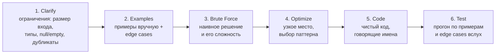

---
tags:
  - Junior
  - Middle
  - Алгоритмы
---

# Задачи: массивы и строки

Большинство задач на собесе — вариации одних и тех же паттернов. Здесь — задачи на массивы и строки: два указателя, скользящее окно, префиксные суммы, хэш-таблица, бинарный поиск и стек. Узнать паттерн важнее, чем выучить конкретные задачи. Деревья, графы и динамическое программирование — на странице [Задачи: деревья, графы, ДП](leetcode-trees-dp.md), теория — в [Big O и структурах данных](algorithms.md).

## Подход к задаче { #approach }

### Как решать задачу на собесе? { #framework }

**Уровень:** Junior

!!! abstract "Ответ вслух"
    Уточни ограничения, разбери примеры с крайними случаями и озвучь наивное решение с его сложностью. Потом найди узкое место и выбери паттерн, напиши чистый код и прогони его по примерам вслух. Главное — думать вслух: «тут подходит скользящее окно, потому что…» — это уже половина успеха.



1. **Clarify** — уточни ограничения: размер входа, типы, null или пустой ввод, дубликаты.
2. **Examples** — разбери примеры вручную, добавь edge cases: пустой ввод, один элемент.
3. **Brute Force** — озвучь наивное решение и его сложность.
4. **Optimize** — найди узкое место, выбери паттерн.
5. **Code** — пиши чистый код с говорящими именами переменных.
6. **Test** — прогони по примерам и edge cases вслух.

!!! warning "Ловушка: сразу писать код"
    Без уточнения ограничений легко решить не ту задачу: например, не знать, отсортирован ли массив и бывают ли в нём дубликаты. А без озвученного brute force интервьюер не видит, от чего ты оптимизируешь. Первые минуты — вопросы и примеры, а не код.

??? question "Проверь себя"
    1. Назови шесть шагов решения задачи.
    2. Что уточнить на шаге Clarify?
    3. Зачем озвучивать brute force, если он заведомо медленный?

### Какие edge cases проверять всегда? { #edge-cases }

**Уровень:** Junior

!!! abstract "Ответ вслух"
    Пустой или `null` ввод, один элемент, переполнение при сложении, деление на ноль. В задачах на сумму и произведение — отрицательные числа, в задачах на рюкзак — нулевые веса и стоимости. Проговори их до кода и прогони после.

```java
// Пустой/null ввод
if (nums == null || nums.length == 0) return ...;

// Один элемент
if (nums.length == 1) return nums[0];

// Переполнение при сложении (используй long или проверяй)
int mid = left + (right - left) / 2;  // не (left + right) / 2 !

// Деление на ноль
if (divisor == 0) throw new ArithmeticException();

// Отрицательные числа в задачах на сумму/произведение
// Нулевые веса/стоимости в задачах на рюкзак
```

!!! warning "Ловушка: переполнение `int`"
    Сумма двух больших `int` молча переполняется и становится отрицательной — исключения не будет. Если значения могут быть большими, считай в `long` или переставляй операции, как в `left + (right - left) / 2`.

??? question "Проверь себя"
    1. Какие крайние случаи входа проверять в любой задаче на массив?
    2. Почему `(left + right) / 2` опасно?
    3. Какие крайние случаи важны для задач на сумму?

## Two Pointers (два указателя) { #two-pointers }

### Когда применять два указателя? { #two-pointers-basics }

**Уровень:** Junior

!!! abstract "Ответ вслух"
    Когда массив отсортирован и нужно найти пару или тройку с условием, развернуть массив или удалить дубликаты на месте. Указатели идут навстречу друг другу или один за другим (slow/fast), и каждый шаг отбрасывает часть вариантов. Это превращает перебор пар за O(N²) в один проход за O(N).

Указатели навстречу — поиск пары с заданной суммой в отсортированном массиве. Сумма меньше цели — двигаем левый, больше — правый.

```java
// Пример: найти пару с заданной суммой в отсортированном массиве
int[] twoSum(int[] arr, int target) {
    int left = 0, right = arr.length - 1;

    while (left < right) {
        int sum = arr[left] + arr[right];
        if (sum == target) return new int[]{left, right};
        if (sum < target) left++;
        else right--;
    }
    return new int[]{-1, -1};
}
```

Указатели slow/fast — удаление дубликатов на месте: `fast` ищет новое значение, `slow` отмечает, куда его записать.

```java
// Пример: удалить дубликаты из отсортированного массива на месте
int removeDuplicates(int[] arr) {
    if (arr.length == 0) return 0;
    int slow = 0;

    for (int fast = 1; fast < arr.length; fast++) {
        if (arr[fast] != arr[slow]) {
            slow++;
            arr[slow] = arr[fast];
        }
    }
    return slow + 1;
}
```

!!! warning "Ловушка: два указателя на неотсортированном массиве"
    Сдвиг указателя по сравнению суммы с целью работает только потому, что массив отсортирован: левее — меньше, правее — больше. На неотсортированном массиве так можно пропустить ответ. Тогда либо сортируют за O(N log N), либо берут [хэш-таблицу](#two-sum).

??? question "Проверь себя"
    1. Какие сигналы в условии подсказывают два указателя?
    2. Почему при сумме меньше цели двигают именно левый указатель?
    3. Как работает схема slow/fast при удалении дубликатов?

### Как найти все тройки с нулевой суммой (3Sum)? { #three-sum }

**Уровень:** Middle

!!! abstract "Ответ вслух"
    Сортируем массив, фиксируем первый элемент и для остатка ищем пару двумя указателями. Дубликаты пропускаем и для первого элемента, и для указателей, чтобы тройки были уникальными. Сложность — O(N²) времени и O(1) дополнительной памяти.

```text
Дан массив. Найди все уникальные тройки [a, b, c] такие, что a + b + c = 0.
Input: [-1, 0, 1, 2, -1, -4]
Output: [[-1, -1, 2], [-1, 0, 1]]
```

```java
List<List<Integer>> threeSum(int[] nums) {
    Arrays.sort(nums); // O(N log N)
    List<List<Integer>> result = new ArrayList<>();

    for (int i = 0; i < nums.length - 2; i++) {
        // Пропускаем дубликаты для i
        if (i > 0 && nums[i] == nums[i - 1]) continue;
        if (nums[i] > 0) break; // все оставшиеся тоже > 0, сумма не будет 0

        int left = i + 1, right = nums.length - 1;

        while (left < right) {
            int sum = nums[i] + nums[left] + nums[right];

            if (sum == 0) {
                result.add(List.of(nums[i], nums[left], nums[right]));
                // Пропускаем дубликаты для left и right
                while (left < right && nums[left] == nums[left + 1]) left++;
                while (left < right && nums[right] == nums[right - 1]) right--;
                left++;
                right--;
            } else if (sum < 0) {
                left++;
            } else {
                right--;
            }
        }
    }
    return result;
}
// Сложность: O(N²) время, O(1) доп. память
```

!!! warning "Ловушка: дубликаты троек"
    Без пропуска одинаковых значений для `i`, `left` и `right` в ответ попадут одинаковые тройки, например `[-1, 0, 1]` дважды. Складывать результат в `Set`, чтобы убрать дубли, можно, но это лишняя память и признак того, что алгоритм не додуман.

??? question "Проверь себя"
    1. Зачем массив сортируют в начале?
    2. Почему можно остановиться, когда `nums[i] > 0`?
    3. Как избежать повторяющихся троек?

## Sliding Window (скользящее окно) { #sliding-window }

### Как работает скользящее окно? { #sliding-window-basics }

**Уровень:** Junior

!!! abstract "Ответ вслух"
    Окно — непрерывный подмассив или подстрока, которую двигают по входу, обновляя результат за O(1) на шаг, а не пересчитывая заново. Окно фиксированного размера просто сдвигается: добавили новый элемент, убрали старый. Динамическое окно расширяется правой границей и сжимается левой, пока выполняется условие.

**Окно фиксированного размера** — максимальная сумма подмассива длины K:

```java
// Максимальная сумма подмассива длиной K
int maxSumSubarray(int[] arr, int k) {
    int windowSum = 0;
    for (int i = 0; i < k; i++) windowSum += arr[i]; // начальное окно

    int maxSum = windowSum;

    for (int i = k; i < arr.length; i++) {
        windowSum += arr[i] - arr[i - k]; // добавляем новый, убираем старый
        maxSum = Math.max(maxSum, windowSum);
    }
    return maxSum;
}
```

**Динамическое окно** — наименьший подмассив с суммой не меньше `target`:

```java
// Динамическое окно: наименьший подмассив с суммой ≥ target
int minSubarrayLen(int target, int[] arr) {
    int left = 0, sum = 0, minLen = Integer.MAX_VALUE;

    for (int right = 0; right < arr.length; right++) {
        sum += arr[right];

        while (sum >= target) {             // сжимаем окно пока выполняется условие
            minLen = Math.min(minLen, right - left + 1);
            sum -= arr[left++];
        }
    }
    return minLen == Integer.MAX_VALUE ? 0 : minLen;
}
```

!!! warning "Ловушка: динамическое окно с отрицательными числами"
    Сжатие окна в `minSubarrayLen` корректно, только пока все числа неотрицательны: тогда расширение окна не уменьшает сумму, а сжатие не увеличивает. С отрицательными числами это свойство ломается, и окно может пропустить ответ. Такие задачи решают [префиксными суммами](#prefix-sum-basics).

??? question "Проверь себя"
    1. Как обновляется сумма при сдвиге окна фиксированного размера?
    2. Когда динамическое окно расширяется, а когда сжимается?
    3. Почему динамическое окно для суммы ломается на отрицательных числах?

### Как найти самую длинную подстроку без повторов? { #longest-substring }

**Уровень:** Middle

!!! abstract "Ответ вслух"
    Динамическое окно плюс хэш-таблица «символ → последний индекс». Правая граница идёт по строке; если текущий символ уже встречался внутри окна, левая граница прыгает сразу за его прошлое вхождение. Сложность — O(N) времени и O(min(N, алфавит)) памяти.

```text
Input: "abcabcbb"
Output: 3  ("abc")
```

```java
int lengthOfLongestSubstring(String s) {
    Map<Character, Integer> lastSeen = new HashMap<>(); // символ → последний индекс
    int maxLen = 0;
    int left = 0;

    for (int right = 0; right < s.length(); right++) {
        char c = s.charAt(right);

        // Если символ уже в окне — сдвигаем левую границу за него
        if (lastSeen.containsKey(c) && lastSeen.get(c) >= left) {
            left = lastSeen.get(c) + 1;
        }

        lastSeen.put(c, right);
        maxLen = Math.max(maxLen, right - left + 1);
    }
    return maxLen;
}
// O(N) время, O(min(N, alphabet)) память
```

!!! warning "Ловушка: проверка `lastSeen.get(c) >= left`"
    Символ мог встречаться раньше, но уже за левой границей окна. Без проверки `>= left` левая граница прыгнет назад, и окно снова включит повторы. Например, в `"abba"` на последней `a` её прошлый индекс 0 уже вне окна `[2, 3]`.

??? question "Проверь себя"
    1. Что хранится в `lastSeen`?
    2. Зачем проверять `lastSeen.get(c) >= left`?
    3. Какая сложность решения по времени и памяти?

### Как найти минимальное окно, покрывающее шаблон? { #min-window }

**Уровень:** Senior

!!! abstract "Ответ вслух"
    Считаем, сколько каждого символа нужно из шаблона `t`, и двигаем окно по `s`, считая символы внутри. Счётчик `have` показывает, сколько разных символов уже набрано в нужном количестве; когда окно валидно, сжимаем его слева и запоминаем минимум. Сложность — O(|S| + |T|).

```text
Дана строка s и шаблон t. Найди наименьшую подстроку s, содержащую все символы t.
Input: s = "ADOBECODEBANC", t = "ABC"
Output: "BANC"
```

```java
String minWindow(String s, String t) {
    Map<Character, Integer> need = new HashMap<>();
    for (char c : t.toCharArray()) need.merge(c, 1, Integer::sum);

    int have = 0, required = need.size();
    Map<Character, Integer> window = new HashMap<>();
    int[] ans = {-1, 0, 0}; // длина, left, right
    int left = 0;

    for (int right = 0; right < s.length(); right++) {
        char c = s.charAt(right);
        window.merge(c, 1, Integer::sum);

        if (need.containsKey(c) && window.get(c).equals(need.get(c))) have++;

        // Сжимаем окно пока оно валидно
        while (have == required) {
            if (ans[0] == -1 || right - left + 1 < ans[0]) {
                ans = new int[]{right - left + 1, left, right};
            }
            char leftChar = s.charAt(left++);
            window.merge(leftChar, -1, Integer::sum);
            if (need.containsKey(leftChar) && window.get(leftChar) < need.get(leftChar)) {
                have--;
            }
        }
    }
    return ans[0] == -1 ? "" : s.substring(ans[1], ans[2] + 1);
}
// O(|S| + |T|) время и память
```

!!! warning "Ловушка: `==` для `Integer` из мапы"
    `window.get(c)` и `need.get(c)` возвращают `Integer`, и `==` сравнит ссылки, а не значения. Для чисел от −128 до 127 это случайно работает благодаря кэшу `Integer`, а на больших счётчиках сломается. Поэтому в коде `equals()`; подробно — в [Основы языка → ловушки автоупаковки](../java/basics.md#autoboxing-traps).

??? question "Проверь себя"
    1. Что считают счётчики `have` и `required`?
    2. Когда окно сжимается слева?
    3. Почему счётчики из мапы сравнивают через `equals()`?

## Prefix Sum (префиксные суммы) { #prefix-sum }

### Как посчитать сумму отрезка за O(1)? { #prefix-sum-basics }

**Уровень:** Junior

!!! abstract "Ответ вслух"
    Заранее за O(N) строим массив префиксных сумм: `prefix[i]` — сумма первых `i` элементов. Тогда сумма отрезка `[left, right]` — это `prefix[right + 1] - prefix[left]`, и считается за O(1). Паттерн подходит для сумм подотрезков и подсчёта подмассивов с заданной суммой.

```java
// Сумма подмассива [left, right] за O(1) после O(N) предобработки
int[] prefixSum(int[] arr) {
    int[] prefix = new int[arr.length + 1];
    for (int i = 0; i < arr.length; i++) {
        prefix[i + 1] = prefix[i] + arr[i];
    }
    return prefix;
}

// Сумма arr[left..right] = prefix[right+1] - prefix[left]
int rangeSum(int[] prefix, int left, int right) {
    return prefix[right + 1] - prefix[left];
}
```

!!! warning "Ловушка: сдвиг индексов на единицу"
    Массив префиксов на один элемент длиннее входа: `prefix[0] = 0`. Отсюда `+ 1` в формуле: сумма `arr[left..right]` — это `prefix[right + 1] - prefix[left]`. Если сделать `prefix` той же длины, придётся отдельно обрабатывать `left = 0`.

??? question "Проверь себя"
    1. Что хранится в `prefix[i]`?
    2. Как посчитать сумму отрезка `[left, right]`?
    3. Зачем массив префиксов на один элемент длиннее исходного?

## HashMap для частот и индексов { #hashmap }

### Как найти два числа с заданной суммой (Two Sum)? { #two-sum }

**Уровень:** Junior

!!! abstract "Ответ вслух"
    Идём по массиву и для каждого числа ищем в хэш-таблице его дополнение `target - nums[i]`. Если нашли — ответ готов, если нет — кладём текущее число с индексом. Один проход за O(N) вместо перебора пар за O(N²), и сортировка не нужна.

```text
Input: nums = [2, 7, 11, 15], target = 9
Output: [0, 1]  (nums[0] + nums[1] = 9)
```

```java
int[] twoSum(int[] nums, int target) {
    Map<Integer, Integer> seen = new HashMap<>(); // значение → индекс

    for (int i = 0; i < nums.length; i++) {
        int complement = target - nums[i];

        if (seen.containsKey(complement)) {
            return new int[]{seen.get(complement), i};
        }
        seen.put(nums[i], i);
    }
    return new int[]{-1, -1};
}
// O(N) время и память — вместо O(N²) наивного подхода
```

!!! warning "Ловушка: положить число в мапу до проверки"
    Если сначала сделать `seen.put(nums[i], i)`, а потом искать дополнение, число может сложиться само с собой. При `target = 6` и `nums[i] = 3` найдётся пара из одного элемента. Поэтому сначала проверка, потом запись.

??? question "Проверь себя"
    1. Что хранится в мапе `seen`?
    2. Почему Two Sum на хэш-таблице не требует сортировки?
    3. Почему проверку дополнения делают до записи текущего числа?

### Как сгруппировать анаграммы? { #group-anagrams }

**Уровень:** Middle

!!! abstract "Ответ вслух"
    У анаграмм одинаковый набор букв, поэтому отсортированная строка — общий ключ группы. Кладём каждое слово в мапу «ключ → список слов» через `computeIfAbsent`. Сложность — O(N × K log K), где K — длина слова.

```text
Input: ["eat","tea","tan","ate","nat","bat"]
Output: [["bat"],["nat","tan"],["ate","eat","tea"]]
```

```java
List<List<String>> groupAnagrams(String[] strs) {
    Map<String, List<String>> groups = new HashMap<>();

    for (String s : strs) {
        char[] chars = s.toCharArray();
        Arrays.sort(chars);                     // ключ — отсортированная строка
        String key = new String(chars);         // анаграммы дают одинаковый ключ

        groups.computeIfAbsent(key, k -> new ArrayList<>()).add(s);
    }
    return new ArrayList<>(groups.values());
}
// O(N × K log K), где K — длина слова
```

!!! warning "Ловушка: `chars.toString()` вместо `new String(chars)`"
    `toString()` у массива возвращает адрес вида `[C@1b6d3586`, а не строку из символов. Каждое слово получит уникальный ключ, и группировка не сработает. Строку из `char[]` создают через `new String(chars)` или `String.valueOf(chars)`.

??? question "Проверь себя"
    1. Почему отсортированная строка подходит как ключ группы?
    2. Что делает `computeIfAbsent`?
    3. Какая сложность решения и откуда в ней K log K?

## Бинарный поиск { #binary-search }

### Как искать в повёрнутом отсортированном массиве? { #rotated-array }

**Уровень:** Middle

!!! abstract "Ответ вслух"
    Это бинарный поиск с дополнительной проверкой: после поворота хотя бы одна половина от `mid` остаётся отсортированной. Определяем, какая именно, и проверяем, лежит ли `target` в её диапазоне — если да, идём в неё, иначе в другую. Сложность остаётся O(log N).

Бинарный поиск подходит, когда массив отсортирован или нужно найти границу — «первый или последний элемент, удовлетворяющий условию». Базовая реализация — в [Big O и структуры данных → Big O](algorithms.md#big-o-basics).

```text
Отсортированный массив повернули: [4, 5, 6, 7, 0, 1, 2]
Найти элемент target = 0.
Output: 4
```

```java
int search(int[] nums, int target) {
    int left = 0, right = nums.length - 1;

    while (left <= right) {
        int mid = left + (right - left) / 2;
        if (nums[mid] == target) return mid;

        // Определяем, какая половина отсортирована
        if (nums[left] <= nums[mid]) {          // левая половина отсортирована
            if (nums[left] <= target && target < nums[mid]) {
                right = mid - 1;
            } else {
                left = mid + 1;
            }
        } else {                                // правая половина отсортирована
            if (nums[mid] < target && target <= nums[right]) {
                left = mid + 1;
            } else {
                right = mid - 1;
            }
        }
    }
    return -1;
}
// O(log N)
```

!!! warning "Ловушка: `<` вместо `<=` в `nums[left] <= nums[mid]`"
    Когда в отрезке два элемента, `left == mid`, и левая половина состоит из одного элемента — она отсортирована. Со строгим `<` код решит, что отсортирована правая, и отбросит не ту половину. Граничные условия бинарного поиска проверяй на массивах из одного и двух элементов.

??? question "Проверь себя"
    1. Почему после поворота хотя бы одна половина отсортирована?
    2. Как решить, в какую половину идти?
    3. На каких входах проверять граничные условия бинарного поиска?

## Стек для скобок и монотонных задач { #stack }

### Как проверить скобочную последовательность? { #valid-parentheses }

**Уровень:** Junior

!!! abstract "Ответ вслух"
    Открывающие скобки кладём в стек, а на закрывающей проверяем, что на вершине — парная открывающая, и снимаем её. Если стек пуст при закрывающей или не пуст в конце — последовательность невалидна. Сложность — O(N).

```text
Input: "()[]{}"  → true
Input: "([)]"    → false
```

```java
boolean isValid(String s) {
    Deque<Character> stack = new ArrayDeque<>();
    Map<Character, Character> pairs = Map.of(')', '(', ']', '[', '}', '{');

    for (char c : s.toCharArray()) {
        if (!pairs.containsKey(c)) {
            stack.push(c); // открывающая скобка
        } else {
            if (stack.isEmpty() || stack.peek() != pairs.get(c)) return false;
            stack.pop();
        }
    }
    return stack.isEmpty();
}
// O(N)
```

!!! warning "Ловушка: `!=` между двумя `Character`"
    `stack.peek()` и `pairs.get(c)` возвращают объекты `Character`, и `!=` сравнивает ссылки. Код работает только потому, что `Character` кэширует значения до 127, а скобки входят в этот диапазон. Надёжнее сравнивать значения:

    ```java
    if (stack.isEmpty() || !stack.peek().equals(pairs.get(c))) return false; // ✅
    ```

??? question "Проверь себя"
    1. Что лежит в стеке во время проверки?
    2. В каких двух случаях последовательность невалидна?
    3. Почему `stack.peek() != pairs.get(c)` работает и чем это опасно?

### Как найти следующий больший элемент (монотонный стек)? { #monotonic-stack }

**Уровень:** Middle

!!! abstract "Ответ вслух"
    Храним в стеке индексы элементов, для которых ещё не нашли больший, — значения на них убывают от дна к вершине. Новый элемент снимает со стека все меньшие и становится для них ответом. Каждый индекс входит в стек и выходит из него один раз, поэтому сложность — O(N).

```text
Input: [2, 1, 2, 4, 3]
Output: [4, 2, 4, -1, -1]  // для каждого элемента — следующий больший
```

```java
int[] nextGreaterElement(int[] nums) {
    int n = nums.length;
    int[] result = new int[n];
    Arrays.fill(result, -1);
    Deque<Integer> stack = new ArrayDeque<>(); // хранит индексы

    for (int i = 0; i < n; i++) {
        // Пока стек не пуст и текущий элемент больше элемента на вершине
        while (!stack.isEmpty() && nums[i] > nums[stack.peek()]) {
            result[stack.pop()] = nums[i]; // нашли следующий больший
        }
        stack.push(i);
    }
    return result;
}
// O(N) — каждый элемент заходит и выходит из стека один раз
```

!!! warning "Ловушка: «вложенный цикл — значит, O(N²)»"
    Внутренний `while` выглядит как второй уровень вложенности, но за весь проход он снимает не больше N элементов, потому что каждый индекс попадает в стек один раз. Это амортизированный анализ: общая сложность — O(N).

??? question "Проверь себя"
    1. Почему в стеке хранят индексы, а не значения?
    2. В каком порядке лежат значения в монотонном стеке?
    3. Почему вложенный `while` не делает алгоритм O(N²)?

## Шпаргалка { #cheatsheet }

<!-- --8<-- [start:cheatsheet] -->
| Паттерн | Сигналы в условии и сложность |
|---|---|
| **Two Pointers** | Отсортирован, пара/тройка с суммой, разворот, дубликаты на месте → O(N) |
| **Sliding Window** | Подстрока/подмассив, максимум/минимум с условием → O(N) |
| **Prefix Sum** | Сумма подотрезка, количество подмассивов с суммой → O(N) предобработка, O(1) запрос |
| **HashMap** | Частоты, пары, «видели ли раньше» → O(N) |
| **Бинарный поиск** | Отсортирован, найти границу, «первый/последний» → O(log N) |
| **Monotonic Stack** | Следующий больший/меньший, гистограмма → O(N) |
| **Heap / PriorityQueue** | Top-K, k-й наибольший/наименьший, медиана → O(N log K) |

<!-- --8<-- [end:cheatsheet] -->
