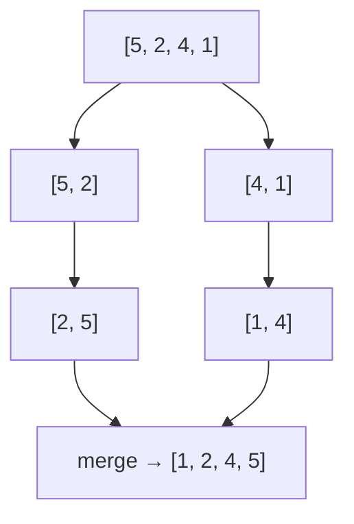

---
tags:
  - Middle
  - Алгоритмы
---

# Сортировки и графы

Какие сортировки нужно знать и как работают Merge Sort и Quick Sort, как хранить граф и обходить его в ширину и в глубину, как найти кратчайший путь алгоритмом Дейкстры. Спрашивают, почему Quick Sort бывает O(N²), какую сортировку использует Java и чем BFS отличается от DFS. Big O и структуры данных — на странице [Big O и структуры данных](algorithms.md).

## Сортировки { #sorting }

### Какие сортировки нужно знать? { #sorting-overview }

**Уровень:** Middle

!!! abstract "Ответ вслух"
    Простые сортировки — Bubble, Selection, Insertion — работают за O(N²), эффективные — Merge, Quick, Heap, Tim — за O(N log N). Merge Sort и Tim Sort стабильны, но требуют O(N) памяти, Quick Sort в худшем случае деградирует до O(N²). В Java `Arrays.sort` для объектов и `Collections.sort` используют Tim Sort, а для примитивов — Quick Sort.

| Алгоритм | Лучшее | Среднее | Худшее | Память | Стабильна |
|---|---|---|---|---|---|
| **Bubble Sort** | O(N) | O(N²) | O(N²) | O(1) | ✅ |
| **Selection Sort** | O(N²) | O(N²) | O(N²) | O(1) | ❌ |
| **Insertion Sort** | O(N) | O(N²) | O(N²) | O(1) | ✅ |
| **Merge Sort** | O(N log N) | O(N log N) | O(N log N) | O(N) | ✅ |
| **Quick Sort** | O(N log N) | O(N log N) | O(N²) | O(log N) | ❌ |
| **Heap Sort** | O(N log N) | O(N log N) | O(N log N) | O(1) | ❌ |
| **Tim Sort** | O(N) | O(N log N) | O(N log N) | O(N) | ✅ |

- **Tim Sort** — используется в Java для объектов (`Arrays.sort` для объектов, `Collections.sort`). Гибрид Merge Sort и Insertion Sort.
- **Quick Sort** — используется в Java для примитивов (`Arrays.sort(int[])`). Нестабильна, но очень быстра на практике.

!!! warning "Ловушка: стабильность"
    Стабильная сортировка сохраняет порядок равных элементов. Это важно, когда объекты сортируют по нескольким полям по очереди: например, сначала по имени, потом по отделу — нестабильная сортировка перемешает имена внутри отдела. Для примитивов стабильность не нужна: равные числа неотличимы.

??? question "Проверь себя"
    1. Какие сортировки работают за O(N log N) в худшем случае?
    2. Какую сортировку Java использует для объектов, а какую — для примитивов?
    3. Что значит «стабильная сортировка» и когда это важно?

### Как работает Merge Sort? { #merge-sort }

**Уровень:** Middle

!!! abstract "Ответ вслух"
    Merge Sort — «разделяй и властвуй»: массив делится пополам, каждая половина сортируется рекурсивно, затем отсортированные половины сливаются. Слияние двух отсортированных частей идёт за O(N) двумя указателями. Итог — O(N log N) всегда, стабильно, но с O(N) дополнительной памяти.



```java
void mergeSort(int[] arr, int left, int right) {
    if (left >= right) return;

    int mid = left + (right - left) / 2;
    mergeSort(arr, left, mid);       // сортируем левую половину
    mergeSort(arr, mid + 1, right);  // сортируем правую половину
    merge(arr, left, mid, right);    // сливаем
}

void merge(int[] arr, int left, int mid, int right) {
    int[] temp = new int[right - left + 1];
    int i = left, j = mid + 1, k = 0;

    while (i <= mid && j <= right) {
        if (arr[i] <= arr[j]) temp[k++] = arr[i++];
        else                   temp[k++] = arr[j++];
    }
    while (i <= mid)    temp[k++] = arr[i++];
    while (j <= right)  temp[k++] = arr[j++];

    System.arraycopy(temp, 0, arr, left, temp.length);
}
```

!!! warning "Ловушка: `<` вместо `<=` при слиянии"
    Условие `arr[i] <= arr[j]` берёт равный элемент из левой половины первым — это и делает Merge Sort стабильным. Если написать `<`, при равенстве первым уйдёт элемент из правой половины, и порядок равных элементов нарушится.

??? question "Проверь себя"
    1. Из каких шагов состоит Merge Sort?
    2. Почему Merge Sort требует O(N) дополнительной памяти?
    3. Какое условие при слиянии делает сортировку стабильной?

### Как работает Quick Sort? { #quick-sort }

**Уровень:** Middle

!!! abstract "Ответ вслух"
    Quick Sort выбирает опорный элемент (pivot) и переставляет массив так, чтобы слева оказались элементы не больше него, справа — больше. Затем рекурсивно сортирует обе части. В среднем O(N log N) и O(log N) памяти на стек, но при неудачном выборе pivot — O(N²).

```java
void quickSort(int[] arr, int left, int right) {
    if (left >= right) return;

    int pivot = partition(arr, left, right);
    quickSort(arr, left, pivot - 1);
    quickSort(arr, pivot + 1, right);
}

int partition(int[] arr, int left, int right) {
    int pivot = arr[right]; // выбираем последний элемент как пивот
    int i = left - 1;

    for (int j = left; j < right; j++) {
        if (arr[j] <= pivot) {
            i++;
            int temp = arr[i]; arr[i] = arr[j]; arr[j] = temp; // swap
        }
    }
    int temp = arr[i+1]; arr[i+1] = arr[right]; arr[right] = temp;
    return i + 1;
}
```

!!! warning "Ловушка: худший случай Quick Sort"
    Если массив уже отсортирован и pivot всегда выбирается крайним, каждое разбиение отрезает один элемент — получается O(N²). Решение: случайный pivot (`arr[random.nextInt(right - left + 1) + left]`) или медиана из трёх.

??? question "Проверь себя"
    1. Что делает функция `partition`?
    2. Когда Quick Sort деградирует до O(N²)?
    3. Как выбрать pivot, чтобы избежать худшего случая?

## Графы { #graphs }

### Как хранить граф? { #graph-representation }

**Уровень:** Junior

!!! abstract "Ответ вслух"
    Чаще всего — списком смежности: для каждой вершины хранится список соседей, в Java это `Map<Integer, List<Integer>>`. Для плотных графов используют матрицу смежности `int[n][n]`, где `matrix[i][j]` — наличие или вес ребра. Список экономит память на разреженных графах, матрица проверяет ребро за O(1).

```java
// 1. Список смежности (чаще всего)
Map<Integer, List<Integer>> graph = new HashMap<>();
graph.computeIfAbsent(0, k -> new ArrayList<>()).add(1);
graph.computeIfAbsent(0, k -> new ArrayList<>()).add(2);
graph.computeIfAbsent(1, k -> new ArrayList<>()).add(3);

// 2. Матрица смежности (для плотных графов)
int[][] matrix = new int[n][n];
matrix[0][1] = 1; // ребро 0 → 1
```

!!! warning "Ловушка: матрица для разреженного графа"
    Матрица занимает O(V²) памяти независимо от числа рёбер. Для графа на миллион вершин с несколькими соседями у каждой это триллион ячеек. Для разреженных графов — только список смежности.

??? question "Проверь себя"
    1. Как представить граф списком смежности в Java?
    2. Когда выгоднее матрица смежности?
    3. Сколько памяти занимает матрица смежности?

### Как найти кратчайший путь в невзвешенном графе? { #graph-bfs }

**Уровень:** Middle

!!! abstract "Ответ вслух"
    Обходом в ширину (BFS): он идёт от старта слоями, поэтому первый раз, когда BFS достигает вершины, — это кратчайший путь до неё по числу рёбер. Нужны очередь и множество посещённых вершин. Сложность — O(V + E).

```java
int bfs(Map<Integer, List<Integer>> graph, int start, int target) {
    Queue<Integer> queue = new ArrayDeque<>();
    Set<Integer> visited = new HashSet<>();
    queue.offer(start);
    visited.add(start);
    int steps = 0;

    while (!queue.isEmpty()) {
        int size = queue.size();

        for (int i = 0; i < size; i++) {
            int node = queue.poll();
            if (node == target) return steps;

            for (int neighbor : graph.getOrDefault(node, List.of())) {
                if (!visited.contains(neighbor)) {
                    visited.add(neighbor);
                    queue.offer(neighbor);
                }
            }
        }
        steps++;
    }
    return -1; // не нашли
}
```

Задача про кратчайший путь в лабиринте — в [Паттерны задач → BFS](leetcode-trees-dp.md#maze).

!!! warning "Ловушка: помечать вершину при извлечении из очереди"
    Если добавлять в `visited` только при `poll()`, одна вершина может попасть в очередь много раз — через разных соседей одного слоя. Обход станет медленнее, а на плотных графах очередь разрастётся. Вершину помечают в момент добавления в очередь, как в коде выше.

??? question "Проверь себя"
    1. Почему BFS находит кратчайший путь в невзвешенном графе?
    2. Зачем нужно множество `visited`?
    3. В какой момент помечать вершину посещённой?

### Как работает DFS? { #graph-dfs }

**Уровень:** Middle

!!! abstract "Ответ вслух"
    Обход в глубину (DFS) идёт по одной ветке до конца, потом возвращается и пробует следующую. Его пишут рекурсивно или итеративно через стек; итеративный вариант нужен, когда рекурсия слишком глубокая. Применение — обход, поиск циклов, топологическая сортировка; сложность — O(V + E).

```java
// Рекурсивный DFS
void dfs(Map<Integer, List<Integer>> graph, int node, Set<Integer> visited) {
    visited.add(node);
    process(node);

    for (int neighbor : graph.getOrDefault(node, List.of())) {
        if (!visited.contains(neighbor)) {
            dfs(graph, neighbor, visited);
        }
    }
}

// Итеративный DFS (через стек — когда рекурсия глубокая и есть риск StackOverflow)
void dfsIterative(Map<Integer, List<Integer>> graph, int start) {
    Deque<Integer> stack = new ArrayDeque<>();
    Set<Integer> visited = new HashSet<>();
    stack.push(start);

    while (!stack.isEmpty()) {
        int node = stack.pop();
        if (visited.contains(node)) continue;
        visited.add(node);
        process(node);

        for (int neighbor : graph.getOrDefault(node, List.of())) {
            if (!visited.contains(neighbor)) {
                stack.push(neighbor);
            }
        }
    }
}
```

Задачи на DFS — валидность BST и количество островов — в [Паттерны задач → DFS](leetcode-trees-dp.md#dfs).

!!! warning "Ловушка: `StackOverflowError` на большом графе"
    Рекурсивный DFS по цепочке из сотен тысяч вершин создаёт столько же кадров на стеке потока, и он переполняется. Для глубоких графов DFS переписывают итеративно с явным `ArrayDeque`, который живёт в куче.

??? question "Проверь себя"
    1. Чем DFS отличается от BFS по порядку обхода?
    2. Когда рекурсивный DFS заменяют итеративным?
    3. Для каких задач применяют DFS?

### Как работает алгоритм Дейкстры? { #dijkstra }

**Уровень:** Senior

!!! abstract "Ответ вслух"
    Дейкстра ищет кратчайшие пути от одной вершины во взвешенном графе без отрицательных весов. Он каждый раз берёт из min-кучи вершину с наименьшей известной дистанцией и пытается улучшить через неё дистанции соседей (релаксация). С `PriorityQueue` сложность — O((V + E) log V).

```java
int[] dijkstra(int[][] graph, int src) {  // graph[i][j] = вес ребра или 0
    int n = graph.length;
    int[] dist = new int[n];
    Arrays.fill(dist, Integer.MAX_VALUE);
    dist[src] = 0;

    // [дистанция, вершина]
    PriorityQueue<int[]> pq = new PriorityQueue<>((a, b) -> a[0] - b[0]);
    pq.offer(new int[]{0, src});

    while (!pq.isEmpty()) {
        int[] curr = pq.poll();
        int d = curr[0], u = curr[1];

        if (d > dist[u]) continue; // устаревшая запись

        for (int v = 0; v < n; v++) {
            if (graph[u][v] > 0) { // есть ребро
                int newDist = dist[u] + graph[u][v];
                if (newDist < dist[v]) {
                    dist[v] = newDist;
                    pq.offer(new int[]{newDist, v});
                }
            }
        }
    }
    return dist;
}
```

**Сложность:** O((V + E) log V) с `PriorityQueue`. В этой реализации граф — матрица смежности, поэтому перебор соседей добавляет O(V) на каждую вершину.

!!! warning "Ловушка: отрицательные веса"
    Дейкстра считает дистанцию вершины окончательной, как только достаёт её из кучи. С отрицательным ребром позже может найтись более короткий путь, и ответ окажется неверным. Для графов с отрицательными весами используют другие алгоритмы, например Беллмана — Форда.

??? question "Проверь себя"
    1. Для каких графов подходит алгоритм Дейкстры?
    2. Зачем проверка `if (d > dist[u]) continue`?
    3. Какая сложность у Дейкстры с `PriorityQueue`?

## Шпаргалка { #cheatsheet }

<!-- --8<-- [start:cheatsheet] -->
| Тема | Запомнить |
|---|---|
| **Сортировки** | O(N log N): Merge, Quick (в среднем), Heap, Tim. Java: Tim Sort для объектов, Quick Sort для примитивов |
| **Merge Sort** | Делим пополам, сливаем за O(N); стабильна, O(N) памяти |
| **Quick Sort** | Partition вокруг pivot; O(N²) на отсортированном с крайним pivot → случайный pivot |
| **Граф** | Список смежности — по умолчанию, матрица — для плотных |
| **BFS по графу** | Кратчайший путь без весов; помечать при добавлении в очередь |
| **DFS** | Рекурсия или стек; глубокий граф — итеративно |
| **Дейкстра** | Min-куча + релаксация, O((V + E) log V), без отрицательных весов |

<!-- --8<-- [end:cheatsheet] -->
