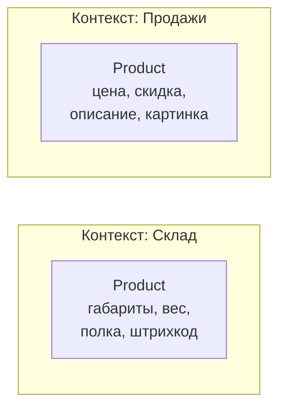
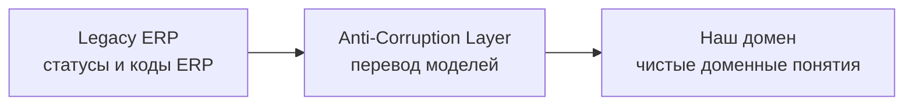
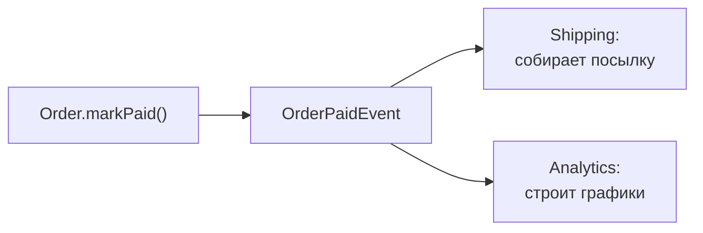
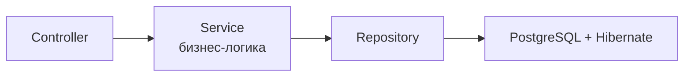
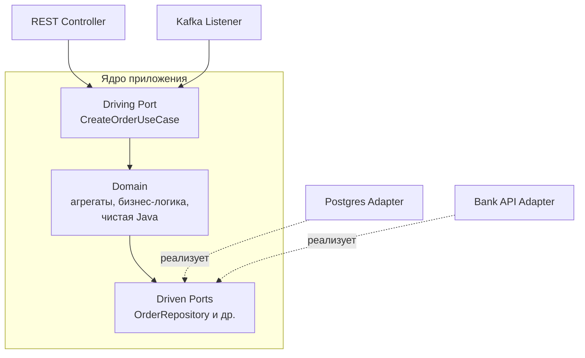
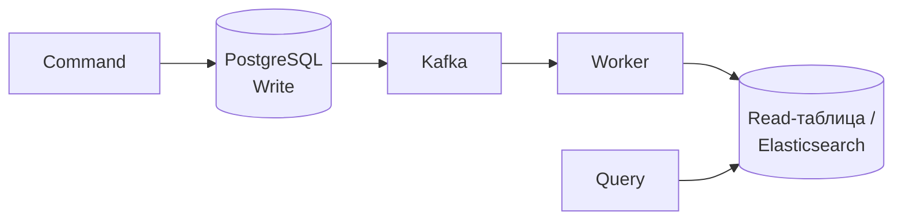
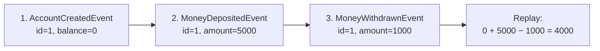

---
tags:
  - Junior
  - Middle
  - Senior
  - Архитектура
  - Микросервисы
---

# Архитектура приложения (DDD, Hexagonal, CQRS)

Как устроить код одного сервиса так, чтобы бизнес-логика не тонула в инфраструктуре: DDD, гексагональная архитектура, CQRS и Event Sourcing. На собесе спрашивают, что такое Bounded Context и Aggregate, чем Rich Domain Model лучше анемичной, как устроены порты и адаптеры и какой подвох у CQRS.

## Domain-Driven Design (DDD) { #ddd }

### Что такое Ubiquitous Language? { #ubiquitous-language }

**Уровень:** Junior

!!! abstract "Ответ вслух"
    Ubiquitous Language (единый язык) — фундамент DDD: бизнес и разработчики называют вещи одними словами. Термин бизнеса становится именем класса, таблицы и переменной. Тогда код читается как бизнес-спецификация, а не как перевод с технического.

- **Антипаттерн:** бизнес говорит «отгрузка», в базе таблица `delivery`, в коде класс `ShippingManager`. Путаница.
- **По DDD:** бизнес говорит «Накладная» (Waybill) → класс `Waybill`, таблица `waybill`, переменные `waybill`. Никаких технических синонимов.

!!! warning "Ловушка: технические синонимы"
    Названия вроде `Manager`, `Processor`, `Data` не несут бизнес-смысла, а три разных слова для одного понятия заставляют каждого держать в голове словарь перевода. Если продакт говорит «Накладная», класс называется `Waybill`, а не `DeliveryDocumentManager`.

??? question "Проверь себя"
    1. Что такое Ubiquitous Language?
    2. Какой антипаттерн он устраняет?
    3. Как бизнес-термин «Накладная» должен отразиться в коде и базе?

### Что такое Bounded Context? { #bounded-context }

**Уровень:** Middle

!!! abstract "Ответ вслух"
    Bounded Context (ограниченный контекст) — граница, внутри которой у понятия одна модель. Одна и та же сущность значит разное в разных отделах: товар для склада — габариты и полка, для продаж — цена и картинка. Вместо одного гигантского `Product` в каждом контексте своя маленькая модель, и на уровне архитектуры контексты часто становятся отдельными микросервисами.

**Товар (Product):**

- В контексте **Склада (Inventory)** — габариты, вес, полка, штрихкод.
- В контексте **Продаж (Sales)** — цена, скидка, описание, картинка.

Вместо гигантского `Product` на 100 полей (God Object) систему бьют на Bounded Contexts. В каждом — своя маленькая изолированная модель `Product`.



!!! warning "Ловушка: один общий `Product` на всю систему"
    Общая модель на 100 полей связывает все отделы: изменение для склада ломает продажи, а каждая команда тащит поля, которые ей не нужны. Это God Object. Разные контексты — разные модели, даже если имя одно.

??? question "Проверь себя"
    1. Что такое Bounded Context?
    2. Почему один и тот же `Product` в разных контекстах — разные классы?
    3. Как Bounded Context связан с микросервисами?

### Как связываются контексты? { #context-mapping }

**Уровень:** Senior

!!! abstract "Ответ вслух"
    Context Mapping описывает типы связей между контекстами: Shared Kernel — общий кусок модели, Customer–Supplier и Conformist — один контекст подстраивается под другой. На границе с легаси или внешней системой ставят Anti-Corruption Layer — прослойку-переводчик. Она конвертирует чужую модель в свою, чтобы чужие концепции не протекали в домен.

- **Shared Kernel** — два контекста делят общий кусок модели (общая библиотека). Дёшево, но жёстко связывает команды.
- **Customer–Supplier / Conformist** — один контекст подстраивается под модель другого, например под API внешней системы, на которую не влияешь.
- **Anti-Corruption Layer (ACL)** — прослойка-переводчик на границе. Классика: интеграция с legacy-ERP, где ACL мапит её кривые статусы и коды в чистые доменные понятия.



Фраза для собеса: «На границе с легаси ставим Anti-Corruption Layer — наш домен ничего не знает про чужие модели».

!!! warning "Ловушка: Shared Kernel «для экономии»"
    Общая библиотека модели выглядит дешёвой, но любое её изменение требует согласования всех команд-участников. Чем больше контекстов делят ядро, тем сильнее они связаны. Shared Kernel держат минимальным.

??? question "Проверь себя"
    1. Чем Shared Kernel отличается от Conformist?
    2. Зачем нужен Anti-Corruption Layer?
    3. Где ставят ACL при интеграции с легаси?

### Что такое Entity и Aggregate? { #aggregate }

**Уровень:** Middle

!!! abstract "Ответ вслух"
    Entity — объект с уникальным ID: свойства меняются, а он остаётся собой. Aggregate — группа сущностей, которая меняется как единое целое в одной транзакции. Работа с агрегатом идёт только через корень (Aggregate Root), который защищает инварианты — например, пересчитывает сумму заказа при добавлении позиции.

**Entity** — объект с уникальным ID. Свойства меняются, но он остаётся собой — например, Клиент.

**Aggregate** — группа сущностей, изменяемых как единое целое (транзакция).

```java
// Order — Aggregate Root. Работа с позициями ТОЛЬКО через корень.
public class Order {
    private final OrderId id;
    private final List<OrderItem> items = new ArrayList<>();
    private Money total;

    // ❌ Нельзя менять OrderItem в обход Order — иначе total не пересчитается
    // ✅ Только через метод корня
    public void addItem(Product product, int quantity) {
        OrderItem item = new OrderItem(product, quantity);
        items.add(item);
        recalculateTotal(); // инвариант агрегата сохранён
    }

    private void recalculateTotal() {
        this.total = items.stream()
            .map(OrderItem::subtotal)
            .reduce(Money.ZERO, Money::add);
    }
}
```

`Order` — **Aggregate Root**. На уровне БД это гарантия, что транзакция охватит весь агрегат целиком.

!!! warning "Ловушка: отдавать изменяемую коллекцию наружу"
    Если корень возвращает `items` как есть, любой код может сделать `order.getItems().add(...)` мимо `addItem()`, и `total` разойдётся с позициями. Наружу отдают неизменяемое представление или копию, а меняют агрегат только методами корня.

??? question "Проверь себя"
    1. Чем Entity отличается от Aggregate?
    2. Почему позиции заказа меняют только через `Order`?
    3. Какую гарантию даёт агрегат на уровне транзакции?

### Где должна жить бизнес-логика? { #rich-domain-model }

**Уровень:** Middle

!!! abstract "Ответ вслух"
    В домене, внутри агрегатов, а не в сервисах-простынях. Anemic Domain Model — сущности с голыми геттерами и сеттерами, вся логика в толстом `OrderService` — антипаттерн: инварианты никто не защищает. В Rich Domain Model логика внутри агрегата (`order.addItem()`), а сервисы тонкие.

Anemic Domain Model (анемичная модель): сущности — только данные, вся логика — в сервисах. Любой может сделать `order.getItems().add(...)` мимо пересчёта `total`, потому что сущность ничего не проверяет.

Rich Domain Model (богатая модель): логика и инварианты — в методах агрегата. Сервис только оркестрирует: загрузил агрегат, вызвал метод, сохранил.

```java
// ❌ Anemic: логика снаружи, инвариант держится на дисциплине
order.getItems().add(item);
order.setTotal(calculator.total(order.getItems()));

// ✅ Rich: инвариант защищает сам агрегат
order.addItem(product, quantity);
```

!!! warning "Ловушка: сеттер на каждое поле"
    Публичные `setTotal()` и `setStatus()` позволяют перевести агрегат в недопустимое состояние в обход правил — например, пометить заказ оплаченным без суммы. В Rich Domain Model вместо сеттеров — методы с бизнес-смыслом: `markPaid()`, `addItem()`.

??? question "Проверь себя"
    1. Что такое Anemic Domain Model и чем она плоха?
    2. Где живёт логика в Rich Domain Model и что остаётся сервису?
    3. Чем метод `markPaid()` лучше сеттера `setStatus(PAID)`?

### Что такое Value Object? { #value-object }

**Уровень:** Junior

!!! abstract "Ответ вслух"
    Value Object (объект-значение) — объект без ID и неизменяемый: два объекта равны, если равны их значения. Классический пример — `Money` с суммой и валютой, который не даст сложить тенге с долларами. В Java его удобно делать через `record`.

```java
// ❌ Просто BigDecimal — нет защиты от ошибок
private BigDecimal amount;

// ✅ Value Object — record идеально подходит (Java 16+)
public record Money(BigDecimal amount, Currency currency) {

    public static final Money ZERO = new Money(BigDecimal.ZERO, Currency.getInstance("KZT"));

    public Money add(Money other) {
        if (!this.currency.equals(other.currency)) {
            throw new IllegalArgumentException("Нельзя складывать разные валюты");
            // тенге + доллары не сложатся — класс не даст ошибиться
        }
        return new Money(this.amount.add(other.amount), this.currency);
    }
}
```

Купюра 1000 тенге у тебя и у меня равны: серийный номер (ID) не важен, важен номинал. Как `record` генерирует `equals()` и `hashCode()` по полям, разобрано в [Современная Java → record](../java/modern-java.md#records).

!!! warning "Ловушка: `BigDecimal.equals()` учитывает масштаб"
    `record` сравнивает поля через `equals()`, а у `BigDecimal` он учитывает scale: `new BigDecimal("1.0")` не равен `new BigDecimal("1.00")`. Поэтому два `Money` с одной суммой, но разным масштабом окажутся не равны. Масштаб нормализуют в конструкторе или сравнивают суммы через `compareTo()`.

??? question "Проверь себя"
    1. Чем Value Object отличается от Entity?
    2. Почему `Money` лучше, чем голый `BigDecimal`?
    3. Почему `record` подходит для Value Object?

### Что такое доменные события? { #domain-events }

**Уровень:** Middle

!!! abstract "Ответ вслух"
    Доменное событие — факт, важный для бизнеса, в прошедшем времени: «заказ оплачен». Агрегат генерирует событие, а другие контексты на него реагируют, при этом модуль заказов ничего не знает о доставке и аналитике. Наружу, в Kafka, событие уезжает через Transactional Outbox.

```java
// Заказ оплачен → агрегат генерирует событие
public class Order {
    public void markPaid() {
        this.status = OrderStatus.PAID;
        registerEvent(new OrderPaidEvent(this.id, this.total));
    }
}

// Другие Bounded Contexts реагируют:
// - Shipping ловит OrderPaidEvent → собирает посылку
// - Analytics ловит то же событие → строит графики
// Модуль заказов НИЧЕГО не знает о модуле доставки — жёсткая развязка
```



!!! warning "Ловушка: dual write при публикации события"
    Если сохранить агрегат в БД и отдельно отправить событие в Kafka, одно из двух может не случиться: агрегат сохранили, событие потеряли. Поэтому событие пишут в той же транзакции через [Transactional Outbox](distributed-transactions.md#outbox).

??? question "Проверь себя"
    1. Почему доменные события называют в прошедшем времени?
    2. Как события развязывают Bounded Contexts?
    3. Как доменное событие надёжно попадает в Kafka?

## Архитектурные стили { #styles }

### Чем плоха классическая слоистая архитектура? { #layered }

**Уровень:** Middle

!!! abstract "Ответ вслух"
    В схеме `Controller → Service → Repository` бизнес-логика зависит от репозитория, а он — от PostgreSQL и Hibernate. Чтобы поменять БД, обновить Hibernate или написать unit-тест на расчёт скидки, приходится тащить всю инфраструктуру. Для CRUD это нормально, для сложного домена — нет.

Проблема — **направление зависимостей**:



Итог: чистая бизнес-логика зависит от инфраструктуры. Поменять БД, обновить Hibernate или написать unit-тест на расчёт скидки — значит поднимать Spring-контекст и базу.

!!! warning "Ловушка: слои ради слоёв в сложном домене"
    Для CRUD слоистая архитектура — нормальный выбор. Но в сложной ERP со статусами и расчётами каждый тест бизнес-правила требует инфраструктуры, и логика постепенно расползается по сервисам и репозиториям. Тогда зависимости переворачивают.

??? question "Проверь себя"
    1. В какую сторону направлены зависимости в слоистой архитектуре?
    2. Почему unit-тест на расчёт скидки требует базы?
    3. Когда слоистая архитектура — нормальный выбор?

### Как устроена гексагональная архитектура? { #hexagonal }

**Уровень:** Middle

!!! abstract "Ответ вслух"
    Hexagonal (Ports and Adapters), как и Onion и Clean Architecture, переворачивает зависимости: внешние слои зависят от домена, а домен ничего не знает о них. В центре — чистая Java без аннотаций Spring, Kafka и Hibernate. Домен общается с миром через порты — интерфейсы, а адаптеры снаружи их реализуют или вызывают.

Главное правило — **dependency inversion**: внешние слои (БД, UI, API) зависят от внутренних (бизнес-логика), внутренние **ничего не знают** о внешних.



**Порты** — Java-интерфейсы внутри домена:

- **Driving Ports (входящие)** — как мир вызывает домен: `CreateOrderUseCase`.
- **Driven Ports (исходящие)** — как домен обращается к миру: `OrderRepository`. «Мне нужно сохранить заказ, вот контракт; кто и как — неважно».

**Адаптеры** — классы-реализации снаружи:

- **Driving Adapters** — `OrderRestController` принимает JSON и вызывает `CreateOrderUseCase`.
- **Driven Adapters** — `PostgresOrderRepository` реализует `OrderRepository` и мапит домен в Hibernate `@Entity`.

По кольцам код раскладывается так: в центре **Domain** (Entity, Value Objects, доменные сервисы — чистая Java), вокруг — **Application** (use case'ы и порты), снаружи — **Infrastructure** (Spring, JPA, Kafka, REST). **Onion** и **Clean Architecture** делают то же самое и рисуют концентрическими кругами: «зависимости указывают только внутрь».

Куда ставить аннотации Spring, `@Transactional` и как склеить слои конфигурацией — разобрано в [Spring в гексагональной архитектуре](hexagonal.md#spring-ddd).

!!! warning "Ловушка: JPA-аннотации на доменных классах"
    Если пометить доменный `Order` аннотацией `@Entity`, домен снова зависит от Hibernate — и все плюсы гексагона пропадают. Доменная модель и JPA-сущность — разные классы, а driven-адаптер мапит одну в другую.

??? question "Проверь себя"
    1. Чем driving port отличается от driven port?
    2. Что такое адаптер и где он живёт?
    3. Что общего у Hexagonal, Onion и Clean Architecture?

### Layered или Hexagonal? { #layered-vs-hexagonal }

**Уровень:** Middle

!!! abstract "Ответ вслух"
    Layered — для примитивной логики и CRUD: просто и быстро, но бизнес-логика зависит от инфраструктуры. Hexagonal — для сложного домена: бизнес-правила тестируются за миллисекунды с замоканными портами. Главный плюс — новый вход в систему, например Kafka вместо REST, добавляется новым адаптером без изменения домена.

| | **Layered** | **Hexagonal / Clean** |
|---|---|---|
| **Когда** | Примитивная логика, CRUD | Сложный домен (ERP, статусы, расчёты) |
| **Плюс** | Просто, быстро написать | Тесты бизнес-правил за миллисекунды (мокаем порты) |
| **Минус** | Бизнес-логика зависит от инфраструктуры | Оверинжиниринг для простого CRUD |

Сейчас вызов идёт через REST-контроллер. Завтра бизнес скажет «слушаем события из Kafka» — пишешь новый входящий адаптер (Kafka Listener), который дёргает тот же порт `CreateOrderUseCase`. **Домен не меняется.**

!!! warning "Ловушка: гексагон для CRUD"
    Для справочника из трёх таблиц порты, адаптеры и маппинг между доменом и JPA-сущностями — лишний код без выгоды. Hexagonal окупается там, где много бизнес-правил, которые надо тестировать и защищать от инфраструктуры.

??? question "Проверь себя"
    1. Когда выбирать слоистую архитектуру, а когда — гексагональную?
    2. Как в гексагоне добавить приём событий из Kafka?
    3. Почему тесты бизнес-правил в гексагоне быстрые?

### Что такое модульный монолит? { #modular-monolith }

**Уровень:** Middle

!!! abstract "Ответ вслух"
    Модульный монолит — компромисс между монолитом и микросервисами: один деплой, но внутри жёсткие границы модулей по Bounded Contexts. Это дисциплина микросервисов без сетевой боли и распределённых транзакций. В Java его делают на Spring Modulith, а границы модулей — готовые линии разреза, если позже понадобится пилить на сервисы.

Модульный монолит хорошо стыкуется с советом из [System Design → Монолит или микросервисы](microservices.md#monolith-vs-microservices): «начинай с монолита, выделяй сервисы под конкретную причину».

!!! warning "Ловушка: модули без контроля границ"
    Если модули могут свободно лезть во внутренние классы и таблицы друг друга, это обычный монолит с папками. Границы проверяют инструментально — Spring Modulith умеет проверять зависимости между модулями тестом.

??? question "Проверь себя"
    1. Чем модульный монолит отличается от обычного?
    2. Что он даёт по сравнению с микросервисами?
    3. Почему его границы помогают при будущем переходе на сервисы?

## CQRS и Event Sourcing { #cqrs-es }

### Что такое CQRS? { #cqrs }

**Уровень:** Senior

!!! abstract "Ответ вслух"
    CQRS (Command Query Responsibility Segregation) разделяет модели записи и чтения. Команда проверяет бизнес-правила и пишет в нормализованную базу, событие через Kafka обновляет денормализованную модель для чтения — таблицу или Elasticsearch. Главный подвох — eventual consistency: модель чтения отстаёт от записи.

**Проблема:** в CRUD одна модель и для записи, и для чтения, хотя это разные процессы.

- **Запись (Command)** — сложные проверки, транзакции, блокировки: не продать товар дважды.
- **Чтение (Query)** — сложные дашборды с джойнами 10 таблиц, и база тормозит.

**Решение — разделить:**

| | **Command** | **Query** |
|---|---|---|
| **Что делает** | Меняет состояние: create, update, delete | Только читает |
| **Возвращает** | ID или статус | Данные |
| **Модель** | Строгая, нормализованная | Плоские денормализованные таблицы |



Команда валидирует бизнес-правила, сохраняет в PostgreSQL и кидает событие в Kafka. Воркер слушает Kafka и обновляет «таблицу для чтения» или кладёт данные в Elasticsearch для быстрого поиска.

Read-реплики БД из [System Design → Репликация](../system-design/distributed-data.md#replication) — «CQRS на минималках»: то же разделение путей записи и чтения. Полноценный CQRS добавляет **разные модели** под каждый путь.

!!! warning "Ловушка: eventual consistency"
    Пишем в одну базу, читаем из другой через Kafka — возникает задержка (lag). Пользователь нажал «Оплатить», команда отработала, write-база обновлена, но событие ещё летит. Фронтенд запрашивает статус из read-базы — счёт ещё не оплачен; данные станут консистентными через долю секунды.

??? question "Проверь себя"
    1. Чем модель Command отличается от модели Query?
    2. Как данные попадают из write-базы в read-модель?
    3. Почему пользователь может не увидеть только что оплаченный счёт?

### Что такое Event Sourcing? { #event-sourcing }

**Уровень:** Senior

!!! abstract "Ответ вслух"
    Event Sourcing хранит не текущее состояние, а историю событий, append-only; текущее состояние получается replay'ем всех событий. Это даёт полный аудит и возможность восстановить состояние на любой момент прошлого, и он естественно сочетается с CQRS. Цена — высокий порог входа, версионирование событий и eventual consistency.

Если CQRS — разделение чтения и записи, то Event Sourcing — подход к тому, **как хранить данные при записи**.

**Классический подход** хранит текущее состояние: `balance = 5000` → потратили 1000 → перезаписали `balance = 4000`. Предыдущее состояние потеряно.

**Event Sourcing** хранит историю событий:



**Плюсы для ERP:**

- **100% аудит** — подходит бухгалтерии и финтеху: история не врёт, событие удалить нельзя.
- **Машина времени** — восстановить состояние на любую секунду прошлого: не проигрывать события после нужной даты.
- **Сочетается с CQRS** — write-модель — это Event Store, событие летит в Kafka и обновляет read-модели.

**Минусы:**

- **Высокий порог входа** — команда должна мыслить событиями.
- **Версионирование событий** — что, если через год в `OrderCreated` появилось новое обязательное поле, а в старых событиях его нет? Классический вопрос со звёздочкой, решается через upcasting событий — преобразование старой версии события в новую при чтении.
- **Eventual consistency** — тот же рассинхрон, что и в CQRS.

!!! warning "Ловушка: replay миллиона событий"
    Восстанавливать агрегат с миллионом событий с нуля медленно. Раз в N событий сохраняют снимок состояния (snapshot): восстановление = последний снапшот + replay только хвоста событий после него. Это второй классический вопрос со звёздочкой после upcasting.

??? question "Проверь себя"
    1. Чем Event Sourcing отличается от хранения текущего состояния?
    2. Что такое upcasting и какую проблему он решает?
    3. Как snapshot ускоряет восстановление агрегата?

## Шпаргалка { #cheatsheet }

<!-- --8<-- [start:cheatsheet] -->
| Тема | Запомнить |
|---|---|
| **Ubiquitous Language** | Бизнес-термин = класс = таблица. Код читается как спецификация |
| **Bounded Context** | Одна сущность — разные модели в разных контекстах. Часто = микросервис |
| **Context Mapping / ACL** | ACL — прослойка-переводчик на границе: легаси или чужая модель не протекает в домен |
| **Aggregate Root** | Изменения только через корень (`order.addItem()`). Защита инвариантов |
| **Anemic vs Rich** | Логика — в домене, а не в сервисах-простынях с геттерами и сеттерами |
| **Value Object** | Без ID, неизменяемый. `Money`, `record`. Защита от ошибок на уровне типов |
| **Domain Event** | Событие в прошедшем времени. Развязывает контексты; наружу — через Outbox |
| **Layered** | `Controller → Service → Repository`: логика зависит от инфраструктуры. Нормально для CRUD |
| **Hexagonal** | Зависимости внутрь, ядро — чистая Java. Порты — интерфейсы в домене, адаптеры — снаружи |
| **Layered vs Hexagonal** | Новый вход = новый адаптер, домен не трогаем. Для CRUD — оверинжиниринг |
| **Modular Monolith** | Границы модулей по контекстам без сетевой боли. Готовые линии разреза на сервисы |
| **CQRS** | Разные модели для Command и Query. Read-реплики — CQRS на минималках |
| **Eventual Consistency** | Write и Read модели рассинхронизированы на доли секунды — главный подвох CQRS |
| **Event Sourcing** | История событий (append-only), состояние = replay. 100% аудит, машина времени |
| **Snapshot / Upcasting** | Snapshot — против медленного replay. Upcasting — против версий событий |

<!-- --8<-- [end:cheatsheet] -->
