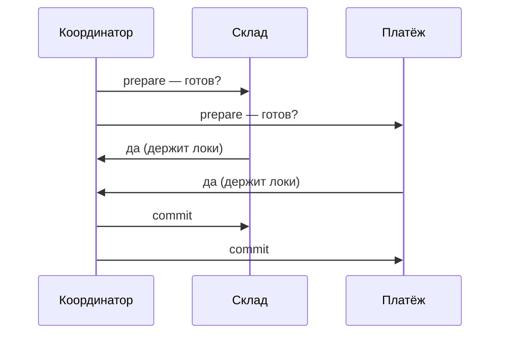
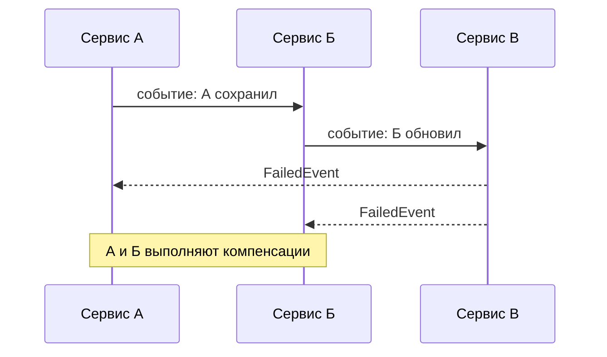
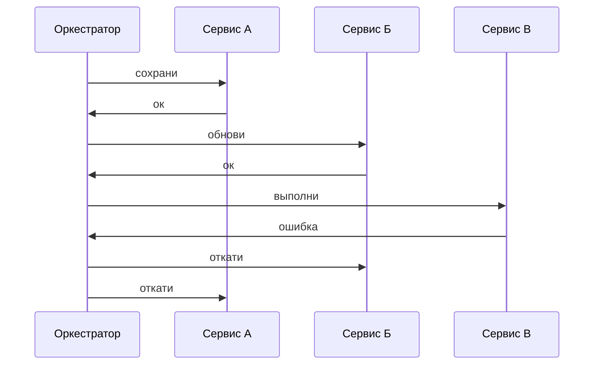
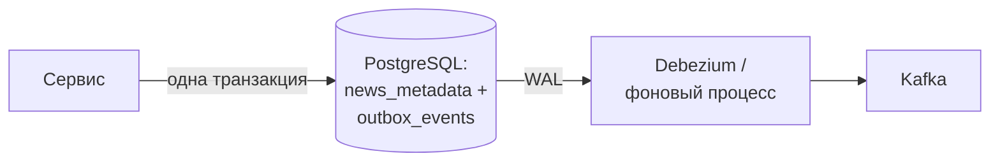

---
tags:
  - Senior
  - Архитектура
  - Микросервисы
  - Транзакции
---

# Распределённые транзакции

Как сохранить согласованность, когда одна бизнес-операция затрагивает несколько сервисов и баз: гарантии доставки и идемпотентность, двухфазный коммит, Saga и Transactional Outbox. На собесе спрашивают, почему 2PC почти не используют, чем хореография отличается от оркестрации и как решить проблему dual write.

## Согласованность между сервисами { #cross-service }

### Какие бывают гарантии доставки и при чём тут идемпотентность? { #delivery-guarantees }

**Уровень:** Middle

!!! abstract "Ответ вслух"
    At-most-once — доставим максимум раз, можно потерять; at-least-once — ретраим до подтверждения, возможны дубликаты; exactly-once — ровно один раз, но end-to-end дорого. Брокеры по умолчанию дают at-least-once. Поэтому exactly-once на практике — это at-least-once доставка плюс идемпотентная обработка.

- **At-most-once** — доставим максимум раз, без ретраев. Можно терять. Некритичные метрики.
- **At-least-once** — ретраим до подтверждения, поэтому возможны **дубликаты**. Дефолт брокеров (Kafka, RabbitMQ).
- **Exactly-once** — ровно один раз. End-to-end дорог и труднодостижим.

**Exactly-once на практике = at-least-once доставка + идемпотентная обработка.** Смиряемся с дубликатами на доставке, но делаем обработку безопасной к повтору.

**Идемпотентность** — повторное выполнение равно однократному по эффекту: `GET` и `set(x=5)` идемпотентны, `increment(x)` — нет. Приём для API — **idempotency key**: клиент шлёт уникальный id запроса, сервер запоминает обработанные и на повтор возвращает прежний результат, не выполняя операцию заново. Так работают платёжные API, например Stripe: при ретрае деньги не спишутся дважды.

**Idempotent consumer** — консьюмер, у которого повторная обработка не создаёт дублей побочных эффектов: пользователь не получит три одинаковых письма. Два способа — проверка по `event_id` перед обработкой и UNIQUE constraint в БД, который надёжнее; код для `@KafkaListener` разобран в [Kafka: Гарантии доставки](../kafka/kafka-reliability.md).

!!! warning "Ловушка: проверка «уже обрабатывали?» без constraint"
    `existsById(eventId)` и последующий `save()` — две операции. Два дубля могут одновременно пройти проверку и оба выполниться. UNIQUE constraint в БД даёт атомарную гарантию: второй дубль получит `DataIntegrityViolationException`, его ловят и коммитят offset.

??? question "Проверь себя"
    1. Почему брокеры по умолчанию дают дубликаты?
    2. Как собрать exactly-once из более слабых гарантий?
    3. Как работает idempotency key в платёжном API?

### Почему 2PC почти не используют в микросервисах? { #two-phase-commit }

**Уровень:** Senior

!!! abstract "Ответ вслух"
    Two-Phase Commit — координатор спрашивает всех участников «готовы закоммитить?», и только если все ответили «да», командует commit. Атомарность он даёт, но протокол блокирующий: участники держат локи на время голосования. Умер координатор между фазами — участники зависли с заблокированными ресурсами.

Бизнес-операция размазана по сервисам и базам — «оформить заказ» = склад + платёж + доставка, — а единого `BEGIN...COMMIT` поверх них нет.



- **Блокирующий** — пока идёт голосование, участники держат локи.
- Плохо масштабируется и снижает availability.

Поэтому в микросервисах 2PC почти не используют — используют [Saga](#saga).

!!! warning "Ловушка: падение координатора между фазами"
    Если координатор умер после prepare, но до commit, участники не знают, коммитить или откатывать. Они держат локи и ждут, пока координатор не вернётся. Один упавший узел блокирует ресурсы во всех сервисах.

??? question "Проверь себя"
    1. Из каких двух фаз состоит 2PC?
    2. Почему 2PC называют блокирующим протоколом?
    3. Что случится, если координатор умрёт между фазами?

### Как работает Saga? { #saga }

**Уровень:** Senior

!!! abstract "Ответ вслух"
    Saga — цепочка локальных транзакций в разных сервисах, у каждой есть компенсирующая транзакция. Если шаг 3 упал, выполняются компенсации шагов 2 и 1: «вернуть товар на склад», «отменить платёж». Координировать сагу можно хореографией через события или оркестрацией через центральный сервис.

Единого `ROLLBACK` по микросервисам нет, поэтому Saga откатывает изменения **компенсирующими транзакциями** — шагами отмены.

**Choreography (хореография)** — центра нет, сервисы общаются событиями. А сохранил данные и кинул событие, Б поймал, обновил и кинул своё. Если В падает, он кидает `FailedEvent`, А и Б ловят его и компенсируют.

- ➕ Слабая связность, нет единой точки отказа.
- ➖ При 4+ сервисах логику почти невозможно отследить.



**Orchestration (оркестрация)** — центральный оркестратор (стейт-машина) шлёт команды: «А, сохрани» → ждёт → «Б, обнови» → ждёт. Если В вернул ошибку, оркестратор шлёт А и Б команды отката.

- ➕ Весь флоу в одном месте, легче мониторить.
- ➖ Оркестратор — единая точка отказа и может обрасти сложной логикой.



!!! warning "Ловушка: Saga не даёт изоляции"
    В середине саги система в промежуточном состоянии: платёж прошёл, доставки ещё нет. Другие запросы видят это состояние — это eventual consistency, и дизайн должен это учитывать.

??? question "Проверь себя"
    1. Чем компенсирующая транзакция отличается от `ROLLBACK`?
    2. Чем хореография отличается от оркестрации и какие у каждой минусы?
    3. Почему Saga не даёт изоляции?

### Что такое Transactional Outbox? { #outbox }

**Уровень:** Senior

!!! abstract "Ответ вслух"
    Outbox решает проблему dual write — когда нужно атомарно сохранить данные в БД и отправить событие в брокер. В той же транзакции, что и бизнес-данные, событие пишется в таблицу `outbox_events`. Отдельный процесс, часто Debezium по WAL, перекладывает события из outbox в Kafka.

**Проблема dual write.** Редактор публикует новость: нужно 1) сохранить её в PostgreSQL и 2) отправить событие в Kafka. Если сначала БД, а Kafka моргнёт — сервисы не узнают о новости. Если сначала Kafka, а БД упадёт — получится фантомное событие без данных.

**Решение** — в той же транзакции БД писать во вторую таблицу `outbox_events`:

```sql
BEGIN;
INSERT INTO news_metadata (id, title) VALUES (1, 'Новый листинг');
INSERT INTO outbox_events (id, aggregate_type, payload)
    VALUES (100, 'News', '{...json...}');
COMMIT;
-- Транзакция гарантирует: либо всё, либо ничего
```



Отдельный фоновый процесс — часто Debezium, читающий WAL-логи БД, — сканирует `outbox_events` и надёжно перекладывает сообщения в Kafka. Отправленное удаляется из outbox.

!!! warning "Ловушка: Outbox даёт at-least-once, а не exactly-once"
    Процесс-перекладчик может отправить событие в Kafka и упасть, не успев удалить его из outbox. После рестарта событие уйдёт повторно. Поэтому консьюмеры за Outbox всё равно должны быть [идемпотентными](#delivery-guarantees).

??? question "Проверь себя"
    1. Что такое dual write и чем он опасен в обоих порядках?
    2. Почему запись в `outbox_events` должна быть в той же транзакции?
    3. Кто и как доставляет события из outbox в Kafka?

## Шпаргалка { #cheatsheet }

<!-- --8<-- [start:cheatsheet] -->
| Тема | Запомнить |
|---|---|
| **Доставка** | Брокеры = at-least-once → дубли. Exactly-once = at-least-once + идемпотентность |
| **2PC** | Атомарно, но блокирующий и хрупкий — в микросервисах избегают |
| **Saga** | Компенсации вместо rollback. Choreography vs orchestration. Изоляции нет |
| **Transactional Outbox** | Бизнес-данные + событие в одной транзакции. Решает dual write |

<!-- --8<-- [end:cheatsheet] -->
