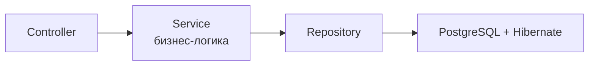
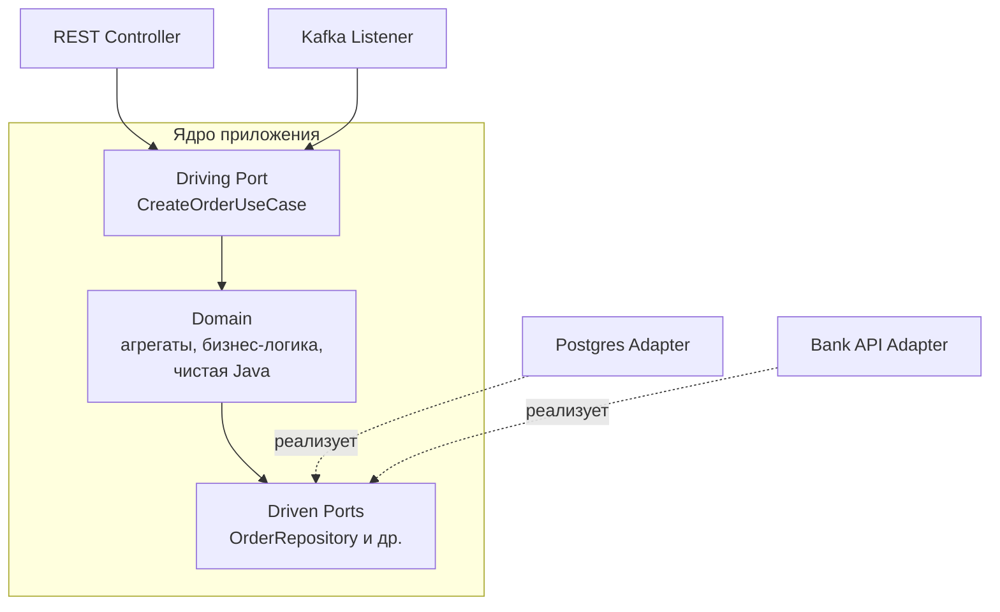

---
tags:
  - Middle
  - Senior
  - Архитектура
  - Spring
---

# Слоистая и гексагональная архитектура

Как разложить код сервиса по слоям, чтобы бизнес-логика не тонула в инфраструктуре: классическая слоистая архитектура, гексагональная с портами и адаптерами и когда какую выбирать. Вторая половина — где в такой архитектуре живёт Spring: в каких слоях ставить аннотации Spring и JPA, как адаптеры и конфигурация связывают ядро с фреймворком и куда ставить `@Transactional`, если домен не знает про Spring. На собесе спрашивают, чем плоха слоистая архитектура, как устроены порты и адаптеры и куда в них ставить `@Transactional`.

## Архитектурные стили { #styles }

### Чем плоха классическая слоистая архитектура? { #layered }

**Уровень:** Middle

!!! abstract "Ответ вслух"
    В схеме `Controller → Service → Repository` бизнес-логика зависит от репозитория, а он — от PostgreSQL и Hibernate. Чтобы поменять БД, обновить Hibernate или написать unit-тест на расчёт скидки, приходится тащить всю инфраструктуру. Для CRUD это нормально, для сложного домена — нет.

Проблема — **направление зависимостей**:



Итог: чистая бизнес-логика зависит от инфраструктуры. Поменять БД, обновить Hibernate или написать unit-тест на расчёт скидки — значит поднимать Spring-контекст и базу.

!!! warning "Ловушка: слои ради слоёв в сложном домене"
    Для CRUD слоистая архитектура — нормальный выбор. Но в сложной ERP со статусами и расчётами каждый тест бизнес-правила требует инфраструктуры, и логика постепенно расползается по сервисам и репозиториям. Тогда зависимости переворачивают.

??? question "Проверь себя"
    1. В какую сторону направлены зависимости в слоистой архитектуре?
    2. Почему unit-тест на расчёт скидки требует базы?
    3. Когда слоистая архитектура — нормальный выбор?

### Как устроена гексагональная архитектура? { #hexagonal }

**Уровень:** Middle

!!! abstract "Ответ вслух"
    Hexagonal (Ports and Adapters), как и Onion и Clean Architecture, переворачивает зависимости: внешние слои зависят от домена, а домен ничего не знает о них. В центре — чистая Java без аннотаций Spring, Kafka и Hibernate. Домен общается с миром через порты — интерфейсы, а адаптеры снаружи их реализуют или вызывают.

Главное правило — **dependency inversion**: внешние слои (БД, UI, API) зависят от внутренних (бизнес-логика), внутренние **ничего не знают** о внешних.



**Порты** — Java-интерфейсы внутри домена:

- **Driving Ports (входящие)** — как мир вызывает домен: `CreateOrderUseCase`.
- **Driven Ports (исходящие)** — как домен обращается к миру: `OrderRepository`. «Мне нужно сохранить заказ, вот контракт; кто и как — неважно».

**Адаптеры** — классы-реализации снаружи:

- **Driving Adapters** — `OrderRestController` принимает JSON и вызывает `CreateOrderUseCase`.
- **Driven Adapters** — `PostgresOrderRepository` реализует `OrderRepository` и мапит домен в Hibernate `@Entity`.

По кольцам код раскладывается так: в центре **Domain** (Entity, Value Objects, доменные сервисы — чистая Java), вокруг — **Application** (use case'ы и порты), снаружи — **Infrastructure** (Spring, JPA, Kafka, REST). **Onion** и **Clean Architecture** делают то же самое и рисуют концентрическими кругами: «зависимости указывают только внутрь».

Куда ставить аннотации Spring, `@Transactional` и как склеить слои конфигурацией — разобрано в [Spring в гексагональной архитектуре](#spring-ddd).

!!! warning "Ловушка: JPA-аннотации на доменных классах"
    Если пометить доменный `Order` аннотацией `@Entity`, домен снова зависит от Hibernate — и все плюсы гексагона пропадают. Доменная модель и JPA-сущность — разные классы, а driven-адаптер мапит одну в другую.

??? question "Проверь себя"
    1. Чем driving port отличается от driven port?
    2. Что такое адаптер и где он живёт?
    3. Что общего у Hexagonal, Onion и Clean Architecture?

### Layered или Hexagonal? { #layered-vs-hexagonal }

**Уровень:** Middle

!!! abstract "Ответ вслух"
    Layered — для примитивной логики и CRUD: просто и быстро, но бизнес-логика зависит от инфраструктуры. Hexagonal — для сложного домена: бизнес-правила тестируются за миллисекунды с замоканными портами. Главный плюс — новый вход в систему, например Kafka вместо REST, добавляется новым адаптером без изменения домена.

| | **Layered** | **Hexagonal / Clean** |
|---|---|---|
| **Когда** | Примитивная логика, CRUD | Сложный домен (ERP, статусы, расчёты) |
| **Плюс** | Просто, быстро написать | Тесты бизнес-правил за миллисекунды (мокаем порты) |
| **Минус** | Бизнес-логика зависит от инфраструктуры | Оверинжиниринг для простого CRUD |

Сейчас вызов идёт через REST-контроллер. Завтра бизнес скажет «слушаем события из Kafka» — пишешь новый входящий адаптер (Kafka Listener), который дёргает тот же порт `CreateOrderUseCase`. **Домен не меняется.**

!!! warning "Ловушка: гексагон для CRUD"
    Для справочника из трёх таблиц порты, адаптеры и маппинг между доменом и JPA-сущностями — лишний код без выгоды. Hexagonal окупается там, где много бизнес-правил, которые надо тестировать и защищать от инфраструктуры.

??? question "Проверь себя"
    1. Когда выбирать слоистую архитектуру, а когда — гексагональную?
    2. Как в гексагоне добавить приём событий из Kafka?
    3. Почему тесты бизнес-правил в гексагоне быстрые?

## Spring в гексагональной архитектуре { #spring-ddd }

Порты, адаптеры и направление зависимостей разобраны в [гексагональной архитектуре](#hexagonal). Модель домена — в [DDD](ddd.md). Здесь — где в такой архитектуре ставить аннотации Spring и JPA.

### В каких слоях живут аннотации Spring? { #where-annotations }

**Уровень:** Middle

=== "Коротко"

    !!! abstract "Ответ вслух"
        Только во внешнем слое — инфраструктуре. Домен и use cases — чистая Java без `@Entity`, `@Service` и `@Autowired`, порты — обычные Java-интерфейсы. Spring живёт в адаптерах (`@RestController`, `@KafkaListener`, реализации репозиториев с `@Component`) и в `@Configuration`, которая собирает чистые классы ядра через `@Bean`.

=== "Подробно"

    В классической слоистой архитектуре (`Controller → Service → Repository`) бизнес-логика в `@Service` знает про Spring, JPA и конкретные реализации. При смене БД правим сервисы, при тестировании поднимаем контекст. В гексагоне аннотации уходят наружу:

    ```mermaid
    flowchart TB
        subgraph INF["Infrastructure — здесь живёт Spring"]
            DA["Driving Adapters: @RestController, @KafkaListener"]
            DRA["Driven Adapters: JpaRepository, KafkaTemplate"]
            CFG["@Configuration: сборка ядра через @Bean"]
            subgraph APP["Application — Use Cases и Ports, без Spring"]
                IP["Incoming Ports: интерфейсы Use Case"]
                OP["Outgoing Ports: интерфейсы Repository"]
                subgraph DOM["Domain — чистая Java"]
                    D["Entity, Value Objects, Domain Services"]
                end
            end
        end
        DA --> IP
        IP --> D
        D --> OP
        DRA -. реализует .-> OP
    ```

    **Domain — ноль Spring.** Богатая доменная модель защищает инварианты бизнес-методами (почему анемичная модель — антипаттерн, разобрано в [DDD → Aggregates и Entities](ddd.md#aggregate)):

    ```java
    // ❌ Анемичная модель (антипаттерн)
    @Entity
    public class Booking {
        private Long id;
        private BookingStatus status;
        // только геттеры и сеттеры, логика в сервисе
    }

    // ✅ Богатая доменная модель (Rich Domain Model)
    // Никаких @Entity, @Service, @Autowired — чистая Java
    public class Booking {
        private final BookingId id;
        private BookingStatus status;
        private final ClientId clientId;
        private final TimeSlot timeSlot;

        // Бизнес-метод защищает инварианты
        public void confirm() {
            if (this.status != BookingStatus.PENDING) {
                throw new IllegalStateException("Можно подтвердить только ожидающую запись");
            }
            this.status = BookingStatus.CONFIRMED;
        }

        public void cancel(String reason) {
            if (this.status == BookingStatus.COMPLETED) {
                throw new IllegalStateException("Нельзя отменить завершённую запись");
            }
            this.status = BookingStatus.CANCELLED;
        }
    }
    ```

    **Ports — контракты без реализации**, обычные Java-интерфейсы:

    ```java
    // Incoming Port — что умеет система (Use Case)
    public interface CreateBookingUseCase {
        Booking createBooking(CreateBookingCommand command);
    }

    public interface CancelBookingUseCase {
        void cancelBooking(BookingId id, String reason);
    }

    // Outgoing Port — что нужно ядру от внешнего мира
    public interface BookingRepository {   // обычный Java-интерфейс, не JpaRepository!
        void save(Booking booking);
        Optional<Booking> findById(BookingId id);
        List<Booking> findByClientId(ClientId clientId);
    }

    public interface NotificationPort {
        void notifyBookingConfirmed(Booking booking);
    }
    ```

    **Application — Use Cases**, тоже без Spring:

    ```java
    // Чистый Java-класс, реализует Use Case
    // Нет @Service, @Transactional, @Autowired — только бизнес-логика
    public class CreateBookingService implements CreateBookingUseCase {

        private final BookingRepository bookingRepository;   // Outgoing Port
        private final NotificationPort notificationPort;     // Outgoing Port

        // Конструктор вместо @Autowired
        public CreateBookingService(BookingRepository bookingRepository,
                                    NotificationPort notificationPort) {
            this.bookingRepository = bookingRepository;
            this.notificationPort = notificationPort;
        }

        @Override
        public Booking createBooking(CreateBookingCommand command) {
            // Только бизнес-правила
            if (bookingRepository.isSlotOccupied(command.getTimeSlot())) {
                throw new SlotAlreadyBookedException(command.getTimeSlot());
            }
            Booking booking = new Booking(command.getClientId(), command.getTimeSlot());
            bookingRepository.save(booking);
            notificationPort.notifyBookingConfirmed(booking);
            return booking;
        }
    }
    ```

!!! warning "Ловушка: `JpaRepository` как порт"
    Если outgoing port — это `JpaRepository`, ядро снова зависит от Spring Data и JPA. Порт — свой интерфейс, а `JpaRepository` используется только внутри адаптера.

??? question "Проверь себя"
    1. В каких слоях нет аннотаций Spring?
    2. Чем outgoing port отличается от `JpaRepository`?
    3. Почему `CreateBookingService` не помечен `@Service`?

### Как адаптеры и конфигурация связывают ядро со Spring? { #adapters-config }

**Уровень:** Middle

=== "Коротко"

    !!! abstract "Ответ вслух"
        Входящий адаптер — `@RestController` — зависит от интерфейса use case, а не от сервиса. Исходящий адаптер — `@Component`, реализующий доменный порт через стандартный `JpaRepository` и маппинг в JPA Entity. Чистые классы ядра Spring создаёт через `@Bean` в `@Configuration` и сам подставляет адаптеры в их конструкторы.

=== "Подробно"

    ```java
    // Driving Adapter — входящий (REST)
    @RestController
    @RequestMapping("/api/bookings")
    public class BookingController {

        private final CreateBookingUseCase createBooking; // Incoming Port, не сервис!

        public BookingController(CreateBookingUseCase createBooking) {
            this.createBooking = createBooking;
        }

        @PostMapping
        public ResponseEntity<BookingDto> create(@Valid @RequestBody CreateBookingRequest req) {
            Booking booking = createBooking.createBooking(req.toCommand());
            return ResponseEntity.status(CREATED).body(BookingDto.from(booking));
        }
    }

    // Driven Adapter — исходящий (JPA реализует наш доменный интерфейс)
    @Component
    public class JpaBookingRepository implements BookingRepository { // Outgoing Port!

        private final BookingJpaRepository jpaRepo; // стандартный JpaRepository

        @Override
        public void save(Booking booking) {
            BookingJpaEntity entity = BookingMapper.toEntity(booking); // маппинг!
            jpaRepo.save(entity);
        }

        @Override
        public Optional<Booking> findById(BookingId id) {
            return jpaRepo.findById(id.getValue())
                .map(BookingMapper::toDomain); // маппинг обратно в доменный объект
        }
    }

    // JPA Entity — только для персистентности, не бизнес-объект
    @Entity
    @Table(name = "bookings")
    public class BookingJpaEntity {
        @Id @GeneratedValue
        private Long id;
        private Long clientId;
        private LocalDateTime slotStart;
        private LocalDateTime slotEnd;
        @Enumerated(EnumType.STRING)
        private BookingStatus status;
    }
    ```

    Конфигурация склеивает всё через Spring:

    ```java
    @Configuration
    public class DomainConfig {

        // Spring создаёт чистый Java-объект и инжектит адаптеры
        @Bean
        public CreateBookingUseCase createBookingUseCase(
                BookingRepository bookingRepository,     // Spring найдёт JpaBookingRepository
                NotificationPort notificationPort) {
            return new CreateBookingService(bookingRepository, notificationPort);
        }

        @Bean
        public CancelBookingUseCase cancelBookingUseCase(BookingRepository bookingRepository) {
            return new CancelBookingService(bookingRepository);
        }
    }
    ```

!!! warning "Ловушка: контроллер зависит от реализации"
    Если `BookingController` внедряет `CreateBookingService`, а не `CreateBookingUseCase`, адаптер привязан к конкретному классу ядра. Зависимость должна идти на порт — тогда реализацию можно заменить или задекорировать.

??? question "Проверь себя"
    1. От чего зависит `BookingController`?
    2. Как `JpaBookingRepository` связан с доменным портом?
    3. Как Spring создаёт `CreateBookingService`, если на нём нет `@Service`?

### Где ставить `@Transactional`, если в ядре нет Spring? { #transactional-ddd }

**Уровень:** Senior

!!! abstract "Ответ вслух"
    Есть два подхода. Пуристский — декоратор на инфраструктурном слое: класс-обёртка реализует тот же use case, помечен `@Transactional` и делегирует чистому сервису. Прагматичный — `jakarta.transaction.Transactional` из стандарта JTA прямо в use case: транзакции — часть бизнес-требований, а зависимость от JTA некритична.

Вопрос: в ядре нет Spring, но транзакции — бизнес-требование. Куда вешать `@Transactional`?

**Подход 1 — пуристский.** Создать обёртку-[декоратор](../design/structural-patterns.md#decorator) на инфраструктурном слое:

```java
@Component
@Primary
public class TransactionalCreateBookingUseCase implements CreateBookingUseCase {
    private final CreateBookingService delegate; // чистый сервис

    @Override
    @Transactional  // транзакция на обёртке, не в ядре
    public Booking createBooking(CreateBookingCommand command) {
        return delegate.createBooking(command);
    }
}
```

**Подход 2 — прагматичный (принятый в индустрии).** Использовать `jakarta.transaction.Transactional` прямо в use case. Это стандарт JTA, не Spring-специфичный импорт; до Spring Boot 3 / Jakarta EE 9 пакет назывался `javax.transaction`. Компромисс допустим: транзакции реально являются частью бизнес-требований (ACID), и завязка на JTA-стандарт некритична.

!!! warning "Ловушка: `@Primary` у декоратора"
    Декоратор и чистый сервис реализуют один интерфейс. Без `@Primary` (или квалификатора) Spring не поймёт, какой бин внедрять в контроллер, и упадёт с ошибкой неоднозначности.

??? question "Проверь себя"
    1. Как работает пуристский подход с декоратором?
    2. Почему `jakarta.transaction.Transactional` считается допустимым компромиссом?
    3. Как назывался пакет JTA до Spring Boot 3?

### Зачем маппить доменную модель в отдельную JPA Entity? { #double-entities }

**Уровень:** Senior

!!! abstract "Ответ вслух"
    Это цена изоляции: JPA Entity оптимизирована под таблицы — пустой конструктор, геттеры и сеттеры, аннотации связей, а доменная модель — под бизнес-правила и может вообще не иметь сеттеров. В простом CRUD двойные сущности — лишний оверхед, в сложном домене они защищают от «большого кома грязи».

Вопрос: _«Зачем маппить `Booking` → `BookingJpaEntity` → `Booking`? Это же дублирование!»_

JPA Entity требует пустого конструктора, геттеров/сеттеров и аннотаций связей — она оптимизирована под структуру таблиц. Domain Model оптимизирована под бизнес-правила: может не иметь сеттеров вообще, а её структура не обязана совпадать с таблицами.

!!! warning "Ловушка: двойные сущности в простом CRUD"
    В простых CRUD-приложениях маппинг — чистый оверхед. Он окупается в сложных доменах, где спасает от превращения кода в Big Ball of Mud («большой ком грязи»).

??? question "Проверь себя"
    1. Чем JPA Entity отличается от доменной модели по требованиям?
    2. Когда двойные сущности оправданы?
    3. Когда они лишние?

## Шпаргалка { #cheatsheet }

<!-- --8<-- [start:cheatsheet] -->
| Тема | Запомнить |
|---|---|
| **Layered** | `Controller → Service → Repository`: логика зависит от инфраструктуры. Нормально для CRUD |
| **Hexagonal** | Зависимости внутрь, ядро — чистая Java. Порты — интерфейсы в домене, адаптеры — снаружи |
| **Layered vs Hexagonal** | Новый вход = новый адаптер, домен не трогаем. Для CRUD — оверинжиниринг |
| **DDD: Domain** | Чистая Java. Никаких `@Entity`, `@Service`. Богатая модель с бизнес-методами |
| **DDD: Ports** | Incoming — use cases (что умеем). Outgoing — repository и внешние сервисы |
| **DDD: Adapters** | Driving (REST/Kafka) → Driven (JPA/HTTP-клиент). Здесь живёт Spring |
| **`@Transactional` в DDD** | Декоратор (пуристы) или `jakarta.transaction.Transactional` в use case (прагматики) |

<!-- --8<-- [end:cheatsheet] -->
