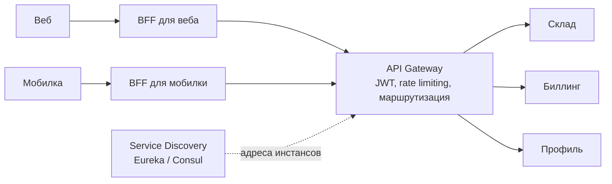
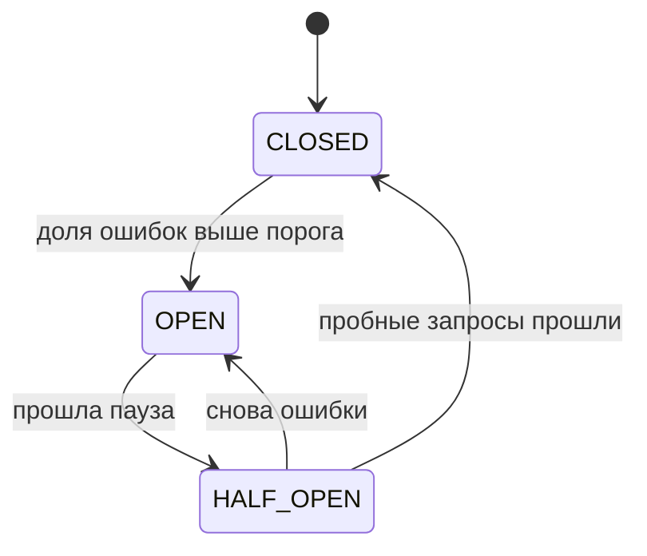

---
tags:
  - Middle
  - Архитектура
  - Микросервисы
---

# Микросервисы и отказоустойчивость

Когда разбивать систему на микросервисы и как они общаются: монолит против микросервисов, синхронная и асинхронная связь, API Gateway и BFF, rate limiting. Вторая половина — как сервисам переживать сбои друг друга: timeout и retry с backoff, circuit breaker, bulkhead и graceful degradation.

## Микросервисы { #microservices }

### Монолит или микросервисы? { #monolith-vs-microservices }

**Уровень:** Middle

!!! abstract "Ответ вслух"
    Монолит проще разрабатывать, деплоить и тестировать на старте, у него одна БД и обычные ACID-транзакции. Микросервисы дают независимый деплой и масштабирование, автономию команд и свободу стека, но приносят сетевую сложность и распределённые транзакции. Начинают с монолита и выделяют сервисы под конкретную причину.

- **Монолит** — одно разворачиваемое приложение. Проще разрабатывать, деплоить и тестировать на старте, единая БД и обычные ACID-транзакции. Минусы приходят с ростом: нельзя масштабировать отдельные части, команды мешают друг другу, стек — один навсегда.
- **Микросервисы** — независимые сервисы: отдельный деплой и масштабирование, автономия команд, свобода стека. Цена — сетевая сложность, [распределённые транзакции](distributed-transactions.md#saga), сложная наблюдаемость, ops-overhead.

Компромисс между мирами — модульный монолит, он разобран в [Архитектура → Модульный монолит](architecture.md#modular-monolith). Внутреннее устройство отдельного сервиса — DDD, Hexagonal, CQRS и Event Sourcing — тоже в [Архитектура приложения](architecture.md).

!!! warning "Ловушка: distributed monolith"
    Худший исход: систему разбили на сервисы, но они так связаны, что деплоятся только вместе. Это минусы обоих миров сразу. Зрелый ответ на собесе: «начинаем с монолита, выделяем сервисы под конкретную причину — масштаб, автономия команд, — а не рефлекторно».

??? question "Проверь себя"
    1. В чём плюсы монолита на старте проекта?
    2. Чем платят за микросервисы?
    3. Что такое distributed monolith?

### Синхронно или асинхронно? { #sync-async }

**Уровень:** Junior

!!! abstract "Ответ вслух"
    Синхронный вызов блокирует тебя до ответа: просто, но если получатель тормозит или упал, тормозишь или падаешь и ты. Асинхронный — кладёшь сообщение в очередь и работаешь дальше: сервисы развязаны, пики буферизуются. Цена асинхронности — eventual consistency и сложнее отследить результат.

- **Sync** — вызвал и блокируешься до ответа, как в обычном REST-вызове. Просто, но связность высокая: получатель тормозит или упал — тормозишь или падаешь и ты.
- **Async** — кинул сообщение в очередь (Kafka, RabbitMQ) и работаешь дальше. Это развязка сервисов, буферизация пиков и устойчивость к падениям получателя.

Пример: регистрация пользователя — синхронно, потому что нужен мгновенный ответ. Отправка welcome-письма — в очередь.

!!! warning "Ловушка: всё асинхронно"
    Асинхронность покупается eventual consistency: результат появится позже, и отследить его сложнее. Если пользователю нужен ответ здесь и сейчас — успешна ли регистрация, прошёл ли платёж, — этот шаг оставляют синхронным.

??? question "Проверь себя"
    1. Чем синхронный вызов опасен для вызывающего сервиса?
    2. Что даёт асинхронное общение через очередь?
    3. Какую часть регистрации пользователя делать синхронно, а какую — асинхронно?

### Зачем нужны API Gateway, BFF и Service Discovery? { #api-gateway }

**Уровень:** Middle

!!! abstract "Ответ вслух"
    API Gateway — единая точка входа для клиентов: маршрутизация к сервисам, аутентификация, rate limiting, агрегация ответов. BFF (Backend For Frontend) — отдельный лёгкий бэкенд под конкретного клиента, который собирает данные для экрана одним запросом. Service Discovery — реестр живых инстансов, через который сервисы находят друг друга при автоскейлинге.

- **API Gateway** — клиент общается с gateway, а не с десятком сервисов. Gateway маршрутизирует к нужному микросервису, проверяет JWT-токены, ограничивает частоту запросов (rate limiting, защита от DDoS) и агрегирует ответы. В Java — Spring Cloud Gateway.
- **BFF (Backend For Frontend)** — развитие gateway: отдельный сервис под конкретного клиента, один для веба, другой для мобилки. Вместо 10 запросов с фронта к складу, биллингу и профилю — 1 запрос к BFF, который сам соберёт данные по микросервисам и вернёт готовый JSON под конкретный экран.
- **Service Discovery** — реестр живых инстансов (Eureka, Consul). Нужен, потому что при автоскейлинге инстансы постоянно появляются и исчезают.



!!! warning "Ловушка: бизнес-логика в gateway"
    Gateway — инфраструктурный слой: маршрутизация, аутентификация, лимиты. Если в него начинают переносить бизнес-правила, он становится узким местом, через которое проходит каждый релиз каждой команды. Сборку данных под конкретный экран выносят в BFF.

??? question "Проверь себя"
    1. Какие задачи решает API Gateway?
    2. Чем BFF отличается от общего gateway?
    3. Зачем нужен Service Discovery при автоскейлинге?

### Как работает rate limiting? { #rate-limiting }

**Уровень:** Middle

!!! abstract "Ответ вслух"
    Rate limiting ограничивает частоту запросов: защищает от абьюза и брутфорса, делит ресурсы честно и контролирует затраты. Основные алгоритмы — fixed window, sliding window, token bucket и leaky bucket. Token bucket разрешает всплески до размера ведра, leaky bucket выравнивает поток.

| Алгоритм | Суть | Особенность |
|---|---|---|
| **Fixed window** | Счётчик на фиксированное окно (100/мин) | Проблема границы: 100 в конце минуты + 100 в начале следующей = 200 за пару секунд |
| **Sliding window log** | Храним timestamp каждого запроса | Точно, но ест память |
| **Sliding window counter** | Взвешенный гибрид текущего и прошлого окна | Хороший баланс точности и памяти для прода |
| **Token bucket** | Токены капают со скоростью R, запрос тратит токен | **Разрешает всплески** до размера ведра |
| **Leaky bucket** | Запросы «вытекают» с постоянной скоростью | **Выравнивает** поток, всплесков не допускает |

Различие, которое спрашивают: token bucket допускает burst — накопил токены, потратил разом, — а leaky bucket выравнивает поток в ровный темп. Реализация на Redis — в [NoSQL](../database/nosql.md).

!!! warning "Ловушка: локальный счётчик на каждом инстансе"
    При многих инстансах за балансировщиком каждый будет считать лимит по-своему, и реальный предел умножится на число инстансов. Счётчик распределённого лимитера должен быть общим — атомарные инкременты в **Redis**.

??? question "Проверь себя"
    1. В чём проблема границы окна у fixed window?
    2. Чем token bucket отличается от leaky bucket?
    3. Где хранить счётчик, если сервис запущен в нескольких инстансах?

## Надёжность { #reliability }

Аксиома распределённых систем: **всё рано или поздно падает** — сеть моргает, сервисы тормозят, диски умирают. Дизайн отвечает не на вопрос «как избежать сбоев», а «как выжить при них». В Java эти паттерны собраны в **Resilience4j**.

### Зачем нужны timeout и retry с backoff? { #timeout-retry }

**Уровень:** Middle

!!! abstract "Ответ вслух"
    Timeout — никогда не ждать ответа бесконечно: зависшие вызовы копят потоки и соединения, и медленный сосед вешает твой сервис. Retry повторяет запрос при временном сбое, но с экспоненциальной паузой и случайным разбросом (jitter), чтобы не добить лежащий сервис. Ретраить можно только идемпотентные операции.

**Timeout** — базовая и часто забываемая защита. Без него зависшие вызовы копят потоки и соединения.

**Retry + exponential backoff + jitter** — повтор при временном сбое, но с умом:

- Пауза растёт экспоненциально (1 с → 2 с → 4 с) — даём сервису восстановиться.
- **Jitter** — случайная добавка к паузе. Без неё все клиенты ретраят синхронно и добивают лежащий сервис (**retry storm / thundering herd**).
- Ретраить — только **идемпотентные** операции, иначе дважды спишешь деньги.

```java
@Retry(name = "bankApi")
// application.yml:
// resilience4j.retry.bankApi.max-attempts: 4
// resilience4j.retry.bankApi.wait-duration: 1s
// resilience4j.retry.bankApi.exponential-backoff-multiplier: 2
```

!!! warning "Ловушка: ретраи без jitter"
    Если тысяча клиентов получила ошибку в одну секунду и все ретраят ровно через 1, 2, 4 секунды, на сервис приходят синхронные волны нагрузки. Он не успевает подняться между ними. Jitter размазывает повторы во времени.

??? question "Проверь себя"
    1. Почему вызов без timeout опасен для вызывающего сервиса?
    2. Зачем к exponential backoff добавляют jitter?
    3. Какие операции нельзя ретраить?

### Как работает circuit breaker? { #circuit-breaker }

**Уровень:** Middle

!!! abstract "Ответ вслух"
    Circuit breaker (предохранитель) считает ошибки вызовов к зависимости. Когда их доля превышает порог, он размыкается и сразу отклоняет запросы, не дёргая упавший сервис; через паузу пропускает несколько пробных. Так локальный сбой не превращается в каскадный отказ всей системы.



- **Closed** — работаем, считаем ошибки.
- **Open** — мгновенно отклоняем запросы, не дёргая мёртвый сервис: fail fast, не тратим ресурсы, даём упавшему передышку.
- **Half-open** — пропускаем несколько пробных запросов.

```java
// Resilience4j — стандарт де-факто в Java
@CircuitBreaker(name = "bankApi", fallbackMethod = "fallbackBonus")
public BonusResult calculateBonus(Long userId) {
    return bankApiClient.getBonus(userId); // может зависнуть
}

// Fallback — когда предохранитель открыт
public BonusResult fallbackBonus(Long userId, Throwable t) {
    log.warn("Банк недоступен, возвращаем дефолт", t);
    return BonusResult.empty();
}
```

`@CircuitBreaker` работает через прокси, поэтому на самовызов внутри класса не срабатывает — механика разобрана в [Spring Core](../spring/spring-core.md).

!!! warning "Ловушка: circuit breaker без fallback"
    В состоянии Open запросы отклоняются сразу, и без fallback пользователь получит ошибку вместо ответа. Fallback возвращает дефолт или кэш — это и есть [graceful degradation](#bulkhead).

??? question "Проверь себя"
    1. Опиши три состояния circuit breaker и переходы между ними.
    2. Зачем нужно состояние Half-open?
    3. Что делает fallback-метод?

### Что такое bulkhead и graceful degradation? { #bulkhead }

**Уровень:** Middle

!!! abstract "Ответ вслух"
    Bulkhead (переборка) — отдельные пулы потоков и соединений на каждую зависимость, как отсеки корабля. Зависли вызовы к сервису А и выели свой пул — вызовы к Б живут на своём. Graceful degradation — отдать урезанный, но рабочий ответ вместо 500: страница товара без блока «похожие», если упал сервис рекомендаций.

- **Bulkhead** — без переборок один медленный dependency вешает всё приложение, потому что занимает общий пул.
- **Graceful degradation / fallback** — часто реализуется как fallback у circuit breaker: в Open отдаём кэш или дефолт. Это разница между «сайт лагает» и «сайт лежит».

!!! warning "Ловушка: один общий пул на все вызовы"
    Если все внешние вызовы делятся одним пулом потоков, медленный платёжный шлюз займёт его целиком. Тогда перестанут работать и запросы, которым платёжный шлюз вообще не нужен. Переборка ограничивает ущерб одной зависимостью.

??? question "Проверь себя"
    1. Как bulkhead защищает приложение от медленной зависимости?
    2. Что такое graceful degradation? Приведи пример.
    3. Как связаны fallback и circuit breaker?

## Шпаргалка { #cheatsheet }

<!-- --8<-- [start:cheatsheet] -->
| Тема | Запомнить |
|---|---|
| **Монолит vs микросервисы** | Начинай с монолита; distributed monolith — худший исход |
| **Sync vs async** | Sync — просто, но связность. Async — развязка и буфер, цена — eventual consistency |
| **API Gateway / BFF** | Gateway — единая точка входа. BFF — 1 запрос → готовый JSON для экрана |
| **Rate limiting** | Token bucket — всплески ок. Leaky — ровный поток. Счётчик — в Redis |
| **Retry** | Только идемпотентные + exponential backoff + jitter (иначе retry storm) |
| **Circuit breaker** | Closed → Open → Half-Open. Fail fast против каскадного отказа |
| **Bulkhead** | Изолируй пулы потоков по зависимостям; fallback — урезанный ответ вместо 500 |

<!-- --8<-- [end:cheatsheet] -->
