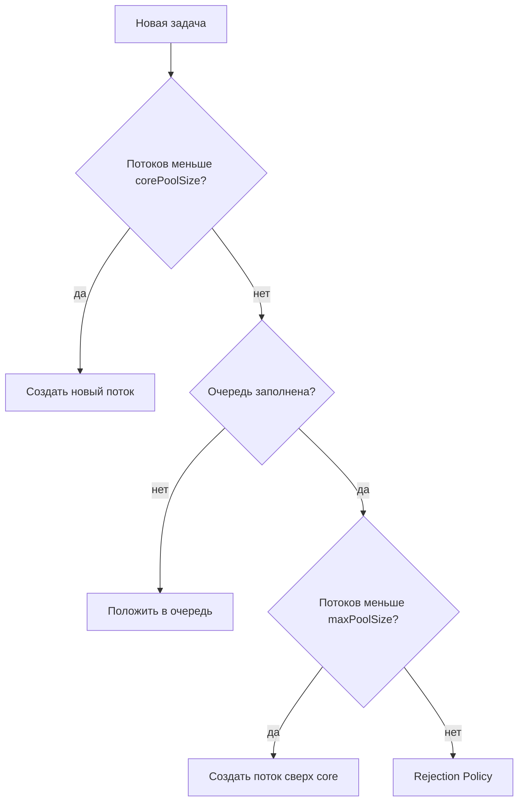
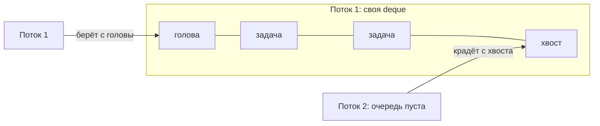

---
tags:
  - Junior
  - Middle
  - Java
  - Многопоточность
---

# Пулы потоков и CompletableFuture

Зачем нужны пулы потоков, как `ThreadPoolExecutor` решает, что делать с новой задачей, чем опасны фабрики `Executors` и как устроен `ForkJoinPool`. Вторая часть — асинхронность: чем плох `Future` и как строить цепочки и обрабатывать ошибки в `CompletableFuture`.

## Пулы потоков (Executors) { #executors }

### Зачем пулы, если есть `new Thread()`? { #why-pools }

**Уровень:** Junior

!!! abstract "Ответ вслух"
    Создание системного потока — дорогой системный вызов, а поток на каждый запрос под нагрузкой приводит к `OutOfMemoryError: unable to create new native thread`. Пул переиспользует потоки, ограничивает их число и управляет жизненным циклом. Базовые интерфейсы — `Executor`, `ExecutorService` и `ScheduledExecutorService`.

Почему не делаем `new Thread()` вручную:

1. **Дорого:** создание системного потока (Java-поток → поток ОС) — тяжёлый системный вызов с выделением памяти под стек.
2. **Риск OOM:** 1000 запросов → 1000 потоков → `OutOfMemoryError: unable to create new native thread`.
3. **Нет контроля:** непонятно, как собрать результаты, отменить задачу или ограничить количество потоков.

Решение — **пулы потоков**: переиспользуем потоки, управляем жизненным циклом. Иерархия интерфейсов:

- **`Executor`** — базовый: `execute(Runnable)`. Просто «выполни где-нибудь».
- **`ExecutorService`** — рабочий инструмент: управление жизненным циклом (`shutdown`, `shutdownNow`), возврат результата через `submit(Callable)` → `Future`.
- **`ScheduledExecutorService`** — выполнение с задержкой или периодически (замена устаревшему `Timer`).

```java
try (ExecutorService pool = Executors.newFixedThreadPool(4)) {
    Future<Integer> answer = pool.submit(() -> 6 * 7); // Callable → Future
    System.out.println(answer.get());                  // 42
} // с Java 19 ExecutorService — AutoCloseable: close() ждёт завершения задач
```

!!! warning "Ловушка: пул без `shutdown()`"
    Потоки пула не демоны: если не вызвать `shutdown()` (или не закрыть пул в `try-with-resources`), JVM не завершится после `main`.

??? question "Проверь себя"
    1. Назови три причины не создавать поток на каждую задачу.
    2. Чем `ExecutorService` отличается от `Executor`?
    3. Что заменяет `ScheduledExecutorService`?

### Как `ThreadPoolExecutor` решает, что делать с задачей? { #thread-pool-executor }

**Уровень:** Middle

!!! abstract "Ответ вслух"
    Пока потоков меньше `corePoolSize`, создаётся новый поток. Потом задачи идут в очередь, и только когда очередь заполнена, пул создаёт потоки до `maxPoolSize`. Если и это не помогло — срабатывает политика отказа (rejection policy).

Четыре главных параметра конструктора:

- **`corePoolSize`** — базовое число потоков, живут всегда (даже без задач).
- **`maxPoolSize`** — максимум потоков при пиковой нагрузке.
- **`keepAliveTime`** — время простоя «лишних» потоков (сверх core) до удаления.
- **`workQueue`** — очередь задач, когда все потоки заняты.

Алгоритм принятия решений — порядок строго такой:



**Rejection Policies:**

| Политика | Поведение | Когда применять |
|---|---|---|
| `AbortPolicy` | Бросает `RejectedExecutionException` | По умолчанию, когда важно не терять задачи |
| `CallerRunsPolicy` | Вызывающий поток сам выполняет задачу | ⭐ Продакшн — создаёт естественный Backpressure |
| `DiscardPolicy` | Молча выбрасывает новую задачу | Некритичные логи, метрики |
| `DiscardOldestPolicy` | Выбрасывает самую старую задачу | Редко |

`CallerRunsPolicy` часто выбирают для продакшена. Пока главный поток сам обрабатывает задачу, он не может принимать новые запросы — пул получает время разгрести завал. Это **backpressure**.

```java
var pool = new ThreadPoolExecutor(
    4, 8,                                   // corePoolSize, maxPoolSize
    60, TimeUnit.SECONDS,                   // keepAliveTime для потоков сверх core
    new ArrayBlockingQueue<>(100),          // ограниченная очередь
    new ThreadPoolExecutor.CallerRunsPolicy());
```

!!! warning "Ловушка: потоки сверх core — только при полной очереди"
    Тут часто путаются: новые потоки сверх `corePoolSize` создаются только тогда, когда **очередь заполнена**. С безлимитной очередью пул никогда не вырастет выше core, и `maxPoolSize` ни на что не влияет.

??? question "Проверь себя"
    1. В каком порядке пул создаёт потоки, кладёт задачи в очередь и отказывает?
    2. Почему с безлимитной очередью `maxPoolSize` бесполезен?
    3. Как `CallerRunsPolicy` создаёт backpressure?

### Чем опасны фабрики `Executors`? { #executors-factories }

**Уровень:** Middle

!!! abstract "Ответ вслух"
    Стандартные фабрики удобны, но у каждой есть ограничение, которое бьёт на проде. `newFixedThreadPool` и `newSingleThreadExecutor` используют безлимитную очередь и при наплыве задач падают с OOM по куче. `newCachedThreadPool` создаёт поток на каждую задачу и падает с `unable to create new native thread`.

**`Executors.newFixedThreadPool(n)`**

- Под капотом: `core == max == n`, `LinkedBlockingQueue` — **безлимитная** очередь.
- Риск: при наплыве задач очередь бесконечно растёт → `OutOfMemoryError: Java heap space`.
- Когда использовать: нагрузка предсказуема, количество потоков строго ограничено ресурсами CPU.

**`Executors.newCachedThreadPool()`**

- Под капотом: `core = 0`, `max = Integer.MAX_VALUE`, `SynchronousQueue` (ёмкость 0 — сразу передаёт потоку).
- Риск: при DDoS-атаке создаёт поток на каждую задачу → `OutOfMemoryError: unable to create new native thread`.
- Когда использовать: много коротких лёгких асинхронных задач.

**`Executors.newSingleThreadExecutor()`**

- Под капотом: `core = max = 1`, `LinkedBlockingQueue`.
- Гарантирует строго последовательное выполнение. Если поток умрёт — пул создаст замену.

!!! warning "Ловушка: `newSingleThreadExecutor()` против `newFixedThreadPool(1)`"
    `newFixedThreadPool(1)` возвращает обычный `ThreadPoolExecutor` — его можно привести к типу и перенастроить (например, `.setMaximumPoolSize(10)`). `newSingleThreadExecutor()` оборачивает пул в **неизменяемый wrapper** — изменить размер в процессе работы невозможно.

??? question "Проверь себя"
    1. Какая очередь у `newFixedThreadPool` и чем это грозит?
    2. Почему `newCachedThreadPool` опасен под нагрузкой?
    3. Чем `newSingleThreadExecutor()` отличается от `newFixedThreadPool(1)`?

### Как устроен `ForkJoinPool`? { #forkjoinpool }

**Уровень:** Senior

!!! abstract "Ответ вслух"
    Это пул для рекурсивных задач «разделяй и властвуй», на нём по умолчанию работают `parallelStream()` и `CompletableFuture`. У каждого потока своя двусторонняя очередь (deque). Освободившийся поток крадёт задачи с хвоста очереди соседа (work stealing), поэтому синхронизация минимальна.

В обычном пуле — одна общая очередь, все потоки толкаются за ней. В FJP у **каждого** потока **своя очередь (Deque)**.

**Work Stealing (кража работы):** если поток выполнил все свои задачи, он идёт к загруженному соседу и «ворует» задачу с **хвоста** его очереди. Хозяин берёт с головы — конфликтов нет, синхронизация минимальна, CPU загружен максимально.



```java
// Рекурсивная сумма: задача делится пополам, пока кусок не станет маленьким
class SumTask extends RecursiveTask<Long> {
    private final long[] data;
    private final int from, to;

    SumTask(long[] data, int from, int to) {
        this.data = data;
        this.from = from;
        this.to = to;
    }

    @Override
    protected Long compute() {
        if (to - from <= 1_000) {
            long sum = 0;
            for (int i = from; i < to; i++) sum += data[i];
            return sum;
        }
        int mid = (from + to) >>> 1;
        SumTask left = new SumTask(data, from, mid);
        left.fork();                                   // в свою очередь — её могут украсть
        long right = new SumTask(data, mid, to).compute();
        return right + left.join();
    }
}
```

!!! warning "Ловушка: общий `commonPool()`"
    `parallelStream()` и `CompletableFuture` без своего `Executor` делят один `ForkJoinPool.commonPool()`. Блокирующая задача в нём занимает поток, который нужен всем остальным. Подробнее — в [Stream API → параллельные стримы](../java/streams.md#parallel) и [ниже про `CompletableFuture`](#completablefuture).

??? question "Проверь себя"
    1. Чем очередь задач в `ForkJoinPool` отличается от обычного пула?
    2. С какого конца очереди берёт хозяин, а с какого — вор, и зачем так?
    3. Что работает на `ForkJoinPool` по умолчанию?

## Асинхронность: `Future` и `CompletableFuture` { #async }

### Чем плох `Future`? { #future }

**Уровень:** Junior

!!! abstract "Ответ вслух"
    `Future` (Java 5) — «обещание» результата задачи из пула. Но узнать результат можно только опросом `isDone()` в цикле или блокирующим `get()`. Цепочки, комбинирование и обработку ошибок он не поддерживает — для этого есть `CompletableFuture`.

Отправляешь задачу в пул — получаешь `Future`. Но он «глухой и немой»:

```java
Future<String> future = executor.submit(() -> fetchData());

// Два варианта — оба плохие:
while (!future.isDone()) { /* ... */ } // сжигаем CPU в опросном цикле
String result = future.get();          // БЛОКИРУЕМ текущий поток — вся суть асинхронности теряется
```

!!! warning "Ловушка: `get()` без тайм-аута"
    Если задача зависла, `future.get()` будет ждать вечно. На проде используют `get(timeout, unit)` — он бросит `TimeoutException`.

??? question "Проверь себя"
    1. Какими двумя способами можно получить результат `Future` и чем плох каждый?
    2. Чего не умеет `Future` по сравнению с `CompletableFuture`?
    3. Чем `get(timeout, unit)` лучше `get()`?

### Как строить цепочки на `CompletableFuture`? { #completablefuture }

**Уровень:** Middle

!!! abstract "Ответ вслух"
    `CompletableFuture` (Java 8) строит конвейер асинхронных шагов, не блокируя главный поток. `thenApply` — как `map`, `thenCompose` — как `flatMap`, `thenCombine` — слияние двух независимых задач, `allOf` и `anyOf` — ожидание группы. Запускать задачи нужно со своим `Executor`, иначе всё уходит в общий `commonPool()`.

**Запуск:**

```java
CompletableFuture<Void> noResult = CompletableFuture
    .runAsync(() -> sendEmail(), executor);           // void

CompletableFuture<String> withResult = CompletableFuture
    .supplyAsync(() -> fetchData(), executor);        // возвращает результат
```

**Трансформация результата:**

```java
// thenApply — как map() в стримах. Один к одному, без нового async-шага
CompletableFuture<Integer> length = CompletableFuture
    .supplyAsync(() -> "Hello", executor)
    .thenApply(String::length);       // String → Integer

// thenCompose — как flatMap(). Когда следующий шаг тоже возвращает CF
CompletableFuture<Document> doc = CompletableFuture
    .supplyAsync(() -> fetchDocumentId(), executor)       // → Long
    .thenCompose(id -> loadDocument(id, executor));       // Long → CF<Document>
    // без thenCompose получили бы CF<CF<Document>>
```

**Слияние независимых задач (`thenCombine`):**

```java
// Параллельно парсим таблицы и картинки из файла
CompletableFuture<List<Table>> tables = CompletableFuture
    .supplyAsync(() -> parseTables(file), executor);
CompletableFuture<List<Image>> images = CompletableFuture
    .supplyAsync(() -> parseImages(file), executor);

// Ждём обоих, склеиваем результат — без блокировки главного потока
CompletableFuture<Document> result = tables.thenCombine(images,
    (t, i) -> new Document(t, i)
);
```

**Ожидание нескольких CF:**

```java
// Ждём, пока ВСЕ завершатся
CompletableFuture.allOf(cf1, cf2, cf3).join();

// Возвращает результат ПЕРВОГО завершившегося
CompletableFuture.anyOf(cf1, cf2, cf3).thenAccept(first -> System.out.println(first));
```

!!! warning "Ловушка: CF без своего `Executor`"
    Всегда передавай свой `Executor`. По умолчанию `*Async`-методы используют `ForkJoinPool.commonPool()` — его легко забить тяжёлыми или блокирующими задачами, и встанут все, кто его делит.

??? question "Проверь себя"
    1. Чем `thenApply` отличается от `thenCompose`?
    2. Как дождаться двух независимых задач и склеить их результаты?
    3. Почему в `supplyAsync` передают свой `Executor`?

### Как обрабатывать ошибки в `CompletableFuture`? { #cf-errors }

**Уровень:** Middle

!!! abstract "Ответ вслух"
    `exceptionally` работает как `catch`: вызывается только при ошибке и возвращает запасное значение. `handle` вызывается в любом случае и получает и результат, и исключение — как `catch` и `finally` вместе. Ошибка, которую никто не обработал, всплывёт при `join()` или `get()`.

```java
CompletableFuture<List<Image>> images = CompletableFuture
    .supplyAsync(() -> parseImages(file), executor)

    // exceptionally — как catch: ловит ошибку, возвращает фоллбэк
    .exceptionally(ex -> {
        log.error("Не удалось распарсить картинки: ", ex);
        return Collections.emptyList(); // вместо падения — пустой список
    })

    // handle — как finally + catch: вызывается В ЛЮБОМ СЛУЧАЕ
    // удобно для закрытия ресурсов и записи статуса
    .handle((result, ex) -> {
        if (ex != null) {
            log.error("Ошибка:", ex);
            return Collections.emptyList();
        }
        return result;
    });
```

!!! warning "Ловушка: исключение приходит обёрнутым"
    Если ошибка случилась на одном из предыдущих этапов, в `exceptionally` и `handle` придёт `CompletionException`, а исходное исключение — в `ex.getCause()`. `join()` тоже бросает `CompletionException`, а `get()` — `ExecutionException`.

??? question "Проверь себя"
    1. Когда вызывается `exceptionally`, а когда — `handle`?
    2. Что получает на вход `handle`?
    3. Какое исключение бросит `join()`, если этап упал?

## Шпаргалка { #cheatsheet }

<!-- --8<-- [start:cheatsheet] -->
| Тема | Запомнить |
|---|---|
| **`ThreadPoolExecutor`** | core → очередь → потоки до max → rejection policy; в проде — `CallerRunsPolicy` |
| **Фабрики `Executors`** | Fixed и Single — безлимитная очередь (OOM heap), Cached — безлимит потоков (OOM native thread) |
| **`ForkJoinPool`** | Своя очередь у каждого потока и work stealing; под капотом `parallelStream()` и `CompletableFuture` |
| **`CompletableFuture`** | `thenApply` — map, `thenCompose` — flatMap, `thenCombine` — слияние; всегда свой `Executor` |
| **Ошибки в CF** | `exceptionally` — catch с фоллбэком, `handle` — вызывается всегда |

<!-- --8<-- [end:cheatsheet] -->
