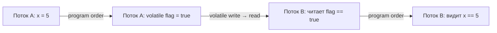
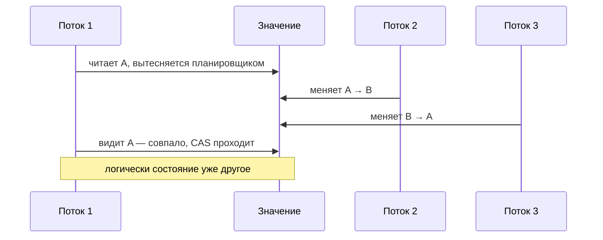

---
tags:
  - Middle
  - Senior
  - Java
  - Многопоточность
---

# JMM, volatile и атомики

Java Memory Model: когда запись одного потока видна другому, что такое happens-before и что гарантирует `volatile`. Вторая половина страницы — неблокирующая синхронизация: атомики, CAS, `LongAdder` и false sharing. Это самый частый «глубокий» вопрос блока многопоточности.

## Java Memory Model (JMM) { #jmm }

### Какие три проблемы решает JMM? { #jmm-basics }

**Уровень:** Middle

!!! abstract "Ответ вслух"
    Атомарность, видимость и упорядочивание. Без синхронизации поток может увидеть половину 64-битной записи, не увидеть чужую запись вообще или увидеть записи в другом порядке. JMM задаёт правила, когда запись одного потока гарантированно видна другому.

**Atomicity (атомарность)** — операция либо выполнена полностью, либо не начиналась. Другие потоки не видят промежуточного состояния.

Атомарны из коробки: чтение и запись ссылок и всех примитивов, **кроме** `long` и `double` (если они не `volatile`). 64-битная запись на 32-битной ОС может разбиться на два шага — и другой поток прочитает «склейку» из старой и новой половины (word tearing).

**Visibility (видимость)** — запись одного потока может долго оставаться невидимой для другого. Значение лежит в регистре или store buffer ядра, а JIT вправе закэшировать поле в регистре и вообще не перечитывать его. Без явной синхронизации JMM **не гарантирует**, когда (и увидит ли вообще) другой поток новое значение.

**Ordering (упорядочивание, reordering)** — компилятор и CPU вправе менять порядок инструкций, если это не ломает логику _текущего потока_ (правило _as-if-serial_). В многопоточном коде это приводит к неожиданным эффектам.

```java
// ❌ Без volatile JIT может вынести чтение running из цикла,
//    и поток никогда не увидит false
private boolean running = true;

void loop() {
    while (running) { /* работа */ }
}

void stop() {
    running = false; // запись из другого потока
}
```

!!! warning "Ловушка: «у меня на ноутбуке работает»"
    Отсутствие гарантии видимости не значит, что баг проявится всегда. Код без синхронизации может годами работать на одной машине и зависнуть на другой JVM, CPU или после прогрева JIT.

??? question "Проверь себя"
    1. Какие типы читаются и пишутся неатомарно и почему?
    2. Откуда берётся проблема видимости, если кэши ядер когерентны?
    3. Что разрешает правило as-if-serial?

### Что такое happens-before? { #happens-before }

**Уровень:** Middle

!!! abstract "Ответ вслух"
    Это отношение между действиями: если A happens-before B, то результат A виден B, и A не переупорядочится после B. Если между записью в одном потоке и чтением в другом нет happens-before, это data race. Связь дают монитор, `volatile`, `start()` и `join()`, и она транзитивна.

Если событие A _happens-before_ события B, то JMM гарантирует:

1. Результат A будет **виден** для B.
2. A гарантированно **выполнится до** B (запрет переупорядочивания).

**Ключевые правила:**

| Правило | Суть |
|---|---|
| **Program Order** | Каждое действие в потоке HB следующего в том же потоке |
| **Monitor Lock** | `unlock` HB следующего `lock` того же монитора |
| **Volatile Variable** | Запись в `volatile` HB любого последующего чтения этой переменной |
| **Thread Start** | `Thread.start()` HB любой инструкции в `run()` этого потока |
| **Thread Join** | Любая инструкция потока HB успешного выхода из `join()` |
| **Transitivity** | Если A HB B, и B HB C, то A HB C |



!!! warning "Ловушка: разные мониторы"
    Правило Monitor Lock работает только для **одного и того же** монитора. Если писатель синхронизируется на `lockA`, а читатель на `lockB`, связи happens-before между ними нет — это всё ещё data race.

??? question "Проверь себя"
    1. Какие две гарантии даёт happens-before?
    2. Назови три правила, которые создают happens-before между потоками.
    3. Как транзитивность позволяет обычной переменной стать видимой через `volatile`?

### Что гарантирует `volatile`, а что нет? { #volatile }

**Уровень:** Middle

!!! abstract "Ответ вслух"
    `volatile` решает видимость и упорядочивание: запись в него happens-before любого последующего чтения, а барьеры памяти запрещают переупорядочивание. Атомарность составных операций он не даёт — `count++` на `volatile` остаётся гонкой. Для атомарного инкремента нужен `AtomicInteger`.

- **Видимость:** запись в `volatile` happens-before любого последующего чтения этой переменной.
- **Memory barriers:** `volatile` расставляет барьеры (StoreStore, StoreLoad, LoadLoad, LoadStore), запрещающие переупорядочивание.
- **Release/Acquire-семантика:** если поток А записал `x = 5`, потом `volatile flag = true`, то поток Б, увидев `flag == true`, гарантированно увидит и `x == 5`.

Это **не** «запись в RAM и чтение из RAM в обход кэша»: кэши ядер и так когерентны (протокол MESI), и volatile-переменная спокойно живёт в L1. Значение «застревает» в регистрах и store buffer ядра, а ещё JIT может закэшировать поле в регистре и вынести чтение из цикла. `volatile` запрещает JIT такие оптимизации и ставит барьеры памяти, после которых запись становится видна другим ядрам.

```java
private int x;
private volatile boolean flag;

void writer() {          // поток А
    x = 5;
    flag = true;         // release: всё, что записано до, станет видно
}

void reader() {          // поток Б
    if (flag) {          // acquire
        System.out.println(x); // гарантированно 5
    }
}
```

!!! warning "Ловушка: `volatile count++` — это баг"
    `count++` — это три шага: Read → Modify → Write. `volatile` гарантирует честное чтение и запись, но **не защищает** от двух потоков, одновременно прочитавших одно значение. Для атомарного инкремента — `AtomicInteger`.

??? question "Проверь себя"
    1. Почему `volatile` не делает `count++` атомарным?
    2. Правда ли, что `volatile` читает значение прямо из RAM?
    3. Что гарантирует release/acquire-семантика для обычных полей?

### Как `final`-поля помогают безопасной публикации? { #final-fields }

**Уровень:** Senior

!!! abstract "Ответ вслух"
    JMM даёт особую гарантию для `final`-полей (final field semantics): если конструктор завершился, любой поток, получивший ссылку на объект, увидит инициализированные значения `final`-полей. Поэтому неизменяемые объекты можно передавать между потоками без синхронизации. Гарантия ломается, если `this` утёк из конструктора.

```java
public class ImmutableConfig {
    private final Map<String, String> settings;

    public ImmutableConfig() {
        Map<String, String> temp = new HashMap<>();
        temp.put("timeout", "5000");
        this.settings = temp;
        // В конце конструктора JMM ставит StoreStore-барьер:
        // все записи внутри конструктора будут видны ВСЕМ потокам
        // ДО того, как ссылка на объект станет доступна снаружи
    }
}
```

!!! warning "Ловушка: утечка `this` при конструировании (escape during construction)"
    Гарантия ломается, если ссылка на объект «утекла» до завершения конструктора — например, ты передал `this` в глобальный Listener или запустил поток из конструктора. Другой поток может увидеть `final`-поля ещё равными `null`.

??? question "Проверь себя"
    1. Что гарантирует JMM для `final`-полей после конструктора?
    2. Как можно сломать эту гарантию?
    3. Почему неизменяемый объект можно передать другому потоку без синхронизации?

## Атомики и CAS { #atomics-cas }

Как обойтись без блокировок: атомарные переменные на CAS, счётчики под высокой конкуренцией и то, как кэш процессора мешает независимым переменным.

### Как работают атомики? { #atomics }

**Уровень:** Middle

!!! abstract "Ответ вслух"
    Атомарные переменные работают без блокировок (lock-free) через CAS — атомарную инструкцию процессора «обнови значение на X, но только если текущее равно Y». Если CAS не прошёл, код обычно повторяет попытку с новым значением. Так устроены `AtomicInteger`, `AtomicLong` и `AtomicReference`.

CAS (Compare-And-Swap) на x86 — инструкция `cmpxchg`. Подробно о ней и о проблеме ABA — [ниже](#cas-aba).

```java
AtomicInteger counter = new AtomicInteger(0);
counter.incrementAndGet();              // атомарный ++
counter.compareAndSet(expected, update); // CAS напрямую

AtomicReference<Node> head = new AtomicReference<>();
head.compareAndSet(oldHead, newHead);   // lock-free структуры данных
```

!!! warning "Ловушка: две атомарные операции подряд — не атомарны"
    `if (counter.get() < 10) counter.incrementAndGet();` — между `get()` и `incrementAndGet()` другой поток успеет изменить значение. Проверку и запись нужно делать одним CAS, например через `updateAndGet()` или цикл с `compareAndSet()`.

??? question "Проверь себя"
    1. Что делает CAS?
    2. Почему атомики называют lock-free?
    3. Почему `get()` и `incrementAndGet()` подряд не дают атомарной проверки?

### Что такое CAS и проблема ABA? { #cas-aba }

**Уровень:** Senior

!!! abstract "Ответ вслух"
    CAS (Compare-And-Swap) — неделимая инструкция процессора: прочитать, сравнить с ожидаемым и, если совпало, записать новое значение, без блокировок ОС. Проблема ABA — значение успело смениться с A на B и обратно на A, и CAS этого не заметит. Лечится версией рядом со значением — `AtomicStampedReference`.

**CAS (Compare-And-Swap)** — неделимая инструкция процессора (`cmpxchg` в x86). Одной инструкцией читает → сравнивает с ожидаемым → если совпало, записывает новое. Никаких блокировок ОС.

**Проблема ABA:**



**Решение:** `AtomicStampedReference` — к значению добавляется счётчик-версия. CAS проверяет и значение, и версию.

```java
var ref = new AtomicStampedReference<>("A", 0);
int[] stamp = new int[1];
String value = ref.get(stamp);                       // значение и версия
ref.compareAndSet(value, "C", stamp[0], stamp[0] + 1); // не пройдёт, если версия сменилась
```

!!! warning "Ловушка: ABA бьёт по ссылочным структурам"
    Для счётчика ABA безвреден: число то же — и результат тот же. Опасен он в lock-free стеках и списках на `AtomicReference`: узел A мог быть удалён и вставлен заново с другим `next`.

??? question "Проверь себя"
    1. Какие три шага CAS выполняет неделимо?
    2. Опиши сценарий ABA по шагам.
    3. Как `AtomicStampedReference` защищает от ABA?

### Почему `LongAdder` быстрее `AtomicLong` под нагрузкой? { #longadder }

**Уровень:** Senior

!!! abstract "Ответ вслух"
    При высокой конкуренции большинство CAS на одной переменной промахиваются и уходят на новый круг, сжигая CPU. `LongAdder` держит массив ячеек: потоки обновляют разные ячейки и не мешают друг другу, а `sum()` складывает их. Его берут для метрик и счётчиков, а `AtomicLong` — когда нужен точный CAS или мгновенно точный `get()`.

При 100 потоках, бьющих в один `AtomicInteger`, 99 промахнутся в CAS и уйдут на новый круг (spin-wait), сжигая CPU. `LongAdder` держит массив ячеек — потоки хешируются и обновляют разные ячейки. `sum()` просто складывает ячейки.

```java
LongAdder requests = new LongAdder();
requests.increment();         // из любого числа потоков
long total = requests.sum();  // сумма ячеек на момент вызова
```

!!! warning "Ловушка: `sum()` — не моментальный снимок"
    Пока одни потоки увеличивают ячейки, `sum()` может не учесть обновления, идущие в момент подсчёта. Для метрик это нормально, но если нужен `compareAndSet` или `get()` с мгновенной точностью — бери `AtomicLong`.

??? question "Проверь себя"
    1. Почему `AtomicLong` деградирует при сотне конкурирующих потоков?
    2. Как устроен `LongAdder` внутри?
    3. Когда `AtomicLong` всё же лучше?

### Что такое false sharing? { #false-sharing }

**Уровень:** Senior

!!! abstract "Ответ вслух"
    Ложное разделение (false sharing) — когда две независимые часто изменяемые переменные попали в одну кэш-линию (64 байта), и ядра постоянно инвалидируют кэш друг друга. Производительность падает, хотя потоки не трогают общих данных. Лечится `@Contended` или паддингом — так устроен `LongAdder`.

Процессор читает память **кэш-линиями** по 64 байта. Если две независимые `volatile`-переменные оказались в одной кэш-линии и два потока на разных ядрах их постоянно обновляют, ядра непрерывно инвалидируют кэш друг друга. Производительность падает на ровном месте.

**Решение:** аннотация `@Contended` или паддинг — добивка пустыми полями. Она заставляет JVM разнести переменные по разным кэш-линиям, и именно так устроен `LongAdder` под капотом.

```java
// С Java 9 аннотация переехала из sun.misc во внутренний пакет JDK:
// javac --add-exports java.base/jdk.internal.vm.annotation=ALL-UNNAMED
// java  -XX:-RestrictContended  (без флага вне JDK аннотация игнорируется)
@jdk.internal.vm.annotation.Contended
private volatile long value;
```

!!! warning "Ловушка: `@Contended` молча не работает"
    В пользовательском коде аннотация без флага `-XX:-RestrictContended` игнорируется — ни ошибки, ни предупреждения. Проверяй раскладку полей, например через JOL.

??? question "Проверь себя"
    1. Что такое кэш-линия и какой у неё размер?
    2. Почему две независимые переменные могут тормозить друг друга?
    3. Какой флаг нужен, чтобы `@Contended` работал вне JDK?

## Шпаргалка { #cheatsheet }

<!-- --8<-- [start:cheatsheet] -->
| Тема | Запомнить |
|---|---|
| **JMM** | Атомарность, видимость, упорядочивание; без happens-before — data race |
| **`volatile`** | Видимость и запрет переупорядочивания через барьеры; `count++` не делает атомарным |
| **`final`-поля** | Видны всем потокам после конструктора, если `this` не утёк |
| **Atomics** | CAS без блокировок; под высокой конкуренцией счётчики — `LongAdder` |
| **CAS и ABA** | Неделимое «сравнить и записать»; ABA лечится `AtomicStampedReference` |
| **False sharing** | Независимые переменные в одной кэш-линии мешают друг другу; `@Contended` или паддинг |

<!-- --8<-- [end:cheatsheet] -->
