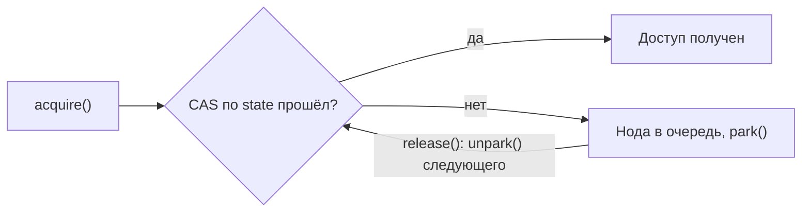

---
tags:
  - Middle
  - Senior
  - Java
  - Многопоточность
---

# Блокировки и синхронизаторы

Монитор и `synchronized`, `wait`/`notify`, явные блокировки `java.util.concurrent.locks`, синхронизаторы и AQS, на котором они построены. Чаще всего спрашивают, чем `ReentrantLock` лучше `synchronized`, зачем `wait()` в цикле и чем `CountDownLatch` отличается от `CyclicBarrier`.

## Мониторы и `wait`/`notify` { #monitors }

### Как работает `synchronized`? { #synchronized }

**Уровень:** Junior

!!! abstract "Ответ вслух"
    У каждого объекта в Java есть встроенный замок — монитор (mutex), и в один момент им владеет только один поток. `synchronized` на методе берёт монитор `this`, на блоке — указанного объекта, на `static`-методе — объекта класса. Он даёт сразу атомарность и видимость.

```java
public class Counter {
    private int count = 0;
    private final Object lock = new Object();

    // Вариант 1: лок на this
    public synchronized void increment() {
        count++;
    }

    // Вариант 2: лок на конкретном объекте (лучше для гранулярности)
    public void incrementBlock() {
        synchronized (lock) {
            count++;
        }
    }

    // Вариант 3: лок на классе (static synchronized)
    // эквивалентно synchronized(Counter.class)
    public static synchronized void staticJob() { /* ... */ }
}
```

`synchronized` даёт сразу два свойства:

- **Атомарность** — никто не вмешается в середине.
- **Видимость** — после выхода из блока все потоки, которые возьмут тот же монитор, увидят актуальное значение.

!!! warning "Ловушка: `static synchronized` и `synchronized` не исключают друг друга"
    `static synchronized` берёт монитор `Counter.class`, а обычный `synchronized`-метод — монитор `this`. Это разные мониторы, поэтому методы из вариантов 1 и 3 могут выполняться одновременно.

??? question "Проверь себя"
    1. Какой монитор берёт `synchronized`-метод, а какой — `static synchronized`?
    2. Зачем выносить лок в отдельное поле `lock`?
    3. Какие два свойства даёт `synchronized`?

### Зачем `wait()` вызывают в цикле `while`? { #wait-notify }

**Уровень:** Middle

!!! abstract "Ответ вслух"
    Из-за ложного пробуждения (spurious wakeup): поток может проснуться без вызова `notify`. Поэтому после пробуждения условие нужно проверить снова, а значит — `while`, а не `if`. Сами `wait()` и `notify()` работают только внутри `synchronized` на том же объекте.

- `wait()` — «отпускаю монитор и иду спать, пока не разбудят».
- `notify()` — будит одного случайного из спящих.
- `notifyAll()` — будит всех, они начинают драться за монитор.

```java
public synchronized void consume() throws InterruptedException {
    // ✅ while — если проснулись ложно, цикл проверит условие снова
    while (queue.isEmpty()) {
        wait();
    }
    var data = queue.poll();
    notifyAll(); // сообщаем продюсерам, что место освободилось
}
```

!!! warning "Ловушка: `wait()` вне `synchronized`"
    `wait()`, `notify()` и `notifyAll()` можно вызывать **только** внутри `synchronized` блока того же объекта. Иначе — `IllegalMonitorStateException`.

!!! warning "Ловушка: `if` вместо `while`"
    С `if` поток после ложного пробуждения пойдёт дальше, не проверив условие, и, например, вызовет `poll()` у пустой очереди. ОС может разбудить поток и без `notify` — это и есть spurious wakeup.

??? question "Проверь себя"
    1. Что такое spurious wakeup и как от него защититься?
    2. Чем `notify()` отличается от `notifyAll()`?
    3. Что будет, если вызвать `wait()` вне `synchronized`?

## Явные блокировки { #locks-atomics }

### Чем `ReentrantLock` лучше `synchronized`? { #reentrantlock }

**Уровень:** Middle

!!! abstract "Ответ вслух"
    `ReentrantLock` умеет то, чего нет у `synchronized`: попытку захвата без зависания (`tryLock`), прерываемое ожидание, честную очередь и несколько `Condition` на один лок. Цена — освобождать его нужно вручную в `finally`. Если эти возможности не нужны, `synchronized` проще.

```java
ReentrantLock lock = new ReentrantLock();

// ✅ tryLock — не зависнешь навсегда
if (lock.tryLock(100, TimeUnit.MILLISECONDS)) {
    try {
        // критическая секция
    } finally {
        lock.unlock(); // обязателен в finally!
    }
}

// ✅ lockInterruptibly — можно прервать ожидание
lock.lockInterruptibly();
```

| Возможность | `synchronized` | `ReentrantLock` |
|---|---|---|
| Попытка захвата без зависания | ❌ | ✅ `tryLock()` |
| Прерываемое ожидание | ❌ | ✅ `lockInterruptibly()` |
| Честная очередь (fairness) | ❌ | ✅ `new ReentrantLock(true)` |
| Несколько Condition | ❌ | ✅ `lock.newCondition()` |
| Автоматическое освобождение | ✅ | ❌ (нужен `finally`) |

!!! warning "Ловушка: `unlock()` не в `finally`"
    Если код в критической секции бросит исключение, а `unlock()` стоит после него, лок не освободится никогда. Все остальные потоки будут ждать вечно.

??? question "Проверь себя"
    1. Какие четыре возможности есть у `ReentrantLock` и нет у `synchronized`?
    2. Почему `unlock()` обязательно ставят в `finally`?
    3. Чем `lockInterruptibly()` отличается от `lock()`?

### Зачем нужны `ReadWriteLock`, `StampedLock` и `Condition`? { #rwlock-condition }

**Уровень:** Middle

!!! abstract "Ответ вслух"
    `ReadWriteLock` пускает тысячи читателей одновременно, но на время записи блокирует всех — подходит для кэшей. `StampedLock` (Java 8) добавляет оптимистичное чтение без блокировки с последующей проверкой. `Condition` — замена `wait/notify`, которая даёт несколько независимых очередей ожидания на один лок.

**`ReadWriteLock`** — для кэшей: тысячи читателей одновременно, но при записи все ждут.

**`StampedLock`** (Java 8) — добавляет **оптимистичное чтение**: читаешь без блокировки, получаешь `stamp`, потом проверяешь «данные не изменились?». Если нет — сэкономил время, если да — перечитываешь с обычной блокировкой.

**`Condition`** — замена `wait/notify`. Для одного лока можно создать несколько независимых очередей ожидания:

```java
ReentrantLock lock = new ReentrantLock();
Condition notEmpty = lock.newCondition(); // будим потребителей
Condition notFull  = lock.newCondition(); // будим производителей

// При добавлении элемента:
notEmpty.signal(); // только потребителей, не всех подряд

// При извлечении:
notFull.signal();  // только производителей
```

!!! warning "Ловушка: `signal()` без захваченного лока"
    `await()` и `signal()` вызывают только под тем локом, от которого создан `Condition`, — так же, как `wait/notify` только под `synchronized`. Иначе — `IllegalMonitorStateException`.

??? question "Проверь себя"
    1. Для какой нагрузки подходит `ReadWriteLock`?
    2. Как работает оптимистичное чтение в `StampedLock`?
    3. Что даёт `Condition` по сравнению с `notifyAll()`?

## Синхронизаторы { #synchronizers }

### Чем `CountDownLatch` отличается от `CyclicBarrier`? { #latch-barrier }

**Уровень:** Middle

!!! abstract "Ответ вслух"
    `CountDownLatch` — одноразовая защёлка: один поток ждёт, пока N других не отчитаются через `countDown()`. `CyclicBarrier` — многоразовый шлагбаум: N потоков ждут друг друга в точке сбора и идут дальше вместе. `Phaser` объединяет оба подхода и позволяет менять число участников на ходу.

**`CountDownLatch` — «защёлка» (одноразовый).** Главный поток ждёт, пока `N` других не выполнят работу.

```java
CountDownLatch latch = new CountDownLatch(3);

// В каждом из 3 потоков:
latch.countDown(); // уменьшает счётчик

// В главном потоке:
latch.await(); // блокируется, пока счётчик не станет 0
```

_Пример:_ отправили запросы в 3 микросервиса, дождались всех, собрали финальный ответ.

**`CyclicBarrier` — «шлагбаум» (многоразовый).** N потоков делают расчёт по этапам. Кто дошёл до точки — ждёт остальных, когда все пришли — идут дальше вместе.

```java
CyclicBarrier barrier = new CyclicBarrier(5, () -> {
    System.out.println("Все пришли, переходим к следующему этапу!");
});

// В каждом из 5 потоков:
barrier.await(); // ждём остальных
```

**`Phaser` — «комбайн».** Смесь Latch и Barrier, которая динамически регистрирует и удаляет участников в процессе работы. Очень гибкий, но сложный.

!!! warning "Ловушка: защёлку не сбросить"
    Счётчик `CountDownLatch` только уменьшается: дошёл до нуля — повторно использовать защёлку нельзя. Для повторяющихся этапов нужен `CyclicBarrier` или `Phaser`.

??? question "Проверь себя"
    1. Кто ждёт в `CountDownLatch`, а кто — в `CyclicBarrier`?
    2. Какой из них многоразовый?
    3. Что умеет `Phaser` сверх этих двух?

### Как `Semaphore` ограничивает доступ? { #semaphore }

**Уровень:** Middle

!!! abstract "Ответ вслух"
    `Semaphore` выдаёт фиксированное число разрешений: `acquire()` берёт разрешение или блокируется, если все заняты, `release()` возвращает его. Так ограничивают число потоков, одновременно работающих с ресурсом, — например, запросов к внешнему API.

**`Semaphore` — «парковка».** Ограничивает количество потоков, работающих с ресурсом одновременно.

```java
Semaphore semaphore = new Semaphore(5); // 5 «пропусков»

semaphore.acquire(); // взять пропуск (блокируется, если все заняты)
try {
    callExternalApi();
} finally {
    semaphore.release(); // вернуть пропуск
}
```

Подходит для rate limiting — ограничить одновременные запросы к внешнему API.

!!! warning "Ловушка: `release()` не в `finally`"
    Если `callExternalApi()` бросит исключение, а `release()` стоит не в `finally`, пропуск потеряется. После пяти таких ошибок семафор не пустит никого.

??? question "Проверь себя"
    1. Что делают `acquire()` и `release()`?
    2. Для какой задачи на проде берут `Semaphore`?
    3. Что случится, если `release()` не стоит в `finally`?

## Под капотом { #under-the-hood }

### Как устроен AQS? { #aqs }

**Уровень:** Senior

!!! abstract "Ответ вслух"
    `AbstractQueuedSynchronizer` — основа `java.util.concurrent`: на нём построены `ReentrantLock`, `CountDownLatch`, `Semaphore` и `ReadWriteLock`. Он хранит `volatile int state` и FIFO-очередь ожидающих потоков. Если CAS по `state` не прошёл, AQS сам паркует поток и сам будит следующего, когда ресурс освободится.

- Хранит `volatile int state` (состояние: количество разрешений, статус лока и т.п.).
- Держит FIFO-очередь ожидания потоков (двусвязный список нод).
- Если поток не смог получить доступ (CAS не прошёл) — AQS **сам паркует** его и ставит в очередь. Когда ресурс освобождается — **сам будит** следующего.



!!! warning "Ловушка: `state` значит разное"
    Смысл `state` задаёт наследник AQS. У `ReentrantLock` это число повторных захватов владельцем, у `Semaphore` — число свободных разрешений, у `CountDownLatch` — оставшийся счётчик.

??? question "Проверь себя"
    1. Какие синхронизаторы построены на AQS?
    2. Что хранит AQS и что он делает с потоком, который не получил доступ?
    3. Что означает `state` у `Semaphore`?

### Чем `LockSupport.park()` отличается от `wait()`? { #park-unpark }

**Уровень:** Senior

!!! abstract "Ответ вслух"
    `park()` и `unpark()` — низкоуровневые примитивы, на которых работает AQS, и им не нужен `synchronized`. У каждого потока один «пермит»: `park()` блокирует, если пермита нет, а `unpark(thread)` выдаёт его. Поэтому `unpark()` до `park()` не теряется, а `notify()` до `wait()` — теряется.

```java
Thread waiter = Thread.ofPlatform().start(() -> {
    LockSupport.park();                 // пермит уже выдан — не блокируется
    System.out.println("проснулся");
});
LockSupport.unpark(waiter);             // можно вызвать до park()
```

!!! warning "Ловушка: порядок вызовов"
    Если сделать `unpark()` **до** вызова `park()`, поток не заблокируется вообще. С `wait/notify` такой порядок приводит к вечному зависанию: `notify()` без ждущих потоков ничего не запоминает.

??? question "Проверь себя"
    1. Что такое пермит у `LockSupport`?
    2. Что будет, если вызвать `unpark()` раньше `park()`?
    3. Почему тот же порядок с `notify()` и `wait()` зависает?

## Шпаргалка { #cheatsheet }

<!-- --8<-- [start:cheatsheet] -->
| Тема | Запомнить |
|---|---|
| **`synchronized`** | Монитор объекта: атомарность и видимость; `static synchronized` — монитор класса |
| **`wait` / `notify`** | Только внутри `synchronized`; ждать в `while`, а не в `if` (spurious wakeup) |
| **`ReentrantLock`** | `tryLock`, прерываемое ожидание, fairness, несколько `Condition`; `unlock()` — в `finally` |
| **`ReadWriteLock` / `StampedLock`** | Много читателей или один писатель; `StampedLock` — оптимистичное чтение со `stamp` |
| **Синхронизаторы** | `CountDownLatch` — одноразовый, `CyclicBarrier` — многоразовый, `Semaphore` — ограничение доступа |
| **AQS** | `volatile int state` + очередь ожидания; основа `ReentrantLock`, `Semaphore`, `CountDownLatch` |
| **`park` / `unpark`** | Пермит на поток; `unpark()` до `park()` не теряется, в отличие от `notify()` |

<!-- --8<-- [end:cheatsheet] -->
