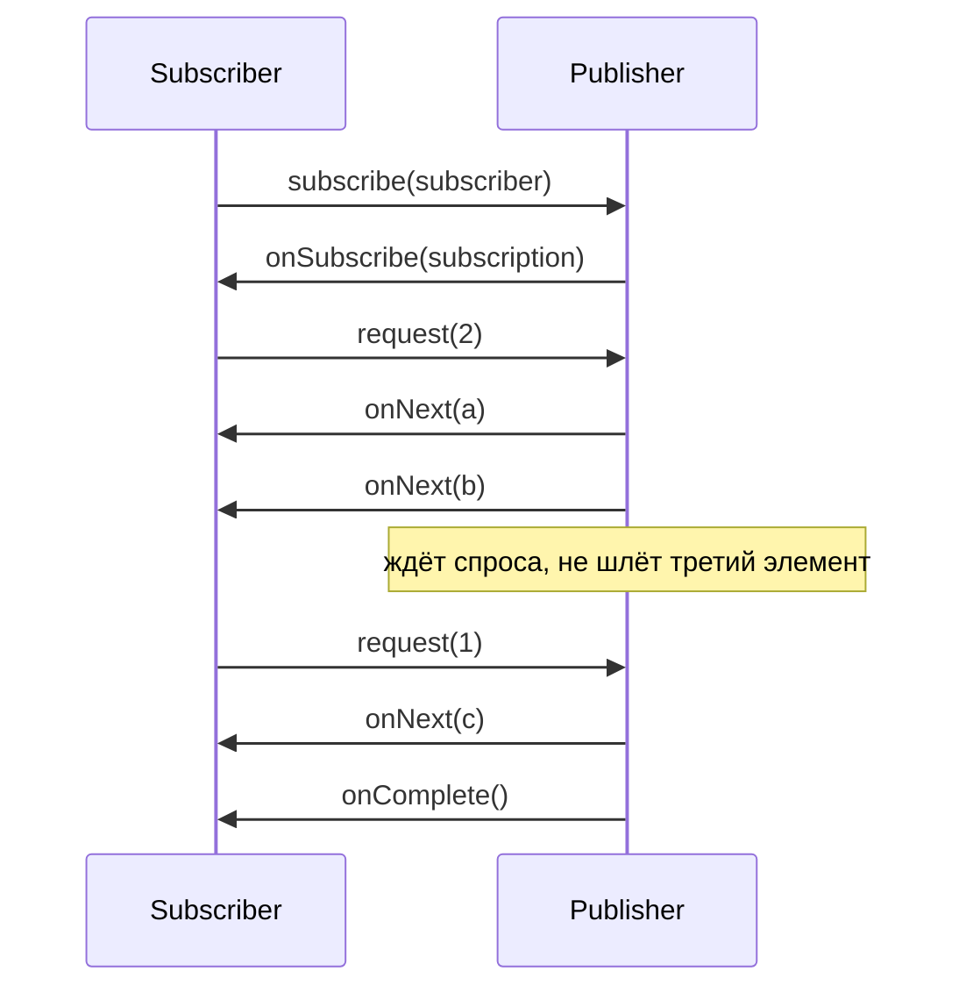

---
tags:
  - Junior
  - Middle
  - Senior
  - Java
  - Многопоточность
  - Spring
---

# Реактивное программирование

Реактивный подход в Java: спецификация Reactive Streams, backpressure и Project Reactor, на котором работают Spring WebFlux, WebClient и R2DBC. На собесе спрашивают, почему без подписки ничего не происходит, чем `flatMap` отличается от `concatMap`, как `publishOn` и `subscribeOn` переключают потоки, что делать с блокирующим вызовом и как передать `traceId`, если `ThreadLocal` не работает. Веб-стек WebFlux и выбор между ним и MVC — в [Spring MVC и WebFlux → WebFlux](../spring/spring-mvc.md#webflux).

## Основы { #basics }

### Что такое реактивное программирование и когда оно нужно? { #what-is-reactive }

**Уровень:** Junior

!!! abstract "Ответ вслух"
    Это асинхронная обработка потоков данных: вместо того чтобы ждать результат в блокированном потоке, ты описываешь цепочку операторов, которая сработает, когда данные придут. Потоков нужно немного, и они не простаивают на I/O. Ключевая часть — backpressure: потребитель сам говорит, сколько элементов готов принять, и быстрый источник не заваливает медленного получателя.

Как выглядит один и тот же сценарий в двух стилях:

```java
// Императивно: поток стоит на каждом вызове
User user = userClient.find(id);              // ждём 50 мс
List<Order> orders = orderClient.find(id);    // ещё 80 мс, хотя вызовы независимы
return new Profile(user, orders);

// Реактивно: оба запроса летят параллельно, поток свободен, пока ждём ответы
return Mono.zip(userClient.find(id), orderClient.find(id).collectList())
    .map(t -> new Profile(t.getT1(), t.getT2()));
```

**Когда реактивность оправдана:**

- Много одновременных соединений, которые в основном ждут I/O: шлюзы, прокси, агрегаторы чужих API.
- Стриминг: SSE, WebSocket, бесконечные потоки событий, где важны backpressure, окна и таймауты.
- Стек уже реактивный: Spring Cloud Gateway, R2DBC, реактивные драйверы Mongo и Redis.

**Когда не нужна:** обычный CRUD на JPA, вычисления на CPU, команда без опыта Reactor. Цена — сложная отладка, нечитаемые стектрейсы и «заразность»: реактивным должен быть весь путь запроса.

!!! warning "Ловушка: «реактивный — значит быстрый»"
    Реактивный код не ускоряет отдельный запрос и не ускоряет вычисления. Он позволяет держать больше одновременных запросов на тех же ресурсах, пока они ждут I/O. На CPU-bound задачах он медленнее обычного кода из-за накладных расходов операторов.

??? question "Проверь себя"
    1. За счёт чего реактивное приложение обходится небольшим числом потоков?
    2. Что такое backpressure одной фразой?
    3. В каких задачах реактивность не даёт выигрыша?

### Чем `Mono` и `Flux` отличаются от `Stream` и `CompletableFuture`? { #reactor-vs-stream-cf }

**Уровень:** Junior

!!! abstract "Ответ вслух"
    `Stream` синхронный и одноразовый, `CompletableFuture` асинхронный, но на одно значение, и он стартует сразу при создании. `Mono` (0..1) и `Flux` (0..N) асинхронные и ленивые: пока нет подписки, ничего не выполняется, а каждая новая подписка запускает работу заново. Сверху у них backpressure, отмена и операторы времени: таймауты, задержки, окна.

| | **`Stream`** | **`CompletableFuture`** | **`Mono` / `Flux`** |
|---|---|---|---|
| **Элементов** | 0..N | 1 | 0..1 / 0..N |
| **Синхронность** | Синхронный | Асинхронный | Асинхронный |
| **Когда начинается работа** | На терминальной операции | Сразу при создании | При подписке |
| **Повторное использование** | Нельзя | Результат запоминается | Каждая подписка выполняет заново |
| **Backpressure** | Pull: потребитель сам итерирует | Нет | `request(n)` |
| **Отмена** | Нет | `cancel()` не прерывает работу | `cancel()` идёт вверх по цепочке до источника |
| **Время** | Нет | `orTimeout()` | `timeout`, `delay`, `interval`, `window` |

Базовые примеры `Mono` и `Flux` в контроллере — в [Spring MVC и WebFlux → `Mono` и `Flux`](../spring/spring-mvc.md#mono-flux). Как устроен `CompletableFuture` — в [Пулы потоков и CompletableFuture](executors.md#completablefuture).

!!! warning "Ловушка: `Mono` как `Optional`"
    `Mono.empty()` — не ошибка и не `null`, а сигнал «завершился без значения». Цепочка `map` после пустого `Mono` просто не выполнится, и контроллер вернёт пустой ответ 200. Отсутствие данных обрабатывают явно: `switchIfEmpty(Mono.error(new NotFoundException(id)))` или `defaultIfEmpty(...)`.

??? question "Проверь себя"
    1. Когда начинает работу `CompletableFuture`, а когда `Mono`?
    2. Что произойдёт, если подписаться на один `Flux` дважды?
    3. Что делает `map`, если `Mono` пустой?

## Reactive Streams { #reactive-streams }

### Как устроена спецификация Reactive Streams? { #reactive-streams-spec }

**Уровень:** Middle

!!! abstract "Ответ вслух"
    Это четыре интерфейса: `Publisher`, `Subscriber`, `Subscription` и `Processor`. Подписчик подписывается на издателя, получает `Subscription` и запрашивает через `request(n)` столько элементов, сколько готов обработать; издатель не вправе прислать больше. Поток заканчивается одним терминальным сигналом: `onComplete` или `onError`.

```java
public interface Publisher<T> {
    void subscribe(Subscriber<? super T> s);
}

public interface Subscriber<T> {
    void onSubscribe(Subscription s);  // первый сигнал, ровно один раз
    void onNext(T t);                  // не больше, чем запрошено через request(n)
    void onError(Throwable t);         // терминальный
    void onComplete();                 // терминальный
}

public interface Subscription {
    void request(long n);              // спрос: «готов принять ещё n»
    void cancel();                     // отписка, издатель прекращает работу
}

public interface Processor<T, R> extends Subscriber<T>, Publisher<R> {}
```



Спецификация задаёт и правила: сигналы приходят последовательно, а не параллельно, после терминального сигнала ничего не приходит, `request(Long.MAX_VALUE)` означает «без ограничений». Её реализуют Reactor, RxJava, Akka Streams, драйверы БД — поэтому их можно соединять друг с другом.

С Java 9 те же интерфейсы есть в JDK как вложенные в `java.util.concurrent.Flow`. Reactor реализует `org.reactivestreams.Publisher`, а для `Flow` есть адаптер `JdkFlowAdapter`.

!!! warning "Ловушка: свой `Publisher` руками"
    Интерфейсы выглядят просто, но правил больше тридцати: учёт спроса при конкурентных `request`, отмена, запрет рекурсии `onNext` → `request` → `onNext`. Самописный издатель почти всегда нарушает какое-нибудь из них. Источники создают фабриками Reactor: `Flux.create`, `Flux.generate`, `Mono.fromCallable`.

??? question "Проверь себя"
    1. Какие четыре интерфейса входят в Reactive Streams?
    2. Может ли издатель прислать больше элементов, чем запрошено?
    3. Какими сигналами заканчивается поток?

### Что такое backpressure и как с ним работать? { #backpressure }

**Уровень:** Middle

=== "Коротко"

    !!! abstract "Ответ вслух"
        Backpressure — обратное давление: потребитель регулирует скорость источника через `request(n)`. Если источник умеет ждать (БД, файл, Kafka), он просто притормаживает. Если не умеет (клики, тики таймера, push от брокера), выбирают стратегию переполнения: буфер, отбросить новые, оставить последний или упасть с ошибкой.

=== "Подробно"

    В Reactor спрос обычно не пишут руками: операторы запрашивают элементы пачками (prefetch) и дозапрашивают по мере обработки. `subscribe(lambda)` без своего `Subscriber` запрашивает `Long.MAX_VALUE`, то есть без ограничений.

    ```java
    // Источник умеет ждать: читаем из R2DBC пачками по 100, а не всю таблицу сразу
    repository.findAll()
        .limitRate(100)                    // request(100), потом дозапрос по 75
        .flatMap(this::sendToPartner, 8)   // не больше 8 запросов к партнёру одновременно
        .subscribe();
    ```

    Источник, который не умеет ждать, требует стратегии переполнения:

    | Оператор | Что делает при переполнении | Когда |
    |---|---|---|
    | `onBackpressureBuffer(n)` | Копит до `n`, потом ошибка или своя политика | Короткие всплески |
    | `onBackpressureDrop()` | Выбрасывает новые элементы | Метрики, где пропуск не страшен |
    | `onBackpressureLatest()` | Хранит только последний элемент | Котировки, состояние «сейчас» |
    | `onBackpressureError()` | Сразу `OverflowException` | Переполнение — баг, о нём надо знать |

    ```java
    // Тики раз в 10 мс, а обработка — 100 мс
    Flux.interval(Duration.ofMillis(10))
        .onBackpressureDrop(tick -> log.debug("пропущен тик {}", tick))
        .concatMap(tick -> slowOperation(tick)) // concatMap просит по одному
        .subscribe();
    ```

    В `Flux.create` стратегия задаётся вторым аргументом (`FluxSink.OverflowStrategy`), по умолчанию — неограниченный буфер.

!!! warning "Ловушка: `Flux.interval` без стратегии"
    `Flux.interval` не умеет ждать: таймер тикает независимо от спроса. Если обработка медленнее, поток падает с `OverflowException` «Could not emit tick … due to lack of requests». Медленный потребитель за таймером — сразу `onBackpressureDrop` или `onBackpressureLatest`.

!!! warning "Ловушка: неограниченный буфер"
    `onBackpressureBuffer()` без лимита и `Flux.create` по умолчанию копят всё, что не успели обработать. Источник быстрее потребителя в течение часа — и буфер съедает кучу до `OutOfMemoryError`. Буфер всегда задают с лимитом и решают, что делать при его переполнении.

??? question "Проверь себя"
    1. Как подписчик сообщает источнику, сколько элементов готов принять?
    2. Какие стратегии переполнения есть в Reactor и когда какую выбрать?
    3. Почему `Flux.interval` падает, если подписчик медленный?

## Project Reactor { #reactor }

### Почему без подписки ничего не происходит и чем холодный поток отличается от горячего? { #cold-hot }

**Уровень:** Middle

!!! abstract "Ответ вслух"
    Цепочка операторов — только описание работы (assembly time), выполняется она при подписке (subscription time). Большинство источников холодные (cold): каждая подписка запускает работу заново, например новый HTTP-запрос. Горячие (hot) источники существуют независимо от подписчиков и раздают им общие события; холодный поток делают горячим через `share()`, `cache()` или `Sinks`.

```java
Mono<Rate> rate = webClient.get().uri("/rates/USD").retrieve().bodyToMono(Rate.class);

rate.subscribe(r -> log.info("1: {}", r));
rate.subscribe(r -> log.info("2: {}", r));   // ❌ второй HTTP-запрос: источник холодный

Mono<Rate> cached = rate.cache();             // ✅ первый подписчик вызывает, остальные получают результат
```

| | **Холодный** | **Горячий** |
|---|---|---|
| **Когда работает** | На каждую подписку заново | Независимо от подписчиков |
| **Что видит поздний подписчик** | Всё с начала | Только новые события (если нет replay) |
| **Примеры** | `WebClient`, R2DBC-запрос, `Flux.range`, `Mono.fromCallable` | `Sinks.many().multicast()`, события UI, тики после `share()` |
| **Как получить из холодного** | — | `share()`, `publish().autoConnect(n)`, `cache()`, `replay()` |

!!! warning "Ловушка: `Mono.just(вызов())` выполняет вызов сразу"
    `Mono.just(callBank())` вызывает `callBank()` в момент сборки цепочки, в текущем потоке, даже если на `Mono` никто не подпишется. Повтор через `retry()` тоже не повторит вызов — повторится выдача уже готового значения. Ленивые варианты — `Mono.fromCallable(() -> callBank())` и `Mono.defer(() -> callBankReactive())`.

!!! warning "Ловушка: двойная подписка в коде"
    Результат одного `Mono` используют в двух местах: `mono.subscribe(...)` для лога и тот же `mono` возвращают из контроллера. Получаются две подписки и два запроса к БД или стороннему API, а при неидемпотентной операции — два платежа. Общий результат переиспользуют через `cache()` или собирают в одну цепочку.

??? question "Проверь себя"
    1. Чем assembly time отличается от subscription time?
    2. Почему второй `subscribe()` на `WebClient`-запрос делает второй HTTP-вызов?
    3. Чем `Mono.just(f())` отличается от `Mono.fromCallable(() -> f())`?

### Чем `map` отличается от `flatMap`, `concatMap` и `flatMapSequential`? { #flatmap }

**Уровень:** Middle

!!! abstract "Ответ вслух"
    `map` — синхронное преобразование элемента в значение. Остальные три преобразуют элемент в `Publisher` и подписываются на него: `flatMap` — параллельно, результаты выходят в порядке готовности; `concatMap` — строго по одному, порядок сохраняется; `flatMapSequential` — параллельно, но выдаёт результаты в исходном порядке, буферизуя ранние.

```java
Flux.just(3, 1, 2)
    .flatMap(n -> Mono.delay(Duration.ofSeconds(n)).thenReturn(n));
// → 1, 2, 3 — порядок готовности, всё за 3 секунды

Flux.just(3, 1, 2)
    .concatMap(n -> Mono.delay(Duration.ofSeconds(n)).thenReturn(n));
// → 3, 1, 2 — исходный порядок, по одному: 6 секунд

Flux.just(3, 1, 2)
    .flatMapSequential(n -> Mono.delay(Duration.ofSeconds(n)).thenReturn(n));
// → 3, 1, 2 — исходный порядок, параллельно: 3 секунды
```

| Оператор | Параллельность | Порядок | Когда |
|---|---|---|---|
| `map` | — | Сохраняется | Синхронное преобразование без I/O |
| `flatMap` | До 256 по умолчанию | Не сохраняется | Независимые вызовы, порядок не важен |
| `concatMap` | 1 | Сохраняется | Порядок важен: события одного счёта, миграции |
| `flatMapSequential` | Как у `flatMap` | Сохраняется | Нужны и скорость, и порядок |

!!! warning "Ловушка: `flatMap` без ограничения параллельности"
    `Flux.fromIterable(10_000 клиентов).flatMap(partnerApi::notify)` откроет до 256 одновременных запросов к партнёру, и он ответит 429 или ляжет. Второй аргумент задаёт потолок: `flatMap(partnerApi::notify, 8)`. Это и есть ручка backpressure для внешнего сервиса.

!!! warning "Ловушка: `map` с вызовом, который возвращает `Mono`"
    `map(id -> repository.findById(id))` вернёт `Flux<Mono<User>>`, и на внутренние `Mono` никто не подпишется — запросов в БД не будет вообще. Если функция возвращает `Publisher`, нужен `flatMap` или `concatMap`.

??? question "Проверь себя"
    1. Почему `flatMap` не сохраняет порядок?
    2. Как ограничить число одновременных вызовов внутри `flatMap`?
    3. Что получится, если в `map` вернуть `Mono`?

### Как работают `publishOn` и `subscribeOn`? { #schedulers }

**Уровень:** Senior

=== "Коротко"

    !!! abstract "Ответ вслух"
        По умолчанию Reactor не переключает потоки: цепочка выполняется там, где произошла подписка или где источник выдал сигнал. `subscribeOn` задаёт поток для подписки и источника, и где бы он ни стоял в цепочке, работает самый близкий к источнику. `publishOn` переключает поток для всех операторов ниже себя.

=== "Подробно"

    **Планировщики (Schedulers):**

    | Планировщик | Потоки | Для чего |
    |---|---|---|
    | `Schedulers.immediate()` | Текущий поток | Без переключения |
    | `Schedulers.single()` | Один переиспользуемый | Лёгкие последовательные задачи |
    | `Schedulers.parallel()` | По числу ядер | CPU-работа, никогда не блокировать |
    | `Schedulers.boundedElastic()` | До 10 × ядер, очередь задач ограничена | Блокирующие вызовы: JDBC, файлы, старые клиенты |

    ```java
    Flux.range(1, 3)
        .map(i -> log("map1", i))           // поток boundedElastic — из-за subscribeOn
        .publishOn(Schedulers.parallel())
        .map(i -> log("map2", i))           // поток parallel — после publishOn
        .subscribeOn(Schedulers.boundedElastic())
        .subscribe();
    ```

    ```mermaid
    flowchart LR
        S["Flux.range"] --> M1["map1"]
        M1 --> P["publishOn(parallel)"]
        P --> M2["map2"]
        M2 --> SUB["subscribe"]
        SO["subscribeOn(boundedElastic)"] -.->|"подписка и источник<br/>на boundedElastic"| S
        P -.->|"всё ниже<br/>на parallel"| M2
    ```

    В WebFlux цепочка обычно работает на потоках event loop Netty (`reactor-http-nio-*`), а результат от `WebClient` приходит на его потоках. Переключаться вручную нужно в двух случаях: увести блокирующую работу на `boundedElastic` и увести тяжёлую CPU-работу с event loop на `parallel`.

    С Reactor 3.6 на Java 21+ `boundedElastic` можно перевести на виртуальные потоки системным свойством `reactor.schedulers.defaultBoundedElasticOnVirtualThreads=true`.

!!! warning "Ловушка: второй `subscribeOn` ничего не меняет"
    `subscribeOn` действует на подписку, которая поднимается снизу вверх, и учитывается тот, что ближе к источнику. Добавленный ниже по цепочке второй `subscribeOn(parallel())` не переключит источник с `boundedElastic`. Чтобы сменить поток для части цепочки — `publishOn`.

!!! warning "Ловушка: `publishOn` в начале горячего пути"
    Каждый `publishOn` — очередь и переключение потока на каждый элемент. Расставленные «на всякий случай» в каждом сервисе, они добавляют задержку и делают поведение непредсказуемым. Переключение потока — осознанное решение под блокирующую или CPU-работу.

??? question "Проверь себя"
    1. В каком потоке выполняется цепочка, если нет ни `publishOn`, ни `subscribeOn`?
    2. Какой из двух `subscribeOn` в цепочке сработает?
    3. Какой планировщик выбрать для JDBC-вызова и почему не `parallel`?

### Как вызвать блокирующий код из реактивной цепочки? { #blocking-calls }

**Уровень:** Middle

!!! abstract "Ответ вслух"
    Блокирующий вызов оборачивают в `Mono.fromCallable` и уводят на `Schedulers.boundedElastic()` через `subscribeOn`, чтобы он не занял поток event loop. Вызывать `block()` внутри реактивной цепочки нельзя: на неблокирующих потоках Reactor бросит `IllegalStateException`. Найти забытые блокировки помогает BlockHound.

```java
// ❌ JDBC прямо в цепочке: поток Netty стоит, пока идёт запрос
public Mono<Report> report(long id) {
    return Mono.just(jdbcTemplate.queryForObject(SQL, mapper, id));
}

// ✅ Блокирующий вызов — лениво и на отдельном пуле
public Mono<Report> report(long id) {
    return Mono.fromCallable(() -> jdbcTemplate.queryForObject(SQL, mapper, id))
        .subscribeOn(Schedulers.boundedElastic());
}
```

**Почему это важно.** Потоков event loop в Netty по числу ядер, но не меньше четырёх. Если 8 из 8 стоят на JDBC, приложение перестаёт принимать даже запросы, которым база не нужна, — health-check тоже, и Kubernetes перезапускает под.

**BlockHound** — Java-агент, который бросает ошибку при блокирующем вызове (`Thread.sleep`, `socket.read`, `synchronized` на занятом мониторе) из неблокирующего потока. Его включают в тестах: `BlockHound.install()` в `@BeforeAll`.

!!! warning "Ловушка: `block()` внутри цепочки"
    `flatMap(order -> Mono.just(clientMono.block()))` на потоке `parallel` или Netty падает с `IllegalStateException`: «block()/blockFirst()/blockLast() are blocking, which is not supported in thread …». На `boundedElastic` ошибки не будет, но поток всё равно занят ожиданием. Внутри цепочки результат другого `Mono` получают через `flatMap` или `zip`.

??? question "Проверь себя"
    1. Почему JDBC-вызов на потоке event loop опасен для всего приложения?
    2. Как правильно обернуть блокирующий вызов?
    3. Что такое BlockHound и где его используют?

### Как обрабатывать ошибки и повторы в реактивной цепочке? { #reactive-errors }

**Уровень:** Middle

=== "Коротко"

    !!! abstract "Ответ вслух"
        Ошибка в реактивной цепочке — терминальный сигнал `onError`: поток завершается, и `try/catch` вокруг цепочки её не поймает, потому что код выполнится позже. Обрабатывают операторами: `onErrorReturn` и `onErrorResume` — запасное значение или поток, `onErrorMap` — смена типа, `retryWhen` — повтор с backoff, `timeout` — ограничение по времени. `doOnError` только наблюдает и ошибку не гасит.

=== "Подробно"

    ```java
    public Mono<Rate> rate(String currency) {
        return webClient.get().uri("/rates/{c}", currency)
            .retrieve()
            .bodyToMono(Rate.class)
            .timeout(Duration.ofSeconds(2))                       // TimeoutException через 2 с
            .retryWhen(Retry.backoff(3, Duration.ofMillis(200))   // 200 мс, 400, 800 + jitter
                .filter(this::isTransient)                        // 4xx не повторяем
                .onRetryExhaustedThrow((spec, signal) -> signal.failure()))
            .onErrorMap(WebClientResponseException.class, RateServiceException::new)
            .doOnError(e -> log.warn("Курс {} недоступен", currency, e))
            .onErrorResume(e -> cache.lastKnown(currency));        // запасной вариант — последний известный курс
    }
    ```

    | Оператор | Что делает |
    |---|---|
    | `onErrorReturn(value)` | Заменяет ошибку значением и завершает поток |
    | `onErrorResume(e -> publisher)` | Переключается на запасной поток: кэш, другой сервис |
    | `onErrorMap(e -> other)` | Меняет тип ошибки, поток всё равно завершается ошибкой |
    | `onErrorComplete()` | Превращает ошибку в обычное завершение |
    | `doOnError(...)` | Побочный эффект: лог, метрика. Ошибка идёт дальше |
    | `retry(n)`, `retryWhen(Retry...)` | Переподписывается на источник |
    | `timeout(d)` | Ошибка, если элемент не пришёл за `d` |

    `retry` повторяет переподпиской, поэтому повтор работает только с холодным ленивым источником — см. [холодные и горячие потоки](#cold-hot). Когда ретраить можно, а когда нельзя, — в [Микросервисы → timeout и retry](../architecture/microservices.md#timeout-retry).

!!! warning "Ловушка: ошибка завершает весь `Flux`"
    Обработка 1000 сообщений, на 37-м — исключение в `map`. Поток завершается, оставшиеся 963 не обработаются. Ошибку отдельного элемента обрабатывают внутри `flatMap`: `flatMap(msg -> process(msg).onErrorResume(e -> toDlq(msg, e)))`, тогда упавший элемент не роняет весь поток.

!!! warning "Ловушка: `RetryExhaustedException` вместо исходной ошибки"
    После исчерпания попыток `Retry.backoff` по умолчанию бросает обёртку `RetryExhaustedException`, и обработчик `onErrorResume(TimeoutException.class, …)` её не поймает. Либо обрабатывай обёртку, либо верни исходную ошибку через `onRetryExhaustedThrow`, как в примере.

!!! warning "Ловушка: стектрейс без твоего кода"
    Исключение в реактивной цепочке показывает стек операторов Reactor и потока, на котором оно случилось, но не место, где цепочку собрали. Для отладки ставят `.checkpoint("загрузка курса")` в ключевых местах, а в проде подключают `ReactorDebugAgent` из `reactor-tools`. `Hooks.onOperatorDebug()` даёт полную картину, но дорог для прода.

??? question "Проверь себя"
    1. Почему `try/catch` вокруг реактивной цепочки не ловит ошибку?
    2. Чем `onErrorResume` отличается от `doOnError`?
    3. Как обработать ошибку одного элемента, не завершая весь `Flux`?

### Как передать traceId и пользователя без `ThreadLocal`? { #reactor-context }

**Уровень:** Senior

!!! abstract "Ответ вслух"
    Реактивная цепочка прыгает между потоками, поэтому `ThreadLocal` и MDC теряются или, хуже, показывают данные чужого запроса. Для этого есть Reactor `Context`: неизменяемая карта, привязанная к подписке. Пишут в неё через `contextWrite`, читают через `deferContextual`, и она распространяется снизу вверх — от подписчика к источнику.

```java
// Запись: фильтр WebFlux кладёт traceId в контекст подписки
public Mono<Void> filter(ServerWebExchange exchange, WebFilterChain chain) {
    String traceId = exchange.getRequest().getHeaders().getFirst("X-Trace-Id");
    return chain.filter(exchange)
        .contextWrite(Context.of("traceId", traceId));
}

// Чтение: в любом месте цепочки выше contextWrite
public Mono<Payment> pay(PaymentRequest request) {
    return Mono.deferContextual(ctx -> {
        String traceId = ctx.getOrDefault("traceId", "none");
        return bankClient.pay(request, traceId);
    });
}
```

**Почему снизу вверх.** Контекст едет вместе с подпиской, а подписка идёт от подписчика к источнику. Поэтому `contextWrite` виден операторам выше себя и не виден ниже.

**MDC и трассировка автоматически.** С Reactor 3.5.3+ и библиотекой Micrometer `context-propagation` `Hooks.enableAutomaticContextPropagation()` восстанавливает `ThreadLocal`-значения (MDC, трейс Micrometer Tracing) при переходе между потоками. В Spring Boot 3.2+ это включается свойством `spring.reactor.context-propagation=auto`. Так же работает и `ReactiveSecurityContextHolder` в Spring Security: пользователь лежит в Reactor `Context`, а не в `ThreadLocal`.

!!! warning "Ловушка: `contextWrite` выше чтения"
    `Mono.deferContextual(...)` → `.contextWrite(...)` работает, а `.contextWrite(...)` в начале цепочки, а чтение ниже — нет: контекст поднимается вверх, а не стекает вниз. Типичный симптом — `traceId` равен `none` только в части логов.

!!! warning "Ловушка: MDC в реактивном коде"
    `MDC.put("traceId", id)` в начале обработки, а через `flatMap` цепочка продолжилась на другом потоке — в логах `traceId` пропал. Хуже, если поток до этого обслуживал другой запрос и его MDC не очищен: в логах окажется чужой `traceId`. MDC в реактивном коде настраивают только через context propagation.

??? question "Проверь себя"
    1. Почему `ThreadLocal` не работает в реактивной цепочке?
    2. В какую сторону распространяется Reactor `Context`?
    3. Как сделать так, чтобы MDC работал в WebFlux-приложении?

### Как тестировать реактивный код? { #stepverifier }

**Уровень:** Middle

!!! abstract "Ответ вслух"
    `StepVerifier` из `reactor-test` подписывается на `Publisher` и проверяет сигналы по шагам: какие элементы пришли, в каком порядке, чем закончилось. Для операторов времени есть виртуальное время: `withVirtualTime` подменяет планировщик, и задержка в час проверяется за миллисекунды. Тест обязательно заканчивается `verify…`, иначе подписки не будет.

```java
@Test
void fallsBackToCachedRateWhenClientFails() {
    RateClient failing = currency -> Mono.error(new IOException("connection reset"));
    RateService service = new RateService(failing, cacheWith("USD", "92.50"));

    StepVerifier.create(service.rate("USD"))
        .expectNext(new Rate("USD", new BigDecimal("92.50")))  // значение из кэша
        .verifyComplete();
}

@Test
void emitsAfterOneHourOfVirtualTime() {
    StepVerifier.withVirtualTime(() -> Mono.delay(Duration.ofHours(1)).thenReturn("done")) // источник — внутри лямбды
        .expectSubscription()
        .expectNoEvent(Duration.ofHours(1))   // виртуальный час проходит мгновенно
        .expectNext("done")
        .verifyComplete();
}
```

Для проверки ошибки — `expectError(TimeoutException.class)` или `expectErrorMatches(e -> ...)`. `TestPublisher` позволяет управлять источником вручную и проверять, как твой оператор реагирует на спрос и нарушения спецификации.

!!! warning "Ловушка: тест без `verify()`"
    `StepVerifier.create(flux).expectNext(1).expectComplete();` без финального `verify()` ничего не проверяет: цепочка ожиданий только описана, подписки не было. Тест зелёный при любом поведении кода. Заканчивай `verifyComplete()`, `verifyError()` или `.verify()`.

!!! warning "Ловушка: `Flux` создан вне `withVirtualTime`"
    Виртуальный планировщик подменяется только на время вызова лямбды. Если `Flux.interval` или `Mono.delay` создан заранее и передан в `withVirtualTime(() -> flux)`, он уже привязан к настоящему таймеру, и тест на час ждёт час. Источник создают внутри лямбды.

??? question "Проверь себя"
    1. Что произойдёт, если не вызвать `verify()` у `StepVerifier`?
    2. Как проверить оператор с задержкой в час, не ожидая час?
    3. Где нужно создавать `Publisher` для `withVirtualTime`?

## Выбор подхода { #choice }

### Реактивщина или виртуальные потоки? { #reactive-vs-loom }

**Уровень:** Senior

!!! abstract "Ответ вслух"
    Обе технологии решают проблему потоков, простаивающих на I/O. Виртуальные потоки дают ту же масштабируемость для обычного блокирующего кода: читаемые стектрейсы, `ThreadLocal`, JDBC и JPA работают как раньше. Реактивщина остаётся сильнее там, где нужны потоки данных: backpressure, стриминг, композиция таймаутов, окон и слияний, а также в готовых реактивных продуктах вроде Spring Cloud Gateway.

| | **Реактивный стек** | **Виртуальные потоки** |
|---|---|---|
| **Стиль кода** | Цепочки операторов | Обычный последовательный код |
| **Библиотеки** | Нужны реактивные: R2DBC, `WebClient`, реактивные драйверы | Любые блокирующие: JDBC, JPA, `RestClient` |
| **Отладка** | Сложные стектрейсы, `checkpoint` | Обычные стектрейсы и профайлеры |
| **Контекст** | Reactor `Context` | `ThreadLocal`, `ScopedValue` |
| **Backpressure** | Встроен в протокол | Нет, ограничивают семафором или пулом соединений |
| **Стриминг и операторы времени** | Сильная сторона | Пишутся руками |
| **Включение в Spring Boot** | WebFlux целиком | `spring.threads.virtual.enabled=true` (Boot 3.2+) |

Для нового CRUD-сервиса на Java 21+ разумный выбор по умолчанию — MVC на виртуальных потоках. Реактивщину берут, когда задача сама по себе потоковая или стек уже реактивный. Как устроены виртуальные потоки и что такое pinning — в [Виртуальные потоки](virtual-threads.md#virtual-threads).

!!! warning "Ловушка: виртуальные потоки без ограничений"
    Реактивный стек ограничивает нагрузку на внешний сервис через backpressure и `flatMap(…, concurrency)`. С виртуальными потоками миллион задач одновременно пойдут в базу или к партнёру, и упрутся в пул соединений или положат сервис. Параллельность к внешним ресурсам ограничивают явно: семафором, размером пула, rate limiter.

??? question "Проверь себя"
    1. Какую общую проблему решают реактивный стек и виртуальные потоки?
    2. В каких задачах реактивщина остаётся лучше виртуальных потоков?
    3. Чем заменить backpressure в коде на виртуальных потоках?

## Шпаргалка { #cheatsheet }

<!-- --8<-- [start:cheatsheet] -->
| Тема | Запомнить |
|---|---|
| **Реактивность** | Асинхронные потоки данных + backpressure. Выигрыш — на I/O и высокой конкурентности, не на CPU |
| **`Mono` / `Flux`** | 0..1 / 0..N, ленивые: без подписки ничего не выполняется. `CompletableFuture` стартует сразу |
| **Reactive Streams** | `Publisher`, `Subscriber`, `Subscription`, `Processor`. Не больше `request(n)`, конец — `onComplete` или `onError`. В JDK — `java.util.concurrent.Flow` |
| **Backpressure** | `limitRate`, `flatMap(f, concurrency)`. Для источников без ожидания — `onBackpressureBuffer/Drop/Latest/Error` |
| **Cold / hot** | Холодный выполняется на каждую подписку. `Mono.just(f())` — f вызван сразу, нужен `fromCallable` или `defer`. Общий результат — `cache()` |
| **`flatMap` / `concatMap`** | Параллельно без порядка (до 256) / по одному с порядком. `flatMapSequential` — параллельно с порядком |
| **Schedulers** | `parallel` — CPU, `boundedElastic` — блокирующее. `subscribeOn` — источник, срабатывает ближний к нему; `publishOn` — всё ниже |
| **Блокирующий код** | `Mono.fromCallable(...).subscribeOn(boundedElastic())`. `block()` внутри цепочки — `IllegalStateException`. BlockHound в тестах |
| **Ошибки** | Терминальны, `try/catch` не ловит. `onErrorResume`, `onErrorMap`, `retryWhen(Retry.backoff)`, `timeout`. Ошибка элемента — внутри `flatMap` |
| **Context** | Вместо `ThreadLocal`. `contextWrite` → виден выше. MDC — через `context-propagation` |
| **Тесты** | `StepVerifier` + обязательный `verify…`. `withVirtualTime` — источник внутри лямбды |
| **vs виртуальные потоки** | CRUD на Java 21+ — MVC + виртуальные потоки. Стриминг, backpressure, реактивный стек — Reactor |

<!-- --8<-- [end:cheatsheet] -->
