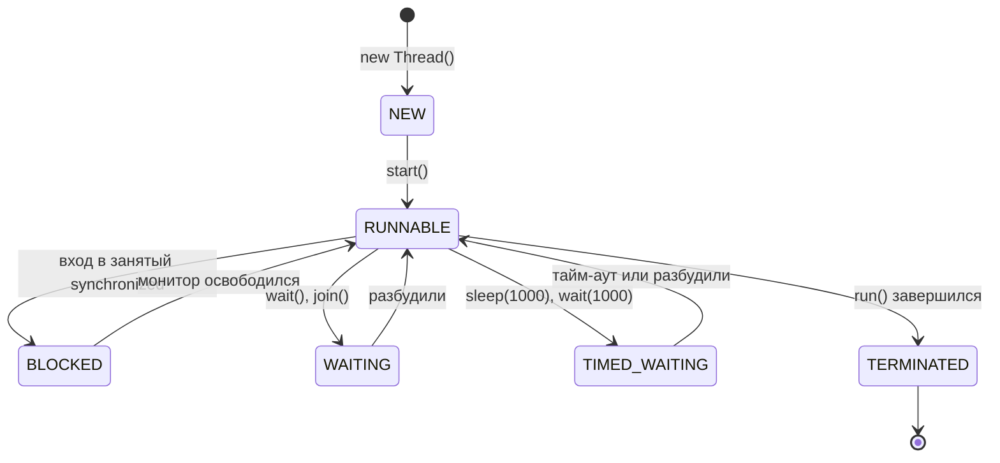

---
tags:
  - Junior
  - Java
  - Многопоточность
---

# Потоки

Чем поток отличается от процесса, как его создать и запустить, какие у него состояния и как его остановить. На собесе с этого начинают блок многопоточности: просят нарисовать жизненный цикл потока, объяснить разницу `sleep` и `wait` и показать, как правильно обработать `InterruptedException`.

## Фундамент { #basics }

### Чем поток отличается от процесса? { #thread-vs-process }

**Уровень:** Junior

!!! abstract "Ответ вслух"
    Процесс — экземпляр запущенной программы со своей изолированной памятью: если один процесс упадёт, другие выживут. Поток — лёгкая единица исполнения внутри процесса. Все потоки процесса делят общую кучу (Heap), но у каждого свой стек (Stack).

- **Процесс** — тяжеловесная единица. У процесса **своя изолированная память**.
    - _Аналогия:_ отдельный дом. Чтобы поговорить с соседом (другим процессом), нужно кричать через улицу (Socket, REST, IPC).
- **Поток** — лёгкая единица исполнения _внутри_ процесса. Потоки делят **общую память (Heap)**, но имеют свой **стек (Stack)**.
    - _Аналогия:_ жильцы одной квартиры. Легко передают вещи (объекты в Heap), но могут подраться за туалет (Race Condition).

```java
// Оба потока видят один и тот же объект в куче
List<String> shared = Collections.synchronizedList(new ArrayList<>());
Runnable task = () -> shared.add(Thread.currentThread().getName());
Thread t1 = new Thread(task);
Thread t2 = new Thread(task);
t1.start();
t2.start();
t1.join();
t2.join();
System.out.println(shared); // оба имени — потоки писали в общий объект
```

!!! warning "Ловушка: общая куча — общие проблемы"
    То, что потоки делят кучу, удобно для обмена данными, но любое изменяемое общее состояние без синхронизации даёт гонку данных (race condition). Локальные переменные живут в стеке потока и другим потокам не видны.

??? question "Проверь себя"
    1. Что общее у потоков одного процесса, а что у каждого своё?
    2. Почему падение одного процесса не роняет другие?
    3. Как процессы обмениваются данными?

### Как создать поток: `Thread` или `Runnable`? { #thread-vs-runnable }

**Уровень:** Junior

!!! abstract "Ответ вслух"
    Задачу описывают в `Runnable` (или `Callable`, если нужен результат), а запускают в `Thread` или пуле потоков. Наследоваться от `Thread` — моветон: теряешь единственное наследование и смешиваешь механизм запуска с бизнес-логикой.

Почему `extends Thread` — моветон:

1. **Ограниченность наследования:** множественного наследования нет — ты теряешь возможность унаследоваться от бизнес-класса.
2. **SRP:** поток (`Thread`) — это «рабочий», механизм запуска, а задача (`Runnable`) — «инструкция», бизнес-логика. Вшивать инструкцию в рабочего нельзя.

```java
// ❌ Смешиваем инфраструктуру и логику
class BadThread extends Thread {
    @Override
    public void run() { System.out.println("Hard work..."); }
}

// ✅ Логика отдельно, запуск отдельно
Runnable task = () -> System.out.println("Clean work!");
Thread worker = new Thread(task);
worker.start();
```

!!! warning "Ловушка: `run()` вместо `start()`"
    `worker.run()` выполнит задачу в текущем потоке, как обычный метод. Новый поток создаёт только `start()`.

??? question "Проверь себя"
    1. Назови две причины не наследоваться от `Thread`.
    2. Чем `Runnable` отличается от `Callable`?
    3. Что произойдёт, если вызвать `run()` вместо `start()`?

### Какие состояния есть у потока? { #thread-states }

**Уровень:** Junior

!!! abstract "Ответ вслух"
    Состояний шесть, они перечислены в `Thread.State`: NEW, RUNNABLE, BLOCKED, WAITING, TIMED_WAITING и TERMINATED. BLOCKED — ожидание монитора `synchronized`, WAITING — ожидание другого потока без лимита, TIMED_WAITING — с тайм-аутом. Завершённый поток перезапустить нельзя.



1. **NEW** — создан `new Thread()`, `start()` ещё не вызван.
2. **RUNNABLE** — вызван `start()`. Поток либо выполняется на CPU, либо ждёт своей очереди в планировщике ОС.
3. **BLOCKED** — упёрся в `synchronized` и ждёт освобождения монитора.
4. **WAITING** — ждёт другого потока без лимита времени (`wait()`, `join()`).
5. **TIMED_WAITING** — ждёт с тайм-аутом (`sleep(1000)`, `wait(1000)`).
6. **TERMINATED** — `run()` завершился.

!!! warning "Ловушка: повторный `start()`"
    Перезапустить поток нельзя: умер — значит умер. Повторный `start()` бросит `IllegalThreadStateException`, для новой попытки нужен новый объект `Thread`.

??? question "Проверь себя"
    1. В каком состоянии поток, который ждёт входа в `synchronized`?
    2. Чем WAITING отличается от TIMED_WAITING?
    3. Можно ли снова запустить поток в состоянии TERMINATED?

### Как работают `join`, `sleep` и `yield`? { #join-sleep-yield }

**Уровень:** Junior

!!! abstract "Ответ вслух"
    `Thread.sleep(ms)` ставит текущий поток на паузу и не отпускает мониторы. `thread.join()` ждёт, пока поток `thread` завершится. `Thread.yield()` — подсказка планировщику, что поток готов уступить CPU, её можно проигнорировать.

- **`Thread.sleep(ms)`** — пауза текущего потока.
- **`thread.join()`** — «жду, пока поток `thread` завершится». Используется, чтобы дождаться результата.
- **`Thread.yield()`** — подсказка планировщику «готов уступить CPU». Может быть проигнорирована, в реальном коде встречается редко.

```java
Thread worker = new Thread(() -> System.out.println("работаю"));
worker.start();
worker.join();                   // main ждёт завершения worker
System.out.println("worker закончил");
```

!!! warning "Ловушка: `sleep` под монитором"
    `sleep` **не отпускает мониторы**. Если поток уснул внутри `synchronized`, никто другой в этот блок не зайдёт, пока он не проснётся. Монитор на время ожидания отпускает только `wait()`.

??? question "Проверь себя"
    1. Отпускает ли `sleep()` монитор?
    2. Зачем нужен `join()`?
    3. Гарантирует ли `yield()`, что поток уступит CPU?

### Как правильно остановить поток? { #interrupt }

**Уровень:** Middle

!!! abstract "Ответ вслух"
    Через `interrupt()` и кооперативное завершение: поток сам проверяет флаг `isInterrupted()` и аккуратно выходит. `stop()` устарел и опасен — он убивает поток на полуслове, и данные остаются битыми.

`stop()` — **deprecated**: он прерывает поток в произвольной точке. Правильный путь — **кооперативное завершение**: попросить поток остановиться и дать ему закончить работу самому.

```java
Thread worker = new Thread(() -> {
    while (!Thread.currentThread().isInterrupted()) {
        try {
            System.out.println("Working...");
            Thread.sleep(1000);
        } catch (InterruptedException e) {
            System.out.println("Попросили выйти во сне!");
            Thread.currentThread().interrupt(); // ❗ восстанавливаем флаг — catch его сбрасывает
            break;
        }
    }
    System.out.println("Clean shutdown.");
});

worker.start();
Thread.sleep(3000);
worker.interrupt(); // «стучимся» к потоку
```

!!! warning "Ловушка: проглоченный `InterruptedException`"
    Когда `sleep()` или `wait()` бросают `InterruptedException`, флаг прерывания уже сброшен. Если в `catch` его не восстановить через `Thread.currentThread().interrupt()`, код выше по стеку не узнает, что поток просили остановиться.

??? question "Проверь себя"
    1. Почему `stop()` опасен?
    2. Что происходит с флагом прерывания, когда бросается `InterruptedException`?
    3. Как поток узнаёт, что его попросили остановиться?

## Шпаргалка { #cheatsheet }

<!-- --8<-- [start:cheatsheet] -->
| Тема | Запомнить |
|---|---|
| **Процесс vs поток** | У процесса своя память; потоки процесса делят кучу, но у каждого свой стек |
| **`Thread` vs `Runnable`** | Задача — в `Runnable` (или `Callable`), запуск — в `Thread` или пуле; `extends Thread` — моветон |
| **Жизненный цикл** | NEW → RUNNABLE → BLOCKED / WAITING / TIMED_WAITING → TERMINATED; перезапустить нельзя |
| **`sleep` / `join` / `yield`** | `sleep` не отпускает мониторы; `join` ждёт завершения потока; `yield` — лишь подсказка |
| **Остановка потока** | `interrupt()` + проверка флага; в `catch (InterruptedException)` восстанавливай флаг |

<!-- --8<-- [end:cheatsheet] -->
