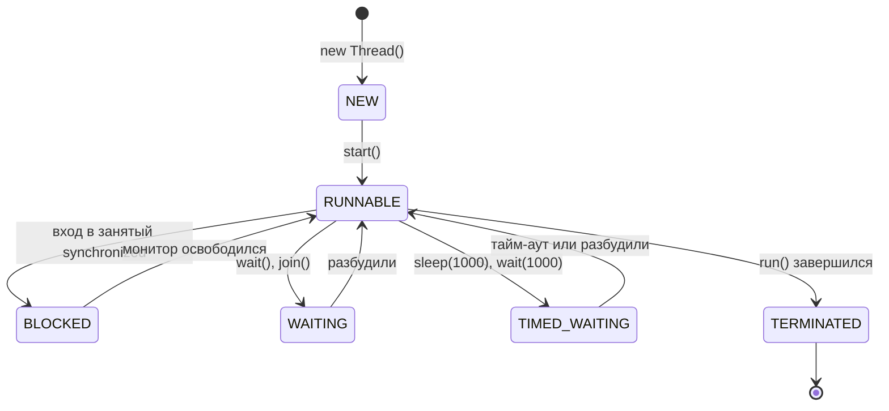

---
tags:
  - Junior
  - Middle
  - Java
  - Многопоточность
---

# Потоки и ThreadLocal

Чем поток отличается от процесса, как его создать и запустить, какие у него состояния и как его остановить, а в конце — данные, привязанные к потоку (`ThreadLocal`). На собесе с этого начинают блок многопоточности: просят нарисовать жизненный цикл потока, объяснить разницу `sleep` и `wait`, показать, как правильно обработать `InterruptedException`, и объяснить, почему `ThreadLocal` течёт в пуле потоков.

## Фундамент { #basics }

### Чем поток отличается от процесса? { #thread-vs-process }

**Уровень:** Junior

!!! abstract "Ответ вслух"
    Процесс — экземпляр запущенной программы со своей изолированной памятью: если один процесс упадёт, другие выживут. Поток — лёгкая единица исполнения внутри процесса. Все потоки процесса делят общую кучу (Heap), но у каждого свой стек (Stack).

- **Процесс** — тяжеловесная единица. У процесса **своя изолированная память**.
    - _Аналогия:_ отдельный дом. Чтобы поговорить с соседом (другим процессом), нужно кричать через улицу (Socket, REST, IPC).
- **Поток** — лёгкая единица исполнения _внутри_ процесса. Потоки делят **общую память (Heap)**, но имеют свой **стек (Stack)**.
    - _Аналогия:_ жильцы одной квартиры. Легко передают вещи (объекты в Heap), но могут подраться за туалет (Race Condition).

```java
// Оба потока видят один и тот же объект в куче
List<String> shared = Collections.synchronizedList(new ArrayList<>());
Runnable task = () -> shared.add(Thread.currentThread().getName());
Thread t1 = new Thread(task);
Thread t2 = new Thread(task);
t1.start();
t2.start();
t1.join();
t2.join();
System.out.println(shared); // оба имени — потоки писали в общий объект
```

!!! warning "Ловушка: общая куча — общие проблемы"
    То, что потоки делят кучу, удобно для обмена данными, но любое изменяемое общее состояние без синхронизации даёт гонку данных (race condition). Локальные переменные живут в стеке потока и другим потокам не видны.

??? question "Проверь себя"
    1. Что общее у потоков одного процесса, а что у каждого своё?
    2. Почему падение одного процесса не роняет другие?
    3. Как процессы обмениваются данными?

### Как создать поток: `Thread` или `Runnable`? { #thread-vs-runnable }

**Уровень:** Junior

!!! abstract "Ответ вслух"
    Задачу описывают в `Runnable` (или `Callable`, если нужен результат), а запускают в `Thread` или пуле потоков. Наследоваться от `Thread` — моветон: теряешь единственное наследование и смешиваешь механизм запуска с бизнес-логикой.

Почему `extends Thread` — моветон:

1. **Ограниченность наследования:** множественного наследования нет — ты теряешь возможность унаследоваться от бизнес-класса.
2. **SRP:** поток (`Thread`) — это «рабочий», механизм запуска, а задача (`Runnable`) — «инструкция», бизнес-логика. Вшивать инструкцию в рабочего нельзя.

```java
// ❌ Смешиваем инфраструктуру и логику
class BadThread extends Thread {
    @Override
    public void run() { System.out.println("Hard work..."); }
}

// ✅ Логика отдельно, запуск отдельно
Runnable task = () -> System.out.println("Clean work!");
Thread worker = new Thread(task);
worker.start();
```

!!! warning "Ловушка: `run()` вместо `start()`"
    `worker.run()` выполнит задачу в текущем потоке, как обычный метод. Новый поток создаёт только `start()`.

??? question "Проверь себя"
    1. Назови две причины не наследоваться от `Thread`.
    2. Чем `Runnable` отличается от `Callable`?
    3. Что произойдёт, если вызвать `run()` вместо `start()`?

### Какие состояния есть у потока? { #thread-states }

**Уровень:** Junior

!!! abstract "Ответ вслух"
    Состояний шесть, они перечислены в `Thread.State`: NEW, RUNNABLE, BLOCKED, WAITING, TIMED_WAITING и TERMINATED. BLOCKED — ожидание монитора `synchronized`, WAITING — ожидание другого потока без лимита, TIMED_WAITING — с тайм-аутом. Завершённый поток перезапустить нельзя.



1. **NEW** — создан `new Thread()`, `start()` ещё не вызван.
2. **RUNNABLE** — вызван `start()`. Поток либо выполняется на CPU, либо ждёт своей очереди в планировщике ОС.
3. **BLOCKED** — упёрся в `synchronized` и ждёт освобождения монитора.
4. **WAITING** — ждёт другого потока без лимита времени (`wait()`, `join()`).
5. **TIMED_WAITING** — ждёт с тайм-аутом (`sleep(1000)`, `wait(1000)`).
6. **TERMINATED** — `run()` завершился.

!!! warning "Ловушка: повторный `start()`"
    Перезапустить поток нельзя: умер — значит умер. Повторный `start()` бросит `IllegalThreadStateException`, для новой попытки нужен новый объект `Thread`.

??? question "Проверь себя"
    1. В каком состоянии поток, который ждёт входа в `synchronized`?
    2. Чем WAITING отличается от TIMED_WAITING?
    3. Можно ли снова запустить поток в состоянии TERMINATED?

### Как работают `join`, `sleep` и `yield`? { #join-sleep-yield }

**Уровень:** Junior

!!! abstract "Ответ вслух"
    `Thread.sleep(ms)` ставит текущий поток на паузу и не отпускает мониторы. `thread.join()` ждёт, пока поток `thread` завершится. `Thread.yield()` — подсказка планировщику, что поток готов уступить CPU, её можно проигнорировать.

- **`Thread.sleep(ms)`** — пауза текущего потока.
- **`thread.join()`** — «жду, пока поток `thread` завершится». Используется, чтобы дождаться результата.
- **`Thread.yield()`** — подсказка планировщику «готов уступить CPU». Может быть проигнорирована, в реальном коде встречается редко.

```java
Thread worker = new Thread(() -> System.out.println("работаю"));
worker.start();
worker.join();                   // main ждёт завершения worker
System.out.println("worker закончил");
```

!!! warning "Ловушка: `sleep` под монитором"
    `sleep` **не отпускает мониторы**. Если поток уснул внутри `synchronized`, никто другой в этот блок не зайдёт, пока он не проснётся. Монитор на время ожидания отпускает только `wait()`.

??? question "Проверь себя"
    1. Отпускает ли `sleep()` монитор?
    2. Зачем нужен `join()`?
    3. Гарантирует ли `yield()`, что поток уступит CPU?

### Как правильно остановить поток? { #interrupt }

**Уровень:** Middle

!!! abstract "Ответ вслух"
    Через `interrupt()` и кооперативное завершение: поток сам проверяет флаг `isInterrupted()` и аккуратно выходит. `stop()` устарел и опасен — он убивает поток на полуслове, и данные остаются битыми.

`stop()` — **deprecated**: он прерывает поток в произвольной точке. Правильный путь — **кооперативное завершение**: попросить поток остановиться и дать ему закончить работу самому.

```java
Thread worker = new Thread(() -> {
    while (!Thread.currentThread().isInterrupted()) {
        try {
            System.out.println("Working...");
            Thread.sleep(1000);
        } catch (InterruptedException e) {
            System.out.println("Попросили выйти во сне!");
            Thread.currentThread().interrupt(); // ❗ восстанавливаем флаг — catch его сбрасывает
            break;
        }
    }
    System.out.println("Clean shutdown.");
});

worker.start();
Thread.sleep(3000);
worker.interrupt(); // «стучимся» к потоку
```

!!! warning "Ловушка: проглоченный `InterruptedException`"
    Когда `sleep()` или `wait()` бросают `InterruptedException`, флаг прерывания уже сброшен. Если в `catch` его не восстановить через `Thread.currentThread().interrupt()`, код выше по стеку не узнает, что поток просили остановиться.

??? question "Проверь себя"
    1. Почему `stop()` опасен?
    2. Что происходит с флагом прерывания, когда бросается `InterruptedException`?
    3. Как поток узнаёт, что его попросили остановиться?

## Данные потока { #thread-data }

### Как работает `ThreadLocal` и почему он течёт в пуле потоков? { #thread-local }

**Уровень:** Middle

=== "Коротко"

    !!! abstract "Ответ вслух"
        `ThreadLocal` даёт каждому потоку свою копию значения: оно лежит не в самом `ThreadLocal`, а в `ThreadLocalMap` внутри объекта `Thread`, где `ThreadLocal` — ключ. В пуле поток живёт долго, поэтому значение, которое задача не убрала через `remove()` в `finally`, увидит следующая задача, и память держится, пока жив поток. `InheritableThreadLocal` копирует значения только при создании потока, поэтому в пул контекст передают явно — в Spring через `TaskDecorator`.

=== "Подробно"

    **Где хранится значение.** У каждого `Thread` есть поле `threadLocals` типа `ThreadLocal.ThreadLocalMap` — хеш-таблица, своя у каждого потока. `get()` берёт `Thread.currentThread()`, достаёт его карту и ищет в ней запись по ключу — самому объекту `ThreadLocal`. Поэтому синхронизация не нужна: два потока читают разные карты.

    ```mermaid
    flowchart LR
        TL["static ThreadLocal CURRENT_USER"]
        subgraph T1["Thread http-nio-1"]
            M1["ThreadLocalMap"] --> E1["ключ → «alice»"]
        end
        subgraph T2["Thread http-nio-2"]
            M2["ThreadLocalMap"] --> E2["ключ → «bob»"]
        end
        E1 -. слабая ссылка .-> TL
        E2 -. слабая ссылка .-> TL
    ```

    Запись карты (`Entry`) держит ключ через `WeakReference`, а значение — обычной сильной ссылкой. Если сам `ThreadLocal` стал недостижим, GC обнулит ключ, но значение останется в карте. Такие записи без ключа (stale entries) карта чистит только попутно, при следующих `set`, `get` и `remove` в этом же потоке, и не обязательно все.

    Типичные пользователи `ThreadLocal` — контекст запроса, который неудобно передавать параметром через все методы: `SecurityContextHolder` в Spring Security, `TransactionSynchronizationManager` с соединением текущей транзакции, `RequestContextHolder`, MDC (Mapped Diagnostic Context) логгера.

    **Почему течёт в пуле.** Обычно `ThreadLocal` — `static final` поле, поэтому ключ достижим всегда и слабая ссылка ничего не освобождает. Значение живёт, пока жив поток, а поток пула живёт до остановки приложения. Задача, которая положила значение и не убрала его, оставляет его следующей задаче в этом потоке:

    ```java
    import java.util.concurrent.ExecutorService;
    import java.util.concurrent.Executors;

    public class ThreadLocalLeak {

        // Как в фильтре веб-приложения: кто делает текущий запрос
        static final ThreadLocal<String> CURRENT_USER = new ThreadLocal<>();

        public static void main(String[] args) throws Exception {
            try (ExecutorService pool = Executors.newFixedThreadPool(1)) {
                // ❌ Запрос alice кладёт значение и не убирает его
                pool.submit(() -> CURRENT_USER.set("alice")).get();

                // Следующий запрос попал в тот же поток и видит чужого пользователя
                pool.submit(() -> System.out.println("запрос без логина: " + CURRENT_USER.get())).get();

                // ✅ set — в начале задачи, remove — в finally
                pool.submit(() -> {
                    CURRENT_USER.set("bob");
                    try {
                        System.out.println("запрос bob: " + CURRENT_USER.get());
                    } finally {
                        CURRENT_USER.remove();
                    }
                }).get();

                pool.submit(() -> System.out.println("после remove(): " + CURRENT_USER.get())).get();
            }
        }
    }
    ```

    Вывод `java ThreadLocalLeak.java` на JDK 25:

    ```text
    запрос без логина: alice
    запрос bob: bob
    после remove(): null
    ```

    Потоки Tomcat — тоже пул. Поэтому интерсептор, который кладёт данные в `ThreadLocal`, очищает их в `afterCompletion`, а не в `postHandle` (см. [интерсепторы](../spring/spring-mvc.md#interceptor)). В сервере приложений забытое значение ещё и держит класс из приложения, а через него — весь его `ClassLoader`: после редеплоя это [утечка Metaspace](../java/jvm.md#metaspace-gc).

    **Почему `InheritableThreadLocal` не спасает.** Он копирует значения родителя в момент создания дочернего потока, и только тогда. Поток пула создаётся один раз — на первой задаче — и дальше видит снимок того момента:

    ```java
    import java.util.concurrent.ExecutorService;
    import java.util.concurrent.Executors;

    public class InheritableInPool {

        static final InheritableThreadLocal<String> REQUEST_ID = new InheritableThreadLocal<>();

        public static void main(String[] args) throws Exception {
            try (ExecutorService pool = Executors.newFixedThreadPool(1)) {
                REQUEST_ID.set("req-1");
                // Поток пула создаётся на первой задаче и копирует значения main
                pool.submit(() -> System.out.println("задача 1: " + REQUEST_ID.get())).get();

                REQUEST_ID.set("req-2");
                // Поток уже есть, копирования больше не будет
                pool.submit(() -> System.out.println("задача 2: " + REQUEST_ID.get())).get();
            }
        }
    }
    ```

    ```text
    задача 1: req-1
    задача 2: req-1
    ```

    **Как передать контекст в пул.** Снять значение в потоке, который отправляет задачу, установить его в потоке пула перед запуском и убрать в `finally`. Это и есть декоратор задачи:

    ```java
    import java.util.concurrent.ExecutorService;
    import java.util.concurrent.Executors;

    public class CapturedContext {

        static final ThreadLocal<String> REQUEST_ID = new ThreadLocal<>();

        // То же делает TaskDecorator в Spring: снимок — в потоке, который отправляет
        // задачу, установка и очистка — в потоке пула
        static Runnable withContext(Runnable task) {
            String captured = REQUEST_ID.get();
            return () -> {
                REQUEST_ID.set(captured);
                try {
                    task.run();
                } finally {
                    REQUEST_ID.remove();
                }
            };
        }

        public static void main(String[] args) throws Exception {
            Runnable task = () -> System.out.println(Thread.currentThread().getName() + ": " + REQUEST_ID.get());
            try (ExecutorService pool = Executors.newFixedThreadPool(1)) {
                for (String id : new String[] {"req-1", "req-2"}) {
                    REQUEST_ID.set(id);
                    pool.submit(withContext(task)).get();
                }
                pool.submit(task).get(); // без обёртки: в потоке пула ничего не осталось
            }
        }
    }
    ```

    ```text
    pool-1-thread-1: req-1
    pool-1-thread-1: req-2
    pool-1-thread-1: null
    ```

    В Spring такую обёртку пишут как `TaskDecorator`. Spring Boot сам применяет бины `TaskDecorator` к пулу, который создаёт для `@Async`. Пример переносит MDC, чтобы в логах асинхронной задачи остался `requestId` запроса:

    ```java
    @Bean
    TaskDecorator mdcTaskDecorator() {
        return task -> {
            Map<String, String> mdc = MDC.getCopyOfContextMap(); // поток, который вызвал @Async
            return () -> {
                if (mdc != null) MDC.setContextMap(mdc);          // поток пула
                try {
                    task.run();
                } finally {
                    MDC.clear();                                  // поток вернётся в пул чистым
                }
            };
        };
    }
    ```

    На Spring Boot 4.0.8 `@Async`-метод, который печатает `MDC.get("requestId")`, без этого бина выводит `task-1: requestId=null`, с ним — `task-1: requestId=req-42`. Для логов и трейсинга в Spring 6.1+ есть готовый `ContextPropagatingTaskDecorator` (поверх библиотеки Micrometer Context Propagation). Контекст безопасности переносят обёртками Spring Security — см. [`SecurityContext` в асинхронном коде](../spring/spring-ecosystem.md#security-context-async).

    `ThreadLocal` работает и в виртуальных потоках, но копия значения будет у каждого из них, а их бывают миллионы. Для передачи контекста вниз по вызовам в Java 25 есть `ScopedValue` ([JEP 506](https://openjdk.org/jeps/506)): значение неизменяемое и привязано к блоку кода, поэтому забыть его убрать нельзя.

!!! warning "Ловушка: забытый `remove()` — данные чужого запроса"
    Без `remove()` в `finally` значение переживает задачу, и следующий запрос в том же потоке пула увидит чужой `userId` или `tenantId`. Это не только утечка памяти, но и утечка данных между пользователями. `set` без парного `remove` в коде с пулом — баг, даже если исключений не бывает.

!!! warning "Ловушка: «ключ слабый — GC всё почистит»"
    Слабая ссылка — только на ключ, значение карта держит сильно. А ключ обычно `static final` и не собирается никогда. Освобождает значение только `remove()` или смерть потока.

!!! warning "Ловушка: `InheritableThreadLocal` для `@Async`"
    Значения копируются один раз, при создании потока. В пуле задача получит контекст того запроса, на котором создали поток, — или ничего. Так же ведёт себя `SecurityContextHolder` в режиме `MODE_INHERITABLETHREADLOCAL`. Для пула нужен декоратор задачи, который снимает и восстанавливает контекст на каждую задачу.

??? question "Проверь себя"
    1. Где физически хранится значение `ThreadLocal` и почему его чтение не требует синхронизации?
    2. Почему значение остаётся в потоке пула после задачи, хотя ключ в `ThreadLocalMap` слабый?
    3. Почему `InheritableThreadLocal` не передаёт контекст в задачу пула и что делает `TaskDecorator`?

**Источники:**

- [`ThreadLocal` — Java SE 25 API](https://docs.oracle.com/en/java/javase/25/docs/api/java.base/java/lang/ThreadLocal.html) — копия значения живёт, пока жив поток и доступен `ThreadLocal`; `remove()`
- [`InheritableThreadLocal` — Java SE 25 API](https://docs.oracle.com/en/java/javase/25/docs/api/java.base/java/lang/InheritableThreadLocal.html) — значения передаются при создании дочернего потока
- [Исходник `ThreadLocal.ThreadLocalMap` (JDK 25)](https://github.com/openjdk/jdk/blob/jdk-25%2B36/src/java.base/share/classes/java/lang/ThreadLocal.java) — `Entry extends WeakReference<ThreadLocal<?>>`, stale entries
- [JEP 506: Scoped Values](https://openjdk.org/jeps/506) — финальная фича Java 25
- [`TaskDecorator` — Spring Framework API](https://docs.spring.io/spring-framework/docs/current/javadoc-api/org/springframework/core/task/TaskDecorator.html) и [`ContextPropagatingTaskDecorator`](https://docs.spring.io/spring-framework/docs/current/javadoc-api/org/springframework/core/task/support/ContextPropagatingTaskDecorator.html) (с 6.1)
- [Spring Boot: Task Execution and Scheduling](https://docs.spring.io/spring-boot/reference/features/task-execution-and-scheduling.html) — автоконфигурация пула для `@Async`; бины `TaskDecorator` к нему применяет [`TaskExecutorConfigurations`](https://github.com/spring-projects/spring-boot/blob/v4.0.0/core/spring-boot-autoconfigure/src/main/java/org/springframework/boot/autoconfigure/task/TaskExecutorConfigurations.java)

## Шпаргалка { #cheatsheet }

<!-- --8<-- [start:cheatsheet] -->
| Тема | Запомнить |
|---|---|
| **Процесс vs поток** | У процесса своя память; потоки процесса делят кучу, но у каждого свой стек |
| **`Thread` vs `Runnable`** | Задача — в `Runnable` (или `Callable`), запуск — в `Thread` или пуле; `extends Thread` — моветон |
| **Жизненный цикл** | NEW → RUNNABLE → BLOCKED / WAITING / TIMED_WAITING → TERMINATED; перезапустить нельзя |
| **`sleep` / `join` / `yield`** | `sleep` не отпускает мониторы; `join` ждёт завершения потока; `yield` — лишь подсказка |
| **Остановка потока** | `interrupt()` + проверка флага; в `catch (InterruptedException)` восстанавливай флаг |
| **`ThreadLocal`** | Значение — в `ThreadLocalMap` потока, ключ слабый, значение — нет; в пуле — `remove()` в `finally`; `InheritableThreadLocal` копирует только при создании потока, в пул контекст переносит `TaskDecorator` |

<!-- --8<-- [end:cheatsheet] -->
