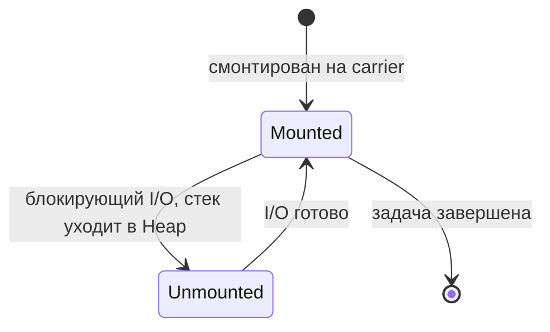

---
tags:
  - Senior
  - Java
  - Многопоточность
---

# Виртуальные потоки

Project Loom: виртуальные потоки, пиннинг и Structured Concurrency. Спрашивают, чем виртуальный поток отличается от платформенного, когда он не даёт выигрыша и что изменилось в Java 24 с `synchronized`.

## Project Loom (Java 21+) { #loom }

### Чем виртуальные потоки отличаются от платформенных? { #virtual-threads }

**Уровень:** Middle

!!! abstract "Ответ вслух"
    Платформенным потоком управляет ОС, у него стек 1–2 МБ, и их бывает тысячи. Виртуальным управляет JVM, стек хранится в куче, и их можно создать миллионы. На блокирующем I/O виртуальный поток размонтируется с потока-носителя (carrier), и тот берёт следующую задачу.

| | **Platform (OS) Threads** | **Virtual Threads** |
|---|---|---|
| **Управление** | ОС | JVM |
| **Стек** | ~1-2 МБ в памяти ОС | В Java Heap как обычный объект |
| **Максимум** | ~тысячи | **Миллионы** |
| **Создание** | `new Thread(task)` | `Thread.ofVirtual().start(task)` |

Виртуальные потоки выполняются на небольшом пуле обычных потоков-носителей (carrier threads, по умолчанию `ForkJoinPool`):



1. Виртуальный поток **монтируется** на carrier — выполняется на CPU.
2. Встречает блокирующую I/O (ждёт БД, сеть) — **размонтируется**, стек сохраняется в Heap.
3. Carrier-поток свободен — берёт другой виртуальный поток.
4. Когда I/O готово — виртуальный поток монтируется снова.

Никто не простаивает. Можно держать тысячи открытых соединений к БД без тысяч реальных потоков.

```java
try (var executor = Executors.newVirtualThreadPerTaskExecutor()) {
    for (int i = 0; i < 10_000; i++) {
        executor.submit(() -> {
            Thread.sleep(1_000); // блокировка — carrier освобождается
            return null;
        });
    }
} // 10 000 задач по секунде завершаются примерно за секунду
```

!!! warning "Ловушка: виртуальные потоки не ускоряют вычисления"
    Выигрыш есть только там, где потоки в основном ждут I/O. Для задач, которые грузят CPU, число носителей всё равно равно числу ядер, и виртуальные потоки не помогут.

??? question "Проверь себя"
    1. Где хранится стек виртуального потока?
    2. Что происходит с carrier-потоком, когда виртуальный поток ждёт I/O?
    3. Для каких задач виртуальные потоки не дают выигрыша?

### Что такое pinning? { #pinning }

**Уровень:** Senior

!!! abstract "Ответ вслух"
    Пиннинг (pinning) — когда виртуальный поток блокируется, но не может размонтироваться и держит carrier-поток. Если таких много, пул носителей исчерпается и приложение зависнет. В Java 21–23 пинит блокировка внутри `synchronized` и native-код, с Java 24 (JEP 491) — только native-код и редкие случаи.

**Когда происходит пиннинг:**

- **Java 21–23:** блокировка внутри `synchronized` (I/O под монитором, `Object.wait()`, ожидание входа в занятый монитор) и вызов native-метода (JNI).
- **Java 24+ ([JEP 491](https://openjdk.org/jeps/491)):** `synchronized` больше **не пинит** — виртуальный поток размонтируется и при ожидании монитора, и внутри `synchronized`, и в `Object.wait()`. Пиннинг остался для native-кода (JNI, Foreign Function API) и для редких случаев вроде блокировки в статическом инициализаторе класса.

```java
// На Java 21–23 — пиннинг: I/O под монитором держит carrier
synchronized (lock) {
    callDatabase();
}

// ✅ На Java 21–23 — ReentrantLock: виртуальный поток размонтируется при ожидании
reentrantLock.lock();
try {
    callDatabase();
} finally {
    reentrantLock.unlock();
}
```

!!! warning "Ловушка: правило «замени `synchronized`» — только для Java 21–23"
    На Java 21–23 заменяй `synchronized` на `ReentrantLock` там, где под блокировкой есть блокирующие операции: с `ReentrantLock` виртуальные потоки корректно размонтируются при ожидании. С Java 24 переписывать `synchronized` ради виртуальных потоков не нужно. `ReentrantLock` выбирают только ради его возможностей: `tryLock()`, таймауты, fairness, несколько `Condition`.

??? question "Проверь себя"
    1. Что такое pinning и чем он опасен?
    2. Что изменил JEP 491 в Java 24?
    3. Что до сих пор пинит виртуальный поток?

### Что такое Structured Concurrency? { #structured-concurrency }

**Уровень:** Senior

!!! abstract "Ответ вслух"
    Это управление подзадачами как единым блоком, по аналогии с `try`: все подзадачи живут внутри scope и не переживают его. Если одна упала, остальные отменяются, и потоки не утекают. В Java 25 это всё ещё preview: `StructuredTaskScope.open()`, политика через `Joiner`, `fork()` возвращает `Subtask`.

```java
// Java 25 (JEP 505), preview: javac/java --enable-preview
try (var scope = StructuredTaskScope.open()) { // Joiner по умолчанию: все успешны или исключение
    Subtask<String> user  = scope.fork(() -> fetchUser(id));
    Subtask<Order>  order = scope.fork(() -> fetchOrder(id));

    scope.join(); // ждём обе; если одна упала — вторая отменяется, join() бросает FailedException

    return new Response(user.get(), order.get());
} // при выходе из блока — все незавершённые подзадачи автоматически отменяются
```

Если один fork падает с ошибкой, второй автоматически отменяется. Никаких утечек потоков, код становится линейным и предсказуемым.

Политику ожидания задаёт `Joiner`, который передают в `open()`. Например, «кто первый — тот и победил» (гонка реплик):

```java
try (var scope = StructuredTaskScope.open(Joiner.<String>anySuccessfulResultOrThrow())) {
    scope.fork(() -> fetchFromReplica("eu"));
    scope.fork(() -> fetchFromReplica("us"));

    return scope.join(); // результат первой успешной подзадачи, остальные отменяются
}
```

!!! warning "Ловушка: preview API меняется"
    Structured Concurrency — preview-фича (Java 21–25): без флага `--enable-preview` код не скомпилируется. В Java 21–24 scope создавали через `new StructuredTaskScope.ShutdownOnFailure()`, а ошибку проверяли отдельным `throwIfFailed()` после `join()`. Примеры выше — для Java 25 ([JEP 505](https://openjdk.org/jeps/505)): фабрика `StructuredTaskScope.open()`, политика через `Joiner`, `fork()` возвращает `Subtask`.

??? question "Проверь себя"
    1. Что происходит с остальными подзадачами, если одна упала?
    2. Как задать политику «первый успешный результат»?
    3. Чем API в Java 25 отличается от Java 21–24?

## Шпаргалка { #cheatsheet }

<!-- --8<-- [start:cheatsheet] -->
| Тема | Запомнить |
|---|---|
| **Виртуальные потоки** | Миллионы потоков на JVM; размонтируются на блокирующем I/O; Java 21+ |
| **Pinning** | Java 21–23 — `synchronized` и native; с Java 24 (JEP 491) — только native-код и редкие случаи |
| **Structured Concurrency** | Preview: `StructuredTaskScope.open()` + `Joiner`, `fork()` → `Subtask` (Java 25) |

<!-- --8<-- [end:cheatsheet] -->
