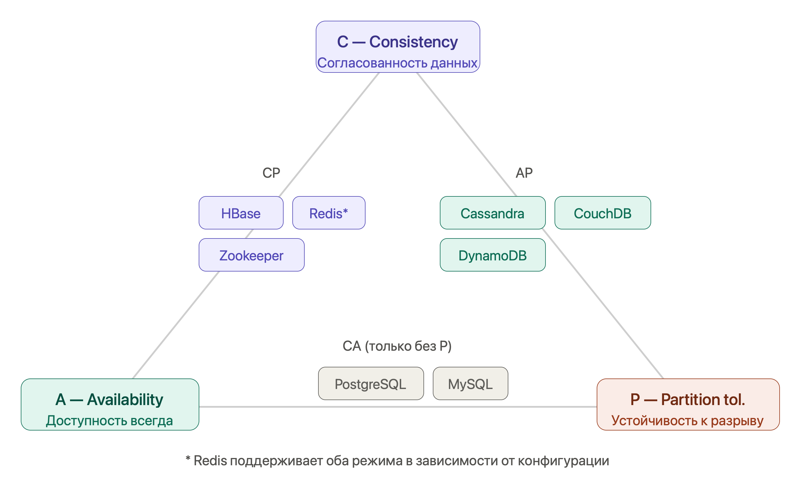
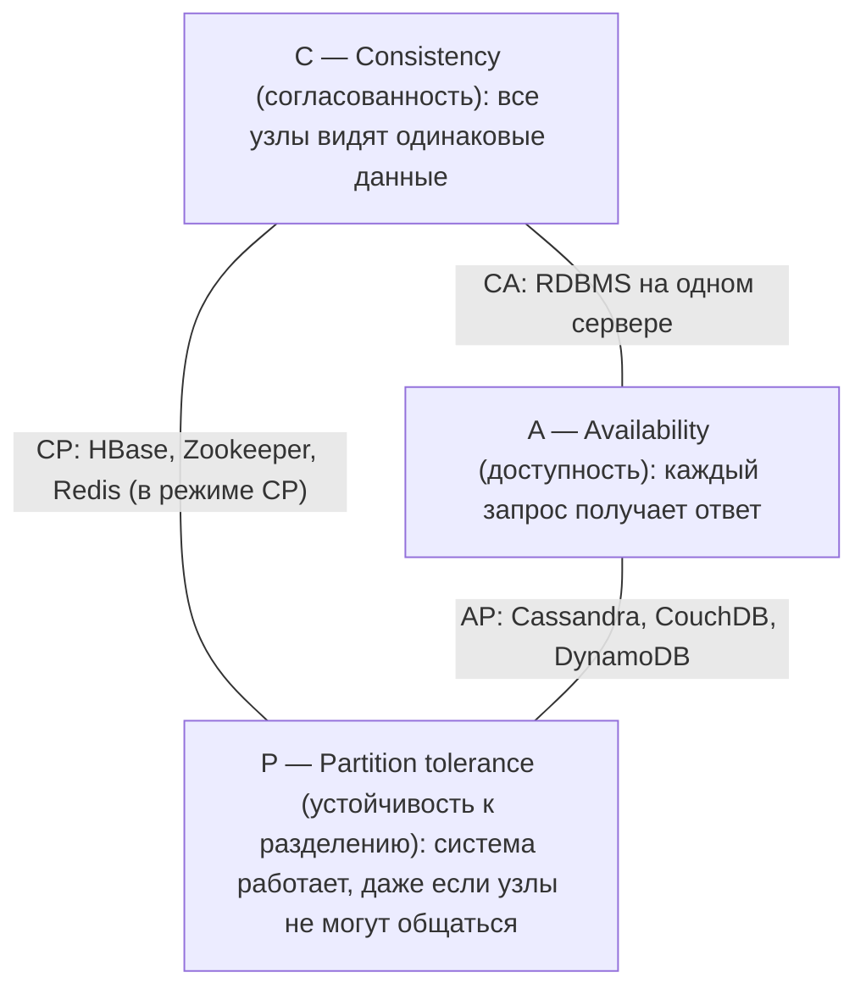

# NoSQL

Четыре семейства NoSQL-баз — документные, key-value, wide-column и графовые — и как с ними работать из Spring Boot. На собесе спрашивают, когда NoSQL лучше SQL, чем отличаются семейства, где каждая база стоит в CAP-теореме и какие задачи решают на Redis.

## Зачем NoSQL { #why-nosql }

### Зачем NoSQL, если есть SQL? { #nosql-vs-sql }

**Уровень:** Junior

!!! abstract "Ответ вслух"
    NoSQL (Not Only SQL) — не замена SQL, а другой инструмент под другие задачи. Реляционные БД упираются в жёсткую схему, сложное горизонтальное масштабирование и плохо хранят неструктурированные данные. Там, где это критично — гибкие документы, кэш, огромные потоки записи, графы, — берут специализированную NoSQL-базу.

Реляционные БД отлично работают для структурированных данных с чёткими связями. Но у них есть ограничения, которые в некоторых сценариях становятся критичными:

- **Жёсткая схема** — добавить поле означает миграцию таблицы. Для продуктов с частыми изменениями это дорого.
- **Вертикальное масштабирование** — нагрузку снимают более мощным сервером. Горизонтальное (шардирование) есть, но сложное.
- **Избыточная мощь** — если хранишь сессии пользователей, кэш или очередь событий, реляционная модель избыточна.
- **Неструктурированные данные** — JSON-документы разной структуры, графы, временные ряды плохо ложатся в таблицы.

Общий выбор между SQL и NoSQL в системном дизайне — в [System Design → SQL vs NoSQL](../system-design/system-design.md#sql-vs-nosql).

!!! warning "Ловушка: NoSQL «потому что модно»"
    NoSQL — не замена SQL, а другой инструмент под конкретный паттерн доступа. Без чётко понятной причины SQL остаётся выбором по умолчанию.

??? question "Проверь себя"
    1. Какие четыре ограничения реляционных БД толкают к NoSQL?
    2. Как расшифровывается NoSQL?
    3. Почему NoSQL не заменяет SQL?

## Семейства NoSQL { #families }

### Что такое документная БД? { #document-store }

**Уровень:** Junior

!!! abstract "Ответ вслух"
    Документная БД хранит данные как JSON/BSON-документы без фиксированной схемы: у каждого документа могут быть свои поля, а вложенные объекты лежат прямо внутри. Пример — MongoDB. Подходит для данных с переменной структурой и частыми изменениями схемы, плохо — для сложных связей между сущностями.

**Представители:** MongoDB, CouchDB, Firestore.

```json
// Документ "habit" в MongoDB
{
  "_id": "64a1f2c3d4e5f6a7b8c9d0e1",
  "userId": "user_42",
  "name": "Утренняя пробежка",
  "frequency": "daily",
  "reminders": [
    { "time": "07:00", "enabled": true },
    { "time": "07:30", "enabled": false }
  ],
  "streaks": {
    "current": 14,
    "longest": 30
  },
  "tags": ["здоровье", "спорт"],
  "createdAt": "2024-01-15T07:00:00Z"
}
```

**Spring Data MongoDB:**

```java
@Document(collection = "habits")
public class Habit {
    @Id
    private String id;
    private String userId;
    private String name;
    private List<Reminder> reminders;
    private Map<String, Integer> streaks;

    // Вложенный объект — просто поле, никаких JOIN-ов
    @Document
    public record Reminder(String time, boolean enabled) {}
}

public interface HabitRepository extends MongoRepository<Habit, String> {

    List<Habit> findByUserId(String userId);

    // MongoDB Query
    @Query("{ 'userId': ?0, 'streaks.current': { $gte: ?1 } }")
    List<Habit> findActiveStreaks(String userId, int minDays);
}
```

**Когда выбирать:**

- Данные имеют переменную структуру (каталог товаров, где у каждого свои атрибуты).
- Нужно хранить вложенные объекты без нормализации.
- Частые изменения схемы (стартап, быстрые итерации).
- Целый документ читают чаще, чем отдельные поля.

**Когда не выбирать:**

- Сложные связи между сущностями (придётся делать JOIN в коде).
- Нужны ACID-транзакции через несколько документов (MongoDB 4.0+ поддерживает, но дороже).
- Данные высоко нормализованы и структурированы.

!!! warning "Ловушка: связи между документами"
    JOIN-ов в привычном виде нет. Если сущности сильно связаны, связи придётся собирать в коде отдельными запросами — это признак, что нужна реляционная БД.

??? question "Проверь себя"
    1. В каком формате документная БД хранит данные?
    2. Когда MongoDB — хороший выбор?
    3. Почему сложные связи между сущностями — плохой кейс для документной БД?

### Что такое key-value хранилище? { #key-value }

**Уровень:** Junior

!!! abstract "Ответ вслух"
    Самая простая модель: ключ → значение, БД не знает, что внутри значения, а операции по ключу работают за O(1). Самый популярный представитель — Redis: данные в памяти, опциональная персистентность и богатые типы данных — строки, списки, множества, sorted sets, хэши, стримы. Используют для кэша, сессий, счётчиков, очередей и лидербордов.

**Представители:** Redis, DynamoDB, Memcached.

**Redis** — самый популярный: данные в памяти (in-memory), опциональная персистентность, богатые типы данных.

```java
// Spring Data Redis
@Configuration
public class RedisConfig {
    @Bean
    public RedisTemplate<String, Object> redisTemplate(RedisConnectionFactory factory) {
        RedisTemplate<String, Object> template = new RedisTemplate<>();
        template.setConnectionFactory(factory);
        template.setValueSerializer(new GenericJackson2JsonRedisSerializer());
        return template;
    }
}

@Service
public class HabitCacheService {

    private final RedisTemplate<String, Object> redis;
    private static final Duration TTL = Duration.ofMinutes(30);

    // Простой кэш
    public void cacheHabit(String habitId, HabitDto habit) {
        redis.opsForValue().set("habit:" + habitId, habit, TTL);
    }

    public HabitDto getCachedHabit(String habitId) {
        return (HabitDto) redis.opsForValue().get("habit:" + habitId);
    }

    // Счётчик streak (атомарная операция)
    public long incrementStreak(String userId, String habitId) {
        String key = "streak:" + userId + ":" + habitId;
        return redis.opsForValue().increment(key);
    }

    // Хранение сессии пользователя
    public void saveSession(String sessionId, UserSession session, Duration ttl) {
        redis.opsForValue().set("session:" + sessionId, session, ttl);
    }

    // Очередь задач (List)
    public void pushNotification(String userId, NotificationDto notification) {
        redis.opsForList().leftPush("notifications:" + userId, notification);
    }

    public NotificationDto popNotification(String userId) {
        return (NotificationDto) redis.opsForList().rightPop("notifications:" + userId);
    }

    // Уникальные просмотры (Set)
    public void trackView(String habitId, String userId) {
        redis.opsForSet().add("views:" + habitId, userId);
    }

    public long uniqueViewCount(String habitId) {
        return redis.opsForSet().size("views:" + habitId);
    }

    // Топ привычек по streak (Sorted Set)
    public void updateLeaderboard(String userId, double streak) {
        redis.opsForZSet().add("leaderboard", userId, streak);
    }

    public Set<Object> getTopUsers(int count) {
        return redis.opsForZSet().reverseRange("leaderboard", 0, count - 1);
    }
}
```

| Тип | Команды | Применение |
|---|---|---|
| **String** | `GET`, `SET`, `INCR`, `EXPIRE` | Кэш, счётчики, сессии |
| **List** | `LPUSH`, `RPOP`, `LRANGE` | Очереди, история, лента |
| **Set** | `SADD`, `SMEMBERS`, `SINTER` | Уникальные элементы, теги |
| **Sorted Set** | `ZADD`, `ZRANGE`, `ZRANK` | Лидерборды, приоритеты |
| **Hash** | `HSET`, `HGET`, `HGETALL` | Объекты с полями |
| **Stream** | `XADD`, `XREAD` | Event sourcing, логи |

**Когда выбирать:**

- Кэширование (самый частый кейс).
- Сессии пользователей.
- Rate limiting (счётчик запросов с TTL).
- Очереди задач.
- Pub/Sub (уведомления в реальном времени).
- Лидерборды и рейтинги.

Сравнение Redis с Memcached и Hazelcast и устройство Redis Cluster — в [System Design → Caching](../system-design/system-design.md#caching).

!!! warning "Ловушка: поиск не по ключу"
    Key-value хранилище отвечает быстро только на запрос по ключу. Найти «все сессии пользователя из Алматы» без заранее построенного ключа или индекса нельзя — это задача другой БД.

??? question "Проверь себя"
    1. Какой структурой Redis сделать лидерборд?
    2. Почему `INCR` подходит для счётчиков?
    3. Какие задачи решают на key-value хранилище?

### Как устроены wide-column БД? { #wide-column }

**Уровень:** Middle

!!! abstract "Ответ вслух"
    Wide-column БД вроде Cassandra хранят строки с гибким набором колонок и масштабируются горизонтально почти линейно. Partition key определяет, на какой ноде лежат данные, а clustering key — порядок внутри партиции. Схему проектируют вокруг запросов, и каждый запрос обязан указывать partition key.

**Суть:** таблицы есть, но схема гибкая — строки в одной таблице могут иметь разные столбцы. Такие БД спроектированы для огромных объёмов данных и горизонтального масштабирования.

**Представители:** Apache Cassandra, HBase, Amazon Keyspaces.

```sql
-- Cassandra CQL (похож на SQL, но другая семантика)
CREATE TABLE habit_events (
    user_id     UUID,
    habit_id    UUID,
    event_date  DATE,
    event_time  TIMESTAMP,
    completed   BOOLEAN,
    notes       TEXT,
    PRIMARY KEY ((user_id, habit_id), event_date, event_time)
) WITH CLUSTERING ORDER BY (event_date DESC, event_time DESC);

-- Partition key: (user_id, habit_id) — определяет на какой ноде лежат данные
-- Clustering key: event_date, event_time — порядок внутри партиции

-- Запрос: ОБЯЗАТЕЛЬНО по partition key
SELECT * FROM habit_events
WHERE user_id = ? AND habit_id = ?
AND event_date >= '2024-01-01';

-- ❌ Так нельзя — нет фильтрации по partition key
SELECT * FROM habit_events WHERE completed = true;
```

**Spring Data Cassandra:**

```java
@Table("habit_events")
public class HabitEvent {
    @PrimaryKeyColumn(name = "user_id", type = PrimaryKeyType.PARTITIONED, ordinal = 0)
    private UUID userId;

    @PrimaryKeyColumn(name = "habit_id", type = PrimaryKeyType.PARTITIONED, ordinal = 1)
    private UUID habitId;

    @PrimaryKeyColumn(name = "event_date", type = PrimaryKeyType.CLUSTERED, ordinal = 0,
                      ordering = Ordering.DESCENDING)
    private LocalDate eventDate;

    @Column private boolean completed;
    @Column private String notes;
}
```

**Главное правило Cassandra:** проектируй схему вокруг запросов, а не вокруг данных. В реляционных БД сначала нормализация, потом запросы; в Cassandra — сначала запросы, потом схема.

**Когда выбирать:**

- Огромные объёмы данных (терабайты, петабайты).
- Высокая скорость записи (IoT, логи, метрики, события).
- Временные ряды (история показателей, события с временной меткой).
- Нужна линейная горизонтальная масштабируемость.

!!! warning "Ловушка: чего нет в Cassandra"
    Нет JOIN, нет агрегаций типа `SUM` / `AVG` / `GROUP BY` в традиционном смысле. Нет транзакций через несколько партиций — только lightweight transactions в одной партиции.

    Это не баг, а намеренный выбор в пользу скорости и масштабируемости.

??? question "Проверь себя"
    1. Чем partition key отличается от clustering key?
    2. Почему запрос `WHERE completed = true` в Cassandra не сработает?
    3. Что значит «проектировать схему вокруг запросов»?

### Когда нужна графовая БД? { #graph }

**Уровень:** Middle

!!! abstract "Ответ вслух"
    Когда главное в данных — связи. Графовая БД хранит узлы и рёбра, причём рёбра — полноценные объекты со своими атрибутами. Пример — Neo4j с языком Cypher; типичные задачи — соцграфы, рекомендации, поиск мошеннических цепочек и кратчайших путей.

**Суть:** данные — это узлы (nodes) и рёбра (edges, relationships). Рёбра хранятся явно, с атрибутами, — поэтому графовые БД подходят для сильно связанных данных.

**Представители:** Neo4j, Amazon Neptune, JanusGraph.

```cypher
// Cypher — язык запросов Neo4j

// Создаём узлы и связи
CREATE (alice:User {id: 1, name: 'Alice'})
CREATE (bob:User {id: 2, name: 'Bob'})
CREATE (running:Habit {id: 10, name: 'Бег'})
CREATE (alice)-[:FOLLOWS]->(bob)
CREATE (alice)-[:PRACTICES {since: '2024-01-01', streak: 14}]->(running)
CREATE (bob)-[:PRACTICES {since: '2024-02-01', streak: 5}]->(running)

// Найти все привычки друзей Alice
MATCH (alice:User {name: 'Alice'})-[:FOLLOWS]->(friend:User)-[:PRACTICES]->(habit:Habit)
RETURN friend.name, habit.name, friend.streak

// Рекомендации: привычки, которые практикуют люди с похожими интересами
MATCH (me:User {id: $userId})-[:PRACTICES]->(habit:Habit)<-[:PRACTICES]-(other:User)
      -[:PRACTICES]->(recommended:Habit)
WHERE NOT (me)-[:PRACTICES]->(recommended)
RETURN recommended.name, COUNT(other) AS popularity
ORDER BY popularity DESC
LIMIT 5

// Кратчайший путь между пользователями
MATCH path = shortestPath((alice:User {name:'Alice'})-[:FOLLOWS*]-(bob:User {name:'Bob'}))
RETURN path, length(path)
```

**Когда выбирать:**

- Социальные графы (друзья, подписчики, рекомендации).
- Системы рекомендаций.
- Обнаружение мошенничества (цепочки транзакций).
- Карты и маршруты.
- Иерархические структуры (оргструктура компании).
- Управление зависимостями (граф зависимостей пакетов).

!!! warning "Ловушка: масштабирование Neo4j"
    Графовые БД плохо шардируются: обход графа по рёбрам, разнесённым по разным серверам, требует сетевых переходов. Neo4j масштабируют в основном вертикально.

??? question "Проверь себя"
    1. Что хранит графовая БД, кроме узлов?
    2. Как на Cypher найти привычки друзей пользователя?
    3. Для каких задач графовая БД подходит лучше реляционной?

### Как сравнить четыре семейства? { #comparison }

**Уровень:** Middle

!!! abstract "Ответ вслух"
    Документная БД — гибкие JSON-документы и запросы по любому полю, key-value — O(1) по ключу, wide-column — огромные объёмы записи и запросы по partition key, графовая — обход связей. Первые три масштабируются горизонтально, Neo4j — в основном вертикально.

| | **Document** | **Key-Value** | **Wide-Column** | **Graph** |
|---|---|---|---|---|
| **Пример** | MongoDB | Redis | Cassandra | Neo4j |
| **Модель данных** | JSON документы | Пары ключ-значение | Строки с динамическими столбцами | Узлы и рёбра |
| **Схема** | Гибкая | Нет | Гибкая | Гибкая |
| **Запросы** | По любому полю | Только по ключу | По partition key | Обход графа |
| **Масштабирование** | Горизонтальное | Горизонтальное | Линейное горизонтальное | Вертикальное (Neo4j) |
| **ACID** | Частично (4.0+) | Частично (транзакции) | Нет (LWT в партиции) | Да |
| **CAP** | CP или AP | CP | AP | CA |
| **Лучший кейс** | Каталоги, CMS | Кэш, сессии, очереди | IoT, логи, события | Соцсети, рекомендации |

!!! warning "Ловушка: CAP-метка из таблицы как абсолют"
    Положение базы в CAP зависит от конфигурации: MongoDB — «CP или AP», Redis бывает в режиме CP, Cassandra настраивает согласованность на уровне запроса. Таблица — ориентир по умолчанию, а не закон.

??? question "Проверь себя"
    1. Какое семейство позволяет запросы по любому полю?
    2. Какое масштабируется в основном вертикально?
    3. Какой лучший кейс у wide-column БД?

## CAP-теорема { #cap }

### Где NoSQL-базы находятся в CAP-теореме? { #cap-theorem }

**Уровень:** Middle

!!! abstract "Ответ вслух"
    CAP-теорема (теорема Брюера) говорит, что распределённая система может гарантировать только два свойства из трёх: согласованность, доступность и устойчивость к разделению сети. Сеть может упасть всегда, поэтому реальный выбор — между CP (HBase, Zookeeper) и AP (Cassandra, CouchDB, DynamoDB). PACELC добавляет, что и без сбоя есть компромисс между задержкой и согласованностью.

Полный разбор CAP и PACELC — в [System Design → CAP-теорема](../system-design/system-design.md#cap-) и [PACELC](../system-design/system-design.md#pacelc). Здесь — где стоят NoSQL-семейства.





- **CA (без P)** — нет смысла в реальных распределённых системах: сеть всегда может упасть. Это традиционные RDBMS на одном сервере.
- **CP (без A)** — при разрыве сети система предпочтёт вернуть ошибку, чем устаревшие данные. **HBase, Zookeeper, Redis (в режиме CP).**
- **AP (без C)** — при разрыве сети система продолжит работу, но может отдавать устаревшие данные. **Cassandra, CouchDB, DynamoDB.**

!!! tip "PACELC — более реалистичная модель"
    CAP описывает поведение только при сетевом разделении (P), а большую часть времени сеть работает. PACELC добавляет: даже без разделения есть компромисс между **latency (задержкой)** и **consistency (согласованностью)**. Cassandra позволяет настраивать уровень согласованности на уровне запроса через `ConsistencyLevel`.

!!! warning "Ловушка: «выбираем любые два из трёх»"
    В распределённой системе отказаться от P нельзя — разрыв сети случится независимо от твоего выбора. Поэтому CA-систем в распределённом мире нет, и выбор всегда между C и A в момент сбоя.

??? question "Проверь себя"
    1. Почему CA не имеет смысла в распределённой системе?
    2. Как поведёт себя CP-система при разрыве сети, а как AP?
    3. Что PACELC добавляет к CAP?

## Redis в Spring Boot { #redis-patterns }

### Как вручную реализовать Cache-Aside на Redis? { #cache-aside }

**Уровень:** Middle

!!! abstract "Ответ вслух"
    Сначала ищем значение в Redis; при промахе идём в основную БД, кладём результат в кэш и отдаём. При обновлении данных запись в кэше инвалидируем. В Spring это же делает `@Cacheable`, но ручная реализация показывает, что происходит внутри.

Сама стратегия Cache-Aside и её альтернативы (Write-Through, Write-Behind) — в [System Design → Caching](../system-design/system-design.md#caching), декларативный вариант через `@Cacheable` — в [Инструменты → Кэширование](../spring/spring-tools.md#cacheable). Ниже — ручная реализация поверх `HabitCacheService` из [темы про Redis](#key-value).

```java
@Service
public class HabitService {

    private final HabitRepository habitRepository;     // PostgreSQL
    private final HabitCacheService cacheService;      // Redis

    public HabitDto findById(String id) {
        // 1. Проверяем кэш
        HabitDto cached = cacheService.getCachedHabit(id);
        if (cached != null) return cached;

        // 2. Промах — идём в БД
        HabitDto habit = habitRepository.findById(id)
            .map(HabitMapper::toDto)
            .orElseThrow(() -> new HabitNotFoundException(id));

        // 3. Кладём в кэш для следующих запросов
        cacheService.cacheHabit(id, habit);
        return habit;
    }

    public HabitDto update(String id, HabitUpdateDto dto) {
        HabitEntity entity = habitRepository.findById(id).orElseThrow();
        entity.setName(dto.name());
        habitRepository.save(entity);

        // Инвалидируем кэш после обновления
        cacheService.evictHabit(id);
        return HabitMapper.toDto(entity);
    }
}
```

!!! warning "Ловушка: забытая инвалидация"
    Если после `update()` не удалить ключ из кэша, читатели будут получать старую версию до истечения TTL. Каждое место, которое меняет данные, должно инвалидировать кэш.

??? question "Проверь себя"
    1. Из каких трёх шагов состоит чтение в Cache-Aside?
    2. Что нужно сделать с кэшем после обновления данных?
    3. Какая аннотация Spring делает то же самое декларативно?

### Что такое polyglot persistence? { #polyglot }

**Уровень:** Middle

!!! abstract "Ответ вслух"
    Это подход, при котором разные данные хранят в разных БД — там, где они хранятся лучше всего. Например, основные данные с транзакциями — в PostgreSQL, история событий — в Cassandra, кэш и лидерборды — в Redis, аналитика — в MongoDB.

Общая идея и другие специализированные хранилища (S3, time-series, поиск) — в [System Design → Polyglot persistence](../system-design/system-design.md#polyglot-persistence).

```java
@Service
public class HabitTrackerService {

    private final HabitJpaRepository postgresRepo;    // Основные данные (PostgreSQL)
    private final HabitEventRepository cassandraRepo; // История событий (Cassandra)
    private final RedisTemplate<String, Object> redis; // Кэш и сессии (Redis)
    private final MongoTemplate mongo;                 // Аналитика и отчёты (MongoDB)

    public void recordHabitCompletion(String userId, String habitId) {
        // Обновляем streak в PostgreSQL (транзакция)
        postgresRepo.incrementStreak(userId, habitId);

        // Записываем событие в Cassandra (масштабируемая история)
        cassandraRepo.save(new HabitEvent(userId, habitId, LocalDateTime.now(), true));

        // Обновляем Redis (кэш + лидерборд)
        redis.opsForValue().increment("streak:" + userId + ":" + habitId);
        redis.opsForZSet().incrementScore("leaderboard:" + habitId, userId, 1);

        // Сбрасываем кэш профиля
        redis.delete("profile:" + userId);
    }
}
```

!!! warning "Ловушка: одной транзакции на все базы нет"
    `@Transactional` охватывает только PostgreSQL. Если запись в Cassandra упадёт после коммита в Postgres, данные разойдутся — согласованность между хранилищами обеспечивают отдельно (см. [System Design → Transactional Outbox](../system-design/system-design.md#transactional-outbox)).

??? question "Проверь себя"
    1. Что такое polyglot persistence?
    2. Какие данные в примере лежат в Cassandra, а какие — в Redis?
    3. Почему `@Transactional` не делает такой метод атомарным?

### Как сделать rate limiting на Redis? { #rate-limiting }

**Уровень:** Middle

!!! abstract "Ответ вслух"
    Простейший вариант — фиксированное окно: на каждый запрос атомарно увеличиваем счётчик `INCR` по ключу «пользователь + эндпоинт», а при первом запросе ставим TTL на длину окна. Пока счётчик не превысил лимит, запрос пропускаем. Redis подходит, потому что счётчик общий для всех инстансов приложения.

Алгоритмы ограничения частоты (fixed window, sliding window, token bucket, leaky bucket) — в [System Design → Rate Limiting](../system-design/system-design.md#rate-limiting). Ниже — fixed window на Redis.

```java
@Component
public class RateLimiter {

    private final RedisTemplate<String, String> redis;

    public boolean isAllowed(String userId, String endpoint, int maxRequests, Duration window) {
        String key = "rate:" + userId + ":" + endpoint;

        Long count = redis.opsForValue().increment(key);

        if (count == 1) {
            // Первый запрос — устанавливаем TTL окна
            redis.expire(key, window);
        }

        return count <= maxRequests;
    }
}

// Использование в фильтре:
// isAllowed("user_42", "/api/habits", 100, Duration.ofMinutes(1))
// → true пока запросов ≤ 100 в минуту, потом false
```

!!! warning "Ловушка: проблема границы окна"
    Fixed window пропускает всплеск на стыке окон: 100 запросов в конце минуты и 100 в начале следующей — 200 за пару секунд. Если это критично, нужен sliding window или token bucket.

??? question "Проверь себя"
    1. Зачем ставить TTL только при первом запросе?
    2. Почему для распределённого лимитера используют Redis?
    3. В чём проблема fixed window на границе окон?

## Шпаргалка { #cheatsheet }

| Тема | Запомнить |
|---|---|
| **NoSQL vs SQL** | Не замена, а другой инструмент. Гибкая схема, горизонтальное масштабирование, специализация |
| **Document** | JSON-документы, гибкая схема. MongoDB. Каталоги, CMS, данные с переменной структурой |
| **Key-Value** | O(1) по ключу. Redis. Кэш, сессии, счётчики, очереди, лидерборды |
| **Wide-Column** | Проектируй под запросы. Cassandra. IoT, логи, временные ряды, огромные объёмы |
| **Graph** | Узлы и рёбра — полноценные объекты. Neo4j. Соцсети, рекомендации, мошенничество |
| **CAP** | C + P = HBase. A + P = Cassandra. Реальных CA нет в распределённых системах |
| **PACELC** | Без разделения — компромисс latency vs consistency. Cassandra: `ConsistencyLevel` на запрос |
| **Redis типы** | String (кэш), List (очередь), Set (уникальные), ZSet (рейтинг), Hash (объект), Stream (события) |
| **Cassandra правило** | Partition key обязателен в запросе. Схема = запросы, не данные |
| **Cache-Aside** | Читай из кэша → промах → БД → положи в кэш → инвалидируй при обновлении |
| **Polyglot** | Разные данные в разных БД. PostgreSQL + Redis + Cassandra — нормально |
| **Rate limiting** | `INCR` + TTL на окно в Redis — общий счётчик для всех инстансов |
