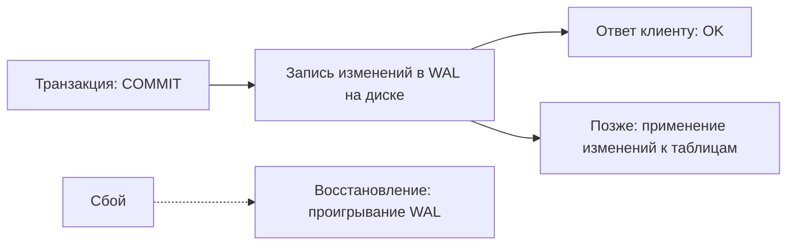
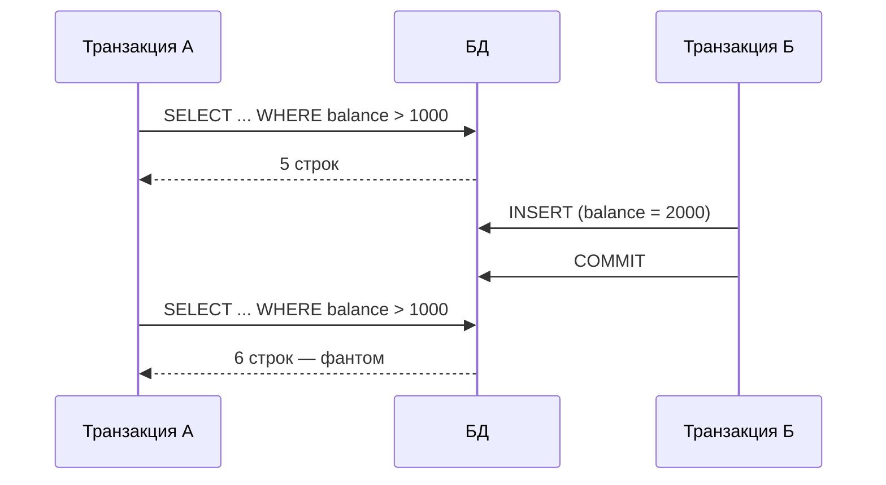
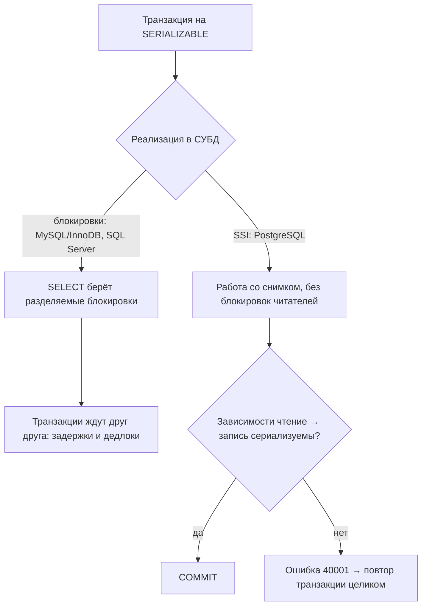
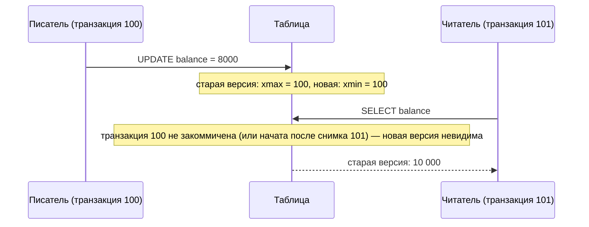
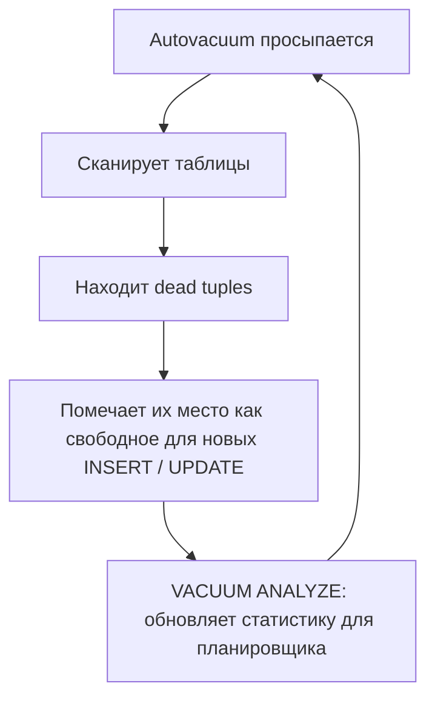

---
tags:
  - Junior
  - Middle
  - Senior
  - Базы данных
  - Транзакции
---

# Транзакции и MVCC

Что гарантирует транзакция, какие аномалии бывают при параллельной работе, какие уровни изоляции от них защищают и как PostgreSQL и MySQL реализуют изоляцию через MVCC. На собесе чаще всего спрашивают ACID, разницу non-repeatable read и phantom read, уровни изоляции по умолчанию и почему не ставить `SERIALIZABLE` везде.

## ACID { #acid }

### Что такое ACID? { #acid-properties }

**Уровень:** Junior

!!! abstract "Ответ вслух"
    Это четыре гарантии транзакции. Atomicity — всё или ничего, Consistency — переход только между валидными состояниями, Isolation — параллельные транзакции не мешают друг другу, Durability — закоммиченное не теряется даже при сбое питания.

Базовая единица работы с БД — **транзакция**: набор SQL-запросов, выполняемых как единое целое (списать деньги → зачислить).

**A — Atomicity (атомарность).** «Всё или ничего»: если транзакция обрывается посередине, все уже выполненные шаги откатываются. Частичного сохранения быть не может.

```sql
BEGIN;
UPDATE accounts SET balance = balance - 1000 WHERE id = 1; -- списали
UPDATE accounts SET balance = balance + 1000 WHERE id = 2; -- зачислили
-- Если второй UPDATE упал — первый тоже откатится
COMMIT;
```

Связь со Spring: `@Transactional` → `RuntimeException` → `ROLLBACK`, успех → `COMMIT` (подробно — в [Spring Data JPA](../spring/spring-data-jpa.md#transactional-flow)).

**C — Consistency (консистентность).** Переход строго от одного валидного состояния к другому. БД не даст зафиксировать изменения, нарушающие правила: ограничения (constraints), внешние ключи (foreign keys), типы данных.

```sql
ALTER TABLE accounts ADD CONSTRAINT balance_positive CHECK (balance >= 0);
-- Попытка увести баланс в минус вызовет ошибку и откат транзакции
```

**I — Isolation (изоляция).** Параллельные транзакции не должны мешать друг другу — это защита от состояния гонки (race condition). Компромисс: выше изоляция — надёжнее данные, но ниже пропускная способность.

Связь со Spring: `@Transactional(isolation = Isolation.REPEATABLE_READ)`. Уровни разобраны [ниже](#isolation-levels).

**D — Durability (долговечность).** Закоммичено — значит сохранено навсегда, даже при сбое питания. Как это устроено — в [следующей теме](#wal).

!!! warning "Ловушка: C в ACID и C в CAP"
    Consistency в ACID — соблюдение правил и ограничений внутри одной БД. Consistency в CAP-теореме — одинаковые данные на всех узлах распределённой системы. Это разные понятия с одним словом.

??? question "Проверь себя"
    1. Расшифруй каждую букву ACID.
    2. Что произойдёт с первым `UPDATE`, если второй упадёт?
    3. Как БД обеспечивает Consistency?

### Как БД гарантирует долговечность? { #wal }

**Уровень:** Middle

!!! abstract "Ответ вслух"
    Через журнал упреждающей записи — WAL (Write-Ahead Log). Все изменения сначала пишутся в лог-файл на диске и только потом применяются к таблицам. При сбое БД восстанавливается, проигрывая этот лог.



!!! warning "Ловушка: «данные сразу пишутся в таблицу»"
    К моменту коммита изменения гарантированно лежат в WAL, но не обязательно в файлах таблиц. Именно журнал, а не таблица, делает коммит долговечным.

??? question "Проверь себя"
    1. Что такое WAL?
    2. Куда изменения пишутся раньше — в лог или в таблицы?
    3. Как БД восстанавливается после сбоя?

## Изоляция транзакций { #isolation }

### Какие бывают аномалии чтения? { #read-anomalies }

**Уровень:** Junior

!!! abstract "Ответ вслух"
    Три классические: dirty read — читаем незакоммиченные чужие изменения; non-repeatable read — повторное чтение одной строки даёт другой результат, потому что её обновили; phantom read — повторный запрос по условию возвращает новые строки, потому что их вставили. Non-repeatable — про `UPDATE` существующей строки, phantom — про `INSERT` и `DELETE`.

Три проблемы, которые возникают при параллельных транзакциях без изоляции:

**1. Dirty Read (грязное чтение)** — транзакция А читает данные, которые Б изменила, но **ещё не закоммитила**. Б делает rollback — А работала с «мусором», которого никогда не было в БД.

**2. Non-repeatable Read (неповторяющееся чтение)** — проблема **одной строки**. А читает строку дважды в рамках одной транзакции, а между чтениями Б успела сделать `UPDATE` и закоммитить. Пример: А читает баланс (100), Б списывает 50 и коммитит, А снова читает тот же баланс и видит 50.

**3. Phantom Read (фантомное чтение)** — проблема **множества строк**. А делает `SELECT WHERE balance > 1000` → 5 строк. Б вставляет новую строку с `balance = 2000` и коммитит, А повторяет тот же `SELECT` → 6 строк — появился «фантом».



!!! warning "Ловушка: путать non-repeatable и phantom"
    Non-repeatable read — изменение **существующей** строки (`UPDATE`). Phantom read — появление или исчезновение **строк** в выборке (`INSERT` / `DELETE`).

??? question "Проверь себя"
    1. Что такое dirty read и почему он опасен?
    2. Чем non-repeatable read отличается от phantom read?
    3. Какая операция в другой транзакции вызывает фантом?

### Какие бывают уровни изоляции? { #isolation-levels }

**Уровень:** Middle

!!! abstract "Ответ вслух"
    Четыре уровня по стандарту SQL: `READ UNCOMMITTED`, `READ COMMITTED`, `REPEATABLE READ` и `SERIALIZABLE`. Каждый следующий закрывает ещё одну аномалию ценой производительности. В PostgreSQL по умолчанию `READ COMMITTED`, в MySQL (InnoDB) — `REPEATABLE READ`.

**1. `READ UNCOMMITTED` — скорость ценой любых аномалий.** Транзакция видит всё, включая незакоммиченные изменения чужих транзакций.

**2. `READ COMMITTED` — умолчание PostgreSQL.** Транзакция видит только закоммиченные изменения: каждый SQL-запрос получает свежий снимок данных. Защищает от dirty read, но допускает non-repeatable read и phantom read.

**3. `REPEATABLE READ` — умолчание MySQL (InnoDB).** Снимок данных делается **один раз при старте транзакции**, и все последующие `SELECT` видят одни и те же данные. Защищает от dirty read и non-repeatable read.

**4. `SERIALIZABLE` — полная изоляция.** Результат параллельных транзакций идентичен последовательному выполнению. Защищает от всех аномалий (цена — в [следующей теме](#serializable)).

| Уровень | Dirty Read | Non-repeatable Read | Phantom Read |
|---|---|---|---|
| **READ UNCOMMITTED** | 🔴 Возможно | 🔴 Возможно | 🔴 Возможно |
| **READ COMMITTED** | ✅ Защита | 🔴 Возможно | 🔴 Возможно |
| **REPEATABLE READ** | ✅ Защита | ✅ Защита | 🔴 Возможно* |
| **SERIALIZABLE** | ✅ Защита | ✅ Защита | ✅ Защита |

_*В PostgreSQL `REPEATABLE READ` дополнительно защищает от phantom read через MVCC._

Как задать уровень в Spring (`@Transactional(isolation = ...)`, `Isolation.DEFAULT`), — в [Spring Data JPA → Изоляция](../spring/spring-data-jpa.md#isolation).

```java
@Transactional(isolation = Isolation.READ_COMMITTED) // умолчание в PostgreSQL
```

!!! warning "Ловушка: `READ UNCOMMITTED` в PostgreSQL"
    Postgres физически не поддерживает этот уровень: если его указать, он молча работает как `READ COMMITTED`. Грязного чтения в Postgres не бывает в принципе.

!!! warning "Ловушка: фантомы в `REPEATABLE READ` PostgreSQL"
    По стандарту SQL фантомы на этом уровне допускаются. Но в PostgreSQL `REPEATABLE READ` через MVCC защищает и от них: каждая транзакция работает со своим снимком, и новые строки других транзакций не пройдут проверку видимости.

??? question "Проверь себя"
    1. Какой уровень изоляции по умолчанию в PostgreSQL, а какой — в MySQL?
    2. От каких аномалий защищает `READ COMMITTED`?
    3. Что произойдёт, если в PostgreSQL выставить `READ UNCOMMITTED`?

### Почему не ставить `SERIALIZABLE` везде? { #serializable }

**Уровень:** Senior

!!! abstract "Ответ вслух"
    Потому что он убивает пропускную способность, и как именно — зависит от БД. В блокировочной реализации (MySQL/InnoDB, SQL Server) даже обычные `SELECT` берут разделяемые блокировки, и транзакции ждут друг друга. В PostgreSQL (SSI) читатели не блокируются, но конфликтующие транзакции падают с ошибкой сериализации, и приложение обязано повторять их целиком.

Вопрос на собесе: _«Если `SERIALIZABLE` решает все проблемы, почему бы не ставить его везде?»_

- **Блокировочная реализация (MySQL/InnoDB, SQL Server).** Даже обычные `SELECT` берут разделяемые блокировки, читатели и писатели ждут друг друга. В высоконагруженной системе — большие задержки и дедлоки.
- **PostgreSQL — SSI (Serializable Snapshot Isolation).** Читатели **не блокируются**: все работают со снимком, как на `REPEATABLE READ`. Postgres лишь отслеживает зависимости «чтение → запись» между транзакциями, и если их нельзя выстроить в последовательный порядок, одна транзакция падает с ошибкой `could not serialize access due to read/write dependencies among transactions` (SQLSTATE `40001`).



`SERIALIZABLE` используют редко — только для критичных финансовых операций: сложных отчётов, итоговых расчётов. В остальных случаях конкуренцию за строки решают блокировками на уровне приложения (см. [Spring Data JPA → Оптимистичная блокировка](../spring/spring-data-jpa.md#optimistic-locking)).

!!! warning "Ловушка: SSI без повторов"
    На SSI ошибка сериализации — нормальная часть работы, а не баг. Приложение обязано поймать SQLSTATE `40001` и **повторить транзакцию целиком**. При высокой конкуренции это превращается в лавину откатов и повторов.

??? question "Проверь себя"
    1. Как `SERIALIZABLE` реализован в MySQL и чем это плохо?
    2. Как работает SSI в PostgreSQL и блокирует ли он читателей?
    3. Что приложение должно делать с ошибкой `40001`?

## MVCC { #mvcc }

### Как работает MVCC? { #mvcc-how }

**Уровень:** Middle

!!! abstract "Ответ вслух"
    MVCC (Multi-Version Concurrency Control) хранит несколько версий одной строки вместо перезаписи. У каждой версии есть скрытые поля `xmin` и `xmax` — номера транзакций, которые её создали и удалили, — и по ним каждая транзакция видит версию, подходящую её снимку. Поэтому читатели не блокируют писателей, а писатели — читателей.

**Проблема, которую решает MVCC.** До MVCC БД работали через блокировки: транзакция А обновляет строку и вешает замок, а транзакция Б, которая хочет прочитать эту строку, ждёт. База тормозила.

> Главное правило MVCC: читатели никогда не блокируют писателей. Писатели никогда не блокируют читателей.

**Несколько версий одной строки.** База не перезаписывает данные поверх старых, а хранит несколько версий строки. У каждой строки два скрытых системных поля:

- `xmin` — номер транзакции, которая **создала** эту версию.
- `xmax` — номер транзакции, которая **удалила или изменила** её (пусто — версия актуальна).

**Сценарий: `UPDATE` без блокировки читателя.**

| Момент | Версия строки | `xmin` | `xmax` |
|---|---|---|---|
| Начальное состояние | баланс = 10 000 — актуальная | 50 | NULL |
| После `UPDATE` транзакции 100 | баланс = 10 000 — помечена удалённой | 50 | 100 |
| После `UPDATE` транзакции 100 | баланс = 8 000 — новая версия | 100 | NULL |



Читатель видит обе версии, но проверка видимости отбрасывает новую. Никаких блокировок: каждый работает в своём снимке времени.

!!! warning "Ловушка: «MVCC убирает все блокировки»"
    MVCC развязывает читателей и писателей, но два писателя одной строки всё равно конфликтуют: второй `UPDATE` той же строки ждёт, пока первая транзакция закончится.

??? question "Проверь себя"
    1. Что хранят поля `xmin` и `xmax`?
    2. Почему читатель не ждёт писателя при MVCC?
    3. Какую версию строки увидит транзакция 101 в сценарии выше?

### Как MVCC реализует уровни изоляции? { #mvcc-isolation }

**Уровень:** Senior

!!! abstract "Ответ вслух"
    Через момент, когда делается снимок. В `READ COMMITTED` снимок делается заново перед каждым запросом, поэтому между двумя `SELECT` видны чужие коммиты. В `REPEATABLE READ` снимок делается один раз при старте транзакции и замораживается, поэтому повторные чтения стабильны.

- **`READ COMMITTED`** — снимок делается **заново перед каждым SQL-запросом** внутри транзакции. Поэтому между двумя `SELECT` можно увидеть чужие закоммиченные изменения: non-repeatable read возможен.
- **`REPEATABLE READ`** — снимок делается **один раз при старте транзакции** и замораживается. Все последующие `SELECT` смотрят в него. Новые строки, добавленные другими транзакциями, не пройдут проверку видимости — отсюда защита от phantom read в PostgreSQL.

!!! warning "Ловушка: снимок на запрос, а не на транзакцию"
    В `READ COMMITTED` (умолчание Postgres) два одинаковых `SELECT` в одной транзакции могут вернуть разные данные. Если логика опирается на повторное чтение, нужен `REPEATABLE READ` или блокировка строки.

??? question "Проверь себя"
    1. Когда делается снимок в `READ COMMITTED`?
    2. Когда — в `REPEATABLE READ`?
    3. Почему `REPEATABLE READ` в PostgreSQL защищает от фантомов?

### Что такое table bloat и autovacuum? { #vacuum }

**Уровень:** Senior

!!! abstract "Ответ вслух"
    При `UPDATE` и `DELETE` старые версии строк в PostgreSQL не удаляются сразу, и таблица пухнет. Версии, не нужные ни одной активной транзакции, становятся мёртвыми кортежами (dead tuples). Фоновый процесс autovacuum находит их и помечает место свободным; если он не успевает, таблица раздувается в разы.

При каждом `UPDATE` и `DELETE` старые версии строк остаются — таблица начинает пухнуть. Старые версии, ненужные ни одной активной транзакции, становятся **мёртвыми кортежами (dead tuples)**. Чтобы диск не переполнился, в PostgreSQL работает фоновый процесс **autovacuum**.



!!! warning "Ловушка: bloat на продакшене"
    Если autovacuum не успевает — например, живёт долгая транзакция, удерживающая старый снимок, — таблица может раздуться в несколько раз. Симптом: `SELECT COUNT(*)` работает медленно, размер таблицы неоправданно велик. Диагностика: `pg_stat_user_tables`, колонка `n_dead_tup`.

??? question "Проверь себя"
    1. Откуда берутся dead tuples?
    2. Что делает autovacuum?
    3. Как долгая транзакция приводит к bloat?

### Чем MVCC в PostgreSQL отличается от MySQL? { #mvcc-postgres-vs-mysql }

**Уровень:** Senior

!!! abstract "Ответ вслух"
    PostgreSQL при `UPDATE` пишет новую версию строки прямо в таблицу (heap), старая остаётся там же, и её чистит autovacuum. MySQL (InnoDB) меняет строку на месте, а старую версию кладёт в undo log, откуда читатели собирают нужную версию на лету.

| | **PostgreSQL** | **MySQL (InnoDB)** |
|---|---|---|
| **`UPDATE`** | Новая версия строки пишется в саму таблицу (heap) | Строка меняется на месте |
| **Старая версия** | Остаётся в таблице | Уходит в undo log |
| **Чтение старой версии** | Читается из таблицы | Читатели «собирают» нужную версию из undo log на лету |
| **Очистка** | Autovacuum чистит мёртвые кортежи | — |

Плюсы подхода PostgreSQL: проще читать, нет накладных расходов на сборку версии из лога. Минусы: нужен autovacuum, возможен table bloat.

!!! warning "Ловушка: bloat — особенность именно Postgres"
    Table bloat из-за мёртвых кортежей — следствие того, что Postgres хранит старые версии прямо в таблице. В InnoDB старые версии живут в undo log.

??? question "Проверь себя"
    1. Куда PostgreSQL пишет новую версию строки при `UPDATE`?
    2. Где хранит старые версии InnoDB?
    3. Какие плюсы и минусы у подхода PostgreSQL?

## Шпаргалка { #cheatsheet }

<!-- --8<-- [start:cheatsheet] -->
| Тема | Запомнить |
|---|---|
| **ACID** | Атомарность, Консистентность, Изоляция, Долговечность |
| **WAL** | Изменения сначала в лог, потом в таблицы → восстановление при сбое |
| **Аномалии** | Dirty read — чужое незакоммиченное; non-repeatable — `UPDATE` строки; phantom — `INSERT` / `DELETE` строк |
| **`READ COMMITTED`** | Умолчание PostgreSQL. Снимок на каждый запрос |
| **`REPEATABLE READ`** | Умолчание MySQL. Один снимок на транзакцию. В Postgres защищает и от phantom |
| **`SERIALIZABLE`** | Полная изоляция. MySQL — блокировки, Postgres — SSI и ошибка `40001` с повтором. Только для критичных операций |
| **MVCC** | Читатели не блокируют писателей. Несколько версий строки через `xmin` / `xmax` |
| **Autovacuum** | Чистит мёртвые кортежи после `UPDATE` / `DELETE`. Следить, чтобы успевал |
| **Postgres vs InnoDB** | Postgres — версии в heap + vacuum; InnoDB — правка на месте + undo log |

<!-- --8<-- [end:cheatsheet] -->
