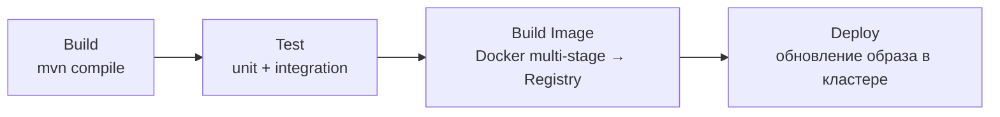
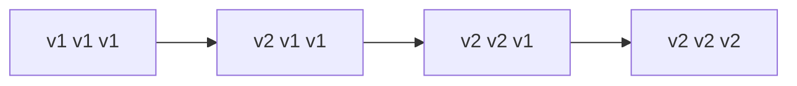
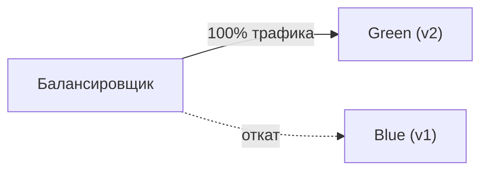
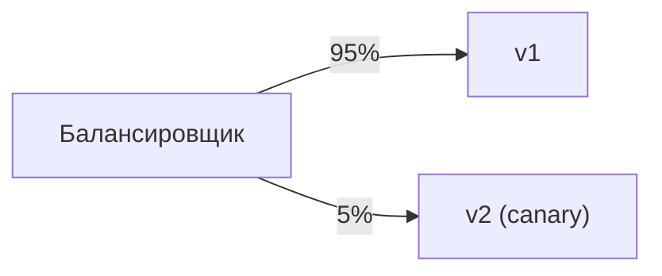
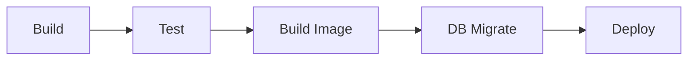
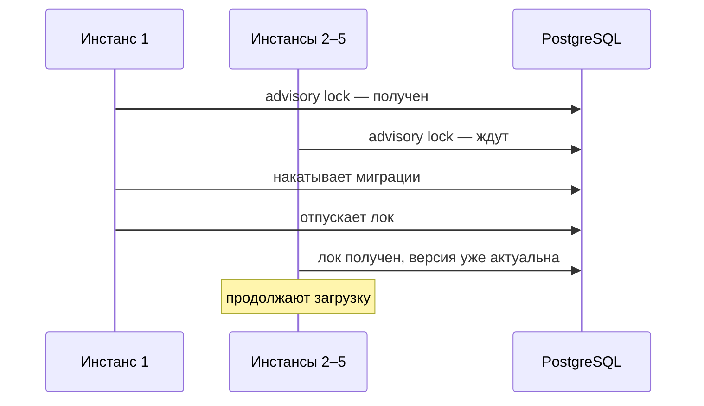
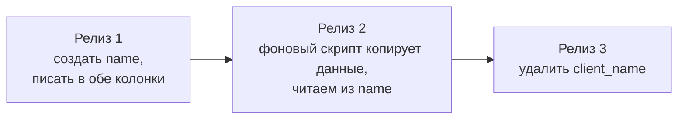

---
tags:
  - Junior
  - Middle
  - Senior
  - DevOps
  - Базы данных
---

# CI/CD и миграции БД

Как код доезжает до прода: CI против Continuous Delivery и Continuous Deployment, стадии Java-пайплайна, стратегии деплоя и миграции схемы БД через Flyway и Liquibase. На собесе спрашивают, чем Blue-Green отличается от Canary, что будет, если изменить уже применённую миграцию, как Flyway не даёт пяти инстансам подраться за миграцию и как мигрировать схему без простоя.

## CI/CD { #cicd }

### Чем CI отличается от Continuous Delivery и Continuous Deployment? { #ci-cd }

**Уровень:** Junior

!!! abstract "Ответ вслух"
    CI (Continuous Integration) — каждый коммит автоматически собирается и тестируется, чтобы рано заметить поломку. Continuous Delivery — артефакт собирается автоматически, а на прод его выкатывает человек по кнопке. Continuous Deployment — всё автоматически: тесты прошли, и код сам уходит на прод.

- **CI (Continuous Integration)** — цель: рано обнаружить, что код что-то сломал.
- **CD (Continuous Delivery)** — до прода — по кнопке человеком.
- **CD (Continuous Deployment)** — автоматизировано на 100%.

!!! warning "Ловушка: одна аббревиатура — два смысла"
    «CD» означает и Delivery, и Deployment, а разница — в последнем шаге: нажимает ли кнопку человек. На собесе уточняй, о каком CD речь.

??? question "Проверь себя"
    1. Какую задачу решает CI?
    2. Чем Continuous Delivery отличается от Continuous Deployment?
    3. Что должно быть готово, чтобы перейти к Continuous Deployment?

### Из каких стадий состоит Java-пайплайн? { #pipeline }

**Уровень:** Middle

!!! abstract "Ответ вслух"
    Build компилирует код, Test прогоняет unit- и интеграционные тесты, Build Image собирает Docker-образ и отправляет его в registry. Deploy обновляет образ в кластере. Кэш `~/.m2` ускоряет сборку, а секреты хранятся только в защищённых переменных CI или Vault.



- **Build** — Runner скачивает код и выполняет `mvn clean compile`. Кэш `~/.m2`: если `pom.xml` не менялся, зависимости берутся из кэша за секунду.
- **Test** — `mvn test` (unit) + `mvn verify` (интеграционные с Testcontainers, см. [Spring: Testcontainers](../spring/spring-testing.md#testcontainers)).
- **Build Image** — собирается Docker-образ, тегируется (`v1.2.42` или хэш коммита) и отправляется в Registry (Nexus, Harbor, GitLab Registry).
- **Deploy** — Runner подключается к кластеру (K8s API или SSH) и обновляет образ.

Частая жалоба: _«Интеграционные тесты идут 20 минут»_. Тесты разделяют по стадиям: быстрые unit — на каждый коммит, тяжёлые интеграционные — параллельно (parallel jobs) или только при Merge Request в master.

!!! warning "Ловушка: секреты в коде пайплайна"
    Пароли, ключи и токены нельзя хранить в `.gitlab-ci.yml` — они попадут в историю репозитория. Только через masked variables в настройках CI/CD или HashiCorp Vault.

??? question "Проверь себя"
    1. Назови четыре стадии Java-пайплайна.
    2. Как ускорить пайплайн с медленными интеграционными тестами?
    3. Где хранить секреты для пайплайна?

### Какие есть стратегии деплоя? { #deploy-strategies }

**Уровень:** Middle

!!! abstract "Ответ вслух"
    Rolling Update — старые контейнеры гасятся по очереди, новые поднимаются; это стандарт Kubernetes. Blue-Green — рядом со старой версией поднимают новую и переключают на неё весь трафик сразу, откат мгновенный. Canary — новую версию получают 5% пользователей, и при отсутствии ошибок долю плавно повышают до 100%.

**Rolling Update** — стандарт K8s; если новая версия падает, деплой останавливается:



**Blue-Green** — балансировщик переключает 100% трафика с Blue на Green за миллисекунду; что-то не так — мгновенный откат на Blue:



**Canary** — новая версия на 5% пользователей, смотрим Grafana; ошибок нет — плавно повышаем до 100%:



!!! warning "Ловушка: старая и новая версии работают одновременно"
    При Rolling Update, Blue-Green и Canary какое-то время обе версии обслуживают трафик и работают с одной базой. Поэтому миграции схемы должны быть [обратно совместимыми](#zero-downtime).

??? question "Проверь себя"
    1. Как работает Rolling Update?
    2. Чем Blue-Green отличается от Canary?
    3. Почему при любой из стратегий важна обратная совместимость миграций?

## Миграции БД { #migrations }

### Зачем нужны Flyway и Liquibase? { #flyway }

**Уровень:** Junior

!!! abstract "Ответ вслух"
    Чтобы схема БД менялась вместе с кодом, а не руками админа. Миграции — пронумерованные SQL-скрипты в репозитории, а Flyway хранит список применённых в служебной таблице `flyway_schema_history`. При старте он сверяет файлы с таблицей и накатывает только новые.

**Проблема ручных обновлений.** Добавил сущность `Review` — нужна таблица `reviews`. Отправляешь `CREATE TABLE` админу в Telegram «накати перед деплоем», а админ забыл, накатил не в ту базу или ошибся — и новый код падает с `PSQLException`.

**Решение — версионирование БД:**

```text
src/main/resources/db/migration/
  ├── V1__init.sql
  ├── V2__add_reviews.sql
  └── V3__add_indexes.sql
```

Flyway создаёт служебную таблицу `flyway_schema_history` и записывает в неё применённые скрипты. При старте сверяет файлы с таблицей и накатывает **только новые**.

!!! warning "Ловушка: миграции «руками» на одном окружении"
    Если на одном стенде схему поправили вручную, его `flyway_schema_history` перестаёт соответствовать реальной схеме. Следующая миграция упадёт только там, и баг не воспроизведётся у других. Любые изменения схемы — только через скрипт миграции.

??? question "Проверь себя"
    1. Какую проблему решают инструменты миграций?
    2. Где Flyway хранит информацию о применённых скриптах?
    3. Какие скрипты Flyway накатывает при старте?

### Как запускать миграции в CI/CD? { #migrations-cicd }

**Уровень:** Middle

!!! abstract "Ответ вслух"
    Обычно Flyway встроен в Spring Boot: он запускается до Tomcat, накатывает миграции, и только потом приложение начинает принимать запросы. Для огромных баз миграцию выносят в отдельный шаг пайплайна. Иначе индекс на таблице в 500 ГБ строится часами, и Kubernetes убивает «зависший» под по liveness probe.

- **Встроенный в Spring Boot** — добавляешь зависимость, Flyway запускается ДО Tomcat, накатывает миграции, потом приложение оживает.
- **Отдельный шаг пайплайна** — для огромных баз. Индекс на таблице в 500 ГБ строится часами: Spring Boot ждал бы долго, а K8s решил бы, что контейнер завис, и убил его по liveness probe. Поэтому: `Build → Test → Build Image → DB Migrate → Deploy`.



!!! warning "Ловушка: долгая миграция при старте приложения"
    Пока миграция идёт внутри старта Spring Boot, приложение не отвечает на health-check'и. Оркестратор принимает это за зависание и перезапускает под — миграция начинается заново или обрывается. Долгие миграции выносят в отдельный шаг.

??? question "Проверь себя"
    1. Когда Flyway запускается во встроенном режиме?
    2. Почему долгую миграцию выносят в отдельный шаг пайплайна?
    3. Как выглядит пайплайн с отдельным шагом миграции?

### Что будет, если изменить уже применённую миграцию? { #flyway-checksum }

**Уровень:** Middle

!!! abstract "Ответ вслух"
    Приложение не запустится с `FlywayException`. Flyway хранит контрольную сумму каждого скрипта и при старте пересчитывает её — изменение даже одного пробела ломает проверку. Исправлять можно только новым скриптом, например `V4__fix.sql`.

Flyway хранит хэш каждого применённого скрипта и при старте пересчитывает его по файлу. Старые скрипты иммутабельны — как сообщения в Kafka.

!!! warning "Ловушка: «поправлю опечатку в V1»"
    Правка применённого скрипта не изменит базы, где он уже выполнен, зато сломает старт на всех окружениях из-за несовпадения чексуммы. Любое исправление — новым скриптом `V4__fix.sql`.

??? question "Проверь себя"
    1. Как Flyway обнаруживает изменение применённого скрипта?
    2. Что произойдёт при старте приложения после такой правки?
    3. Как правильно исправить ошибку в применённой миграции?

### Что, если пять инстансов одновременно начнут миграцию? { #flyway-lock }

**Уровень:** Senior

!!! abstract "Ответ вслух"
    Гонки не будет. На PostgreSQL первый инстанс берёт advisory lock — логическую блокировку на уровне БД по числовому ключу, не привязанную к строкам таблицы. Остальные ждут, пока лок освободится, а потом видят, что версия уже обновлена, и продолжают загрузку.

Advisory lock берётся через `pg_try_advisory_xact_lock` или `pg_try_advisory_lock` по числовому ключу. Строки `flyway_schema_history` при этом никто не блокирует через `SELECT FOR UPDATE`.



!!! warning "Ловушка: «Flyway блокирует строки таблицы истории»"
    Частый неверный ответ — про `SELECT FOR UPDATE` по `flyway_schema_history`. На PostgreSQL Flyway использует advisory lock: это блокировка по числу, а не по строкам. Она не мешает читать таблицу истории и не требует, чтобы в ней уже были строки.

??? question "Проверь себя"
    1. Что такое advisory lock в PostgreSQL?
    2. Что делают остальные инстансы, пока первый накатывает миграцию?
    3. Почему для этого не нужна блокировка строк `flyway_schema_history`?

### Как мигрировать схему без простоя? { #zero-downtime }

**Уровень:** Senior

!!! abstract "Ответ вслух"
    При деплое без простоя старая и новая версии кода работают одновременно, поэтому миграция не должна ломать старый код. Переименование колонки делают в три релиза: создать новую колонку и писать в обе, перенести данные и читать из новой, удалить старую. Сразу переименовать нельзя — старая версия упадёт.

❌ Нельзя сразу переименовать `client_name` → `name`: старая версия посыплется.

✅ В 3 релиза:



!!! warning "Ловушка: удалить старую колонку в том же релизе"
    Пока идёт Blue-Green или Rolling Update, часть трафика обслуживает старая версия, и она всё ещё читает `client_name`. Удалить колонку можно только в релизе, когда старого кода, который её использует, не осталось.

??? question "Проверь себя"
    1. Почему миграции при zero-downtime деплое должны быть обратно совместимыми?
    2. Опиши три релиза для переименования колонки.
    3. Когда можно удалить старую колонку?

## Шпаргалка { #cheatsheet }

<!-- --8<-- [start:cheatsheet] -->
| Тема | Запомнить |
|---|---|
| **CI / CD / CD** | Integration — сборка и тесты на коммит. Delivery — по кнопке. Deployment — сам |
| **Пайплайн** | Build → Test → Build Image → Deploy; секреты — в masked variables или Vault |
| **Стратегии деплоя** | Rolling (K8s), Blue-Green (мгновенный откат), Canary (5%) |
| **Flyway** | `flyway_schema_history`, накатываются только новые скрипты |
| **Flyway чексуммы** | Изменил старый скрипт → `FlywayException`. Скрипты иммутабельны |
| **Flyway лок** | На PostgreSQL — advisory lock, 5 инстансов не подерутся за миграцию |
| **Zero-downtime миграции** | Переименование колонки — в 3 релиза, не сразу |

<!-- --8<-- [end:cheatsheet] -->
