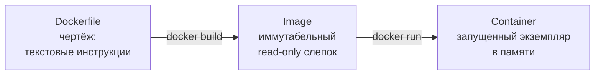
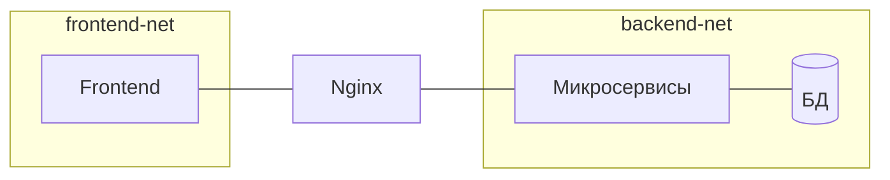

---
tags:
  - Junior
  - Middle
  - DevOps
---

# Docker и Compose

Как Java-приложение упаковывается в контейнер и запускается локально вместе с окружением: чем контейнер отличается от виртуальной машины, как написать хороший Dockerfile, какой выбрать базовый образ, как сервисы в Compose находят друг друга и что будет с данными в volume. На собесе спрашивают про namespaces и cgroups, multi-stage build и почему контейнер нельзя запускать под root.

## Docker { #docker }

### Какую проблему решает Docker? { #why-docker }

**Уровень:** Junior

!!! abstract "Ответ вслух"
    Docker убирает проблему «на моей машине работало». Он упаковывает приложение вместе со всей средой — куском ОС, JDK, библиотеками, конфигами — в стандартизированный образ. Такой образ запускается одинаково на ноутбуке, в CI и в проде.

На твоём ноутбуке Java 17, своя версия PostgreSQL, свои настройки таймзон — всё работает. Передаёшь `.jar` на прод, а там Java 11 и нет переменных окружения — всё падает.

Docker упаковывает приложение со средой в стандартизированный «ящик», который работает идентично везде.

!!! warning "Ловушка: «в контейнере — значит, одинаково везде»"
    Образ одинаков, но конфигурация — переменные окружения, секреты, адреса БД — приходит снаружи и отличается между средами. Если захардкодить её в образ, получишь ту же проблему в новой форме. Конфиги прокидывают при запуске, а в Kubernetes — через ConfigMaps и Secrets.

??? question "Проверь себя"
    1. Какую проблему решает Docker?
    2. Что входит в образ вместе с приложением?
    3. Что не стоит класть внутрь образа?

### Чем контейнер отличается от виртуальной машины? { #container-vs-vm }

**Уровень:** Junior

!!! abstract "Ответ вслух"
    Виртуальная машина запускает полноценную гостевую ОС со своим ядром поверх гипервизора: гигабайты и старт за минуты. Контейнер своей ОС не имеет и переиспользует ядро хоста: мегабайты и старт за миллисекунды. По сути контейнер — обычный процесс Linux, изолированный средствами ядра.

| | **Виртуальная машина** | **Docker-контейнер** |
|---|---|---|
| **ОС** | Полноценная гостевая ОС со своим ядром | Нет своей ОС — переиспользует ядро хоста |
| **Вес** | Гигабайты | Мегабайты |
| **Старт** | Минуты | Миллисекунды |
| **Изоляция** | Полная (гипервизор) | Процесс с иллюзией изоляции |
| **Накладные расходы** | Высокие (вторая ОС вхолостую) | Минимальные |

Контейнер — обычный процесс Linux, вокруг которого ОС выстроила стены изоляции: процесс думает, что он на сервере один.

!!! warning "Ловушка: контейнер изолирован так же, как VM"
    У всех контейнеров на хосте общее ядро. Уязвимость ядра или запуск под root открывает путь из контейнера на хост — у VM такого общего ядра нет. Поэтому контейнеры запускают [не под root](#non-root).

??? question "Проверь себя"
    1. Почему контейнер стартует быстрее виртуальной машины?
    2. Что общего у всех контейнеров на одном хосте?
    3. Почему изоляция контейнера слабее, чем у VM?

### Чем Dockerfile, образ и контейнер отличаются? { #image-container }

**Уровень:** Junior

!!! abstract "Ответ вслух"
    Dockerfile — текстовые инструкции, чертёж. Образ (image) — собранный по ним неизменяемый read-only слепок. Контейнер — запущенный экземпляр образа; в терминах Java образ — это класс, а контейнер — `new Object()`.



Аналогия с Java: Image = class, Container = `new Object()`. Из одного образа можно запустить сколько угодно контейнеров.

!!! warning "Ловушка: менять контейнер руками"
    Изменения, сделанные внутри запущенного контейнера, живут в его writable-слое и пропадают при `docker rm`. Образ при этом не меняется. Всё, что должно быть в каждом запуске, описывают в Dockerfile, а данные — выносят в [volumes](#volumes).

??? question "Проверь себя"
    1. Чем образ отличается от контейнера?
    2. Как связаны Dockerfile, образ и контейнер?
    3. Что станет с изменениями внутри контейнера после `docker rm`?

### На чём держится изоляция контейнера? { #namespaces-cgroups }

**Уровень:** Middle

!!! abstract "Ответ вслух"
    Изоляция держится на двух механизмах ядра Linux. Namespaces ограничивают, что контейнер видит: свою файловую систему, сеть и дерево процессов, где он — PID 1. Cgroups ограничивают, что контейнер использует: CPU и память, чтобы приложение с утечкой не съело все ресурсы хоста.

- **Namespaces (изоляция)** — ограничивают, что контейнер **видит**. Процесс думает, что у него свой корень файловой системы `/`, своя сетевая карта и что он главный процесс (PID 1).
- **Cgroups (лимиты)** — ограничивают, что контейнер **использует**. Не дадут Java-приложению с утечкой памяти занять все 64 ГБ и положить соседей: «убей процесс, если превысит 1 ГБ».

!!! warning "Ловушка: heap впритык к лимиту контейнера"
    Cgroups ограничивают всю память процесса, а JVM нужна память не только под heap: ещё Metaspace, стеки потоков, буферы. Если задать heap близко к лимиту контейнера или выше, процесс превысит лимит и будет убит ядром. Поэтому долю heap задают от лимита через `-XX:MaxRAMPercentage`, как в [Dockerfile ниже](#dockerfile).

??? question "Проверь себя"
    1. Что ограничивают namespaces, а что — cgroups?
    2. Почему процесс в контейнере видит себя как PID 1?
    3. Что случится с контейнером, превысившим лимит памяти cgroups?

### Как написать хороший Dockerfile для Java? { #dockerfile }

**Уровень:** Middle

!!! abstract "Ответ вслух"
    Используй multi-stage сборку: тяжёлый образ с Maven собирает jar, а в лёгкий runner-образ копируется только jar. Так образ уменьшается с 1 ГБ+ до ~150 МБ, и исходного кода в проде нет. Зависимости копируй и скачивай отдельным слоем до исходников, чтобы Docker их кэшировал.

**Multi-stage сборка:**

```dockerfile
# STAGE 1: Builder (тяжёлый образ для сборки)
FROM maven:3.8.5-openjdk-17-slim AS builder
WORKDIR /build

# Кэшируем зависимости ОТДЕЛЬНЫМ слоем (меняются редко)
COPY pom.xml .
RUN mvn dependency:go-offline

# Только теперь копируем код (меняется часто)
COPY src ./src
RUN mvn clean package -DskipTests

# STAGE 2: Runner (лёгкий и безопасный)
FROM gcr.io/distroless/java17-debian11
WORKDIR /app
COPY --from=builder /build/target/app.jar ./app.jar
ENV JAVA_OPTS="-XX:+UseG1GC -XX:MaxRAMPercentage=75.0"
ENTRYPOINT ["java", "-jar", "app.jar"]
```

Без multi-stage итоговый образ весит 1 ГБ+: исходники, кэш Maven, утилиты сборки. С multi-stage — 150 МБ, только JRE и jar. Исходного кода в проде физически нет.

Каждая инструкция `RUN` или `COPY` создаёт слой, а Docker кэширует неизменённые слои. Зависимости меняются редко, код — постоянно, поэтому их разделяют.

!!! warning "Ловушка: порядок `COPY`"
    ```dockerfile
    # ❌ Плохо — любое изменение кода инвалидирует кэш зависимостей
    COPY . .
    RUN mvn clean package   # каждый раз качает все зависимости заново

    # ✅ Хорошо — зависимости в отдельном слое
    COPY pom.xml .
    RUN mvn dependency:go-offline   # кэшируется до изменения pom.xml
    COPY src ./src
    RUN mvn clean package -DskipTests
    ```

??? question "Проверь себя"
    1. Что даёт multi-stage сборка?
    2. Почему `pom.xml` копируют отдельно от `src`?
    3. Сколько весит образ с multi-stage и без неё?

### Какой базовый образ выбрать? { #base-images }

**Уровень:** Middle

!!! abstract "Ответ вслух"
    Полный `openjdk` на Debian весит ~300 МБ и тащит кучу утилит — это большая поверхность атаки. Alpine лёгкий, но использует `musl libc` вместо `glibc`, и иногда бывают странности с JNI и шрифтами. Distroless содержит только то, что нужно для запуска, — нет даже `/bin/sh` и пакетного менеджера.

| Образ | Вес | Особенность |
|---|---|---|
| `openjdk:17` (Debian) | ~300 МБ | Куча утилит, большая поверхность атаки |
| `eclipse-temurin:17-jre-alpine` | ~5 МБ ОС | Лёгкий, но `musl libc` вместо `glibc` — иногда странности с JNI и шрифтами |
| `gcr.io/distroless/java17` | Минимум | Нет ничего, даже `/bin/sh` и пакетного менеджера |

Distroless — довод по безопасности. Если приложение взломали (как с Log4Shell) и атакующий хочет открыть консоль или скачать вредонос через `wget`, в distroless нет ни `bash`, ни `wget`.

!!! warning "Ловушка: отлаживать distroless как обычный образ"
    В distroless нельзя зайти через `docker exec ... sh` — оболочки нет. Это плата за безопасность: диагностику ведут через логи, метрики и внешние инструменты, а не изнутри контейнера.

??? question "Проверь себя"
    1. Чем Alpine-образ может доставить проблемы Java-приложению?
    2. Почему distroless безопаснее полного образа?
    3. Что нельзя сделать в distroless-контейнере?

### Почему контейнер нельзя запускать под root? { #non-root }

**Уровень:** Junior

!!! abstract "Ответ вслух"
    По умолчанию процесс в контейнере работает под root. Если атакующий прорвёт изоляцию, он окажется root на хост-сервере. Поэтому в Dockerfile создают отдельного пользователя и переключаются на него инструкцией `USER`.

```dockerfile
# По умолчанию контейнер работает под root.
# Прорыв изоляции → атакующий получает root на хост-сервере.
RUN addgroup -S spring && adduser -S spring -G spring
USER spring:spring
```

!!! warning "Ловушка: `USER` до копирования файлов"
    Файлы, скопированные после `USER`, принадлежат root, если не указать владельца, и приложение может не получить к ним доступ на запись. Владельца задают через `COPY --chown=spring:spring`. Обратная ошибка — забыть `USER` вовсе, и всё работает под root.

??? question "Проверь себя"
    1. Под каким пользователем по умолчанию работает процесс в контейнере?
    2. Чем опасен root в контейнере?
    3. Как в Dockerfile переключиться на непривилегированного пользователя?

## Docker Compose { #compose }

### Как сервисы в Compose находят друг друга? { #compose-dns }

**Уровень:** Junior

!!! abstract "Ответ вслух"
    Docker Compose создаёт виртуальную сеть со встроенным DNS, и имя сервиса становится его хостнеймом. Поэтому бэкенд подключается к базе по адресу `postgres-db:5432`, а не по `localhost` или IP. Блок `ports` нужен только для доступа снаружи, например из DBeaver с ноутбука.

```yaml
services:
  postgres-db:        # ← это имя становится хостнеймом
    image: postgres:15
  crm-backend:
    image: backend:latest
    # В application.yml: jdbc:postgresql://postgres-db:5432/booking
    # Никаких localhost и хардкода IP!
```

`ports: ["5432:5432"]` пробрасывает порт наружу. Если сервис нужен только внутри — например, Redis для бэкенда, — блок `ports` не пишут вообще: контейнеры и так видят друг друга. Это базовая безопасность.

!!! warning "Ловушка: `localhost` внутри контейнера"
    Внутри контейнера `localhost` — это сам контейнер, а не хост и не соседний сервис. Строка `jdbc:postgresql://localhost:5432` в бэкенде не найдёт базу, которая крутится в другом контейнере. Обращаются по имени сервиса.

??? question "Проверь себя"
    1. Как бэкенд в Compose обращается к базе данных?
    2. Зачем нужен блок `ports` и когда его не пишут?
    3. Что означает `localhost` внутри контейнера?

### Как дождаться готовности базы при старте? { #healthcheck }

**Уровень:** Junior

!!! abstract "Ответ вслух"
    Spring Boot стартует за 3 секунды, а БД ещё инициализируется — и приложение падает с `ConnectionRefusedException`. Простой `depends_on` ждёт только запуска контейнера, а не готовности базы. Нужен `healthcheck` у базы и `depends_on` с `condition: service_healthy` у приложения.

```yaml
services:
  postgres-db:
    image: postgres:15
    healthcheck:
      test: ["CMD-SHELL", "pg_isready -U postgres"]
      interval: 5s
      retries: 5

  crm-backend:
    depends_on:
      postgres-db:
        condition: service_healthy   # ждёт, пока healthcheck скажет OK
```

!!! warning "Ловушка: `wait-for-it.sh` и `Thread.sleep()`"
    Скрипты ожидания и паузы в коде гадают о времени старта: на медленной машине пауза окажется короткой, на быстрой — лишней. `healthcheck` + `depends_on` с `service_healthy` ждут фактической готовности базы.

??? question "Проверь себя"
    1. Почему простого `depends_on` недостаточно?
    2. Как Compose узнаёт, что PostgreSQL готов?
    3. Чем `healthcheck` лучше `Thread.sleep()` в коде?

### Как запускать тяжёлые сервисы только по запросу? { #compose-profiles }

**Уровень:** Junior

!!! abstract "Ответ вслух"
    Через профили (profiles). Сервис с `profiles: ["analytics"]` не запускается при обычном `docker-compose up`. Он поднимается, только если явно включить профиль флагом `--profile analytics`.

```yaml
services:
  analytics:
    profiles: ["analytics"]   # не запустится при обычном up
# docker-compose up                      → только базовые сервисы
# docker-compose --profile analytics up  → всё, включая тяжёлое
```

!!! warning "Ловушка: стенд поднят без нужного профиля"
    Обычный `up` молча пропускает сервисы с профилями — ошибки не будет, сервиса просто нет. Если тест или соседний сервис рассчитывает на `analytics`, стенд надо поднимать с `--profile analytics`. Поэтому в профили выносят только то, без чего основная система работает.

??? question "Проверь себя"
    1. Что делает `profiles` у сервиса в Compose?
    2. Как запустить сервисы из профиля?
    3. Какие сервисы разумно выносить в профили?

### Как поднять Kafka в Compose без ZooKeeper? { #kraft }

**Уровень:** Middle

!!! abstract "Ответ вслух"
    Через режим KRaft (Kafka Raft): Kafka сама хранит метаданные кластера через консенсус Raft, отдельный ZooKeeper не нужен. Это на один контейнер меньше, меньше RAM и старт примерно вдвое быстрее. С Kafka 3.3 ZooKeeper deprecated.

Если рассказываешь, как поднимаешь ZooKeeper для Kafka, это звучит устаревше. KRaft убирает отдельный кластер ZooKeeper: метаданные живут в самой Kafka. Как Raft договаривается о данных, разобрано в [Распределённые данные → Консенсус](../system-design/distributed-data.md#consensus).

!!! warning "Ловушка: настраивать новый кластер с ZooKeeper"
    Для нового кластера ZooKeeper — лишний контейнер и лишняя точка отказа. Конфигурацию с ZooKeeper стоит знать для поддержки старых кластеров, а новые поднимают в KRaft.

??? question "Проверь себя"
    1. Что такое KRaft?
    2. Что даёт отказ от ZooKeeper?
    3. На каком алгоритме консенсуса основан KRaft?

### Какие сети бывают в Docker? { #docker-networks }

**Уровень:** Middle

!!! abstract "Ответ вслух"
    Default bridge соединяет контейнеры по IP без DNS. User-defined bridge, который создаёт Compose, даёт DNS по именам сервисов. Host-сеть делит сетевой стек с хостом без NAT — максимальная скорость и никакой изоляции.

| Драйвер | Как работает | Когда |
|---|---|---|
| **bridge (default)** | Контейнеры по IP, без DNS | Редко используется напрямую |
| **bridge (user-defined)** | Контейнеры по именам, есть DNS | Docker Compose создаёт автоматически |
| **host** | Делит сетевой стек с хостом, без NAT | Максимальная скорость, ноль изоляции |

Сегментация сетей — паттерн безопасности. Создают `frontend-net` и `backend-net`: Nginx подключён к обеим, микросервисы и БД — только к `backend-net`. Взломали фронтенд-контейнер — атакующий не может отправить пакет в БД: между ними нет сетевого маршрута на уровне ядра.



!!! warning "Ловушка: все контейнеры в одной сети"
    Если фронтенд, бэкенд и база в одной сети, взлом любого контейнера открывает прямой путь к базе. Сеть — граница доступа, и сегментация ограничивает ущерб от взлома одного контейнера.

??? question "Проверь себя"
    1. Чем default bridge отличается от user-defined bridge?
    2. Когда используют host-сеть и чем за это платят?
    3. Как сегментация сетей защищает базу данных?

### Как Docker хранит данные? { #volumes }

**Уровень:** Middle

!!! abstract "Ответ вслух"
    Слои образа — read-only, а поверх них при запуске создаётся тонкий writable-слой (copy-on-write), который уничтожается при `docker rm`. Чтобы данные пережили контейнер, используют volumes. Bind mount монтирует папку хоста и подходит для локальной разработки, named volume управляется Docker'ом и нужен в проде для БД, Kafka и Redis.

```yaml
services:
  postgres-db:
    volumes:
      - pg_data:/var/lib/postgresql/data
volumes:
  pg_data:   # данные переживут docker-compose down
```

| | **Bind Mount** | **Named Volume** |
|---|---|---|
| **Синтаксис** | `-v /Users/me/logs:/app/logs` | `-v pg_data:/var/lib/postgresql/data` |
| **Управление** | Ты указываешь папку на хосте | Docker сам управляет в `/var/lib/docker/volumes` |
| **Когда** | Локальная разработка (hot reload) | Продакшн: БД, Kafka, Redis |

Вопрос на засыпку: _«PostgreSQL в Docker с named volume. Что с данными при `docker stop/start`? При `docker rm` и новом контейнере с тем же томом? При выключении питания?»_

1. `stop/start` — контейнер не уничтожается, данные на месте.
2. `rm` — контейнер уничтожен, но **named volume живёт независимо**: новый контейнер с тем же томом подхватит данные.
3. Выключение питания — данные в volume на диске. Но есть риск потерять последние транзакции из кэша записи ОС, не успевшие в `fsync`; защита — строгая синхронизация в самой СУБД (`wal_level` в Postgres).

!!! warning "Ловушка: база без volume"
    Если запустить PostgreSQL без volume, данные лежат в writable-слое контейнера. `docker rm` — и база пропала целиком. Для любой БД в Docker volume обязателен.

??? question "Проверь себя"
    1. Что происходит с writable-слоем при `docker rm`?
    2. Чем bind mount отличается от named volume и где что использовать?
    3. Что станет с данными named volume при выключении питания?

## Шпаргалка { #cheatsheet }

<!-- --8<-- [start:cheatsheet] -->
| Тема | Запомнить |
|---|---|
| **Docker** | Приложение + среда в одном образе — «на моей машине работало» больше не аргумент |
| **Контейнер vs VM** | Контейнер переиспользует ядро хоста. Мегабайты, миллисекунды |
| **Image vs Container** | Image = class (read-only). Container = `new Object()` |
| **Namespaces / Cgroups** | Namespaces — что видит. Cgroups — что использует (лимиты) |
| **Multi-stage build** | Builder (JDK + Maven) → Runner (только JRE). 1 ГБ → 150 МБ |
| **Кэш слоёв** | `COPY pom.xml` → зависимости в отдельном слое до `COPY src` |
| **Distroless** | Нет bash и wget — атакующему нечем воспользоваться |
| **Non-root user** | Прорыв изоляции под root = root на хосте |
| **Compose DNS** | Имя сервиса = хостнейм. Никаких localhost |
| **healthcheck + depends_on** | Ждать готовности БД, а не `Thread.sleep()` |
| **Profiles** | Тяжёлые сервисы — только с `--profile` |
| **KRaft** | Kafka без ZooKeeper: метаданные через Raft, минус контейнер |
| **Сегментация сетей** | frontend-net + backend-net. БД недоступна из фронта |
| **Named Volume** | Переживает `docker rm`. Стандарт для БД в проде |

<!-- --8<-- [end:cheatsheet] -->
