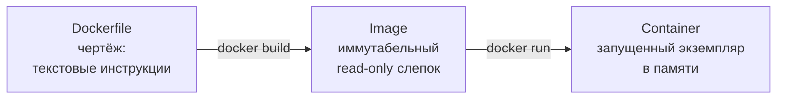
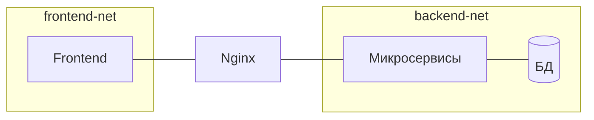
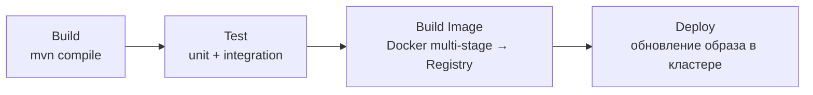
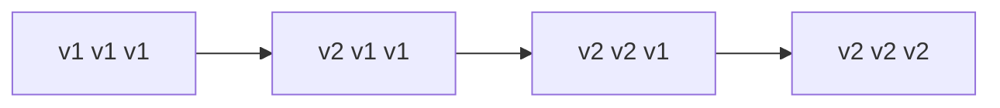
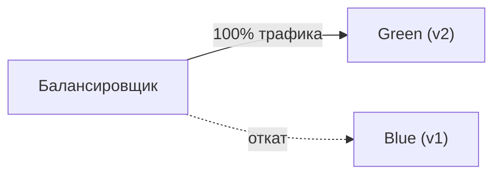
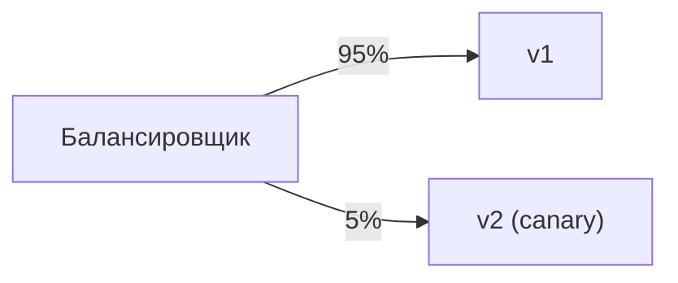
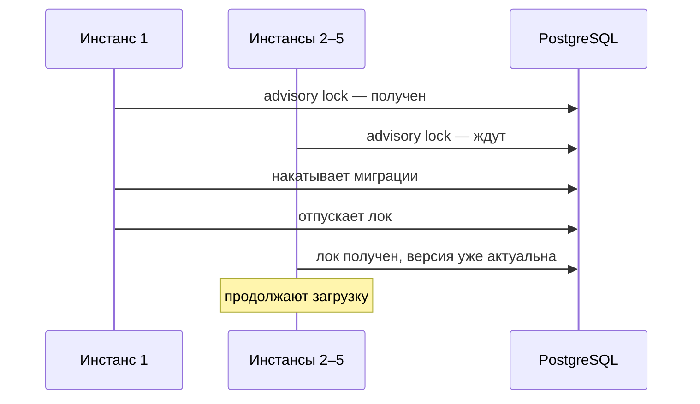
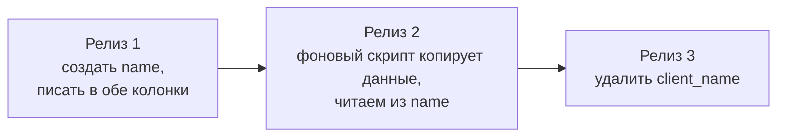

---
tags:
  - Junior
  - Middle
  - Senior
  - DevOps
  - Микросервисы
  - Базы данных
---

# Инфраструктура (DevOps)

Как Java-приложение упаковывается, доставляется и запускается в проде: Docker и Compose, CI/CD, миграции БД и Kubernetes. На собесе спрашивают, чем контейнер отличается от виртуальной машины, как написать хороший Dockerfile, что будет с данными в volume, какие бывают стратегии деплоя и как Flyway не даёт пяти инстансам подраться за миграцию.

## Docker { #docker }

### Какую проблему решает Docker? { #why-docker }

**Уровень:** Junior

!!! abstract "Ответ вслух"
    Docker убирает проблему «на моей машине работало». Он упаковывает приложение вместе со всей средой — куском ОС, JDK, библиотеками, конфигами — в стандартизированный образ. Такой образ запускается одинаково на ноутбуке, в CI и в проде.

На твоём ноутбуке Java 17, своя версия PostgreSQL, свои настройки таймзон — всё работает. Передаёшь `.jar` на прод, а там Java 11 и нет переменных окружения — всё падает.

Docker упаковывает приложение со средой в стандартизированный «ящик», который работает идентично везде.

!!! warning "Ловушка: «в контейнере — значит, одинаково везде»"
    Образ одинаков, но конфигурация — переменные окружения, секреты, адреса БД — приходит снаружи и отличается между средами. Если захардкодить её в образ, получишь ту же проблему в новой форме. Конфиги прокидывают при запуске, а в Kubernetes — через ConfigMaps и Secrets.

??? question "Проверь себя"
    1. Какую проблему решает Docker?
    2. Что входит в образ вместе с приложением?
    3. Что не стоит класть внутрь образа?

### Чем контейнер отличается от виртуальной машины? { #container-vs-vm }

**Уровень:** Junior

!!! abstract "Ответ вслух"
    Виртуальная машина запускает полноценную гостевую ОС со своим ядром поверх гипервизора: гигабайты и старт за минуты. Контейнер своей ОС не имеет и переиспользует ядро хоста: мегабайты и старт за миллисекунды. По сути контейнер — обычный процесс Linux, изолированный средствами ядра.

| | **Виртуальная машина** | **Docker-контейнер** |
|---|---|---|
| **ОС** | Полноценная гостевая ОС со своим ядром | Нет своей ОС — переиспользует ядро хоста |
| **Вес** | Гигабайты | Мегабайты |
| **Старт** | Минуты | Миллисекунды |
| **Изоляция** | Полная (гипервизор) | Процесс с иллюзией изоляции |
| **Накладные расходы** | Высокие (вторая ОС вхолостую) | Минимальные |

Контейнер — обычный процесс Linux, вокруг которого ОС выстроила стены изоляции: процесс думает, что он на сервере один.

!!! warning "Ловушка: контейнер изолирован так же, как VM"
    У всех контейнеров на хосте общее ядро. Уязвимость ядра или запуск под root открывает путь из контейнера на хост — у VM такого общего ядра нет. Поэтому контейнеры запускают [не под root](#non-root).

??? question "Проверь себя"
    1. Почему контейнер стартует быстрее виртуальной машины?
    2. Что общего у всех контейнеров на одном хосте?
    3. Почему изоляция контейнера слабее, чем у VM?

### Чем Dockerfile, образ и контейнер отличаются? { #image-container }

**Уровень:** Junior

!!! abstract "Ответ вслух"
    Dockerfile — текстовые инструкции, чертёж. Образ (image) — собранный по ним неизменяемый read-only слепок. Контейнер — запущенный экземпляр образа; в терминах Java образ — это класс, а контейнер — `new Object()`.



Аналогия с Java: Image = class, Container = `new Object()`. Из одного образа можно запустить сколько угодно контейнеров.

!!! warning "Ловушка: менять контейнер руками"
    Изменения, сделанные внутри запущенного контейнера, живут в его writable-слое и пропадают при `docker rm`. Образ при этом не меняется. Всё, что должно быть в каждом запуске, описывают в Dockerfile, а данные — выносят в [volumes](#volumes).

??? question "Проверь себя"
    1. Чем образ отличается от контейнера?
    2. Как связаны Dockerfile, образ и контейнер?
    3. Что станет с изменениями внутри контейнера после `docker rm`?

### На чём держится изоляция контейнера? { #namespaces-cgroups }

**Уровень:** Middle

!!! abstract "Ответ вслух"
    Изоляция держится на двух механизмах ядра Linux. Namespaces ограничивают, что контейнер видит: свою файловую систему, сеть и дерево процессов, где он — PID 1. Cgroups ограничивают, что контейнер использует: CPU и память, чтобы приложение с утечкой не съело все ресурсы хоста.

- **Namespaces (изоляция)** — ограничивают, что контейнер **видит**. Процесс думает, что у него свой корень файловой системы `/`, своя сетевая карта и что он главный процесс (PID 1).
- **Cgroups (лимиты)** — ограничивают, что контейнер **использует**. Не дадут Java-приложению с утечкой памяти занять все 64 ГБ и положить соседей: «убей процесс, если превысит 1 ГБ».

!!! warning "Ловушка: heap впритык к лимиту контейнера"
    Cgroups ограничивают всю память процесса, а JVM нужна память не только под heap: ещё Metaspace, стеки потоков, буферы. Если задать heap близко к лимиту контейнера или выше, процесс превысит лимит и будет убит ядром. Поэтому долю heap задают от лимита через `-XX:MaxRAMPercentage`, как в [Dockerfile ниже](#dockerfile).

??? question "Проверь себя"
    1. Что ограничивают namespaces, а что — cgroups?
    2. Почему процесс в контейнере видит себя как PID 1?
    3. Что случится с контейнером, превысившим лимит памяти cgroups?

### Как написать хороший Dockerfile для Java? { #dockerfile }

**Уровень:** Middle

!!! abstract "Ответ вслух"
    Используй multi-stage сборку: тяжёлый образ с Maven собирает jar, а в лёгкий runner-образ копируется только jar. Так образ уменьшается с 1 ГБ+ до ~150 МБ, и исходного кода в проде нет. Зависимости копируй и скачивай отдельным слоем до исходников, чтобы Docker их кэшировал.

**Multi-stage сборка:**

```dockerfile
# STAGE 1: Builder (тяжёлый образ для сборки)
FROM maven:3.8.5-openjdk-17-slim AS builder
WORKDIR /build

# Кэшируем зависимости ОТДЕЛЬНЫМ слоем (меняются редко)
COPY pom.xml .
RUN mvn dependency:go-offline

# Только теперь копируем код (меняется часто)
COPY src ./src
RUN mvn clean package -DskipTests

# STAGE 2: Runner (лёгкий и безопасный)
FROM gcr.io/distroless/java17-debian11
WORKDIR /app
COPY --from=builder /build/target/app.jar ./app.jar
ENV JAVA_OPTS="-XX:+UseG1GC -XX:MaxRAMPercentage=75.0"
ENTRYPOINT ["java", "-jar", "app.jar"]
```

Без multi-stage итоговый образ весит 1 ГБ+: исходники, кэш Maven, утилиты сборки. С multi-stage — 150 МБ, только JRE и jar. Исходного кода в проде физически нет.

Каждая инструкция `RUN` или `COPY` создаёт слой, а Docker кэширует неизменённые слои. Зависимости меняются редко, код — постоянно, поэтому их разделяют.

!!! warning "Ловушка: порядок `COPY`"
    ```dockerfile
    # ❌ Плохо — любое изменение кода инвалидирует кэш зависимостей
    COPY . .
    RUN mvn clean package   # каждый раз качает все зависимости заново

    # ✅ Хорошо — зависимости в отдельном слое
    COPY pom.xml .
    RUN mvn dependency:go-offline   # кэшируется до изменения pom.xml
    COPY src ./src
    RUN mvn clean package -DskipTests
    ```

??? question "Проверь себя"
    1. Что даёт multi-stage сборка?
    2. Почему `pom.xml` копируют отдельно от `src`?
    3. Сколько весит образ с multi-stage и без неё?

### Какой базовый образ выбрать? { #base-images }

**Уровень:** Middle

!!! abstract "Ответ вслух"
    Полный `openjdk` на Debian весит ~300 МБ и тащит кучу утилит — это большая поверхность атаки. Alpine лёгкий, но использует `musl libc` вместо `glibc`, и иногда бывают странности с JNI и шрифтами. Distroless содержит только то, что нужно для запуска, — нет даже `/bin/sh` и пакетного менеджера.

| Образ | Вес | Особенность |
|---|---|---|
| `openjdk:17` (Debian) | ~300 МБ | Куча утилит, большая поверхность атаки |
| `eclipse-temurin:17-jre-alpine` | ~5 МБ ОС | Лёгкий, но `musl libc` вместо `glibc` — иногда странности с JNI и шрифтами |
| `gcr.io/distroless/java17` | Минимум | Нет ничего, даже `/bin/sh` и пакетного менеджера |

Distroless — довод по безопасности. Если приложение взломали (как с Log4Shell) и атакующий хочет открыть консоль или скачать вредонос через `wget`, в distroless нет ни `bash`, ни `wget`.

!!! warning "Ловушка: отлаживать distroless как обычный образ"
    В distroless нельзя зайти через `docker exec ... sh` — оболочки нет. Это плата за безопасность: диагностику ведут через логи, метрики и внешние инструменты, а не изнутри контейнера.

??? question "Проверь себя"
    1. Чем Alpine-образ может доставить проблемы Java-приложению?
    2. Почему distroless безопаснее полного образа?
    3. Что нельзя сделать в distroless-контейнере?

### Почему контейнер нельзя запускать под root? { #non-root }

**Уровень:** Junior

!!! abstract "Ответ вслух"
    По умолчанию процесс в контейнере работает под root. Если атакующий прорвёт изоляцию, он окажется root на хост-сервере. Поэтому в Dockerfile создают отдельного пользователя и переключаются на него инструкцией `USER`.

```dockerfile
# По умолчанию контейнер работает под root.
# Прорыв изоляции → атакующий получает root на хост-сервере.
RUN addgroup -S spring && adduser -S spring -G spring
USER spring:spring
```

!!! warning "Ловушка: `USER` до копирования файлов"
    Файлы, скопированные после `USER`, принадлежат root, если не указать владельца, и приложение может не получить к ним доступ на запись. Владельца задают через `COPY --chown=spring:spring`. Обратная ошибка — забыть `USER` вовсе, и всё работает под root.

??? question "Проверь себя"
    1. Под каким пользователем по умолчанию работает процесс в контейнере?
    2. Чем опасен root в контейнере?
    3. Как в Dockerfile переключиться на непривилегированного пользователя?

## Docker Compose { #compose }

### Как сервисы в Compose находят друг друга? { #compose-dns }

**Уровень:** Junior

!!! abstract "Ответ вслух"
    Docker Compose создаёт виртуальную сеть со встроенным DNS, и имя сервиса становится его хостнеймом. Поэтому бэкенд подключается к базе по адресу `postgres-db:5432`, а не по `localhost` или IP. Блок `ports` нужен только для доступа снаружи, например из DBeaver с ноутбука.

```yaml
services:
  postgres-db:        # ← это имя становится хостнеймом
    image: postgres:15
  crm-backend:
    image: backend:latest
    # В application.yml: jdbc:postgresql://postgres-db:5432/booking
    # Никаких localhost и хардкода IP!
```

`ports: ["5432:5432"]` пробрасывает порт наружу. Если сервис нужен только внутри — например, Redis для бэкенда, — блок `ports` не пишут вообще: контейнеры и так видят друг друга. Это базовая безопасность.

!!! warning "Ловушка: `localhost` внутри контейнера"
    Внутри контейнера `localhost` — это сам контейнер, а не хост и не соседний сервис. Строка `jdbc:postgresql://localhost:5432` в бэкенде не найдёт базу, которая крутится в другом контейнере. Обращаются по имени сервиса.

??? question "Проверь себя"
    1. Как бэкенд в Compose обращается к базе данных?
    2. Зачем нужен блок `ports` и когда его не пишут?
    3. Что означает `localhost` внутри контейнера?

### Как дождаться готовности базы при старте? { #healthcheck }

**Уровень:** Junior

!!! abstract "Ответ вслух"
    Spring Boot стартует за 3 секунды, а БД ещё инициализируется — и приложение падает с `ConnectionRefusedException`. Простой `depends_on` ждёт только запуска контейнера, а не готовности базы. Нужен `healthcheck` у базы и `depends_on` с `condition: service_healthy` у приложения.

```yaml
services:
  postgres-db:
    image: postgres:15
    healthcheck:
      test: ["CMD-SHELL", "pg_isready -U postgres"]
      interval: 5s
      retries: 5

  crm-backend:
    depends_on:
      postgres-db:
        condition: service_healthy   # ждёт, пока healthcheck скажет OK
```

!!! warning "Ловушка: `wait-for-it.sh` и `Thread.sleep()`"
    Скрипты ожидания и паузы в коде гадают о времени старта: на медленной машине пауза окажется короткой, на быстрой — лишней. `healthcheck` + `depends_on` с `service_healthy` ждут фактической готовности базы.

??? question "Проверь себя"
    1. Почему простого `depends_on` недостаточно?
    2. Как Compose узнаёт, что PostgreSQL готов?
    3. Чем `healthcheck` лучше `Thread.sleep()` в коде?

### Как запускать тяжёлые сервисы только по запросу? { #compose-profiles }

**Уровень:** Junior

!!! abstract "Ответ вслух"
    Через профили (profiles). Сервис с `profiles: ["analytics"]` не запускается при обычном `docker-compose up`. Он поднимается, только если явно включить профиль флагом `--profile analytics`.

```yaml
services:
  analytics:
    profiles: ["analytics"]   # не запустится при обычном up
# docker-compose up                      → только базовые сервисы
# docker-compose --profile analytics up  → всё, включая тяжёлое
```

!!! warning "Ловушка: стенд поднят без нужного профиля"
    Обычный `up` молча пропускает сервисы с профилями — ошибки не будет, сервиса просто нет. Если тест или соседний сервис рассчитывает на `analytics`, стенд надо поднимать с `--profile analytics`. Поэтому в профили выносят только то, без чего основная система работает.

??? question "Проверь себя"
    1. Что делает `profiles` у сервиса в Compose?
    2. Как запустить сервисы из профиля?
    3. Какие сервисы разумно выносить в профили?

### Как поднять Kafka в Compose без ZooKeeper? { #kraft }

**Уровень:** Middle

!!! abstract "Ответ вслух"
    Через режим KRaft (Kafka Raft): Kafka сама хранит метаданные кластера через консенсус Raft, отдельный ZooKeeper не нужен. Это на один контейнер меньше, меньше RAM и старт примерно вдвое быстрее. С Kafka 3.3 ZooKeeper deprecated.

Если рассказываешь, как поднимаешь ZooKeeper для Kafka, это звучит устаревше. KRaft убирает отдельный кластер ZooKeeper: метаданные живут в самой Kafka. Как Raft договаривается о данных, разобрано в [System Design → Консенсус](../system-design/system-design.md#consensus).

!!! warning "Ловушка: настраивать новый кластер с ZooKeeper"
    Для нового кластера ZooKeeper — лишний контейнер и лишняя точка отказа. Конфигурацию с ZooKeeper стоит знать для поддержки старых кластеров, а новые поднимают в KRaft.

??? question "Проверь себя"
    1. Что такое KRaft?
    2. Что даёт отказ от ZooKeeper?
    3. На каком алгоритме консенсуса основан KRaft?

### Какие сети бывают в Docker? { #docker-networks }

**Уровень:** Middle

!!! abstract "Ответ вслух"
    Default bridge соединяет контейнеры по IP без DNS. User-defined bridge, который создаёт Compose, даёт DNS по именам сервисов. Host-сеть делит сетевой стек с хостом без NAT — максимальная скорость и никакой изоляции.

| Драйвер | Как работает | Когда |
|---|---|---|
| **bridge (default)** | Контейнеры по IP, без DNS | Редко используется напрямую |
| **bridge (user-defined)** | Контейнеры по именам, есть DNS | Docker Compose создаёт автоматически |
| **host** | Делит сетевой стек с хостом, без NAT | Максимальная скорость, ноль изоляции |

Сегментация сетей — паттерн безопасности. Создают `frontend-net` и `backend-net`: Nginx подключён к обеим, микросервисы и БД — только к `backend-net`. Взломали фронтенд-контейнер — атакующий не может отправить пакет в БД: между ними нет сетевого маршрута на уровне ядра.



!!! warning "Ловушка: все контейнеры в одной сети"
    Если фронтенд, бэкенд и база в одной сети, взлом любого контейнера открывает прямой путь к базе. Сеть — граница доступа, и сегментация ограничивает ущерб от взлома одного контейнера.

??? question "Проверь себя"
    1. Чем default bridge отличается от user-defined bridge?
    2. Когда используют host-сеть и чем за это платят?
    3. Как сегментация сетей защищает базу данных?

### Как Docker хранит данные? { #volumes }

**Уровень:** Middle

!!! abstract "Ответ вслух"
    Слои образа — read-only, а поверх них при запуске создаётся тонкий writable-слой (copy-on-write), который уничтожается при `docker rm`. Чтобы данные пережили контейнер, используют volumes. Bind mount монтирует папку хоста и подходит для локальной разработки, named volume управляется Docker'ом и нужен в проде для БД, Kafka и Redis.

```yaml
services:
  postgres-db:
    volumes:
      - pg_data:/var/lib/postgresql/data
volumes:
  pg_data:   # данные переживут docker-compose down
```

| | **Bind Mount** | **Named Volume** |
|---|---|---|
| **Синтаксис** | `-v /Users/me/logs:/app/logs` | `-v pg_data:/var/lib/postgresql/data` |
| **Управление** | Ты указываешь папку на хосте | Docker сам управляет в `/var/lib/docker/volumes` |
| **Когда** | Локальная разработка (hot reload) | Продакшн: БД, Kafka, Redis |

Вопрос на засыпку: _«PostgreSQL в Docker с named volume. Что с данными при `docker stop/start`? При `docker rm` и новом контейнере с тем же томом? При выключении питания?»_

1. `stop/start` — контейнер не уничтожается, данные на месте.
2. `rm` — контейнер уничтожен, но **named volume живёт независимо**: новый контейнер с тем же томом подхватит данные.
3. Выключение питания — данные в volume на диске. Но есть риск потерять последние транзакции из кэша записи ОС, не успевшие в `fsync`; защита — строгая синхронизация в самой СУБД (`wal_level` в Postgres).

!!! warning "Ловушка: база без volume"
    Если запустить PostgreSQL без volume, данные лежат в writable-слое контейнера. `docker rm` — и база пропала целиком. Для любой БД в Docker volume обязателен.

??? question "Проверь себя"
    1. Что происходит с writable-слоем при `docker rm`?
    2. Чем bind mount отличается от named volume и где что использовать?
    3. Что станет с данными named volume при выключении питания?

## CI/CD { #cicd }

### Чем CI отличается от Continuous Delivery и Continuous Deployment? { #ci-cd }

**Уровень:** Junior

!!! abstract "Ответ вслух"
    CI (Continuous Integration) — каждый коммит автоматически собирается и тестируется, чтобы рано заметить поломку. Continuous Delivery — артефакт собирается автоматически, а на прод его выкатывает человек по кнопке. Continuous Deployment — всё автоматически: тесты прошли, и код сам уходит на прод.

- **CI (Continuous Integration)** — цель: рано обнаружить, что код что-то сломал.
- **CD (Continuous Delivery)** — до прода — по кнопке человеком.
- **CD (Continuous Deployment)** — автоматизировано на 100%.

!!! warning "Ловушка: одна аббревиатура — два смысла"
    «CD» означает и Delivery, и Deployment, а разница — в последнем шаге: нажимает ли кнопку человек. На собесе уточняй, о каком CD речь.

??? question "Проверь себя"
    1. Какую задачу решает CI?
    2. Чем Continuous Delivery отличается от Continuous Deployment?
    3. Что должно быть готово, чтобы перейти к Continuous Deployment?

### Из каких стадий состоит Java-пайплайн? { #pipeline }

**Уровень:** Middle

!!! abstract "Ответ вслух"
    Build компилирует код, Test прогоняет unit- и интеграционные тесты, Build Image собирает Docker-образ и отправляет его в registry. Deploy обновляет образ в кластере. Кэш `~/.m2` ускоряет сборку, а секреты хранятся только в защищённых переменных CI или Vault.



- **Build** — Runner скачивает код и выполняет `mvn clean compile`. Кэш `~/.m2`: если `pom.xml` не менялся, зависимости берутся из кэша за секунду.
- **Test** — `mvn test` (unit) + `mvn verify` (интеграционные с Testcontainers, см. [Spring: Testcontainers](../spring/spring-testing.md#testcontainers)).
- **Build Image** — собирается Docker-образ, тегируется (`v1.2.42` или хэш коммита) и отправляется в Registry (Nexus, Harbor, GitLab Registry).
- **Deploy** — Runner подключается к кластеру (K8s API или SSH) и обновляет образ.

Частая жалоба: _«Интеграционные тесты идут 20 минут»_. Тесты разделяют по стадиям: быстрые unit — на каждый коммит, тяжёлые интеграционные — параллельно (parallel jobs) или только при Merge Request в master.

!!! warning "Ловушка: секреты в коде пайплайна"
    Пароли, ключи и токены нельзя хранить в `.gitlab-ci.yml` — они попадут в историю репозитория. Только через masked variables в настройках CI/CD или HashiCorp Vault.

??? question "Проверь себя"
    1. Назови четыре стадии Java-пайплайна.
    2. Как ускорить пайплайн с медленными интеграционными тестами?
    3. Где хранить секреты для пайплайна?

### Какие есть стратегии деплоя? { #deploy-strategies }

**Уровень:** Middle

!!! abstract "Ответ вслух"
    Rolling Update — старые контейнеры гасятся по очереди, новые поднимаются; это стандарт Kubernetes. Blue-Green — рядом со старой версией поднимают новую и переключают на неё весь трафик сразу, откат мгновенный. Canary — новую версию получают 5% пользователей, и при отсутствии ошибок долю плавно повышают до 100%.

**Rolling Update** — стандарт K8s; если новая версия падает, деплой останавливается:



**Blue-Green** — балансировщик переключает 100% трафика с Blue на Green за миллисекунду; что-то не так — мгновенный откат на Blue:



**Canary** — новая версия на 5% пользователей, смотрим Grafana; ошибок нет — плавно повышаем до 100%:



!!! warning "Ловушка: старая и новая версии работают одновременно"
    При Rolling Update, Blue-Green и Canary какое-то время обе версии обслуживают трафик и работают с одной базой. Поэтому миграции схемы должны быть [обратно совместимыми](#zero-downtime).

??? question "Проверь себя"
    1. Как работает Rolling Update?
    2. Чем Blue-Green отличается от Canary?
    3. Почему при любой из стратегий важна обратная совместимость миграций?

## Миграции БД { #migrations }

### Зачем нужны Flyway и Liquibase? { #flyway }

**Уровень:** Junior

!!! abstract "Ответ вслух"
    Чтобы схема БД менялась вместе с кодом, а не руками админа. Миграции — пронумерованные SQL-скрипты в репозитории, а Flyway хранит список применённых в служебной таблице `flyway_schema_history`. При старте он сверяет файлы с таблицей и накатывает только новые.

**Проблема ручных обновлений.** Добавил сущность `Review` — нужна таблица `reviews`. Отправляешь `CREATE TABLE` админу в Telegram «накати перед деплоем», а админ забыл, накатил не в ту базу или ошибся — и новый код падает с `PSQLException`.

**Решение — версионирование БД:**

```text
src/main/resources/db/migration/
  ├── V1__init.sql
  ├── V2__add_reviews.sql
  └── V3__add_indexes.sql
```

Flyway создаёт служебную таблицу `flyway_schema_history` и записывает в неё применённые скрипты. При старте сверяет файлы с таблицей и накатывает **только новые**.

!!! warning "Ловушка: миграции «руками» на одном окружении"
    Если на одном стенде схему поправили вручную, его `flyway_schema_history` перестаёт соответствовать реальной схеме. Следующая миграция упадёт только там, и баг не воспроизведётся у других. Любые изменения схемы — только через скрипт миграции.

??? question "Проверь себя"
    1. Какую проблему решают инструменты миграций?
    2. Где Flyway хранит информацию о применённых скриптах?
    3. Какие скрипты Flyway накатывает при старте?

### Как запускать миграции в CI/CD? { #migrations-cicd }

**Уровень:** Middle

!!! abstract "Ответ вслух"
    Обычно Flyway встроен в Spring Boot: он запускается до Tomcat, накатывает миграции, и только потом приложение начинает принимать запросы. Для огромных баз миграцию выносят в отдельный шаг пайплайна. Иначе индекс на таблице в 500 ГБ строится часами, и Kubernetes убивает «зависший» под по liveness probe.

- **Встроенный в Spring Boot** — добавляешь зависимость, Flyway запускается ДО Tomcat, накатывает миграции, потом приложение оживает.
- **Отдельный шаг пайплайна** — для огромных баз. Индекс на таблице в 500 ГБ строится часами: Spring Boot ждал бы долго, а K8s решил бы, что контейнер завис, и убил его по liveness probe. Поэтому: `Build → Test → Build Image → DB Migrate → Deploy`.


!!! warning "Ловушка: долгая миграция при старте приложения"
    Пока миграция идёт внутри старта Spring Boot, приложение не отвечает на health-check'и. Оркестратор принимает это за зависание и перезапускает под — миграция начинается заново или обрывается. Долгие миграции выносят в отдельный шаг.

??? question "Проверь себя"
    1. Когда Flyway запускается во встроенном режиме?
    2. Почему долгую миграцию выносят в отдельный шаг пайплайна?
    3. Как выглядит пайплайн с отдельным шагом миграции?

### Что будет, если изменить уже применённую миграцию? { #flyway-checksum }

**Уровень:** Middle

!!! abstract "Ответ вслух"
    Приложение не запустится с `FlywayException`. Flyway хранит контрольную сумму каждого скрипта и при старте пересчитывает её — изменение даже одного пробела ломает проверку. Исправлять можно только новым скриптом, например `V4__fix.sql`.

Flyway хранит хэш каждого применённого скрипта и при старте пересчитывает его по файлу. Старые скрипты иммутабельны — как сообщения в Kafka.

!!! warning "Ловушка: «поправлю опечатку в V1»"
    Правка применённого скрипта не изменит базы, где он уже выполнен, зато сломает старт на всех окружениях из-за несовпадения чексуммы. Любое исправление — новым скриптом `V4__fix.sql`.

??? question "Проверь себя"
    1. Как Flyway обнаруживает изменение применённого скрипта?
    2. Что произойдёт при старте приложения после такой правки?
    3. Как правильно исправить ошибку в применённой миграции?

### Что, если пять инстансов одновременно начнут миграцию? { #flyway-lock }

**Уровень:** Senior

!!! abstract "Ответ вслух"
    Гонки не будет. На PostgreSQL первый инстанс берёт advisory lock — логическую блокировку на уровне БД по числовому ключу, не привязанную к строкам таблицы. Остальные ждут, пока лок освободится, а потом видят, что версия уже обновлена, и продолжают загрузку.

Advisory lock берётся через `pg_try_advisory_xact_lock` или `pg_try_advisory_lock` по числовому ключу. Строки `flyway_schema_history` при этом никто не блокирует через `SELECT FOR UPDATE`.



!!! warning "Ловушка: «Flyway блокирует строки таблицы истории»"
    Частый неверный ответ — про `SELECT FOR UPDATE` по `flyway_schema_history`. На PostgreSQL Flyway использует advisory lock: это блокировка по числу, а не по строкам. Она не мешает читать таблицу истории и не требует, чтобы в ней уже были строки.

??? question "Проверь себя"
    1. Что такое advisory lock в PostgreSQL?
    2. Что делают остальные инстансы, пока первый накатывает миграцию?
    3. Почему для этого не нужна блокировка строк `flyway_schema_history`?

### Как мигрировать схему без простоя? { #zero-downtime }

**Уровень:** Senior

!!! abstract "Ответ вслух"
    При деплое без простоя старая и новая версии кода работают одновременно, поэтому миграция не должна ломать старый код. Переименование колонки делают в три релиза: создать новую колонку и писать в обе, перенести данные и читать из новой, удалить старую. Сразу переименовать нельзя — старая версия упадёт.

❌ Нельзя сразу переименовать `client_name` → `name`: старая версия посыплется.

✅ В 3 релиза:



!!! warning "Ловушка: удалить старую колонку в том же релизе"
    Пока идёт Blue-Green или Rolling Update, часть трафика обслуживает старая версия, и она всё ещё читает `client_name`. Удалить колонку можно только в релизе, когда старого кода, который её использует, не осталось.

??? question "Проверь себя"
    1. Почему миграции при zero-downtime деплое должны быть обратно совместимыми?
    2. Опиши три релиза для переименования колонки.
    3. Когда можно удалить старую колонку?

## Kubernetes { #kubernetes }

### Что даёт Kubernetes? { #k8s-basics }

**Уровень:** Junior

!!! abstract "Ответ вслух"
    Когда проект вырастает из одного сервера, Docker Compose перестаёт справляться, и кластером управляет Kubernetes. Deployments плавно обновляют версии подов, Services и Ingress маршрутизируют и балансируют трафик. ConfigMaps и Secrets прокидывают конфигурацию и пароли извне, без хардкода.

- **Pods & Deployments** — K8s плавно обновляет версии (Rolling Update): поднимает новый контейнер, ждёт готовности, гасит старый, не обрывая запросы.
- **Services & Ingress** — как внешний трафик маршрутизируется внутрь кластера и балансируется между инстансами.
- **ConfigMaps & Secrets** — логины, пароли и переменные окружения прокидываются извне, без хардкода в `application.yml`.

Как K8s решает, жив ли под и готов ли он к трафику, разобрано в [System Design → Liveness и readiness](../system-design/system-design.md#health-checks).

!!! warning "Ловушка: Rolling Update без readiness probe"
    Kubernetes ждёт готовности нового пода по readiness probe. Если её нет, под считается готовым сразу после старта контейнера, и трафик пойдёт на приложение, которое ещё не подняло Spring-контекст. Пользователи получат ошибки во время каждого деплоя.

??? question "Проверь себя"
    1. Как Deployment обновляет версию приложения без обрыва запросов?
    2. Для чего нужны Services и Ingress?
    3. Как передать в под пароль от БД без хардкода?

## Observability { #observability }

Метрики, логи и трейсы, централизованное логирование (ELK/EFK) и проброс `traceId` через MDC разобраны в [System Design → Observability](../system-design/system-design.md#observability). Сбор метрик в Spring Boot через Actuator и Micrometer — в [Actuator и Micrometer](../spring/spring-actuator.md).

## Reverse proxy и API Gateway { #proxy-gateway }

### Зачем нужен reverse proxy? { #reverse-proxy }

**Уровень:** Junior

!!! abstract "Ответ вслух"
    Reverse proxy — Nginx или HAProxy — стоит перед приложениями и принимает запросы от клиентов. Он балансирует нагрузку, терминирует SSL — HTTPS снаружи, HTTP внутри защищённого контура — и кэширует статику. API Gateway делает похожую работу на уровне микросервисов: проверяет JWT, ограничивает частоту запросов и маршрутизирует.

API Gateway (например, Spring Cloud Gateway) разобран в [System Design → API Gateway, BFF и Service Discovery](../system-design/system-design.md#api-gateway). Балансировка на L4 и L7 — в [System Design → L4 и L7](../system-design/system-design.md#l4-l7).

!!! warning "Ловушка: HTTP внутри контура «и так безопасно»"
    SSL termination на прокси означает, что за ним трафик идёт в открытом виде. Это допустимо только внутри действительно защищённого контура. Если сеть между прокси и приложениями общая с чужими сервисами, шифруют и внутренний трафик.

??? question "Проверь себя"
    1. Какие задачи решает reverse proxy?
    2. Что такое SSL termination?
    3. Чем API Gateway отличается от reverse proxy?

## Шпаргалка { #cheatsheet }

<!-- --8<-- [start:cheatsheet] -->
| Тема | Запомнить |
|---|---|
| **Docker** | Приложение + среда в одном образе — «на моей машине работало» больше не аргумент |
| **Контейнер vs VM** | Контейнер переиспользует ядро хоста. Мегабайты, миллисекунды |
| **Image vs Container** | Image = class (read-only). Container = `new Object()` |
| **Namespaces / Cgroups** | Namespaces — что видит. Cgroups — что использует (лимиты) |
| **Multi-stage build** | Builder (JDK + Maven) → Runner (только JRE). 1 ГБ → 150 МБ |
| **Кэш слоёв** | `COPY pom.xml` → зависимости в отдельном слое до `COPY src` |
| **Distroless** | Нет bash и wget — атакующему нечем воспользоваться |
| **Non-root user** | Прорыв изоляции под root = root на хосте |
| **Compose DNS** | Имя сервиса = хостнейм. Никаких localhost |
| **healthcheck + depends_on** | Ждать готовности БД, а не `Thread.sleep()` |
| **Profiles** | Тяжёлые сервисы — только с `--profile` |
| **KRaft** | Kafka без ZooKeeper: метаданные через Raft, минус контейнер |
| **Сегментация сетей** | frontend-net + backend-net. БД недоступна из фронта |
| **Named Volume** | Переживает `docker rm`. Стандарт для БД в проде |
| **CI / CD / CD** | Integration — сборка и тесты на коммит. Delivery — по кнопке. Deployment — сам |
| **Пайплайн** | Build → Test → Build Image → Deploy; секреты — в masked variables или Vault |
| **Стратегии деплоя** | Rolling (K8s), Blue-Green (мгновенный откат), Canary (5%) |
| **Flyway** | `flyway_schema_history`, накатываются только новые скрипты |
| **Flyway чексуммы** | Изменил старый скрипт → `FlywayException`. Скрипты иммутабельны |
| **Flyway лок** | На PostgreSQL — advisory lock, 5 инстансов не подерутся за миграцию |
| **Zero-downtime миграции** | Переименование колонки — в 3 релиза, не сразу |
| **Kubernetes** | Deployments, Services и Ingress, ConfigMaps и Secrets |
| **Observability** | Logs (что) + Metrics (сколько) + Traces (где) — в [System Design](../system-design/system-design.md#observability) |
| **Reverse proxy** | Балансировка, SSL termination, кэш статики |

<!-- --8<-- [end:cheatsheet] -->
