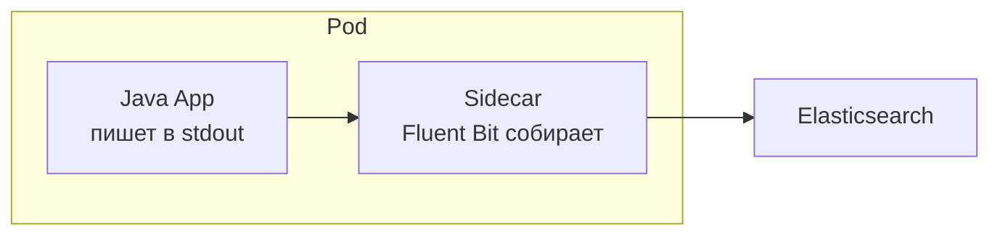

---
tags:
  - DevOps
---

# Kubernetes

Как приложение живёт в Kubernetes: пробы liveness и readiness и паттерн sidecar. На собесе спрашивают, чем liveness отличается от readiness и почему проверку БД не кладут в liveness.

## Эксплуатация в Kubernetes { #k8s-operations }

### Чем liveness отличается от readiness? { #health-checks }

**Уровень:** Junior

!!! abstract "Ответ вслух"
    Liveness проверяет, жив ли процесс: если нет, оркестратор его перезапускает. Readiness проверяет, готов ли инстанс принимать трафик: прогрет ли кэш, есть ли соединение с БД. Пока readiness не пройден, балансировщик не шлёт на инстанс запросы, но и не убивает его.

В Spring Boot обе проверки отдаёт Actuator `/health` — подробно в [Actuator и Micrometer → Actuator](../spring/spring-actuator.md#actuator).

!!! warning "Ловушка: проверять БД в liveness"
    Если liveness падает при недоступной БД, то при сбое базы оркестратор начнёт перезапускать все инстансы приложения — хотя они живы и просто ждут. Зависимости проверяют в readiness, а liveness отвечает только за сам процесс.

??? question "Проверь себя"
    1. Что делает оркестратор, если не прошёл liveness, а что — если readiness?
    2. Почему проверку соединения с БД кладут в readiness?
    3. Какой эндпоинт Spring Boot отдаёт состояние здоровья?

### Что такое sidecar? { #sidecar }

**Уровень:** Middle

!!! abstract "Ответ вслух"
    Sidecar — паттерн деплоя в Kubernetes: рядом с приложением в том же поде запускается отдельный контейнер для логов, метрик или проксирования. Контейнеры делят сеть и диск, но изолированы по процессам. Приложение просто пишет в stdout, а sidecar собирает логи и отправляет дальше.

Аналогия — мотоцикл с коляской: бизнес-логика — «мотоцикл», логирование, метрики и проксирование — «коляска». Тяжёлая инфраструктура логирования не тащится в код приложения.

!!! warning "Ловушка: sidecar бесплатен"
    Sidecar — это ещё один контейнер в каждом поде со своими CPU и памятью. При сотнях подов накладные расходы заметны, и лимиты ресурсов нужно задавать и для него.

??? question "Проверь себя"
    1. Что общего у приложения и sidecar в одном поде, а что раздельно?
    2. Как приложение передаёт логи sidecar?
    3. Зачем выносить сбор логов в sidecar, а не в код?

## Шпаргалка { #cheatsheet }

<!-- --8<-- [start:cheatsheet] -->
| Тема | Запомнить |
|---|---|
| **Liveness vs readiness** | Liveness — жив ли процесс (рестарт). Readiness — готов ли к трафику |
| **Sidecar** | Логи, метрики, прокси — в соседнем контейнере пода, не в коде приложения |

<!-- --8<-- [end:cheatsheet] -->
