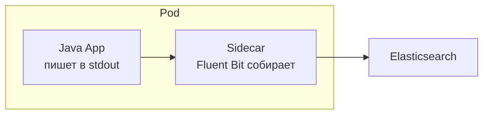

---
tags:
  - Junior
  - DevOps
---

# Kubernetes

Что даёт Kubernetes и как приложение в нём живёт: основные объекты, пробы liveness и readiness, паттерн sidecar и reverse proxy перед сервисами. На собесе спрашивают, чем liveness отличается от readiness, почему проверку БД не кладут в liveness и зачем нужен reverse proxy.

## Kubernetes { #kubernetes }

### Что даёт Kubernetes? { #k8s-basics }

**Уровень:** Junior

!!! abstract "Ответ вслух"
    Когда проект вырастает из одного сервера, Docker Compose перестаёт справляться, и кластером управляет Kubernetes. Deployments плавно обновляют версии подов, Services и Ingress маршрутизируют и балансируют трафик. ConfigMaps и Secrets прокидывают конфигурацию и пароли извне, без хардкода.

- **Pods & Deployments** — K8s плавно обновляет версии (Rolling Update): поднимает новый контейнер, ждёт готовности, гасит старый, не обрывая запросы.
- **Services & Ingress** — как внешний трафик маршрутизируется внутрь кластера и балансируется между инстансами.
- **ConfigMaps & Secrets** — логины, пароли и переменные окружения прокидываются извне, без хардкода в `application.yml`.

Как K8s решает, жив ли под и готов ли он к трафику, разобрано ниже, в [пробах liveness и readiness](#health-checks).

!!! warning "Ловушка: Rolling Update без readiness probe"
    Kubernetes ждёт готовности нового пода по readiness probe. Если её нет, под считается готовым сразу после старта контейнера, и трафик пойдёт на приложение, которое ещё не подняло Spring-контекст. Пользователи получат ошибки во время каждого деплоя.

??? question "Проверь себя"
    1. Как Deployment обновляет версию приложения без обрыва запросов?
    2. Для чего нужны Services и Ingress?
    3. Как передать в под пароль от БД без хардкода?

## Эксплуатация в Kubernetes { #k8s-operations }

### Чем liveness отличается от readiness? { #health-checks }

**Уровень:** Junior

!!! abstract "Ответ вслух"
    Liveness проверяет, жив ли процесс: если нет, оркестратор его перезапускает. Readiness проверяет, готов ли инстанс принимать трафик: прогрет ли кэш, есть ли соединение с БД. Пока readiness не пройден, балансировщик не шлёт на инстанс запросы, но и не убивает его.

В Spring Boot обе проверки отдаёт Actuator `/health` — подробно в [Actuator и Micrometer → Actuator](../spring/spring-actuator.md#actuator).

!!! warning "Ловушка: проверять БД в liveness"
    Если liveness падает при недоступной БД, то при сбое базы оркестратор начнёт перезапускать все инстансы приложения — хотя они живы и просто ждут. Зависимости проверяют в readiness, а liveness отвечает только за сам процесс.

??? question "Проверь себя"
    1. Что делает оркестратор, если не прошёл liveness, а что — если readiness?
    2. Почему проверку соединения с БД кладут в readiness?
    3. Какой эндпоинт Spring Boot отдаёт состояние здоровья?

### Что такое sidecar? { #sidecar }

**Уровень:** Middle

!!! abstract "Ответ вслух"
    Sidecar — паттерн деплоя в Kubernetes: рядом с приложением в том же поде запускается отдельный контейнер для логов, метрик или проксирования. Контейнеры делят сеть и диск, но изолированы по процессам. Приложение просто пишет в stdout, а sidecar собирает логи и отправляет дальше.

Аналогия — мотоцикл с коляской: бизнес-логика — «мотоцикл», логирование, метрики и проксирование — «коляска». Тяжёлая инфраструктура логирования не тащится в код приложения.

!!! warning "Ловушка: sidecar бесплатен"
    Sidecar — это ещё один контейнер в каждом поде со своими CPU и памятью. При сотнях подов накладные расходы заметны, и лимиты ресурсов нужно задавать и для него.

??? question "Проверь себя"
    1. Что общего у приложения и sidecar в одном поде, а что раздельно?
    2. Как приложение передаёт логи sidecar?
    3. Зачем выносить сбор логов в sidecar, а не в код?

## Reverse proxy и API Gateway { #proxy-gateway }

### Зачем нужен reverse proxy? { #reverse-proxy }

**Уровень:** Junior

!!! abstract "Ответ вслух"
    Reverse proxy — Nginx или HAProxy — стоит перед приложениями и принимает запросы от клиентов. Он балансирует нагрузку, терминирует SSL — HTTPS снаружи, HTTP внутри защищённого контура — и кэширует статику. API Gateway делает похожую работу на уровне микросервисов: проверяет JWT, ограничивает частоту запросов и маршрутизирует.

API Gateway (например, Spring Cloud Gateway) разобран в [Микросервисы → API Gateway, BFF и Service Discovery](../architecture/microservices.md#api-gateway). Балансировка на L4 и L7 — в [Строительные блоки → L4 и L7](../system-design/building-blocks.md#l4-l7).

!!! warning "Ловушка: HTTP внутри контура «и так безопасно»"
    SSL termination на прокси означает, что за ним трафик идёт в открытом виде. Это допустимо только внутри действительно защищённого контура. Если сеть между прокси и приложениями общая с чужими сервисами, шифруют и внутренний трафик.

??? question "Проверь себя"
    1. Какие задачи решает reverse proxy?
    2. Что такое SSL termination?
    3. Чем API Gateway отличается от reverse proxy?

## Шпаргалка { #cheatsheet }

<!-- --8<-- [start:cheatsheet] -->
| Тема | Запомнить |
|---|---|
| **Kubernetes** | Deployments, Services и Ingress, ConfigMaps и Secrets |
| **Liveness vs readiness** | Liveness — жив ли процесс (рестарт). Readiness — готов ли к трафику |
| **Sidecar** | Логи, метрики, прокси — в соседнем контейнере пода, не в коде приложения |
| **Reverse proxy** | Балансировка, SSL termination, кэш статики |

<!-- --8<-- [end:cheatsheet] -->
