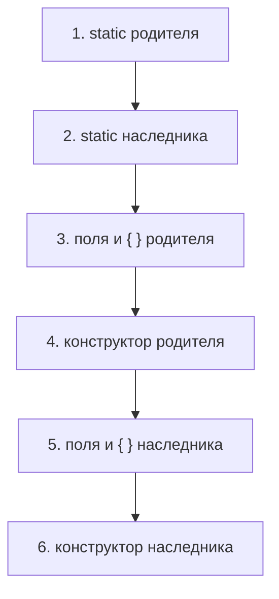

# Основы языка

Типы данных, передача параметров, автоупаковка, контракт `equals()`/`hashCode()`, `final`, `static`, порядок инициализации, `enum` и модификаторы доступа. Чаще всего спрашивают про Integer Cache, «Java передаёт по ссылке или по значению?», `equals()` без `hashCode()` и порядок инициализации родителя и наследника.

## Типы данных { #types }

### Чем примитивы отличаются от ссылочных типов? { #primitives }

**Уровень:** Junior

!!! abstract "Ответ вслух"
    Примитивов восемь, они хранят само значение и не могут быть `null`. Ссылочные типы — объекты, массивы, интерфейсы, `enum` — хранят ссылку на объект в куче и могут быть `null`. Примитивы быстрее: не нужно ходить по ссылке, а массив примитивов лежит в памяти сплошным куском.

В Java есть чёткое разделение на примитивные типы (8 штук) и ссылочные (объекты, массивы, интерфейсы, `enum`). Примитивы встроены в язык, не являются объектами (у них нет методов) и оптимизированы для скорости.

| **Категория** | **Тип** | **Размер в памяти** | **Значение по умолчанию** |
|---|---|---|---|
| **Целочисленные** | `byte` | 1 байт (8 бит) | 0 |
| | `short` | 2 байта (16 бит) | 0 |
| | `int` | 4 байта (32 бита) | 0 |
| | `long` | 8 байт (64 бита) | 0L |
| **С плавающей точкой** | `float` | 4 байта (32 бита) | 0.0f |
| | `double` | 8 байт (64 бита) | 0.0d |
| **Символьный** | `char` | 2 байта (16 бит) | `\u0000` |
| **Логический** | `boolean` | Зависит от JVM | `false` |

Главные отличия:

1. **Расположение в памяти:**
    - **Примитивы** хранят само значение. Локальные переменные-примитивы лежат во фрейме **стека** потока. Если примитив — поле класса, он хранится в **куче** вместе с объектом.
    - **Ссылочные** хранят **ссылку** на объект. Сама ссылка может лежать в стеке, а объект всегда находится в **куче**. Подробно про стек и кучу — в [JVM и память → Stack и Heap](jvm.md#stack-heap).
2. **Возможность быть `null`:**
    - Примитивы **не могут** быть `null` — у них всегда есть значение.
    - Ссылочные типы могут указывать в никуда (`null`), что часто приводит к `NullPointerException`.
3. **Производительность:** доступ к примитивам быстрее — не нужно переходить по ссылке в кучу. Массивы примитивов лежат в памяти сплошным куском, что идеально для кэша процессора (cache locality).

```java
int count = 5;            // само значение
Integer boxed = null;     // ссылка, может быть null
int[] nums = {1, 2, 3};   // массив примитивов — один непрерывный кусок памяти
Integer[] refs = {1, 2};  // массив ссылок на отдельные объекты Integer
```

!!! warning "Ловушка: `null` там, где ждут примитив"
    Ссылочная переменная может быть `null`, примитивная — нет. Как только `null` попадает туда, где нужен примитив, получаешь `NullPointerException` — подробнее в [ловушках автоупаковки](#autoboxing-traps).

??? question "Проверь себя"
    1. Сколько примитивных типов в Java и какие у них значения по умолчанию?
    2. Где хранится примитив, если он — поле объекта?
    3. Почему массив `int[]` обрабатывается быстрее, чем `Integer[]`?

### Java передаёт параметры по ссылке или по значению? { #pass-by-value }

**Уровень:** Junior

!!! abstract "Ответ вслух"
    Только по значению. Для примитива копируется само значение, для объекта — значение ссылки. Поэтому изменения состояния объекта внутри метода видны снаружи, а присваивание параметру нового объекта — нет.

Один из самых частых вопросов-ловушек. В Java **всё** передаётся исключительно **по значению** (pass-by-value), передачи «по ссылке» в стиле C++ нет.

- **Примитив:** в метод копируется само значение (например, число `5`). Изменения внутри метода не затронут исходную переменную.
- **Объект:** в метод копируется **значение ссылки** (адрес в памяти).
    - Если внутри метода изменить состояние объекта (`user.setName("John")`), оригинал **изменится**: обе ссылки указывают на один объект в куче.
    - Если внутри метода присвоить параметру новый объект (`user = new User()`), оригинал **не изменится**: ты поменял лишь локальную копию адреса.

```java
static void rename(User user) {
    user.setName("John"); // ✅ меняем объект — вызывающий код это увидит
    user = new User();    // меняем только локальную копию ссылки
    user.setName("Bob");  // этого вызывающий код уже не увидит
}

static void increment(int value) {
    value++;              // меняем копию — исходная переменная не изменится
}
```

!!! warning "Ловушка: «объекты передаются по ссылке»"
    Звучит похоже на правду, но это неверно: если бы ссылка передавалась по ссылке, `user = new User()` внутри метода поменял бы объект у вызывающего кода. Правильная формулировка — «ссылка передаётся по значению».

??? question "Проверь себя"
    1. Что именно копируется при передаче объекта в метод?
    2. Изменится ли объект снаружи после `user.setName("John")` внутри метода?
    3. Изменится ли переменная снаружи после `user = new User()` внутри метода?

### Как работают автоупаковка и распаковка? { #autoboxing }

**Уровень:** Junior

!!! abstract "Ответ вслух"
    Коллекции и дженерики работают только с объектами, поэтому у каждого примитива есть класс-обёртка: `Integer`, `Double`, `Boolean` и т.д. Компилятор сам вставляет `Integer.valueOf()` при упаковке и `intValue()` при распаковке. Механизм появился в Java 5.

В Java исторически две системы типов: быстрые примитивы (`int`, `boolean`) и объекты. Но коллекции (например, `ArrayList`) и дженерики умеют работать **только с объектами**. Чтобы подружить эти два мира, в Java 5 появились классы-обёртки (wrapper classes) и автоматическое преобразование между ними.

Компилятор делает работу за нас, подставляя нужные методы на этапе компиляции:

- **Autoboxing (автоупаковка)** — примитив превращается в объект-обёртку.
- **Unboxing (распаковка)** — объект-обёртка превращается обратно в примитив.

```java
Integer num = 10;   // ты пишешь
Integer num2 = Integer.valueOf(10); // что делает компилятор

int a = num;        // ты пишешь
int a2 = num.intValue();            // что делает компилятор
```

!!! warning "Ловушка: автоупаковка скрыта от глаз"
    В коде не видно ни вызова `valueOf()`, ни `intValue()`, но они есть. Отсюда три классические проблемы — NPE, сравнение через `==` и лишние объекты в цикле — [разобраны ниже](#autoboxing-traps).

??? question "Проверь себя"
    1. Зачем в Java нужны классы-обёртки?
    2. Во что компилятор превращает `Integer num = 10;`?
    3. Что вызывается при распаковке `int a = num;`?

### Какие ловушки у автоупаковки? { #autoboxing-traps }

**Уровень:** Middle

!!! abstract "Ответ вслух"
    Три ловушки: распаковка `null` даёт `NullPointerException`; сравнение обёрток через `==` работает «случайно» только для значений от -128 до 127 из-за Integer Cache. И упаковка в цикле незаметно создаёт миллионы объектов.

Это то, что нужно знать для технического скрининга.

!!! warning "Ловушка №1: скрытый `NullPointerException`"
    Примитивы не могут быть `null`, а обёртки — могут. Если распаковать `null`, приложение упадёт:

    ```java
    Integer wrapper = null;
    int primitive = wrapper; // NPE в рантайме: под капотом вызывается null.intValue()
    ```

!!! warning "Ловушка №2: Integer Cache и сравнение через `==`"
    Классический вопрос на понимание `==` со ссылочными типами. Для экономии памяти JVM кэширует обёртки для значений от **-128 до 127**. Верхнюю границу можно поднять флагом `-XX:AutoBoxCacheMax`, но по умолчанию диапазон такой.

    ```java
    Integer a = 100;
    Integer b = 100;
    System.out.println(a == b); // true: оба указывают на один объект из кэша

    Integer c = 200;
    Integer d = 200;
    System.out.println(c == d); // false: 200 не кэшируется, в куче два разных объекта
    ```

    Никогда не сравнивай обёртки через `==`. Всегда используй `.equals()`.

!!! warning "Ловушка №3: лишние объекты в цикле"
    Компилятор упаковывает незаметно, поэтому легко написать код, который создаёт миллионы объектов в цикле, забивает кучу и нагружает GC:

    ```java
    Long sum = 0L; // объект-обёртка
    for (long i = 0; i < Integer.MAX_VALUE; i++) {
        sum += i;  // распаковка, сложение и создание НОВОГО Long на каждой итерации
    }
    ```

    Решение — примитив: `long sum = 0L;`.

??? question "Проверь себя"
    1. Что произойдёт при `int x = (Integer) null;`?
    2. Почему `Integer a = 100, b = 100; a == b` даёт `true`, а для 200 — `false`?
    3. Чем опасен `Long sum` в цикле?

## Объекты { #objects }

### Какой контракт у `equals()` и `hashCode()`? { #equals-hashcode }

**Уровень:** Middle

!!! abstract "Ответ вслух"
    Если `a.equals(b)`, то у них обязан совпадать `hashCode()`; обратное не обязательно — это коллизия. `hashCode()` должен быть стабильным, пока не менялись поля из `equals()`. Если переопределить `equals()` без `hashCode()`, хэш-коллекции сломаются: равные объекты окажутся в разных бакетах.

В классе `Object` уже есть оба метода. По умолчанию `equals()` работает как `==` (сравнивает ссылки), а `hashCode()` возвращает число, не связанное с полями объекта. Для бизнес-логики нужно сравнивать объекты по содержимому — поэтому методы переопределяют, и тут вступает в силу жёсткий контракт.

#### Четыре правила контракта

1. **Согласованность с `equals`:** если `a.equals(b) == true`, хэш-коды **обязаны** совпадать (`a.hashCode() == b.hashCode()`).
2. **Коллизии допустимы:** если `a.hashCode() == b.hashCode()`, объекты **не обязательно** равны по `equals()`. Это называется _коллизией_.
3. **Оптимизация:** если `a.hashCode() != b.hashCode()`, объекты **гарантированно не равны** по `equals()`.
4. **Стабильность:** повторный вызов `hashCode()` на одном объекте возвращает одно и то же число, пока не менялись поля, участвующие в `equals()`.

#### Зачем нужен контракт

Интервьюер спросит: _"Что будет, если я переопределю `equals`, но забуду `hashCode`?"_ Ответ упирается в устройство `HashMap` и `HashSet`. Хэш-таблица сначала по `hashCode()` выбирает бакет, а потом внутри бакета сравнивает ключи через `equals()` — подробно в [Коллекции → Как HashMap устроена внутри](collections.md#hashmap-internals).

#### Цена ошибки

**Пример с `HashSet`:** есть класс `Habit`. Создаём два объекта с одинаковым названием и добавляем в `HashSet`:

```java
Habit h1 = new Habit("Бег");
Habit h2 = new Habit("Бег");
set.add(h1);
set.add(h2);
```

- **Если НЕ переопределил `equals()` и `hashCode()`:** `HashSet` посчитает хэши по умолчанию — у двух разных объектов они почти наверняка разные — и положит объекты в разные бакеты. В `Set` окажется **два логически одинаковых объекта**: контракт уникальности нарушен.
- **Если ПЕРЕОПРЕДЕЛИЛ:** `HashSet` вычислит одинаковый хэш-код (строка «Бег» одинаковая), сравнит объекты через `equals()`, и `add()` вернёт `false`. Дубликат не добавится.

**Сценарий 1: забыли `hashCode` (разные хэш-коды у равных объектов).** Ты создал двух пользователей с одинаковыми ID, именем и почтой — по `equals()` они равны. Кладёшь первого ключом в `HashMap`, а достать данные пытаешься по второму: хэш у второго другой, `HashMap` ищет **в другом бакете** и возвращает `null`.

Повторные `put()` с «равными» ключами копят дубликаты, и мапа растёт — это прямой путь к утечке памяти.

**Сценарий 2: плохой `hashCode` (например, всегда возвращает 1).** Контракт формально не нарушен, но все объекты попадают в один бакет. `HashMap` вырождается в длинную цепочку, и поиск падает с O(1) до O(n). С ростом данных сервис начинает тормозить.

```java
public final class User {
    private final Long id;
    private final String email;

    public User(Long id, String email) {
        this.id = id;
        this.email = email;
    }

    @Override
    public boolean equals(Object o) {
        if (this == o) return true;
        if (!(o instanceof User other)) return false;
        return Objects.equals(id, other.id) && Objects.equals(email, other.email);
    }

    @Override
    public int hashCode() {
        return Objects.hash(id, email); // те же поля, что и в equals()
    }
}
```

!!! tip "Золотое правило"
    Если объект планируется использовать в качестве ключа в `Map` или элемента в `Set`, переопределение `equals()` и `hashCode()` **обязательно**.

- **Не пиши руками:** генерируй методы через IDE (IntelliJ IDEA) или Lombok (`@EqualsAndHashCode`).
- **Используй неизменяемые поля:** хэш-код считается только по полям из `equals`, и желательно, чтобы они были `final`.
- **Современный подход:** с Java 16 есть `record` — там `equals()` и `hashCode()` генерируются по всем компонентам на уровне языка, см. [Современная Java → record](modern-java.md#records).

!!! warning "Ловушка: изменили поле после добавления в `HashSet`"
    Если поменять поле, участвующее в `hashCode()`, _после_ того как объект положили в `HashSet` или ключом в `HashMap`, его хэш изменится. Коллекция будет искать объект в другом бакете, и достать или удалить его больше не получится.

??? question "Проверь себя"
    1. Сформулируй четыре правила контракта `equals()`/`hashCode()`.
    2. Что случится с `HashSet`, если переопределить `equals()`, но не `hashCode()`?
    3. Почему нельзя менять поля ключа после того, как он попал в `HashMap`?

### Чем отличаются `final`, `finally` и `finalize()`? { #final-finally-finalize }

**Уровень:** Junior

!!! abstract "Ответ вслух"
    `final` — модификатор: запрещает менять переменную, переопределять метод или наследоваться от класса. `finally` — блок после `try`, который выполняется почти всегда. `finalize()` — устаревший метод `Object`, который GC мог вызвать перед удалением объекта; с Java 9 он deprecated.

#### `final` — запрет изменений

Поведение зависит от того, к чему применён модификатор:

- **`final` переменная:** значение задаётся только один раз.
    - Если переменная примитивная (`final int x = 5;`), её значение изменить нельзя. Если ссылочная (`final List<String> list = new ArrayList<>();`), **нельзя изменить саму ссылку**, но **можно менять состояние объекта** (`list.add()`).
- **`final` метод:** запрещает переопределение (override) в наследниках. Нужен, когда критичную бизнес-логику нельзя сломать при наследовании.
- **`final` класс:** запрещает наследование. Пример из JDK — `String`: никто не может написать `class MyString extends String`, что гарантирует его неизменяемость.

```java
final List<String> list = new ArrayList<>();
list.add("ok");             // ✅ менять содержимое объекта можно
// list = new ArrayList<>(); // ❌ ошибка компиляции: менять саму ссылку нельзя
```

#### `finally` — гарантия выполнения

Часть конструкции `try-catch-finally`: выполняется и при исключении, и при нормальном завершении, даже после `return`. Когда `finally` всё-таки не выполняется и почему для ресурсов лучше `try-with-resources` — в [Исключения → finally](exceptions.md#finally).

#### `finalize()` — устаревший метод

Метод класса `Object`.

- **Как задумывалось:** GC вызывает его у объекта перед удалением. Разработчик мог переопределить метод и закрыть ресурсы «в последний момент».
- **Почему это антипаттерн:**
    1. **Непредсказуемость:** никто не гарантирует, когда GC соберёт объект. `finalize()` может вызваться через секунду, через час или никогда.
    2. **Производительность:** объекты с `finalize()` собираются в разы медленнее — GC ставит их в отдельную очередь (finalization queue).
    3. **«Воскрешение»:** внутри `finalize()` можно случайно сохранить ссылку на умирающий объект в статическое поле и тем самым «воскресить» его.
- **Статус:** с Java 9 метод помечен `@Deprecated`, а с Java 18 ([JEP 421](https://openjdk.org/jeps/421)) — к удалению. Для очистки ресурсов используют `try-with-resources` или `java.lang.ref.Cleaner`.

| **Понятие** | **Что это** | **Где применяется** | **Суть** |
|---|---|---|---|
| **`final`** | Ключевое слово | Переменные, методы, классы | Запрет изменений и наследования |
| **`finally`** | Блок кода | Обработка исключений (`try-catch`) | Выполняется почти всегда (освобождение ресурсов) |
| **`finalize()`** | Метод класса `Object` | Жизненный цикл объекта (GC) | Вызывался перед удалением, устарел |

!!! warning "Ловушка: `final` не делает объект неизменяемым"
    `final` защищает только ссылку. Содержимое `final List` или поля `final`-объекта по-прежнему можно менять. Для настоящей неизменяемости нужны неизменяемые типы: `List.of()`, `record` с неизменяемыми полями.

??? question "Проверь себя"
    1. Что именно запрещает `final` для переменной, метода и класса?
    2. Можно ли добавить элемент в `final List`?
    3. Почему `finalize()` стал антипаттерном и что использовать вместо него?

### Что значит `static`? { #static }

**Уровень:** Junior

!!! abstract "Ответ вслух"
    Всё, что помечено `static`, принадлежит классу, а не объекту: статическое поле существует в одном экземпляре на весь класс. Статический метод не имеет `this`, поэтому не видит нестатические поля, и его нельзя переопределить — только скрыть (method hiding).

Главное правило: **всё, что помечено `static`, принадлежит самому классу, а не конкретному объекту**. Чтобы обратиться к статическому члену, объект не нужен — обращаешься через имя класса (`Math.max()`).

#### Статические поля

Обычное поле у каждого объекта своё. Статическое — одно на весь класс:

- **Общая память:** существует в **единственном экземпляре** для всех объектов класса.
- **Где хранится:** с Java 8 — в куче, внутри объекта `java.lang.Class`; подробно в [JVM и память → Где живут статические переменные](jvm.md#static-location).
- **Константы:** поэтому статические поля чаще всего делают константами — `public static final`.

#### Статические методы

Методы, логика которых не привязана к состоянию конкретного объекта. Пример — утилитные классы (`StringUtils`, `Math`). Два главных ограничения:

1. **Нет `this` и `super`:** статический метод не знает, от имени какого объекта его вызвали — объекта может и не быть. Поэтому из него **нельзя** напрямую обратиться к нестатическим полям или методам.
2. **Method hiding (сокрытие), а не override:** статический метод **нельзя переопределить**. Если в наследнике объявить такой же статический метод, компилятор не возразит, но полиморфизма не будет: вызовется метод по типу ссылки, известному при компиляции.

```java
class Parent {
    static String who() { return "Parent"; }
}

class Child extends Parent {
    static String who() { return "Child"; } // сокрытие, а не переопределение
}

Parent p = new Child();
System.out.println(p.who()); // "Parent": статический метод выбран по типу ссылки
```

!!! warning "Ловушка: статическое поле и потоки"
    Значение статического поля одно на весь класс, поэтому его видят все объекты. Но между **потоками** без `volatile` или синхронизации изменение может быть не видно сразу — см. [Многопоточность → Java Memory Model](multithreading.md#java-memory-model-jmm). Изменяемое статическое состояние — частый источник гонок.

??? question "Проверь себя"
    1. Кому принадлежит статическое поле и сколько у него копий?
    2. Почему из статического метода нельзя обратиться к нестатическому полю?
    3. Что выведет `p.who()`, если `Parent p = new Child()` и `who()` статический?

### В каком порядке инициализируется объект? { #init-order }

**Уровень:** Middle

!!! abstract "Ответ вслух"
    Сначала статика родителя, потом статика наследника — один раз, при загрузке классов. Затем для каждого `new`: поля и блоки инициализации родителя, конструктор родителя, поля и блоки наследника, конструктор наследника. Сверху вниз по иерархии и от статики к экземпляру.

Иногда присвоить значение при объявлении (`static int x = 5;`) недостаточно — нужна сложная логика (загрузить данные, собрать `Map`). Для этого есть блоки инициализации:

- **Статический блок (`static { ... }`):** выполняется **один раз** — когда класс инициализируется при первом использовании, ещё до создания объектов.
- **Блок инициализации экземпляра (`{ ... }`):** выполняется **при каждом** `new`, _до_ тела конструктора. Исторически им выносили общую логику из нескольких конструкторов.

Топ-1 задача на скринингах: дают иерархию с кучей статических и нестатических блоков, полей и конструкторов и спрашивают, в каком порядке напечатаются сообщения при `new Child()`. Алгоритм: сверху вниз, от родителя к наследнику, и от статики к экземпляру.

1. **Статические поля и статические блоки суперкласса** (родителя).
2. **Статические поля и статические блоки подкласса** (наследника). _На этом этапе классы загружены. Дальше создаётся сам объект._
3. **Нестатические поля и блоки инициализации суперкласса.**
4. **Конструктор суперкласса.**
5. **Нестатические поля и блоки инициализации подкласса.**
6. **Конструктор подкласса.**



```java
class Parent {
    static { System.out.println("1. static Parent"); }
    { System.out.println("3. init Parent"); }
    Parent() { System.out.println("4. Parent()"); }
}

class Child extends Parent {
    static { System.out.println("2. static Child"); }
    { System.out.println("5. init Child"); }
    Child() { System.out.println("6. Child()"); }
}

new Child(); // напечатает 1 → 6 по порядку
new Child(); // напечатает только 3 → 6: статика уже отработала
```

!!! warning "Ловушка: второй `new` не повторяет статику"
    Статические блоки выполняются один раз на класс. При втором `new Child()` напечатаются только шаги 3–6 — об этом часто забывают в задачах «что выведет код».

??? question "Проверь себя"
    1. Перечисли шесть шагов инициализации при `new Child()`.
    2. Когда выполняется статический блок?
    3. Что выведет второй вызов `new Child()`?

### Какие значения по умолчанию у переменных? { #default-values }

**Уровень:** Junior

!!! abstract "Ответ вслух"
    Поля класса и элементы массивов JVM заполняет значениями по умолчанию: нули, `false` и `null`. У локальных переменных значений по умолчанию нет — компилятор не даст их прочитать до присваивания. Так сделано ради защиты от ошибок и ради скорости работы стека.

Поведение переменной зависит от того, **где** она объявлена: на уровне класса (поле) или внутри метода (локальная).

#### Поля класса

При создании объекта через `new` под него выделяется память в куче. JVM «зачищает» её, присваивая всем полям значения по умолчанию (фактически забивает память нулями). Инициализировать их руками не обязательно:

| **Тип данных** | **Значение по умолчанию** |
|---|---|
| `byte`, `short`, `int`, `long` | `0` (или `0L` для long) |
| `float`, `double` | `0.0f` или `0.0d` |
| `char` | `'\u0000'` (нулевой символ) |
| `boolean` | `false` |
| **Все ссылочные типы** (String, объекты, массивы) | `null` |

!!! info "Важно"
    Элементы массива (даже если массив создан локально в методе) тоже получают значения по умолчанию: сам массив — объект в куче. `int[] arr = new int[5];` сразу заполнен пятью нулями.

#### Локальные переменные

Локальные переменные объявлены **внутри методов**, конструкторов или блоков (например, в цикле `for`). Главное правило: **у локальных переменных НЕТ значений по умолчанию**. Если прочитать переменную до присваивания, компилятор выдаст ошибку `variable might not have been initialized`.

```java
public void calculate() {
    int result;
    // System.out.println(result); // ❌ ошибка компиляции
    result = 10;
    System.out.println(result);    // ✅ теперь всё в порядке
}
```

#### Почему так сделали

Интервьюер спросит: _"Почему JVM не зануляет и локальные переменные?"_ Две причины:

1. **Защита от ошибок (safety):** в C и C++ неинициализированная локальная переменная берёт «мусор», оставшийся в памяти, — это приводило к трудноуловимым багам. Java заставляет явно задать стартовое значение на этапе компиляции.
2. **Производительность:** локальные переменные живут в стеке, а фреймы создаются и уничтожаются миллионы раз в секунду. Занулять каждую переменную при каждом вызове — лишняя работа, поэтому ответственность оставили разработчику.

!!! warning "Ловушка: массив внутри метода"
    Локальная переменная-массив без присваивания не скомпилируется, но элементы созданного массива уже заполнены значениями по умолчанию: `new int[5]` — пять нулей, `new String[3]` — три `null`.

??? question "Проверь себя"
    1. Какие значения по умолчанию получают поля разных типов?
    2. Что будет, если прочитать локальную переменную до присваивания?
    3. Почему элементы локально созданного массива инициализированы, а сама локальная переменная — нет?

### Как устроен `enum`? { #enum }

**Уровень:** Middle

!!! abstract "Ответ вслух"
    `enum` — синтаксический сахар: компилятор делает из него `final`-класс, наследника `java.lang.Enum`, с `public static final` константами и приватным конструктором. Поэтому `enum` не может ничего наследовать, но может реализовывать интерфейсы, иметь поля, методы и свою реализацию метода у каждой константы. `values()` и `valueOf()` генерирует компилятор.

Главное на собесе: **`enum` — синтаксический сахар**. На уровне JVM «перечислений» нет, есть обычные классы. Когда ты пишешь:

```java
public enum Status {
    NEW, IN_PROGRESS, DONE
}
```

компилятор превращает это примерно в следующее:

```java
public final class Status extends java.lang.Enum<Status> {
    public static final Status NEW = new Status("NEW", 0);
    public static final Status IN_PROGRESS = new Status("IN_PROGRESS", 1);
    public static final Status DONE = new Status("DONE", 2);

    private Status(String name, int ordinal) {
        super(name, ordinal);
    }
    // ... скрытые методы компилятора ...
}
```

_Этот код — иллюстрация: руками наследоваться от `java.lang.Enum` компилятор не разрешит._ Из него вытекают все правила и каверзные вопросы.

#### Ограничения

- **Наследование запрещено:** `enum` уже неявно наследует `java.lang.Enum`, а множественного наследования классов в Java нет.
- **Интерфейсы разрешены:** реализовывать (`implements`) можно сколько угодно интерфейсов — так разные перечисления связывают общим контрактом.
- **Конструктор всегда `private`:** создать экземпляр через `new` нельзя. Константы создаются один раз при инициализации класса.

#### Откуда берутся методы

`name()` (имя константы) и `ordinal()` (порядковый номер с 0) приходят из `java.lang.Enum`. А вот `values()` и `valueOf(String)` в классе `Enum` **нет** — их генерирует компилятор:

- `values()` — массив всех констант.
- `valueOf("NEW")` — константа по точному имени; если не нашлась — `IllegalArgumentException`.

#### Что ещё умеет `enum`

**Состояние и поведение.** Это полноценный класс: можно добавлять поля, конструкторы и методы.

```java
public enum ErrorCode {
    NOT_FOUND(404, "Ресурс не найден"),
    SERVER_ERROR(500, "Ошибка сервера");

    private final int code;
    private final String message;

    ErrorCode(int code, String message) { // конструктор неявно private
        this.code = code;
        this.message = message;
    }

    public int getCode() { return code; }
    public String getMessage() { return message; }
}
```

**Свой метод у каждой константы (паттерн Стратегия / Состояние).** Каждая константа может реализовать абстрактный метод по-своему — это избавляет от простыней `switch` и `if-else`.

```java
public enum Operation {
    PLUS {
        public int apply(int x, int y) { return x + y; }
    },
    MINUS {
        public int apply(int x, int y) { return x - y; }
    };

    public abstract int apply(int x, int y); // абстрактный метод внутри enum
}
```

**Singleton.** `enum` из одного элемента — самый надёжный способ написать Singleton в Java; почему — в [Паттерны → Enum Singleton](patterns.md#enum-singleton).

**`EnumSet` и `EnumMap`.** Для набора констант или констант-ключей используй их вместо `HashSet` и `HashMap`. `EnumSet` хранит набор как битовый вектор, `EnumMap` — как массив по `ordinal()`: никаких хэшей, бакетов и коллизий, минимум памяти.

```java
EnumSet<Status> active = EnumSet.of(Status.NEW, Status.IN_PROGRESS);
EnumMap<Status, Integer> counts = new EnumMap<>(Status.class);
counts.put(Status.DONE, 42);
```

!!! warning "Ловушка: `valueOf()` с неизвестным именем"
    `Status.valueOf("new")` бросит `IllegalArgumentException`: поиск идёт по точному имени с учётом регистра. Данные извне (из запроса, из файла) перед `valueOf()` нужно проверять.

!!! warning "Ловушка: хранить `ordinal()` в базе"
    `ordinal()` зависит от порядка объявления констант. Добавишь константу в середину — все сохранённые номера поедут. Поэтому в JPA используют `@Enumerated(EnumType.STRING)`, а не `ORDINAL`, который стоит по умолчанию.

??? question "Проверь себя"
    1. Во что компилятор превращает `enum`?
    2. Может ли `enum` наследовать класс? А реализовать интерфейс?
    3. Откуда берутся `values()` и `valueOf()` и что бросает `valueOf()` при неизвестном имени?

### Какие модификаторы доступа есть в Java? { #access-modifiers }

**Уровень:** Junior

!!! abstract "Ответ вслух"
    Четыре: `private` — только внутри класса, `default` (без слова) — внутри пакета, `protected` — пакет плюс наследники в других пакетах, `public` — везде. Поля делают `private`, наружу открывают минимум. Главная ловушка — `protected` из другого пакета доступен только через наследование, а не через ссылку на родителя.

Модификаторы определяют, кто и откуда видит классы, поля, методы и конструкторы.

| **Модификатор** | **Внутри класса** | **В том же пакете** | **В наследнике (другой пакет)** | **Везде** |
|---|---|---|---|---|
| **`private`** | ✅ Да | ❌ Нет | ❌ Нет | ❌ Нет |
| **`default` (без слова)** | ✅ Да | ✅ Да | ❌ Нет | ❌ Нет |
| **`protected`** | ✅ Да | ✅ Да | ✅ Да | ❌ Нет |
| **`public`** | ✅ Да | ✅ Да | ✅ Да | ✅ Да |

#### `private` — только внутри класса

Самый строгий модификатор.

- **Архитектурное правило:** все поля класса **всегда** `private`. Доступ к ним — только через методы. Это основа инкапсуляции.
- **Приватный конструктор:** запрещает `new` снаружи. Так устроены [Singleton](patterns.md#singleton) и утилитные классы вроде `Math` — никто не сделает `new Math()`.

#### `default` (package-private) — внутри пакета

Если модификатор не написан, Java применяет `default`: элемент виден **только внутри того же пакета**.

- **Где ловушка:** многие новички думают, что отсутствие модификатора равносильно `public`.
- **Архитектурная ценность:** мощный инструмент для чистой архитектуры и DDD. В пакете может быть 10 классов, которые общаются между собой, а `public` — только один фасад. Остальные 9 — `package-private`, и контроллеры физически не смогут вызвать их напрямую.

#### `protected` — пакет и наследники

Виден внутри пакета **и** во всех наследниках, даже в других пакетах.

#### `public` — везде

- **Архитектурное правило:** `public` должно быть как можно меньше. Публичным делай только API класса — его контракт с остальной системой. Чем шире публичный API, тем сложнее рефакторинг: на него завязаны другие классы.

!!! warning "Ловушка: `protected` через ссылку на родителя"
    Любимый вопрос: _"`Parent` в пакете `a` с `protected` методом, `Child extends Parent` в пакете `b`. Можно ли в `Child` создать `new Parent()` и вызвать у него этот метод?"_ **Нет.** `protected` даёт доступ только **через наследование** — к своим унаследованным методам, а не к методам чужого экземпляра родителя.

    ```java
    // a/Parent.java
    package a;

    public class Parent {
        protected void method() { }
    }

    // b/Child.java
    package b;

    import a.Parent;

    public class Child extends Parent {
        void test() {
            method();                // ✅ через наследование — можно
            Parent p = new Parent();
            // p.method();           // ❌ ошибка компиляции: через ссылку на Parent из другого пакета
        }
    }
    ```

??? question "Проверь себя"
    1. Чем `default` отличается от `protected`?
    2. Зачем делать классы `package-private`?
    3. Можно ли из наследника в другом пакете вызвать `protected` метод у `new Parent()`?

## Шпаргалка { #cheatsheet }

| Тема | Запомнить |
|---|---|
| **Примитивы** | 8 типов, хранят значение, не бывают `null`; ссылочные хранят адрес объекта в куче |
| **Передача параметров** | Только по значению; для объектов копируется ссылка |
| **Автоупаковка** | Компилятор вставляет `valueOf()` и `intValue()`; появилась в Java 5 |
| **Ловушки автоупаковки** | Распаковка `null` → NPE; Integer Cache -128..127 — сравнивай через `equals()`; обёртки в цикле — лишние объекты |
| **`equals()` / `hashCode()`** | Равны по `equals` → равны хэши; без `hashCode()` ломаются `HashMap` и `HashSet` |
| **`final` / `finally` / `finalize()`** | Запрет изменений / блок после `try` / устаревший метод GC |
| **`static`** | Принадлежит классу; статические методы не переопределяются, а скрываются |
| **Порядок инициализации** | static родителя → static наследника → поля и блоки родителя → конструктор родителя → то же для наследника |
| **Значения по умолчанию** | У полей и элементов массивов — нули, `false`, `null`; у локальных переменных — нет |
| **`enum`** | `final`-класс, наследник `Enum`; `values()` и `valueOf()` от компилятора; `EnumSet` / `EnumMap`; не храни `ordinal()` |
| **Модификаторы доступа** | `private` → `default` → `protected` → `public`; `protected` из другого пакета — только через наследование |
