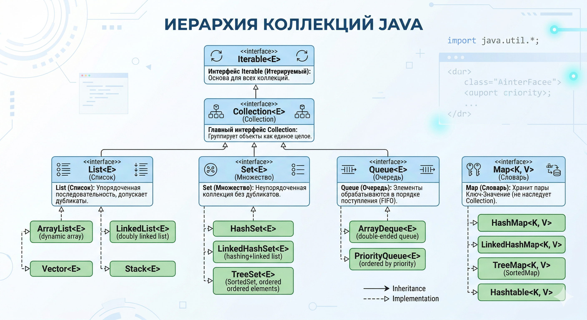

---
tags:
  - Junior
  - Middle
  - Java
---

# Коллекции

Как устроены `List`, `Set` и `Queue` в Java и как выбрать коллекцию под задачу. Чаще всего спрашивают `ArrayList` против `LinkedList`, `Comparable` против `Comparator` и `ConcurrentModificationException`. Устройство `Map` — на странице [HashMap](hashmap.md), коллекции для многопоточного кода — в [Потокобезопасных коллекциях](../concurrency/concurrent-collections.md).

## Иерархия и интерфейсы { #hierarchy }

### Как устроена иерархия коллекций? { #collection-hierarchy }

**Уровень:** Junior

!!! abstract "Ответ вслух"
    Всё начинается с `Iterable` — его умеет обходить `for-each`. От него наследуется `Collection` с базовыми `add`, `remove`, `size`, `contains`, а от неё три ветки: `List` (порядок и индексы), `Set` (уникальность) и `Queue` (порядок обработки). `Map` стоит отдельно.



Интерфейс **`Iterable`** говорит: _"по этому объекту можно пройтись в цикле `for-each`"_. Он возвращает `Iterator`, который шагает по элементам через `hasNext()` и `next()`. Компилятор превращает `for-each` именно в такой цикл:

```java
for (String s : list) {
    System.out.println(s);
}

// Во что компилятор превращает for-each
Iterator<String> it = list.iterator();
while (it.hasNext()) {
    String s = it.next();
    System.out.println(s);
}
```

От `Iterable` наследуется **`Collection`** — базовый контракт для группы элементов. Он добавляет методы, которые умеют все стандартные коллекции: `add()`, `remove()`, `size()`, `contains()`, `clear()`.

От `Collection` отходят три ветки, и каждая добавляет свои правила к базовому контракту:

| | **`List` (список)** | **`Set` (множество)** | **`Queue` (очередь)** |
|---|---|---|---|
| **Контракт** | Порядок и индексы | Уникальность | Порядок обработки (обычно FIFO — First In, First Out) |
| **Порядок** | Строго порядок добавления | Нет индексов; в большинстве реализаций порядок добавления не сохраняется | Порядок, в котором элементы должны быть обработаны |
| **Дубликаты** | Разрешены | Нельзя: `add()` уже существующего элемента вернёт `false` | Разрешены |
| **Свои методы** | `get(int index)` | — | `offer()`, `poll()`, `peek()` |
| **Пример** | История отметок пользователя за неделю по дням | Уникальные названия привычек | Очередь отправки push-уведомлений |

У `Queue` свои методы: `offer()` добавляет в конец, `poll()` достаёт и удаляет первый элемент, `peek()` показывает первый, не удаляя.

```java
Queue<String> queue = new ArrayDeque<>();
queue.offer("push-1");   // добавить в конец
queue.peek();            // посмотреть первый, не удаляя → "push-1"
queue.poll();            // достать и удалить первый → "push-1"
queue.poll();            // очередь пуста → null
queue.remove();          // очередь пуста → NoSuchElementException
```

!!! warning "Ловушка: у `Queue` по два метода на каждое действие"
    `add()`, `remove()` и `element()` при неудаче бросают исключение, а `offer()`, `poll()` и `peek()` возвращают `false` или `null`. Разница видна на пустой очереди и на очереди с ограниченной ёмкостью. В коде обработки задач обычно берут вторую тройку.

??? question "Проверь себя"
    1. Во что компилятор превращает цикл `for-each` по коллекции?
    2. Чем контракт `Set` отличается от контракта `List`?
    3. Что вернут `poll()` и `remove()` на пустой очереди?

### Почему `Map` — это не `Collection`? { #map-not-collection }

**Уровень:** Junior

!!! abstract "Ответ вслух"
    `Collection` работает с одиночными элементами и её базовый метод — `add(e)`, а `Map` работает с парами ключ → значение через `put(k, v)`. Если бы `Map` наследовала `Collection`, ей пришлось бы реализовать `add(e)`, у которого для пар нет осмысленного поведения. Это принцип разделения интерфейсов из SOLID.

На собесе спросят: _"Почему `List` и `Set` наследуются от `Collection`, а `Map` стоит особняком?"_ Ответ — [Interface Segregation из SOLID](../design/solid.md#isp):

- `Collection` оперирует **одиночными элементами** (values). Её базовый метод — `add(Element e)`.
- `Map` оперирует **парами** (key → value). Её базовый метод — `put(Key k, Value v)`.

Если бы `Map` унаследовалась от `Collection`, ей пришлось бы реализовать `add(Element)`. Что этот метод делал бы в мапе и каким был бы ключ — непонятно, это сломало бы логику структуры данных. Поэтому `Map` — независимая ветка со своим интерфейсом.

Зато `Map` умеет отдавать свои данные как коллекции-представления (views):

```java
Map<String, Integer> prices = new HashMap<>();
prices.put("кофе", 250);

Set<String> keys = prices.keySet();                          // ключи
Collection<Integer> values = prices.values();                // значения
Set<Map.Entry<String, Integer>> entries = prices.entrySet(); // пары — так обходят всю мапу

for (Map.Entry<String, Integer> e : prices.entrySet()) {
    System.out.println(e.getKey() + " = " + e.getValue());
}
```

!!! warning "Ловушка: представления — не копии"
    `keySet()`, `values()` и `entrySet()` смотрят прямо в мапу. `prices.keySet().remove("кофе")` удалит запись из самой `prices`, а `prices.keySet().add("чай")` бросит `UnsupportedOperationException` — добавить ключ без значения нельзя.

??? question "Проверь себя"
    1. Почему `Map` не наследует `Collection`? Какой принцип SOLID здесь работает?
    2. Как обойти все пары ключ → значение в `Map`?
    3. Что произойдёт с мапой, если удалить ключ из её `keySet()`?

## Списки: ArrayList и LinkedList { #lists }

### Как устроен `ArrayList`? { #arraylist }

**Уровень:** Junior

!!! abstract "Ответ вслух"
    `ArrayList` — обёртка над обычным массивом `Object[]`, поэтому доступ по индексу работает за O(1). Когда массив заполнен, создаётся новый в 1,5 раза больше и элементы копируются в него через `System.arraycopy()`.

- **Создание:** `new ArrayList<>()` создаёт пустой массив. При добавлении первого элемента массив получает ёмкость (capacity) по умолчанию — **10 элементов**.
- **Расширение (resizing):** при добавлении 11-го элемента:
    1. Создаётся **новый массив**.
    2. Его размер считается по формуле `oldCapacity + (oldCapacity >> 1)`: сдвиг вправо на 1 — это деление на 2. Массив растёт **в 1,5 раза** с округлением вниз: 10 → 15 → 22 → 33...
    3. Старый массив копируется в новый через нативный `System.arraycopy()`.
    4. Старый массив уходит в Garbage Collector.
- **Доступ:** `get(index)` работает за **O(1)** — адрес элемента вычисляется по индексу, без перебора.

```java
// Как ArrayList считает новую ёмкость (упрощённо, из ArrayList.grow)
int newCapacity = oldCapacity + (oldCapacity >> 1);

// Знаешь размер заранее — задай ёмкость и обойдись без расширений
List<String> names = new ArrayList<>(10_000);
```

!!! warning "Ловушка: `remove(int)` против `remove(Object)`"
    У `List<Integer>` два метода `remove`, и выбирается по типу аргумента:

    ```java
    List<Integer> ids = new ArrayList<>(List.of(10, 20, 30));
    ids.remove(1);                   // удалит элемент по ИНДЕКСУ 1 → [10, 30]
    ids.remove(Integer.valueOf(10)); // удалит элемент со ЗНАЧЕНИЕМ 10 → [30]
    ```

??? question "Проверь себя"
    1. Какая ёмкость у `ArrayList` после первого `add()` и как она растёт дальше?
    2. Почему `get(index)` у `ArrayList` работает за O(1)?
    3. Что удалит `ids.remove(1)` у `List<Integer>`?

### Как устроен `LinkedList`? { #linkedlist }

**Уровень:** Junior

!!! abstract "Ответ вслух"
    `LinkedList` — двусвязный список: цепочка узлов `Node`, каждый хранит элемент и ссылки на соседей. Вставка и удаление на концах — O(1), а доступ по индексу — O(n), потому что до нужного узла приходится идти перебором.

Никакого единого массива внутри нет — только независимые объекты-узлы:

```java
// Узел внутри LinkedList
private static class Node<E> {
    E item;        // данные
    Node<E> next;  // ссылка на следующий узел
    Node<E> prev;  // ссылка на предыдущий узел
}
```

Чтобы найти 500-й элемент, `LinkedList` начинает с головы или хвоста — с того конца, который ближе, — и последовательно перебирает узлы. Поэтому доступ по индексу — **O(n)**.

!!! warning "Ловушка: `get(i)` в цикле"
    ```java
    for (int i = 0; i < linked.size(); i++) {
        linked.get(i);          // ❌ каждый get(i) — обход от края, весь цикл O(n²)
    }
    for (Integer x : linked) {  // ✅ итератор идёт по ссылкам, весь цикл O(n)
        System.out.println(x);
    }
    ```

??? question "Проверь себя"
    1. Что хранит узел `LinkedList`?
    2. Почему доступ по индексу у `LinkedList` — O(n)?
    3. Как правильно обойти `LinkedList`, чтобы не получить O(n²)?

### Что быстрее для вставки в середину: `ArrayList` или `LinkedList`? { #insert-middle }

**Уровень:** Middle

!!! abstract "Ответ вслух"
    Как правило, `ArrayList`. Сама вставка в `LinkedList` — O(1), но до середины нужно дойти перебором узлов за O(n). `ArrayList` тоже тратит O(n), но сдвигает хвост одним `System.arraycopy()` по непрерывной памяти, и на практике это намного быстрее.

Классический вопрос: _"Нужно вставить элемент в середину списка из миллиона элементов. Что быстрее?"_

Частый неверный ответ: _"Конечно `LinkedList`! Вставка O(1), просто перекинем ссылки. А `ArrayList` сдвинет полмиллиона элементов — O(n)."_

Почему на деле побеждает `ArrayList`:

1. **Поиск узла:** сама вставка в `LinkedList` — O(1), но чтобы добраться до середины, узел нужно сначала **найти**, а это O(n) перебора.
2. **Скорость сдвига:** `ArrayList` сдвигает элементы через `System.arraycopy()`. Это интринсик JVM, который копирует память большими блоками, — он намного быстрее, чем переход по полумиллиону ссылок.

```java
List<Integer> array = new ArrayList<>(source);
List<Integer> linked = new LinkedList<>(source);
int middle = source.size() / 2;

array.add(middle, 42);  // O(n): arraycopy сдвигает полмиллиона элементов одним блоком
linked.add(middle, 42); // O(n): полмиллиона переходов по ссылкам до узла, потом O(1) вставка
```

!!! warning "Ловушка: O(1) у `LinkedList` — только когда узел уже найден"
    Дешёвая вставка у `LinkedList` бывает на концах (`addFirst`, `addLast`) и через `ListIterator`, который уже стоит на нужном месте. Вставка по индексу всегда начинается с перебора.

??? question "Проверь себя"
    1. Из каких двух шагов состоит вставка в середину `LinkedList` и какова сложность каждого?
    2. Почему `ArrayList` сдвигает элементы быстрее, чем `LinkedList` ищет узел?
    3. В каких случаях вставка в `LinkedList` действительно O(1)?

### Почему `LinkedList` проигрывает даже при равной асимптотике? { #cache-locality }

**Уровень:** Senior

!!! abstract "Ответ вслух"
    Из-за локальности данных (cache locality). Процессор читает память кэш-линиями, поэтому соседние ячейки массива приезжают в кэш вместе, а узлы `LinkedList` разбросаны по куче, и почти каждый переход по `next` — промах кэша. К тому же каждый узел — отдельный объект с заголовком и двумя ссылками, так что памяти уходит в разы больше.

Назови на собесе термин **Cache Locality** — он показывает, что ты понимаешь, как работает железо.

- Процессор читает из RAM не по одному байту, а блоками — кэш-линиями (cache line). Запросил `ArrayList[0]` — в кэш подтянулись и `[1]`, `[2]`, `[3]`.
- Массив лежит в памяти **сплошным куском**, поэтому следующие итерации цикла читают данные прямо из кэша.
- Узлы `LinkedList` разбросаны по куче. Переход по ссылке `next` почти всегда даёт **промах кэша (cache miss)**, и процессор идёт в медленную RAM.

```java
// Один и тот же обход, одинаковая асимптотика O(n)
long sum = 0;
for (int x : arrayList)  sum += x; // массив читается подряд — данные уже в кэше
for (int x : linkedList) sum += x; // переход по next — промах кэша почти на каждом шаге
```

!!! note "Итог"
    `LinkedList` потребляет в несколько раз больше памяти (объекты `Node` + ссылки) и проигрывает на уровне кэша процессора. В современном коде `LinkedList` практически не используется. Даже там, где нужна семантика `Deque`, `ArrayDeque` справляется лучше.

!!! warning "Ловушка: «у `LinkedList` же O(1) на концах»"
    Асимптотика одинакова у `LinkedList` и `ArrayDeque`, но `ArrayDeque` хранит элементы в массиве и не создаёт объект-узел на каждую вставку. Для стека и очереди бери `ArrayDeque`.

??? question "Проверь себя"
    1. Что такое cache line и как она связана со скоростью обхода `ArrayList`?
    2. Почему обход `LinkedList` медленнее обхода `ArrayList`, хотя оба O(n)?
    3. Чем заменить `LinkedList`, если нужен стек или очередь?

## Множества { #sets }

### Как `HashSet` обеспечивает уникальность? { #hashset }

**Уровень:** Junior

!!! abstract "Ответ вслух"
    `HashSet` — обёртка над `HashMap`: элемент становится ключом, а значением — общая заглушка `PRESENT`. Ключи в `HashMap` уникальны, поэтому уникальность и O(1) достаются `HashSet` без отдельного алгоритма.

На собесе спросят: _"Как реализована уникальность в `HashSet`? Там свой алгоритм?"_ Нет — `HashSet` просто **обёртка над `HashMap`**.

```java
// Внутри HashSet:
private transient HashMap<E, Object> map;
private static final Object PRESENT = new Object(); // заглушка-значение

public boolean add(E e) {
    return map.put(e, PRESENT) == null; // твой элемент — ключ, PRESENT — заглушка
}
```

Твой элемент становится **ключом** в `HashMap`, а ключи в `HashMap` всегда уникальны — вся работа с хэшами и коллизиями достаётся `HashSet` бесплатно. `PRESENT` — один объект на все записи, отдельное значение на каждый элемент не создаётся.

!!! warning "Ловушка: уникальность держится на `equals()` и `hashCode()`"
    Если не переопределить их у элемента, два логически одинаковых объекта лягут в `Set` дважды. Контракт, пример с `HashSet` и цена ошибки — в [Основы → Контракт `equals()` и `hashCode()`](basics.md#equals-hashcode).

??? question "Проверь себя"
    1. Как `HashSet` устроен внутри?
    2. Что лежит в значениях внутренней `HashMap` у `HashSet`?
    3. Что будет, если положить в `HashSet` объекты без переопределённых `equals()` и `hashCode()`?

### Как `TreeSet` сортирует элементы? { #treeset }

**Уровень:** Junior

!!! abstract "Ответ вслух"
    `TreeSet` построен на `TreeMap` — красно-чёрном дереве, поэтому элементы всегда отсортированы, а `add`, `remove` и `contains` работают за O(log n). Порядок задаёт `Comparable` самого элемента или `Comparator`, переданный в конструктор.

`HashSet` не хранит порядок. Когда нужны уникальные элементы **в отсортированном порядке**, берут **`TreeSet`**:

- **Под капотом:** `TreeMap` (красно-чёрное дерево).
- **Сложность:** O(log n) для `add`, `remove`, `contains` — медленнее `HashSet`, зато элементы всегда отсортированы.

Встаёт вопрос: _"Как `TreeSet` понимает, что больше, а что меньше? Как отсортировать свой класс `Habit`?"_ Порядок нужно объяснить — через `Comparable` или `Comparator` (следующая тема).

!!! warning "Ловушка: элемент без порядка — `ClassCastException`"
    Если положить в `TreeSet` объект, который не реализует `Comparable`, и не передать `Comparator`, получишь `ClassCastException` в рантайме. Дерево не понимает, куда класть элемент.

    ```java
    Set<Habit> habits = new TreeSet<>();
    habits.add(new Habit("Бег")); // ❌ Habit не Comparable и нет Comparator → ClassCastException
    ```

!!! warning "Ловушка: дубликаты определяет `compareTo()`, а не `equals()`"
    `TreeSet` считает элементы равными, если `compare()` вернул 0. Если компаратор не согласован с `equals()`, «разные» элементы молча не добавятся:

    ```java
    Set<String> names = new TreeSet<>(String.CASE_INSENSITIVE_ORDER);
    names.add("Бег");
    names.add("БЕГ"); // false: компаратор считает строки равными
    ```

??? question "Проверь себя"
    1. На чём построен `TreeSet` и какова сложность его операций?
    2. Что будет, если добавить в `TreeSet` объект без `Comparable` и без `Comparator`?
    3. Как `TreeSet` решает, что элемент — дубликат?

### `Comparable` или `Comparator`? { #comparable-comparator }

**Уровень:** Junior

!!! abstract "Ответ вслух"
    `Comparable` задаёт естественный порядок внутри самого класса через единственный метод `compareTo()`. `Comparator` — внешний «судья» (паттерн Стратегия): их может быть сколько угодно, и он работает даже с классами, код которых нельзя менять.

#### `java.lang.Comparable` — естественный порядок { #comparable }

Используй, когда хочешь задать сортировку **по умолчанию** прямо в самом классе.

- **Суть:** "Я умею сравнивать **себя** с другими."
- **Реализуется внутри класса:** `class Habit implements Comparable<Habit>`.
- **Метод:** `compareTo(Habit other)` возвращает отрицательное число (меньше), 0 (равно) или положительное (больше).
- **Когда:** для очевидной естественной сортировки — `String` по алфавиту, даты от старой к новой.

```java
public class Habit implements Comparable<Habit> {
    private String name;

    @Override
    public int compareTo(Habit other) {
        return this.name.compareTo(other.name); // сортировка по имени
    }
}
```

#### `java.util.Comparator` — внешний судья { #comparator }

Что если нужно сортировать по-разному: на главном экране — по дате, в профиле — по приоритету? `compareTo()` один, а логик несколько. `Comparator` — это паттерн [Strategy](../design/behavioral-patterns.md#strategy).

- **Суть:** "Я — независимый судья, сравниваю **два чужих** объекта."
- **Реализуется снаружи класса:** лямбда, анонимный класс или отдельный класс. Передаётся в `TreeSet`, `Collections.sort()`, `Stream.sorted()`.
- **Метод:** `compare(Habit h1, Habit h2)`.
- **Когда:** в разных местах нужна разная сортировка или нельзя изменить исходный код класса.

```java
// Сортировка по приоритету через лямбду
Comparator<Habit> byPriority = (h1, h2) -> Integer.compare(h1.getPriority(), h2.getPriority());
// ❌ не пиши h1.getPriority() - h2.getPriority(): на больших числах вычитание переполнит int
TreeSet<Habit> byPrioritySet = new TreeSet<>(byPriority);

// Цепочка: сначала по приоритету, потом по имени
Comparator<Habit> complex = Comparator.comparingInt(Habit::getPriority)
                                       .thenComparing(Habit::getName);
```

!!! warning "Ловушка: компаратор через вычитание"
    `(a, b) -> a - b` выглядит короче, но ломается на больших числах: `Integer.MIN_VALUE - 1` переполняется и становится `2147483647`. Знак результата меняется, и сортировка тихо выдаёт неверный порядок. Используй `Integer.compare()` или `Comparator.comparingInt()`.

??? question "Проверь себя"
    1. Чем `Comparable` отличается от `Comparator` и где реализуется каждый?
    2. Как отсортировать объекты сначала по одному полю, потом по другому?
    3. Почему компаратор `(a, b) -> a - b` опасен?

## Очереди и стеки { #queues }

### Почему `Stack` устарел и чем его заменить? { #stack-arraydeque }

**Уровень:** Junior

!!! abstract "Ответ вслух"
    `Stack` из Java 1.0 наследует `Vector`: у него есть лишние методы вроде вставки по индексу, которые ломают LIFO, и `synchronized` на каждом методе. Вместо него берут `ArrayDeque` — он работает и как стек, и как очередь, без синхронизации и на непрерывном массиве.

Два базовых порядка обработки:

- **FIFO (First In, First Out)** — классическая **очередь** (`Queue`). Кто первым встал в очередь в кассу, того первым и обслужат.
    - _Где применяется:_ обработка потока задач, брокеры сообщений, поиск в ширину (BFS).
- **LIFO (Last In, First Out)** — **стек** (stack). Стопка тарелок: берёшь ту, которую положил последней.
    - _Где применяется:_ стек вызовов в JVM, отмена операций (Ctrl+Z), поиск в глубину (DFS), проверка скобочных последовательностей.

Почему не `java.util.Stack`:

1. **Наследование от `Vector`:** `Stack` написан в Java 1.0 и унаследован от `Vector`. Стек получил кучу лишних методов (например, вставку по индексу в середину), что ломает саму семантику LIFO.
2. **Синхронизация везде:** все методы `Vector` (и `Stack`) помечены `synchronized`. В однопоточном коде это бессмысленная трата ресурсов.

**Современная альтернатива — `ArrayDeque`**, двусторонняя очередь на динамическом массиве:

```java
Deque<String> stack = new ArrayDeque<>();
stack.push("A");      // добавить на вершину (LIFO)
stack.peek();         // посмотреть вершину, не снимая
stack.pop();          // взять с вершины

Queue<String> queue = new ArrayDeque<>();
queue.offer("A");     // добавить в хвост (FIFO)
queue.poll();         // взять из головы
```

- Нет синхронизации — нет лишних затрат.
- Данные в сплошном массиве — хорошая локальность для кэша процессора.
- **Один класс заменяет и стек, и очередь.**

!!! warning "Ловушка: «использую `java.util.Stack`»"
    На собесе это красный флаг: класс устарел по двум причинам выше. Правильный ответ — `Deque<T> stack = new ArrayDeque<>()`.

!!! warning "Ловушка: `ArrayDeque` не принимает `null`"
    `offer(null)` и `push(null)` бросают `NullPointerException`: `null` в `ArrayDeque` зарезервирован как признак пустой ячейки и пустой очереди у `poll()`.

??? question "Проверь себя"
    1. Чем FIFO отличается от LIFO? Приведи по примеру применения.
    2. Назови две причины, почему `Stack` устарел.
    3. Как сделать стек и очередь на `ArrayDeque`?

### Как работает `PriorityQueue`? { #priorityqueue }

**Уровень:** Middle

!!! abstract "Ответ вслух"
    `PriorityQueue` — двоичная min-куча (binary min-heap), хранящаяся в массиве: в голове всегда минимальный элемент по `Comparable` или `Comparator`. `peek()` работает за O(1), `offer()` и `poll()` — за O(log n).

Обычная очередь — строго FIFO. Но что если задача с пометкой «КРИТИЧЕСКИЙ БАГ» должна проскочить вперёд?

**Под капотом** — **двоичная min-куча**, физически хранящаяся в массиве.

- Приоритет определяется так же, как в `TreeSet`, — через `Comparable` или `Comparator` в конструкторе. Max-кучу получают компаратором `Comparator.reverseOrder()`.
- **Сложность:** `peek()` (посмотреть минимум) — O(1). `poll()` и `offer()` — O(log n) из-за перестройки кучи.

```java
Queue<Integer> pq = new PriorityQueue<>(List.of(5, 1, 4, 2, 3));
System.out.println(pq);                // [1, 2, 4, 5, 3] — порядок кучи, а не сортировка!
while (!pq.isEmpty()) {
    System.out.print(pq.poll() + " "); // 1 2 3 4 5 — строгий порядок только через poll()
}
```

!!! warning "Ловушка с итерацией"
    Если вывести `PriorityQueue` через `for-each` или `println()`, элементы **не будут** в порядке приоритета. Куча гарантирует только одно: **самый приоритетный элемент всегда в индексе 0**. Строгий порядок — только при последовательных вызовах `poll()`.

| **Структура** | **Интерфейс** | **Суть** | **Скорость** | **Когда использовать** |
|---|---|---|---|---|
| **`ArrayDeque`** | `Deque` | Универсал: и стек, и очередь | O(1) на концах | Очередь задач, обход графов (BFS/DFS) |
| **`Stack`** | `List` (через `Vector`) | Устаревший | O(1), но с `synchronized` | **Никогда** |
| **`PriorityQueue`** | `Queue` | Очередь с приоритетом (двоичная куча) | O(log n) | Планировщики, алгоритм Дейкстры, Top-K задачи |

??? question "Проверь себя"
    1. Какая структура данных лежит внутри `PriorityQueue`?
    2. Какова сложность `peek()`, `offer()` и `poll()`?
    3. Почему `println(priorityQueue)` не выводит элементы по порядку?

## Итераторы { #iterators }

### Откуда берётся `ConcurrentModificationException`? { #cme }

**Уровень:** Middle

!!! abstract "Ответ вслух"
    Стандартные коллекции считают изменения в поле `modCount`, а итератор на каждом шаге сверяет его со своим `expectedModCount`. Чаще всего CME ловят в одном потоке — удаляя элемент прямо внутри `for-each`. Удалять нужно через `iterator.remove()` или `removeIf()`.

Классический случай — вообще **без многопоточности**: один поток удаляет элемент из `ArrayList` прямо внутри `for-each`.

```java
List<String> list = new ArrayList<>(List.of("a", "b", "c"));
for (String s : list) {
    if (s.equals("a")) {
        list.remove(s); // ❌ на следующем шаге цикла — ConcurrentModificationException
    }
}

list.removeIf(s -> s.equals("a")); // ✅ удалять через removeIf или iterator.remove()
```

То же через итератор явно:

```java
Iterator<String> it = list.iterator();
while (it.hasNext()) {
    if (it.next().equals("b")) {
        it.remove(); // ✅ итератор сам обновит expectedModCount
    }
}
```

**Как итератор это обнаруживает?** У стандартных коллекций есть счётчик изменений — `modCount`. Он растёт при каждом `add` и `remove`. Итератор запоминает его при старте в `expectedModCount` и на каждом шаге проверяет:

```java
if (modCount != expectedModCount)
    throw new ConcurrentModificationException();
```

Это называется **fail-fast**: лучше сразу упасть с ошибкой, чем тихо работать с наполовину изменёнными данными и получить скрытый баг в бизнес-логике.

!!! warning "В многопоточном коде CME не гарантирован"
    Если один поток бежит по `ArrayList`, а другой в это время делает `add()`, исключение **может и не вылететь**: `modCount` — обычное поле без `volatile`, и итератор может просто не увидеть чужую запись. Вместо CME можно получить пропущенные элементы, `null` или `ArrayIndexOutOfBoundsException`. Fail-fast — это best-effort проверка для поиска багов, а не защита от гонок.

**Fail-safe / weakly consistent** — подход потокобезопасных коллекций из `java.util.concurrent`. Они не бросают CME: работают либо со снимком данных, либо допускают параллельные изменения без падения.

??? question "Проверь себя"
    1. Как итератор понимает, что коллекцию изменили во время обхода?
    2. Как удалить элементы из списка во время обхода без CME?
    3. Защищает ли fail-fast от гонок в многопоточном коде?

## Шпаргалка { #cheatsheet }

<!-- --8<-- [start:cheatsheet] -->
| Тема | Запомнить |
|---|---|
| **Иерархия** | `Iterable` → `Collection` → `List` / `Set` / `Queue`. `Map` отдельно (Interface Segregation) |
| **`Queue`** | `offer` / `poll` / `peek` возвращают `false` / `null`; `add` / `remove` / `element` бросают исключение |
| **`ArrayList`** | Массив `Object[]`, ёмкость 10 → 15 → 22 → 33 (×1,5), `get` — O(1) |
| **`LinkedList`** | Двусвязный список, доступ по индексу O(n), плохая cache locality — почти не используется |
| **Вставка в середину** | `ArrayList` обычно быстрее: `LinkedList` тратит O(n) на поиск узла |
| **`HashSet`** | Обёртка над `HashMap`, элемент — ключ, значение — `PRESENT` |
| **`TreeSet`** | Красно-чёрное дерево, O(log n); нужен `Comparable` или `Comparator`; дубликаты — по `compare() == 0` |
| **`Comparable` vs `Comparator`** | Естественный порядок в классе vs внешняя стратегия; сравнивай через `Integer.compare` |
| **Стек и очередь** | `ArrayDeque`, не `Stack`; `null` не принимает |
| **`PriorityQueue`** | Двоичная куча: `peek` O(1), `offer` / `poll` O(log n); порядок только через `poll()` |
| **CME** | `modCount` против `expectedModCount`; удаляй через `removeIf` или `iterator.remove()` |

<!-- --8<-- [end:cheatsheet] -->
