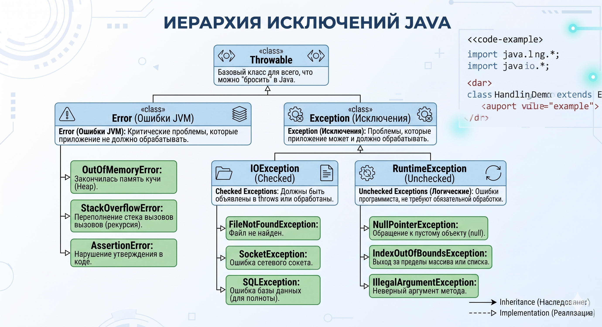

# Исключения (Exceptions)

Иерархия исключений, checked против unchecked, `try-catch-finally`, `try-with-resources`, свои исключения и антипаттерны. Чаще всего спрашивают разницу между checked и unchecked, когда не выполняется `finally` и почему в Spring принято бросать `RuntimeException`.

## Иерархия { #hierarchy }

### Как устроена иерархия исключений? { #throwable }

**Уровень:** Junior

!!! abstract "Ответ вслух"
    Всё начинается с `Throwable` — базового класса для всего, что можно бросить и поймать. От него две ветки: `Error` — критические сбои JVM, которые приложение обрабатывать не должно, и `Exception` — проблемы, которые можно и нужно обрабатывать. `RuntimeException` — особая ветка внутри `Exception`: это непроверяемые исключения.



Вся иерархия исключений в Java начинается с класса **`Throwable`** — базового для всего, что можно бросить (`throw`) и поймать (`catch`). От него отходят две принципиально разные ветки.

#### `Error` — ошибки JVM

`Error` — критические проблемы на уровне JVM или ОС, которые приложение **не должно** пытаться обработать. Когда возникает `Error`, JVM сигнализирует: «нормально продолжать работу я не могу». Ловить их через `try-catch` — плохая практика. Типичные представители:

- **`OutOfMemoryError`** — закончилась память. Подробно — в [JVM и память → OutOfMemoryError](jvm.md#oom).
- **`StackOverflowError`** — переполнение стека вызовов (бесконечная рекурсия).
- **`AssertionError`** — нарушено утверждение `assert` в коде.

#### `Exception` — наша зона ответственности

`Exception` — проблемы, которые приложение **может и должно** обрабатывать. Они делятся на два лагеря — [checked и unchecked](#checked-unchecked), и разница между ними — один из топ-вопросов на собесах.

```java
try {
    Integer.parseInt(input);
} catch (NumberFormatException e) { // ✅ конкретное исключение, которое умеем обработать
    System.out.println("Неверные данные: " + e.getMessage());
}
// catch (Throwable t) { ... }      // ❌ так поймаешь и Error — например, OutOfMemoryError
```

!!! warning "Ловушка: `catch (Throwable t)`"
    Такой блок ловит и `Error`, включая `OutOfMemoryError` и `StackOverflowError`, после которых состояние JVM непредсказуемо. Ловить `Throwable` оправдано только на самой верхней границе — например, чтобы залогировать падение потока.

??? question "Проверь себя"
    1. От какого класса наследуются все исключения?
    2. Чем `Error` отличается от `Exception`?
    3. Почему `catch (Throwable t)` — плохая идея?

### Чем checked-исключения отличаются от unchecked? { #checked-unchecked }

**Уровень:** Junior

!!! abstract "Ответ вслух"
    Checked — наследники `Exception`, кроме `RuntimeException`: компилятор требует их поймать или объявить в `throws`, это ожидаемые внешние проблемы вроде отсутствующего файла. Unchecked — наследники `RuntimeException`: обработку компилятор не требует, это обычно баги в логике — `null`, неверный аргумент, выход за границы.

#### Checked exceptions (проверяемые)

Наследники `Exception`, **кроме** `RuntimeException` и его потомков.

- **Правило:** компилятор **принудительно** требует обработки. Если метод может бросить checked exception, ты обязан либо обернуть вызов в `try-catch`, либо объявить исключение в сигнатуре через `throws`.
- **Философия:** это **ожидаемые внешние проблемы**, которые случаются не из-за бага в коде, а из-за внешнего мира. Файла может не быть, сеть может упасть, база может быть недоступна. Java предупреждает заранее: «подумай, что делать в этой ситуации».

Типичные представители:

- **`FileNotFoundException`** — файл не найден (ветка `IOException`).
- **`SocketException`** — ошибка сетевого соединения (ветка `IOException`).
- **`SQLException`** — ошибка при работе с базой данных. Это **не** потомок `IOException`: `SQLException` наследуется напрямую от `Exception`.

```java
// Компилятор не пустит без try-catch или throws
public void readFile(String path) throws IOException {
    FileReader reader = new FileReader(path); // бросает FileNotFoundException
}
```

#### Unchecked exceptions (непроверяемые)

Наследники **`RuntimeException`**.

- **Правило:** компилятор **не требует** обработки. Ловить их можно, но не обязательно.
- **Философия:** это **ошибки программиста** — баги в логике, которых не должно быть в нормальном коде: обращение к `null`, выход за пределы массива, неверный аргумент. Компилятор не может предусмотреть все такие случаи.

Типичные представители:

- **`NullPointerException`** — обращение к `null`-ссылке.
- **`IndexOutOfBoundsException`** — выход за пределы массива или списка.
- **`IllegalArgumentException`** — методу передан некорректный аргумент.
- **`IllegalStateException`** — метод вызван в неподходящем состоянии объекта.
- **`ClassCastException`** — некорректное приведение типов.
- **`ArithmeticException`** — например, целочисленное деление на ноль.

| | **Error** | **Checked Exception** | **Unchecked Exception** |
|---|---|---|---|
| **Базовый класс** | `Error` | `Exception` (не `RuntimeException`) | `RuntimeException` |
| **Причина** | Критический сбой JVM или ОС | Ожидаемая внешняя проблема | Баг в логике |
| **Компилятор требует обработки** | ❌ Нет | ✅ Да | ❌ Нет |
| **Ловить через `catch`** | Крайне редко | Да, обязательно | По необходимости |
| **Примеры** | `OutOfMemoryError`, `StackOverflowError` | `IOException`, `SQLException` | `NPE`, `IndexOutOfBoundsException` |

!!! warning "Ловушка: `catch (Exception e)` ловит и unchecked"
    `RuntimeException` — наследник `Exception`. Поэтому `catch (Exception e)` поймает и `NullPointerException`, и `IllegalArgumentException` — вместе с багами, которые лучше бы упали громко.

??? question "Проверь себя"
    1. Как по иерархии отличить checked-исключение от unchecked?
    2. Что компилятор требует сделать с checked-исключением?
    3. Наследует ли `SQLException` класс `IOException`?

## Обработка { #handling }

### Как работает `try-catch-finally`? { #try-catch }

**Уровень:** Junior

!!! abstract "Ответ вслух"
    В `try` — код, который может бросить исключение, в `catch` — обработка конкретных типов, в `finally` — код, который выполнится и при ошибке, и без неё. `catch`-блоки проверяются сверху вниз, поэтому частные исключения пишут раньше общих. Несколько несвязанных типов можно поймать одним `catch (A | B e)`.

```java
try {
    // код, который может бросить исключение
    String content = readFile("data.txt");
} catch (FileNotFoundException e) {
    // конкретная ошибка — обрабатываем первой
    log.error("Файл не найден: {}", e.getMessage());
} catch (IOException e) {
    // более широкая ошибка — обрабатываем второй
    log.error("Ошибка чтения: {}", e.getMessage());
} finally {
    // выполнится и при ошибке, и без неё
    closeResources();
}
```

С Java 7 несколько несвязанных исключений можно обработать одним блоком (multi-catch):

```java
try {
    Object plugin = Class.forName("com.example.Plugin").getDeclaredConstructor().newInstance();
} catch (ClassNotFoundException | NoSuchMethodException e) { // одна обработка для двух типов
    log.error("Плагин не найден", e);
} catch (ReflectiveOperationException e) {
    log.error("Не удалось создать плагин", e);
}
```

!!! warning "Ловушка: порядок `catch` имеет значение"
    Частные (дочерние) исключения должны идти **перед** общими (родительскими). Если поставить `catch (IOException e)` перед `catch (FileNotFoundException e)`, код не скомпилируется: второй блок недостижим.

??? question "Проверь себя"
    1. В каком порядке проверяются `catch`-блоки?
    2. Что будет, если поставить `catch (IOException e)` раньше `catch (FileNotFoundException e)`?
    3. Как поймать два несвязанных исключения одним блоком?

### Когда `finally` не выполняется? { #finally }

**Уровень:** Middle

!!! abstract "Ответ вслух"
    Почти никогда. `finally` не выполнится, если вызвать `System.exit()`, если процесс JVM умер — упала сама JVM или её убили через `kill -9`, — и если `try` никогда не завершится. При `OutOfMemoryError` `finally` выполняется — это обычный `Throwable`.

`finally` выполняется **почти всегда**: и при исключении, и при нормальном завершении, даже если в `try` или `catch` стоит `return` — JVM сначала выполнит `finally` и только потом выйдет из метода. Любимый вопрос-засыпка — когда это не так:

1. Если вызвать `System.exit(0)` — JVM завершается, не возвращаясь из вызова.
2. Если процесс JVM умер: падение самой JVM (crash), `kill -9`, отключение питания.
3. Если `try` никогда не завершится — бесконечный цикл внутри.

```java
static int compute() {
    try {
        return 1;
    } finally {
        System.out.println("finally выполнится до выхода из метода");
    }
}

static int swallow() {
    try {
        throw new IllegalStateException("потеряется");
    } finally {
        return 2; // ❌ return в finally молча проглатывает исключение из try
    }
}
```

!!! warning "Частая ошибка: `OutOfMemoryError`"
    При `OutOfMemoryError` `finally` **выполняется**. Это обычный `Error` — он летит вверх по стеку, как любое исключение, и по пути отрабатывают все `finally`. Так же `finally` отрабатывал при `Thread.stop()`: тот бросал в потоке `ThreadDeath` (а с Java 20 метод и вовсе кидает `UnsupportedOperationException`).

!!! warning "Ловушка: `return` внутри `finally`"
    `return` в `finally` перебивает и результат `try`, и брошенное в `try` исключение: метод `swallow()` выше вернёт `2`, а `IllegalStateException` бесследно исчезнет. В `finally` не пишут `return` и не бросают исключений.

??? question "Проверь себя"
    1. В каких трёх случаях `finally` не выполняется?
    2. Выполнится ли `finally` при `OutOfMemoryError`?
    3. Что вернёт метод с `return` в `finally`, если в `try` было брошено исключение?

### Что даёт `try-with-resources`? { #try-with-resources }

**Уровень:** Middle

!!! abstract "Ответ вслух"
    Это конструкция Java 7, которая сама вызывает `close()` у всех ресурсов, реализующих `AutoCloseable`, в обратном порядке, даже при исключении. Если упадёт и тело, и `close()`, исключение из `close()` не перетрёт основное, а добавится к нему как suppressed. В современном коде `finally` для закрытия ресурсов — антипаттерн.

Вместо ручного закрытия ресурсов в `finally` используй `try-with-resources`. Он автоматически вызывает `close()` у всех ресурсов, которые реализуют `AutoCloseable`.

```java
// ❌ Старый способ — многословный и опасный (можно забыть закрыть)
FileReader reader = null;
try {
    reader = new FileReader("data.txt");
    // ...
} finally {
    if (reader != null) reader.close(); // close() тоже может бросить — и перетереть исходную ошибку
}

// ✅ Современный способ — коротко и безопасно
try (FileReader fileReader = new FileReader("data.txt");
     BufferedReader br = new BufferedReader(fileReader)) {
    String line = br.readLine();
    // fileReader и br закроются автоматически в обратном порядке
}
```

Главный выигрыш — **suppressed-исключения**. В старом коде, если упало и тело, и `close()` в `finally`, наружу улетит ошибка из `close()`, а исходная потеряется. `try-with-resources` сохранит исходную и прикрепит к ней ошибку закрытия:

```java
class Resource implements AutoCloseable {
    @Override
    public void close() {
        throw new IllegalStateException("ошибка при закрытии");
    }
}

try (Resource r = new Resource()) {
    throw new RuntimeException("основная ошибка");
} catch (RuntimeException e) {
    System.out.println(e.getMessage());                    // основная ошибка
    System.out.println(e.getSuppressed()[0].getMessage()); // ошибка при закрытии
}
```

!!! tip "Правило"
    В современном коде `finally` для закрытия ресурсов — антипаттерн. Всегда используй `try-with-resources`.

!!! warning "Ловушка: ресурс без `AutoCloseable`"
    В `try (...)` можно объявлять только объекты, реализующие `AutoCloseable` (или `Closeable`). Свой класс-ресурс, который нужно закрывать, должен реализовать этот интерфейс — иначе код не скомпилируется.

??? question "Проверь себя"
    1. Какой интерфейс должен реализовать ресурс для `try-with-resources`?
    2. В каком порядке закрываются ресурсы?
    3. Что такое suppressed-исключение и чем оно лучше поведения ручного `finally`?

## Свои исключения { #custom }

### Когда создавать свои исключения и какие — checked или unchecked? { #custom-exceptions }

**Уровень:** Middle

!!! abstract "Ответ вслух"
    Свои исключения нужны, чтобы нести доменный смысл, добавить контекст вроде `orderId` и не пропускать инфраструктурные ошибки между слоями. Checked — когда вызывающий код обязан обработать ситуацию, unchecked — для багов и неожиданных состояний. В Spring-приложениях почти всегда выбирают unchecked.

Свои исключения нужны, когда хочешь:

1. **Нести доменный смысл** — `OrderNotFoundException` говорит больше, чем `RuntimeException("Order not found")`.
2. **Добавить контекст** — передать `orderId`, `userId` и другие данные для логирования.
3. **Разграничить слои** — не пропускать `SQLException` из репозитория в контроллер.

```java
// Checked — если вызывающий код ОБЯЗАН обработать этот случай
public class InsufficientFundsException extends Exception {
    private final BigDecimal required;
    private final BigDecimal available;

    public InsufficientFundsException(BigDecimal required, BigDecimal available) {
        super("Недостаточно средств: требуется %s, доступно %s"
              .formatted(required, available));
        this.required = required;
        this.available = available;
    }

    public BigDecimal getRequired() { return required; }
    public BigDecimal getAvailable() { return available; }
}

// Unchecked — если это баг или неожиданное состояние (Spring-стиль)
public class OrderNotFoundException extends RuntimeException {
    public OrderNotFoundException(Long orderId) {
        super("Заказ не найден: id=" + orderId);
    }
}
```

!!! note "Правило в Spring-приложениях"
    В Spring принято использовать **unchecked** исключения. Это убирает «шум» в сигнатурах методов и бесполезные `throws` на каждом уровне стека. Checked-исключения из JDK (вроде `IOException`) оборачиваются в unchecked на границе инфраструктурного слоя.

Как превратить такие исключения в HTTP-ответы через `@RestControllerAdvice` и `@ExceptionHandler` — в [Spring MVC → Обработка исключений](../spring/spring-mvc.md#exception-handling).

!!! warning "Ловушка: checked-исключение и `@Transactional`"
    По умолчанию Spring откатывает транзакцию только при unchecked-исключениях. Если сервис бросит checked `InsufficientFundsException`, транзакция закоммитится — нужен `@Transactional(rollbackFor = Exception.class)`. Подробно — в [Spring Data JPA](../spring/spring-data-jpa.md).

??? question "Проверь себя"
    1. Зачем создавать свои исключения вместо `RuntimeException("...")`?
    2. Когда своё исключение стоит сделать checked, а когда — unchecked?
    3. Почему в Spring-приложениях предпочитают unchecked-исключения?

### Какие антипаттерны встречаются при работе с исключениями? { #antipatterns }

**Уровень:** Middle

!!! abstract "Ответ вслух"
    Три главных: проглотить исключение пустым `catch`, залогировать и тут же пробросить — получив два стектрейса об одной ошибке, — и ловить `Exception` или `Throwable` без причины. Правильно — ловить конкретный тип, логировать один раз и оборачивать с контекстом, не теряя `cause`.

```java
// ❌ Глотать исключение — худший грех
void swallow() {
    try {
        riskyOperation();
    } catch (Exception e) {
        // ничего не делаем — баг навсегда скрыт
    }
}

// ❌ Логировать И пробрасывать — дублирование в логах
void logAndRethrow() throws Exception {
    try {
        riskyOperation();
    } catch (Exception e) {
        log.error("Ошибка", e);
        throw e; // в логах будет два стектрейса об одной ошибке
    }
}

// ❌ Ловить Exception или Throwable без причины — слишком широко, ловим всё подряд
void catchAll() {
    try {
        riskyOperation();
    } catch (Exception e) {
        log.warn("что-то пошло не так");
    }
}

// ✅ Ловить конкретное, логировать один раз, пробрасывать с контекстом
void wrap(Path path) {
    try {
        Files.readString(path);
    } catch (IOException e) {
        throw new FileProcessingException("Не удалось обработать файл: " + path, e);
    }
}
```

!!! warning "Никогда не теряй cause"
    При оборачивании исключения всегда передавай оригинал вторым аргументом: `new MyException("message", originalException)`. Иначе теряется стектрейс — и отладка превращается в детективное расследование.

??? question "Проверь себя"
    1. Почему пустой `catch` — худший антипаттерн?
    2. Что плохого в том, чтобы залогировать исключение и пробросить его дальше?
    3. Как правильно обернуть checked-исключение в unchecked?

## Шпаргалка { #cheatsheet }

| Тема | Запомнить |
|---|---|
| **Иерархия** | `Throwable` → `Error` (не трогаем) и `Exception` (обрабатываем) |
| **Checked** | Наследники `Exception` кроме `RuntimeException`; компилятор требует `catch` или `throws` |
| **Unchecked** | Наследники `RuntimeException`; обычно баги в логике |
| **`SQLException`** | Checked, наследует `Exception` напрямую, а не `IOException` |
| **Порядок `catch`** | Сначала частные, потом общие; multi-catch `A \| B` с Java 7 |
| **`finally`** | Не выполнится при `System.exit`, смерти процесса, бесконечном `try`; при OOM — выполнится |
| **`return` в `finally`** | Проглатывает исключение из `try` — так не пишут |
| **`try-with-resources`** | `AutoCloseable`, закрытие в обратном порядке, suppressed-исключения |
| **Свои исключения** | Доменный смысл и контекст; в Spring — unchecked |
| **Антипаттерны** | Пустой `catch`, лог + проброс, ловля `Exception` без причины, потерянный `cause` |
| **Spring** | `@RestControllerAdvice` и `@ExceptionHandler` — в [Spring MVC](../spring/spring-mvc.md#exception-handling) |
