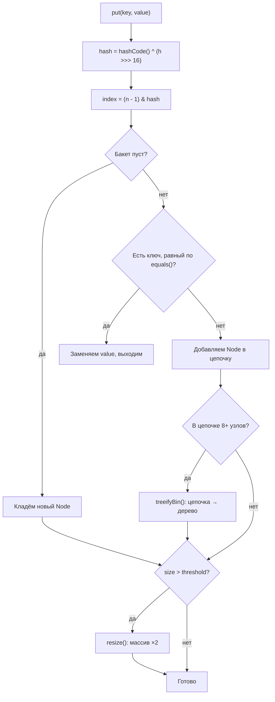
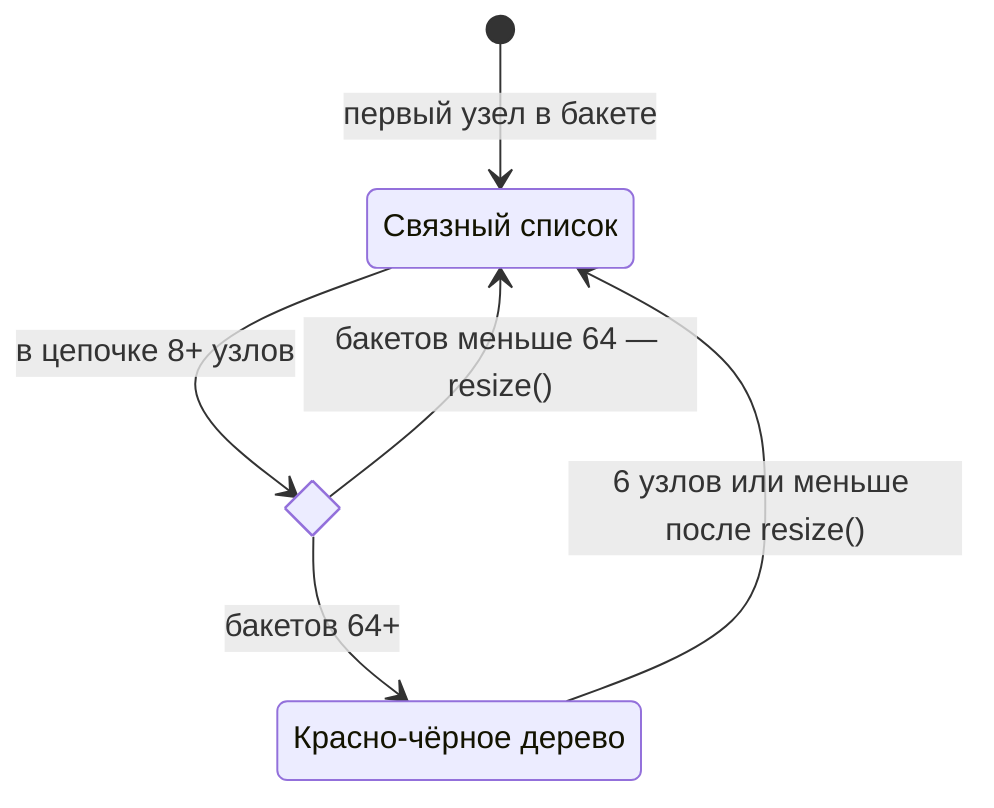

---
tags:
  - Junior
  - Middle
  - Java
---

# HashMap

Как `HashMap` устроена внутри: бакеты, индекс по хешу, коллизии, расширение и превращение бакета в дерево, а также чем от неё отличаются `LinkedHashMap` и `TreeMap`. Это самый частый вопрос блока коллекций: просят рассказать путь от `put()` до бакета и объяснить, почему ёмкость — степень двойки.

## HashMap { #hashmap }

### Как `HashMap` устроена внутри? { #hashmap-internals }

**Уровень:** Junior

!!! abstract "Ответ вслух"
    Внутри `HashMap` — массив бакетов, по умолчанию 16. В бакете лежат узлы `Node` с ключом, значением, хэшем ключа и ссылкой на следующий узел. Номер бакета вычисляется из `hashCode()` ключа, поэтому `get` и `put` в среднем работают за O(1).

Под капотом `HashMap` — **массив** объектов `Node<K, V>`. Каждая ячейка массива называется **бакетом (bucket)**, или корзиной.

- **Размер по умолчанию:** у `new HashMap<>()` 16 бакетов. Сам массив создаётся лениво — при первом `put()`.
- **Что хранит `Node`:** ключ (`key`), значение (`value`), хэш ключа (`hash`) и ссылку на следующий узел (`next`).

```java
// Узел HashMap (упрощённо)
static class Node<K, V> {
    final int hash;   // хэш ключа, посчитан один раз при вставке
    final K key;
    V value;
    Node<K, V> next;  // следующий узел в том же бакете

    Node(int hash, K key, V value, Node<K, V> next) {
        this.hash = hash;
        this.key = key;
        this.value = value;
        this.next = next;
    }
}
```

!!! warning "Ловушка: `null` в ключах и значениях"
    `HashMap` допускает один ключ `null` (он всегда лежит в бакете 0) и сколько угодно значений `null`. Из-за этого `map.get(key) == null` не отличает «ключа нет» от «значение — `null`»: для проверки есть `containsKey()`. А `ConcurrentHashMap` `null` не принимает вовсе — об этом [ниже](../concurrency/concurrent-collections.md#concurrenthashmap).

??? question "Проверь себя"
    1. Сколько бакетов у `new HashMap<>()` и когда создаётся массив?
    2. Какие поля хранит `Node`?
    3. Как отличить «ключа нет» от «значение — `null`»?

### Как `HashMap` находит бакет по ключу? { #bucket-index }

**Уровень:** Middle

!!! abstract "Ответ вслух"
    Берётся `hashCode()` ключа, старшие биты подмешиваются к младшим, а индекс считается как `(n - 1) & hash`. Побитовое И дешевле деления с остатком, но совпадает с `hash % n` только когда `n` — степень двойки. Поэтому ёмкость `HashMap` всегда степень двойки.

Что происходит при `map.put("First", "Developer")`:

1. **Хэш:** вызывается `hashCode()` у ключа `"First"`.
2. **Перемешивание:** внутренняя функция `hash()` подмешивает старшие биты к младшим, чтобы сгладить плохие реализации `hashCode()`.
3. **Индекс:** как получить число от 0 до 15?
    - _Наивный способ:_ `hash % 16` — деление, медленная операция.
    - _Как в Java на самом деле:_ `(n - 1) & hash` — **побитовое И**, одна дешёвая инструкция процессора.
    - _Почему размер всегда степень двойки:_ формула `(n - 1) & hash` работает корректно **только** когда `n` — степень двойки. Попросишь `new HashMap<>(20)` — Java округлит до 32.

```java
// HashMap.hash(): старшие 16 бит подмешиваются к младшим
static int hash(Object key) {
    int h;
    return (key == null) ? 0 : (h = key.hashCode()) ^ (h >>> 16);
}

int index = (n - 1) & hash; // n = 16 → берутся 4 младших бита хэша
```

Весь путь `put()` целиком:



!!! warning "Ловушка: остаток от деления даёт отрицательный индекс"
    `hashCode()` может быть отрицательным, и тогда `hash % n` вернёт отрицательное число — выход за границы массива. `(n - 1) & hash` всегда даёт число от 0 до `n - 1`. Это важно, если пишешь свою хэш-таблицу на собесе.

??? question "Проверь себя"
    1. Зачем `HashMap.hash()` делает `h ^ (h >>> 16)`?
    2. Почему ёмкость `HashMap` всегда степень двойки?
    3. Какой будет ёмкость у `new HashMap<>(20)`?

### Что происходит при коллизии? { #collisions }

**Уровень:** Middle

!!! abstract "Ответ вслух"
    Коллизия — это когда два разных ключа попали в один бакет. Java решает её методом цепочек: узлы бакета связываются в список. При поиске `HashMap` идёт по цепочке и сравнивает ключи сначала по хэшу, потом через `equals()`.

Если два ключа получают одинаковый индекс — это **коллизия**. Она решается методом цепочек (separate chaining): новый `Node` прикрепляется к старому, и внутри бакета получается **связный список**.

При `get(key)`: вычисляется индекс → переход в бакет → если там цепочка, каждый узел сравнивается с ключом, пока не найдётся совпадение.

```java
// Как get() ищет ключ внутри бакета (упрощённо)
for (Node<K, V> e = table[index]; e != null; e = e.next) {
    if (e.hash == hash && (e.key == key || key.equals(e.key))) {
        return e.value; // сначала дешёвое сравнение хэшей, потом equals()
    }
}
return null;
```

!!! warning "Ловушка: длинные цепочки убивают O(1)"
    Чем больше коллизий, тем длиннее цепочки, и поиск в бакете деградирует до O(n). Спасают хороший `hashCode()` и деревья в бакетах с Java 8 — [ниже](#treeify).

??? question "Проверь себя"
    1. Что такое коллизия и как `HashMap` её разрешает?
    2. В каком порядке `get()` сравнивает ключи внутри бакета и почему?
    3. Во что превращается сложность поиска, если все ключи попали в один бакет?

### Когда `HashMap` расширяется? { #rehashing }

**Уровень:** Middle

!!! abstract "Ответ вслух"
    Когда число элементов превышает порог `capacity × loadFactor` — по умолчанию `16 × 0.75 = 12`. На 13-м элементе создаётся массив вдвое больше, и все элементы перекладываются по новым индексам. Это rehashing, он стоит O(n).

Бесконечно накапливать элементы в 16 бакетах нельзя — цепочки вырастут, и поиск замедлится.

- **Load factor (коэффициент загрузки)** = `0.75` по умолчанию — баланс между памятью и скоростью.
- **Threshold (порог)** = `capacity × loadFactor` = `16 × 0.75 = 12`.
- **Rehashing:** при добавлении 13-го элемента:
    1. Создаётся новый массив **в 2 раза больше** (32 бакета).
    2. Все элементы пересчитывают свои индексы и перекладываются.

```java
Map<String, User> users = new HashMap<>(135_000);      // ёмкость с запасом: 100_000 / 0.75 ≈ 133_334
Map<String, User> same  = HashMap.newHashMap(100_000); // Java 19+: ёмкость под 100_000 элементов посчитается сама
```

!!! warning "Ловушка производительности: rehashing"
    Rehashing — **тяжёлая операция**, O(n) на каждое расширение. Если заполнять `new HashMap<>()` до 100 000 элементов, она перестроится 14 раз. Знаешь примерное количество элементов — задай начальный размер сразу.

!!! warning "Ловушка: ёмкость — это не количество элементов"
    `new HashMap<>(100_000)` всё равно расширится один раз: ёмкость округлится до 131 072, а порог будет `131 072 × 0.75 = 98 304` — меньше 100 000. Передавай ёмкость с учётом load factor или используй `HashMap.newHashMap(100_000)` из Java 19.

??? question "Проверь себя"
    1. Что такое load factor и threshold? Чему они равны по умолчанию?
    2. На каком элементе `new HashMap<>()` впервые расширится и что при этом происходит?
    3. Почему `new HashMap<>(100_000)` не спасает от расширения при 100 000 элементов?

### Зачем в Java 8 бакеты превращаются в деревья? { #treeify }

**Уровень:** Senior

!!! abstract "Ответ вслух"
    Чтобы поиск не деградировал до O(n) при массовых коллизиях. Когда в бакете набирается 8 узлов, а в таблице не меньше 64 бакетов, цепочка превращается в красно-чёрное дерево, и поиск в бакете идёт за O(log n). Когда узлов становится 6 или меньше, дерево снова превращается в список.

До Java 8 при массовых коллизиях (все элементы в одном бакете) мапа вырождалась в длинный список, и поиск падал до O(n). На этом строились **HashDoS-атаки**: злоумышленник слал запросы с ключами, у которых одинаковый хэш. Процессор загружался на 100%, приложение переставало отвечать.

Подобрать такие ключи легко — у строк `"Aa"` и `"BB"` одинаковый хэш, а из них склеиваются сколько угодно новых:

```java
System.out.println("Aa".hashCode());                        // 2112
System.out.println("BB".hashCode());                        // 2112 — коллизия
System.out.println("AaBB".hashCode() == "BBAa".hashCode()); // true: склейки из коллизий тоже коллизии
```

**Решение в Java 8:** если цепочка в бакете вырастает до **8 узлов**, а в таблице **не меньше 64 бакетов**, бакет превращается в **красно-чёрное дерево (red-black tree)**. Если бакетов меньше 64, вместо дерева `HashMap` просто расширяется.

- Поиск в дереве — **O(log n)**: миллион элементов в одном бакете — это 20 шагов вместо миллиона.
- Обратно в список бакет превращается, когда в нём остаётся **6 узлов или меньше** (проверяется при `resize()`). Узлы дерева тяжелее, и маленькое дерево не окупается.



!!! warning "Ловушка: дерево полностью помогает только `Comparable`-ключам"
    Внутри дерева узлы упорядочиваются по хэшу, а при равных хэшах — через `compareTo()`, если ключи `Comparable`. Если ключи не `Comparable`, при одинаковом хэше `HashMap` может обходить оба поддерева, и поиск снова приближается к O(n). У `String` всё в порядке — строки `Comparable`.

??? question "Проверь себя"
    1. При каких двух условиях бакет превращается в дерево?
    2. Что такое HashDoS-атака и как Java 8 от неё защищает?
    3. Почему дерево слабо помогает, если ключи не реализуют `Comparable`?

### `HashMap`, `LinkedHashMap` или `TreeMap`? { #map-choice }

**Уровень:** Junior

!!! abstract "Ответ вслух"
    `HashMap` — выбор по умолчанию: O(1), порядок не гарантирован. `LinkedHashMap` дополнительно помнит порядок добавления (или доступа — на этом строят LRU-кэш). `TreeMap` хранит ключи отсортированными, но операции стоят O(log n).

| **Характеристика** | **HashMap** | **LinkedHashMap** | **TreeMap** |
|---|---|---|---|
| **Сложность (put/get)** | **O(1)** — самая быстрая | O(1) | O(log n) — медленнее |
| **Порядок элементов** | Не гарантирован | **Порядок добавления** (или доступа) | **Отсортированы по ключу** |
| **Внутреннее устройство** | Массив + списки/деревья | Массив + двусвязный список | Только красно-чёрное дерево |
| **Когда использовать** | В 95% случаев | LRU-кэш, сохранение хронологии | Вывод ключей по алфавиту или возрастанию |

LRU-кэш на `LinkedHashMap` — частая задача на собесе:

```java
// LRU-кэш: порядок доступа + вытеснение самой давней записи
class LruCache<K, V> extends LinkedHashMap<K, V> {
    private final int capacity;

    LruCache(int capacity) {
        super(16, 0.75f, true); // true — порядок доступа, а не добавления
        this.capacity = capacity;
    }

    @Override
    protected boolean removeEldestEntry(Map.Entry<K, V> eldest) {
        return size() > capacity; // переполнились — выбрасываем самую давнюю запись
    }
}
```

!!! warning "Ловушка: не полагайся на порядок `HashMap`"
    Порядок обхода `HashMap` зависит от хэшей и ёмкости. Он может измениться после расширения таблицы или при смене версии JDK. Нужен порядок — бери `LinkedHashMap` или `TreeMap`.

??? question "Проверь себя"
    1. Чем `LinkedHashMap` отличается от `HashMap` внутри?
    2. Как сделать LRU-кэш на `LinkedHashMap`?
    3. Когда стоит выбрать `TreeMap`, несмотря на O(log n)?

## Шпаргалка { #cheatsheet }

<!-- --8<-- [start:cheatsheet] -->
| Тема | Запомнить |
|---|---|
| **`HashMap`** | 16 бакетов, индекс `(n - 1) & hash`, ёмкость — степень двойки |
| **Коллизии** | Цепочка в бакете; с Java 8 — дерево при 8+ узлах и 64+ бакетах, обратно при ≤ 6 |
| **Rehashing** | Порог `capacity × 0.75`; расширение ×2 за O(n). Размер заранее — `HashMap.newHashMap(n)` |
| **`LinkedHashMap` / `TreeMap`** | Порядок добавления или доступа (LRU) / сортировка по ключу за O(log n) |

<!-- --8<-- [end:cheatsheet] -->
