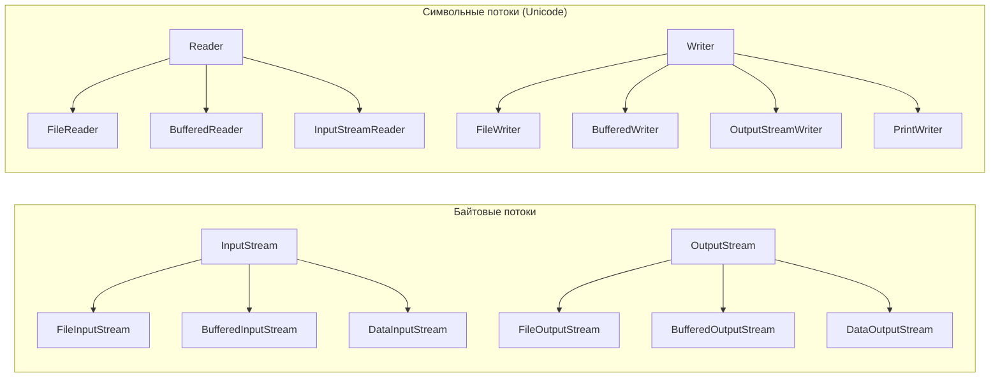

---
tags:
  - Junior
  - Middle
  - Java
---

# IO / NIO — работа с файлами

Два поколения API для файлов и потоков данных: классический `java.io` и современный `java.nio.file`. Чаще всего спрашивают разницу между байтовыми и символьными потоками, зачем нужны `Buffered`-классы, чем `Path` и `Files` лучше `File` и как прочитать файл, который не помещается в память.

## java.io и java.nio { #io-vs-nio }

### Чем `java.io` отличается от `java.nio`? { #io-vs-nio-diff }

**Уровень:** Junior

!!! abstract "Ответ вслух"
    `java.io` (Java 1.0) работает с потоками байт и символов и всегда блокирует поток выполнения. `java.nio` (Java 1.4) добавил буферы, каналы и неблокирующий ввод-вывод, а `java.nio.file` (Java 7) — современный API `Path` и `Files`. В новом коде для файлов используют `Path` и `Files`.

| | **java.io** (классика, Java 1.0) | **java.nio** / **java.nio.file** (Java 1.4 / Java 7) |
|---|---|---|
| **Модель** | Потоки байт и символов (streams) | Блоки данных (buffers, channels) + Path API |
| **Блокировка** | Блокирующая (поток ждёт) | Блокирующая и неблокирующая |
| **Работа с файлами** | `File` — устаревший класс | `Path` + `Files` — современный API |
| **Удобство** | Многословно, много кода | Лаконично, богатый функционал |
| **Когда использовать** | Редко в новом коде | **Всегда в современном коде** |

```java
File legacy = new File("data.txt");   // java.io — устаревший способ
Path modern = Path.of("data.txt");    // java.nio.file — современный
Path converted = legacy.toPath();     // мост между мирами для старых API
```

!!! warning "Ловушка: `File` молча возвращает `false`"
    `new File("x.txt").delete()` при ошибке просто вернёт `false` — без причины. `Files.delete(path)` бросит исключение с объяснением: `NoSuchFileException`, `AccessDeniedException`, `DirectoryNotEmptyException`. Это одна из главных причин перейти на `Files`.

??? question "Проверь себя"
    1. Чем модель `java.io` отличается от модели `java.nio`?
    2. Какой API использовать для работы с файлами в новом коде?
    3. Почему `File.delete()` хуже `Files.delete()`?

## java.io { #java-io }

### Как устроены потоки `java.io`? { #io-streams }

**Уровень:** Junior

!!! abstract "Ответ вслух"
    Есть две иерархии: байтовые потоки `InputStream`/`OutputStream` для бинарных данных и символьные `Reader`/`Writer` для текста с учётом кодировки. Мост между ними — `InputStreamReader` и `OutputStreamWriter`. Байтовые потоки — для картинок, архивов и сериализации, символьные — для текстовых файлов.



```java
try (InputStream in = new FileInputStream("photo.png")) {        // байты — бинарные данные
    byte[] header = in.readNBytes(8);
}
try (Reader reader = new FileReader("notes.txt", UTF_8)) {      // символы — текст в кодировке
    int firstChar = reader.read();
}
```

!!! tip "Байты vs символы"
    Используй байтовые потоки (`InputStream`/`OutputStream`) для бинарных данных: изображений, архивов, сериализации. Символьные (`Reader`/`Writer`) — для текстовых файлов: они корректно обрабатывают кодировки.

!!! warning "Ловушка: читать текст байтами"
    Если читать UTF-8 текст байтовым потоком и превращать каждый байт в `char`, кириллица и эмодзи превратятся в мусор: один символ занимает 2–4 байта. Для текста нужен `Reader` с явной кодировкой.

??? question "Проверь себя"
    1. Какие две иерархии потоков есть в `java.io`?
    2. Какой класс соединяет байтовые и символьные потоки?
    3. Почему текст нельзя читать по одному байту?

### Как в `java.io` используется паттерн Декоратор? { #io-decorator }

**Уровень:** Middle

!!! abstract "Ответ вслух"
    Каждый поток оборачивает другой и добавляет одну способность: `FileInputStream` читает байты, `InputStreamReader` декодирует их в символы, `BufferedReader` буферизирует и даёт `readLine()`. Это классический Декоратор. Кодировку нужно указывать явно, а не полагаться на значение по умолчанию.

Всё IO API построено на паттерне [Декоратор](patterns.md#decorator): потоки оборачиваются друг в друга, и каждый слой добавляет свою способность.

```java
// Читаем текстовый файл построчно через цепочку декораторов
try (BufferedReader reader = new BufferedReader(
        new InputStreamReader(
            new FileInputStream("data.txt"),
            StandardCharsets.UTF_8))) {     // явно задаём кодировку!

    String line;
    while ((line = reader.readLine()) != null) {
        System.out.println(line);
    }
}
// FileInputStream      — читает байты из файла
// InputStreamReader    — декодирует байты в символы (кодировка)
// BufferedReader       — буферизирует, добавляет readLine()
```

Закрывать такие цепочки нужно через `try-with-resources`: при закрытии внешнего декоратора закрываются и все вложенные потоки. Подробно — в [Исключения → try-with-resources](exceptions.md#try-with-resources).

!!! warning "Всегда явно указывай кодировку"
    До Java 18 `new FileReader("file.txt")` брал системную кодировку по умолчанию, а она на разных машинах разная (Windows-1251, UTF-8…). С Java 18 ([JEP 400](https://openjdk.org/jeps/400)) по умолчанию UTF-8, но флаг `-Dfile.encoding=COMPAT` и старые JDK возвращают прежнее поведение. Передавай `StandardCharsets.UTF_8` явно — код не будет зависеть от окружения.

??? question "Проверь себя"
    1. Какую способность добавляет каждый слой в цепочке `BufferedReader` → `InputStreamReader` → `FileInputStream`?
    2. Как этот подход связан с паттерном Декоратор?
    3. Какая кодировка используется по умолчанию начиная с Java 18?

### Зачем нужны `Buffered`-потоки? { #buffered }

**Уровень:** Middle

!!! abstract "Ответ вслух"
    Без буфера каждый `read()` — отдельный системный вызов к ОС, и чтение большого файла по байту превращается в миллионы дорогих вызовов. `BufferedInputStream` читает блоками (8 КБ по умолчанию) и отдаёт данные из памяти. Ещё лучше читать сразу в свой массив через `read(byte[])`.

```java
// ❌ Без буфера — каждый вызов read() = системный вызов к ОС
try (FileInputStream slow = new FileInputStream("big.txt")) {
    int b;
    while ((b = slow.read()) != -1) { // миллионы системных вызовов!
        process(b);
    }
}

// ✅ BufferedInputStream читает блоками (8 КБ по умолчанию)
// Системных вызовов в тысячи раз меньше
try (BufferedInputStream fast = new BufferedInputStream(
        new FileInputStream("big.txt"), 16384)) { // буфер 16 КБ

    byte[] buffer = new byte[4096];
    int bytesRead;
    while ((bytesRead = fast.read(buffer)) != -1) {
        process(buffer, bytesRead);
    }
}
```

!!! warning "Ловушка: забыть `flush()` у `BufferedWriter`"
    Буферизированный вывод копит данные в памяти и пишет на диск, только когда буфер заполнен или поток закрыт. Если не закрыть `BufferedWriter` (или не вызвать `flush()`), последние данные не попадут в файл. `try-with-resources` решает это автоматически.

??? question "Проверь себя"
    1. Почему чтение по одному байту без буфера медленное?
    2. Какой размер буфера у `BufferedInputStream` по умолчанию?
    3. Что будет, если не закрыть `BufferedWriter`?

## java.nio.file { #nio }

### Чем `Path` лучше `File`? { #path }

**Уровень:** Junior

!!! abstract "Ответ вслух"
    `Path` — неизменяемое представление пути с удобными операциями: `getParent()`, `resolve()`, `relativize()`, `normalize()`. Эти операции работают только со строкой пути и не трогают файловую систему. Работу с самими файлами берёт на себя утилитный класс `Files`.

`Path` и `Files` — то, что нужно использовать в любом новом коде.

```java
// Создание Path
Path absolute = Path.of("/home/user/documents/report.pdf");
Path relative = Path.of("src", "main", "resources", "config.yml");

// Операции с путями — без обращения к файловой системе
Path parent   = absolute.getParent();      // /home/user/documents
Path fileName = absolute.getFileName();    // report.pdf
String ext    = absolute.toString()
    .substring(absolute.toString().lastIndexOf('.') + 1); // pdf

// Построение пути
Path config = Path.of("src").resolve("main").resolve("config.yml");

// Относительный путь между двумя точками
Path from = Path.of("/home/user");
Path to   = Path.of("/home/user/docs/file.txt");
Path rel  = from.relativize(to); // docs/file.txt

// Нормализация (убирает . и ..)
Path messy = Path.of("/home/user/../user/./docs");
Path clean = messy.normalize(); // /home/user/docs
```

!!! warning "Ловушка: `Path` не значит, что файл существует"
    `Path.of("x.txt")` не проверяет, есть ли такой файл. Ошибка вылетит только при обращении к файловой системе — например, в `Files.readString()`. Проверить заранее можно через `Files.exists()`.

??? question "Проверь себя"
    1. Обращается ли `Path.of()` к файловой системе?
    2. Что делают `resolve()`, `relativize()` и `normalize()`?
    3. Как получить имя файла и родительскую папку из `Path`?

### Как читать и писать файлы через `Files`? { #files-read-write }

**Уровень:** Junior

!!! abstract "Ответ вслух"
    Маленькие файлы читают целиком: `Files.readString()`, `readAllLines()`, `readAllBytes()`. Большие — лениво, через `Files.lines()` в `try-with-resources`, чтобы в памяти была только текущая строка. Писать — через `Files.writeString()` и `Files.write()`, для дозаписи передают `StandardOpenOption.APPEND`.

```java
// === Чтение ===

// Весь файл в строку (маленькие файлы)
String content = Files.readString(Path.of("config.txt"), StandardCharsets.UTF_8);

// Все строки в список (маленькие файлы)
List<String> lines = Files.readAllLines(Path.of("data.csv"), StandardCharsets.UTF_8);

// Все байты
byte[] bytes = Files.readAllBytes(Path.of("image.png"));

// Стрим строк — ленивый, подходит для больших файлов
try (Stream<String> stream = Files.lines(Path.of("big.log"), StandardCharsets.UTF_8)) {
    long errorCount = stream
        .filter(line -> line.contains("ERROR"))
        .count();
}

// === Запись ===

// Записать строку (перезапись)
Files.writeString(Path.of("output.txt"), "Hello, World!", StandardCharsets.UTF_8);

// Записать строку (дозапись)
Files.writeString(
    Path.of("log.txt"),
    "New line\n",
    StandardCharsets.UTF_8,
    StandardOpenOption.APPEND, StandardOpenOption.CREATE
);

// Записать строки
List<String> lines2 = List.of("line1", "line2", "line3");
Files.write(Path.of("output.txt"), lines2, StandardCharsets.UTF_8);

// Записать байты
Files.write(Path.of("image.png"), imageBytes);
```

!!! warning "Ловушка: `readAllLines` на большом файле"
    `readAllLines` и `readString` загружают файл в память целиком — на логе в 10 ГБ получишь `OutOfMemoryError`. Для больших файлов — `Files.lines()`: в памяти одновременно только несколько строк.

    ```java
    // ❌ readAllLines загружает весь файл в память
    List<String> all = Files.readAllLines(hugePath); // OutOfMemoryError на файле в 10 ГБ!

    // ✅ Files.lines — ленивый стрим, читает построчно
    long count;
    try (Stream<String> logLines = Files.lines(hugePath, StandardCharsets.UTF_8)) {
        count = logLines
            .filter(line -> line.contains("CRITICAL"))
            .count();
    }
    ```

!!! warning "Ловушка: `Files.lines()` без `try-with-resources`"
    `Files.lines()` держит открытый файловый дескриптор, пока стрим не закрыт. Без `try-with-resources` дескрипторы утекают, и под нагрузкой приложение упрётся в `Too many open files`.

??? question "Проверь себя"
    1. Чем `Files.readAllLines()` отличается от `Files.lines()`?
    2. Как дописать строку в конец файла?
    3. Почему `Files.lines()` нужно закрывать?

### Какие операции с файлами и директориями есть в `Files`? { #files-ops }

**Уровень:** Junior

!!! abstract "Ответ вслух"
    Проверки — `exists`, `isDirectory`, `size`; создание — `createFile`, `createDirectories`; копирование и перемещение — `copy`, `move` с опцией `REPLACE_EXISTING`; удаление — `delete` и `deleteIfExists`. Плюс временные файлы и папки через `createTempFile` и `createTempDirectory`.

```java
Path src  = Path.of("source.txt");
Path dest = Path.of("backup/source.txt");

// Проверки
boolean exists   = Files.exists(src);       // существует?
boolean isDir    = Files.isDirectory(src);  // это папка?
boolean readable = Files.isReadable(src);   // можно читать?
long size        = Files.size(src);         // размер в байтах

// Создание
Files.createFile(Path.of("new.txt"));
Files.createDirectory(Path.of("newdir"));
Files.createDirectories(Path.of("a/b/c/d")); // создаёт всю цепочку

// Копирование / перемещение
Files.copy(src, dest);
Files.copy(src, dest, StandardCopyOption.REPLACE_EXISTING); // перезаписать, если есть
Files.move(src, dest, StandardCopyOption.REPLACE_EXISTING);

// Удаление
Files.delete(src);          // бросает исключение, если файла нет
Files.deleteIfExists(src);  // тихо, если нет

// Временные файлы и папки
Path tmpFile = Files.createTempFile("prefix", ".tmp");
Path tmpDir  = Files.createTempDirectory("work");
```

!!! warning "Ловушка: `copy` и `move` без опций"
    По умолчанию `Files.copy()` и `Files.move()` бросают `FileAlreadyExistsException`, если цель уже есть. Перезапись нужно разрешить явно — `StandardCopyOption.REPLACE_EXISTING`.

??? question "Проверь себя"
    1. Чем `createDirectory` отличается от `createDirectories`?
    2. Что будет, если скопировать файл поверх существующего без опций?
    3. Чем `delete` отличается от `deleteIfExists`?

### Как обойти директорию? { #walk }

**Уровень:** Middle

!!! abstract "Ответ вслух"
    `Files.list()` — содержимое одной папки, `Files.walk()` — рекурсивный обход с ограничением глубины, `Files.find()` — поиск с фильтром по пути и атрибутам. Все три возвращают ленивые стримы, которые держат открытые дескрипторы, поэтому их всегда закрывают через `try-with-resources`.

```java
// Список файлов в директории (не рекурсивно)
try (Stream<Path> entries = Files.list(Path.of("src/main"))) {
    entries
        .filter(Files::isRegularFile)
        .forEach(System.out::println);
}

// Рекурсивный обход (walk)
try (Stream<Path> tree = Files.walk(Path.of("src"), 3)) { // глубина 3
    List<Path> javaFiles = tree
        .filter(p -> p.toString().endsWith(".java"))
        .collect(Collectors.toList());
}

// Поиск файлов по условию
try (Stream<Path> found = Files.find(
        Path.of("logs"),
        Integer.MAX_VALUE,
        (path, attrs) -> attrs.isRegularFile()
            && path.getFileName().toString().startsWith("error")
            && attrs.size() > 1024)) {

    found.forEach(System.out::println);
}

// Удалить директорию со всем содержимым
try (Stream<Path> toDelete = Files.walk(Path.of("temp"))) {
    toDelete
        .sorted(Comparator.reverseOrder()) // сначала вложенные, потом папки
        .forEach(p -> {
            try { Files.delete(p); }
            catch (IOException e) { throw new UncheckedIOException(e); }
        });
}
```

!!! warning "Ловушка: `Files.walk()` без закрытия"
    Стрим из `Files.walk()` держит открытые дескрипторы директорий. Удаление папки через `Files.walk(...).sorted().forEach(...)` без `try-with-resources` — частая утечка. Лямбда внутри `forEach` не может бросить `IOException`, поэтому его заворачивают в `UncheckedIOException`.

??? question "Проверь себя"
    1. Чем `Files.list()` отличается от `Files.walk()`?
    2. Почему при удалении директории элементы сортируют в обратном порядке?
    3. Зачем закрывать стрим из `Files.walk()`?

### Как читать атрибуты файла? { #attributes }

**Уровень:** Middle

!!! abstract "Ответ вслух"
    Через `Files.readAttributes(path, BasicFileAttributes.class)` — время создания и изменения, размер, тип — за одно обращение к файловой системе. Менять отдельные атрибуты можно методами вроде `Files.setLastModifiedTime()`. Для атрибутов конкретной ОС есть `PosixFileAttributes` и `DosFileAttributes`.

```java
Path file = Path.of("report.pdf");

// Базовые атрибуты — одним обращением к файловой системе
BasicFileAttributes attrs = Files.readAttributes(file, BasicFileAttributes.class);
FileTime created  = attrs.creationTime();     // время создания
FileTime modified = attrs.lastModifiedTime(); // время изменения
long size         = attrs.size();             // размер
boolean isDir     = attrs.isDirectory();

// Установить время изменения
Files.setLastModifiedTime(file, FileTime.from(Instant.now()));
```

!!! warning "Ловушка: `creationTime()` есть не везде"
    Не все файловые системы хранят время создания. Там, где его нет, `creationTime()` вернёт время последнего изменения или другое значение по умолчанию — не стоит строить на нём бизнес-логику.

??? question "Проверь себя"
    1. Как прочитать базовые атрибуты файла одним вызовом?
    2. Как изменить время последней модификации файла?
    3. Почему на `creationTime()` нельзя полагаться на всех ОС?

## Практические задачи { #practice }

### Как обработать большой CSV построчно? { #big-files }

**Уровень:** Middle

!!! abstract "Ответ вслух"
    Читать через `Files.newBufferedReader()` в `try-with-resources` и разбирать строку за строкой, а не загружать файл целиком. Писать результат — через `Files.newBufferedWriter()`, который сам сбросит буфер и закроет файл при выходе из блока.

#### Чтение с `BufferedReader` { #csv-read }

```java
try (BufferedReader reader = Files.newBufferedReader(
        Path.of("data.csv"), StandardCharsets.UTF_8)) {

    reader.readLine(); // пропускаем заголовок

    String line;
    while ((line = reader.readLine()) != null) {
        String[] parts = line.split(",");
        processRow(parts);
    }
}
```

#### Запись с `BufferedWriter` { #csv-write }

```java
try (BufferedWriter writer = Files.newBufferedWriter(
        Path.of("output.csv"),
        StandardCharsets.UTF_8,
        StandardOpenOption.CREATE,
        StandardOpenOption.TRUNCATE_EXISTING)) {

    writer.write("id,name,age");
    writer.newLine();

    for (User user : users) {
        writer.write(user.getId() + "," + user.getName() + "," + user.getAge());
        writer.newLine();
    }
} // flush и close — автоматически
```

!!! warning "Ловушка: `split(\",\")` для настоящего CSV"
    `line.split(",")` ломается на значениях с запятой внутри кавычек (`"Иванов, Иван"`) и молча отбрасывает пустые хвостовые поля. Для реальных CSV используй библиотеку (OpenCSV, Apache Commons CSV) или `split(",", -1)` хотя бы для пустых полей.

??? question "Проверь себя"
    1. Как прочитать большой CSV, не загружая его целиком в память?
    2. Зачем при записи передавать `TRUNCATE_EXISTING`?
    3. Чем опасен `split(",")` для CSV?

### Как скопировать файл? { #copy }

**Уровень:** Junior

!!! abstract "Ответ вслух"
    Проще всего — `Files.copy(src, dest, REPLACE_EXISTING)`. Если копировать нужно между потоками, есть `InputStream.transferTo()` (Java 9). А если нужен контроль — например, показывать прогресс, — копируют вручную буфером через `read(byte[])` и `write()`.

```java
// 1. Одной строкой
Files.copy(Path.of("input.txt"), Path.of("output.txt"), StandardCopyOption.REPLACE_EXISTING);

// 2. Между потоками — transferTo (Java 9+)
try (var fis = new FileInputStream("input.txt");
     var fos = new FileOutputStream("output.txt")) {
    fis.transferTo(fos);
}
```

```java
// 3. Вручную — с прогрессом
public void copyWithProgress(Path src, Path dest) throws IOException {
    long totalSize = Files.size(src);
    long copied = 0;

    try (InputStream in  = new BufferedInputStream(Files.newInputStream(src));
         OutputStream out = new BufferedOutputStream(Files.newOutputStream(dest))) {

        byte[] buffer = new byte[8192];
        int bytesRead;

        while ((bytesRead = in.read(buffer)) != -1) {
            out.write(buffer, 0, bytesRead);
            copied += bytesRead;
            System.out.printf("%.1f%%%n", (double) copied / totalSize * 100);
        }
    }
}
```

!!! warning "Ловушка: `out.write(buffer)` вместо `write(buffer, 0, bytesRead)`"
    Последний `read()` обычно заполняет буфер не целиком. `out.write(buffer)` допишет в файл хвост из прошлой итерации, и копия окажется длиннее и битой. Всегда пиши ровно `bytesRead` байт.

??? question "Проверь себя"
    1. Назови три способа скопировать файл.
    2. Что делает `InputStream.transferTo()` и с какой версии он есть?
    3. Почему при ручном копировании нужен `write(buffer, 0, bytesRead)`?

### Как работать с properties-файлами? { #properties }

**Уровень:** Junior

!!! abstract "Ответ вслух"
    Через класс `Properties`: `load()` читает пары `ключ=значение` из потока, `getProperty()` возвращает значение с необязательным дефолтом, `store()` записывает обратно. Поток открывают через `Files.newInputStream()` и закрывают через `try-with-resources`.

```java
// Чтение
Properties props = new Properties();
try (InputStream in = Files.newInputStream(Path.of("app.properties"))) {
    props.load(in);
}
String host = props.getProperty("db.host", "localhost"); // с дефолтом

// Запись
props.setProperty("db.port", "5432");
try (OutputStream out = Files.newOutputStream(Path.of("app.properties"))) {
    props.store(out, "Application config");
}
```

!!! warning "Ловушка: кодировка в `load(InputStream)`"
    `load(InputStream)` читает файл в ISO-8859-1: кириллица превратится в мусор. Для текста в UTF-8 загружай через `Reader`: `props.load(Files.newBufferedReader(path, UTF_8))`.

??? question "Проверь себя"
    1. Как прочитать значение из properties-файла с дефолтом?
    2. Как сохранить изменённые свойства обратно в файл?
    3. Почему кириллица ломается в `load(InputStream)`?

## Шпаргалка { #cheatsheet }

<!-- --8<-- [start:cheatsheet] -->
| Задача | Рекомендуемый способ |
|---|---|
| Прочитать небольшой текстовый файл целиком | `Files.readString(path, UTF_8)` |
| Прочитать небольшой файл построчно в список | `Files.readAllLines(path, UTF_8)` |
| Обработать большой файл построчно | `Files.lines(path)` в try-with-resources |
| Прочитать бинарный файл | `Files.readAllBytes(path)` |
| Записать строку в файл | `Files.writeString(path, text, UTF_8)` |
| Дозаписать в файл | `Files.writeString(path, text, UTF_8, APPEND, CREATE)` |
| Копировать файл | `Files.copy(src, dest, REPLACE_EXISTING)` |
| Создать директории рекурсивно | `Files.createDirectories(path)` |
| Обойти директорию рекурсивно | `Files.walk(path)` в try-with-resources |
| Работа с кастомной логикой парсинга | `Files.newBufferedReader(path, UTF_8)` |
| Построчная запись | `Files.newBufferedWriter(path, UTF_8)` |
| Байты против символов | `InputStream`/`OutputStream` — бинарное, `Reader`/`Writer` — текст |
| Кодировка | Всегда явно `StandardCharsets.UTF_8`; по умолчанию UTF-8 только с Java 18 |

!!! tip "Правило большого пальца"
    Если нужна простая операция — `Files.*`. Если нужен контроль над буфером, кодировкой или построчной обработкой — `Files.newBufferedReader` / `Files.newBufferedWriter`. `FileInputStream`/`FileOutputStream` напрямую — только для бинарных данных или совместимости со старым кодом.

<!-- --8<-- [end:cheatsheet] -->
