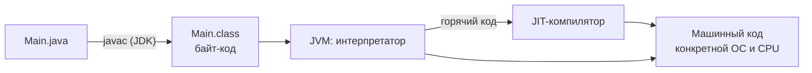
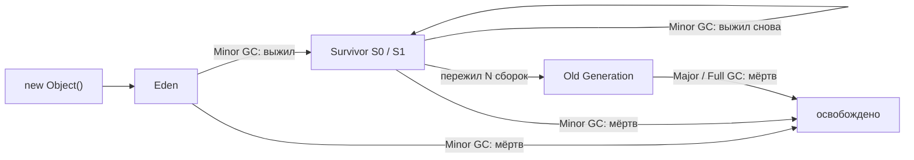
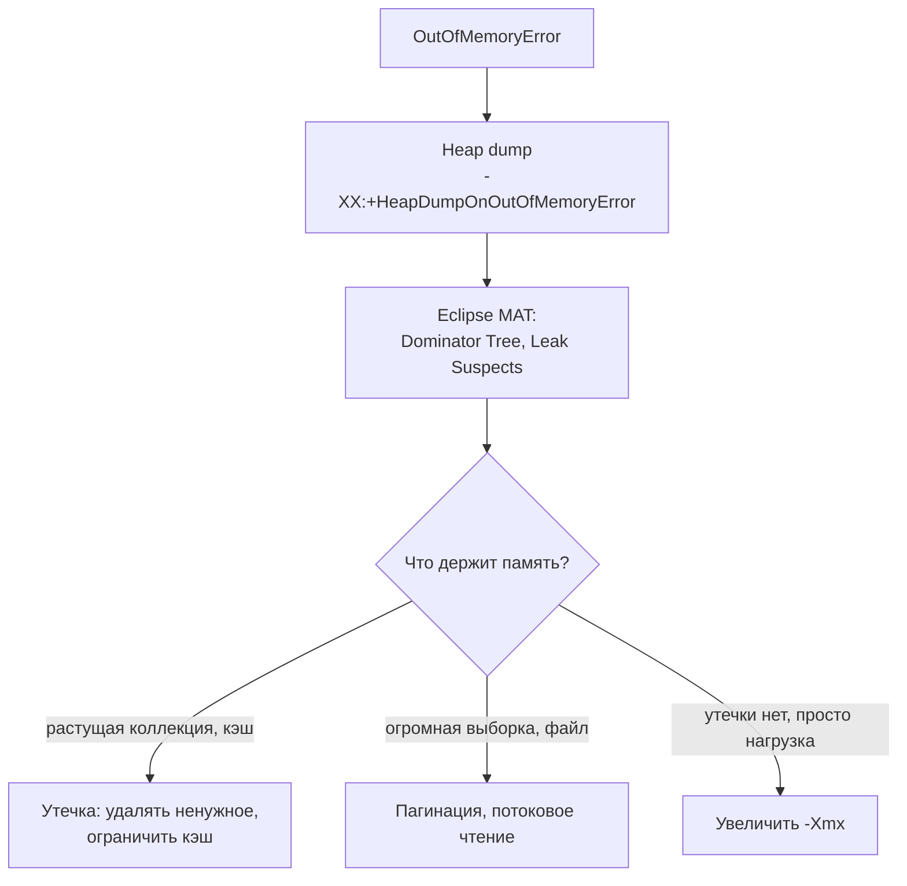

# JVM и память

Как Java-код превращается в работающую программу, где JVM хранит данные и как работает сборщик мусора. Чаще всего спрашивают разницу JVM/JRE/JDK, Stack против Heap, поколения GC, Metaspace и что делать при `OutOfMemoryError`.

## Платформа { #platform }

### Чем отличаются JVM, JRE и JDK? { #jvm-jre-jdk }

**Уровень:** Junior

!!! abstract "Ответ вслух"
    JVM выполняет байт-код, JRE — это JVM плюс стандартные библиотеки для запуска программ, JDK — это JRE плюс инструменты разработки вроде компилятора `javac`. Байт-код платформонезависим, а сама JVM у каждой ОС своя — так работает принцип _"Write Once, Run Anywhere"_.



#### JVM (Java Virtual Machine) — исполнитель

JVM — виртуальная машина, которая непосредственно выполняет Java-код.

- **Как это работает:** ты пишешь код на Java (`.java`), компилятор превращает его в промежуточный байт-код (`.class`). JVM берёт байт-код и переводит его в машинный код конкретной ОС (Windows, Linux, macOS).
- **Принцип:** именно JVM обеспечивает _"Write Once, Run Anywhere"_ (написал один раз — запускай где угодно).
- **Что внутри (кратко):**
    - **Classloader** загружает классы в память.
    - **Memory Area** управляет памятью: здесь живут Heap, Stack, Metaspace.
    - **Execution Engine** выполняет код: интерпретатор, JIT-компилятор для оптимизации «горячего» кода и Garbage Collector, который чистит память.

#### JRE (Java Runtime Environment) — среда выполнения

JRE — минимальный набор для **запуска** уже скомпилированных Java-приложений.

- **Из чего состоит:** **JRE = JVM + Core Libraries** (базовые библиотеки).
- **Зачем библиотеки:** сама JVM только выполняет инструкции. Чтобы приложение работало с файлами, сетью и коллекциями (`java.lang`, `java.util`, `java.io`), нужны готовые классы — их даёт JRE.
- **Кому это нужно:** серверам и пользователям, на которых приложение просто должно работать. Сейчас вместо JRE чаще собирают урезанный образ под приложение (`jlink`), но концептуально это то же самое.

#### JDK (Java Development Kit) — инструменты разработчика

JDK — полный набор инструментов для **разработки** на Java.

- **Из чего состоит:** **JDK = JRE + Development Tools**.
- **Утилиты:** `javac` (компилятор в байт-код), `java` (запуск), `jdb` (отладчик), `javadoc` (генератор документации), `javap` (дизассемблер байт-кода) и множество профилировщиков и анализаторов.
- **Кому это нужно:** разработчикам. На рабочий компьютер всегда ставят именно JDK.

```bash
javac Main.java     # JDK: исходник → байт-код Main.class
javap -c Main       # JDK: посмотреть байт-код
java Main           # JRE/JVM: запустить
```

!!! warning "Ловушка: «Java платформонезависима — значит, и JVM одна на всех»"
    Платформонезависим **байт-код**. JVM — платформозависима: для каждой ОС и архитектуры процессора нужна своя сборка.

!!! warning "Ловушка: писать код с одним JRE"
    В JRE нет компилятора `javac`, поэтому собрать проект с ним нельзя. Для разработки нужен JDK.

??? question "Проверь себя"
    1. Что входит в JRE и что JDK добавляет сверху?
    2. Что из цепочки `.java → .class → машинный код` платформонезависимо?
    3. Зачем JVM нужен JIT-компилятор, если есть интерпретатор?

## Garbage Collector { #gc }

### Как GC понимает, что объект больше не нужен? { #gc-roots }

**Уровень:** Junior

!!! abstract "Ответ вслух"
    GC идёт от GC Roots — локальных переменных в стеках потоков, статических полей и активных потоков — и помечает всё, до чего можно добраться по ссылкам. Всё недостижимое — мусор, даже если эти объекты ссылаются друг на друга по кругу. Ссылки GC не считает.

В C или C++ программист сам выделяет и сам освобождает память. Забыл освободить — получил утечку памяти (memory leak). В Java ты просто создаёшь объекты (`new Object()`), а JVM сама решает, когда их уничтожить.

GC не считает ссылки объектов друг на друга (reference counting), чтобы не попасть в ловушку циклических ссылок: объект А ссылается на Б, Б — на А, а программе оба уже не нужны. Вместо этого GC использует **трассировку (tracing)** от **GC Roots** — заведомо живых объектов:

- локальные переменные в выполняемых сейчас методах (в стеках потоков);
- статические переменные классов;
- активные потоки (threads).

**Правило:** GC строит граф ссылок от корней. Если до объекта можно добраться по цепочке ссылок от GC Root — он **жив**. Если цепочка оборвалась — он **мусор**.

```java
class Node {
    Node next;
}

Node a = new Node();
Node b = new Node();
a.next = b;
b.next = a; // цикл ссылок
a = null;
b = null;   // от GC Roots до пары не дойти — обе станут мусором, несмотря на цикл
```

!!! warning "Ловушка: «раз есть GC, утечек памяти не бывает»"
    Утечка в Java — это объект, который больше не нужен, но всё ещё достижим от GC Root. Классика — статическая коллекция-кэш, в которую только добавляют. GC её никогда не очистит.

??? question "Проверь себя"
    1. Что относится к GC Roots?
    2. Соберёт ли GC два объекта, которые ссылаются друг на друга, но недостижимы из корней?
    3. Как в Java может возникнуть утечка памяти, если есть GC?

### Что такое гипотеза поколений? { #generations }

**Уровень:** Middle

!!! abstract "Ответ вслух"
    Большинство объектов умирают молодыми, а пережившие несколько сборок обычно живут долго. Поэтому куча делится на Young Generation (Eden и два Survivor) и Old Generation. Young чистится часто и быстро (Minor GC), Old — редко и дорого.

Это фундамент большинства сборщиков в Java. Создатели JVM заметили закономерность в поведении программ — слабую гипотезу поколений (weak generational hypothesis):

1. **Большинство объектов умирают молодыми.** Например, переменные внутри цикла или метода: метод отработал — они больше не нужны.
2. **Объекты, пережившие пару сборок, скорее всего, будут жить долго.** Например, кэши, пулы соединений с базой, синглтоны Spring.

Поэтому кучу (heap) разделили на области, чтобы не сканировать всю память каждый раз:

- **Young Generation (молодое поколение):** здесь создаются все новые объекты. Состоит из **Eden** и двух небольших зон **Survivor** (S0 и S1).
    - Когда Eden заполняется, происходит быстрая сборка — **Minor GC**, и выжившие объекты переезжают в Survivor.
- **Old Generation / Tenured (старое поколение):** сюда попадают «долгожители», пережившие несколько Minor GC. Когда заполняется эта зона, запускается сборка старого поколения — **Major GC**, а при сборке всей кучи — **Full GC**. Это тяжёлая и долгая операция: сканируется огромный объём памяти.



```bash
# Сколько сборок объект должен пережить в Survivor, прежде чем уехать в Old (по умолчанию до 15)
java -XX:MaxTenuringThreshold=15 -jar app.jar
```

!!! warning "Ловушка: Major GC и Full GC — не одно и то же"
    Термины часто смешивают. Major GC чистит старое поколение, Full GC — всю кучу целиком, обычно с самой долгой паузой. Если в логах GC регулярно появляется Full GC, это сигнал разбираться с памятью.

??? question "Проверь себя"
    1. Из каких двух наблюдений состоит гипотеза поколений?
    2. Из каких зон состоит Young Generation и что происходит при Minor GC?
    3. Когда объект попадает в Old Generation?

### Как работает Mark-Sweep-Compact? { #mark-sweep-compact }

**Уровень:** Middle

!!! abstract "Ответ вслух"
    Сначала GC помечает все живые объекты, проходя от GC Roots (Mark). Потом освобождает память всех непомеченных (Sweep). В конце сдвигает живые объекты вплотную друг к другу, чтобы убрать фрагментацию (Compact).

Когда GC решает навести порядок, он делает три шага:

1. **Mark (маркировка):** проходит от GC Roots и ставит «флажок» на всех живых объектах.
2. **Sweep (очистка):** проходит по памяти и освобождает все объекты без флажка.
3. **Compact (сжатие, опционально, но важно):** после очистки память похожа на швейцарский сыр (фрагментация). GC сдвигает живые объекты в начало памяти, чтобы новые объекты выделялись быстро и целым куском.


```java
System.gc(); // лишь просьба к JVM запустить сборку — она может её проигнорировать
```

!!! warning "Ловушка: `System.gc()` в коде"
    `System.gc()` ничего не гарантирует, а если JVM всё же послушается — это может быть Full GC с долгой паузой. В продакшен-коде его не вызывают; флаг `-XX:+DisableExplicitGC` вообще отключает такие вызовы.

??? question "Проверь себя"
    1. Что делает каждая из фаз Mark, Sweep и Compact?
    2. Зачем нужна фаза Compact?
    3. Гарантирует ли `System.gc()` сборку мусора?

### Что такое Stop-The-World? { #stw }

**Уровень:** Middle

!!! abstract "Ответ вслух"
    Это пауза, во время которой GC останавливает все потоки приложения, чтобы безопасно пометить или переместить объекты. Пока она идёт, приложение не отвечает. Вся эволюция сборщиков в Java — борьба за то, чтобы эти паузы были как можно короче.

Самый важный концепт для понимания GC. Когда сборщик делает свою основную работу (особенно перемещает объекты в памяти), он **ставит на паузу все потоки приложения**. Это называется **Stop-The-World (STW)**: код замирает, API не отвечает, данные не пишутся.

Вся эволюция сборщиков в Java сводится к одной цели: **сделать STW-паузы максимально короткими**, чтобы приложение не «фризило».

```bash
# Посмотреть все паузы GC в логе
java -Xlog:gc*:file=gc.log -jar app.jar
```

!!! warning "Ловушка: «у ZGC нет пауз»"
    STW-паузы есть у всех сборщиков. ZGC и Shenandoah делают почти всю работу параллельно с приложением, поэтому их паузы очень короткие, но не нулевые.

??? question "Проверь себя"
    1. Что происходит с приложением во время STW-паузы?
    2. Почему GC вообще нужно останавливать потоки?
    3. Как посмотреть, сколько длятся паузы GC в твоём приложении?

### Какие сборщики мусора есть и какой выбрать? { #collectors }

**Уровень:** Senior

!!! abstract "Ответ вслух"
    Serial — однопоточный для крошечных приложений, Parallel — многопоточный с упором на пропускную способность, G1 — сборщик по умолчанию с Java 9, балансирует пропускную способность и паузы. ZGC и Shenandoah делают почти всю работу параллельно с приложением, и паузы у них не зависят от размера кучи.

| **Сборщик** | **Суть** | **Когда** |
|---|---|---|
| **Serial GC** | Однопоточный | Крошечные приложения, 1 CPU |
| **Parallel GC** | Несколько потоков сборки, но долгие STW-паузы. Долгое время был сборщиком по умолчанию | Пакетная обработка, где важна пропускная способность, а не паузы |
| **G1 GC (Garbage-First)** | По умолчанию с Java 9. Делит кучу на множество регионов и чистит сначала те, где больше всего мусора | Большинство серверных приложений |
| **ZGC** | Почти вся работа, включая перемещение объектов, — параллельно с приложением. Паузы — меньше миллисекунды даже на кучах в терабайты | Высоконагруженные сервисы с требованиями к задержкам |
| **Shenandoah** | Тоже перемещает объекты параллельно с приложением; паузы не зависят от размера кучи. Есть в сборках OpenJDK, но не в Oracle JDK | То же, что ZGC |

```bash
java -XX:+UseSerialGC     -jar app.jar
java -XX:+UseParallelGC   -jar app.jar
java -XX:+UseG1GC         -jar app.jar   # по умолчанию с Java 9
java -XX:+UseZGC          -jar app.jar
java -XX:+UseShenandoahGC -jar app.jar
```

!!! warning "Ловушка: в маленьком контейнере G1 может и не включиться"
    Если JVM видит меньше 2 CPU или меньше ~1792 МБ памяти, она считает машину «не серверной» и по умолчанию выбирает Serial GC. В Kubernetes-подах с лимитом в 1 CPU это частая причина долгих пауз — сборщик стоит задавать явно.

!!! warning "Ловушка: короткие паузы не бесплатны"
    ZGC и Shenandoah платят за короткие паузы дополнительным CPU и памятью. Если сервису важна пропускная способность, а не задержки (например, ночная пакетная обработка), Parallel или G1 могут оказаться выгоднее.

??? question "Проверь себя"
    1. Какой сборщик используется по умолчанию начиная с Java 9 и как он устроен?
    2. Чем ZGC и Shenandoah отличаются от G1?
    3. Почему в контейнере с 1 CPU JVM может выбрать Serial GC?

## Память JVM { #memory }

### Чем Stack отличается от Heap? { #stack-heap }

**Уровень:** Junior

!!! abstract "Ответ вслух"
    Stack у каждого потока свой: в нём лежат фреймы методов с локальными переменными, примитивами и ссылками, и он очищается сам, когда метод завершается. Heap один на всё приложение: в нём живут все объекты, и чистит его GC. Переполнение стека — `StackOverflowError`, кучи — `OutOfMemoryError`.

#### Stack (стек) — личный рабочий стол потока

Стек — быстрая, но небольшая область памяти. Главное правило: **у каждого потока (thread) свой собственный стек**, заглядывать в чужие стеки потоки не могут.

- **Как это работает:** стек работает по принципу LIFO (Last In, First Out). Представь стопку тарелок: кладёшь сверху и берёшь всегда только верхнюю.
- **Что внутри (фреймы):** при вызове метода в стеке создаётся новый фрейм (frame). В нём хранятся:
    - локальные переменные метода;
    - примитивные значения (`int`, `double`, `boolean`, `char` и т.д.);
    - **ссылки** на объекты — сами объекты здесь не живут, только их «адреса».
- **Жизненный цикл:** метод отработал — его фрейм сразу удаляется из стека. Память освобождается сама, без Garbage Collector.
- **Главная ошибка:** если методы вызывают друг друга бесконечно (например, рекурсия без выхода), стопка упрётся в потолок — получишь `StackOverflowError`.

#### Heap (куча) — общий склад

Куча — большая область памяти, которая выделяется приложению при запуске. Главное правило: **куча одна на всё приложение, и все потоки имеют к ней доступ**.

- **Что внутри:** **все объекты** — экземпляры классов, созданные через `new`, массивы, строки.
- **Связь со стеком:** при `User user = new User();` в стеке создаётся локальная переменная `user` (ссылка), а в куче выделяется место под сам объект `User`. Ссылка из стека указывает на объект в куче.
- **Жизненный цикл:** объект живёт, пока до него можно добраться от GC Roots (в том числе по ссылкам из стеков). Как только ссылки пропадают, приходит Garbage Collector.
- **Главная ошибка:** если создавать слишком много объектов и не отпускать ссылки (например, складывать всё в бесконечный `List`), место закончится — `OutOfMemoryError: Java heap space`.

```java
void handle() {
    int count = 5;               // примитив — прямо во фрейме стека
    User user = new User();      // ссылка user — в стеке, сам объект User — в куче
}                                // фрейм удалён; объект User станет мусором для GC

int depth(int n) {
    return depth(n + 1);         // ❌ рекурсия без выхода → StackOverflowError
}
```

| **Характеристика** | **Stack (стек)** | **Heap (куча)** |
|---|---|---|
| **Доступ** | Локальный (только свой поток) | Глобальный (общий для всех потоков) |
| **Что хранится** | Фреймы методов: примитивы, ссылки | Объекты и массивы |
| **Управление** | Автоматически при вызове и выходе из метода | Garbage Collector |
| **Скорость** | Очень быстрая | Медленнее: нужно найти место, работает GC |
| **Размер** | Маленький, задаётся флагом `-Xss` | Большой, задаётся флагами `-Xms` и `-Xmx` |

!!! warning "Ловушка: `-Xss` — это размер стека каждого потока"
    `-Xss` задаётся на поток, а не на всё приложение. Увеличишь его ради глубокой рекурсии — каждая тысяча потоков съест в тысячу раз больше памяти.

??? question "Проверь себя"
    1. Где окажутся ссылка и объект при `User user = new User();`?
    2. Почему стек не нужно чистить сборщиком мусора?
    3. Какая ошибка возникает при переполнении стека и при переполнении кучи?

### Что такое Metaspace и чем он отличается от PermGen? { #metaspace }

**Уровень:** Middle

!!! abstract "Ответ вслух"
    Metaspace хранит метаданные классов — их структуру, байт-код методов, данные JIT — и находится в нативной памяти, вне кучи. Он появился в Java 8 вместо PermGen, который жил внутри памяти JVM с жёстким лимитом и падал с `OutOfMemoryError: PermGen space`. Metaspace по умолчанию растёт, пока хватает памяти машины.

Объекты живут в куче, локальные переменные и вызовы методов — в стеке. А где JVM хранит информацию о самих классах — их структуру, методы, имена полей? Для этого есть **Metaspace**.

- **Где физически:** Metaspace находится **вне кучи (off-heap)** — в нативной памяти (native memory), которую ОС выделяет процессу JVM напрямую.
- **Что хранится:** метаданные классов — «чертежи» объектов: структура класса, байт-код методов, данные JIT-компилятора и другая служебная информация.

На собесе почти наверняка спросят: _"А что было до Metaspace и почему это изменили в Java 8?"_

- **До Java 8:** эта область называлась **PermGen** (Permanent Generation). Она находилась _внутри_ памяти JVM и имела жёстко заданный максимум. Если приложение динамически создавало много классов (а Spring и Hibernate делают это постоянно через прокси), PermGen переполнялся и приложение падало с `OutOfMemoryError: PermGen space`.
- **С Java 8:** PermGen удалили и заменили на Metaspace. Главное отличие — по умолчанию Metaspace **растёт динамически** и ограничен только объёмом оперативной памяти сервера. Ошибка `OOM: PermGen` ушла в прошлое.

```bash
# Ограничить Metaspace явно — без флага он ограничен только памятью машины
java -XX:MaxMetaspaceSize=256m -jar app.jar
```

!!! warning "Ловушка: Metaspace без лимита в контейнере"
    В Kubernetes, где память жёстко лимитирована, всегда ограничивай Metaspace флагом вроде `-XX:MaxMetaspaceSize=256m`. Иначе при утечке классов Metaspace съест всю память контейнера, и ОС убьёт его через OOM Killer. С лимитом ты хотя бы получишь понятную `OutOfMemoryError: Metaspace`.

??? question "Проверь себя"
    1. Что хранится в Metaspace и где он находится физически?
    2. Почему PermGen заменили на Metaspace?
    3. Зачем ограничивать Metaspace в контейнере?

### Где живут статические переменные и String Pool? { #static-location }

**Уровень:** Senior

!!! abstract "Ответ вслух"
    В куче. String Pool переехал в кучу ещё в Java 7, а статические переменные — в Java 8, вместе с объектами `java.lang.Class`. В Metaspace осталась только метаинформация о классах и байт-код.

Самый каверзный вопрос по теме памяти. Многие по старым книжкам про Java 7 отвечают, что статические переменные и String Pool хранятся в Metaspace (или PermGen). **Это грубая ошибка.**

- **String Pool** переехал в основную кучу (heap) ещё в Java 7.
- **Статические переменные** (и сами объекты `java.lang.Class`) переехали из PermGen в кучу в Java 8.

В Metaspace осталась _только_ метаинформация о классах и байт-код для JVM.

```java
class Config {
    // значение статического поля и сама Map — в куче (внутри объекта Config.class);
    // в Metaspace — только описание класса Config
    static Map<String, String> CACHE = new HashMap<>();
}
```

!!! warning "Ловушка: «статика — в Metaspace»"
    Это ответ из эпохи Java 7 и PermGen. С Java 8 значения статических полей лежат в куче, поэтому статическая коллекция, которая только растёт, даёт `OutOfMemoryError: Java heap space`, а не ошибку Metaspace.

??? question "Проверь себя"
    1. Где хранятся значения статических полей начиная с Java 8?
    2. В какой версии Java String Pool переехал в кучу?
    3. Какую ошибку получишь, если статическая коллекция бесконечно растёт?

### Как очищается Metaspace? { #metaspace-gc }

**Уровень:** Senior

!!! abstract "Ответ вслух"
    Метаданные класса живут в Metaspace, пока жив его `ClassLoader`. В обычном приложении базовые классы живут от старта до остановки. Metaspace освобождается, только когда весь `ClassLoader` вместе с классами становится недостижим — например, при горячей перезагрузке приложения в сервере приложений.

Хотя Metaspace растягивается, он не бесконечен. Метаданные класса живут, пока жив его **ClassLoader** (загрузчик классов):

- В обычном приложении базовые классы живут от старта до остановки сервера.
- При «горячей замене» кода (hot reload) или в серверах приложений вроде Tomcat старые `ClassLoader`-ы уничтожаются вместе со своими классами. Тогда GC освобождает и нативную память Metaspace.

```bash
# Смотрим, сколько классов загружено и сколько из них выгружено
java -Xlog:class+load,class+unload -jar app.jar
```

!!! warning "Ловушка: утечка ClassLoader"
    Если после редеплоя хоть один объект старого приложения остаётся достижим (через `ThreadLocal`, статическое поле библиотеки, незавершённый поток), весь старый `ClassLoader` со всеми классами не выгрузится. После нескольких редеплоев — `OutOfMemoryError: Metaspace`.

??? question "Проверь себя"
    1. От чего зависит время жизни метаданных класса в Metaspace?
    2. В каких сценариях Metaspace реально очищается?
    3. Как один `ThreadLocal` может вызвать утечку Metaspace?

## OutOfMemoryError { #oom }

### Что такое OutOfMemoryError? { #oom-basics }

**Уровень:** Junior

!!! abstract "Ответ вслух"
    Это не исключение, а `Error` — наследник `VirtualMachineError`. JVM бросает его, когда GC сделал всё что мог, но места для нового объекта нет. Ловить его технически можно, но приложение уже в нестабильном состоянии.

Первое правило для собеса: **OOM — это не Exception, это Error**. Он наследуется от `java.lang.VirtualMachineError` и сигнализирует о критической ситуации: память закончилась, GC не смог освободить место. Ловить его через `try-catch` — плохая практика, хоть технически и возможно.

```java
try {
    byte[] huge = new byte[Integer.MAX_VALUE];
} catch (OutOfMemoryError e) {
    // ❌ технически поймать можно, но состояние приложения уже непредсказуемо
}
```

!!! warning "Ловушка: `catch (Exception e)` не поймает OOM"
    `OutOfMemoryError` — наследник `Error`, а не `Exception`. Общий `catch (Exception e)` его пропустит, и это правильно: восстанавливаться после OOM внутри обычной бизнес-логики бесполезно.

??? question "Проверь себя"
    1. От какого класса наследуется `OutOfMemoryError`?
    2. Почему ловить OOM — плохая идея?
    3. Поймает ли его `catch (Exception e)`?

### Какие бывают OutOfMemoryError? { #oom-types }

**Уровень:** Middle

!!! abstract "Ответ вслух"
    Чаще всего — `Java heap space`: в куче нет места под объект. Ещё бывают `GC overhead limit exceeded`, когда GC работает почти постоянно и почти ничего не освобождает, `Metaspace` — переполнены метаданные классов, и `unable to create new native thread` — ОС не даёт создать поток.

На собесе не говори просто «закончилась память». Память бывает разная:

| Тип ошибки | Суть проблемы | Частая причина в коде |
|---|---|---|
| **Java heap space** | В куче нет места для нового объекта | Утечка памяти (коллекция бесконечно растёт), загрузка огромного файла или `SELECT *` из БД целиком в память |
| **GC overhead limit exceeded** | Приложение «буксует»: GC работает больше 98% времени, но освобождает меньше 2% памяти (проверка есть у Parallel GC) | Слишком много временных объектов, GC не успевает их чистить |
| **Metaspace** | Переполнилась область метаданных классов | Динамическая генерация классов (часто — фреймворки при кривой настройке), утечка `ClassLoader` |
| **Unable to create new native thread** | JVM не может создать новый поток на уровне ОС | Исчерпан лимит ОС на число потоков или закончилась физическая память |

```java
public class Cache {
    private static final List<byte[]> DATA = new ArrayList<>();

    public static void remember(byte[] chunk) {
        DATA.add(chunk); // ❌ только добавляем и никогда не удаляем → Java heap space
    }
}
```

!!! warning "Ловушка: «unable to create new native thread» — не про кучу"
    Увеличение `-Xmx` здесь не поможет и даже навредит: потоки живут вне кучи. Причина — слишком много потоков (например, `newCachedThreadPool` под нагрузкой) или лимиты ОС.

??? question "Проверь себя"
    1. Чем `Java heap space` отличается от `GC overhead limit exceeded`?
    2. Какая причина у `OutOfMemoryError: Metaspace`?
    3. Поможет ли увеличение `-Xmx` при `unable to create new native thread`?

### Как расследовать и лечить OutOfMemoryError? { #oom-investigation }

**Уровень:** Senior

!!! abstract "Ответ вслух"
    Включить `-XX:+HeapDumpOnOutOfMemoryError`, забрать heap dump и открыть его в Eclipse MAT: Dominator Tree или Leak Suspects покажут, кто держит память. Дальше чинить код — утечку или загрузку данных целиком. Увеличивать `-Xmx` — только если утечки нет и памяти реально не хватает под нагрузку.

Обычно OOM обнаруживается сам — приложение умирает с ошибкой в логах. Задача инженера — понять, **почему** это произошло.

- **Флаги JVM (must-have):** `-XX:+HeapDumpOnOutOfMemoryError` — в момент падения JVM сама сохранит снимок памяти (heap dump). `-XX:HeapDumpPath=...` указывает, куда его положить.
- **Мониторинг (Grafana / Prometheus):** если график памяти днями плавно ползёт вверх и не падает после сборок мусора — это утечка памяти. Если взлетел вертикально за секунду — резкий всплеск трафика или тяжёлый запрос к БД.
- **JMX и профилировщики:** VisualVM или JProfiler подключаются к работающей JVM и показывают, какие объекты занимают место.

```bash
java -XX:+HeapDumpOnOutOfMemoryError \
     -XX:HeapDumpPath=/var/dumps \
     -jar app.jar
```

Любимый вопрос: _"У тебя упал OOM, твои действия?"_ Не отвечай «увеличу `-Xmx`» — при утечке это лишь отсрочит следующее падение. Правильный алгоритм:

1. **Собрать данные:** забрать heap dump, который JVM сохранила при падении.
2. **Проанализировать:** открыть дамп в **Eclipse MAT** (Memory Analyzer Tool).
3. **Найти виновника:** _Dominator Tree_ или _Leak Suspects Report_ покажут, например: «этот `HashMap` держит 80% памяти, внутри — миллионы объектов `User`».
4. **Починить код:**
    - Утечка — найти, где объекты складываются в кэш или коллекцию и не удаляются.
    - Всплеск данных — читать из БД страницами (батчами по 1000 строк, а не миллион за раз), читать файлы потоково (`BufferedReader`, Stream API), а не грузить в `byte[]` целиком.
5. **Настроить JVM:** только если анализ показал, что утечки нет, а приложению реально нужно больше памяти под возросшую нагрузку, аккуратно увеличить `-Xmx`.



!!! warning "Ловушка: «просто увеличу `-Xmx`»"
    При утечке памяти больший хип только отодвинет падение и сделает Full GC ещё дольше. Сначала дамп и анализ, потом — решение.

??? question "Проверь себя"
    1. Какие флаги JVM нужны, чтобы при OOM остался heap dump?
    2. Как по графику памяти отличить утечку от всплеска нагрузки?
    3. Когда увеличение `-Xmx` — правильное решение?

## Шпаргалка { #cheatsheet }

| Тема | Запомнить |
|---|---|
| **JVM / JRE / JDK** | JVM выполняет байт-код; JRE = JVM + библиотеки; JDK = JRE + `javac` и утилиты |
| **GC Roots** | Стеки потоков, статические поля, активные потоки; недостижимое — мусор, циклы не мешают |
| **Поколения** | Eden → Survivor → Old; Minor GC часто и быстро, Major/Full GC — редко и дорого |
| **Mark-Sweep-Compact** | Пометить живые → освободить остальное → убрать фрагментацию |
| **Stop-The-World** | Пауза всех потоков приложения; эволюция GC — борьба за короткие паузы |
| **Сборщики** | Serial, Parallel, G1 (по умолчанию с Java 9), ZGC и Shenandoah (паузы не зависят от размера кучи) |
| **Stack vs Heap** | Стек — свой у потока, фреймы и ссылки, `-Xss`; куча — общая, объекты, `-Xmx` |
| **Metaspace** | Метаданные классов вне кучи, с Java 8 вместо PermGen; ограничивай `-XX:MaxMetaspaceSize` |
| **Статика и String Pool** | В куче: пул — с Java 7, статические поля — с Java 8 |
| **OOM** | `Error`, а не `Exception`; виды: heap space, GC overhead, Metaspace, native thread |
| **Расследование OOM** | `-XX:+HeapDumpOnOutOfMemoryError` → Eclipse MAT → чинить код → и только потом `-Xmx` |
