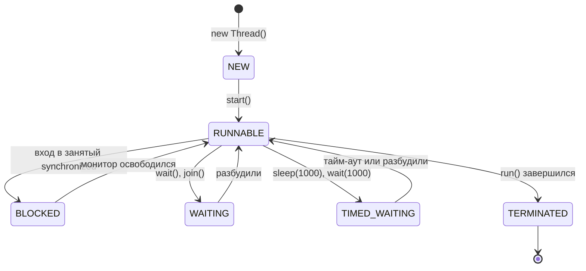
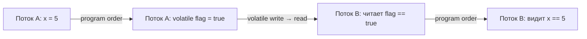
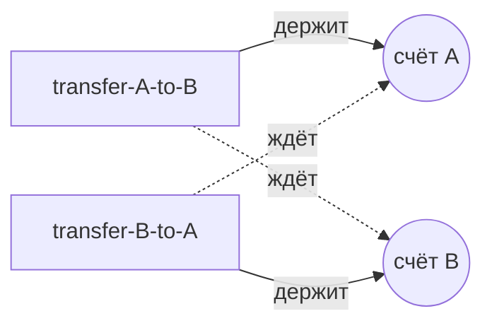
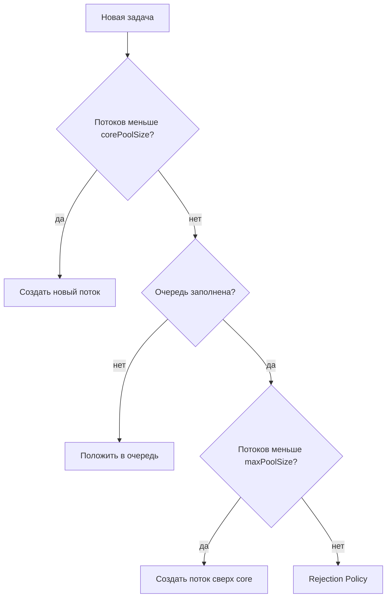
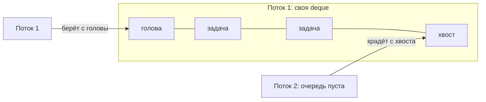
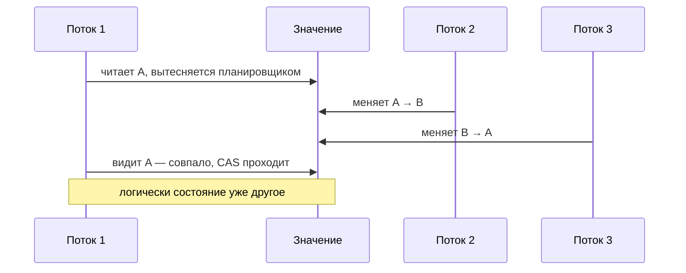
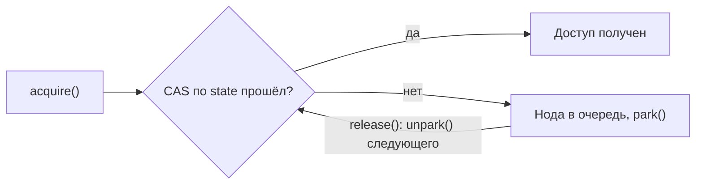
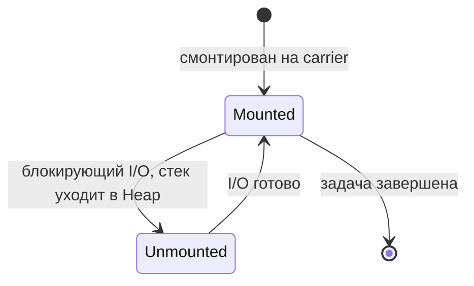

# Многопоточность (Multithreading)

Потоки, Java Memory Model, блокировки, синхронизаторы, пулы потоков, `CompletableFuture` и виртуальные потоки. Чаще всего спрашивают про `volatile` и happens-before, разницу `synchronized` и `ReentrantLock`, порядок решений `ThreadPoolExecutor`, дедлок и пиннинг виртуальных потоков.

## Фундамент { #basics }

### Чем поток отличается от процесса? { #thread-vs-process }

**Уровень:** Junior

!!! abstract "Ответ вслух"
    Процесс — экземпляр запущенной программы со своей изолированной памятью: если один процесс упадёт, другие выживут. Поток — лёгкая единица исполнения внутри процесса. Все потоки процесса делят общую кучу (Heap), но у каждого свой стек (Stack).

- **Процесс** — тяжеловесная единица. У процесса **своя изолированная память**.
    - _Аналогия:_ отдельный дом. Чтобы поговорить с соседом (другим процессом), нужно кричать через улицу (Socket, REST, IPC).
- **Поток** — лёгкая единица исполнения _внутри_ процесса. Потоки делят **общую память (Heap)**, но имеют свой **стек (Stack)**.
    - _Аналогия:_ жильцы одной квартиры. Легко передают вещи (объекты в Heap), но могут подраться за туалет (Race Condition).

```java
// Оба потока видят один и тот же объект в куче
List<String> shared = Collections.synchronizedList(new ArrayList<>());
Runnable task = () -> shared.add(Thread.currentThread().getName());
Thread t1 = new Thread(task);
Thread t2 = new Thread(task);
t1.start();
t2.start();
t1.join();
t2.join();
System.out.println(shared); // оба имени — потоки писали в общий объект
```

!!! warning "Ловушка: общая куча — общие проблемы"
    То, что потоки делят кучу, удобно для обмена данными, но любое изменяемое общее состояние без синхронизации даёт гонку данных (race condition). Локальные переменные живут в стеке потока и другим потокам не видны.

??? question "Проверь себя"
    1. Что общее у потоков одного процесса, а что у каждого своё?
    2. Почему падение одного процесса не роняет другие?
    3. Как процессы обмениваются данными?

### Как создать поток: `Thread` или `Runnable`? { #thread-vs-runnable }

**Уровень:** Junior

!!! abstract "Ответ вслух"
    Задачу описывают в `Runnable` (или `Callable`, если нужен результат), а запускают в `Thread` или пуле потоков. Наследоваться от `Thread` — моветон: теряешь единственное наследование и смешиваешь механизм запуска с бизнес-логикой.

Почему `extends Thread` — моветон:

1. **Ограниченность наследования:** множественного наследования нет — ты теряешь возможность унаследоваться от бизнес-класса.
2. **SRP:** поток (`Thread`) — это «рабочий», механизм запуска, а задача (`Runnable`) — «инструкция», бизнес-логика. Вшивать инструкцию в рабочего нельзя.

```java
// ❌ Смешиваем инфраструктуру и логику
class BadThread extends Thread {
    @Override
    public void run() { System.out.println("Hard work..."); }
}

// ✅ Логика отдельно, запуск отдельно
Runnable task = () -> System.out.println("Clean work!");
Thread worker = new Thread(task);
worker.start();
```

!!! warning "Ловушка: `run()` вместо `start()`"
    `worker.run()` выполнит задачу в текущем потоке, как обычный метод. Новый поток создаёт только `start()`.

??? question "Проверь себя"
    1. Назови две причины не наследоваться от `Thread`.
    2. Чем `Runnable` отличается от `Callable`?
    3. Что произойдёт, если вызвать `run()` вместо `start()`?

### Какие состояния есть у потока? { #thread-states }

**Уровень:** Junior

!!! abstract "Ответ вслух"
    Состояний шесть, они перечислены в `Thread.State`: NEW, RUNNABLE, BLOCKED, WAITING, TIMED_WAITING и TERMINATED. BLOCKED — ожидание монитора `synchronized`, WAITING — ожидание другого потока без лимита, TIMED_WAITING — с тайм-аутом. Завершённый поток перезапустить нельзя.



1. **NEW** — создан `new Thread()`, `start()` ещё не вызван.
2. **RUNNABLE** — вызван `start()`. Поток либо выполняется на CPU, либо ждёт своей очереди в планировщике ОС.
3. **BLOCKED** — упёрся в `synchronized` и ждёт освобождения монитора.
4. **WAITING** — ждёт другого потока без лимита времени (`wait()`, `join()`).
5. **TIMED_WAITING** — ждёт с тайм-аутом (`sleep(1000)`, `wait(1000)`).
6. **TERMINATED** — `run()` завершился.

!!! warning "Ловушка: повторный `start()`"
    Перезапустить поток нельзя: умер — значит умер. Повторный `start()` бросит `IllegalThreadStateException`, для новой попытки нужен новый объект `Thread`.

??? question "Проверь себя"
    1. В каком состоянии поток, который ждёт входа в `synchronized`?
    2. Чем WAITING отличается от TIMED_WAITING?
    3. Можно ли снова запустить поток в состоянии TERMINATED?

### Как работают `join`, `sleep` и `yield`? { #join-sleep-yield }

**Уровень:** Junior

!!! abstract "Ответ вслух"
    `Thread.sleep(ms)` ставит текущий поток на паузу и не отпускает мониторы. `thread.join()` ждёт, пока поток `thread` завершится. `Thread.yield()` — подсказка планировщику, что поток готов уступить CPU, её можно проигнорировать.

- **`Thread.sleep(ms)`** — пауза текущего потока.
- **`thread.join()`** — «жду, пока поток `thread` завершится». Используется, чтобы дождаться результата.
- **`Thread.yield()`** — подсказка планировщику «готов уступить CPU». Может быть проигнорирована, в реальном коде встречается редко.

```java
Thread worker = new Thread(() -> System.out.println("работаю"));
worker.start();
worker.join();                   // main ждёт завершения worker
System.out.println("worker закончил");
```

!!! warning "Ловушка: `sleep` под монитором"
    `sleep` **не отпускает мониторы**. Если поток уснул внутри `synchronized`, никто другой в этот блок не зайдёт, пока он не проснётся. Монитор на время ожидания отпускает только `wait()`.

??? question "Проверь себя"
    1. Отпускает ли `sleep()` монитор?
    2. Зачем нужен `join()`?
    3. Гарантирует ли `yield()`, что поток уступит CPU?

### Как правильно остановить поток? { #interrupt }

**Уровень:** Middle

!!! abstract "Ответ вслух"
    Через `interrupt()` и кооперативное завершение: поток сам проверяет флаг `isInterrupted()` и аккуратно выходит. `stop()` устарел и опасен — он убивает поток на полуслове, и данные остаются битыми.

`stop()` — **deprecated**: он прерывает поток в произвольной точке. Правильный путь — **кооперативное завершение**: попросить поток остановиться и дать ему закончить работу самому.

```java
Thread worker = new Thread(() -> {
    while (!Thread.currentThread().isInterrupted()) {
        try {
            System.out.println("Working...");
            Thread.sleep(1000);
        } catch (InterruptedException e) {
            System.out.println("Попросили выйти во сне!");
            Thread.currentThread().interrupt(); // ❗ восстанавливаем флаг — catch его сбрасывает
            break;
        }
    }
    System.out.println("Clean shutdown.");
});

worker.start();
Thread.sleep(3000);
worker.interrupt(); // «стучимся» к потоку
```

!!! warning "Ловушка: проглоченный `InterruptedException`"
    Когда `sleep()` или `wait()` бросают `InterruptedException`, флаг прерывания уже сброшен. Если в `catch` его не восстановить через `Thread.currentThread().interrupt()`, код выше по стеку не узнает, что поток просили остановиться.

??? question "Проверь себя"
    1. Почему `stop()` опасен?
    2. Что происходит с флагом прерывания, когда бросается `InterruptedException`?
    3. Как поток узнаёт, что его попросили остановиться?

## Мониторы и `wait`/`notify` { #monitors }

### Как работает `synchronized`? { #synchronized }

**Уровень:** Junior

!!! abstract "Ответ вслух"
    У каждого объекта в Java есть встроенный замок — монитор (mutex), и в один момент им владеет только один поток. `synchronized` на методе берёт монитор `this`, на блоке — указанного объекта, на `static`-методе — объекта класса. Он даёт сразу атомарность и видимость.

```java
public class Counter {
    private int count = 0;
    private final Object lock = new Object();

    // Вариант 1: лок на this
    public synchronized void increment() {
        count++;
    }

    // Вариант 2: лок на конкретном объекте (лучше для гранулярности)
    public void incrementBlock() {
        synchronized (lock) {
            count++;
        }
    }

    // Вариант 3: лок на классе (static synchronized)
    // эквивалентно synchronized(Counter.class)
    public static synchronized void staticJob() { /* ... */ }
}
```

`synchronized` даёт сразу два свойства:

- **Атомарность** — никто не вмешается в середине.
- **Видимость** — после выхода из блока все потоки, которые возьмут тот же монитор, увидят актуальное значение.

!!! warning "Ловушка: `static synchronized` и `synchronized` не исключают друг друга"
    `static synchronized` берёт монитор `Counter.class`, а обычный `synchronized`-метод — монитор `this`. Это разные мониторы, поэтому методы из вариантов 1 и 3 могут выполняться одновременно.

??? question "Проверь себя"
    1. Какой монитор берёт `synchronized`-метод, а какой — `static synchronized`?
    2. Зачем выносить лок в отдельное поле `lock`?
    3. Какие два свойства даёт `synchronized`?

### Зачем `wait()` вызывают в цикле `while`? { #wait-notify }

**Уровень:** Middle

!!! abstract "Ответ вслух"
    Из-за ложного пробуждения (spurious wakeup): поток может проснуться без вызова `notify`. Поэтому после пробуждения условие нужно проверить снова, а значит — `while`, а не `if`. Сами `wait()` и `notify()` работают только внутри `synchronized` на том же объекте.

- `wait()` — «отпускаю монитор и иду спать, пока не разбудят».
- `notify()` — будит одного случайного из спящих.
- `notifyAll()` — будит всех, они начинают драться за монитор.

```java
public synchronized void consume() throws InterruptedException {
    // ✅ while — если проснулись ложно, цикл проверит условие снова
    while (queue.isEmpty()) {
        wait();
    }
    var data = queue.poll();
    notifyAll(); // сообщаем продюсерам, что место освободилось
}
```

!!! warning "Ловушка: `wait()` вне `synchronized`"
    `wait()`, `notify()` и `notifyAll()` можно вызывать **только** внутри `synchronized` блока того же объекта. Иначе — `IllegalMonitorStateException`.

!!! warning "Ловушка: `if` вместо `while`"
    С `if` поток после ложного пробуждения пойдёт дальше, не проверив условие, и, например, вызовет `poll()` у пустой очереди. ОС может разбудить поток и без `notify` — это и есть spurious wakeup.

??? question "Проверь себя"
    1. Что такое spurious wakeup и как от него защититься?
    2. Чем `notify()` отличается от `notifyAll()`?
    3. Что будет, если вызвать `wait()` вне `synchronized`?

## Java Memory Model (JMM) { #jmm }

### Какие три проблемы решает JMM? { #jmm-basics }

**Уровень:** Middle

!!! abstract "Ответ вслух"
    Атомарность, видимость и упорядочивание. Без синхронизации поток может увидеть половину 64-битной записи, не увидеть чужую запись вообще или увидеть записи в другом порядке. JMM задаёт правила, когда запись одного потока гарантированно видна другому.

**Atomicity (атомарность)** — операция либо выполнена полностью, либо не начиналась. Другие потоки не видят промежуточного состояния.

Атомарны из коробки: чтение и запись ссылок и всех примитивов, **кроме** `long` и `double` (если они не `volatile`). 64-битная запись на 32-битной ОС может разбиться на два шага — и другой поток прочитает «склейку» из старой и новой половины (word tearing).

**Visibility (видимость)** — запись одного потока может долго оставаться невидимой для другого. Значение лежит в регистре или store buffer ядра, а JIT вправе закэшировать поле в регистре и вообще не перечитывать его. Без явной синхронизации JMM **не гарантирует**, когда (и увидит ли вообще) другой поток новое значение.

**Ordering (упорядочивание, reordering)** — компилятор и CPU вправе менять порядок инструкций, если это не ломает логику _текущего потока_ (правило _as-if-serial_). В многопоточном коде это приводит к неожиданным эффектам.

```java
// ❌ Без volatile JIT может вынести чтение running из цикла,
//    и поток никогда не увидит false
private boolean running = true;

void loop() {
    while (running) { /* работа */ }
}

void stop() {
    running = false; // запись из другого потока
}
```

!!! warning "Ловушка: «у меня на ноутбуке работает»"
    Отсутствие гарантии видимости не значит, что баг проявится всегда. Код без синхронизации может годами работать на одной машине и зависнуть на другой JVM, CPU или после прогрева JIT.

??? question "Проверь себя"
    1. Какие типы читаются и пишутся неатомарно и почему?
    2. Откуда берётся проблема видимости, если кэши ядер когерентны?
    3. Что разрешает правило as-if-serial?

### Что такое happens-before? { #happens-before }

**Уровень:** Middle

!!! abstract "Ответ вслух"
    Это отношение между действиями: если A happens-before B, то результат A виден B, и A не переупорядочится после B. Если между записью в одном потоке и чтением в другом нет happens-before, это data race. Связь дают монитор, `volatile`, `start()` и `join()`, и она транзитивна.

Если событие A _happens-before_ события B, то JMM гарантирует:

1. Результат A будет **виден** для B.
2. A гарантированно **выполнится до** B (запрет переупорядочивания).

**Ключевые правила:**

| Правило | Суть |
|---|---|
| **Program Order** | Каждое действие в потоке HB следующего в том же потоке |
| **Monitor Lock** | `unlock` HB следующего `lock` того же монитора |
| **Volatile Variable** | Запись в `volatile` HB любого последующего чтения этой переменной |
| **Thread Start** | `Thread.start()` HB любой инструкции в `run()` этого потока |
| **Thread Join** | Любая инструкция потока HB успешного выхода из `join()` |
| **Transitivity** | Если A HB B, и B HB C, то A HB C |



!!! warning "Ловушка: разные мониторы"
    Правило Monitor Lock работает только для **одного и того же** монитора. Если писатель синхронизируется на `lockA`, а читатель на `lockB`, связи happens-before между ними нет — это всё ещё data race.

??? question "Проверь себя"
    1. Какие две гарантии даёт happens-before?
    2. Назови три правила, которые создают happens-before между потоками.
    3. Как транзитивность позволяет обычной переменной стать видимой через `volatile`?

### Что гарантирует `volatile`, а что нет? { #volatile }

**Уровень:** Middle

!!! abstract "Ответ вслух"
    `volatile` решает видимость и упорядочивание: запись в него happens-before любого последующего чтения, а барьеры памяти запрещают переупорядочивание. Атомарность составных операций он не даёт — `count++` на `volatile` остаётся гонкой. Для атомарного инкремента нужен `AtomicInteger`.

- **Видимость:** запись в `volatile` happens-before любого последующего чтения этой переменной.
- **Memory barriers:** `volatile` расставляет барьеры (StoreStore, StoreLoad, LoadLoad, LoadStore), запрещающие переупорядочивание.
- **Release/Acquire-семантика:** если поток А записал `x = 5`, потом `volatile flag = true`, то поток Б, увидев `flag == true`, гарантированно увидит и `x == 5`.

Это **не** «запись в RAM и чтение из RAM в обход кэша»: кэши ядер и так когерентны (протокол MESI), и volatile-переменная спокойно живёт в L1. Значение «застревает» в регистрах и store buffer ядра, а ещё JIT может закэшировать поле в регистре и вынести чтение из цикла. `volatile` запрещает JIT такие оптимизации и ставит барьеры памяти, после которых запись становится видна другим ядрам.

```java
private int x;
private volatile boolean flag;

void writer() {          // поток А
    x = 5;
    flag = true;         // release: всё, что записано до, станет видно
}

void reader() {          // поток Б
    if (flag) {          // acquire
        System.out.println(x); // гарантированно 5
    }
}
```

!!! warning "Ловушка: `volatile count++` — это баг"
    `count++` — это три шага: Read → Modify → Write. `volatile` гарантирует честное чтение и запись, но **не защищает** от двух потоков, одновременно прочитавших одно значение. Для атомарного инкремента — `AtomicInteger`.

??? question "Проверь себя"
    1. Почему `volatile` не делает `count++` атомарным?
    2. Правда ли, что `volatile` читает значение прямо из RAM?
    3. Что гарантирует release/acquire-семантика для обычных полей?

### Как `final`-поля помогают безопасной публикации? { #final-fields }

**Уровень:** Senior

!!! abstract "Ответ вслух"
    JMM даёт особую гарантию для `final`-полей (final field semantics): если конструктор завершился, любой поток, получивший ссылку на объект, увидит инициализированные значения `final`-полей. Поэтому неизменяемые объекты можно передавать между потоками без синхронизации. Гарантия ломается, если `this` утёк из конструктора.

```java
public class ImmutableConfig {
    private final Map<String, String> settings;

    public ImmutableConfig() {
        Map<String, String> temp = new HashMap<>();
        temp.put("timeout", "5000");
        this.settings = temp;
        // В конце конструктора JMM ставит StoreStore-барьер:
        // все записи внутри конструктора будут видны ВСЕМ потокам
        // ДО того, как ссылка на объект станет доступна снаружи
    }
}
```

!!! warning "Ловушка: утечка `this` при конструировании (escape during construction)"
    Гарантия ломается, если ссылка на объект «утекла» до завершения конструктора — например, ты передал `this` в глобальный Listener или запустил поток из конструктора. Другой поток может увидеть `final`-поля ещё равными `null`.

??? question "Проверь себя"
    1. Что гарантирует JMM для `final`-полей после конструктора?
    2. Как можно сломать эту гарантию?
    3. Почему неизменяемый объект можно передать другому потоку без синхронизации?

## Блокировки и атомики { #locks-atomics }

### Чем `ReentrantLock` лучше `synchronized`? { #reentrantlock }

**Уровень:** Middle

!!! abstract "Ответ вслух"
    `ReentrantLock` умеет то, чего нет у `synchronized`: попытку захвата без зависания (`tryLock`), прерываемое ожидание, честную очередь и несколько `Condition` на один лок. Цена — освобождать его нужно вручную в `finally`. Если эти возможности не нужны, `synchronized` проще.

```java
ReentrantLock lock = new ReentrantLock();

// ✅ tryLock — не зависнешь навсегда
if (lock.tryLock(100, TimeUnit.MILLISECONDS)) {
    try {
        // критическая секция
    } finally {
        lock.unlock(); // обязателен в finally!
    }
}

// ✅ lockInterruptibly — можно прервать ожидание
lock.lockInterruptibly();
```

| Возможность | `synchronized` | `ReentrantLock` |
|---|---|---|
| Попытка захвата без зависания | ❌ | ✅ `tryLock()` |
| Прерываемое ожидание | ❌ | ✅ `lockInterruptibly()` |
| Честная очередь (fairness) | ❌ | ✅ `new ReentrantLock(true)` |
| Несколько Condition | ❌ | ✅ `lock.newCondition()` |
| Автоматическое освобождение | ✅ | ❌ (нужен `finally`) |

!!! warning "Ловушка: `unlock()` не в `finally`"
    Если код в критической секции бросит исключение, а `unlock()` стоит после него, лок не освободится никогда. Все остальные потоки будут ждать вечно.

??? question "Проверь себя"
    1. Какие четыре возможности есть у `ReentrantLock` и нет у `synchronized`?
    2. Почему `unlock()` обязательно ставят в `finally`?
    3. Чем `lockInterruptibly()` отличается от `lock()`?

### Зачем нужны `ReadWriteLock`, `StampedLock` и `Condition`? { #rwlock-condition }

**Уровень:** Middle

!!! abstract "Ответ вслух"
    `ReadWriteLock` пускает тысячи читателей одновременно, но на время записи блокирует всех — подходит для кэшей. `StampedLock` (Java 8) добавляет оптимистичное чтение без блокировки с последующей проверкой. `Condition` — замена `wait/notify`, которая даёт несколько независимых очередей ожидания на один лок.

**`ReadWriteLock`** — для кэшей: тысячи читателей одновременно, но при записи все ждут.

**`StampedLock`** (Java 8) — добавляет **оптимистичное чтение**: читаешь без блокировки, получаешь `stamp`, потом проверяешь «данные не изменились?». Если нет — сэкономил время, если да — перечитываешь с обычной блокировкой.

**`Condition`** — замена `wait/notify`. Для одного лока можно создать несколько независимых очередей ожидания:

```java
ReentrantLock lock = new ReentrantLock();
Condition notEmpty = lock.newCondition(); // будим потребителей
Condition notFull  = lock.newCondition(); // будим производителей

// При добавлении элемента:
notEmpty.signal(); // только потребителей, не всех подряд

// При извлечении:
notFull.signal();  // только производителей
```

!!! warning "Ловушка: `signal()` без захваченного лока"
    `await()` и `signal()` вызывают только под тем локом, от которого создан `Condition`, — так же, как `wait/notify` только под `synchronized`. Иначе — `IllegalMonitorStateException`.

??? question "Проверь себя"
    1. Для какой нагрузки подходит `ReadWriteLock`?
    2. Как работает оптимистичное чтение в `StampedLock`?
    3. Что даёт `Condition` по сравнению с `notifyAll()`?

### Как работают атомики? { #atomics }

**Уровень:** Middle

!!! abstract "Ответ вслух"
    Атомарные переменные работают без блокировок (lock-free) через CAS — атомарную инструкцию процессора «обнови значение на X, но только если текущее равно Y». Если CAS не прошёл, код обычно повторяет попытку с новым значением. Так устроены `AtomicInteger`, `AtomicLong` и `AtomicReference`.

CAS (Compare-And-Swap) на x86 — инструкция `cmpxchg`. Подробно о ней и о проблеме ABA — [ниже](#cas-aba).

```java
AtomicInteger counter = new AtomicInteger(0);
counter.incrementAndGet();              // атомарный ++
counter.compareAndSet(expected, update); // CAS напрямую

AtomicReference<Node> head = new AtomicReference<>();
head.compareAndSet(oldHead, newHead);   // lock-free структуры данных
```

!!! warning "Ловушка: две атомарные операции подряд — не атомарны"
    `if (counter.get() < 10) counter.incrementAndGet();` — между `get()` и `incrementAndGet()` другой поток успеет изменить значение. Проверку и запись нужно делать одним CAS, например через `updateAndGet()` или цикл с `compareAndSet()`.

??? question "Проверь себя"
    1. Что делает CAS?
    2. Почему атомики называют lock-free?
    3. Почему `get()` и `incrementAndGet()` подряд не дают атомарной проверки?

### Почему `LongAdder` быстрее `AtomicLong` под нагрузкой? { #longadder }

**Уровень:** Senior

!!! abstract "Ответ вслух"
    При высокой конкуренции большинство CAS на одной переменной промахиваются и уходят на новый круг, сжигая CPU. `LongAdder` держит массив ячеек: потоки обновляют разные ячейки и не мешают друг другу, а `sum()` складывает их. Его берут для метрик и счётчиков, а `AtomicLong` — когда нужен точный CAS или мгновенно точный `get()`.

При 100 потоках, бьющих в один `AtomicInteger`, 99 промахнутся в CAS и уйдут на новый круг (spin-wait), сжигая CPU. `LongAdder` держит массив ячеек — потоки хешируются и обновляют разные ячейки. `sum()` просто складывает ячейки.

```java
LongAdder requests = new LongAdder();
requests.increment();         // из любого числа потоков
long total = requests.sum();  // сумма ячеек на момент вызова
```

!!! warning "Ловушка: `sum()` — не моментальный снимок"
    Пока одни потоки увеличивают ячейки, `sum()` может не учесть обновления, идущие в момент подсчёта. Для метрик это нормально, но если нужен `compareAndSet` или `get()` с мгновенной точностью — бери `AtomicLong`.

??? question "Проверь себя"
    1. Почему `AtomicLong` деградирует при сотне конкурирующих потоков?
    2. Как устроен `LongAdder` внутри?
    3. Когда `AtomicLong` всё же лучше?

## Потокобезопасные коллекции { #concurrent-collections }

Разобраны в [Коллекции → Потокобезопасные коллекции](collections.md#concurrent-collections). Краткая шпаргалка:

| Коллекция | Когда использовать |
|---|---|
| `ConcurrentHashMap` | Кэш, любое хранилище в многопоточной среде |
| `CopyOnWriteArrayList` | Список слушателей — читаем постоянно, пишем редко |
| `ArrayBlockingQueue` | Ограниченная очередь задач, жёсткий лимит |
| `LinkedBlockingQueue` | Очередь задач с высокой пропускной способностью |
| `SynchronousQueue` | Передача «из рук в руки» без буфера |

## Синхронизаторы { #synchronizers }

### Чем `CountDownLatch` отличается от `CyclicBarrier`? { #latch-barrier }

**Уровень:** Middle

!!! abstract "Ответ вслух"
    `CountDownLatch` — одноразовая защёлка: один поток ждёт, пока N других не отчитаются через `countDown()`. `CyclicBarrier` — многоразовый шлагбаум: N потоков ждут друг друга в точке сбора и идут дальше вместе. `Phaser` объединяет оба подхода и позволяет менять число участников на ходу.

**`CountDownLatch` — «защёлка» (одноразовый).** Главный поток ждёт, пока `N` других не выполнят работу.

```java
CountDownLatch latch = new CountDownLatch(3);

// В каждом из 3 потоков:
latch.countDown(); // уменьшает счётчик

// В главном потоке:
latch.await(); // блокируется, пока счётчик не станет 0
```

_Пример:_ отправили запросы в 3 микросервиса, дождались всех, собрали финальный ответ.

**`CyclicBarrier` — «шлагбаум» (многоразовый).** N потоков делают расчёт по этапам. Кто дошёл до точки — ждёт остальных, когда все пришли — идут дальше вместе.

```java
CyclicBarrier barrier = new CyclicBarrier(5, () -> {
    System.out.println("Все пришли, переходим к следующему этапу!");
});

// В каждом из 5 потоков:
barrier.await(); // ждём остальных
```

**`Phaser` — «комбайн».** Смесь Latch и Barrier, которая динамически регистрирует и удаляет участников в процессе работы. Очень гибкий, но сложный.

!!! warning "Ловушка: защёлку не сбросить"
    Счётчик `CountDownLatch` только уменьшается: дошёл до нуля — повторно использовать защёлку нельзя. Для повторяющихся этапов нужен `CyclicBarrier` или `Phaser`.

??? question "Проверь себя"
    1. Кто ждёт в `CountDownLatch`, а кто — в `CyclicBarrier`?
    2. Какой из них многоразовый?
    3. Что умеет `Phaser` сверх этих двух?

### Как `Semaphore` ограничивает доступ? { #semaphore }

**Уровень:** Middle

!!! abstract "Ответ вслух"
    `Semaphore` выдаёт фиксированное число разрешений: `acquire()` берёт разрешение или блокируется, если все заняты, `release()` возвращает его. Так ограничивают число потоков, одновременно работающих с ресурсом, — например, запросов к внешнему API.

**`Semaphore` — «парковка».** Ограничивает количество потоков, работающих с ресурсом одновременно.

```java
Semaphore semaphore = new Semaphore(5); // 5 «пропусков»

semaphore.acquire(); // взять пропуск (блокируется, если все заняты)
try {
    callExternalApi();
} finally {
    semaphore.release(); // вернуть пропуск
}
```

Подходит для rate limiting — ограничить одновременные запросы к внешнему API.

!!! warning "Ловушка: `release()` не в `finally`"
    Если `callExternalApi()` бросит исключение, а `release()` стоит не в `finally`, пропуск потеряется. После пяти таких ошибок семафор не пустит никого.

??? question "Проверь себя"
    1. Что делают `acquire()` и `release()`?
    2. Для какой задачи на проде берут `Semaphore`?
    3. Что случится, если `release()` не стоит в `finally`?

## Deadlock, livelock, starvation { #liveness }

Три проблемы живости (liveness): потоки есть, а работа не двигается. На собесе просят объяснить разницу, написать дедлок с нуля, найти его в thread dump и назвать два способа избежать.

### Что такое deadlock и как он возникает? { #deadlock }

**Уровень:** Middle

!!! abstract "Ответ вслух"
    Взаимная блокировка (deadlock) — это когда потоки навсегда заблокированы, ожидая друг друга: каждый держит один лок и ждёт лок, который держит другой. Классика — два потока берут те же два лока в разном порядке. Сама JVM дедлок не предотвращает и не разрывает: потоки висят, пока жив процесс.

Дедлок возможен, только когда одновременно выполнены четыре условия Коффмана (Coffman conditions):

1. **Взаимное исключение (mutual exclusion)** — ресурсом владеет один поток.
2. **Удержание и ожидание (hold and wait)** — поток держит один лок и ждёт другой.
3. **Нет вытеснения (no preemption)** — отнять лок у потока нельзя, он отпускает его сам.
4. **Циклическое ожидание (circular wait)** — потоки ждут друг друга по кругу.

Сломай любое из условий — и дедлока не будет. На практике ломают циклическое ожидание (порядок захвата) или удержание с ожиданием (`tryLock` с таймаутом), см. [как избежать](#deadlock-prevention).

Пример: перевод между счетами. Каждый `transfer` блокирует сначала счёт-источник, потом счёт-получатель. Если один поток переводит A → B, а другой B → A, они берут те же мониторы в противоположном порядке:

```java linenums="1"
public class Deadlock {

    static class Account {
        private final String id;
        private long balance;

        Account(String id, long balance) {
            this.id = id;
            this.balance = balance;
        }
    }

    // ❌ Порядок захвата зависит от аргументов: transfer(a, b) и transfer(b, a)
    //    берут те же мониторы в противоположном порядке
    static void transfer(Account from, Account to, long amount) throws InterruptedException {
        synchronized (from) {
            Thread.sleep(100); // окно, в которое второй поток успевает взять свой первый лок
            synchronized (to) {
                from.balance -= amount;
                to.balance += amount;
            }
        }
    }

    public static void main(String[] args) {
        var a = new Account("A", 1_000);
        var b = new Account("B", 1_000);

        Thread.ofPlatform().name("transfer-A-to-B").start(() -> run(a, b));
        Thread.ofPlatform().name("transfer-B-to-A").start(() -> run(b, a));
    }

    private static void run(Account from, Account to) {
        try {
            transfer(from, to, 100);
            System.out.println(Thread.currentThread().getName() + ": done");
        } catch (InterruptedException e) {
            Thread.currentThread().interrupt();
        }
    }
}
```

Запусти `java Deadlock.java` на JDK 25 — программа ничего не напечатает и не завершится. `sleep(100)` нужен только чтобы дедлок воспроизводился каждый раз: без него потоки тоже могут сцепиться, но редко и непредсказуемо.



!!! warning "Ловушка: «у меня один лок на метод — дедлока не будет»"
    Дедлок не обязан быть в одном методе. Если под локом ты вызываешь чужой код — колбэк, слушатель, метод другого `synchronized`-объекта, — тот может взять свой лок, и порядок захвата уже неявный. Правило: под локом не вызывай код, который ты не контролируешь (open call — вызов без удержания лока).

!!! warning "Ловушка: дедлок на `synchronized` не прервать"
    Поток в состоянии BLOCKED на входе в `synchronized` не реагирует на `interrupt()` и не имеет таймаута. Спасает только рестарт процесса. У `ReentrantLock` есть `lockInterruptibly()` и `tryLock(timeout, unit)`, у `synchronized` таких выходов нет.

??? question "Проверь себя"
    1. Назови четыре условия Коффмана. Какое из них ломает фиксированный порядок захвата локов?
    2. Почему в примере дедлок воспроизводится каждый раз, а без `Thread.sleep(100)` — нет?
    3. Как можно получить дедлок, если в каждом методе ровно один `synchronized`?

### Как найти дедлок в работающем приложении? { #deadlock-detection }

**Уровень:** Middle

!!! abstract "Ответ вслух"
    Снять thread dump: `jcmd <pid> Thread.print`, `jstack <pid>` или `kill -3 <pid>`. HotSpot сам ищет циклы ожидания по `synchronized` и локам из `java.util.concurrent` и печатает в конце дампа блок `Found one Java-level deadlock` с участниками и стеками. Из кода то же делает `ThreadMXBean.findDeadlockedThreads()`.

Сначала узнай pid: `jps -l` или `jcmd` без аргументов. Потом сними дамп одним из способов:

```bash
jcmd <pid> Thread.print       # рекомендуемый способ; -l добавит локи java.util.concurrent
jstack <pid>                  # то же; -l — «long listing» с информацией о локах; утилита экспериментальная
kill -3 <pid>                 # SIGQUIT: дамп уходит в stdout самого процесса, а не в твой терминал
```

Вывод `jstack` для примера выше (JDK 25, сокращено). Сначала в общем списке потоков:

```text
"transfer-A-to-B" #23 [705] prio=5 os_prio=0 cpu=0.62ms elapsed=3.19s tid=0x00007fe16c1318e0 nid=705 waiting for monitor entry  [0x00007fe14cb34000]
   java.lang.Thread.State: BLOCKED (on object monitor)
	at Deadlock.transfer(Deadlock.java:19)
	- waiting to lock <0x000000073781f3e0> (a Deadlock$Account)
	- locked <0x000000073781f398> (a Deadlock$Account)
	at Deadlock.run(Deadlock.java:35)
	...

"transfer-B-to-A" #24 [706] prio=5 os_prio=0 cpu=0.67ms elapsed=3.19s tid=0x00007fe16c132d80 nid=706 waiting for monitor entry  [0x00007fe14ca34000]
   java.lang.Thread.State: BLOCKED (on object monitor)
	at Deadlock.transfer(Deadlock.java:19)
	- waiting to lock <0x000000073781f398> (a Deadlock$Account)
	- locked <0x000000073781f3e0> (a Deadlock$Account)
	at Deadlock.run(Deadlock.java:35)
	...
```

Затем, в самом конце дампа, — результат поиска дедлоков:

```text
Found one Java-level deadlock:
=============================
"transfer-A-to-B":
  waiting to lock monitor 0x00007fe108002090 (object 0x000000073781f3e0, a Deadlock$Account),
  which is held by "transfer-B-to-A"

"transfer-B-to-A":
  waiting to lock monitor 0x00007fe0fc000f20 (object 0x000000073781f398, a Deadlock$Account),
  which is held by "transfer-A-to-B"

Java stack information for the threads listed above:
===================================================
...

Found 1 deadlock.
```

Как это читать:

- **`BLOCKED (on object monitor)`** и **`waiting for monitor entry`** — поток стоит на входе в `synchronized`.
- **`- locked <0x...398>`** — монитор, которым поток уже владеет; **`- waiting to lock <0x...3e0>`** — монитор, которого он ждёт. У второго потока адреса зеркальные — это и есть цикл.
- **`Deadlock.java:19`** — первая строка внутри вложенного `synchronized (to)`: поток застрял на входе в этот блок.
- **`Found one Java-level deadlock`** — HotSpot сам нашёл цикл и назвал, кто чей лок держит. `jcmd <pid> Thread.print` даёт тот же вывод.

С `ReentrantLock` вместо `synchronized` дедлок тоже находится, но выглядит иначе: поток в состоянии `WAITING (parking)`, в стеке `- parking to wait for <0x...> (a java.util.concurrent.locks.ReentrantLock$NonfairSync)`, а в блоке дедлока — `waiting for ownable synchronizer ..., which is held by "t2"`. Чтобы увидеть, кто держит такой лок, добавь `-l`: у каждого потока появится секция `Locked ownable synchronizers`.

Из кода дедлок ищет `ThreadMXBean` — так делают watchdog-потоки и health-check'и:

```java
var mx = ManagementFactory.getThreadMXBean();
long[] ids = mx.findDeadlockedThreads(); // null, если дедлока нет
if (ids != null) {
    for (var info : mx.getThreadInfo(ids, true, true)) {
        System.out.print(info); // имя потока, лок, которого ждёт, и его владелец
    }
}
```

!!! warning "Ловушка: виртуальные потоки не видны `jstack` и `ThreadMXBean`"
    `jstack` и `jcmd Thread.print` показывают только платформенные потоки, а `findDeadlockedThreads()` по документации не находит циклы с участием виртуальных потоков. Для них снимай `jcmd <pid> Thread.dump_to_file -format=json <file>` (или `plain`): в JDK 25 там видно `BLOCKED`, `locked` и `waiting to lock`, но строки `Found one Java-level deadlock` нет — цикл ищешь глазами.

!!! warning "Ловушка: дедлока не нашлось, а приложение висит"
    `Found 1 deadlock` бывает только при цикле ожидания локов. Если поток навсегда завис в `wait()`, `await()` на защёлке или в `get()` у `Future`, которую никто не завершит, — HotSpot об этом не скажет. Ищи потоки в `WAITING` и смотри в стеке, чего они ждут.

??? question "Проверь себя"
    1. Какими тремя способами можно снять thread dump и куда уходит вывод `kill -3`?
    2. По каким строкам дампа видно, что два потока ждут друг друга?
    3. Почему дедлок между виртуальными потоками не покажет `jstack`, и что использовать вместо него?

### Как избежать дедлока? { #deadlock-prevention }

**Уровень:** Middle

!!! abstract "Ответ вслух"
    Главный способ — глобальный порядок захвата: все потоки берут локи в одном порядке, например по возрастанию id, и цикл ожидания не может возникнуть. Второй — `tryLock` с таймаутом: не взял второй лок — отпусти первый и попробуй позже. Плюс общие правила: держи лок как можно меньше и не вызывай под ним чужой код.

**Способ 1: порядок захвата локов.** Ломает циклическое ожидание. Ключ порядка должен быть уникальным и неизменяемым:

```java
static class Account {
    final long id;     // уникальный и неизменяемый — по нему задаём порядок
    long balance;

    Account(long id) {
        this.id = id;
    }
}

// ✅ Мониторы всегда берутся в порядке возрастания id,
//    какой бы стороной перевода ни был счёт
static void transfer(Account from, Account to, long amount) {
    Account first  = from.id < to.id ? from : to;
    Account second = from.id < to.id ? to : from;
    synchronized (first) {
        synchronized (second) {
            from.balance -= amount;
            to.balance += amount;
        }
    }
}
```

Два потока по миллиону встречных переводов `a → b` и `b → a` на JDK 25 завершаются за доли секунды, сумма на счетах сохраняется.

**Способ 2: `tryLock` с таймаутом.** Ломает «удержание и ожидание»: поток не держит первый лок бесконечно, пока ждёт второй:

```java
static class Account {
    final ReentrantLock lock = new ReentrantLock();
    long balance;
}

// ✅ Не ждём второй лок вечно: не взяли за таймаут — отпускаем первый и пробуем заново
static boolean transfer(Account from, Account to, long amount, long timeoutMs)
        throws InterruptedException {
    long deadline = System.nanoTime() + TimeUnit.MILLISECONDS.toNanos(timeoutMs);
    while (true) {
        if (from.lock.tryLock(10, TimeUnit.MILLISECONDS)) {
            try {
                if (to.lock.tryLock(10, TimeUnit.MILLISECONDS)) {
                    try {
                        from.balance -= amount;
                        to.balance += amount;
                        return true;
                    } finally {
                        to.lock.unlock();
                    }
                }
            } finally {
                from.lock.unlock(); // отпускаем первый лок, даже если второй не взяли
            }
        }
        if (System.nanoTime() > deadline) {
            return false; // сдаёмся — вызывающий решает: повторить, вернуть ошибку
        }
        // случайная пауза, чтобы потоки не повторяли попытки в такт (livelock)
        Thread.sleep(ThreadLocalRandom.current().nextLong(1, 5));
    }
}
```

`tryLock` без порядка захвата выбирают, когда порядок задать нельзя: локи приходят из разных модулей или их набор известен только в рантайме. Цена — повторные попытки и ветка «не получилось», которую надо обработать.

Общие правила, которые снижают шанс дедлока:

- **Меньше локов.** Один лок на всё состояние вместо двух — нет порядка, который можно нарушить.
- **Короткие критические секции.** Под локом — только работа с общим состоянием, без I/O и сетевых вызовов.
- **Open calls.** Чужой код (колбэки, слушатели) вызывай после выхода из `synchronized`.
- **Готовые примитивы.** `ConcurrentHashMap`, очереди и `Atomic*` прячут локи внутри и не дают взять их в неправильном порядке.

!!! warning "Ловушка: `System.identityHashCode` как ключ порядка"
    Если у объектов нет id, порядок часто строят по `System.identityHashCode()`. Но хэши двух разных объектов могут совпасть — тогда порядок снова зависит от аргументов. При равенстве хэшей бери третий, общий для всех лок-«рефери» (tie-breaking lock) и захватывай оба лока под ним.

!!! warning "Ловушка: `tryLock()` без аргументов игнорирует fairness"
    По документации `ReentrantLock` нетаймаутный `tryLock()` захватывает свободный лок, даже если в очереди уже ждут другие потоки, — настройка fairness на него не действует. `tryLock(timeout, unit)` у честного лока её соблюдает.

??? question "Проверь себя"
    1. Какое условие Коффмана ломает порядок захвата, а какое — `tryLock` с таймаутом?
    2. Почему в варианте с `tryLock` первый лок отпускается в `finally`, а не только при успехе?
    3. Зачем случайная пауза между попытками и что будет без неё?

### Чем livelock и starvation отличаются от deadlock? { #livelock-starvation }

**Уровень:** Middle

!!! abstract "Ответ вслух"
    При livelock потоки не заблокированы и жгут CPU, но прогресса нет: они постоянно уступают друг другу, как двое в коридоре, шагающие в одну сторону. При голодании (starvation) система в целом работает, но конкретный поток долго не получает ресурс — его обходят «жадные» потоки. Deadlock — потоки стоят в BLOCKED или WAITING и не двигаются вовсе.

| | **Deadlock** | **Livelock** | **Starvation** |
|---|---|---|---|
| **Состояние потоков** | BLOCKED / WAITING навсегда | RUNNABLE, крутятся в цикле | Жертва ждёт, остальные работают |
| **CPU** | ~0% | Высокий | Нормальный |
| **Прогресс системы** | Нет у участников | Нет у участников | Есть, но не у жертвы |
| **Видно в thread dump** | `Found one Java-level deadlock` | Нет: потоки RUNNABLE, стек меняется от дампа к дампу | Нет: жертва в нескольких дампах подряд ждёт тот же лок |

**Livelock** типично возникает при «вежливом» отступлении: поток не смог взять ресурс, откатился и сразу повторил. Если два потока с `tryLock` делают это с одинаковым интервалом, они могут бесконечно хватать по одному локу и отпускать его. Лечится случайной паузой (backoff), как в примере выше, или фиксированным порядком захвата.

**Starvation** случается, когда:

- лок нечестный (по умолчанию и у `synchronized`, и у `ReentrantLock`) — новый поток может «влезть» (barging) перед тем, кто давно ждёт;
- поток держит лок долго и часто перезахватывает его — остальным почти не достаётся;
- пул забит долгими задачами, и короткие задачи стоят в очереди.

Против голодания на локе — честный лок `new ReentrantLock(true)`: при конкуренции он отдаёт доступ потоку, который ждёт дольше всех. По документации такой лок гарантирует отсутствие голодания, но пропускная способность у него ниже, часто намного.

!!! warning "Ловушка: приоритеты потоков против голодания"
    `Thread.setPriority()` — лишь подсказка планировщику ОС, и на многих платформах она почти ни на что не влияет. Чинить голодание приоритетами нельзя, а высоким приоритетом «жадного» потока его легко устроить.

??? question "Проверь себя"
    1. Как отличить livelock от deadlock по thread dump и загрузке CPU?
    2. Почему `tryLock` в цикле без случайной паузы может привести к livelock?
    3. Чем честный `ReentrantLock` помогает от голодания и чем за это платишь?

**Источники:**

- [JLS SE 25, §17.1 Synchronization](https://docs.oracle.com/javase/specs/jls/se25/html/jls-17.html#jls-17.1) — язык не предотвращает и не обязан обнаруживать дедлоки.
- [The Java Tutorials: Deadlock](https://docs.oracle.com/javase/tutorial/essential/concurrency/deadlock.html) и [Starvation and Livelock](https://docs.oracle.com/javase/tutorial/essential/concurrency/starvelive.html)
- [`jstack` — JDK 25 Tool Specifications](https://docs.oracle.com/en/java/javase/25/docs/specs/man/jstack.html) и [`jcmd`](https://docs.oracle.com/en/java/javase/25/docs/specs/man/jcmd.html) — `Thread.print`, `Thread.dump_to_file`
- [Troubleshooting Guide JDK 25: Diagnostic Tools](https://docs.oracle.com/en/java/javase/25/troubleshoot/diagnostic-tools.html) — `jcmd` рекомендуется вместо `jstack`
- [Troubleshooting Guide JDK 21: Troubleshoot Process Hangs and Loops](https://docs.oracle.com/en/java/javase/21/troubleshoot/troubleshoot-process-hangs-and-loops.html) — thread dump и встроенный поиск дедлоков HotSpot
- [`ThreadMXBean.findDeadlockedThreads()`](https://docs.oracle.com/en/java/javase/25/docs/api/java.management/java/lang/management/ThreadMXBean.html#findDeadlockedThreads()) — только платформенные потоки
- [`ReentrantLock`](https://docs.oracle.com/en/java/javase/25/docs/api/java.base/java/util/concurrent/locks/ReentrantLock.html) — fairness, `tryLock(long, TimeUnit)`, `lockInterruptibly()`

## Пулы потоков (Executors) { #executors }

### Зачем пулы, если есть `new Thread()`? { #why-pools }

**Уровень:** Junior

!!! abstract "Ответ вслух"
    Создание системного потока — дорогой системный вызов, а поток на каждый запрос под нагрузкой приводит к `OutOfMemoryError: unable to create new native thread`. Пул переиспользует потоки, ограничивает их число и управляет жизненным циклом. Базовые интерфейсы — `Executor`, `ExecutorService` и `ScheduledExecutorService`.

Почему не делаем `new Thread()` вручную:

1. **Дорого:** создание системного потока (Java-поток → поток ОС) — тяжёлый системный вызов с выделением памяти под стек.
2. **Риск OOM:** 1000 запросов → 1000 потоков → `OutOfMemoryError: unable to create new native thread`.
3. **Нет контроля:** непонятно, как собрать результаты, отменить задачу или ограничить количество потоков.

Решение — **пулы потоков**: переиспользуем потоки, управляем жизненным циклом. Иерархия интерфейсов:

- **`Executor`** — базовый: `execute(Runnable)`. Просто «выполни где-нибудь».
- **`ExecutorService`** — рабочий инструмент: управление жизненным циклом (`shutdown`, `shutdownNow`), возврат результата через `submit(Callable)` → `Future`.
- **`ScheduledExecutorService`** — выполнение с задержкой или периодически (замена устаревшему `Timer`).

```java
try (ExecutorService pool = Executors.newFixedThreadPool(4)) {
    Future<Integer> answer = pool.submit(() -> 6 * 7); // Callable → Future
    System.out.println(answer.get());                  // 42
} // с Java 19 ExecutorService — AutoCloseable: close() ждёт завершения задач
```

!!! warning "Ловушка: пул без `shutdown()`"
    Потоки пула не демоны: если не вызвать `shutdown()` (или не закрыть пул в `try-with-resources`), JVM не завершится после `main`.

??? question "Проверь себя"
    1. Назови три причины не создавать поток на каждую задачу.
    2. Чем `ExecutorService` отличается от `Executor`?
    3. Что заменяет `ScheduledExecutorService`?

### Как `ThreadPoolExecutor` решает, что делать с задачей? { #thread-pool-executor }

**Уровень:** Middle

!!! abstract "Ответ вслух"
    Пока потоков меньше `corePoolSize`, создаётся новый поток. Потом задачи идут в очередь, и только когда очередь заполнена, пул создаёт потоки до `maxPoolSize`. Если и это не помогло — срабатывает политика отказа (rejection policy).

Четыре главных параметра конструктора:

- **`corePoolSize`** — базовое число потоков, живут всегда (даже без задач).
- **`maxPoolSize`** — максимум потоков при пиковой нагрузке.
- **`keepAliveTime`** — время простоя «лишних» потоков (сверх core) до удаления.
- **`workQueue`** — очередь задач, когда все потоки заняты.

Алгоритм принятия решений — порядок строго такой:



**Rejection Policies:**

| Политика | Поведение | Когда применять |
|---|---|---|
| `AbortPolicy` | Бросает `RejectedExecutionException` | По умолчанию, когда важно не терять задачи |
| `CallerRunsPolicy` | Вызывающий поток сам выполняет задачу | ⭐ Продакшн — создаёт естественный Backpressure |
| `DiscardPolicy` | Молча выбрасывает новую задачу | Некритичные логи, метрики |
| `DiscardOldestPolicy` | Выбрасывает самую старую задачу | Редко |

`CallerRunsPolicy` часто выбирают для продакшена. Пока главный поток сам обрабатывает задачу, он не может принимать новые запросы — пул получает время разгрести завал. Это **backpressure**.

```java
var pool = new ThreadPoolExecutor(
    4, 8,                                   // corePoolSize, maxPoolSize
    60, TimeUnit.SECONDS,                   // keepAliveTime для потоков сверх core
    new ArrayBlockingQueue<>(100),          // ограниченная очередь
    new ThreadPoolExecutor.CallerRunsPolicy());
```

!!! warning "Ловушка: потоки сверх core — только при полной очереди"
    Тут часто путаются: новые потоки сверх `corePoolSize` создаются только тогда, когда **очередь заполнена**. С безлимитной очередью пул никогда не вырастет выше core, и `maxPoolSize` ни на что не влияет.

??? question "Проверь себя"
    1. В каком порядке пул создаёт потоки, кладёт задачи в очередь и отказывает?
    2. Почему с безлимитной очередью `maxPoolSize` бесполезен?
    3. Как `CallerRunsPolicy` создаёт backpressure?

### Чем опасны фабрики `Executors`? { #executors-factories }

**Уровень:** Middle

!!! abstract "Ответ вслух"
    Стандартные фабрики удобны, но у каждой есть ограничение, которое бьёт на проде. `newFixedThreadPool` и `newSingleThreadExecutor` используют безлимитную очередь и при наплыве задач падают с OOM по куче. `newCachedThreadPool` создаёт поток на каждую задачу и падает с `unable to create new native thread`.

**`Executors.newFixedThreadPool(n)`**

- Под капотом: `core == max == n`, `LinkedBlockingQueue` — **безлимитная** очередь.
- Риск: при наплыве задач очередь бесконечно растёт → `OutOfMemoryError: Java heap space`.
- Когда использовать: нагрузка предсказуема, количество потоков строго ограничено ресурсами CPU.

**`Executors.newCachedThreadPool()`**

- Под капотом: `core = 0`, `max = Integer.MAX_VALUE`, `SynchronousQueue` (ёмкость 0 — сразу передаёт потоку).
- Риск: при DDoS-атаке создаёт поток на каждую задачу → `OutOfMemoryError: unable to create new native thread`.
- Когда использовать: много коротких лёгких асинхронных задач.

**`Executors.newSingleThreadExecutor()`**

- Под капотом: `core = max = 1`, `LinkedBlockingQueue`.
- Гарантирует строго последовательное выполнение. Если поток умрёт — пул создаст замену.

!!! warning "Ловушка: `newSingleThreadExecutor()` против `newFixedThreadPool(1)`"
    `newFixedThreadPool(1)` возвращает обычный `ThreadPoolExecutor` — его можно привести к типу и перенастроить (например, `.setMaximumPoolSize(10)`). `newSingleThreadExecutor()` оборачивает пул в **неизменяемый wrapper** — изменить размер в процессе работы невозможно.

??? question "Проверь себя"
    1. Какая очередь у `newFixedThreadPool` и чем это грозит?
    2. Почему `newCachedThreadPool` опасен под нагрузкой?
    3. Чем `newSingleThreadExecutor()` отличается от `newFixedThreadPool(1)`?

### Как устроен `ForkJoinPool`? { #forkjoinpool }

**Уровень:** Senior

!!! abstract "Ответ вслух"
    Это пул для рекурсивных задач «разделяй и властвуй», на нём по умолчанию работают `parallelStream()` и `CompletableFuture`. У каждого потока своя двусторонняя очередь (deque). Освободившийся поток крадёт задачи с хвоста очереди соседа (work stealing), поэтому синхронизация минимальна.

В обычном пуле — одна общая очередь, все потоки толкаются за ней. В FJP у **каждого** потока **своя очередь (Deque)**.

**Work Stealing (кража работы):** если поток выполнил все свои задачи, он идёт к загруженному соседу и «ворует» задачу с **хвоста** его очереди. Хозяин берёт с головы — конфликтов нет, синхронизация минимальна, CPU загружен максимально.



```java
// Рекурсивная сумма: задача делится пополам, пока кусок не станет маленьким
class SumTask extends RecursiveTask<Long> {
    private final long[] data;
    private final int from, to;

    SumTask(long[] data, int from, int to) {
        this.data = data;
        this.from = from;
        this.to = to;
    }

    @Override
    protected Long compute() {
        if (to - from <= 1_000) {
            long sum = 0;
            for (int i = from; i < to; i++) sum += data[i];
            return sum;
        }
        int mid = (from + to) >>> 1;
        SumTask left = new SumTask(data, from, mid);
        left.fork();                                   // в свою очередь — её могут украсть
        long right = new SumTask(data, mid, to).compute();
        return right + left.join();
    }
}
```

!!! warning "Ловушка: общий `commonPool()`"
    `parallelStream()` и `CompletableFuture` без своего `Executor` делят один `ForkJoinPool.commonPool()`. Блокирующая задача в нём занимает поток, который нужен всем остальным. Подробнее — в [Stream API → параллельные стримы](streams.md#parallel) и [ниже про `CompletableFuture`](#completablefuture).

??? question "Проверь себя"
    1. Чем очередь задач в `ForkJoinPool` отличается от обычного пула?
    2. С какого конца очереди берёт хозяин, а с какого — вор, и зачем так?
    3. Что работает на `ForkJoinPool` по умолчанию?

## Асинхронность: `Future` и `CompletableFuture` { #async }

### Чем плох `Future`? { #future }

**Уровень:** Junior

!!! abstract "Ответ вслух"
    `Future` (Java 5) — «обещание» результата задачи из пула. Но узнать результат можно только опросом `isDone()` в цикле или блокирующим `get()`. Цепочки, комбинирование и обработку ошибок он не поддерживает — для этого есть `CompletableFuture`.

Отправляешь задачу в пул — получаешь `Future`. Но он «глухой и немой»:

```java
Future<String> future = executor.submit(() -> fetchData());

// Два варианта — оба плохие:
while (!future.isDone()) { /* ... */ } // сжигаем CPU в опросном цикле
String result = future.get();          // БЛОКИРУЕМ текущий поток — вся суть асинхронности теряется
```

!!! warning "Ловушка: `get()` без тайм-аута"
    Если задача зависла, `future.get()` будет ждать вечно. На проде используют `get(timeout, unit)` — он бросит `TimeoutException`.

??? question "Проверь себя"
    1. Какими двумя способами можно получить результат `Future` и чем плох каждый?
    2. Чего не умеет `Future` по сравнению с `CompletableFuture`?
    3. Чем `get(timeout, unit)` лучше `get()`?

### Как строить цепочки на `CompletableFuture`? { #completablefuture }

**Уровень:** Middle

!!! abstract "Ответ вслух"
    `CompletableFuture` (Java 8) строит конвейер асинхронных шагов, не блокируя главный поток. `thenApply` — как `map`, `thenCompose` — как `flatMap`, `thenCombine` — слияние двух независимых задач, `allOf` и `anyOf` — ожидание группы. Запускать задачи нужно со своим `Executor`, иначе всё уходит в общий `commonPool()`.

**Запуск:**

```java
CompletableFuture<Void> noResult = CompletableFuture
    .runAsync(() -> sendEmail(), executor);           // void

CompletableFuture<String> withResult = CompletableFuture
    .supplyAsync(() -> fetchData(), executor);        // возвращает результат
```

**Трансформация результата:**

```java
// thenApply — как map() в стримах. Один к одному, без нового async-шага
CompletableFuture<Integer> length = CompletableFuture
    .supplyAsync(() -> "Hello", executor)
    .thenApply(String::length);       // String → Integer

// thenCompose — как flatMap(). Когда следующий шаг тоже возвращает CF
CompletableFuture<Document> doc = CompletableFuture
    .supplyAsync(() -> fetchDocumentId(), executor)       // → Long
    .thenCompose(id -> loadDocument(id, executor));       // Long → CF<Document>
    // без thenCompose получили бы CF<CF<Document>>
```

**Слияние независимых задач (`thenCombine`):**

```java
// Параллельно парсим таблицы и картинки из файла
CompletableFuture<List<Table>> tables = CompletableFuture
    .supplyAsync(() -> parseTables(file), executor);
CompletableFuture<List<Image>> images = CompletableFuture
    .supplyAsync(() -> parseImages(file), executor);

// Ждём обоих, склеиваем результат — без блокировки главного потока
CompletableFuture<Document> result = tables.thenCombine(images,
    (t, i) -> new Document(t, i)
);
```

**Ожидание нескольких CF:**

```java
// Ждём, пока ВСЕ завершатся
CompletableFuture.allOf(cf1, cf2, cf3).join();

// Возвращает результат ПЕРВОГО завершившегося
CompletableFuture.anyOf(cf1, cf2, cf3).thenAccept(first -> System.out.println(first));
```

!!! warning "Ловушка: CF без своего `Executor`"
    Всегда передавай свой `Executor`. По умолчанию `*Async`-методы используют `ForkJoinPool.commonPool()` — его легко забить тяжёлыми или блокирующими задачами, и встанут все, кто его делит.

??? question "Проверь себя"
    1. Чем `thenApply` отличается от `thenCompose`?
    2. Как дождаться двух независимых задач и склеить их результаты?
    3. Почему в `supplyAsync` передают свой `Executor`?

### Как обрабатывать ошибки в `CompletableFuture`? { #cf-errors }

**Уровень:** Middle

!!! abstract "Ответ вслух"
    `exceptionally` работает как `catch`: вызывается только при ошибке и возвращает запасное значение. `handle` вызывается в любом случае и получает и результат, и исключение — как `catch` и `finally` вместе. Ошибка, которую никто не обработал, всплывёт при `join()` или `get()`.

```java
CompletableFuture<List<Image>> images = CompletableFuture
    .supplyAsync(() -> parseImages(file), executor)

    // exceptionally — как catch: ловит ошибку, возвращает фоллбэк
    .exceptionally(ex -> {
        log.error("Не удалось распарсить картинки: ", ex);
        return Collections.emptyList(); // вместо падения — пустой список
    })

    // handle — как finally + catch: вызывается В ЛЮБОМ СЛУЧАЕ
    // удобно для закрытия ресурсов и записи статуса
    .handle((result, ex) -> {
        if (ex != null) {
            log.error("Ошибка:", ex);
            return Collections.emptyList();
        }
        return result;
    });
```

!!! warning "Ловушка: исключение приходит обёрнутым"
    Если ошибка случилась на одном из предыдущих этапов, в `exceptionally` и `handle` придёт `CompletionException`, а исходное исключение — в `ex.getCause()`. `join()` тоже бросает `CompletionException`, а `get()` — `ExecutionException`.

??? question "Проверь себя"
    1. Когда вызывается `exceptionally`, а когда — `handle`?
    2. Что получает на вход `handle`?
    3. Какое исключение бросит `join()`, если этап упал?

## Под капотом { #under-the-hood }

### Что такое CAS и проблема ABA? { #cas-aba }

**Уровень:** Senior

!!! abstract "Ответ вслух"
    CAS (Compare-And-Swap) — неделимая инструкция процессора: прочитать, сравнить с ожидаемым и, если совпало, записать новое значение, без блокировок ОС. Проблема ABA — значение успело смениться с A на B и обратно на A, и CAS этого не заметит. Лечится версией рядом со значением — `AtomicStampedReference`.

**CAS (Compare-And-Swap)** — неделимая инструкция процессора (`cmpxchg` в x86). Одной инструкцией читает → сравнивает с ожидаемым → если совпало, записывает новое. Никаких блокировок ОС.

**Проблема ABA:**



**Решение:** `AtomicStampedReference` — к значению добавляется счётчик-версия. CAS проверяет и значение, и версию.

```java
var ref = new AtomicStampedReference<>("A", 0);
int[] stamp = new int[1];
String value = ref.get(stamp);                       // значение и версия
ref.compareAndSet(value, "C", stamp[0], stamp[0] + 1); // не пройдёт, если версия сменилась
```

!!! warning "Ловушка: ABA бьёт по ссылочным структурам"
    Для счётчика ABA безвреден: число то же — и результат тот же. Опасен он в lock-free стеках и списках на `AtomicReference`: узел A мог быть удалён и вставлен заново с другим `next`.

??? question "Проверь себя"
    1. Какие три шага CAS выполняет неделимо?
    2. Опиши сценарий ABA по шагам.
    3. Как `AtomicStampedReference` защищает от ABA?

### Как устроен AQS? { #aqs }

**Уровень:** Senior

!!! abstract "Ответ вслух"
    `AbstractQueuedSynchronizer` — основа `java.util.concurrent`: на нём построены `ReentrantLock`, `CountDownLatch`, `Semaphore` и `ReadWriteLock`. Он хранит `volatile int state` и FIFO-очередь ожидающих потоков. Если CAS по `state` не прошёл, AQS сам паркует поток и сам будит следующего, когда ресурс освободится.

- Хранит `volatile int state` (состояние: количество разрешений, статус лока и т.п.).
- Держит FIFO-очередь ожидания потоков (двусвязный список нод).
- Если поток не смог получить доступ (CAS не прошёл) — AQS **сам паркует** его и ставит в очередь. Когда ресурс освобождается — **сам будит** следующего.



!!! warning "Ловушка: `state` значит разное"
    Смысл `state` задаёт наследник AQS. У `ReentrantLock` это число повторных захватов владельцем, у `Semaphore` — число свободных разрешений, у `CountDownLatch` — оставшийся счётчик.

??? question "Проверь себя"
    1. Какие синхронизаторы построены на AQS?
    2. Что хранит AQS и что он делает с потоком, который не получил доступ?
    3. Что означает `state` у `Semaphore`?

### Чем `LockSupport.park()` отличается от `wait()`? { #park-unpark }

**Уровень:** Senior

!!! abstract "Ответ вслух"
    `park()` и `unpark()` — низкоуровневые примитивы, на которых работает AQS, и им не нужен `synchronized`. У каждого потока один «пермит»: `park()` блокирует, если пермита нет, а `unpark(thread)` выдаёт его. Поэтому `unpark()` до `park()` не теряется, а `notify()` до `wait()` — теряется.

```java
Thread waiter = Thread.ofPlatform().start(() -> {
    LockSupport.park();                 // пермит уже выдан — не блокируется
    System.out.println("проснулся");
});
LockSupport.unpark(waiter);             // можно вызвать до park()
```

!!! warning "Ловушка: порядок вызовов"
    Если сделать `unpark()` **до** вызова `park()`, поток не заблокируется вообще. С `wait/notify` такой порядок приводит к вечному зависанию: `notify()` без ждущих потоков ничего не запоминает.

??? question "Проверь себя"
    1. Что такое пермит у `LockSupport`?
    2. Что будет, если вызвать `unpark()` раньше `park()`?
    3. Почему тот же порядок с `notify()` и `wait()` зависает?

### Что такое false sharing? { #false-sharing }

**Уровень:** Senior

!!! abstract "Ответ вслух"
    Ложное разделение (false sharing) — когда две независимые часто изменяемые переменные попали в одну кэш-линию (64 байта), и ядра постоянно инвалидируют кэш друг друга. Производительность падает, хотя потоки не трогают общих данных. Лечится `@Contended` или паддингом — так устроен `LongAdder`.

Процессор читает память **кэш-линиями** по 64 байта. Если две независимые `volatile`-переменные оказались в одной кэш-линии и два потока на разных ядрах их постоянно обновляют, ядра непрерывно инвалидируют кэш друг друга. Производительность падает на ровном месте.

**Решение:** аннотация `@Contended` или паддинг — добивка пустыми полями. Она заставляет JVM разнести переменные по разным кэш-линиям, и именно так устроен `LongAdder` под капотом.

```java
// С Java 9 аннотация переехала из sun.misc во внутренний пакет JDK:
// javac --add-exports java.base/jdk.internal.vm.annotation=ALL-UNNAMED
// java  -XX:-RestrictContended  (без флага вне JDK аннотация игнорируется)
@jdk.internal.vm.annotation.Contended
private volatile long value;
```

!!! warning "Ловушка: `@Contended` молча не работает"
    В пользовательском коде аннотация без флага `-XX:-RestrictContended` игнорируется — ни ошибки, ни предупреждения. Проверяй раскладку полей, например через JOL.

??? question "Проверь себя"
    1. Что такое кэш-линия и какой у неё размер?
    2. Почему две независимые переменные могут тормозить друг друга?
    3. Какой флаг нужен, чтобы `@Contended` работал вне JDK?

## Project Loom (Java 21+) { #loom }

### Чем виртуальные потоки отличаются от платформенных? { #virtual-threads }

**Уровень:** Middle

!!! abstract "Ответ вслух"
    Платформенным потоком управляет ОС, у него стек 1–2 МБ, и их бывает тысячи. Виртуальным управляет JVM, стек хранится в куче, и их можно создать миллионы. На блокирующем I/O виртуальный поток размонтируется с потока-носителя (carrier), и тот берёт следующую задачу.

| | **Platform (OS) Threads** | **Virtual Threads** |
|---|---|---|
| **Управление** | ОС | JVM |
| **Стек** | ~1-2 МБ в памяти ОС | В Java Heap как обычный объект |
| **Максимум** | ~тысячи | **Миллионы** |
| **Создание** | `new Thread(task)` | `Thread.ofVirtual().start(task)` |

Виртуальные потоки выполняются на небольшом пуле обычных потоков-носителей (carrier threads, по умолчанию `ForkJoinPool`):



1. Виртуальный поток **монтируется** на carrier — выполняется на CPU.
2. Встречает блокирующую I/O (ждёт БД, сеть) — **размонтируется**, стек сохраняется в Heap.
3. Carrier-поток свободен — берёт другой виртуальный поток.
4. Когда I/O готово — виртуальный поток монтируется снова.

Никто не простаивает. Можно держать тысячи открытых соединений к БД без тысяч реальных потоков.

```java
try (var executor = Executors.newVirtualThreadPerTaskExecutor()) {
    for (int i = 0; i < 10_000; i++) {
        executor.submit(() -> {
            Thread.sleep(1_000); // блокировка — carrier освобождается
            return null;
        });
    }
} // 10 000 задач по секунде завершаются примерно за секунду
```

!!! warning "Ловушка: виртуальные потоки не ускоряют вычисления"
    Выигрыш есть только там, где потоки в основном ждут I/O. Для задач, которые грузят CPU, число носителей всё равно равно числу ядер, и виртуальные потоки не помогут.

??? question "Проверь себя"
    1. Где хранится стек виртуального потока?
    2. Что происходит с carrier-потоком, когда виртуальный поток ждёт I/O?
    3. Для каких задач виртуальные потоки не дают выигрыша?

### Что такое pinning? { #pinning }

**Уровень:** Senior

!!! abstract "Ответ вслух"
    Пиннинг (pinning) — когда виртуальный поток блокируется, но не может размонтироваться и держит carrier-поток. Если таких много, пул носителей исчерпается и приложение зависнет. В Java 21–23 пинит блокировка внутри `synchronized` и native-код, с Java 24 (JEP 491) — только native-код и редкие случаи.

**Когда происходит пиннинг:**

- **Java 21–23:** блокировка внутри `synchronized` (I/O под монитором, `Object.wait()`, ожидание входа в занятый монитор) и вызов native-метода (JNI).
- **Java 24+ ([JEP 491](https://openjdk.org/jeps/491)):** `synchronized` больше **не пинит** — виртуальный поток размонтируется и при ожидании монитора, и внутри `synchronized`, и в `Object.wait()`. Пиннинг остался для native-кода (JNI, Foreign Function API) и для редких случаев вроде блокировки в статическом инициализаторе класса.

```java
// На Java 21–23 — пиннинг: I/O под монитором держит carrier
synchronized (lock) {
    callDatabase();
}

// ✅ На Java 21–23 — ReentrantLock: виртуальный поток размонтируется при ожидании
reentrantLock.lock();
try {
    callDatabase();
} finally {
    reentrantLock.unlock();
}
```

!!! warning "Ловушка: правило «замени `synchronized`» — только для Java 21–23"
    На Java 21–23 заменяй `synchronized` на `ReentrantLock` там, где под блокировкой есть блокирующие операции: с `ReentrantLock` виртуальные потоки корректно размонтируются при ожидании. С Java 24 переписывать `synchronized` ради виртуальных потоков не нужно. `ReentrantLock` выбирают только ради его возможностей: `tryLock()`, таймауты, fairness, несколько `Condition`.

??? question "Проверь себя"
    1. Что такое pinning и чем он опасен?
    2. Что изменил JEP 491 в Java 24?
    3. Что до сих пор пинит виртуальный поток?

### Что такое Structured Concurrency? { #structured-concurrency }

**Уровень:** Senior

!!! abstract "Ответ вслух"
    Это управление подзадачами как единым блоком, по аналогии с `try`: все подзадачи живут внутри scope и не переживают его. Если одна упала, остальные отменяются, и потоки не утекают. В Java 25 это всё ещё preview: `StructuredTaskScope.open()`, политика через `Joiner`, `fork()` возвращает `Subtask`.

```java
// Java 25 (JEP 505), preview: javac/java --enable-preview
try (var scope = StructuredTaskScope.open()) { // Joiner по умолчанию: все успешны или исключение
    Subtask<String> user  = scope.fork(() -> fetchUser(id));
    Subtask<Order>  order = scope.fork(() -> fetchOrder(id));

    scope.join(); // ждём обе; если одна упала — вторая отменяется, join() бросает FailedException

    return new Response(user.get(), order.get());
} // при выходе из блока — все незавершённые подзадачи автоматически отменяются
```

Если один fork падает с ошибкой, второй автоматически отменяется. Никаких утечек потоков, код становится линейным и предсказуемым.

Политику ожидания задаёт `Joiner`, который передают в `open()`. Например, «кто первый — тот и победил» (гонка реплик):

```java
try (var scope = StructuredTaskScope.open(Joiner.<String>anySuccessfulResultOrThrow())) {
    scope.fork(() -> fetchFromReplica("eu"));
    scope.fork(() -> fetchFromReplica("us"));

    return scope.join(); // результат первой успешной подзадачи, остальные отменяются
}
```

!!! warning "Ловушка: preview API меняется"
    Structured Concurrency — preview-фича (Java 21–25): без флага `--enable-preview` код не скомпилируется. В Java 21–24 scope создавали через `new StructuredTaskScope.ShutdownOnFailure()`, а ошибку проверяли отдельным `throwIfFailed()` после `join()`. Примеры выше — для Java 25 ([JEP 505](https://openjdk.org/jeps/505)): фабрика `StructuredTaskScope.open()`, политика через `Joiner`, `fork()` возвращает `Subtask`.

??? question "Проверь себя"
    1. Что происходит с остальными подзадачами, если одна упала?
    2. Как задать политику «первый успешный результат»?
    3. Чем API в Java 25 отличается от Java 21–24?

## Шпаргалка { #cheatsheet }

| Тема | Запомнить |
|---|---|
| **Процесс vs поток** | У процесса своя память; потоки процесса делят кучу, но у каждого свой стек |
| **`Thread` vs `Runnable`** | Задача — в `Runnable` (или `Callable`), запуск — в `Thread` или пуле; `extends Thread` — моветон |
| **Жизненный цикл** | NEW → RUNNABLE → BLOCKED / WAITING / TIMED_WAITING → TERMINATED; перезапустить нельзя |
| **`sleep` / `join` / `yield`** | `sleep` не отпускает мониторы; `join` ждёт завершения потока; `yield` — лишь подсказка |
| **Остановка потока** | `interrupt()` + проверка флага; в `catch (InterruptedException)` восстанавливай флаг |
| **`synchronized`** | Монитор объекта: атомарность и видимость; `static synchronized` — монитор класса |
| **`wait` / `notify`** | Только внутри `synchronized`; ждать в `while`, а не в `if` (spurious wakeup) |
| **JMM** | Атомарность, видимость, упорядочивание; без happens-before — data race |
| **`volatile`** | Видимость и запрет переупорядочивания через барьеры; `count++` не делает атомарным |
| **`final`-поля** | Видны всем потокам после конструктора, если `this` не утёк |
| **`ReentrantLock`** | `tryLock`, прерываемое ожидание, fairness, несколько `Condition`; `unlock()` — в `finally` |
| **`ReadWriteLock` / `StampedLock`** | Много читателей или один писатель; `StampedLock` — оптимистичное чтение со `stamp` |
| **Atomics** | CAS без блокировок; под высокой конкуренцией счётчики — `LongAdder` |
| **Синхронизаторы** | `CountDownLatch` — одноразовый, `CyclicBarrier` — многоразовый, `Semaphore` — ограничение доступа |
| **Deadlock** | Потоки держат по локу и ждут друг друга по кругу; нужны все 4 условия Коффмана; JVM сама не разрывает |
| **Поиск дедлока** | `jcmd <pid> Thread.print` / `jstack` / `kill -3` → `Found one Java-level deadlock`; виртуальные потоки — `Thread.dump_to_file` |
| **Избежать дедлока** | Единый порядок захвата локов (по id); `tryLock(timeout)` с откатом и случайной паузой; не звать чужой код под локом |
| **Livelock и starvation** | Livelock — RUNNABLE и CPU, но без прогресса; starvation — поток обходят, лечится `new ReentrantLock(true)` |
| **`ThreadPoolExecutor`** | core → очередь → потоки до max → rejection policy; в проде — `CallerRunsPolicy` |
| **Фабрики `Executors`** | Fixed и Single — безлимитная очередь (OOM heap), Cached — безлимит потоков (OOM native thread) |
| **`ForkJoinPool`** | Своя очередь у каждого потока и work stealing; под капотом `parallelStream()` и `CompletableFuture` |
| **`CompletableFuture`** | `thenApply` — map, `thenCompose` — flatMap, `thenCombine` — слияние; всегда свой `Executor` |
| **Ошибки в CF** | `exceptionally` — catch с фоллбэком, `handle` — вызывается всегда |
| **CAS и ABA** | Неделимое «сравнить и записать»; ABA лечится `AtomicStampedReference` |
| **AQS** | `volatile int state` + очередь ожидания; основа `ReentrantLock`, `Semaphore`, `CountDownLatch` |
| **`park` / `unpark`** | Пермит на поток; `unpark()` до `park()` не теряется, в отличие от `notify()` |
| **False sharing** | Независимые переменные в одной кэш-линии мешают друг другу; `@Contended` или паддинг |
| **Виртуальные потоки** | Миллионы потоков на JVM; размонтируются на блокирующем I/O; Java 21+ |
| **Pinning** | Java 21–23 — `synchronized` и native; с Java 24 (JEP 491) — только native-код и редкие случаи |
| **Structured Concurrency** | Preview: `StructuredTaskScope.open()` + `Joiner`, `fork()` → `Subtask` (Java 25) |
