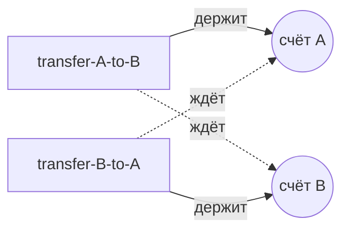

# Многопоточность (Multithreading)

## Фундамент

### 1. Потоки (Threads) и Процессы (Processes)

- **Процесс** — тяжеловесная единица (экземпляр запущенной программы). У процесса **своя изолированная память**. Если один упадёт — другие выживут.
    - _Аналогия:_ Отдельный дом. Чтобы поговорить с соседом (другим процессом), нужно орать через улицу (Socket, REST, IPC).
- **Поток** — лёгкая единица исполнения _внутри_ процесса. Все потоки одного процесса делят **общую память (Heap)**, но имеют свой **стек (Stack)**.
    - _Аналогия:_ Жильцы одной квартиры. Легко передают вещи (объекты в Heap), но могут подраться за туалет (Race Condition).

### 2. Создание: `Thread` vs `Runnable`

Почему `extends Thread` — моветон:

1. **Ограниченность наследования:** нет множественного наследования — ты теряешь возможность унаследоваться от бизнес-класса.
2. **SRP:** Поток (`Thread`) — это "рабочий" (механизм запуска). Задача (`Runnable`) — это "инструкция" (бизнес-логика). Нельзя вшивать инструкцию в рабочего.

```java
// ❌ Смешиваем инфраструктуру и логику
class BadThread extends Thread {
    @Override
    public void run() { System.out.println("Hard work..."); }
}

// ✅ Логика отдельно, запуск отдельно
Runnable task = () -> System.out.println("Clean work!");
Thread worker = new Thread(task);
worker.start();
```

### 3. Жизненный цикл потока

Состояния `Thread.State`:

1. **NEW** — создан `new Thread()`, `start()` ещё не вызван.
2. **RUNNABLE** — вызван `start()`. Поток либо выполняется на CPU, либо ждёт своей очереди в планировщике ОС.
3. **BLOCKED** — упёрся в `synchronized` и ждёт освобождения монитора.
4. **WAITING** — ждёт другого потока без лимита времени (`wait()`, `join()`).
5. **TIMED_WAITING** — ждёт с тайм-аутом (`sleep(1000)`, `wait(1000)`).
6. **TERMINATED** — `run()` завершился. Перезапустить нельзя — умер значит умер.

### 4. Базовая синхронизация: Мониторы

В Java **каждый объект** имеет встроенный замок (монитор/mutex). В один момент монитором может владеть только один поток.

```java
public class Counter {
    private int count = 0;
    private final Object lock = new Object();

    // Вариант 1: лок на this
    public synchronized void increment() {
        count++;
    }

    // Вариант 2: лок на конкретном объекте (лучше для гранулярности)
    public void incrementBlock() {
        synchronized (lock) {
            count++;
        }
    }

    // Вариант 3: лок на классе (static synchronized)
    // эквивалентно synchronized(Counter.class)
    public static synchronized void staticJob() { ... }
}
```

!!! tip "`synchronized` даёт сразу два свойства"
    **Атомарность** — никто не вмешается в середине. **Видимость** — после выхода из блока все потоки увидят актуальное значение.

### 5. `wait()` / `notify()` и Spurious Wakeup

Работают **только** внутри `synchronized` блока того же объекта.

- `wait()` — "Отпускаю монитор и иду спать, пока не разбудят".
- `notify()` — будит одного случайного из спящих.
- `notifyAll()` — будит всех, они начинают драться за монитор.

**Spurious Wakeup:** ОС может разбудить поток без вызова `notify`. Поэтому всегда используем `while`, а не `if`:

```java
public synchronized void consume() throws InterruptedException {
    // ✅ while — если проснулись ложно, цикл проверит условие снова
    while (queue.isEmpty()) {
        wait();
    }
    var data = queue.poll();
    notifyAll(); // сообщаем продюсерам, что место освободилось
}
```

### 6. `join`, `sleep`, `yield`

- **`Thread.sleep(ms)`** — пауза текущего потока. **НЕ отпускает мониторы!** Если уснул в `synchronized` — никто туда не зайдёт.
- **`thread.join()`** — "Жду, пока поток `thread` завершится". Используется, чтобы дождаться результата.
- **`Thread.yield()`** — подсказка планировщику "готов уступить CPU". Может быть проигнорирована. В реальном коде — редко.

### 7. Правильная остановка: `interrupt()`

`stop()` — **deprecated** и опасен: убивает поток "на полуслове", данные могут остаться битыми.

Правильный путь — **кооперативное завершение**:

```java
Thread worker = new Thread(() -> {
    while (!Thread.currentThread().isInterrupted()) {
        try {
            System.out.println("Working...");
            Thread.sleep(1000);
        } catch (InterruptedException e) {
            System.out.println("Попросили выйти во сне!");
            Thread.currentThread().interrupt(); // ❗ восстанавливаем флаг — catch его сбрасывает
            break;
        }
    }
    System.out.println("Clean shutdown.");
});

worker.start();
Thread.sleep(3000);
worker.interrupt(); // "стучимся" к потоку
```

## Java Memory Model (JMM)

### 1. Три кита JMM

**Atomicity (Атомарность)** — операция либо выполнена полностью, либо не начиналась. Другие потоки не видят промежуточного состояния.

Атомарны из коробки: чтение/запись ссылок и всех примитивов, **кроме** `long` и `double` (если не `volatile`). 64-битная запись на 32-битной ОС может разбиться на два шага — другой поток прочитает "склейку" из старой и новой половины (Word Tearing).

**Visibility (Видимость)** — запись одного потока может долго оставаться невидимой для другого: значение лежит в регистре или store buffer ядра, а JIT вправе закэшировать поле в регистре и вообще не перечитывать его. Без явной синхронизации JMM **не гарантирует**, когда (и увидит ли вообще) другой поток новое значение.

**Ordering (Упорядочивание/Reordering)** — компилятор и CPU вправе менять порядок инструкций, если это не ломает логику _текущего потока_ (правило _as-if-serial_). В многопоточном коде это приводит к неожиданным эффектам.

### 2. Happens-Before — твоя главная аксиома

Если событие A _happens-before_ события B, то JMM гарантирует:

1. Результат A будет **виден** для B.
2. A гарантированно **выполнится до** B (запрет переупорядочивания).

Если между записью в одном потоке и чтением в другом нет связи happens-before — у тебя **data race**.

**Ключевые правила:**

| Правило | Суть |
|---|---|
| **Program Order** | Каждое действие в потоке HB следующего в том же потоке |
| **Monitor Lock** | `unlock` HB следующего `lock` того же монитора |
| **Volatile Variable** | Запись в `volatile` HB любого последующего чтения этой переменной |
| **Thread Start** | `Thread.start()` HB любой инструкции в `run()` этого потока |
| **Thread Join** | Любая инструкция потока HB успешного выхода из `join()` |
| **Transitivity** | Если A HB B, и B HB C, то A HB C |

### 3. Анатомия `volatile`

Решает проблемы **видимости** и **упорядочивания**, но **не решает** атомарность сложных операций.

- **Видимость:** запись в `volatile` happens-before любого последующего чтения этой переменной. Это **не** "запись в RAM и чтение из RAM в обход кэша": кэши ядер и так когерентны (протокол MESI), volatile-переменная спокойно живёт в L1. Значение "застревает" в регистрах и store buffer ядра, а ещё JIT может закэшировать поле в регистре и вынести чтение из цикла. `volatile` запрещает JIT такие оптимизации и ставит барьеры памяти, после которых запись становится видна другим ядрам.
- **Memory Barriers:** `volatile` расставляет барьеры (StoreStore, StoreLoad, LoadLoad, LoadStore), запрещающие переупорядочивание.
- **Release/Acquire семантика:** если поток А записал `x = 5`, потом `volatile flag = true` — поток Б, увидев `flag == true`, гарантированно увидит и `x == 5`.

!!! warning "`volatile count++` — это баг"
    `count++` — это три шага: Read → Modify → Write. `volatile` гарантирует честное чтение и запись, но **не защищает** от двух потоков, одновременно прочитавших одно значение. Для атомарного инкремента — `AtomicInteger`.

### 4. Final Field Semantics (Безопасная публикация)

JMM даёт особую гарантию для `final` полей: если объект корректно создан (конструктор завершился), любой поток, получивший на него ссылку, **гарантированно увидит инициализированные значения `final` полей**.

```java
public class ImmutableConfig {
    private final Map<String, String> settings;

    public ImmutableConfig() {
        Map<String, String> temp = new HashMap<>();
        temp.put("timeout", "5000");
        this.settings = temp;
        // В конце конструктора JMM ставит StoreStore-барьер:
        // все записи внутри конструктора будут видны ВСЕМ потокам
        // ДО того, как ссылка на объект станет доступна снаружи
    }
}
```

!!! warning "Escape during construction (Утечка `this`)"
    Гарантия ломается, если ссылка на объект "утекла" до завершения конструктора — например, передал `this` в глобальный Listener или запустил поток из конструктора. Другой поток может увидеть `final` поля ещё равными `null`.

## java.util.concurrent

### 1. Locks (Блокировки)

**`ReentrantLock` vs `synchronized`:**

```java
ReentrantLock lock = new ReentrantLock();

// ✅ tryLock — не зависнешь навсегда
if (lock.tryLock(100, TimeUnit.MILLISECONDS)) {
    try {
        // критическая секция
    } finally {
        lock.unlock(); // обязателен в finally!
    }
}

// ✅ lockInterruptibly — можно прервать ожидание
lock.lockInterruptibly();
```

| Возможность | `synchronized` | `ReentrantLock` |
|---|---|---|
| Попытка захвата без зависания | ❌ | ✅ `tryLock()` |
| Прерываемое ожидание | ❌ | ✅ `lockInterruptibly()` |
| Честная очередь (fairness) | ❌ | ✅ `new ReentrantLock(true)` |
| Несколько Condition | ❌ | ✅ `lock.newCondition()` |
| Автоматическое освобождение | ✅ | ❌ (нужен `finally`) |

**`ReadWriteLock`** — для кэшей: тысячи читателей одновременно, но при записи все ждут.

**`StampedLock`** (Java 8) — добавляет **оптимистичное чтение**: читаешь без блокировки, получаешь `stamp`, потом проверяешь "данные не изменились?". Если нет — сэкономили время. Если да — перечитываем с обычной блокировкой.

**`Condition`** — замена `wait/notify`. Для одного лока можно создать несколько независимых очередей ожидания:

```java
ReentrantLock lock = new ReentrantLock();
Condition notEmpty = lock.newCondition(); // будим потребителей
Condition notFull  = lock.newCondition(); // будим производителей

// При добавлении элемента:
notEmpty.signal(); // только потребителей, не всех подряд

// При извлечении:
notFull.signal();  // только производителей
```

### 2. Atomics (Атомарные переменные)

Работают без блокировок (lock-free) через **CAS** (Compare-And-Swap — атомарная инструкция процессора `cmpxchg`): "обнови значение на X, но только если текущее == Y".

```java
AtomicInteger counter = new AtomicInteger(0);
counter.incrementAndGet();              // атомарный ++
counter.compareAndSet(expected, update); // CAS напрямую

AtomicReference<Node> head = new AtomicReference<>();
head.compareAndSet(oldHead, newHead);   // lock-free структуры данных
```

**`LongAdder` vs `AtomicLong` — почему LongAdder рвёт под нагрузкой:**

При 100 потоках, бьющих в один `AtomicInteger`, 99 промахнутся в CAS и уйдут на новый круг (spin-wait), сжигая CPU. `LongAdder` держит массив ячеек — потоки хешируются и обновляют разные ячейки, не мешая друг другу. `sum()` просто складывает ячейки.

!!! tip "Must-have для метрик"
    `LongAdder` — обязательный выбор для высоконагруженных счётчиков (метрики, статистика). `AtomicLong` — когда нужен точный CAS (`compareAndSet`) или `get()` с мгновенной точностью.

### 3. Concurrent Collections

Разобраны в разделе [Коллекции → Потокобезопасные коллекции](collections.md#concurrent-collections). Краткая шпаргалка:

| Коллекция | Когда использовать |
|---|---|
| `ConcurrentHashMap` | Кэш, любое хранилище в многопоточной среде |
| `CopyOnWriteArrayList` | Список слушателей — читаем постоянно, пишем редко |
| `ArrayBlockingQueue` | Ограниченная очередь задач, жёсткий лимит |
| `LinkedBlockingQueue` | Очередь задач с высокой пропускной способностью |
| `SynchronousQueue` | Передача "из рук в руки" без буфера |

### 4. Synchronizers (Синхронизаторы)

**`CountDownLatch` — "Защёлка" (одноразовый)**

Главный поток ждёт, пока `N` других не выполнят работу.

```java
CountDownLatch latch = new CountDownLatch(3);

// В каждом из 3 потоков:
latch.countDown(); // уменьшает счётчик

// В главном потоке:
latch.await(); // блокируется, пока счётчик не станет 0
```

_Пример:_ Отправили запросы в 3 микросервиса, дождались всех, собрали финальный ответ.

**`CyclicBarrier` — "Шлагбаум" (многоразовый)**

N потоков делают расчёт по этапам. Кто дошёл до точки — ждёт остальных. Когда все пришли — идут дальше вместе.

```java
CyclicBarrier barrier = new CyclicBarrier(5, () -> {
    System.out.println("Все пришли, переходим к следующему этапу!");
});

// В каждом из 5 потоков:
barrier.await(); // ждём остальных
```

**`Semaphore` — "Парковка"**

Ограничивает количество потоков, работающих с ресурсом одновременно.

```java
Semaphore semaphore = new Semaphore(5); // 5 "пропусков"

semaphore.acquire(); // взять пропуск (блокируется если все заняты)
try {
    callExternalApi();
} finally {
    semaphore.release(); // вернуть пропуск
}
```

_Идеально для rate limiting_ — ограничить одновременные запросы к внешнему API.

**`Phaser` — "Комбайн"**

Смесь Latch и Barrier на максималках. Динамически регистрирует и удаляет участников в процессе работы. Очень гибкий, но сложный.

## Deadlock, livelock, starvation { #liveness }

Три проблемы живости (liveness): потоки есть, а работа не двигается. На собесе просят объяснить разницу, написать дедлок с нуля, найти его в thread dump и назвать два способа избежать.

### Что такое deadlock и как он возникает? { #deadlock }

**Уровень:** Middle

!!! abstract "Ответ вслух"
    Взаимная блокировка (deadlock) — это когда потоки навсегда заблокированы, ожидая друг друга: каждый держит один лок и ждёт лок, который держит другой. Классика — два потока берут те же два лока в разном порядке. Сама JVM дедлок не предотвращает и не разрывает: потоки висят, пока жив процесс.

Дедлок возможен, только когда одновременно выполнены четыре условия Коффмана (Coffman conditions):

1. **Взаимное исключение (mutual exclusion)** — ресурсом владеет один поток.
2. **Удержание и ожидание (hold and wait)** — поток держит один лок и ждёт другой.
3. **Нет вытеснения (no preemption)** — отнять лок у потока нельзя, он отпускает его сам.
4. **Циклическое ожидание (circular wait)** — потоки ждут друг друга по кругу.

Сломай любое из условий — и дедлока не будет. На практике ломают циклическое ожидание (порядок захвата) или удержание с ожиданием (`tryLock` с таймаутом), см. [как избежать](#deadlock-prevention).

Пример: перевод между счетами. Каждый `transfer` блокирует сначала счёт-источник, потом счёт-получатель. Если один поток переводит A → B, а другой B → A, они берут те же мониторы в противоположном порядке:

```java linenums="1"
public class Deadlock {

    static class Account {
        private final String id;
        private long balance;

        Account(String id, long balance) {
            this.id = id;
            this.balance = balance;
        }
    }

    // ❌ Порядок захвата зависит от аргументов: transfer(a, b) и transfer(b, a)
    //    берут те же мониторы в противоположном порядке
    static void transfer(Account from, Account to, long amount) throws InterruptedException {
        synchronized (from) {
            Thread.sleep(100); // окно, в которое второй поток успевает взять свой первый лок
            synchronized (to) {
                from.balance -= amount;
                to.balance += amount;
            }
        }
    }

    public static void main(String[] args) {
        var a = new Account("A", 1_000);
        var b = new Account("B", 1_000);

        Thread.ofPlatform().name("transfer-A-to-B").start(() -> run(a, b));
        Thread.ofPlatform().name("transfer-B-to-A").start(() -> run(b, a));
    }

    private static void run(Account from, Account to) {
        try {
            transfer(from, to, 100);
            System.out.println(Thread.currentThread().getName() + ": done");
        } catch (InterruptedException e) {
            Thread.currentThread().interrupt();
        }
    }
}
```

Запусти `java Deadlock.java` на JDK 25 — программа ничего не напечатает и не завершится. `sleep(100)` нужен только чтобы дедлок воспроизводился каждый раз: без него потоки тоже могут сцепиться, но редко и непредсказуемо.



!!! warning "Ловушка: «у меня один лок на метод — дедлока не будет»"
    Дедлок не обязан быть в одном методе. Если под локом ты вызываешь чужой код — колбэк, слушатель, метод другого `synchronized`-объекта, — тот может взять свой лок, и порядок захвата уже неявный. Правило: под локом не вызывай код, который ты не контролируешь (open call — вызов без удержания лока).

!!! warning "Ловушка: дедлок на `synchronized` не прервать"
    Поток в состоянии BLOCKED на входе в `synchronized` не реагирует на `interrupt()` и не имеет таймаута. Спасает только рестарт процесса. У `ReentrantLock` есть `lockInterruptibly()` и `tryLock(timeout, unit)`, у `synchronized` таких выходов нет.

??? question "Проверь себя"
    1. Назови четыре условия Коффмана. Какое из них ломает фиксированный порядок захвата локов?
    2. Почему в примере дедлок воспроизводится каждый раз, а без `Thread.sleep(100)` — нет?
    3. Как можно получить дедлок, если в каждом методе ровно один `synchronized`?

### Как найти дедлок в работающем приложении? { #deadlock-detection }

**Уровень:** Middle

!!! abstract "Ответ вслух"
    Снять thread dump: `jcmd <pid> Thread.print`, `jstack <pid>` или `kill -3 <pid>`. HotSpot сам ищет циклы ожидания по `synchronized` и локам из `java.util.concurrent` и печатает в конце дампа блок `Found one Java-level deadlock` с участниками и стеками. Из кода то же делает `ThreadMXBean.findDeadlockedThreads()`.

Сначала узнай pid: `jps -l` или `jcmd` без аргументов. Потом сними дамп одним из способов:

```bash
jcmd <pid> Thread.print       # рекомендуемый способ; -l добавит локи java.util.concurrent
jstack <pid>                  # то же; -l — «long listing» с информацией о локах; утилита экспериментальная
kill -3 <pid>                 # SIGQUIT: дамп уходит в stdout самого процесса, а не в твой терминал
```

Вывод `jstack` для примера выше (JDK 25, сокращено). Сначала в общем списке потоков:

```text
"transfer-A-to-B" #23 [705] prio=5 os_prio=0 cpu=0.62ms elapsed=3.19s tid=0x00007fe16c1318e0 nid=705 waiting for monitor entry  [0x00007fe14cb34000]
   java.lang.Thread.State: BLOCKED (on object monitor)
	at Deadlock.transfer(Deadlock.java:19)
	- waiting to lock <0x000000073781f3e0> (a Deadlock$Account)
	- locked <0x000000073781f398> (a Deadlock$Account)
	at Deadlock.run(Deadlock.java:35)
	...

"transfer-B-to-A" #24 [706] prio=5 os_prio=0 cpu=0.67ms elapsed=3.19s tid=0x00007fe16c132d80 nid=706 waiting for monitor entry  [0x00007fe14ca34000]
   java.lang.Thread.State: BLOCKED (on object monitor)
	at Deadlock.transfer(Deadlock.java:19)
	- waiting to lock <0x000000073781f398> (a Deadlock$Account)
	- locked <0x000000073781f3e0> (a Deadlock$Account)
	at Deadlock.run(Deadlock.java:35)
	...
```

Затем, в самом конце дампа, — результат поиска дедлоков:

```text
Found one Java-level deadlock:
=============================
"transfer-A-to-B":
  waiting to lock monitor 0x00007fe108002090 (object 0x000000073781f3e0, a Deadlock$Account),
  which is held by "transfer-B-to-A"

"transfer-B-to-A":
  waiting to lock monitor 0x00007fe0fc000f20 (object 0x000000073781f398, a Deadlock$Account),
  which is held by "transfer-A-to-B"

Java stack information for the threads listed above:
===================================================
...

Found 1 deadlock.
```

Как это читать:

- **`BLOCKED (on object monitor)`** и **`waiting for monitor entry`** — поток стоит на входе в `synchronized`.
- **`- locked <0x...398>`** — монитор, которым поток уже владеет; **`- waiting to lock <0x...3e0>`** — монитор, которого он ждёт. У второго потока адреса зеркальные — это и есть цикл.
- **`Deadlock.java:19`** — первая строка внутри вложенного `synchronized (to)`: поток застрял на входе в этот блок.
- **`Found one Java-level deadlock`** — HotSpot сам нашёл цикл и назвал, кто чей лок держит. `jcmd <pid> Thread.print` даёт тот же вывод.

С `ReentrantLock` вместо `synchronized` дедлок тоже находится, но выглядит иначе: поток в состоянии `WAITING (parking)`, в стеке `- parking to wait for <0x...> (a java.util.concurrent.locks.ReentrantLock$NonfairSync)`, а в блоке дедлока — `waiting for ownable synchronizer ..., which is held by "t2"`. Чтобы увидеть, кто держит такой лок, добавь `-l`: у каждого потока появится секция `Locked ownable synchronizers`.

Из кода дедлок ищет `ThreadMXBean` — так делают watchdog-потоки и health-check'и:

```java
var mx = ManagementFactory.getThreadMXBean();
long[] ids = mx.findDeadlockedThreads(); // null, если дедлока нет
if (ids != null) {
    for (var info : mx.getThreadInfo(ids, true, true)) {
        System.out.print(info); // имя потока, лок, которого ждёт, и его владелец
    }
}
```

!!! warning "Ловушка: виртуальные потоки не видны `jstack` и `ThreadMXBean`"
    `jstack` и `jcmd Thread.print` показывают только платформенные потоки, а `findDeadlockedThreads()` по документации не находит циклы с участием виртуальных потоков. Для них снимай `jcmd <pid> Thread.dump_to_file -format=json <file>` (или `plain`): в JDK 25 там видно `BLOCKED`, `locked` и `waiting to lock`, но строки `Found one Java-level deadlock` нет — цикл ищешь глазами.

!!! warning "Ловушка: дедлока не нашлось, а приложение висит"
    `Found 1 deadlock` бывает только при цикле ожидания локов. Если поток навсегда завис в `wait()`, `await()` на защёлке или в `get()` у `Future`, которую никто не завершит, — HotSpot об этом не скажет. Ищи потоки в `WAITING` и смотри в стеке, чего они ждут.

??? question "Проверь себя"
    1. Какими тремя способами можно снять thread dump и куда уходит вывод `kill -3`?
    2. По каким строкам дампа видно, что два потока ждут друг друга?
    3. Почему дедлок между виртуальными потоками не покажет `jstack`, и что использовать вместо него?

### Как избежать дедлока? { #deadlock-prevention }

**Уровень:** Middle

!!! abstract "Ответ вслух"
    Главный способ — глобальный порядок захвата: все потоки берут локи в одном порядке, например по возрастанию id, и цикл ожидания не может возникнуть. Второй — `tryLock` с таймаутом: не взял второй лок — отпусти первый и попробуй позже. Плюс общие правила: держи лок как можно меньше и не вызывай под ним чужой код.

**Способ 1: порядок захвата локов.** Ломает циклическое ожидание. Ключ порядка должен быть уникальным и неизменяемым:

```java
static class Account {
    final long id;     // уникальный и неизменяемый — по нему задаём порядок
    long balance;
}

// ✅ Мониторы всегда берутся в порядке возрастания id,
//    какой бы стороной перевода ни был счёт
static void transfer(Account from, Account to, long amount) {
    Account first  = from.id < to.id ? from : to;
    Account second = from.id < to.id ? to : from;
    synchronized (first) {
        synchronized (second) {
            from.balance -= amount;
            to.balance += amount;
        }
    }
}
```

Два потока по миллиону встречных переводов `a → b` и `b → a` на JDK 25 завершаются за доли секунды, сумма на счетах сохраняется.

**Способ 2: `tryLock` с таймаутом.** Ломает «удержание и ожидание»: поток не держит первый лок бесконечно, пока ждёт второй:

```java
static class Account {
    final ReentrantLock lock = new ReentrantLock();
    long balance;
}

// ✅ Не ждём второй лок вечно: не взяли за таймаут — отпускаем первый и пробуем заново
static boolean transfer(Account from, Account to, long amount, long timeoutMs)
        throws InterruptedException {
    long deadline = System.nanoTime() + TimeUnit.MILLISECONDS.toNanos(timeoutMs);
    while (true) {
        if (from.lock.tryLock(10, TimeUnit.MILLISECONDS)) {
            try {
                if (to.lock.tryLock(10, TimeUnit.MILLISECONDS)) {
                    try {
                        from.balance -= amount;
                        to.balance += amount;
                        return true;
                    } finally {
                        to.lock.unlock();
                    }
                }
            } finally {
                from.lock.unlock(); // отпускаем первый лок, даже если второй не взяли
            }
        }
        if (System.nanoTime() > deadline) {
            return false; // сдаёмся — вызывающий решает: повторить, вернуть ошибку
        }
        // случайная пауза, чтобы потоки не повторяли попытки в такт (livelock)
        Thread.sleep(ThreadLocalRandom.current().nextLong(1, 5));
    }
}
```

`tryLock` без порядка захвата выбирают, когда порядок задать нельзя: локи приходят из разных модулей или их набор известен только в рантайме. Цена — повторные попытки и ветка «не получилось», которую надо обработать.

Общие правила, которые снижают шанс дедлока:

- **Меньше локов.** Один лок на всё состояние вместо двух — нет порядка, который можно нарушить.
- **Короткие критические секции.** Под локом — только работа с общим состоянием, без I/O и сетевых вызовов.
- **Open calls.** Чужой код (колбэки, слушатели) вызывай после выхода из `synchronized`.
- **Готовые примитивы.** `ConcurrentHashMap`, очереди и `Atomic*` прячут локи внутри и не дают взять их в неправильном порядке.

!!! warning "Ловушка: `System.identityHashCode` как ключ порядка"
    Если у объектов нет id, порядок часто строят по `System.identityHashCode()`. Но хэши двух разных объектов могут совпасть — тогда порядок снова зависит от аргументов. При равенстве хэшей бери третий, общий для всех лок-«рефери» (tie-breaking lock) и захватывай оба лока под ним.

!!! warning "Ловушка: `tryLock()` без аргументов игнорирует fairness"
    По документации `ReentrantLock` нетаймаутный `tryLock()` захватывает свободный лок, даже если в очереди уже ждут другие потоки, — настройка fairness на него не действует. `tryLock(timeout, unit)` у честного лока её соблюдает.

??? question "Проверь себя"
    1. Какое условие Коффмана ломает порядок захвата, а какое — `tryLock` с таймаутом?
    2. Почему в варианте с `tryLock` первый лок отпускается в `finally`, а не только при успехе?
    3. Зачем случайная пауза между попытками и что будет без неё?

### Чем livelock и starvation отличаются от deadlock? { #livelock-starvation }

**Уровень:** Middle

!!! abstract "Ответ вслух"
    При livelock потоки не заблокированы и жгут CPU, но прогресса нет: они постоянно уступают друг другу, как двое в коридоре, шагающие в одну сторону. При голодании (starvation) система в целом работает, но конкретный поток долго не получает ресурс — его обходят «жадные» потоки. Deadlock — потоки стоят в BLOCKED или WAITING и не двигаются вовсе.

| | **Deadlock** | **Livelock** | **Starvation** |
|---|---|---|---|
| **Состояние потоков** | BLOCKED / WAITING навсегда | RUNNABLE, крутятся в цикле | Жертва ждёт, остальные работают |
| **CPU** | ~0% | Высокий | Нормальный |
| **Прогресс системы** | Нет у участников | Нет у участников | Есть, но не у жертвы |
| **Видно в thread dump** | `Found one Java-level deadlock` | Нет: потоки RUNNABLE, стек меняется от дампа к дампу | Нет: жертва в нескольких дампах подряд ждёт тот же лок |

**Livelock** типично возникает при «вежливом» отступлении: поток не смог взять ресурс, откатился и сразу повторил. Если два потока с `tryLock` делают это с одинаковым интервалом, они могут бесконечно хватать по одному локу и отпускать его. Лечится случайной паузой (backoff), как в примере выше, или фиксированным порядком захвата.

**Starvation** случается, когда:

- лок нечестный (по умолчанию и у `synchronized`, и у `ReentrantLock`) — новый поток может «влезть» (barging) перед тем, кто давно ждёт;
- поток держит лок долго и часто перезахватывает его — остальным почти не достаётся;
- пул забит долгими задачами, и короткие задачи стоят в очереди.

Против голодания на локе — честный лок `new ReentrantLock(true)`: при конкуренции он отдаёт доступ потоку, который ждёт дольше всех. По документации такой лок гарантирует отсутствие голодания, но пропускная способность у него ниже, часто намного.

!!! warning "Ловушка: приоритеты потоков против голодания"
    `Thread.setPriority()` — лишь подсказка планировщику ОС, и на многих платформах она почти ни на что не влияет. Чинить голодание приоритетами нельзя, а высоким приоритетом «жадного» потока его легко устроить.

??? question "Проверь себя"
    1. Как отличить livelock от deadlock по thread dump и загрузке CPU?
    2. Почему `tryLock` в цикле без случайной паузы может привести к livelock?
    3. Чем честный `ReentrantLock` помогает от голодания и чем за это платишь?

**Источники:**

- [JLS SE 25, §17.1 Synchronization](https://docs.oracle.com/javase/specs/jls/se25/html/jls-17.html#jls-17.1) — язык не предотвращает и не обязан обнаруживать дедлоки.
- [The Java Tutorials: Deadlock](https://docs.oracle.com/javase/tutorial/essential/concurrency/deadlock.html) и [Starvation and Livelock](https://docs.oracle.com/javase/tutorial/essential/concurrency/starvelive.html)
- [`jstack` — JDK 25 Tool Specifications](https://docs.oracle.com/en/java/javase/25/docs/specs/man/jstack.html) и [`jcmd`](https://docs.oracle.com/en/java/javase/25/docs/specs/man/jcmd.html) — `Thread.print`, `Thread.dump_to_file`
- [Troubleshooting Guide JDK 25: Diagnostic Tools](https://docs.oracle.com/en/java/javase/25/troubleshoot/diagnostic-tools.html) — `jcmd` рекомендуется вместо `jstack`
- [Troubleshooting Guide JDK 21: Troubleshoot Process Hangs and Loops](https://docs.oracle.com/en/java/javase/21/troubleshoot/troubleshoot-process-hangs-and-loops.html) — thread dump и встроенный поиск дедлоков HotSpot
- [`ThreadMXBean.findDeadlockedThreads()`](https://docs.oracle.com/en/java/javase/25/docs/api/java.management/java/lang/management/ThreadMXBean.html#findDeadlockedThreads()) — только платформенные потоки
- [`ReentrantLock`](https://docs.oracle.com/en/java/javase/25/docs/api/java.base/java/util/concurrent/locks/ReentrantLock.html) — fairness, `tryLock(long, TimeUnit)`, `lockInterruptibly()`

## Управление потоками (Executors)

### Почему не делаем `new Thread()` вручную?

1. **Дорого:** создание системного потока (Java-поток → поток ОС) — тяжёлый системный вызов с выделением памяти под стек.
2. **Риск OOM:** 1000 запросов → 1000 потоков → `OutOfMemoryError: unable to create new native thread`.
3. **Нет контроля:** как собрать результаты? как отменить? как ограничить количество?

Решение — **пулы потоков**: переиспользуем потоки, управляем жизненным циклом.

### 1. Иерархия интерфейсов

- **`Executor`** — базовый: `execute(Runnable)`. Просто "выполни где-нибудь".
- **`ExecutorService`** — рабочий инструмент: управление жизненным циклом (`shutdown`, `shutdownNow`), возврат результата через `submit(Callable)` → `Future`.
- **`ScheduledExecutorService`** — выполнение с задержкой или периодически (замена устаревшему `Timer`).

### 2. ThreadPoolExecutor — сердце управления потоками

Четыре главных параметра конструктора:

- **`corePoolSize`** — базовое число потоков, живут всегда (даже без задач).
- **`maxPoolSize`** — максимум потоков при пиковой нагрузке.
- **`keepAliveTime`** — время простоя "лишних" потоков (сверх core) до удаления.
- **`workQueue`** — очередь задач, когда все потоки заняты.

!!! warning "Золотое правило пула — алгоритм принятия решений"
    Порядок строго такой, тут часто путаются:

    1. Потоков меньше `corePoolSize` → **создать новый поток**.
    2. `corePoolSize` заполнен → **положить в очередь**.
    3. Очередь **заполнена** → **создать поток до `maxPoolSize`**.
    4. `maxPoolSize` достигнут, очередь полна → **Rejection Policy**.

    Важно: новые потоки сверх core создаются только когда **и** очередь заполнена!

**Rejection Policies:**

| Политика | Поведение | Когда применять |
|---|---|---|
| `AbortPolicy` | Бросает `RejectedExecutionException` | По умолчанию, когда важно не терять задачи |
| `CallerRunsPolicy` | Вызывающий поток сам выполняет задачу | ⭐ Продакшн — создаёт естественный Backpressure |
| `DiscardPolicy` | Молча выбрасывает новую задачу | Некритичные логи, метрики |
| `DiscardOldestPolicy` | Выбрасывает самую старую задачу | Редко |

`CallerRunsPolicy` — любимая политика для продакшена. Пока главный поток сам обрабатывает задачу, он не может принимать новые запросы — пул получает время разгрести завал. Это **Backpressure**.

### 3. Готовые пулы — фабрика `Executors`

!!! warning "Мины в продакшене"
    Стандартные фабрики удобны, но каждая содержит архитектурную мину.

**`Executors.newFixedThreadPool(n)`**

Под капотом: `core == max == n`, `LinkedBlockingQueue` — **безлимитная** очередь.

При наплыве задач очередь бесконечно растёт → `OutOfMemoryError: Java heap space`.

Когда юзать: нагрузка предсказуема, количество потоков строго ограничено ресурсами CPU.

**`Executors.newCachedThreadPool()`**

Под капотом: `core = 0`, `max = Integer.MAX_VALUE`, `SynchronousQueue` (ёмкость 0 — сразу передаёт потоку).

При DDoS-атаке создаёт поток на каждую задачу → `OutOfMemoryError: unable to create new native thread`.

Когда юзать: много коротких лёгких асинхронных задач.

**`Executors.newSingleThreadExecutor()`**

Под капотом: `core = max = 1`, `LinkedBlockingQueue`.

Гарантирует строго последовательное выполнение. Если поток умрёт — пул создаст замену.

!!! tip "Вопрос с подвохом"
    Чем отличается от `newFixedThreadPool(1)`?

    `newFixedThreadPool(1)` возвращает обычный `ThreadPoolExecutor` — его можно привести к типу и перенастроить (например, `.setMaximumPoolSize(10)`). `newSingleThreadExecutor()` оборачивает пул в **неизменяемый wrapper** — изменить размер в процессе работы невозможно.

### 4. ForkJoinPool (FJP)

Особый вид пула для алгоритмов "Разделяй и властвуй" (рекурсивные задачи). Работает под капотом `parallelStream()` и `CompletableFuture` (по умолчанию).

В обычном пуле — одна общая очередь, все толкаются. В FJP у **каждого** потока **своя очередь (Deque)**.

**Work Stealing (Кража работы):** Если поток выполнил все свои задачи — он идёт к загруженному соседу и "ворует" задачу с **хвоста** его очереди. Хозяин берёт с головы — конфликтов нет, синхронизация минимальна, CPU загружен максимально.

## Асинхронность и Future

### 1. `Future` — в чём боль?

`Future` появился в Java 5. Отправляешь задачу в пул, получаешь "обещание" результата. Но он глухой и немой:

```java
Future<String> future = executor.submit(() -> fetchData());

// Два варианта — оба плохие:
while (!future.isDone()) { ... } // сжигаем CPU в опросном цикле
String result = future.get();    // БЛОКИРУЕМ текущий поток — вся суть асинхронности теряется
```

### 2. `CompletableFuture` — функциональный конвейер

Java 8. Строим цепочки задач, передающих данные асинхронно — главный поток не блокируется.

**Запуск:**

```java
// ❗ Всегда передавай свой Executor!
// По умолчанию CF использует ForkJoinPool.commonPool() — его легко забить тяжёлыми задачами

CompletableFuture<Void> noResult = CompletableFuture
    .runAsync(() -> sendEmail(), executor);           // void

CompletableFuture<String> withResult = CompletableFuture
    .supplyAsync(() -> fetchData(), executor);        // возвращает результат
```

**Трансформация результата:**

```java
// thenApply — как map() в стримах. Один к одному, в том же потоке
CompletableFuture<Integer> length = CompletableFuture
    .supplyAsync(() -> "Hello", executor)
    .thenApply(String::length);       // String → Integer

// thenCompose — как flatMap(). Когда следующий шаг тоже возвращает CF
CompletableFuture<Document> doc = CompletableFuture
    .supplyAsync(() -> fetchDocumentId(), executor)       // → Long
    .thenCompose(id -> loadDocument(id, executor));       // Long → CF<Document>
    // без thenCompose получили бы CF<CF<Document>>
```

**Слияние независимых задач (`thenCombine`):**

```java
// Параллельно парсим таблицы и картинки из файла
CompletableFuture<List<Table>> tables = CompletableFuture
    .supplyAsync(() -> parseTables(file), executor);
CompletableFuture<List<Image>> images = CompletableFuture
    .supplyAsync(() -> parseImages(file), executor);

// Ждём обоих, склеиваем результат — без блокировки главного потока
CompletableFuture<Document> result = tables.thenCombine(images,
    (t, i) -> new Document(t, i)
);
```

**Обработка ошибок:**

```java
CompletableFuture<List<Image>> images = CompletableFuture
    .supplyAsync(() -> parseImages(file), executor)

    // exceptionally — как catch: ловит ошибку, возвращает фоллбэк
    .exceptionally(ex -> {
        log.error("Не удалось распарсить картинки: ", ex);
        return Collections.emptyList(); // вместо падения — пустой список
    })

    // handle — как finally + catch: вызывается В ЛЮБОМ СЛУЧАЕ
    // удобно для закрытия ресурсов и записи статуса
    .handle((result, ex) -> {
        if (ex != null) {
            log.error("Ошибка:", ex);
            return Collections.emptyList();
        }
        return result;
    });
```

**Ожидание нескольких CF:**

```java
// Ждём ВСЕ завершатся
CompletableFuture.allOf(cf1, cf2, cf3).join();

// Возвращает результат ПЕРВОГО завершившегося
CompletableFuture.anyOf(cf1, cf2, cf3).thenAccept(result -> ...);
```

## Deep Dive — Under the Hood

### 1. CAS и Проблема ABA

**CAS (Compare-And-Swap)** — неделимая инструкция процессора (`cmpxchg` в x86). За один такт: читает → сравнивает с ожидаемым → если совпало, записывает новое. Никаких блокировок ОС.

**Проблема ABA:**

1. Поток 1 читает значение `A`, вытесняется планировщиком.
2. Поток 2 меняет `A → B`.
3. Поток 3 меняет `B → A`.
4. Поток 1 просыпается, видит `A` — совпало! — делает CAS. Но логически состояние уже другое.

**Решение:** `AtomicStampedReference` — к значению добавляется счётчик-версия. CAS проверяет и значение, и версию.

### 2. AQS (AbstractQueuedSynchronizer)

Абсолютное ядро пакета `java.util.concurrent`. На нём построены `ReentrantLock`, `CountDownLatch`, `Semaphore`, `ReadWriteLock`.

- Хранит `volatile int state` (состояние: количество разрешений, статус лока и т.п.).
- Держит FIFO-очередь ожидания потоков (двусвязный список нод).
- Если поток не смог получить доступ (CAS не прошёл) — AQS **сам паркует** его и ставит в очередь. Когда ресурс освобождается — **сам будит** следующего.

### 3. `LockSupport.park()` / `unpark()`

Низкоуровневые примитивы, на которых работает AQS. Не нужен `synchronized`.

У каждого потока есть один "пермит": `park()` блокирует если пермита нет; `unpark(thread)` выдаёт пермит.

!!! tip "Ключевое отличие от `wait/notify`"
    Если сделать `unpark()` **до** вызова `park()` — поток не заблокируется вообще. С `wait/notify` такой трюк приводит к вечному зависанию.

### 4. False Sharing (Ложное разделение)

Процессор читает память **кэш-линиями** по 64 байта. Если две независимые `volatile` переменные оказались в одной кэш-линии, и два потока на разных ядрах их постоянно обновляют — ядра непрерывно инвалидируют кэш друг друга. Производительность падает на ровном месте.

**Решение:** аннотация `@Contended` (или "паддинг" — добивка пустыми полями). Заставляет JVM разнести переменные по разным кэш-линиям. Именно так устроен `LongAdder` под капотом.

```java
// С Java 9 аннотация переехала из sun.misc во внутренний пакет JDK:
// javac --add-exports java.base/jdk.internal.vm.annotation=ALL-UNNAMED
// java  -XX:-RestrictContended  (без флага вне JDK аннотация игнорируется)
@jdk.internal.vm.annotation.Contended
private volatile long value;
```

## Project Loom (Java 21+)

### Virtual Threads vs Platform Threads

| | **Platform (OS) Threads** | **Virtual Threads** |
|---|---|---|
| **Управление** | ОС | JVM |
| **Стек** | ~1-2 МБ в памяти ОС | В Java Heap как обычный объект |
| **Максимум** | ~тысячи | **Миллионы** |
| **Создание** | `new Thread(task)` | `Thread.ofVirtual().start(task)` |

### Carrier Threads и монтирование

Виртуальные потоки выполняются на небольшом пуле обычных потоков-носителей (Carrier Threads, по умолчанию ForkJoinPool).

1. Виртуальный поток **монтируется** на Carrier — выполняется на CPU.
2. Встречает блокирующую I/O (ждёт БД, сеть) — **размонтируется**, стек сохраняется в Heap.
3. Carrier-поток свободен — берёт другой виртуальный поток.
4. Когда I/O готово — виртуальный поток монтируется снова.

Никто не простаивает. Можно держать тысячи открытых соединений к БД без тысяч реальных потоков.

### Pinning (Прикалывание) — ахиллесова пята

Если виртуальный поток блокируется, но **не может** размонтироваться — он "прикалывает" (pins) Carrier-поток к себе.

Если таких потоков будет много — пул Carrier-потоков исчерпается, приложение зависнет.

**Когда происходит пиннинг:**

- **Java 21–23:** блокировка внутри `synchronized` (I/O под монитором, `Object.wait()`, ожидание входа в занятый монитор) и вызов native-метода (JNI).
- **Java 24+ ([JEP 491](https://openjdk.org/jeps/491)):** `synchronized` больше **не пинит** — виртуальный поток размонтируется и при ожидании монитора, и внутри `synchronized`, и в `Object.wait()`. Пиннинг остался для native-кода (JNI, Foreign Function API) и для редких случаев вроде блокировки в статическом инициализаторе класса.

!!! warning "Золотое правило Loom (только Java 21–23)"
    На Java 21–23 заменяй `synchronized` на `ReentrantLock` там, где под блокировкой есть блокирующие операции. С `ReentrantLock` виртуальные потоки корректно размонтируются при ожидании.

    С Java 24 переписывать `synchronized` ради виртуальных потоков не нужно. `ReentrantLock` выбирают только ради его возможностей: `tryLock()`, таймауты, fairness, несколько `Condition`.

### Structured Concurrency (Preview)

Управление подзадачами как единым блоком — по аналогии с обычным `try-catch`:

```java
// Java 25 (JEP 505), preview: javac/java --enable-preview
try (var scope = StructuredTaskScope.open()) { // Joiner по умолчанию: все успешны или исключение
    Subtask<String> user  = scope.fork(() -> fetchUser(id));
    Subtask<Order>  order = scope.fork(() -> fetchOrder(id));

    scope.join(); // ждём обе; если одна упала — вторая отменяется, join() бросает FailedException

    return new Response(user.get(), order.get());
} // при выходе из блока — все незавершённые подзадачи автоматически отменяются
```

Если один fork падает с ошибкой — второй автоматически отменяется. Никаких утечек потоков. Код становится линейным и предсказуемым.

Политику ожидания задаёт `Joiner`, который передают в `open()`. Например, "кто первый — тот и победил" (гонка реплик):

```java
try (var scope = StructuredTaskScope.open(Joiner.<String>anySuccessfulResultOrThrow())) {
    scope.fork(() -> fetchFromReplica("eu"));
    scope.fork(() -> fetchFromReplica("us"));

    return scope.join(); // результат первой успешной подзадачи, остальные отменяются
}
```

!!! warning "Preview API"
    Structured Concurrency — preview-фича (Java 21–25): без флага `--enable-preview` код не скомпилируется. API менялся от версии к версии: в Java 21–24 scope создавали через `new StructuredTaskScope.ShutdownOnFailure()`, а ошибку проверяли отдельным `throwIfFailed()` после `join()`. Примеры выше — для Java 25 ([JEP 505](https://openjdk.org/jeps/505)): фабрика `StructuredTaskScope.open()`, политика через `Joiner`, `fork()` возвращает `Subtask`.

## Шпаргалка { #cheatsheet }

| Тема | Запомнить |
|---|---|
| **Процесс vs поток** | У процесса своя память; потоки процесса делят кучу, но у каждого свой стек |
| **`Thread` vs `Runnable`** | Задача — в `Runnable` (или `Callable`), запуск — в `Thread` или пуле; `extends Thread` — моветон |
| **Жизненный цикл** | NEW → RUNNABLE → BLOCKED / WAITING / TIMED_WAITING → TERMINATED; перезапустить нельзя |
| **`synchronized`** | Монитор объекта: атомарность и видимость; `static synchronized` — монитор класса |
| **`wait` / `notify`** | Только внутри `synchronized`; ждать в `while`, а не в `if` (spurious wakeup) |
| **`sleep` / `join` / `yield`** | `sleep` не отпускает мониторы; `join` ждёт завершения потока; `yield` — лишь подсказка |
| **Остановка потока** | `interrupt()` + проверка флага; в `catch (InterruptedException)` восстанавливай флаг |
| **JMM** | Атомарность, видимость, упорядочивание; без happens-before — data race |
| **`volatile`** | Видимость и запрет переупорядочивания через барьеры; `count++` не делает атомарным |
| **`final`-поля** | Видны всем потокам после конструктора, если `this` не утёк |
| **`ReentrantLock`** | `tryLock`, прерываемое ожидание, fairness, несколько `Condition`; `unlock()` — в `finally` |
| **Atomics** | CAS без блокировок; под высокой конкуренцией счётчики — `LongAdder` |
| **Синхронизаторы** | `CountDownLatch` — одноразовый, `CyclicBarrier` — многоразовый, `Semaphore` — ограничение доступа |
| **Deadlock** | Потоки держат по локу и ждут друг друга по кругу; нужны все 4 условия Коффмана; JVM сама не разрывает |
| **Поиск дедлока** | `jcmd <pid> Thread.print` / `jstack` / `kill -3` → `Found one Java-level deadlock`; виртуальные потоки — `Thread.dump_to_file` |
| **Избежать дедлока** | Единый порядок захвата локов (по id); `tryLock(timeout)` с откатом и случайной паузой; не звать чужой код под локом |
| **Livelock и starvation** | Livelock — RUNNABLE и CPU, но без прогресса; starvation — поток обходят, лечится `new ReentrantLock(true)` |
| **`ThreadPoolExecutor`** | core → очередь → потоки до max → rejection policy; в проде — `CallerRunsPolicy` |
| **Фабрики `Executors`** | Fixed и Single — безлимитная очередь (OOM heap), Cached — безлимит потоков (OOM native thread) |
| **`ForkJoinPool`** | Своя очередь у каждого потока и work stealing; под капотом `parallelStream()` и `CompletableFuture` |
| **`CompletableFuture`** | `thenApply` — map, `thenCompose` — flatMap, `thenCombine` — слияние; всегда свой `Executor` |
| **CAS и ABA** | Неделимое «сравнить и записать»; ABA лечится `AtomicStampedReference` |
| **AQS** | `volatile int state` + очередь ожидания; основа `ReentrantLock`, `Semaphore`, `CountDownLatch` |
| **False sharing** | Независимые переменные в одной кэш-линии мешают друг другу; `@Contended` или паддинг |
| **Виртуальные потоки** | Миллионы потоков на JVM; размонтируются на блокирующем I/O; Java 21+ |
| **Pinning** | Java 21–23 — `synchronized` и native; с Java 24 (JEP 491) — только native-код и редкие случаи |
| **Structured Concurrency** | Preview: `StructuredTaskScope.open()` + `Joiner`, `fork()` → `Subtask` (Java 25) |
