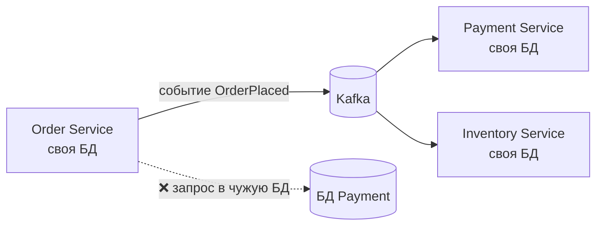

---
tags:
  - Junior
  - Middle
  - Java
---

# ООП (Object-Oriented Programming)

Четыре принципа ООП, интерфейсы и абстрактные классы, перегрузка и переопределение, композиция против наследования, связность и зацепление. Чаще всего спрашивают, чем интерфейс отличается от абстрактного класса после Java 8, почему «композиция лучше наследования» и что входит в сигнатуру метода.

## Принципы ООП { #principles }

### Что такое ООП и зачем оно нужно? { #what-is-oop }

**Уровень:** Junior

!!! abstract "Ответ вслух"
    ООП — стиль, при котором программа строится из объектов, объединяющих данные и логику их обработки. Объект сам управляет своим состоянием, а снаружи у него просят действие: не `списать_деньги(карта)`, а `card.pay()`. Главная цель — управлять сложностью большой системы, разбивая её на изолированные «чёрные ящики».

**ООП (объектно-ориентированное программирование)** — парадигма, при которой программа строится как набор взаимодействующих **объектов**, а не как список последовательных команд. Суть в двух пунктах:

1. **Объект объединяет данные и логику.** Вместо того чтобы хранить переменные отдельно, а функции для их обработки — отдельно (как в процедурном программировании), мы объединяем их в одну сущность. Объект знает своё **состояние** (поля) и сам управляет **поведением** (методы).
2. **Моделирование реального мира.** Вместо разрозненных команд `проверить_баланс(карточка)` и `списать_деньги(карточка)` мы создаём объект `BankCard` и просим его: `card.pay()`. Как он это сделает внутри — нас не волнует.

```java
public class BankCard {
    private long balance; // состояние скрыто внутри

    public BankCard(long balance) {
        this.balance = balance;
    }

    public void pay(long amount) { // поведение: объект сам проверяет и меняет своё состояние
        if (amount > balance) {
            throw new IllegalStateException("Недостаточно средств");
        }
        balance -= amount;
    }
}
```

!!! info "Зачем это вообще придумали?"
    Главная цель ООП — **управление сложностью**. Когда проект вырастает до сотен тысяч строк, процедурный подход превращается в «спагетти», где всё зависит от всего. ООП позволяет разбить систему на изолированные «чёрные ящики»: можно полностью переписать внутренности одного объекта (например, подсчёт скидки), не боясь сломать код на другом конце приложения.

!!! warning "Ловушка: «ООП — это классы и наследование»"
    Классы — лишь инструмент. Суть ООП — объекты, которые сами отвечают за своё состояние. Класс с публичными сеттерами, состояние которого меняет внешний сервис, — это процедурный код в обёртке из классов.

??? question "Проверь себя"
    1. Чем объектный подход отличается от процедурного?
    2. Какую главную задачу решает ООП?
    3. Почему `card.pay()` лучше, чем `списать_деньги(card)`?

### Что такое инкапсуляция? { #encapsulation }

**Уровень:** Junior

!!! abstract "Ответ вслух"
    Это защита инвариантов объекта: состояние меняется только через бизнес-методы, которые проверяют правила. Не `setStatus(PAID)`, а `order.pay()`, внутри которого проверено, что заказ не отменён. Приватные поля с геттерами и сеттерами — только начало, а не суть.

Для джуна инкапсуляция — это «сделать поля `private` и написать `get`/`set`». Для инженера это **защита бизнес-правил (инвариантов)** объекта от некорректного использования извне.

- **Как это работает:** объект сам управляет своим состоянием. У сущности `Order` не должно быть метода `setStatus(Status.PAID)`: перед сменой статуса нужно проверить, не отменён ли заказ и хватает ли средств.
- **Правильный подход:** состояние меняется только через бизнес-методы с говорящими названиями: `order.pay()`, `order.cancel()`. Проверки инкапсулированы внутри них.
- **Архитектурная ценность:** избавляет от антипаттерна «анемичная модель домена» (anemic domain model), когда объекты — просто структуры с геттерами и сеттерами, а бизнес-логика размазана по `Service`-классам.

```java
public class Order {
    private OrderStatus status = OrderStatus.NEW;

    public void pay() {
        if (status == OrderStatus.CANCELLED) {
            throw new IllegalStateException("Заказ отменён");
        }
        status = OrderStatus.PAID;
    }

    public void cancel() {
        if (status == OrderStatus.PAID) {
            throw new IllegalStateException("Оплаченный заказ сначала нужно вернуть");
        }
        status = OrderStatus.CANCELLED;
    }

    // ❌ Нет public setStatus(): иначе любой код обойдёт проверки выше
}
```

!!! warning "Ловушка: сеттер на каждое поле"
    Публичный сеттер для каждого поля формально выглядит как инкапсуляция, но позволяет любому коду перевести объект в недопустимое состояние. Если правило «оплаченный заказ нельзя отменить» живёт в сервисе, а не в `Order`, его обязательно где-то забудут проверить.

??? question "Проверь себя"
    1. Чем инкапсуляция отличается от «приватных полей с геттерами и сеттерами»?
    2. Почему у `Order` не должно быть `setStatus()`?
    3. Что такое анемичная модель домена?

### Что такое абстракция? { #abstraction }

**Уровень:** Junior

!!! abstract "Ответ вслух"
    Абстракция — выделение главного и сокрытие деталей реализации: важно, **что** делает объект, а не **как**. В Java она выражается интерфейсами и абстрактными классами. Бизнес-логика знает только интерфейс `PaymentGateway`, а Stripe, PayPal или мок за ним — деталь.

Абстракция — выделение значимых характеристик объекта и игнорирование незначимых деталей реализации.

- **Как это работает:** в Java абстракция выражается через интерфейсы (`interface`) и абстрактные классы.
- **Архитектурная ценность:** это основа слабого зацепления (low coupling). В гексагональной (Ports and Adapters) или слоистой архитектуре бизнес-домен работает только с абстракциями. Бизнес-логика знает интерфейс `PaymentGateway` с методом `charge()`, а реализован он через Stripe API, PayPal или мок для тестов — ей всё равно.

```java
public interface PaymentGateway {
    void charge(String accountId, long amount); // ЧТО делаем
}

public class StripeGateway implements PaymentGateway {
    @Override
    public void charge(String accountId, long amount) {
        // КАК делаем: HTTP-запрос в Stripe API
    }
}

public class CheckoutService {
    private final PaymentGateway gateway; // знаем только абстракцию

    public CheckoutService(PaymentGateway gateway) {
        this.gateway = gateway;
    }

    public void checkout(String accountId, long amount) {
        gateway.charge(accountId, amount);
    }
}
```

!!! warning "Ловушка: абстракция ради абстракции"
    Интерфейс с единственной реализацией, которую никогда не подменят даже в тестах, только добавляет кода. Абстракция окупается там, где реализаций несколько или их нужно подменять — платежи, хранилища, внешние API.

??? question "Проверь себя"
    1. Чем абстракция отличается от инкапсуляции?
    2. Какими средствами Java выражается абстракция?
    3. Как абстракция помогает тестировать бизнес-логику?

### Что такое полиморфизм? { #polymorphism }

**Уровень:** Junior

!!! abstract "Ответ вслух"
    Полиморфизм — возможность работать с объектами разных классов через общий интерфейс, не зная их реального типа. Статический полиморфизм — перегрузка, метод выбирает компилятор; динамический — переопределение, метод выбирает JVM по реальному типу объекта. На динамическом полиморфизме держатся DIP и внедрение зависимостей в Spring.

Слово переводится как «множество форм». Это способность системы использовать объекты с одинаковым интерфейсом без информации о их типе и внутреннем устройстве.

- **Два вида в Java:**
    1. **Статический (раннее связывание):** перегрузка методов (overloading) — одно имя, разные параметры. Какой метод вызвать, решает компилятор.
    2. **Динамический (позднее связывание):** переопределение (overriding) — переменная типа интерфейса ссылается на конкретную реализацию, и метод выбирается в рантайме. Подробно — в [Override и Overload](#override-overload).
- **Архитектурная ценность:** именно динамический полиморфизм делает возможными принцип инверсии зависимостей ([D в SOLID](../design/solid.md#dip)) и Dependency Injection в Spring. Ты просишь у Spring `NotificationSender`, а полиморфизм гарантирует, что вызовется `send()` нужного бина — Email, SMS или Push.

```java
interface NotificationSender {
    void send(String text);
}

class EmailSender implements NotificationSender {
    public void send(String text) { System.out.println("Email: " + text); }
}

class SmsSender implements NotificationSender {
    public void send(String text) { System.out.println("SMS: " + text); }
}

List<NotificationSender> senders = List.of(new EmailSender(), new SmsSender());
for (NotificationSender sender : senders) {
    sender.send("Заказ оплачен"); // какой send() вызвать, JVM решает по реальному типу объекта
}
```

!!! warning "Ловушка: `instanceof` вместо полиморфизма"
    Цепочка `if (sender instanceof EmailSender) ... else if (sender instanceof SmsSender)` ломает полиморфизм: каждый новый тип требует правки этого кода. Если поведение зависит от типа, оно должно жить в методе самого типа.

??? question "Проверь себя"
    1. Чем статический полиморфизм отличается от динамического?
    2. Кто выбирает вызываемый метод при перегрузке и при переопределении?
    3. Как полиморфизм связан с Dependency Injection?

### Почему с наследованием нужно быть осторожным? { #inheritance }

**Уровень:** Middle

!!! abstract "Ответ вслух"
    Наследование создаёт самую сильную связь между классами: наследник зависит не только от контракта родителя, но и от деталей его реализации. Глубокие иерархии приводят к проблеме хрупкого базового класса. Поэтому правило Effective Java — «предпочитай композицию наследованию».

Наследование — механизм, который описывает новый класс на основе существующего. Наследник получает все свойства и поведение родителя: отношение «IS-A» («ЯВЛЯЕТСЯ»).

- **Как это работает:** ключевое слово `extends`. Класс `VipUser` наследует всё от `User` и добавляет скидку.
- **Главная ловушка:** в современных архитектурах наследование реализаций считается самым опасным принципом ООП. Его часто применяют, чтобы просто переиспользовать пару служебных методов, — это антипаттерн.
- **Хрупкий базовый класс:** глубокие иерархии ведут к проблеме **fragile base class** — изменение в родителе непредсказуемо ломает десятки наследников. Разбор с кодом — в [Композиция против наследования](#fragile-base-class).

```java
class User {
    protected String name;
}

class VipUser extends User {        // VipUser ЯВЛЯЕТСЯ User — наследование оправдано
    private int discountPercent = 10;
}
```

!!! warning "Ловушка: наследование ради переиспользования кода"
    Джошуа Блох в книге _Effective Java_ сформулировал правило: **«Предпочитайте композицию наследованию»**. Наследовать стоит интерфейсы (для полиморфизма), а абстрактные классы — использовать как шаблоны (паттерн Template Method).

??? question "Проверь себя"
    1. Какое отношение между классами выражает наследование?
    2. Что такое проблема хрупкого базового класса?
    3. Что советует Effective Java про наследование и композицию?

## Интерфейсы и абстрактные классы { #interfaces }

### Чем интерфейс отличается от абстрактного класса? { #interface-vs-abstract }

**Уровень:** Junior

!!! abstract "Ответ вслух"
    Абстрактный класс задаёт идентичность — отношение «IS-A», общую базу родственных классов, и может хранить состояние и иметь конструкторы. Интерфейс задаёт роль — «CAN-DO», контракт, и состояния не хранит. Класс может наследовать только один класс, но реализовать сколько угодно интерфейсов.

Главное правило на собесе: сначала отвечай про архитектурный смысл, а потом — про синтаксис.

- **Абстрактный класс — отношение «IS-A» (ЯВЛЯЕТСЯ).** Он определяет **идентичность** объекта и выделяет общую базу родственных классов. _Пример:_ `BaseEntity` — базовая сущность БД. И `User`, и `Order` _являются_ сущностями: у них есть `id`, дата создания и общий конструктор.
- **Интерфейс — отношение «CAN-DO» (УМЕЕТ) или контракт.** Он определяет **роль** или способность, независимо от того, кем объект является. _Пример:_ `Serializable`, `Runnable`, `PaymentGateway`. `EmailSender` и `SmsSender` могут быть из разных иерархий, но оба реализуют контракт `NotificationSender`.

**Техническая разница — множественное наследование.** Java запрещает наследовать больше одного класса (даже абстрактного), чтобы избежать конфликтов состояния («проблема ромба»). А интерфейсов можно реализовать сколько угодно: классический интерфейс не несёт состояния.

```java
public abstract class BaseEntity {              // IS-A: идентичность и общее состояние
    protected Long id;
    protected final Instant createdAt = Instant.now();
}

public interface Notifiable {                   // CAN-DO: роль
    void notifyUser(String text);
}

public class Customer extends BaseEntity implements Notifiable, Serializable {
    @Override
    public void notifyUser(String text) { System.out.println(text); }
}
```

| **Характеристика** | **Абстрактный класс** | **Интерфейс** |
|---|---|---|
| **Смысл** | «IS-A» (базовая идентичность) | «CAN-DO» (контракт, роль) |
| **Множественное наследование** | ❌ Нет (только один) | ✅ Да (сколько угодно) |
| **Хранение состояния (поля)** | ✅ Да (любые поля) | ❌ Нет (только `public static final` константы) |
| **Конструкторы** | ✅ Да (вызываются через `super()`) | ❌ Нет |
| **Модификаторы методов** | `public`, `protected`, `private`, package-private | `public` по умолчанию; с Java 9 — ещё `private` |
| **Методы с реализацией** | Да (любые) | Да (`default`, `static`, `private`) |

!!! warning "Ловушка: начинать ответ с синтаксиса"
    Перечисление «в интерфейсе нет полей, а в абстрактном классе есть» — неполный ответ. Интервьюер ждёт разницу в смысле: идентичность против роли и одно наследование против многих.

??? question "Проверь себя"
    1. Какое отношение выражает абстрактный класс, а какое — интерфейс?
    2. Почему Java разрешает реализовать много интерфейсов, но наследовать только один класс?
    3. Может ли интерфейс иметь конструктор или изменяемые поля?

### Зачем в интерфейсах `default`, `static` и `private` методы? { #interface-methods }

**Уровень:** Middle

!!! abstract "Ответ вслух"
    `default` (Java 8) нужны для обратной совместимости: в `List` и `Collection` добавили `stream()` и `forEach()`, не сломав миллионы чужих реализаций. `static` (Java 8) держат утилиты и фабрики прямо в интерфейсе, как `List.of()`. `private` (Java 9) позволяют вынести общий код из нескольких `default`-методов.

Когда в Java 8 появились `default`-методы, многие решили, что интерфейсы превратились в абстрактные классы. Но у архитекторов языка была веская причина.

- **`default`-методы (Java 8) — обратная совместимость.** Нужно было добавить новые методы (`stream()`, `forEach()`) в стандартные интерфейсы коллекций. Если бы их добавили как обычные абстрактные методы, миллионы проектов перестали бы компилироваться: их собственные коллекции не реализовали бы новые методы. `default` даёт реализацию по умолчанию — класс может её переопределить или использовать готовую.
- **`static`-методы (Java 8) — утилиты рядом с контрактом.** Раньше рядом с интерфейсом `Collection` жил отдельный утилитный класс `Collections` с приватным конструктором. Теперь статические методы (например, фабричные `List.of()`) живут прямо в интерфейсе.
- **`private`-методы (Java 9) — рефакторинг внутри интерфейса.** Когда в интерфейсах разрешили код, появилось дублирование. Приватные методы позволяют вынести общий код нескольких `default`-методов в один скрытый метод.

```java
public interface Greeter {
    String name();

    default String greet() {                 // Java 8: реализация по умолчанию
        return format("Привет");
    }

    default String greetFormally() {
        return format("Здравствуйте");
    }

    private String format(String prefix) {   // Java 9: общий код для default-методов
        return prefix + ", " + name() + "!";
    }

    static Greeter of(String name) {         // Java 8: фабрика прямо в интерфейсе
        return () -> name;
    }
}

System.out.println(Greeter.of("Алиса").greet()); // Привет, Алиса!
```

!!! warning "Ловушка: два интерфейса с одинаковым `default`-методом"
    Если класс реализует два интерфейса с одинаковым `default`-методом, код не скомпилируется, пока класс не переопределит метод сам. Выбрать реализацию одного из интерфейсов можно явно — через `A.super.hello()`.

    ```java
    interface A { default String hello() { return "A"; } }
    interface B { default String hello() { return "B"; } }

    class C implements A, B {
        @Override
        public String hello() {
            return A.super.hello(); // без переопределения — ошибка компиляции
        }
    }
    ```

??? question "Проверь себя"
    1. Какую проблему решили `default`-методы в Java 8?
    2. Зачем в интерфейс добавили `private`-методы?
    3. Что будет, если класс реализует два интерфейса с одинаковым `default`-методом?

### Превратили ли `default`-методы интерфейс в абстрактный класс? { #interface-state }

**Уровень:** Middle

!!! abstract "Ответ вслух"
    Нет. Ключевое слово — состояние: абстрактный класс может иметь обычные поля и конструкторы, а интерфейс — нет, любая его переменная — это `public static final` константа. `default`-метод работает только с аргументами и другими методами интерфейса и не может сохранить ничего в `this`.

Интервьюер спросит: _"И там и там теперь можно писать методы с реализацией. В чём разница сегодня?"_ Твой козырь — слово **СОСТОЯНИЕ (state)**.

1. **Абстрактный класс может хранить состояние.** У него могут быть обычные поля (instance variables) и конструкторы, и он может менять это состояние.
2. **Интерфейс не имеет состояния (stateless).** Обычную переменную объявить нельзя: любое поле автоматически становится `public static final` константой. Конструктора у интерфейса нет и быть не может.

Любой `default`-метод может оперировать только входящими аргументами или вызывать другие методы этого интерфейса. Сохранить что-то в `this.counter = 1` он не может — у интерфейса нет полей.

```java
public interface Limits {
    int MAX_RETRIES = 3;     // на самом деле public static final — константа
    // int counter;          // ❌ ошибка компиляции: поле интерфейса обязано быть инициализировано

    default boolean canRetry(int attempt) {
        return attempt < MAX_RETRIES; // работает только с аргументами и константами
    }
}
```

!!! warning "Ловушка: «константа» в интерфейсе изменяема"
    `public static final List<String> NAMES = new ArrayList<>();` в интерфейсе нельзя переприсвоить, но сам список можно менять из любого места программы. Для констант-коллекций используй неизменяемые `List.of()` и `Map.of()`.

??? question "Проверь себя"
    1. Каким словом отвечать на вопрос «чем интерфейс отличается от абстрактного класса после Java 8»?
    2. Во что компилятор превращает поле интерфейса?
    3. Может ли `default`-метод хранить данные между вызовами?

## Override и Overload { #override-overload }

### Что входит в сигнатуру метода? { #signature }

**Уровень:** Junior

!!! abstract "Ответ вслух"
    Только имя метода и список параметров — их количество, типы и порядок. Возвращаемый тип, модификаторы доступа и `throws` в сигнатуру не входят. Поэтому два метода, которые отличаются только возвращаемым типом, не скомпилируются.

Перегрузка и переопределение — две реализации полиморфизма, но работают они на разных этапах жизни программы. Прежде чем говорить, как компилятор выбирает метод, нужно усвоить жёсткое правило.

**Сигнатура метода включает ТОЛЬКО:**

1. Имя метода.
2. Список параметров (количество, типы и порядок).

```java
class Parser {
    int parse(String s) { return Integer.parseInt(s); }
    int parse(String s, int radix) { return Integer.parseInt(s, radix); } // ✅ другие параметры — перегрузка
    // long parse(String s) { return 0L; }  // ❌ ошибка компиляции: сигнатура та же, отличается только возвращаемый тип
}
```

!!! warning "Ловушка: возвращаемый тип не часть сигнатуры"
    Тип возвращаемого значения, модификаторы доступа (`public`, `private`) и выбрасываемые исключения (`throws`) **НЕ входят** в сигнатуру. Два метода с одинаковым именем и параметрами, но разными возвращаемыми типами компилятор не пропустит.

??? question "Проверь себя"
    1. Что входит в сигнатуру метода?
    2. Можно ли объявить два метода, отличающихся только возвращаемым типом?
    3. Входит ли `throws` в сигнатуру?

### Чем перегрузка отличается от переопределения? { #overload-vs-override }

**Уровень:** Junior

!!! abstract "Ответ вслух"
    Перегрузка — методы с одним именем и разными параметрами; какой вызвать, решает компилятор по типам аргументов и ссылки (раннее связывание). Переопределение — наследник заменяет метод родителя с той же сигнатурой; какой вызвать, решает JVM в рантайме по реальному типу объекта (позднее связывание).

#### Перегрузка (overload) — статический полиморфизм { #overload }

Перегрузка — когда в одном классе (или при наследовании) есть методы с **одинаковым именем, но разной сигнатурой**.

- **Как это работает (раннее связывание, compile-time):** решение, какой метод вызвать, принимает **компилятор** (`javac`). Он смотрит на объявленные типы аргументов.
- **Пример:** есть `print(String s)` и `print(Integer i)`. При `print(5)` компилятор видит число и прописывает в байт-коде вызов `print(Integer)`. В рантайме JVM уже ничего не выбирает.

#### Переопределение (override) — динамический полиморфизм { #override }

Переопределение — когда наследник пишет свою реализацию метода родителя с **точно такой же сигнатурой**.

- **Как это работает (позднее связывание, runtime):** в коде `Animal a = getAnimalFromDb(); a.speak();` компилятор не знает, кто вернётся из базы — собака или кошка. Он лишь проверяет, что у `Animal` есть `speak()`. В рантайме JVM смотрит на **реальный тип объекта** в куче (например, `Dog`), находит его таблицу виртуальных методов (vtable) и вызывает метод из класса `Dog`.

```java
class Printer {
    void print(Object o)  { System.out.println("Object"); }
    void print(String s)  { System.out.println("String"); }
    void print(Integer i) { System.out.println("Integer"); }
}

class Animal { String speak() { return "..."; } }
class Dog extends Animal { @Override String speak() { return "Гав"; } }

Printer p = new Printer();
p.print(5);              // Integer — компилятор выбрал по типу аргумента
Object o = "текст";
p.print(o);              // Object! — перегрузка выбирается по объявленному типу, а не по реальному

Animal a = new Dog();
System.out.println(a.speak()); // Гав — переопределение выбирается по реальному типу объекта
```

| **Характеристика** | **Перегрузка (Overload)** | **Переопределение (Override)** |
|---|---|---|
| **Где происходит** | В одном классе | В классах-наследниках |
| **Имя метода** | Одинаковое | Одинаковое |
| **Параметры (сигнатура)** | **Разные** | **Одинаковые** |
| **Возвращаемый тип** | Может быть любым | Тот же или ковариантный (подтип) |
| **Кто решает** | Компилятор (раннее связывание) | JVM (позднее связывание) |
| **Аннотация** | Не нужна | Желательно писать `@Override` |

!!! warning "Ловушка: перегрузка смотрит на объявленный тип"
    `Object o = "текст"; p.print(o);` вызовет `print(Object)`, а не `print(String)`: компилятор видит только тип переменной. Полиморфизм по реальному типу объекта работает только при переопределении.

!!! warning "Ловушка: правила переопределения"
    Переопределяющий метод не может сузить модификатор доступа (`public` → `protected`) и не может объявить новые или более широкие проверяемые исключения в `throws`. Иначе наследник нарушил бы контракт родителя. Аннотация `@Override` поможет поймать опечатку в сигнатуре на этапе компиляции.

??? question "Проверь себя"
    1. Кто и когда выбирает метод при перегрузке и при переопределении?
    2. Какой метод вызовет `p.print(o)`, если `Object o = "текст"`?
    3. Можно ли при переопределении сделать `public`-метод `protected`?

### Можно ли при переопределении изменить тип возвращаемого значения? { #covariant-return }

**Уровень:** Middle

!!! abstract "Ответ вслух"
    Да, но только на подтип — это ковариантность возвращаемых типов (с Java 5). `Animal create()` в наследнике можно переопределить как `Dog create()`: вызывающему коду больше не нужен каст. Расширить тип или заменить его на несвязанный нельзя.

Вопрос, который отличает мидла от джуна: _"При переопределении сигнатура должна совпадать. А можно ли изменить тип возвращаемого значения?"_

**Ответ:** можно, но только на **класс-наследник** (подтип) — это называется ковариантностью. До Java 5 тип должен был совпадать точь-в-точь. Сейчас действует правило: сузить тип можно, расширить или заменить на другой — нельзя.

```java
class AnimalFactory {
    // Родитель возвращает широкий Animal
    public Animal create() {
        return new Animal();
    }
}

class DogFactory extends AnimalFactory {
    @Override
    // Наследник СУЖАЕТ возвращаемый тип до Dog — это легально
    public Dog create() {
        return new Dog();
    }
}
```

Коду, который вызывает `DogFactory`, больше не нужно делать каст `(Dog) factory.create()`: метод сразу возвращает конкретный тип.

!!! warning "Ловушка: ковариантность только для ссылочных типов"
    Заменить `Animal` на `String` компилятор не даст — это нарушит контракт родителя. И у примитивов ковариантности нет: `int` нельзя переопределить как `long` или `short`.

??? question "Проверь себя"
    1. Что такое ковариантность возвращаемых типов?
    2. С какой версии Java она доступна?
    3. Можно ли переопределить метод, возвращающий `Animal`, методом, возвращающим `String`?

## Композиция и наследование { #composition }

### Почему наследование нарушает инкапсуляцию? { #fragile-base-class }

**Уровень:** Middle

=== "Коротко"

    !!! abstract "Ответ вслух"
        Наследник зависит не только от сигнатур родителя, но и от деталей их реализации. Классический пример из Effective Java: счётчик добавлений в `extends HashSet` насчитает 6 вместо 3, потому что `HashSet.addAll()` внутри вызывает переопределённый `add()`. Решение — композиция и делегирование: класс содержит `Set`, а не является им.

=== "Подробно"

    Для начала зафиксируем понятия:

    - **Наследование (inheritance)** — отношение **«IS-A» (ЯВЛЯЕТСЯ)**. `Dog` _является_ `Animal`.
    - **Композиция (composition)** — отношение **«HAS-A» (СОДЕРЖИТ)**. `Car` _содержит_ `Engine`.

    Наследование реализаций (`extends` от обычного класса) — самая сильная связь (tight coupling) в ООП. Джошуа Блох предупреждает: **наследование нарушает инкапсуляцию**. Подкласс зависит не только от сигнатур методов родителя, но и от **деталей их реализации**.

    **Классический пример из Effective Java:** нужна коллекция, которая считает, сколько элементов в неё когда-либо добавляли. Делаем `extends HashSet<T>`, заводим поле `count` и переопределяем `add()` и `addAll()`:

    ```java
    public class CountingSet<T> extends HashSet<T> {
        private int count = 0;

        @Override
        public boolean add(T e) {
            count++;
            return super.add(e);
        }

        @Override
        public boolean addAll(Collection<? extends T> c) {
            count += c.size();
            return super.addAll(c);
        }

        public int getCount() { return count; }
    }

    CountingSet<String> set = new CountingSet<>();
    set.addAll(List.of("A", "B", "C"));
    System.out.println(set.getCount()); // 6, а не 3!
    ```

    _Что произошло?_ Внутри `HashSet` метод `addAll` реализован через цикл вызовов `add`. Наш `addAll` прибавил 3, затем вызвал `super.addAll()`, а тот трижды вызвал наш же переопределённый `add`.

    Логика сломана, хотя всё сделано «по правилам», — а если разработчики JDK поменяют реализацию `HashSet`, код сломается снова. Это и есть **fragile base class (хрупкий базовый класс)**.

    #### Решение: композиция и делегирование { #delegation }

    Вместо того чтобы _быть_ `HashSet`-ом, класс _содержит_ его. Это паттерн делегирования (delegation), на нём же часто строится [Декоратор](../design/structural-patterns.md#decorator).

    ```java
    public class CountingSet<T> {
        // 1. Композиция: прячем реальный Set внутри
        private final Set<T> innerSet = new HashSet<>();
        private int count = 0;

        // 2. Своя логика
        public boolean add(T e) {
            count++;
            return innerSet.add(e); // 3. Делегирование
        }

        public boolean addAll(Collection<? extends T> c) {
            count += c.size();
            return innerSet.addAll(c); // 3. Делегирование
        }

        public int getCount() {
            return count;
        }
    }
    ```

    - **Композиция:** поле `innerSet` — класс состоит из других объектов.
    - **Делегирование (delegation):** класс не делает работу сам, а перепоручает вызов внутреннему объекту: `innerSet.add()`.

    Теперь класс не зависит от того, как устроен `HashSet` внутри: инкапсуляция сохранена полностью.

!!! warning "Ловушка: «я же ничего не нарушил»"
    Переопределённые методы родителя могут вызываться из его же других методов — это деталь реализации, которой нет в контракте. Наследуясь от класса, который не задокументирован для наследования, ты привязываешься к его внутренностям.

??? question "Проверь себя"
    1. Почему счётчик в `CountingSet extends HashSet` показывает 6 вместо 3?
    2. Что такое проблема хрупкого базового класса?
    3. Как композиция и делегирование решают эту проблему?

### Когда наследование всё-таки уместно? { #when-inherit }

**Уровень:** Middle

!!! abstract "Ответ вслух"
    Когда между классами настоящее отношение «IS-A», при наследовании интерфейсов (тип и контракт, а не реализация) и когда базовый класс специально спроектирован для наследования. Всё остальное лучше закрыть через `final` или `sealed`.

Наследование не нужно выкидывать, но применять его стоит строго по правилам:

1. **Только для истинного отношения «IS-A».** Если есть малейшее сомнение — используй композицию.
2. **Наследование интерфейсов — это хорошо.** `implements MyInterface` наследует _тип и контракт_, а не реализацию. Это безопасно и необходимо для полиморфизма.
3. **Проектируй для наследования или запрещай его.** Джошуа Блох: если класс не спроектирован для наследования (нет документации о том, какие методы вызывают друг друга), он должен быть `final` — или `sealed` в современной Java (см. [Современная Java → sealed](modern-java.md#sealed)).

```java
public final class Money {          // не спроектирован для наследования — закрыт
    private final long amount;
    public Money(long amount) { this.amount = amount; }
}

public abstract class ReportTemplate {      // спроектирован для наследования (Template Method)
    public final String build() {           // алгоритм закрыт от изменений
        return header() + body();
    }
    protected String header() { return "Отчёт\n"; }
    protected abstract String body();       // точка расширения задокументирована
}
```

!!! warning "Ловушка: открытый по умолчанию класс"
    В Java любой класс без `final` открыт для наследования. Если ты пишешь библиотеку или общий модуль, любой может унаследоваться и завязаться на детали реализации — и ты больше не сможешь их менять без риска сломать чужой код.

??? question "Проверь себя"
    1. В каких трёх случаях наследование оправдано?
    2. Почему наследование интерфейсов безопаснее наследования реализаций?
    3. Что делать с классом, который не спроектирован для наследования?

## Связность и зацепление { #coupling-cohesion }

### Что такое high cohesion и low coupling? { #cohesion-coupling }

**Уровень:** Middle

!!! abstract "Ответ вслух"
    Cohesion — насколько сфокусированы обязанности внутри одного класса; её хотят высокой: класс делает одну вещь. Coupling — насколько разные классы зависят друг от друга; его хотят низким: классы общаются через абстракции. Это отражение SRP и DIP из SOLID.

!!! tip "Золотое правило архитектуры"
    **High Cohesion and Low Coupling** — высокая связность внутри и слабое зацепление снаружи.

#### High cohesion (высокая связность) { #high-cohesion }

**Cohesion** показывает, насколько хорошо сфокусированы обязанности _внутри одного_ класса или модуля.

- **Суть:** класс делает ровно одну вещь, и все его методы и поля служат одной цели. Это прямое отражение буквы **S** из SOLID — [SRP](../design/solid.md#srp).
- **Антипаттерн (low cohesion):** `UserService`, который сохраняет пользователя в БД, генерирует PDF-отчёт, отправляет email и считает налоги, — это **God Object** (божественный объект). Его методы логически не связаны, его невозможно тестировать и страшно менять.
- **Как правильно:** разбить на сфокусированные компоненты: `UserRepository` (только БД), `PdfGenerator` (только документы), `EmailSender` (только почта).

#### Low coupling (слабое зацепление) { #low-coupling }

**Coupling** показывает, насколько сильно _разные_ классы или модули зависят друг от друга.

- **Суть:** классы должны знать друг о друге как можно меньше. Изменение одного класса не должно заставлять переписывать десять других. Это отражение буквы **D** из SOLID — [DIP](../design/solid.md#dip).
- **Антипаттерн (high / tight coupling):** `OrderService` сам создаёт `new MySQLOrderRepository()`. Перейдёт бизнес на PostgreSQL или MongoDB — придётся переписывать `OrderService`.
- **Как правильно (low / loose coupling):** классы общаются **только через абстракции**. `OrderService` получает в конструкторе интерфейс `OrderRepository`, а какая база под ним — его не волнует. Реализацию внедряет Spring (Dependency Injection).

```java
// ❌ Сильное зацепление: сервис знает конкретную реализацию
class TightOrderService {
    private final MySQLOrderRepository repository = new MySQLOrderRepository();
}

// ✅ Слабое зацепление: сервис знает только абстракцию
class LooseOrderService {
    private final OrderRepository repository;

    LooseOrderService(OrderRepository repository) { // реализацию передадут снаружи
        this.repository = repository;
    }
}

interface OrderRepository { void save(Order order); }
class MySQLOrderRepository implements OrderRepository { public void save(Order order) { } }
```

| **Характеристика** | **Cohesion (связность)** | **Coupling (зацепление)** |
|---|---|---|
| **Где фокус** | **Внутри** одного модуля или класса | **Между** разными модулями или классами |
| **Что измеряет** | Насколько методы служат одной цели | Насколько классы зависят друг от друга |
| **Идеальное состояние** | **Высокая (high):** класс сфокусирован | **Слабое (low):** классы независимы |
| **Связь с SOLID** | Single Responsibility (SRP) | Dependency Inversion (DIP) |
| **Аналогия** | Хорошо организованный отдел: налоги считают только бухгалтеры | Компании-партнёры общаются через договоры, а не лезут друг к другу в сейф |

!!! warning "Ловушка: перепутать cohesion и coupling"
    Cohesion — про то, что **внутри** класса, coupling — про связи **между** классами. Хотим высокую связность и слабое зацепление, а не наоборот.

??? question "Проверь себя"
    1. Что измеряет cohesion, а что — coupling?
    2. Почему God Object — пример низкой связности?
    3. Как Dependency Injection снижает зацепление?

### Как эти принципы работают в микросервисах? { #microservices }

**Уровень:** Senior

!!! abstract "Ответ вслух"
    High cohesion — один сервис отвечает за один бизнес-домен: оплаты отдельно, склад отдельно. Low coupling — сервисы не ходят в чужие базы и общаются через события или чёткие API-контракты. Тогда падение одного сервиса не обрушивает остальные.

Интервьюер спросит: _"Как эти принципы масштабируются на микросервисы?"_

- **Микросервисы и high cohesion:** один сервис отвечает строго за один бизнес-домен (Domain-Driven Design): отдельно `Payment`, `Inventory` и `Shipping`. Если смешать оплаты и доставку в одном сервисе, получится «распределённый монолит» с низкой связностью.
- **Микросервисы и low coupling:** сервисы не лезут в базы данных друг друга — это жёсткое зацепление через БД. Они общаются через асинхронные события (Kafka, RabbitMQ) или чёткие REST/gRPC-контракты. Если сервис оплат упал, сервис заказов не должен падать следом.

Подробно про микросервисы — в [Архитектура → DDD и микросервисы](../architecture/architecture.md).



!!! warning "Ловушка: общая база данных"
    Два сервиса, которые читают и пишут в одни таблицы, формально разделены, но на деле связаны сильнее, чем классы в монолите. Любая миграция схемы ломает обоих.

??? question "Проверь себя"
    1. Как high cohesion выглядит на уровне микросервисов?
    2. Почему общая база данных — признак сильного зацепления?
    3. Как асинхронные события помогают избежать каскадных сбоев?

## Шпаргалка { #cheatsheet }

<!-- --8<-- [start:cheatsheet] -->
| Тема | Запомнить |
|---|---|
| **ООП** | Объекты объединяют данные и логику; цель — управлять сложностью |
| **Инкапсуляция** | Защита инвариантов через бизнес-методы, а не геттеры и сеттеры |
| **Абстракция** | Важно ЧТО, а не КАК; интерфейсы и абстрактные классы |
| **Полиморфизм** | Overload — компилятор, override — JVM по реальному типу |
| **Наследование** | Самая сильная связь; «предпочитай композицию наследованию» |
| **Интерфейс vs абстрактный класс** | CAN-DO vs IS-A; у интерфейса нет состояния и конструкторов |
| **`default` / `static` / `private`** | Совместимость (Java 8) / утилиты (Java 8) / общий код (Java 9) |
| **Сигнатура** | Имя + параметры; возвращаемый тип и `throws` не входят |
| **Ковариантность** | При override можно сузить возвращаемый тип до подтипа |
| **Fragile base class** | `addAll` в `HashSet` вызывает `add` → счётчик 6 вместо 3; лечится композицией |
| **Cohesion / Coupling** | Высокая связность внутри (SRP), слабое зацепление снаружи (DIP) |

<!-- --8<-- [end:cheatsheet] -->
