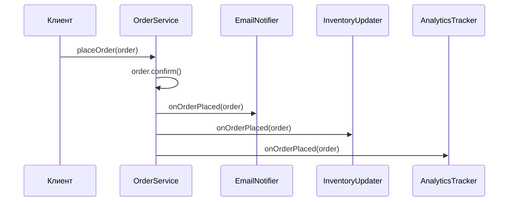

# Паттерны проектирования

Проверенные решения типовых задач проектирования по классификации GoF (Gang of Four): порождающие, структурные и поведенческие. На собесах просят не только объяснить паттерн, но и написать код — чаще всего Singleton, Builder, Factory Method, Decorator, Strategy и Observer.

## Порождающие паттерны { #creational }

Отвечают на вопрос: **как создавать объекты?**

### Как написать потокобезопасный Singleton? { #singleton }

**Уровень:** Middle

!!! abstract "Ответ вслух"
    Классика собесов — double-checked locking: две проверки на `null`, вторая под `synchronized`, а поле обязательно `volatile`. Проще и надёжнее — Holder: вложенный класс загружается при первом обращении, и потокобезопасность гарантирует JVM. Самый надёжный вариант — Enum Singleton.

**Проблема:** нужен ровно один экземпляр класса на всё приложение — конфиг, пул соединений, логгер.

#### Вариант 1: double-checked locking { #singleton-dcl }

```java
public class Singleton {
    // volatile обязателен! Без него другой поток может увидеть
    // частично сконструированный объект из-за переупорядочивания инструкций
    private static volatile Singleton instance;

    private Singleton() {}

    public static Singleton getInstance() {
        if (instance == null) {                    // 1-я проверка — без блокировки (быстро)
            synchronized (Singleton.class) {
                if (instance == null) {            // 2-я проверка — под блокировкой (безопасно)
                    instance = new Singleton();
                }
            }
        }
        return instance;
    }
}
```

#### Вариант 2: Initialization-on-demand Holder { #singleton-holder }

```java
public class Singleton {
    private Singleton() {}

    // Вложенный класс загружается только при первом обращении к getInstance(),
    // а инициализацию класса JVM выполняет потокобезопасно
    private static class Holder {
        private static final Singleton INSTANCE = new Singleton();
    }

    public static Singleton getInstance() {
        return Holder.INSTANCE;
    }
}
```

Третий вариант — Enum Singleton — разобран [ниже](#enum-singleton).

!!! warning "Ловушка: double-checked locking без `volatile`"
    `instance = new Singleton()` — это три шага: выделить память, вызвать конструктор, записать ссылку. JIT и процессор вправе переставить запись ссылки перед конструктором, и другой поток увидит недостроенный объект. `volatile` запрещает такую перестановку — подробнее в [Многопоточность → volatile](multithreading.md#3-volatile).

!!! warning "Singleton в Spring"
    В Spring каждый бин по умолчанию — синглтон в рамках контекста приложения. Писать Singleton вручную в Spring-приложении почти никогда не нужно: паттерн актуален для кода вне контейнера.

??? question "Проверь себя"
    1. Зачем в double-checked locking две проверки на `null`?
    2. Почему поле `instance` обязано быть `volatile`?
    3. За счёт чего потокобезопасен вариант с Holder?

### Почему Enum Singleton считается самым надёжным? { #enum-singleton }

**Уровень:** Middle

!!! abstract "Ответ вслух"
    Это совет Джошуа Блоха: `enum` из одного элемента. JVM сама гарантирует, что экземпляр создан ровно один раз и потокобезопасно; через рефлексию enum не создать; при десериализации возвращается та же константа. Остальные варианты ломаются рефлексией и сериализацией.

```java
public enum Singleton {
    INSTANCE;

    public void doWork() {
        System.out.println("работаю");
    }
}

// Использование:
Singleton.INSTANCE.doWork();
```

Почему этот вариант надёжнее остальных:

1. **Потокобезопасность из коробки:** JVM создаёт константы `enum` один раз при инициализации класса.
2. **Защита от рефлексии:** `Constructor.newInstance()` для `enum` бросает `IllegalArgumentException: Cannot reflectively create enum objects`. Приватный конструктор обычного Singleton рефлексия вызывает без проблем.
3. **Безопасная сериализация:** при десериализации `enum` возвращается та же константа. Обычный `Serializable`-синглтон создаст новый объект, если не написать `readResolve()`.

Как устроен сам `enum` и почему он так себя ведёт — в [Основы языка → enum](basics.md#enum).

!!! warning "Ловушка: ограничения Enum Singleton"
    `enum` не может наследоваться от другого класса и создаётся сразу при инициализации класса, а не лениво. Если синглтону нужен базовый класс или тяжёлая ленивая инициализация, выбирают вариант с Holder.

??? question "Проверь себя"
    1. Назови три причины, почему Enum Singleton надёжнее остальных вариантов.
    2. Что произойдёт при попытке создать экземпляр `enum` через рефлексию?
    3. Когда Enum Singleton не подходит?

### Зачем нужен Builder? { #builder }

**Уровень:** Junior

!!! abstract "Ответ вслух"
    Builder собирает объект с большим количеством параметров по шагам, через читаемый fluent API, вместо конструктора на десять аргументов. Обязательные поля передаются в конструктор билдера, опциональные — методами с дефолтами, а `build()` проверяет данные и создаёт неизменяемый объект. В реальном коде его генерирует Lombok `@Builder`.

**Проблема:** у объекта много параметров. Конструктор на 10 аргументов нечитаем и хрупок.

```java
// ❌ Telescoping constructor — нечитаемо
User user = new User("Alice", "alice@mail.com", 25, "Moscow", true, false, null, 100);
// Что такое true, false, null и 100? Непонятно без IDE.
```

```java
// ✅ Builder — читаемо, безопасно, расширяемо
public class User {
    private final String name;
    private final String email;
    private final int age;
    private final String city;
    private final boolean active;

    private User(Builder builder) {
        this.name   = builder.name;
        this.email  = builder.email;
        this.age    = builder.age;
        this.city   = builder.city;
        this.active = builder.active;
    }

    public static class Builder {
        // Обязательные поля
        private final String name;
        private final String email;
        // Опциональные с дефолтами
        private int age = 0;
        private String city = "";
        private boolean active = true;

        public Builder(String name, String email) {
            this.name  = name;
            this.email = email;
        }

        public Builder age(int age)       { this.age = age; return this; }
        public Builder city(String city)  { this.city = city; return this; }
        public Builder active(boolean a)  { this.active = a; return this; }

        public User build() {
            // Валидация перед созданием
            if (name == null || name.isBlank()) throw new IllegalStateException("Name required");
            return new User(this);
        }
    }
}

// Использование — читается как предложение
User user = new User.Builder("Alice", "alice@mail.com")
    .age(25)
    .city("Moscow")
    .active(true)
    .build();
```

!!! note "Lombok и Builder"
    В реальном коде используй `@Builder` от Lombok — он генерирует всё автоматически. Но на собесе без Lombok умей написать руками. Для простых DTO вместо Builder подойдёт `record` (Java 16+) — см. [Современная Java → record](modern-java.md#records).

!!! warning "Ловушка: валидация не в `build()`"
    Если проверять данные в сеттерах билдера, объект можно собрать, просто не вызвав нужный метод. Обязательные поля передавай в конструктор билдера, а согласованность всех полей проверяй в `build()` — там видна вся картина.

??? question "Проверь себя"
    1. Какую проблему решает Builder?
    2. Как Builder разделяет обязательные и опциональные поля?
    3. Где правильно проверять корректность собираемого объекта?

### Что такое Factory Method и чем он отличается от Simple Factory? { #factory-method }

**Уровень:** Middle

!!! abstract "Ответ вслух"
    Simple Factory — один статический метод со `switch`, который выбирает класс по параметру; это идиома, а не паттерн GoF. Factory Method — базовый класс объявляет абстрактный фабричный метод, а какой объект создать, решает подкласс, переопределяя его. Новый тип продукта в Factory Method добавляется новым подклассом, без правки старого кода.

**Проблема:** нужно создавать объекты, не привязываясь к конкретным классам.

#### Simple Factory — «просто фабрика» { #simple-factory }

То, что чаще всего показывают под видом Factory Method, на самом деле **Simple Factory**: один статический метод со `switch`, который выбирает класс по параметру. Это полезная идиома, но не паттерн GoF.

```java
// Абстрактный продукт
public interface Notification {
    void send(String message);
}

// Конкретные продукты
public class EmailNotification implements Notification {
    private final String email;
    public EmailNotification(String email) { this.email = email; }

    @Override
    public void send(String message) {
        System.out.println("Email → " + email + ": " + message);
    }
}

public class SmsNotification implements Notification {
    private final String phone;
    public SmsNotification(String phone) { this.phone = phone; }

    @Override
    public void send(String message) {
        System.out.println("SMS → " + phone + ": " + message);
    }
}

// Simple Factory — централизованное место создания
public class NotificationFactory {
    public static Notification create(String type, String contact) {
        return switch (type) {
            case "EMAIL" -> new EmailNotification(contact);
            case "SMS"   -> new SmsNotification(contact);
            default      -> throw new IllegalArgumentException("Unknown type: " + type);
        };
    }
}

// Клиентский код не знает о конкретных классах
Notification n = NotificationFactory.create("EMAIL", "user@mail.com");
n.send("Ваш заказ подтверждён");
```

#### Factory Method (GoF) — настоящий фабричный метод { #gof-factory-method }

**Суть:** базовый класс (Creator) содержит общий алгоритм и объявляет абстрактный **фабричный метод**. Какой именно объект создать — решает **подкласс**, переопределяя этот метод. Продукты (`Notification`, `EmailNotification`, `SmsNotification`) — те же, что выше.

```java
// Creator: общий алгоритм + абстрактный фабричный метод
public abstract class NotificationService {

    // Фабричный метод — КАКОЙ объект создать, решает подкласс
    protected abstract Notification createNotification(String contact);

    // Общая логика работает с любым продуктом через интерфейс
    public void notifyUser(String contact, String message) {
        Notification n = createNotification(contact);
        n.send(message);
    }
}

// Конкретные создатели переопределяют только фабричный метод
public class EmailNotificationService extends NotificationService {
    @Override
    protected Notification createNotification(String contact) {
        return new EmailNotification(contact);
    }
}

public class SmsNotificationService extends NotificationService {
    @Override
    protected Notification createNotification(String contact) {
        return new SmsNotification(contact);
    }
}

// Клиент работает с абстрактным создателем
NotificationService service = new EmailNotificationService();
service.notifyUser("user@mail.com", "Ваш заказ подтверждён");
```

| | **Simple Factory** | **Factory Method (GoF)** |
|---|---|---|
| **Кто выбирает класс** | Один статический метод по параметру (`switch`) | Подкласс, переопределяя фабричный метод |
| **Механизм** | Условная логика | Наследование и полиморфизм |
| **Новый тип продукта** | Правим `switch` — нарушаем [OCP](solid.md#ocp) | Добавляем новый подкласс — старый код не трогаем |
| **Паттерн GoF?** | Нет, идиома | Да |

Пример из JDK: `Collection.iterator()` — фабричный метод. `ArrayList`, `HashSet`, `ArrayDeque` переопределяют его и возвращают каждый свой `Iterator`, а код, написанный против `Collection`, об этом не знает.

!!! note "Factory Method vs Abstract Factory"
    **Factory Method** — один фабричный метод, создаёт один тип объекта. **Abstract Factory** — семейство связанных объектов: например, фабрика UI-элементов создаёт либо `WindowsButton` и `WindowsCheckbox`, либо `MacButton` и `MacCheckbox`. На собесах чаще спрашивают Factory Method.

!!! warning "Ловушка: Simple Factory ≠ Factory Method"
    Если на просьбу «напиши Factory Method» показать статический метод со `switch`, это Simple Factory. Ключевое слово для настоящего Factory Method — **подкласс решает**, какой объект создать.

??? question "Проверь себя"
    1. Чем Simple Factory отличается от Factory Method?
    2. Как добавить новый тип уведомления в каждом из вариантов?
    3. Какой метод JDK — пример Factory Method?

## Структурные паттерны { #structural }

Отвечают на вопрос: **как организовать классы и объекты?**

### Что такое Decorator? { #decorator }

**Уровень:** Middle

!!! abstract "Ответ вслух"
    Decorator добавляет объекту поведение во время работы программы, оборачивая его в объект того же интерфейса. Каждая обёртка делегирует вызов внутреннему объекту и добавляет своё. Классический пример — `java.io`: `BufferedInputStream` и `GZIPInputStream` оборачивают `FileInputStream`.

**Проблема:** нужно добавить объекту новое поведение, не меняя его класс и не плодя наследников.

Классический пример — Java I/O, подробно в [IO / NIO → Декоратор в java.io](io-nio.md#io-decorator):

```java
// Вся система I/O в Java — это декораторы
InputStream base      = new FileInputStream("file.txt");     // базовый компонент
InputStream buffered  = new BufferedInputStream(base);       // декоратор: буферизация
InputStream gzipped   = new GZIPInputStream(buffered);       // декоратор: распаковка
```

Реализуем сами:

```java
// Базовый интерфейс
public interface Coffee {
    String getDescription();
    double getCost();
}

// Базовая реализация
public class SimpleCoffee implements Coffee {
    @Override public String getDescription() { return "Coffee"; }
    @Override public double getCost()        { return 1.0; }
}

// Абстрактный декоратор — держит ссылку на декорируемый объект
public abstract class CoffeeDecorator implements Coffee {
    protected final Coffee coffee;
    public CoffeeDecorator(Coffee coffee) { this.coffee = coffee; }
}

// Конкретные декораторы
public class MilkDecorator extends CoffeeDecorator {
    public MilkDecorator(Coffee coffee) { super(coffee); }

    @Override public String getDescription() { return coffee.getDescription() + ", Milk"; }
    @Override public double getCost()        { return coffee.getCost() + 0.5; }
}

public class SugarDecorator extends CoffeeDecorator {
    public SugarDecorator(Coffee coffee) { super(coffee); }

    @Override public String getDescription() { return coffee.getDescription() + ", Sugar"; }
    @Override public double getCost()        { return coffee.getCost() + 0.25; }
}

// Использование — оборачиваем слой за слоем
Coffee order = new SugarDecorator(new MilkDecorator(new SimpleCoffee()));
System.out.println(order.getDescription()); // Coffee, Milk, Sugar
System.out.println(order.getCost());        // 1.75
```


!!! tip "Decorator vs наследование"
    Наследование — статическое (на этапе компиляции). Декоратор — динамическое (в рантайме): объект можно обернуть любым числом декораторов в любом порядке. Это реализация принципа [OCP](solid.md#ocp).

!!! warning "Ловушка: порядок обёрток важен"
    Декораторы применяются снаружи внутрь, и порядок меняет результат. `new GZIPInputStream(new BufferedInputStream(file))` и `new BufferedInputStream(new GZIPInputStream(file))` работают по-разному: в первом случае буферизируются сжатые байты, во втором — уже распакованные.

??? question "Проверь себя"
    1. Какую проблему решает Decorator?
    2. Чем Decorator отличается от наследования?
    3. Где Decorator используется в JDK?

## Поведенческие паттерны { #behavioral }

Отвечают на вопрос: **как организовать взаимодействие объектов?**

### Что такое Strategy? { #strategy }

**Уровень:** Junior

!!! abstract "Ответ вслух"
    Strategy выносит взаимозаменяемые алгоритмы в отдельные классы с общим интерфейсом, а контекст получает нужный алгоритм снаружи и может сменить его на лету. Если интерфейс функциональный, стратегию передают лямбдой. В JDK это, например, `Comparator`.

**Проблема:** нужно менять алгоритм в зависимости от ситуации, не меняя клиентский код.

```java
// Интерфейс стратегии
@FunctionalInterface
public interface SortStrategy {
    void sort(int[] array);
}

// Конкретные стратегии
public class BubbleSort implements SortStrategy {
    @Override
    public void sort(int[] array) {
        // O(n²) — для маленьких массивов
        System.out.println("Bubble sort...");
    }
}

public class QuickSort implements SortStrategy {
    @Override
    public void sort(int[] array) {
        // O(n log n) — для больших массивов
        System.out.println("Quick sort...");
    }
}

// Контекст использует стратегию
public class Sorter {
    private SortStrategy strategy;

    public Sorter(SortStrategy strategy) {
        this.strategy = strategy;
    }

    // Можно менять стратегию на лету
    public void setStrategy(SortStrategy strategy) {
        this.strategy = strategy;
    }

    public void sort(int[] array) {
        strategy.sort(array);
    }
}

// Использование
Sorter sorter = new Sorter(new BubbleSort());
sorter.sort(smallArray);

sorter.setStrategy(new QuickSort());
sorter.sort(largeArray);

// С Java 8 — стратегии как лямбды (раз это @FunctionalInterface)
sorter.setStrategy(array -> Arrays.sort(array));
```

!!! note "Strategy везде"
    `Comparator` (см. [Коллекции → Comparator](collections.md#comparable-comparator)), `Runnable` и `DiscountStrategy` из [SOLID → OCP](solid.md#ocp) — всё это Strategy. Паттерн пронизывает всю Java-экосистему.

!!! warning "Ловушка: Strategy против `switch` внутри класса"
    Если алгоритм выбирается `switch`-ем внутри одного класса, каждый новый вариант требует правки этого класса — это нарушение OCP. Признак, что пора выделять стратегии, — несколько веток с разной логикой, которые растут со временем.

??? question "Проверь себя"
    1. Из каких частей состоит паттерн Strategy?
    2. Как сменить стратегию во время работы программы?
    3. Какие примеры Strategy есть в JDK?

### Что такое Observer? { #observer }

**Уровень:** Middle

!!! abstract "Ответ вслух"
    Observer — подписка на события: субъект хранит список наблюдателей и уведомляет всех, когда что-то происходит, не зная, кто они. Наблюдатели независимы друг от друга, и новых можно добавлять без правки субъекта. В Spring это `ApplicationEvent` и `@EventListener`, на уровне микросервисов — Kafka и RabbitMQ.

**Проблема:** одно событие должно вызвать реакцию у нескольких независимых объектов.

```java
// Интерфейс наблюдателя
public interface OrderObserver {
    void onOrderPlaced(Order order);
}

// Subject — тот, за кем наблюдают
public class OrderService {
    private final List<OrderObserver> observers = new ArrayList<>();

    public void addObserver(OrderObserver observer) {
        observers.add(observer);
    }

    public void removeObserver(OrderObserver observer) {
        observers.remove(observer);
    }

    public void placeOrder(Order order) {
        // бизнес-логика
        order.confirm();

        // уведомляем всех наблюдателей — OrderService не знает, кто они
        observers.forEach(o -> o.onOrderPlaced(order));
    }
}

// Конкретные наблюдатели — независимые друг от друга
public class EmailNotifier implements OrderObserver {
    @Override
    public void onOrderPlaced(Order order) {
        System.out.println("Email: заказ " + order.getId() + " подтверждён");
    }
}

public class InventoryUpdater implements OrderObserver {
    @Override
    public void onOrderPlaced(Order order) {
        System.out.println("Резервируем товары для заказа " + order.getId());
    }
}

public class AnalyticsTracker implements OrderObserver {
    @Override
    public void onOrderPlaced(Order order) {
        System.out.println("Пишем в аналитику: заказ на сумму " + order.getTotal());
    }
}

// Сборка
OrderService service = new OrderService();
service.addObserver(new EmailNotifier());
service.addObserver(new InventoryUpdater());
service.addObserver(new AnalyticsTracker());

service.placeOrder(new Order());
// Выполнятся все три наблюдателя, при этом они ничего не знают друг о друге
```



!!! note "Observer в Java и Spring"
    - `java.util.EventListener` — маркерный интерфейс слушателей в стандартной библиотеке.
    - `ApplicationEvent` / `@EventListener` в Spring — Observer из коробки.
    - Kafka и RabbitMQ — Observer на уровне микросервисов (publisher/subscriber).

!!! warning "Ловушка: синхронные наблюдатели и исключения"
    В примере наблюдатели вызываются по очереди в том же потоке. Если `EmailNotifier` бросит исключение, `InventoryUpdater` и `AnalyticsTracker` не выполнятся, а `placeOrder` упадёт. Наблюдателей изолируют через `try-catch` вокруг каждого вызова или выносят в асинхронную обработку.

??? question "Проверь себя"
    1. Из каких участников состоит Observer?
    2. Что знает субъект о своих наблюдателях?
    3. Что произойдёт, если один из синхронных наблюдателей бросит исключение?

## Шпаргалка { #cheatsheet }

| Тема | Запомнить |
|---|---|
| **Singleton** | Double-checked locking с `volatile` или Holder; в Spring бины и так синглтоны |
| **Enum Singleton** | Самый надёжный: JVM-потокобезопасность, защита от рефлексии и сериализации |
| **Builder** | Пошаговая сборка через fluent API; обязательные поля — в конструктор билдера, проверка — в `build()` |
| **Factory Method** | Подкласс решает, какой объект создать; `switch` по параметру — это Simple Factory |
| **Decorator** | Обёртка с тем же интерфейсом добавляет поведение в рантайме; `java.io` |
| **Strategy** | Интерфейс + реализации + контекст; стратегию можно передать лямбдой; `Comparator` |
| **Observer** | Субъект уведомляет список наблюдателей; `@EventListener`, Kafka |
