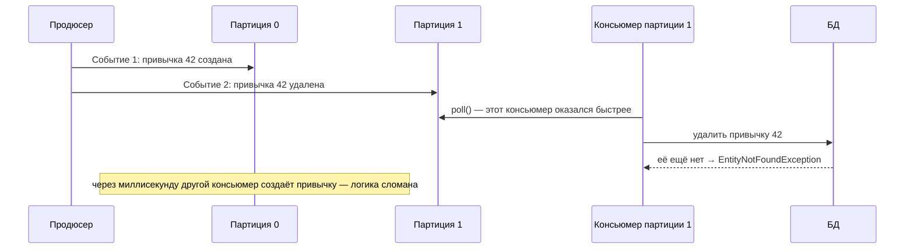
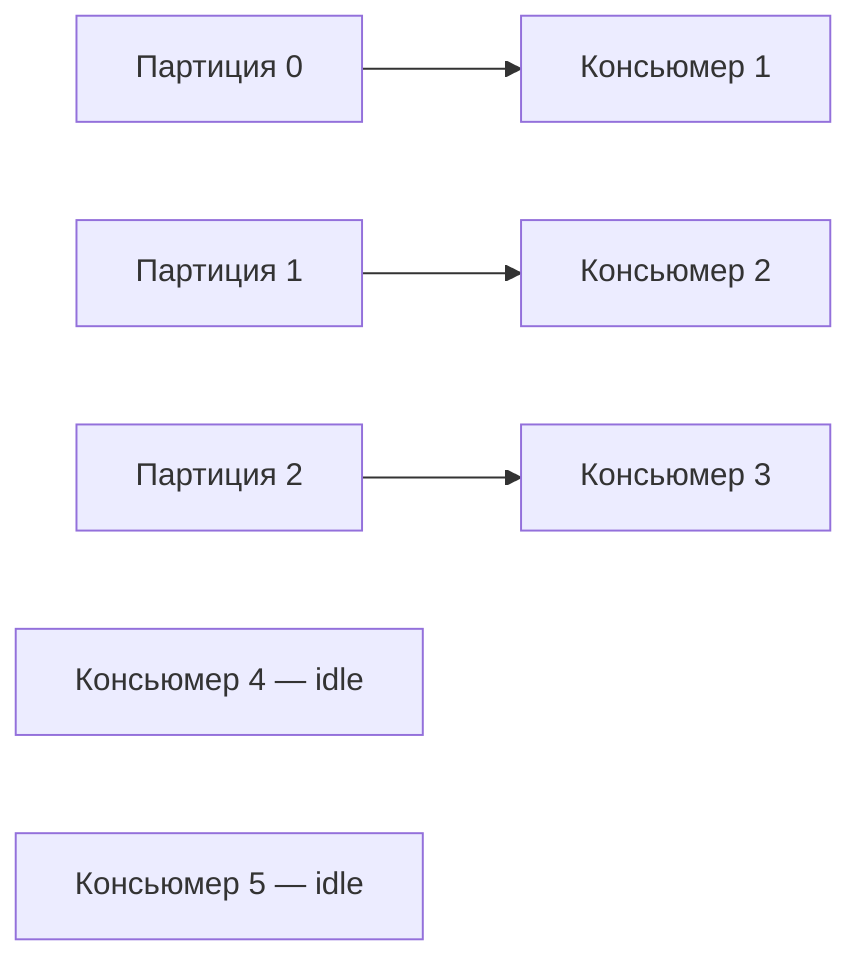
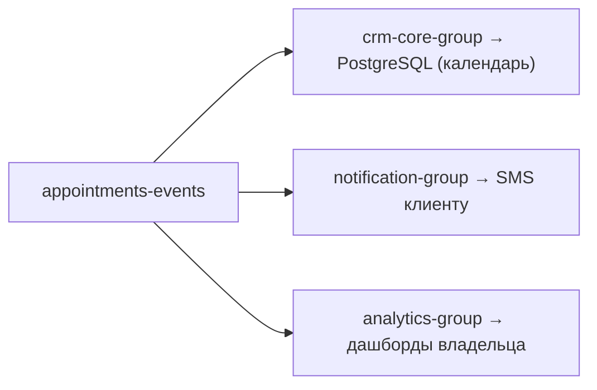
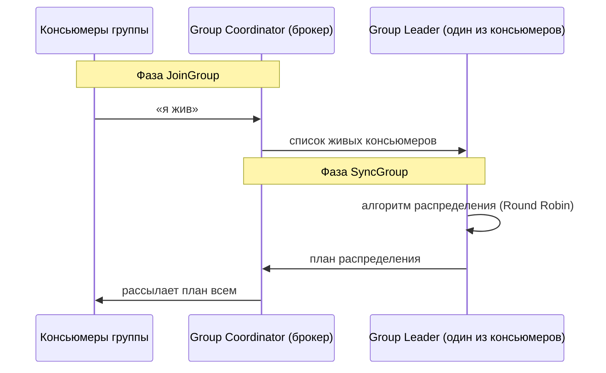
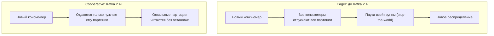

---
tags:
  - Junior
  - Middle
  - Senior
  - Kafka
---

# Порядок, группы и ребаланс

Как продюсер выбирает партицию и как консьюмеры делят партиции между собой: ключи и порядок, consumer groups и ребаланс. На собесе чаще всего спрашивают, как сохранить порядок событий одной сущности, что будет при добавлении партиций, сколько консьюмеров реально работают и почему зависший листенер вызывает ребаланс.

## Ключи и порядок сообщений { #message-keys }

### Почему Kafka не гарантирует глобальный порядок? { #no-global-order }

**Уровень:** Junior

!!! abstract "Ответ вслух"
    Глобальный порядок потребовал бы одной партиции и одного читающего потока — система захлебнулась бы. Kafka делит топик на партиции и читает их параллельно, жертвуя глобальным порядком. Бизнесу обычно нужен порядок только в рамках одной сущности, и его дают ключи.

Пользователи генерируют 10 000 событий в секунду. Если бы Kafka гарантировала **глобальный порядок**, пришлось бы складывать всё в один лог (одну партицию) и читать одним потоком.

Компромисс Kafka: **делим топик на партиции (например, 3), читаем параллельно, но жертвуем глобальным порядком.**

Бизнесу глобальный порядок часто не нужен: неважно, что привычка Пети обработана раньше привычки Васи. Критично другое — **события одной конкретной привычки должны обрабатываться строго по очереди**: сначала «создана», потом «выполнена», а не наоборот. Решение — ключи (keys).

!!! warning "Ловушка: «нужен порядок — одна партиция»"
    Одна партиция даёт порядок ценой всего параллелизма: читать её сможет один консьюмер. Порядок по сущности достигается ключом, а не отказом от партиций.

??? question "Проверь себя"
    1. Чем пришлось бы заплатить за глобальный порядок?
    2. Какой порядок обычно нужен бизнесу?
    3. Что даёт порядок в рамках одной сущности?

### Что будет, если отправить сообщение без ключа? { #null-key }

**Уровень:** Junior

!!! abstract "Ответ вслух"
    Сообщение состоит из ключа и значения, и ключ необязателен. Без ключа (`key = null`) Kafka раскидывает сообщения по партициям по кругу — round-robin. События одной сущности попадают в разные партиции, их читают разные консьюмеры, и порядок ломается.

Kafka включит **round-robin**: первое сообщение → партиция 0, второе → партиция 1, третье → партиция 2, четвёртое → снова 0.

!!! warning "Ловушка: события одной сущности без ключа"
    Без ключа «создана» и «удалена» для одной привычки могут уйти в разные партиции. Их обработают параллельно, и удаление может прийти раньше создания.

??? question "Проверь себя"
    1. Как Kafka распределяет сообщения без ключа?
    2. Почему без ключа ломается порядок событий одной привычки?
    3. Какое исключение получит консьюмер в примере?

### Как ключ гарантирует порядок? { #key-hashing }

**Уровень:** Middle

!!! abstract "Ответ вслух"
    Продюсер считает хэш ключа (по умолчанию Murmur2) и берёт остаток от деления на число партиций. Один и тот же ключ всегда даёт одну и ту же партицию, а партицию в группе читает один консьюмер последовательно. Поэтому все события одной привычки обрабатываются в порядке отправки.

Указываем явный ключ. Для привычек подходящий ключ — её `habitId = "42"`.

Формула: `Hash(Key) % Number_of_Partitions`.

1. Продюсер берёт ключ `"42"`.
2. Прогоняет его через хэш-функцию (по умолчанию Murmur2) → `8462947`.
3. Берёт остаток от деления на количество партиций: `8462947 % 3 = 1`.
4. Сообщение уходит строго в партицию 1.

**Почему это гарантирует порядок:** хэш от `"42"` всегда равен `8462947`. Все события этой привычки (создание, обновление, выполнение, удаление) попадут в **одну партицию 1**. Партицию всегда читает один консьюмер, строго последовательно, — события обработаются ровно в том порядке, в котором сгенерированы.

!!! warning "Ловушка: ключ с малым числом значений"
    Все сообщения с одинаковым ключом идут в одну партицию. Если ключ — например, страна — принимает пару значений, почти весь трафик ляжет на одну-две партиции, а остальные будут простаивать.

??? question "Проверь себя"
    1. По какой формуле продюсер выбирает партицию для ключа?
    2. Какая хэш-функция используется по умолчанию?
    3. Почему одинаковый ключ гарантирует порядок?

### Что будет с порядком, если добавить партиции? { #repartitioning }

**Уровень:** Senior

!!! abstract "Ответ вслух"
    Порядок сломается для существующих ключей. В формуле `Hash(Key) % N` меняется знаменатель, и ключ, который всегда шёл в партицию 1, может уйти в партицию 4. Старые события лежат в одной партиции, новые — в другой, их читают разные консьюмеры параллельно, и гонка возвращается.

Вопрос на собесе: _«Порядок работает. Через полгода трафик вырос в 10 раз. Добавляете ещё 2 партиции (итого 5). Что произойдёт с порядком?»_

**Ответ:** порядок сломается для существующих сущностей, потому что меняется знаменатель в формуле: `Hash(Key) % 5`.

Тот же ключ `"42"`, который всю жизнь летел в партицию 1, теперь может дать остаток 4 и полететь в партицию 4. Старые события в первой партиции, новые — в четвёртой, их читают разные консьюмеры параллельно, и race condition вернулся.

!!! tip "Архитектурное правило"
    Количество партиций в топиках, где важен порядок по ключу, **нельзя менять на лету**. Закладывай количество с запасом (over-provisioning) на этапе проектирования — например, сразу 50 партиций, даже если сейчас всего 2 инстанса приложения.

!!! warning "Ловушка: «добавим партиций — и всё ускорится»"
    Для топиков без требований к порядку добавление партиций безопасно. Для топиков с порядком по ключу оно ломает гарантии, поэтому число партиций там выбирают один раз и с запасом.

??? question "Проверь себя"
    1. Почему добавление партиций ломает порядок для существующих ключей?
    2. Как этого избежать при проектировании?
    3. Для каких топиков добавлять партиции безопасно?

## Consumer Groups { #consumer-groups }

### Что такое consumer group? { #consumer-group }

**Уровень:** Junior

!!! abstract "Ответ вслух"
    Consumer group — логическое объединение инстансов одного приложения, работающих над общей задачей; задаётся через `group.id`. Для брокера вся группа выглядит как один потребитель. Главное правило: одну партицию внутри группы читает только один консьюмер — так сохраняется порядок.

Поднимая инстанс Spring Boot-приложения, читающего Kafka, ты обязан указать `group.id` (например, `appointment-processor`). Для брокера вся группа выглядит как один «виртуальный» потребитель.

!!! info "Главное правило балансировки"
    **Одна партиция в рамках одной consumer group может читаться только одним консьюмером.**

Почему так жёстко? Из-за гарантии порядка. Если Kafka отдаст партицию 0 двум инстансам, они начнут вытаскивать сообщения параллельно, и порядок для одного ключа сразу сломается.

!!! warning "Ловушка: один консьюмер может читать несколько партиций"
    Правило работает только в одну сторону: партиция — максимум одному консьюмеру группы. Один консьюмер при этом может читать несколько партиций, если инстансов меньше, чем партиций.

??? question "Проверь себя"
    1. Что такое consumer group и как она задаётся?
    2. Почему одну партицию в группе читает только один консьюмер?
    3. Может ли один консьюмер читать несколько партиций?

### Что будет, если консьюмеров больше, чем партиций? { #idle-consumers }

**Уровень:** Middle

!!! abstract "Ответ вслух"
    Лишние консьюмеры будут простаивать: при 3 партициях и 5 инстансах работают трое, двое ждут. Это не бесполезная трата ресурсов, а горячий резерв: если работающий инстанс упадёт, ребаланс отдаст его партицию простаивающему.

Классическая задача: топик `payments` с 3 партициями, запущено 5 инстансов с одним `group.id`.

Вопрос-ловушка: _«Зачем запустили 2 лишних инстанса, если они простаивают и жгут ресурсы?»_

**Ответ:** ради отказоустойчивости (high availability). Это горячий резерв: если работающий сервер упадёт (OOM, потеря сети), сработает ребаланс, и простаивающий консьюмер быстро подхватит освободившуюся партицию. Простой минимален.

!!! warning "Ловушка: масштабирование инстансами без партиций"
    Добавление инстансов сверх числа партиций не ускоряет обработку. Чтобы читать параллельнее, нужно больше партиций (см. [Физика брокера → Масштабирование](kafka.md#partition-scaling)).

??? question "Проверь себя"
    1. Сколько консьюмеров будут работать при 3 партициях и 5 инстансах?
    2. Зачем держать простаивающие инстансы?
    3. Ускорит ли обработку шестой инстанс?

### Как несколько групп читают один топик? { #multiple-groups }

**Уровень:** Middle

!!! abstract "Ответ вслух"
    Каждая группа читает топик независимо и хранит свой оффсет — это модель pub/sub. Одни и те же события могут обрабатывать основной бэкенд, сервис уведомлений и аналитика, каждый в своём темпе. Сообщения не удаляются после первого прочтения, поэтому группы друг другу не мешают.

Это то, ради чего выбирают Kafka вместо классических брокеров. Один топик `appointments-events`, разные группы читают его независимо:

- `crm-core-group` — основной бэкенд, кладёт запись в PostgreSQL.
- `notification-group` — читает **те же** события и шлёт SMS.
- `analytics-group` — тяжёлая аналитика, вычитывает раз в час.

**Физически** каждая группа имеет свой независимый оффсет. Уведомления обрабатываются за 10 мс и убегают вперёд, аналитика отстаёт на 5 минут, но все читают **одни и те же физические файлы** партиций. Никто никого не блокирует, сообщения не удаляются после первого прочтения — это развязка (decoupling) микросервисов.

!!! warning "Ловушка: один `group.id` у разных сервисов"
    Если сервис уведомлений и аналитика случайно используют один `group.id`, они станут одной группой и поделят партиции между собой: каждое событие получит только один из них.

??? question "Проверь себя"
    1. Как разные группы хранят прогресс чтения?
    2. Мешает ли медленная группа быстрой?
    3. Что случится, если два разных сервиса используют один `group.id`?

## Ребаланс { #rebalancing }

### Что такое ребаланс и когда он происходит? { #rebalance-triggers }

**Уровень:** Middle

!!! abstract "Ответ вслух"
    Ребаланс — перераспределение партиций между живыми консьюмерами группы, чтобы каждую партицию читал ровно один консьюмер и ни одна не осталась без хозяина. Он запускается, когда инстанс падает, когда добавляют новый инстанс и когда в топике меняется число партиций.

Три триггера:

1. **Падение инстанса** — консьюмер упал (OOM, питание, сеть).
2. **Масштабирование** — добавили новый инстанс, Kafka даёт ему партиции.
3. **Изменение топологии** — админ добавил новые партиции в топик.

!!! warning "Ловушка: частые ребалансы"
    Во время ребаланса партиции меняют владельцев, и обработка тормозит. Постоянные рестарты инстансов или зависания листенера превращают систему в бесконечный ребаланс.

??? question "Проверь себя"
    1. Какую задачу решает ребаланс?
    2. Назови три триггера ребаланса.
    3. Чем опасны частые ребалансы?

### Как Kafka понимает, что консьюмер умер? { #heartbeats }

**Уровень:** Senior

!!! abstract "Ответ вслух"
    По двум «пульсам». Сетевой: фоновый поток шлёт heartbeat, и если его нет дольше `session.timeout.ms` (45 секунд с Kafka 3.0), консьюмер считается мёртвым. Пульс бизнес-логики: если между вызовами `poll()` прошло больше `max.poll.interval.ms` (5 минут), консьюмер считается зависшим — «зомби» — и его выкидывают из группы.

| Пульс | Настройка | Что значит превышение |
|---|---|---|
| **Сетевой** | `session.timeout.ms` (по умолчанию 45 с с Kafka 3.0, раньше 10 с) | Фоновый поток не шлёт heartbeat → сервер физически умер → ребаланс |
| **Бизнес-логики** | `max.poll.interval.ms` (по умолчанию 5 мин) | Сеть есть, но код завис на тяжёлом SQL или дедлоке → «зомби» (жив в сети, работу не делает) → исключение из группы |

Вопрос на собесе: _«Ты вычитал сообщение и пошёл по REST в другой микросервис. Тот завис на 10 минут. Что произойдёт?»_

**Ответ:** листенер не вызывает следующий `poll()` дольше `max.poll.interval.ms`. Брокер решает, что сервис умер, и запускает ребаланс: партиция уходит другому инстансу. Настройка `@KafkaListener` в Spring — в [Экосистема → Spring Kafka](spring-kafka.md#listener-config).

!!! warning "Ловушка: долгие синхронные операции в листенере"
    В листенере нельзя делать долгие синхронные операции без контроля таймаутов. Долгие задачи выносят в отдельный пул потоков и не блокируют поток листенера.

??? question "Проверь себя"
    1. Чем `session.timeout.ms` отличается от `max.poll.interval.ms`?
    2. Что такое консьюмер-«зомби»?
    3. Что произойдёт, если листенер ждёт ответа REST-сервиса 10 минут?

### Кто распределяет партиции при ребалансе? { #group-leader }

**Уровень:** Senior

!!! abstract "Ответ вслух"
    Не брокер. Брокер-координатор (Group Coordinator) только следит, кто жив, и собирает список участников. Сам план распределения считает Group Leader — один из консьюмеров, то есть твоё приложение, — и отправляет его координатору, который рассылает план всем.

Многие думают, что брокер сам распределяет партиции. Это не так: Kafka делегирует эту логику клиентам.

- **Group Coordinator (брокер)** — следит, кто жив, и подаёт сигнал к сбору.
- **Group Leader (твоё приложение)** — один из живых консьюмеров, применяет алгоритм.

Почему так? Чтобы брокер оставался «глупым» и быстрым. Логика распределения живёт в клиентской библиотеке, поэтому можно написать свой Partition Assignor, не трогая код сервера Kafka.

!!! warning "Ловушка: «брокер решает, кому какая партиция»"
    Брокер только координирует. Алгоритм распределения выполняет лидер группы на стороне клиента — поэтому его и можно заменить своим.

??? question "Проверь себя"
    1. Чем Group Coordinator отличается от Group Leader?
    2. Что происходит в фазах JoinGroup и SyncGroup?
    3. Почему распределение партиций вынесено на клиента?

### Чем cooperative rebalancing лучше eager? { #cooperative-rebalance }

**Уровень:** Senior

!!! abstract "Ответ вслух"
    При eager-ребалансе (до Kafka 2.4) все консьюмеры бросали работу и отпускали все партиции — полная остановка группы, stop-the-world. Incremental cooperative rebalancing, который используется по умолчанию в Kafka 2.4+ и современном Spring Kafka, переносит только те партиции, что нужны новичку, а остальные продолжают читаться без остановки.

**Eager rebalancing (до Kafka 2.4)** — при ребалансе все консьюмеры бросали работу, отпускали все партиции и ждали нового распределения. Это полная остановка (**stop-the-world**): на большой группе пауза длилась секунды и даже минуты.

**Incremental Cooperative Rebalancing (Kafka 2.4+, по умолчанию в современном Spring Kafka).** Добавляешь новый сервер — старые серверы **не бросают всю работу**. Лидер просит отдать только те конкретные партиции, что нужны новичку, а остальные читаются без остановок. Глобального простоя нет.

!!! warning "Ловушка: пауза при eager на большой группе"
    Чем больше группа, тем дольше stop-the-world при eager-ребалансе. На старых версиях клиентов каждый деплой с перезапуском инстансов останавливал чтение всего топика.

??? question "Проверь себя"
    1. Что происходит с партициями при eager-ребалансе?
    2. Какие партиции переезжают при cooperative-ребалансе?
    3. С какой версии Kafka появился incremental cooperative rebalancing?

## Шпаргалка { #cheatsheet }

<!-- --8<-- [start:cheatsheet] -->
| Тема | Запомнить |
|---|---|
| **Ключ сообщения** | `Hash(Key) % партиции`. Один ключ → всегда одна партиция → порядок |
| **Без ключа** | Round-robin по партициям. Порядок не гарантирован |
| **Смена числа партиций** | Ломает порядок для существующих ключей. Закладывай с запасом |
| **Consumer Group** | Инстансы одного приложения. Для брокера — один потребитель |
| **Правило партиции** | Одна партиция = один консьюмер в группе. Лишние — горячий резерв |
| **Несколько групп** | Pub/sub: у каждой группы свой оффсет, читают одни файлы независимо |
| **Триггеры ребаланса** | Падение / масштабирование / изменение топологии |
| **Два пульса** | `session.timeout.ms` (сеть) + `max.poll.interval.ms` (бизнес-логика) |
| **Кто распределяет** | Group Leader (клиент), не брокер. Брокер — только Coordinator |
| **Cooperative Rebalance** | Kafka 2.4+. Не stop-the-world, отдаются только нужные партиции |

<!-- --8<-- [end:cheatsheet] -->
