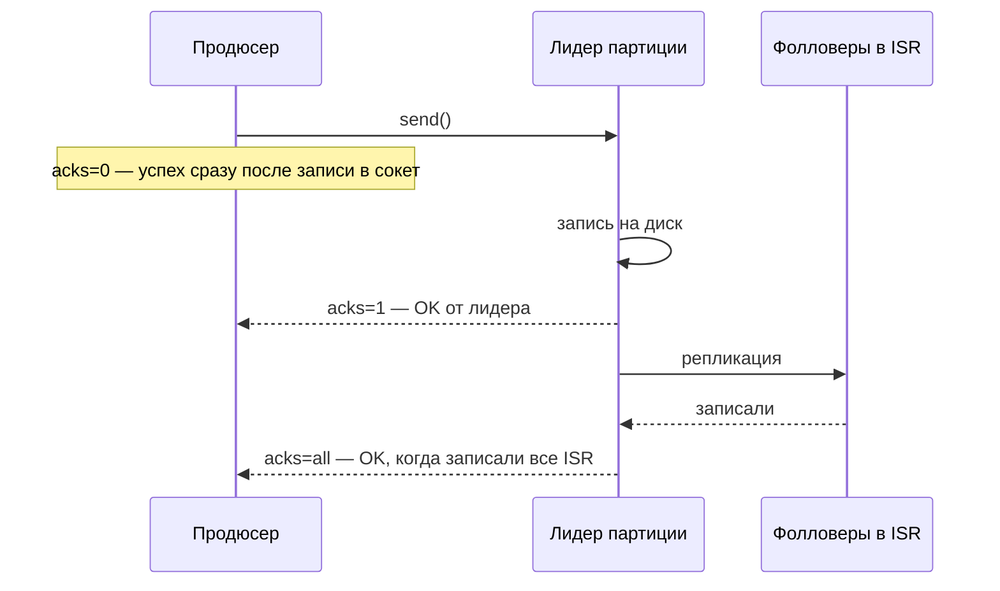
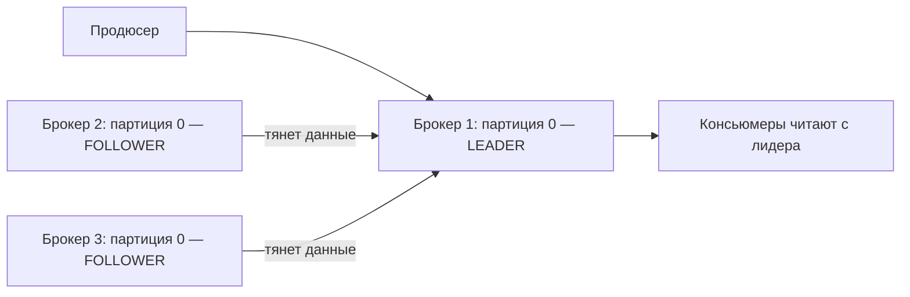
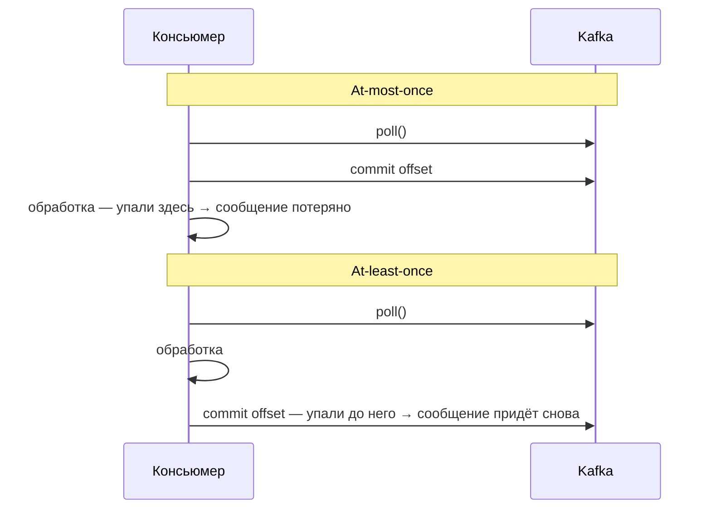

---
tags:
  - Middle
  - Kafka
  - Микросервисы
---

# Kafka: гарантии доставки и надёжность

Как не потерять и не задвоить сообщения: `acks` продюсера, репликация и ISR, семантики доставки, коммит оффсетов, идемпотентность консьюмера и Dead Letter Queue. Это вопросы уровня Middle и Senior, на которых проверяют понимание потери данных.

## Продюсер и репликация { #producer-replication }

### Что задаёт параметр `acks` у продюсера? { #acks }

**Уровень:** Middle

!!! abstract "Ответ вслух"
    `acks` — сколько подтверждений продюсер ждёт от брокеров, прежде чем считать отправку успешной. `acks=0` — не ждёт ничего, `acks=1` — ждёт только лидера партиции, `acks=all` — лидера и все синхронные реплики (ISR). Это компромисс между скоростью и надёжностью, и `acks=all` надёжен только вместе с `min.insync.replicas=2`.

| `acks` | Чего ждёт продюсер | Риск | Применение |
|---|---|---|---|
| **`0`** — «отправил и забыл» | Ничего: записал в сокет — считает успехом | Максимальная скорость, максимальная потеря. Брокер упал в момент отправки — сообщение исчезло, продюсер не узнает | Метрики, логи, где потеря отдельных записей некритична |
| **`1`** — подтверждение от лидера (баланс, старый дефолт) | Лидер записал к себе на диск и ответил OK | Лидер подтвердил, но упал **до** репликации на фолловеров. Новый лидер выбирается из фолловеров, где этого сообщения нет, — потеря | — |
| **`all`** (`-1`) — подтверждение от всех ISR | Лидер **и** все синхронные реплики записали | Медленнее, но сообщение переживёт падение лидера — оно уже на репликах | Платежи, заказы, всё бизнес-критичное |



```java
// Настройка продюсера в Spring
@Bean
public ProducerFactory<String, Object> producerFactory() {
    Map<String, Object> config = new HashMap<>();
    config.put(ProducerConfig.ACKS_CONFIG, "all");           // ждём все ISR
    config.put(ProducerConfig.RETRIES_CONFIG, 3);            // повтор при сбое
    config.put(ProducerConfig.ENABLE_IDEMPOTENCE_CONFIG, true); // защита от дублей
    return new DefaultKafkaProducerFactory<>(config);
}
```

!!! warning "Ловушка: `acks=all` сам по себе не гарантирует надёжность"
    `acks=all` работает в связке с `min.insync.replicas`. Если поставить `acks=all`, но `min.insync.replicas=1`, а все реплики кроме лидера отвалились, лидер подтвердит запись в одиночку, и при его падении данные потеряются. Правильная связка для критичных данных: `acks=all` + `min.insync.replicas=2` при replication factor 3 — если синхронных реплик меньше 2, продюсер получит ошибку, а не тихую потерю.

??? question "Проверь себя"
    1. Чем `acks=1` рискует по сравнению с `acks=all`?
    2. Почему `acks=all` без `min.insync.replicas=2` может потерять данные?
    3. Какой `acks` выбрать для метрик, а какой — для платежей?

### Как работают replication factor и ISR? { #replication-isr }

**Уровень:** Middle

!!! abstract "Ответ вслух"
    Replication factor — сколько копий партиции лежит на разных брокерах: один лидер принимает запись, фолловеры тянут данные с него. ISR (In-Sync Replicas) — реплики, которые не отстают от лидера больше чем на `replica.lag.time.max.ms`; только они могут стать новым лидером. Стандарт для критичных данных — RF=3, `min.insync.replicas=2` и `acks=all`.

Партиция физически дублируется на несколько брокеров. **Replication factor** — сколько всего копий партиции в кластере.



Топик `orders`, партиция 0, replication factor = 3. Если брокер 1 (лидер) физически сгорел, один из фолловеров становится новым лидером за миллисекунды. Данные не потеряны — они были на репликах.

**ISR (In-Sync Replicas)** — множество реплик, которые «идут в ногу» с лидером: не отстают больше чем на `replica.lag.time.max.ms`. Только реплики из ISR могут стать лидером при падении.

| Реплика | Отставание | В ISR? |
|---|---|---|
| Брокер 2 (follower) | 50 мс | ✅ Да |
| Брокер 3 (follower) | Завис, 30 с | ❌ Выпал из ISR |

Если лидер упадёт, новым станет только брокер 2 (он в ISR). Брокер 3 не может стать лидером — у него неполные данные.

!!! tip "Формула надёжности"
    Replication factor 3 + `min.insync.replicas=2` + `acks=all` — стандарт для критичных данных. Система переживает падение **одного** брокера без потери данных и без остановки записи. При падении двух запись остановится: лучше ошибка, чем потеря.

!!! warning "Ловушка: RF=3 не спасает при `acks=1`"
    Реплики защищают только те данные, которые успели на них попасть. С `acks=1` продюсер получает OK раньше репликации, и падение лидера в этот момент теряет сообщение, сколько бы копий ни было настроено.

??? question "Проверь себя"
    1. Что такое replication factor?
    2. Какие реплики могут стать лидером и почему?
    3. Что произойдёт с записью при RF=3, `min.insync.replicas=2` и падении двух брокеров?

## Семантики доставки { #delivery-semantics }

### Чем отличаются at-most-once, at-least-once и exactly-once? { #delivery-guarantees }

**Уровень:** Middle

!!! abstract "Ответ вслух"
    Разница в моменте коммита оффсета: at-most-once коммитит до обработки (дублей нет, но возможна потеря), at-least-once — после (потерь нет, но возможны дубли). At-least-once — стандарт, и он требует идемпотентности. Exactly-once коммитит в транзакции Kafka и работает только внутри Kafka.



**At-most-once (максимум один раз).** Коммитим оффсет **до** обработки: `poll()` → commit → обработка. Если упали после коммита, но до обработки, сообщение потеряно: дублей не будет никогда, но возможна потеря.

Применение: метрики, где потеря приемлема, а дубли — нет.

**At-least-once (хотя бы один раз) — стандарт.** Коммитим оффсет **после** обработки: `poll()` → обработка → commit. Если упали после обработки, но до коммита, при рестарте сообщение придёт снова: дубли возможны, потерь нет.

Применение: стандарт для большинства систем, требует [идемпотентности](#idempotent-consumer).

**Exactly-once (строго один раз).** Каждое сообщение обработано ровно один раз — ни потерь, ни дублей. В Kafka реализуется через:

- Идемпотентный продюсер (`enable.idempotence=true`).
- Транзакции Kafka (`transactional.id`).
- Read-process-write в одной транзакции.

| Семантика | Коммит | Потери | Дубли | Когда |
|---|---|---|---|---|
| **At-most-once** | До обработки | Возможны | Нет | Метрики, некритичные логи |
| **At-least-once** | После обработки | Нет | Возможны | Стандарт (+ идемпотентность) |
| **Exactly-once** | Транзакция | Нет | Нет | Только внутри Kafka |

Те же семантики в общем виде, для любых брокеров, и приём с idempotency key для API — в [System Design → Idempotent Consumer](../architecture/distributed-transactions.md#delivery-guarantees).

!!! warning "Ловушка: at-least-once без идемпотентности"
    At-least-once означает, что дубли **будут** рано или поздно. Если обработка не идемпотентна, повторное сообщение об оплате спишет деньги дважды.

??? question "Проверь себя"
    1. Когда коммитится оффсет при at-most-once и при at-least-once?
    2. Какая семантика — стандарт и что она требует от консьюмера?
    3. Через какие механизмы Kafka реализует exactly-once?

### Почему exactly-once называют «мифическим»? { #exactly-once }

**Уровень:** Senior

!!! abstract "Ответ вслух"
    Потому что транзакции Kafka работают только в цепочке «топик → обработка → топик». Как только в цепочке появляется внешняя система — БД, сторонний API, отправка email, — Kafka не может откатить её действие. На практике exactly-once для внешних систем получают как at-least-once плюс идемпотентность на стороне консьюмера.

Exactly-once работает **только внутри Kafka** через транзакции. Kafka не может откатить `INSERT` в PostgreSQL или «отменить» отправленное письмо.

**Практическое решение:** at-least-once + идемпотентность на стороне консьюмера. Это даёт эффект exactly-once для внешних систем, но контролируешь его ты, а не Kafka.

!!! warning "Ловушка: «включим exactly-once — и дублей в БД не будет»"
    `enable.idempotence` и `transactional.id` защищают от дублей в топиках Kafka. Запись во внешнюю БД остаётся вне транзакции Kafka, и дубль там предотвращает только идемпотентная обработка.

??? question "Проверь себя"
    1. В какой цепочке exactly-once в Kafka действительно работает?
    2. Почему Kafka не может гарантировать exactly-once при записи в PostgreSQL?
    3. Как на практике получить эффект exactly-once для внешних систем?

## Оффсеты и идемпотентность { #offsets-idempotency }

### Почему авто-коммит опасен и как коммитить вручную? { #offset-commit }

**Уровень:** Middle

=== "Коротко"

    !!! abstract "Ответ вслух"
        При `enable.auto.commit=true` фоновый поток коммитит оффсеты каждые 5 секунд, не зная, обработал ли код сообщение. Если сервис упал после коммита, но до сохранения в БД, сообщение потеряно навсегда. Для бизнес-данных выключают авто-коммит, ставят `ack-mode: MANUAL` и вызывают `ack.acknowledge()` только после успешного сохранения.

=== "Подробно"

    ```yaml
    # ❌ Опасная настройка для бизнес-критичных приложений
    spring:
      kafka:
        consumer:
          enable-auto-commit: true   # коммит каждые 5 секунд в фоне
    ```

    Как авто-коммит теряет оплату:

    ```mermaid
    sequenceDiagram
        participant C as Консьюмер
        participant BG as Фоновый поток авто-коммита
        participant K as Kafka
        participant DB as БД
        C->>K: poll() — сообщение об оплате
        BG->>K: через 5 с: commit offset
        C->>DB: сохранить оплату
        DB-->>C: исключение — оплата не сохранена
        Note over C,K: оффсет уже закоммичен → при рестарте сообщение не придёт, оплата потеряна
    ```

    **Ручной коммит после сохранения в БД:**

    ```yaml
    # ✅ Правильная настройка
    spring:
      kafka:
        consumer:
          enable-auto-commit: false
        listener:
          ack-mode: MANUAL          # коммитим вручную через Acknowledgment
    ```

    ```java
    @KafkaListener(topics = "payments", groupId = "payment-processor")
    public void consume(PaymentEvent event, Acknowledgment ack) {
        // 1. Сначала обрабатываем и сохраняем в БД
        paymentService.processPayment(event);

        // 2. Только ПОСЛЕ успешного сохранения — коммитим оффсет
        ack.acknowledge();

        // Если processPayment() упал — ack не вызовется →
        // при рестарте сообщение придёт снова → At-least-once
    }
    ```

    Остальные настройки `@KafkaListener` (`concurrency`, `auto-offset-reset`) — в [Экосистема → Spring Kafka](spring-kafka.md#kafka-listener).

    !!! tip "`MANUAL` vs `MANUAL_IMMEDIATE`"
        `MANUAL` — коммит ставится в очередь и выполняется при следующем `poll()`. `MANUAL_IMMEDIATE` — коммит выполняется немедленно в потоке слушателя. Для большинства случаев `MANUAL` эффективнее: он батчит коммиты.

!!! warning "Ловушка: авто-коммит в платёжном сервисе"
    Авто-коммит не знает, сохранил ли твой код данные. Для любых бизнес-критичных сообщений он превращает падение сервиса в тихую потерю данных.

??? question "Проверь себя"
    1. Как авто-коммит может потерять сообщение?
    2. Какие настройки включают ручной коммит в Spring Kafka?
    3. Чем `MANUAL` отличается от `MANUAL_IMMEDIATE`?

### Как сделать консьюмер идемпотентным? { #idempotent-consumer }

**Уровень:** Middle

!!! abstract "Ответ вслух"
    Обработку привязывают к уникальному бизнес-ID события, чтобы повтор ничего не менял. Первый способ — проверять по таблице обработанных событий, был ли уже этот ID. Надёжнее второй — UNIQUE constraint в БД: дубль упадёт с `DataIntegrityViolationException`, и проверку нельзя обойти гонкой.

**Способ 1: проверка по уникальному ID.**

```java
@KafkaListener(topics = "payments")
@Transactional
public void consume(PaymentEvent event, Acknowledgment ack) {
    // Проверяем — обрабатывали ли уже это событие?
    if (processedEventRepository.existsById(event.getEventId())) {
        log.info("Дубликат {}, пропускаем", event.getEventId());
        ack.acknowledge(); // подтверждаем и игнорируем
        return;
    }

    paymentService.processPayment(event);
    processedEventRepository.save(new ProcessedEvent(event.getEventId()));
    ack.acknowledge();
}
```

**Способ 2: UNIQUE constraint в БД (надёжнее).**

```java
@KafkaListener(topics = "payments")
@Transactional
public void consume(PaymentEvent event, Acknowledgment ack) {
    try {
        // В таблице payments есть UNIQUE constraint на transaction_id
        paymentRepository.save(new Payment(event.getTransactionId(), event.getAmount()));
        ack.acknowledge();
    } catch (DataIntegrityViolationException e) {
        // Дубликат пойман базой — значит уже обрабатывали
        log.info("Транзакция {} уже обработана", event.getTransactionId());
        ack.acknowledge(); // коммитим, дубликат игнорируем
    }
}
```

!!! warning "Ловушка: гонка в проверке `existsById`"
    Способ 1 (проверка + сохранение) имеет race condition: два дубля могут одновременно пройти проверку `existsById` до сохранения. UNIQUE constraint в БД — атомарная гарантия на уровне СУБД, обойти её невозможно.

??? question "Проверь себя"
    1. Почему консьюмер при at-least-once обязан быть идемпотентным?
    2. В чём race condition у проверки через `existsById`?
    3. Почему UNIQUE constraint надёжнее?

## Dead Letter Queue { #dead-letter-queue }

### Что делать с «ядовитым» сообщением? { #dlq }

**Уровень:** Middle

=== "Коротко"

    !!! abstract "Ответ вслух"
        Ядовитое сообщение (poison pill) — например, битый JSON — падает при каждой обработке, оффсет не коммитится, и вся партиция встаёт. Решение — несколько повторов с растущей паузой, а затем перекладывание сообщения в отдельный топик `.DLT` (Dead Letter Queue), после чего основной поток идёт дальше. В Spring Kafka это `DefaultErrorHandler` с `DeadLetterPublishingRecoverer`.

=== "Подробно"

    **Проблема poison pill.** Консьюмер читает партицию, приходит сообщение со сломанным JSON. `@KafkaListener` падает с `NullPointerException`, оффсет не коммитится.

    При следующем `poll()` — то же сообщение, снова NPE, бесконечный цикл. Вся партиция заблокирована одним битым сообщением (head-of-line blocking).

    **Решение: retry + DLQ.**

    ```java
    @Configuration
    public class KafkaErrorHandlerConfig {

        @Bean
        public DefaultErrorHandler errorHandler(KafkaTemplate<String, Object> template) {
            // Recoverer: после исчерпания retry перекладывает в топик .DLT
            var recoverer = new DeadLetterPublishingRecoverer(template,
                (record, ex) -> new TopicPartition(record.topic() + ".DLT", record.partition()));
            // Вариант: партиция -1 — номер не задаётся, партицию в .DLT выберет продюсер
            // (record, ex) -> new TopicPartition(record.topic() + ".DLT", -1)

            // Backoff: 3 попытки с интервалом 1с/2с/4с
            var backOff = new ExponentialBackOffWithMaxRetries(3);
            backOff.setInitialInterval(1000L);
            backOff.setMultiplier(2.0);
            // То же через Spring Core: new ExponentialBackOff(1000L, 2.0) + backOff.setMaxAttempts(3)

            var handler = new DefaultErrorHandler(recoverer, backOff);

            // Некоторые исключения бессмысленно ретраить — сразу в DLQ
            handler.addNotRetryableExceptions(
                JsonParseException.class,           // битый JSON не починится retry
                IllegalArgumentException.class
            );

            return handler;
        }
    }
    ```

    ```mermaid
    flowchart TD
        A["@KafkaListener упал с исключением"] --> B{"Исключение non-retryable?"}
        B -- да --> D["DeadLetterPublishingRecoverer: сообщение → payments.DLT"]
        B -- нет --> C["Retry: 3 попытки с backoff 1с / 2с / 4с — вдруг БД просто моргнула"]
        C -- успех --> OK["Обработано"]
        C -- попытки исчерпаны --> D
        D --> E["Оффсет в основном топике коммитится → партиция работает дальше"]
        E --> F["Битые сообщения в .DLT разбирают разработчики или отдельный сервис; по ним настроены алерты в Grafana"]
    ```

    Общая идея DLQ для любых брокеров — в [System Design → DLQ](../system-design/building-blocks.md#message-queues).

    !!! tip "Retryable vs non-retryable"
        Временные ошибки (БД недоступна, таймаут сети) ретраить есть смысл. Постоянные (битый JSON, невалидные данные) ретраить бессмысленно — они не починятся. `addNotRetryableExceptions` отправляет постоянные ошибки в DLQ сразу, не тратя попытки.

!!! warning "Ловушка: партиций в `.DLT` меньше, чем в основном топике"
    С `record.partition()` сообщение из партиции 5 уйдёт в партицию 5 топика `.DLT`. Если у `.DLT` меньше партиций, публикация упадёт — поэтому либо создают `.DLT` с тем же числом партиций, либо передают `-1` и дают продюсеру выбрать партицию.

??? question "Проверь себя"
    1. Почему одно битое сообщение блокирует всю партицию?
    2. Что делает `DeadLetterPublishingRecoverer`?
    3. Какие ошибки стоит сразу отправлять в DLQ, не ретраить?

## Шпаргалка { #cheatsheet }

<!-- --8<-- [start:cheatsheet] -->
| Тема | Запомнить |
|---|---|
| **`acks=0`** | Не ждёт ответа. Максимум скорости, максимум потерь |
| **`acks=1`** | Ждёт лидера. Риск потери, если лидер упал до репликации |
| **`acks=all`** | Ждёт все ISR. Надёжно. Нужен `min.insync.replicas=2` |
| **Replication Factor** | Копии партиции на разных брокерах. Стандарт — 3 |
| **ISR** | Реплики «в ногу» с лидером. Только они могут стать лидером |
| **Стандарт надёжности** | RF=3 + `min.insync.replicas=2` + `acks=all` |
| **At-least-once** | Стандарт. Коммит после обработки. Дубли возможны → идемпотентность |
| **Exactly-once** | Только внутри Kafka. С внешней БД не работает — нужна идемпотентность |
| **Auto-commit** | Коммитит до сохранения в БД → потеря при падении |
| **Manual ack** | `ack.acknowledge()` только после сохранения в БД. `MANUAL` батчит коммиты |
| **Идемпотентность** | UNIQUE constraint надёжнее проверки `existsById` (нет race condition) |
| **Poison Pill / DLQ** | Retry с backoff → топик `.DLT`. Non-retryable — сразу в DLQ |

<!-- --8<-- [end:cheatsheet] -->
