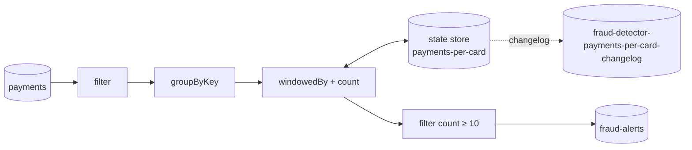
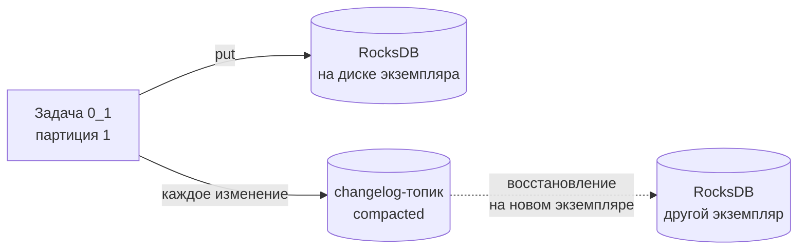
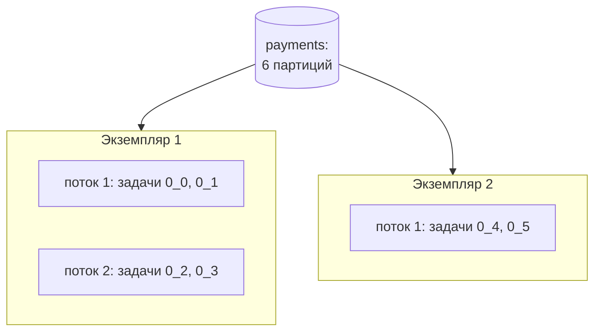

---
tags:
  - Middle
  - Senior
  - Kafka
  - Транзакции
---

# Kafka Streams

Библиотека потоковой обработки поверх Kafka: читает топики, считает агрегаты, джойнит потоки с таблицами и пишет результат обратно в топики. На собесе спрашивают, чем Kafka Streams отличается от обычного консьюмера, в чём разница `KStream` и `KTable`, где живёт состояние и как оно восстанавливается, откуда берутся repartition-топики, как работают окна и exactly-once. Основы брокера, групп и семантик доставки — на страницах [Брокер](kafka.md), [Порядок, группы и ребаланс](kafka-consumer-producer.md) и [Гарантии доставки](kafka-reliability.md).

## Основы { #basics }

### Что такое Kafka Streams и чем он отличается от обычного консьюмера? { #what-is-kafka-streams }

**Уровень:** Middle

!!! abstract "Ответ вслух"
    Kafka Streams — Java-библиотека, а не отдельный кластер: она живёт внутри твоего приложения и масштабируется запуском ещё одного экземпляра. Поверх обычных консьюмера и продюсера она даёт DSL для фильтров, агрегатов, окон и джойнов, локальное состояние с восстановлением после падения и exactly-once для цепочки «топик → обработка → топик». Обычный консьюмер всё это заставляет писать руками.

Задача: считать платежи по карте за последние 5 минут и поднимать тревогу при десятом. На голом `KafkaConsumer` нужно хранить счётчики, переживать ребаланс (счётчики чужих партиций уезжают на другой экземпляр), чистить старые окна и не потерять состояние при рестарте. В Kafka Streams это одна цепочка:

```java
StreamsBuilder builder = new StreamsBuilder();

builder.stream("payments", Consumed.with(Serdes.String(), paymentSerde)) // ключ — номер карты
    .filter((card, payment) -> payment.amount().signum() > 0)
    .groupByKey()                                                       // ключ не менялся
    .windowedBy(TimeWindows.ofSizeAndGrace(Duration.ofMinutes(5), Duration.ofSeconds(30)))
    .count(Materialized.as("payments-per-card"))                        // состояние в RocksDB
    .toStream()
    .filter((window, count) -> count >= 10)                             // дубли тревог — см. «Окна»
    .map((window, count) -> KeyValue.pair(window.key(), new FraudAlert(window.key(), count)))
    .to("fraud-alerts", Produced.with(Serdes.String(), alertSerde));

KafkaStreams streams = new KafkaStreams(builder.build(), props);
streams.start();
```

| | **`KafkaConsumer`** | **Kafka Streams** | **Flink, Spark** |
|---|---|---|---|
| **Что это** | Клиент | Библиотека в приложении | Отдельный кластер |
| **Источники и приёмники** | Kafka | Kafka → Kafka | Kafka, БД, файлы, очереди |
| **Состояние** | Твоя забота | Локальные state store + changelog-топики | Чекпоинты в распределённое хранилище |
| **Масштабирование** | Consumer group | Тоже consumer group: ещё один экземпляр | Параллелизм заданий кластера |
| **Exactly-once** | Транзакции вручную | Одна настройка | Есть, через чекпоинты |
| **Эксплуатация** | Обычный сервис | Обычный сервис | Отдельная платформа |

В Spring Boot библиотека подключается через `@EnableKafkaStreams`: топологию описывают в бине, принимающем `StreamsBuilder`, а настройки берутся из `spring.kafka.streams.*`. Как устроен обычный листенер — в [Kafka в Spring](spring-kafka.md#kafka-listener).

!!! warning "Ловушка: запись в БД из Kafka Streams"
    Kafka Streams рассчитан на выход в топики. Если внутри `foreach` писать в PostgreSQL или звать HTTP, exactly-once на эти побочные эффекты не распространяется, а повтор после сбоя продублирует запись. Результат пишут в топик, а в БД его выгружает отдельный консьюмер или Kafka Connect.

??? question "Проверь себя"
    1. Нужен ли Kafka Streams отдельный кластер?
    2. Что Kafka Streams даёт поверх обычного консьюмера?
    3. Когда стоит взять Flink, а не Kafka Streams?

### Что такое топология и из чего она состоит? { #topology }

**Уровень:** Middle

!!! abstract "Ответ вслух"
    Топология (topology) — граф обработки: source-узлы читают топики, процессоры преобразуют записи, sink-узлы пишут в топики. Её описывают высокоуровневым DSL (`filter`, `groupBy`, `join`) или низкоуровневым Processor API, где пишешь процессор сам и вручную работаешь со state store. Перед запуском `builder.build()` превращает DSL в граф процессоров, а Kafka Streams режет его на подтопологии по repartition-топикам.



**DSL** покрывает большинство задач: stateless-операции, агрегаты, окна и джойны. **Processor API** нужен, когда логики DSL не хватает: своя дедупликация с TTL, таймеры через `punctuate`, ручное управление тем, что и когда писать в store. Оба подхода смешиваются: `KStream.process()` вставляет свой процессор в DSL-цепочку.

Граф можно распечатать: `topology.describe()` показывает подтопологии, процессоры, state store и внутренние топики. Это первое, что смотрят, когда непонятно, откуда в кластере взялся топик с `-repartition` в имени.

!!! warning "Ловушка: автоматические имена процессоров"
    DSL нумерует процессоры и внутренние топики: `KSTREAM-AGGREGATE-STATE-STORE-0000000003`. Добавил `filter` в начало цепочки — номера сдвинулись, и после деплоя приложение создаёт новый пустой store и новый changelog, а старое состояние теряется. Важным узлам задают явные имена: `Materialized.as("payments-per-card")`, `Grouped.as(...)`, `Named.as(...)`.

??? question "Проверь себя"
    1. Из каких узлов состоит топология?
    2. Когда нужен Processor API вместо DSL?
    3. Почему state store и операции с состоянием стоит называть явно?

### Чем `KStream` отличается от `KTable` и `GlobalKTable`? { #kstream-ktable }

**Уровень:** Middle

!!! abstract "Ответ вслух"
    `KStream` — поток событий: каждая запись — отдельный факт, две записи с одним ключом — два события. `KTable` — таблица последних значений: новая запись с тем же ключом перезаписывает старую, а `null` её удаляет. `GlobalKTable` — таблица, которую каждый экземпляр приложения читает целиком из всех партиций, а не только из своих.

Одни и те же данные можно читать обоими способами — это дуальность потока и таблицы (stream-table duality). Поток изменений, свёрнутый по ключу, даёт таблицу; таблица, из которой выписаны все изменения, даёт поток.

| Записи в топике `balances` | Как `KStream` | Как `KTable` |
|---|---|---|
| `acc-1 → 100` | событие: 100 | `acc-1 = 100` |
| `acc-2 → 50` | событие: 50 | `acc-2 = 50` |
| `acc-1 → 70` | событие: 70 | `acc-1 = 70` (100 забыто) |
| `acc-2 → null` | событие: `null` | `acc-2` удалён (tombstone) |

```java
KStream<String, Payment> payments = builder.stream("payments");     // события
KTable<String, Customer> customers = builder.table("customers");    // актуальный профиль клиента
GlobalKTable<String, Currency> currencies = builder.globalTable("currencies"); // маленький справочник
```

**Когда что:**

- **`KStream`** — платежи, клики, заказы: важно каждое событие.
- **`KTable`** — профили, остатки, статусы: важно последнее значение по ключу. Под ней обычно топик с [log compaction](kafka.md#log-compaction).
- **`GlobalKTable`** — небольшие справочники (валюты, тарифы), к которым джойнятся по любому полю без перераспределения данных.

!!! warning "Ловушка: сумма по `KStream` из топика состояний"
    Если в топике лежат остатки счетов, а ты читаешь его как `KStream` и делаешь `groupByKey().reduce(Long::sum)`, получится сумма всех исторических остатков. Остаток — состояние, его читают как `KTable`, где новое значение заменяет старое.

??? question "Проверь себя"
    1. Что означают две записи с одним ключом в `KStream` и в `KTable`?
    2. Что такое tombstone?
    3. Чем `GlobalKTable` отличается от `KTable` по распределению данных?

## Состояние { #state }

### Где Kafka Streams хранит состояние? { #state-stores }

**Уровень:** Middle

!!! abstract "Ответ вслух"
    Агрегаты, окна и таблицы лежат в локальных state store — по умолчанию в RocksDB на диске экземпляра. Каждое изменение store дублируется в compacted changelog-топик в Kafka. Если экземпляр умер, его задачи переезжают на другой, и тот восстанавливает store, перечитав changelog.



- **Локальность.** Store разбит по задачам так же, как входные партиции: состояние карты `card-1` лежит там, где обрабатывается её партиция. Чтение и запись — локальный диск, без сетевого похода в БД.
- **Changelog.** Топик `<application.id>-<store>-changelog` с compaction хранит последнее значение каждого ключа. Это и бэкап, и способ переезда состояния.
- **Кэш.** Перед RocksDB стоит кэш записей (`statestore.cache.max.bytes`, по умолчанию 10 МБ). Он схлопывает частые обновления одного ключа, поэтому вниз по потоку и в changelog уходит меньше записей.

Состояние можно читать снаружи без отдельной БД — это Interactive Queries:

```java
ReadOnlyKeyValueStore<String, Long> store = streams.store(
    StoreQueryParameters.fromNameAndType("turnover-by-account", QueryableStoreTypes.keyValueStore()));

Long turnover = store.get("acc-1"); // только если партиция ключа живёт на этом экземпляре
```

Ключ может жить на другом экземпляре. `streams.queryMetadataForKey(...)` говорит, на каком хосте его партиция, и запрос пересылают туда своим REST-вызовом.

!!! warning "Ловушка: число обновлений зависит от кэша"
    Из-за кэша `KTable` и агрегаты выпускают вниз не каждое изменение, а последнее значение ключа на момент сброса кэша или коммита. Тест с отключённым кэшем видит 5 обновлений, прод — одно. Логика не должна полагаться на то, что увидит каждое промежуточное значение.

??? question "Проверь себя"
    1. Где по умолчанию физически лежит state store?
    2. Зачем нужен changelog-топик и почему он compacted?
    3. Как прочитать агрегат по ключу, который обрабатывается на другом экземпляре?

### Что происходит с состоянием при падении и ребалансе? { #state-restore }

**Уровень:** Senior

!!! abstract "Ответ вслух"
    Задачи упавшего экземпляра переезжают на живые, и те восстанавливают store из changelog-топика; пока идёт восстановление, задача не обрабатывает данные. При гигабайтах состояния это минуты простоя. Время сокращают standby-реплики — копии store на других экземплярах, которые постоянно догоняют changelog, — и статическое членство, чтобы рестарт не вызывал ребаланс.

Восстановление — это чтение changelog от начала до конца. Store на 20 ГБ при 100 МБ/с — больше трёх минут, в течение которых платежи по этим картам никто не считает.

| Средство | Что даёт |
|---|---|
| `num.standby.replicas` | Копия store на другом экземпляре. При падении задача переезжает туда, где состояние уже почти догнано |
| Постоянный диск (`state.dir` на volume) | После рестарта того же экземпляра RocksDB уже на месте, дочитывается только хвост changelog |
| `group.instance.id` (static membership) | Рестарт экземпляра в пределах `session.timeout.ms` не запускает ребаланс |
| Warmup-реплики (`max.warmup.replicas`, `acceptable.recovery.lag`) | Новый экземпляр сначала прогревает состояние, и только потом на него переносят активную задачу |

```java
props.put(StreamsConfig.NUM_STANDBY_REPLICAS_CONFIG, 1);
props.put(StreamsConfig.STATE_DIR_CONFIG, "/var/lib/fraud-detector/state"); // постоянный том
props.put(StreamsConfig.consumerPrefix(ConsumerConfig.GROUP_INSTANCE_ID_CONFIG), podName);
```

Как устроен ребаланс группы и чем cooperative лучше eager — в [Порядок, группы и ребаланс → ребаланс](kafka-consumer-producer.md#rebalancing).

!!! warning "Ловушка: state store на эфемерном диске в Kubernetes"
    Под с `emptyDir` после каждого деплоя стартует с пустым `state.dir` и восстанавливает всё из Kafka. Пока восстановление идёт, под не готов, и rolling update на десяток подов растягивается на час. Для приложений с большим состоянием используют StatefulSet с постоянными томами.

??? question "Проверь себя"
    1. Почему задача не обрабатывает записи во время восстановления?
    2. Чем standby-реплика помогает при падении экземпляра?
    3. Как static membership сокращает число ребалансов?

## Операции { #operations }

### Зачем Kafka Streams создаёт repartition-топики? { #repartition }

**Уровень:** Middle

!!! abstract "Ответ вслух"
    Агрегат по ключу считается в одной задаче, значит, все записи с этим ключом должны лежать в одной партиции. Если ты сменил ключ (`selectKey`, `map`, `groupBy`), записи с новым ключом разбросаны по чужим партициям. Kafka Streams перед агрегатом или джойном записывает их в промежуточный repartition-топик, разложив по новому ключу, и читает оттуда.

```java
// Ключ — номер карты, а считать нужно по магазину
payments
    .groupBy((card, payment) -> payment.merchantId(),          // смена ключа
             Grouped.with("by-merchant", Serdes.String(), paymentSerde))
    .count();
// → топик fraud-detector-by-merchant-repartition: запись на диск, сеть и ещё одно чтение
```

| Операция | Меняет ключ | Repartition перед агрегатом или джойном |
|---|---|---|
| `filter`, `mapValues`, `flatMapValues`, `peek` | Нет | Нет |
| `map`, `flatMap`, `selectKey` | Может | Да — Kafka Streams не знает, менял ли ты ключ |
| `groupByKey` | Нет | Только если до него был `map` или `selectKey` |
| `groupBy` | Да | Всегда |

!!! warning "Ловушка: `map` вместо `mapValues`"
    `map((k, v) -> KeyValue.pair(k, enrich(v)))` ключ не меняет, но Kafka Streams этого не видит и помечает поток как требующий перераспределения. Следующий `groupByKey` создаст лишний repartition-топик: двойной трафик и задержка. Если меняешь только значение — `mapValues`.

??? question "Проверь себя"
    1. Почему агрегат требует, чтобы записи с одним ключом были в одной партиции?
    2. Какие операции помечают поток для перераспределения?
    3. Чем `mapValues` лучше `map`, если ключ не меняется?

### Как работают джойны в Kafka Streams? { #joins }

**Уровень:** Senior

=== "Коротко"

    !!! abstract "Ответ вслух"
        Поток с потоком джойнится только в окне по времени: «платёж и подтверждение, пришедшие в пределах 5 минут». Поток с таблицей — это поиск текущего значения по ключу, и результат выдаёт только запись потока. Для всех джойнов, кроме `GlobalKTable`, входы должны быть ко-партиционированы: одинаковое число партиций и одинаковый ключ.

=== "Подробно"

    | Джойн | Окно | Что запускает результат | Ко-партиционирование |
    |---|---|---|---|
    | `KStream`–`KStream` | Обязательно, `JoinWindows` | Запись с любой стороны, если пара в окне | Да |
    | `KStream`–`KTable` | Нет | Только запись потока; обновление таблицы — нет | Да |
    | `KTable`–`KTable` | Нет | Обновление любой стороны | Да, кроме джойна по внешнему ключу |
    | `KStream`–`GlobalKTable` | Нет | Только запись потока | Нет: справочник целиком на каждом экземпляре |

    ```java
    // Поток с таблицей: обогатить платёж профилем клиента
    KStream<String, EnrichedPayment> enriched = paymentsByCustomer.join(
        customers,                                         // KTable<customerId, Customer>
        (payment, customer) -> new EnrichedPayment(payment, customer.segment()));

    // Поток с потоком: платёж без подтверждения 3-D Secure в течение 5 минут
    KStream<String, Payment> unconfirmed = payments.leftJoin(
        confirmations,
        (payment, confirmation) -> confirmation == null ? payment : null,
        JoinWindows.ofTimeDifferenceAndGrace(Duration.ofMinutes(5), Duration.ofMinutes(1)),
        StreamJoined.with(Serdes.String(), paymentSerde, confirmationSerde))
        .filter((paymentId, payment) -> payment != null);  // пары с подтверждением отбрасываем

    // Поток со справочником: ключ для поиска берём из значения
    KStream<String, Payment> withRate = payments.join(
        currencies,                                        // GlobalKTable<currencyCode, Currency>
        (card, payment) -> payment.currency(),             // ключ справочника
        (payment, currency) -> payment.withRate(currency.rate()));
    ```

    **Ко-партиционирование.** Записи `customer-42` из обоих топиков должны попасть в одну задачу. Для этого у топиков одинаковое число партиций, а продюсеры кладут ключ одним партиционером и одной сериализацией. Разное число партиций Kafka Streams обнаружит при старте и упадёт; разный партиционер не обнаружит — джойн просто будет промахиваться.

!!! warning "Ловушка: таблица отстаёт от потока"
    При джойне `KStream`–`KTable` платёж ищет клиента в таблице на момент обработки. Если профиль нового клиента придёт в `customers` на секунду позже платежа, внутренний `join` молча выбросит платёж, а `leftJoin` вернёт его без профиля. Сценарии «сначала событие, потом справочник» проверяют отдельно.

!!! warning "Ловушка: `GlobalKTable` для большой таблицы"
    `GlobalKTable` целиком копируется на каждый экземпляр и полностью загружается до старта обработки. Таблица на 50 ГБ при десяти экземплярах — 500 ГБ дисков и долгий старт каждого пода. Глобальные таблицы — для справочников, большие таблицы джойнят через ко-партиционированную `KTable`.

??? question "Проверь себя"
    1. Почему джойн двух потоков требует окна?
    2. Выдаст ли результат обновление `KTable` в джойне `KStream`–`KTable`?
    3. Что такое ко-партиционирование и какой джойн его не требует?

### Как работают окна и время в Kafka Streams? { #windows }

**Уровень:** Middle

=== "Коротко"

    !!! abstract "Ответ вслух"
        Окна (windows) режут бесконечный поток на интервалы для агрегатов: tumbling — встык без пересечений, hopping — с перекрытием, sliding — относительно каждой записи, session — по паузам активности. Время по умолчанию — event time из метки записи, а не время обработки. Опоздавшие записи принимаются, пока не прошёл grace period, после закрытия окна они отбрасываются.

=== "Подробно"

    | Окно | API | Пример |
    |---|---|---|
    | **Tumbling** | `TimeWindows.ofSizeWithNoGrace(5 мин)` | Оборот за каждые 5 минут: 10:00–10:05, 10:05–10:10 |
    | **Hopping** | `TimeWindows.ofSizeAndGrace(...).advanceBy(1 мин)` | Оборот за 5 минут с шагом 1 минута, окна перекрываются |
    | **Sliding** | `SlidingWindows.ofTimeDifferenceWithNoGrace(5 мин)` | Платежи, между которыми не больше 5 минут |
    | **Session** | `SessionWindows.ofInactivityGapWithNoGrace(30 мин)` | Сессия пользователя до паузы в 30 минут |

    ```mermaid
    gantt
        dateFormat HH:mm
        axisFormat %H:%M
        section Tumbling 5 мин
        окно 1 :10:00, 5m
        окно 2 :10:05, 5m
        section Hopping 5 мин, шаг 2 мин
        окно A :10:00, 5m
        окно B :10:02, 5m
        окно C :10:04, 5m
    ```

    **Event time и stream time.** Время записи — её метка (`timestamp`), которую ставит продюсер; свою логику задают через `TimestampExtractor`, например брать время из поля платежа. Stream time задачи — максимальная метка, которую она видела. Окно закрывается, когда stream time переваливает за конец окна плюс grace period.

    **Grace period.** Запись из 10:03 пришла в 10:07 из-за задержки в сети — с `ofSizeAndGrace(5 мин, 1 мин)` окно 10:00–10:05 её ещё примет, в 10:06:01 по stream time — уже нет. Опоздавшие сверх grace записи отбрасываются и попадают в метрику `dropped-records`.

    **Финальный результат.** Агрегат по окну выпускает обновление на каждое изменение (с учётом кэша). Чтобы получить одну запись на окно после его закрытия, используют `suppress`:

    ```java
    .windowedBy(TimeWindows.ofSizeAndGrace(Duration.ofMinutes(5), Duration.ofSeconds(30)))
    .count()
    .suppress(Suppressed.untilWindowCloses(Suppressed.BufferConfig.unbounded()))
    .toStream()  // одна запись на карту и окно, после закрытия окна
    ```

!!! warning "Ловушка: несколько тревог вместо одной"
    Цепочка `count()` → `filter(count >= 10)` без `suppress` выпустит тревогу на каждое обновление окна после десятого платежа. Фильтр `count == 10` не спасает: кэш state store может схлопнуть 9 и 11, и десятка вниз не уйдёт вовсе. Нужен `suppress` и тревога после закрытия окна, а если тревога нужна сразу — своя дедупликация в Processor API.

!!! warning "Ловушка: окно не закрывается без новых данных"
    Stream time двигают только новые записи. Если в партицию перестали писать, окно 10:00–10:05 не закроется никогда, и `suppress` не выпустит результат. На тестовом стенде с редкими событиями это выглядит как «Kafka Streams не работает».

??? question "Проверь себя"
    1. Чем tumbling-окно отличается от hopping и session?
    2. Что такое grace period и что происходит с записью после него?
    3. Зачем нужен `suppress`?

## Надёжность и масштабирование { #reliability }

### Как Kafka Streams масштабируется? { #scaling }

**Уровень:** Middle

!!! abstract "Ответ вслух"
    Каждая подтопология режется на задачи (tasks) по числу партиций входного топика, и задача — единица параллелизма. Задачи распределяются между потоками (`num.stream.threads`) всех запущенных экземпляров с одним `application.id`, который служит `group.id`. Потолок параллелизма — число партиций: лишние потоки будут простаивать.



- **Задача** `0_3` — подтопология 0, партиция 3. Состояние задачи живёт вместе с ней.
- **Поток** (`num.stream.threads`, по умолчанию 1) обслуживает несколько задач.
- **Экземпляр** — процесс приложения. Новый экземпляр с тем же `application.id` запускает ребаланс, и часть задач переезжает к нему.

`application.id` — это одновременно `group.id` и префикс внутренних топиков. Смена `application.id` равна новому приложению: пустые оффсеты, пустое состояние, новые changelog и repartition-топики.

!!! warning "Ловушка: двенадцать подов на шесть партиций"
    Задач шесть, значит, шесть подов получат работу, а остальные будут простаивать. Масштабирование Kafka Streams упирается в партиции входных топиков, и увеличивать их надо заранее: после увеличения ключи перераспределятся, а с ними и состояние.

??? question "Проверь себя"
    1. Что такое задача Kafka Streams и сколько их будет?
    2. Какую роль играет `application.id`?
    3. Почему добавление экземпляров перестаёт ускорять обработку?

### Как в Kafka Streams включить exactly-once? { #streams-eos }

**Уровень:** Senior

!!! abstract "Ответ вслух"
    Одной настройкой `processing.guarantee=exactly_once_v2`. Тогда чтение входа, запись результата, изменения state store в changelog и коммит оффсетов делаются в одной транзакции Kafka: после сбоя они либо применены все, либо откатываются все. Гарантия действует только внутри Kafka и только для читателей с `isolation.level=read_committed`.

```java
props.put(StreamsConfig.PROCESSING_GUARANTEE_CONFIG, StreamsConfig.EXACTLY_ONCE_V2);
```

- **`at_least_once`** — по умолчанию. После сбоя часть записей обработается повторно, в выходе и в store будут дубли.
- **`exactly_once_v2`** — с Kafka 3.0, брокеры 2.5+. Старые значения `exactly_once` и `exactly_once_beta` удалены в Kafka 4.0.

**Цена.** Коммит транзакции раз в `commit.interval.ms` — при exactly-once по умолчанию 100 мс вместо 30 секунд. Downstream-консьюмеры с `read_committed` видят результат только после коммита, а это добавляет задержку и нагрузку на брокер.

Почему exactly-once не распространяется на внешние системы — в [Гарантии доставки → «мифический» exactly-once](kafka-reliability.md#exactly-once).

!!! warning "Ловушка: консьюмер результата с `read_uncommitted`"
    Транзакционный продюсер пишет записи сразу, а потом коммитит или отменяет транзакцию. Консьюмер с уровнем изоляции по умолчанию `read_uncommitted` прочитает и записи отменённых транзакций — дубли, которые exactly-once должен был устранить. Читатели выходного топика должны выставить `isolation.level=read_committed`.

??? question "Проверь себя"
    1. Какие действия попадают в одну транзакцию при exactly-once?
    2. Какую цену платишь за `exactly_once_v2`?
    3. Почему консьюмеру результата нужен `read_committed`?

### Как обрабатывать ошибки в Kafka Streams? { #streams-errors }

**Уровень:** Middle

!!! abstract "Ответ вслух"
    Для каждого этапа свой обработчик: десериализации, обработки (с Kafka 3.9) и записи в топик. По умолчанию все они логируют ошибку и останавливают поток, так что одна «ядовитая» запись встаёт колом всю партицию. Для битых данных выбирают «залогировать и продолжить», с Kafka 4.2 — с отправкой записи в DLQ, а для упавшего потока задают `StreamsUncaughtExceptionHandler`.

| Где ошибка | Настройка | По умолчанию | Альтернатива |
|---|---|---|---|
| Десериализация | `deserialization.exception.handler` | `LogAndFailExceptionHandler` | `LogAndContinueExceptionHandler` |
| Обработка в процессоре | `processing.exception.handler` (Kafka 3.9+) | `LogAndFailProcessingExceptionHandler` | `LogAndContinueProcessingExceptionHandler` |
| Запись в топик | `production.exception.handler` | `DefaultProductionExceptionHandler` | Свой обработчик |
| Поток упал | `streams.setUncaughtExceptionHandler(...)` | Остановить клиент | `REPLACE_THREAD`, `SHUTDOWN_APPLICATION` |

До Kafka 4.0 первый и третий параметры назывались с префиксом `default.`; старые имена ещё работают, но устарели.

```java
props.put("deserialization.exception.handler", LogAndContinueExceptionHandler.class);
props.put("errors.dead.letter.queue.topic.name", "payments-dlq"); // Kafka 4.2+

streams.setUncaughtExceptionHandler(ex -> {
    log.error("Поток Kafka Streams упал", ex);
    return StreamThreadExceptionResponse.SHUTDOWN_CLIENT; // пусть Kubernetes перезапустит под
});
```

Общий подход к «ядовитым» сообщениям и DLQ — в [Гарантии доставки → DLQ](kafka-reliability.md#dlq).

!!! warning "Ловушка: `REPLACE_THREAD` на битой записи"
    Если поток упал из-за данных, новый поток начнёт с того же незакоммиченного оффсета, прочитает ту же запись и снова упадёт. Получается бесконечный цикл перезапусков с ростом лага. `REPLACE_THREAD` уместен для временных сбоев, а битые данные отсекаются обработчиками десериализации и обработки.

??? question "Проверь себя"
    1. Что по умолчанию делает Kafka Streams с записью, которую не удалось десериализовать?
    2. Какие обработчики ошибок есть и на каких этапах они срабатывают?
    3. Почему `REPLACE_THREAD` опасен для «ядовитых» записей?

### Как протестировать топологию? { #topology-test-driver }

**Уровень:** Middle

!!! abstract "Ответ вслух"
    `TopologyTestDriver` из `kafka-streams-test-utils` прогоняет топологию синхронно в памяти, без брокера. Записи подаются во входной тестовый топик с нужными метками времени, а результат читается из выходного. Время управляется вручную, поэтому окна и grace period проверяются за миллисекунды.

```java
@Test
void alertsOnTenthPaymentWithinFiveMinutes() {
    Topology topology = new FraudTopology(paymentSerde, alertSerde).build();

    try (TopologyTestDriver driver = new TopologyTestDriver(topology, testProps())) {
        TestInputTopic<String, Payment> payments = driver.createInputTopic(
            "payments", new StringSerializer(), paymentSerde.serializer());
        TestOutputTopic<String, FraudAlert> alerts = driver.createOutputTopic(
            "fraud-alerts", new StringDeserializer(), alertSerde.deserializer());

        Instant start = Instant.parse("2026-10-26T10:00:00Z");
        for (int i = 0; i < 10; i++) {
            payments.pipeInput("card-1", payment("100.00"), start.plusSeconds(i * 20L));
        }

        assertThat(alerts.readValuesToList())
            .containsExactly(new FraudAlert("card-1", 10L));
    }
}
```

Драйвер проверяет логику, но не поведение кластера: ребаланс, восстановление состояния и exactly-once. Их проверяют интеграционными тестами с брокером в Testcontainers — подход описан в [Тестирование → Testcontainers](../spring/spring-testing.md#testcontainers).

!!! warning "Ловушка: кэш и коммиты в тесте"
    `TopologyTestDriver` выпускает результат после каждой записи, а в проде кэш state store схлопывает обновления. Тест, который проверяет все промежуточные значения агрегата, проходит, а прод ведёт себя иначе. Проверяй итоговое значение или используй `suppress`, если логике нужно ровно одно событие.

??? question "Проверь себя"
    1. Нужен ли брокер для `TopologyTestDriver`?
    2. Как в тесте проверить работу окна?
    3. Какие свойства топологии драйвер не проверяет?

## Шпаргалка { #cheatsheet }

<!-- --8<-- [start:cheatsheet] -->
| Тема | Запомнить |
|---|---|
| **Kafka Streams** | Библиотека в приложении, Kafka → Kafka. Состояние, окна, джойны и exactly-once из коробки |
| **Топология** | Source → процессоры → sink. DSL или Processor API. Называй store и узлы явно |
| **`KStream` / `KTable`** | Поток событий / последнее значение по ключу, `null` удаляет. `GlobalKTable` — справочник целиком на каждом экземпляре |
| **State store** | RocksDB локально + compacted changelog-топик. Восстановление — перечитать changelog |
| **Быстрое восстановление** | `num.standby.replicas`, постоянный `state.dir`, static membership |
| **Repartition** | Смена ключа перед агрегатом или джойном → промежуточный топик. `mapValues` вместо `map` |
| **Джойны** | Поток–поток — только в окне. Поток–таблица — поиск, результат от записи потока. Нужно ко-партиционирование, кроме `GlobalKTable` |
| **Окна** | Tumbling, hopping, sliding, session. Event time, grace period, `suppress` для финального результата |
| **Масштабирование** | Задач = партиций входа. `application.id` = `group.id` и префикс внутренних топиков |
| **Exactly-once** | `processing.guarantee=exactly_once_v2`, читатели с `read_committed`. Только внутри Kafka |
| **Ошибки** | По умолчанию — остановка. `LogAndContinue…`, DLQ с Kafka 4.2, `StreamsUncaughtExceptionHandler` |
| **Тесты** | `TopologyTestDriver`: без брокера, время задаётся метками записей |

<!-- --8<-- [end:cheatsheet] -->
