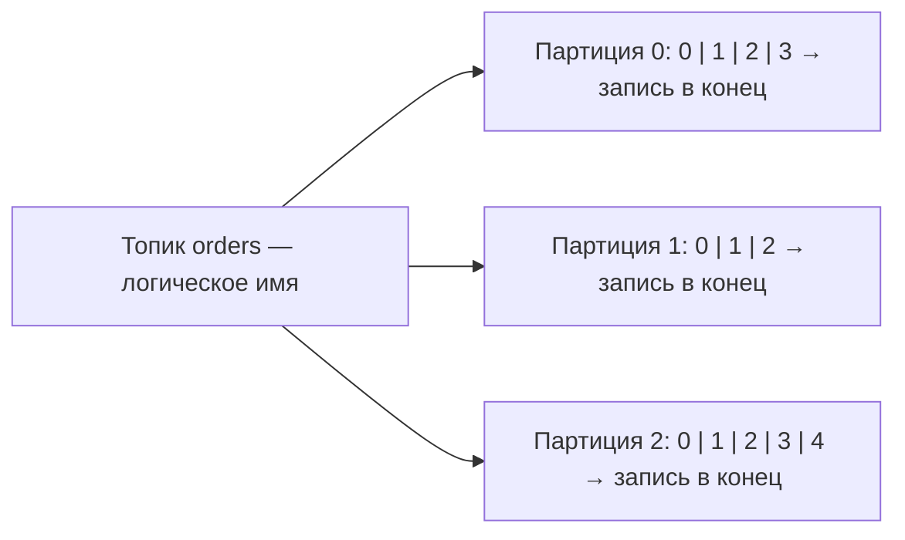
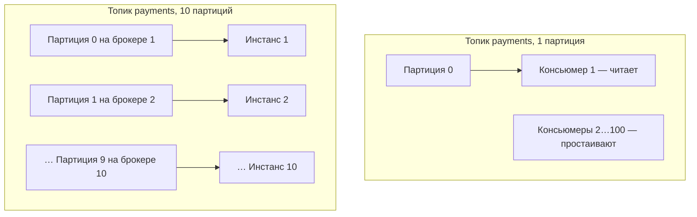
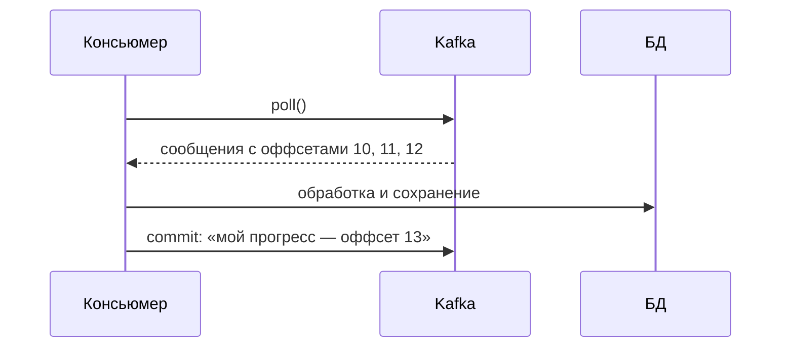
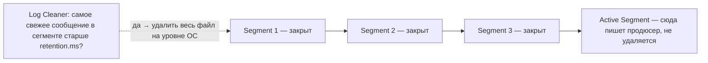

---
tags:
  - Junior
  - Middle
  - Senior
  - Kafka
---

# Брокер: топики, партиции, хранение

Как Kafka хранит данные: распределённый лог, топики и партиции, оффсеты, retention и log compaction. На собесе чаще всего спрашивают отличие Kafka от RabbitMQ, почему порядок гарантирован только внутри партиции, где хранятся оффсеты консьюмеров и как Kafka удаляет старые сообщения.

## Топики и партиции { #topics-partitions }

### Чем Kafka отличается от RabbitMQ? { #kafka-vs-rabbitmq }

**Уровень:** Junior

!!! abstract "Ответ вслух"
    RabbitMQ — классическая очередь: «умный брокер — глупый потребитель», брокер сам пушит сообщения и удаляет их после подтверждения. Kafka — распределённый лог: «глупый брокер — умный потребитель», консьюмеры сами вытягивают данные, а сообщения хранятся до истечения retention. Поэтому в Kafka можно «отмотать» оффсет назад и перечитать сообщения.

**Классическая очередь (RabbitMQ): «умный брокер — глупый потребитель».**

- Брокер получает сообщение и пушит (push) его консьюмеру. После подтверждения (ACK) брокер **навсегда удаляет** сообщение.
- Минусы: брокер тратит ресурсы на отслеживание, кому отдал сообщение и получил ли ответ. Удалённое сообщение прочитать заново невозможно — например, если упала БД и данные не сохранились.

**Kafka (распределённый лог): «глупый брокер — умный потребитель».**

- Kafka не удаляет сообщения после прочтения. Она работает как **append-only log**: сообщения пишутся на диск друг за другом и иммутабельны — их нельзя изменить или удалить поштучно.
- Брокер ничего не пушит: консьюмеры сами вытягивают (pull) данные, когда им удобно. Сообщения хранятся столько, сколько указано в `retention.ms` (например, 7 дней).
- Плюс: если сервис упал или в логике была ошибка, можно «отмотать» время назад и перечитать те же сообщения.

| | **RabbitMQ (очередь)** | **Kafka (лог)** |
|---|---|---|
| **Модель доставки** | Push (брокер → консьюмер) | Pull (консьюмер ← брокер) |
| **После прочтения** | Сообщение удаляется | Хранится до retention |
| **Перечитать** | Невозможно | Отмотать оффсет назад |
| **Где логика** | В брокере | В консьюмере |

Общий обзор брокеров сообщений и моделей point-to-point и pub/sub — в [System Design → Message Queues](../system-design/building-blocks.md#message-queues).

!!! warning "Ловушка: «Kafka удаляет прочитанное»"
    Прочтение не влияет на хранение. Сообщение лежит до истечения retention, даже если его уже прочитали все группы консьюмеров.

??? question "Проверь себя"
    1. Почему Kafka называют «глупый брокер — умный потребитель»?
    2. Что происходит с сообщением в RabbitMQ после ACK, а что в Kafka после прочтения?
    3. Как в Kafka перечитать старые сообщения?

### Что такое топик и партиция? { #topic-partition }

**Уровень:** Junior

!!! abstract "Ответ вслух"
    Топик — логическое имя категории сообщений одного типа, например `payment-events`; физически это набор директорий. Партиция — физическая часть топика: append-only файл на диске брокера, куда новые сообщения дописываются в конец. Каждое сообщение в партиции получает возрастающий номер — оффсет.

**Топик** — имя категории (папки) для сообщений одного типа: `user-registrations`, `payment-events`. Он не существует физически как единый файл: для ОС сервера Kafka топик — просто набор директорий. Физическая реальность начинается на уровне партиций.

**Партиция.** Каждый топик разбивается на партиции: создавая топик `orders`, ты обязан указать, на сколько партиций его разделить (например, 3).

- **Физически** партиция — буквально файл (сегмент лога) на диске брокера. Новые сообщения дописываются строго в конец.
- **Offset (смещение)** — каждое сообщение внутри партиции получает уникальный возрастающий порядковый номер. Первое — offset 0, второе — 1, миллионное — 999999.

!!! warning "Ловушка: гарантия порядка"
    Строгий порядок сообщений гарантируется **только внутри одной партиции**. Kafka не гарантирует, что сообщение из партиции 0 было отправлено раньше, чем из партиции 1. Как сохранить порядок для одной сущности — в [Consumer и Producer → Ключи](kafka-consumer-producer.md#message-keys).

??? question "Проверь себя"
    1. Чем топик отличается от партиции физически?
    2. Что такое offset?
    3. Где Kafka гарантирует порядок сообщений?

### Почему партиция — единица масштабирования? { #partition-scaling }

**Уровень:** Middle

!!! abstract "Ответ вслух"
    Одну партицию в рамках группы читает только один консьюмер, поэтому число партиций — потолок параллелизма чтения. Больше партиций — их можно разнести по брокерам и распределить запись между дисками, и можно запустить столько же консьюмеров. Упёрся в лимит обработки — первым делом увеличивают число партиций и добавляют консьюмеры.

**Топик с 1 партицией.** Сколько бы консьюмеров ни запустил (2, 5, 100), читать эту партицию сможет только один. Остальные простаивают — это защита от состояния гонки (race condition).

**Топик с 10 партициями:**

1. **Масштабирование брокеров** — 10 файлов раскидываются по 10 серверам, нагрузка на запись распределена между 10 дисками.
2. **Масштабирование консьюмеров** — 10 инстансов приложения, Kafka отдаёт каждому по партиции. Они читают параллельно, производительность ×10.

!!! tip "Правило масштабирования"
    Партиция — минимальная единица параллелизма в Kafka. Упёрся в лимиты обработки — первым делом увеличивай количество партиций и добавляй консьюмеры.

!!! warning "Ловушка: добавление партиций ломает порядок по ключу"
    Увеличивать число партиций можно, но для топиков, где важен порядок по ключу, это меняет распределение ключей. Подробно — в [Consumer и Producer → Смена числа партиций](kafka-consumer-producer.md#repartitioning).

??? question "Проверь себя"
    1. Сколько консьюмеров одной группы прочитают топик с одной партицией?
    2. Как 10 партиций масштабируют запись и чтение?
    3. Что делать первым делом, если упёрся в лимит обработки?

## Оффсеты { #offsets }

### Что такое оффсет партиции и оффсет консьюмера? { #offset }

**Уровень:** Junior

!!! abstract "Ответ вслух"
    Оффсет партиции — неизменный номер сообщения, который брокер присваивает при записи; Log End Offset указывает на место для следующего сообщения. Оффсет консьюмера — «закладка» прогресса группы: консьюмер обработал сообщения и коммитит номер следующего, чтобы после перезапуска продолжить с него.

**Оффсет партиции (взгляд брокера).** Партиция — бесконечный лог-файл. Продюсер прислал сообщение → брокер дописал его в конец и присвоил уникальный возрастающий номер.

- **Неизменен** — сообщение с оффсетом `42` навсегда останется под номером `42` (пока не истечёт `retention.ms`).
- **Log End Offset (LEO)** — указатель на конец файла. Если в партиции 100 сообщений (0–99), LEO = 100: сюда запишется следующее входящее.

**Оффсет консьюмера (взгляд потребителя).** Это виртуальная «закладка в книге». Сервис читает данные и отмечает прогресс, чтобы при перезапуске не читать всё сначала.

Отправка прогресса в Kafka называется **коммит (commit)**. Коммитится номер **следующего** сообщения, которое нужно прочитать: обработал 10–12 — коммитишь 13.

!!! warning "Ловушка: когда коммитить"
    Момент коммита определяет гарантию доставки: коммит до обработки рискует потерять сообщение, после — получить дубль. Подробно — в [Гарантии доставки → Семантики](kafka-reliability.md#delivery-semantics).

??? question "Проверь себя"
    1. Что такое Log End Offset?
    2. Какой номер коммитит консьюмер, обработавший сообщения 10, 11 и 12?
    3. Чем оффсет партиции отличается от оффсета консьюмера?

### Где Kafka хранит оффсеты консьюмеров? { #consumer-offsets }

**Уровень:** Senior

!!! abstract "Ответ вслух"
    В скрытом системном топике `__consumer_offsets`. При коммите консьюмер работает как продюсер: отправляет сообщение с ключом «группа + топик + партиция» и значением оффсета. Раньше оффсеты хранились в Zookeeper, но он не выдерживал такого потока записей.

Вопрос: _«Консьюмер закоммитил оффсет. Куда физически Kafka его записала? Не в память же?»_

- **Раньше:** Kafka хранила оффсеты в Zookeeper. Но Zookeeper не был рассчитан на миллионы операций записи в секунду и стал узким местом.
- **Сейчас:** Kafka хранит оффсеты **внутри самой себя** — в скрытом системном топике `__consumer_offsets`.

При коммите консьюмер работает как продюсер — отправляет служебное сообщение в `__consumer_offsets`:

| Ключ | Значение |
|---|---|
| `[Consumer Group + Топик + Номер партиции]` | Число — например, 13 |

При перезагрузке сервис идёт в `__consumer_offsets`, находит свою последнюю цифру по ключу и говорит брокеру: «Давай данные из партиции, начиная с 13-го сообщения».

!!! warning "Ловушка: оффсет принадлежит группе, а не инстансу"
    Ключ в `__consumer_offsets` содержит consumer group, а не конкретный сервер. Поэтому после ребаланса новый владелец партиции продолжает с того же места, где остановился предыдущий.

??? question "Проверь себя"
    1. Как называется топик, где Kafka хранит оффсеты?
    2. Что лежит в ключе и значении такого сообщения?
    3. Почему от Zookeeper для оффсетов отказались?

## Хранение и удаление данных { #retention }

### Почему Kafka не удаляет сообщения по одному? { #no-single-delete }

**Уровень:** Middle

!!! abstract "Ответ вслух"
    Партиция — append-only лог, и удаление сообщения из середины оставило бы дыру или потребовало бы сдвинуть все последующие. Скорость Kafka держится на последовательном I/O и Page Cache: запись в конец файла — O(1). Поштучное удаление превратило бы это в O(N).

Партиция — append-only log. В файле миллион сообщений, консьюмер прочитал сообщение №5 — что если Kafka попытается его удалить?

Придётся либо оставить «дырку» (фрагментация), либо сдвинуть 999 995 сообщений. И то и другое убьёт скорость диска.

!!! info "Почему Kafka такая быстрая"
    Kafka пишет и читает со скоростью, близкой к RAM, благодаря Page Cache в Linux и последовательному I/O. Запись в конец файла — **O(1)**. Поштучное удаление превратило бы это в O(N) и уничтожило бы пропускную способность.

!!! warning "Ловушка: «удалить одно сообщение из топика»"
    Удалить конкретное сообщение из середины партиции нельзя. Если по ключу важна только последняя версия, используют [log compaction](#log-compaction): после неё от каждого ключа остаётся одно сообщение.

??? question "Проверь себя"
    1. Что пришлось бы сделать Kafka, чтобы удалить сообщение из середины партиции?
    2. За счёт чего Kafka работает быстро?
    3. Какова сложность записи в конец партиции?

### Как Kafka удаляет старые данные? { #segments }

**Уровень:** Middle

!!! abstract "Ответ вслух"
    Партиция физически нарезана на сегменты — файлы по 1 ГБ по умолчанию. Kafka удаляет только закрытые сегменты и только целиком: когда самое свежее сообщение в сегменте старше `retention.ms` или партиция превысила `retention.bytes`. Активный сегмент, куда пишет продюсер, не удаляется никогда.

Kafka работает не с отдельными сообщениями, а с файлами-сегментами. Партиция физически — не один гигантский файл, а куски (segments); размер сегмента по умолчанию — 1 ГБ.

Log Cleaner проверяет: возраст самого свежего сообщения в сегменте больше `retention.ms` (7 дней)? Если да — удаляет весь файл на 1 ГБ целиком на уровне ОС, это мгновенно. Активный сегмент (последний, куда пишет продюсер) Kafka не удалит никогда, даже если время вышло.

**Настройки retention.** Политика очистки задаётся для каждого топика. Два триггера:

| Триггер | Настройка | Как работает |
|---|---|---|
| **По времени** | `log.retention.hours` / `ms` | Удалять сегменты старше N дней (по умолчанию 7 дней) |
| **По размеру** | `log.retention.bytes` | Удалять старые сегменты, если размер партиции > N ГБ (лимит 50 ГБ → выросла до 51 ГБ → удаляется старейший сегмент) |

Триггеры работают по принципу «ИЛИ»: что наступит раньше, то и удалит старые данные.

!!! warning "Ловушка: данные живут дольше retention"
    Сегмент удаляется, только когда устарело его **самое свежее** сообщение, а активный сегмент не удаляется вовсе. Поэтому старые сообщения могут лежать на диске заметно дольше `retention.ms`.

??? question "Проверь себя"
    1. Какой размер сегмента по умолчанию?
    2. Почему активный сегмент не удаляется?
    3. Как сочетаются retention по времени и по размеру?

### Зачем хранить сообщения неделями? { #why-retention }

**Уровень:** Junior

!!! abstract "Ответ вслух"
    Чтобы перечитать данные после бага или падения, чтобы быстрые и медленные системы читали один топик каждая в своём темпе, и для event sourcing, где топик с бесконечным хранением становится источником истины. С RabbitMQ так нельзя — сообщения удаляются после первого прочтения.

- **Машина времени (replayability)** — упала БД или выкатил кривой код? Сообщения не потеряны: чинишь баг, отматываешь оффсет назад и перечитываешь логи за 3 дня. С RabbitMQ так нельзя — данные удалились бы после первого прочтения.
- **Независимость множества систем** — данные лежат 7 дней. Сервис уведомлений читает их за миллисекунду, тяжёлый сервис аналитики выкачивает раз в сутки батчами. Данные дождутся всех.
- **Event Sourcing** — топик с `retention.ms = -1` (бесконечное хранение) становится источником истины (source of truth) всей системы за всю историю.

!!! warning "Ловушка: retention короче, чем простой консьюмера"
    Если консьюмер лежал дольше `retention.ms`, сообщения успеют удалиться, и перечитать их будет нельзя. Retention выбирают с запасом на самое долгое восстановление.

??? question "Проверь себя"
    1. Как retention помогает после выкатки кривого кода?
    2. Что значит `retention.ms = -1`?
    3. Почему с RabbitMQ нельзя перечитать данные за прошлые дни?

### Что такое log compaction? { #log-compaction }

**Уровень:** Senior

!!! abstract "Ответ вслух"
    Это альтернативная политика очистки (`cleanup.policy=compact`): вместо удаления по времени Kafka в фоне проходит по старым сегментам и оставляет только последнее сообщение для каждого ключа. Так хранят справочники и текущие состояния — например, последний баланс каждого пользователя — бесконечно и без роста диска.

Задача: _«Не хочу удалять по времени, но и бесконечно растить диск не могу. Топик с балансами пользователей — важен только текущий, последний баланс»._

Решение — **log compaction** (`cleanup.policy=compact`). Вместо удаления по времени Kafka в фоне проходит по старым сегментам, смотрит на **ключи** и удаляет старые версии, оставляя **только последнее сообщение для каждого уникального ключа**.

| Сообщение по ключу `user-123` | После compaction |
|---|---|
| `{баланс: 100}` | удаляется |
| `{баланс: 250}` | удаляется |
| `{баланс: 180}` | удаляется |
| `{баланс: 4000}` | остаётся — последнее |

По ключу `user-123` было 50 изменений профиля за год, а после compaction осталось одно. Это позволяет хранить справочники и стейты вечно, не раздувая диск.

!!! warning "Ловушка: compaction без ключей"
    Compaction работает по ключу сообщения, поэтому брокер отклоняет запись без ключа (`key = null`) в compacted-топик. Ключ у таких сообщений обязателен.

??? question "Проверь себя"
    1. Какая настройка включает log compaction?
    2. Что остаётся в партиции после compaction?
    3. Для каких данных подходит compacted-топик?

## Шпаргалка { #cheatsheet }

<!-- --8<-- [start:cheatsheet] -->
| Тема | Запомнить |
|---|---|
| **Kafka vs RabbitMQ** | Kafka — pull-лог, хранит после чтения. RabbitMQ — push-очередь, удаляет |
| **Topic** | Логическая абстракция, набор директорий. Физика — на уровне партиций |
| **Partition** | Файл на диске, append-only. Порядок гарантирован только внутри партиции |
| **Партиция = масштаб** | Одна партиция = один консьюмер в группе. Больше партиций — больше параллелизма |
| **Offset партиции** | Неизменный номер сообщения. LEO — конец файла |
| **Offset консьюмера** | «Закладка» прогресса. Commit сохраняет номер следующего сообщения |
| **`__consumer_offsets`** | Скрытый топик, где Kafka хранит оффсеты (раньше был Zookeeper) |
| **Retention** | Удаление целыми сегментами (1 ГБ), не по одному. По времени ИЛИ размеру |
| **Сегменты** | Партиция нарезана на куски. Активный сегмент не удаляется |
| **Log Compaction** | `cleanup.policy=compact` — оставить последнее сообщение на каждый ключ |

<!-- --8<-- [end:cheatsheet] -->
