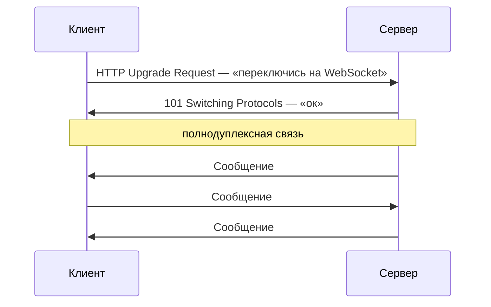

---
tags:
  - Middle
  - Сети
---

# REST, gRPC и WebSocket

Стили API поверх HTTP: что такое REST и чем глаголы в URL его ломают, как устроен gRPC, когда выбирать REST, gRPC или GraphQL и когда нужна связь в реальном времени через WebSocket или SSE. Транспорт, HTTP и TLS, на которых всё это работает, — на странице [TCP/IP, HTTP и TLS](networks.md).

## REST и gRPC { #api-styles }

### Что такое REST? { #rest }

**Уровень:** Junior

!!! abstract "Ответ вслух"
    REST (Representational State Transfer) — архитектурный стиль поверх HTTP, а не протокол. Ресурсы идентифицируются URL-ами с существительными, операции над ними — HTTP-методами, каждый запрос самодостаточен. Глаголы в URL — признак RPC-стиля, а не REST.

**Принципы REST:**

1. **Stateless** — каждый запрос самодостаточен, сервер не хранит состояние клиента.
2. **Uniform Interface** — ресурсы идентифицируются URL, операции — HTTP-методами.
3. **Client-Server** — чёткое разделение ответственности.
4. **Cacheable** — ответы могут кэшироваться.
5. **Layered System** — клиент не знает, есть ли между ним и сервером прокси или балансировщики.

**Правильный REST API:**

```text
# Ресурсы — существительные, не глаголы
GET    /api/habits          → список привычек
GET    /api/habits/1        → конкретная привычка
POST   /api/habits          → создать привычку
PUT    /api/habits/1        → полная замена
PATCH  /api/habits/1        → частичное обновление
DELETE /api/habits/1        → удалить

# Вложенные ресурсы
GET    /api/users/42/habits      → привычки конкретного пользователя
POST   /api/users/42/habits      → создать привычку для пользователя

# Фильтрация, сортировка, пагинация — query params
GET    /api/habits?status=ACTIVE&sort=createdAt&page=0&size=20

# Версионирование
/api/v1/habits
/api/v2/habits
```

Как такой API пишется на Spring, разобрано в [Spring MVC](../spring/spring-mvc.md).

!!! warning "Ловушка: REST только по названию"
    Эти эндпоинты часто называют REST, хотя это RPC-стиль:

    ```text
    POST /api/getHabits            ← ❌ глагол в URL
    GET  /api/habits/delete/1      ← ❌ действие в URL
    GET  /api/habits?action=create ← ❌ действие в параметре
    ```

    Действие должно задаваться HTTP-методом, а URL — называть ресурс.

??? question "Проверь себя"
    1. Назови пять принципов REST.
    2. Как в REST передают фильтрацию, сортировку и пагинацию?
    3. Почему `POST /api/getHabits` — не REST?

### Как устроен gRPC? { #grpc }

**Уровень:** Middle

=== "Коротко"

    !!! abstract "Ответ вслух"
        gRPC — RPC-фреймворк от Google поверх HTTP/2, данные сериализуются в бинарный Protocol Buffers (protobuf). Контракт описывается в `.proto`-файле, из которого генерируется клиентский и серверный код на любом языке. Из коробки есть стриминг в обе стороны.

=== "Подробно"

    **Контракт через `.proto`-файл:**

    ```protobuf
    syntax = "proto3";

    package habits;

    service HabitService {
      rpc GetHabit (GetHabitRequest) returns (HabitResponse);
      rpc CreateHabit (CreateHabitRequest) returns (HabitResponse);
      rpc StreamHabits (StreamRequest) returns (stream HabitResponse); // серверный стриминг
      rpc SyncHabits (stream HabitUpdate) returns (stream HabitResponse); // двусторонний стрим
    }

    message GetHabitRequest {
      int64 id = 1;
    }

    message HabitResponse {
      int64 id = 1;
      string name = 2;
      string status = 3;
      int64 created_at = 4;
    }
    ```

    Из `.proto` генерируется клиентский и серверный код на любом языке: Java, Go, Python, Kotlin.

    **gRPC в Spring Boot:**

    ```java
    // Server
    @GrpcService
    public class HabitGrpcService extends HabitServiceGrpc.HabitServiceImplBase {

        @Override
        public void getHabit(GetHabitRequest request,
                             StreamObserver<HabitResponse> responseObserver) {
            HabitDto habit = habitService.findById(request.getId());

            HabitResponse response = HabitResponse.newBuilder()
                .setId(habit.getId())
                .setName(habit.getName())
                .setStatus(habit.getStatus().name())
                .build();

            responseObserver.onNext(response);
            responseObserver.onCompleted();
        }
    }
    ```

!!! warning "Ловушка: gRPC из браузера"
    Браузер не даёт JavaScript нужного gRPC контроля над HTTP/2, поэтому напрямую вызвать gRPC-сервис из браузера нельзя. Нужен grpc-web и прокси перед сервисом. Это одна из причин, почему публичные API делают на REST, а gRPC оставляют для общения сервисов.

??? question "Проверь себя"
    1. Какой транспорт и какой формат данных использует gRPC?
    2. Что генерируется из `.proto`-файла?
    3. Какие виды стриминга поддерживает gRPC?

### REST, gRPC или GraphQL? { #rest-vs-grpc }

**Уровень:** Middle

!!! abstract "Ответ вслух"
    REST — дефолт для публичных API: прост, понятен любому клиенту, дружит с HTTP-кэшем. gRPC берут для внутреннего общения микросервисов: бинарный protobuf, строгий контракт и стриминг. GraphQL — когда много разных клиентов и каждому нужны свои поля.

| | **REST** | **gRPC** | **GraphQL** |
|---|---|---|---|
| **Протокол** | HTTP/1.1 или HTTP/2 | HTTP/2 обязательно | HTTP, один endpoint |
| **Формат данных** | JSON (текст, читаемо) | Protobuf (бинарный, компактно) | JSON |
| **Контракт** | OpenAPI/Swagger (опционально) | `.proto` (обязательно) + codegen | Схема GraphQL |
| **Типизация** | Слабая | Строгая (генерация кода) | — |
| **Производительность** | Медленнее (парсинг JSON) | В 5–10 раз быстрее (бинарный) | — |
| **Стриминг** | SSE, WebSocket (отдельно) | Встроен (4 режима) | — |
| **Браузер** | Нативно | Нужен grpc-web прокси | Нативно |
| **Читаемость** | Легко дебажить (curl, Postman) | Нужны специальные инструменты | — |
| **Плюсы** | Прост, универсален, HTTP-кэш | Быстрый, компактный, контракт, стриминг | Клиент выбирает поля — нет over-fetching и under-fetching |
| **Минусы** | Over-fetching и under-fetching | Нечитаем глазами, слабее в браузере, сложнее дебаг | Сложно кэшировать, N+1, тяжёлые запросы кладут сервер |
| **Когда** | Публичное API, браузер, простота | Внутренние микросервисы, производительность, стриминг | Много разных клиентов с разными нуждами |

**REST** выбирают для публичного API, когда клиенты разные — браузер, мобилка, сторонние интеграции, — команда привыкла к JSON и нужна простота дебага. **gRPC** — для общения внутренних микросервисов, при высоких требованиях к производительности, стриминге в реальном времени и строгом контракте между командами.

!!! warning "Ловушка: GraphQL как замена REST «везде»"
    Гибкость GraphQL имеет цену: один endpoint плохо кэшируется HTTP-кэшем, вложенные поля легко дают N+1 запросов к базе, а тяжёлый запрос клиента может положить сервер. Его берут, когда разнообразие клиентов действительно мешает, а не по умолчанию.

??? question "Проверь себя"
    1. Почему gRPC быстрее REST?
    2. Какую проблему REST решает GraphQL и чем за это платит?
    3. Что выбрать для публичного API и что — для общения микросервисов?

## Связь в реальном времени { #realtime }

### Когда нужен WebSocket и чем он отличается от SSE? { #websocket }

**Уровень:** Middle

!!! abstract "Ответ вслух"
    HTTP однонаправленный: клиент спрашивает, сервер отвечает. WebSocket начинается с HTTP-запроса Upgrade и превращает соединение в полнодуплексное — писать может любая сторона в любой момент. SSE (Server-Sent Events) проще: это односторонний поток от сервера к клиенту, его хватает для уведомлений.



**Spring WebSocket:**

```java
@Configuration
@EnableWebSocket
public class WebSocketConfig implements WebSocketConfigurer {

    @Override
    public void registerWebSocketHandlers(WebSocketHandlerRegistry registry) {
        registry.addHandler(habitUpdateHandler(), "/ws/habits")
            .setAllowedOrigins("*");
    }
}

// Или STOMP поверх WebSocket (более высокоуровневый)
@MessageMapping("/habits/update")
@SendTo("/topic/habits")
public HabitDto updateHabit(HabitUpdateDto dto) {
    return habitService.update(dto);
    // Все подписчики /topic/habits получат обновление
}
```

WebSocket нужен для чатов, совместного редактирования, live-уведомлений, трейдинговых терминалов и онлайн-игр.

**Server-Sent Events (SSE)** — более простая альтернатива для одностороннего потока сервер → клиент:

```java
@GetMapping(value = "/api/habits/stream", produces = MediaType.TEXT_EVENT_STREAM_VALUE)
public Flux<HabitDto> streamHabits() {
    return habitService.streamUpdates(); // WebFlux
}
```

Реактивный стек, на котором работает `Flux`, разобран в [Spring MVC и WebFlux → WebFlux](../spring/spring-mvc.md#webflux).

!!! warning "Ловушка: `setAllowedOrigins("*")` в проде"
    Звёздочка разрешает подключаться к WebSocket со страниц любого домена. Для примера это удобно, но в проде перечисляют конкретные домены фронтенда.

??? question "Проверь себя"
    1. Как HTTP-соединение превращается в WebSocket?
    2. Чем SSE отличается от WebSocket?
    3. Для каких задач хватит SSE, а для каких нужен WebSocket?

## Шпаргалка { #cheatsheet }

<!-- --8<-- [start:cheatsheet] -->
| Тема | Запомнить |
|---|---|
| **REST** | Stateless, ресурсы в URL, действия — методами; глаголы в URL — не REST |
| **gRPC** | HTTP/2 + protobuf, контракт `.proto`, codegen, стриминг; в браузере — через grpc-web |
| **REST / gRPC / GraphQL** | Наружу / между сервисами / много разных клиентов |
| **WebSocket vs SSE** | WebSocket — двусторонний через Upgrade. SSE — односторонний поток сервер → клиент |

<!-- --8<-- [end:cheatsheet] -->
