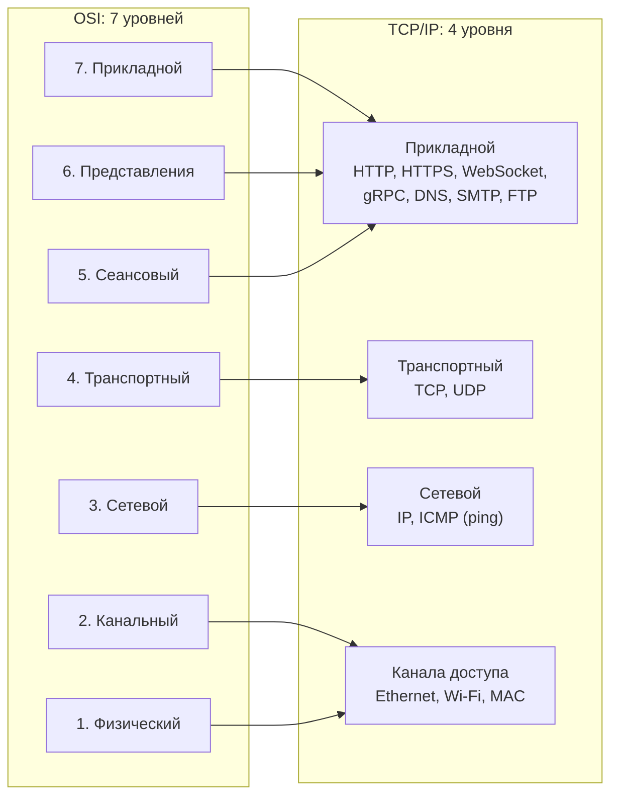
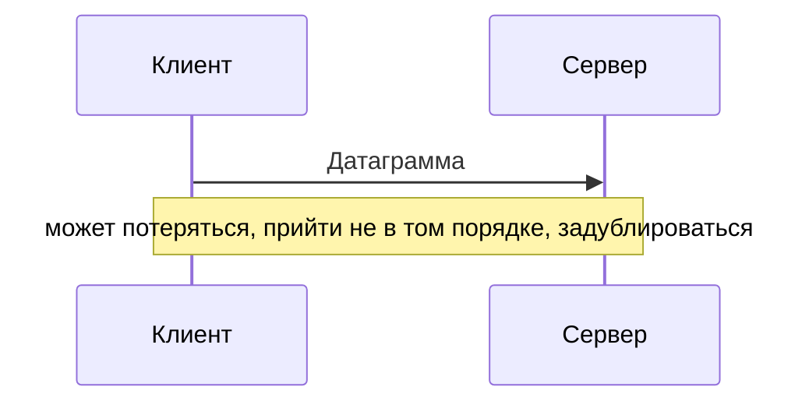
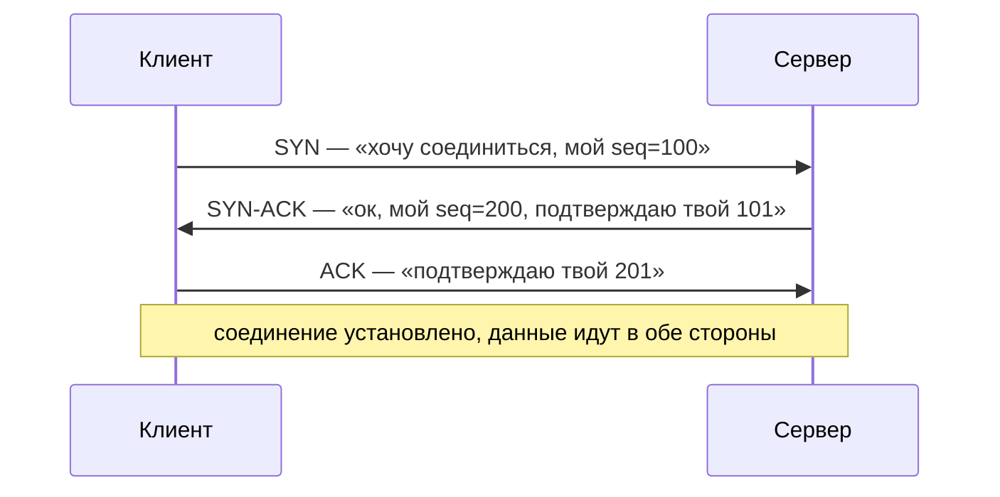
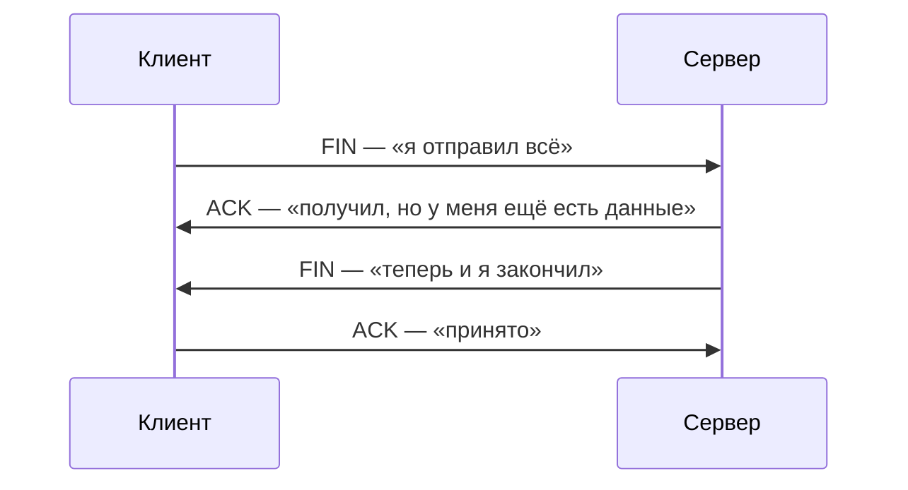
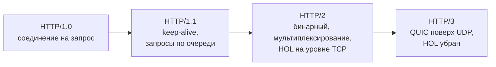
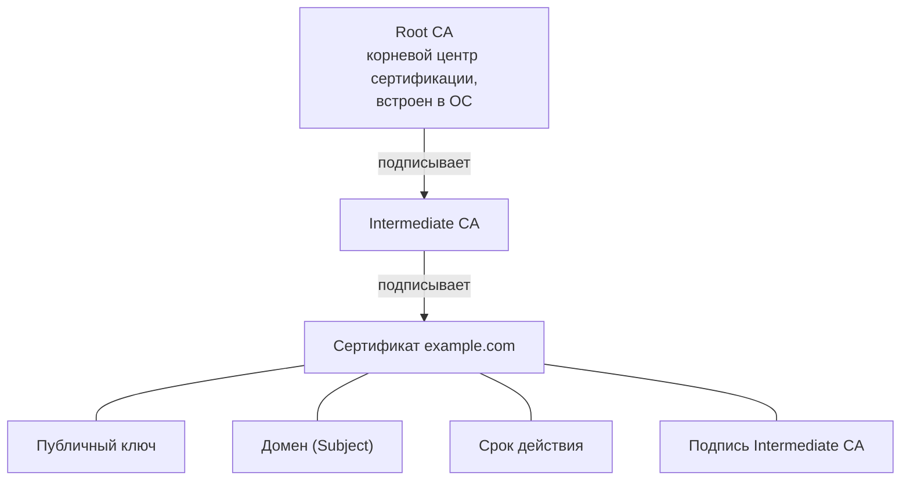
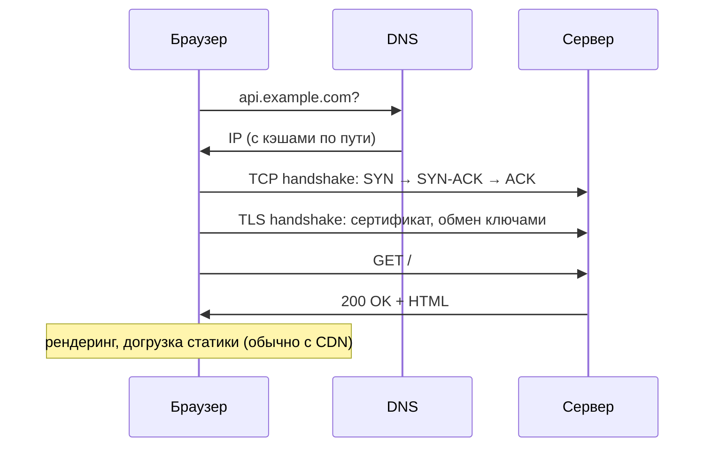
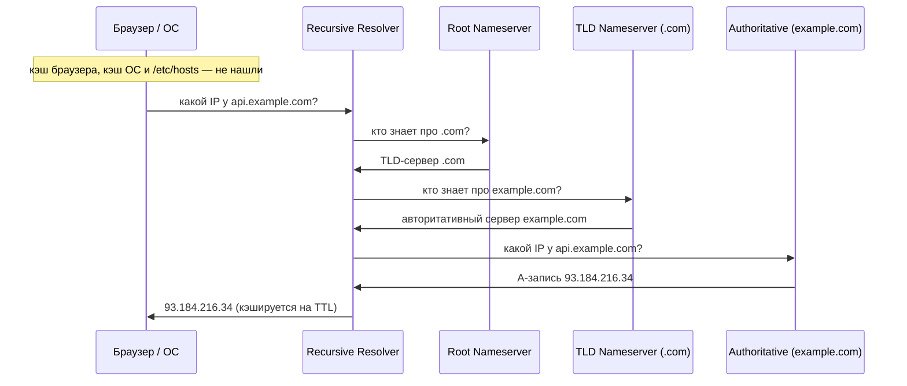
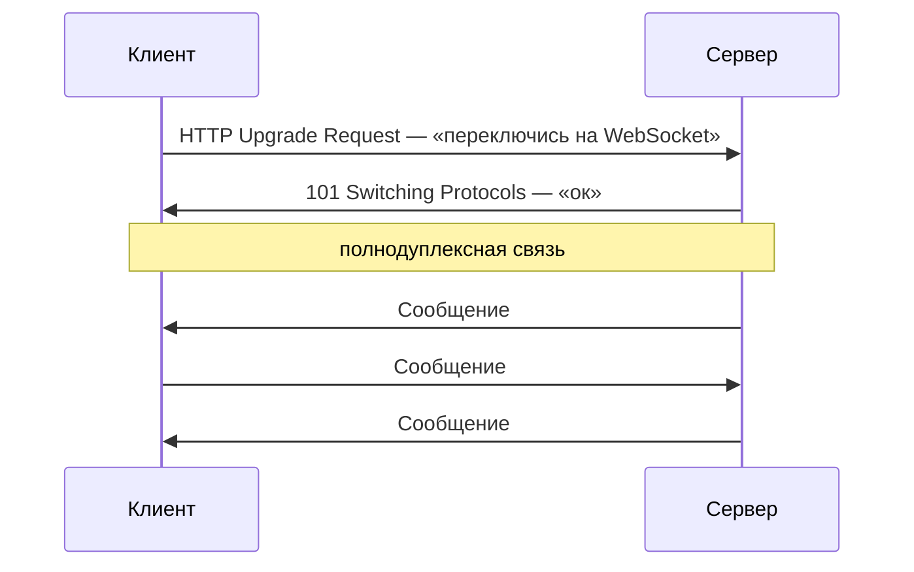

---
tags:
  - Junior
  - Middle
  - Сети
  - Безопасность
---

# Сети и протоколы

Как данные доходят от клиента до сервера: транспорт, HTTP, TLS, DNS и стили API. Чаще всего спрашивают TCP против UDP, эволюцию HTTP от 1.1 до 3, коды 401 и 403, идемпотентность методов, TLS handshake и выбор между REST и gRPC.

## Модели OSI и TCP/IP { #models }

### На каких уровнях живут протоколы, которыми ты пользуешься? { #osi-tcpip }

**Уровень:** Junior

!!! abstract "Ответ вслух"
    Модель OSI делит сеть на 7 уровней, практичная модель TCP/IP — на 4. Бэкенд-разработчик работает с транспортным уровнем (TCP, UDP) и прикладным (HTTP, gRPC, DNS, WebSocket). Уровни ниже — сетевой (IP) и канальный (Ethernet, Wi-Fi) — зона сетевых инженеров и DevOps.

На собесе редко спрашивают все 7 уровней OSI наизусть. Нужно понимать, **где живут протоколы**, которые ты используешь каждый день.



На практике ты работаешь с уровнями 4 (TCP/UDP) и выше. Уровни 1–3 — зона DevOps и сетевых инженеров.

!!! warning "Ловушка: «L4» и «L7» — это номера по OSI"
    Когда говорят «L4-балансировщик» или «L7-балансировщик», имеют в виду уровни OSI: транспортный и прикладной. В модели TCP/IP прикладной уровень — четвёртый, поэтому номера путать нельзя. Подробно про балансировщики — в [System Design → L4 и L7](../system-design/system-design.md#l4-l7).

??? question "Проверь себя"
    1. Какие уровни OSI объединены в прикладной уровень TCP/IP?
    2. На каком уровне работают TCP и UDP, а на каком — HTTP и DNS?
    3. Что означает «L7» в названии балансировщика?

## TCP и UDP { #tcp-udp }

### Чем TCP отличается от UDP? { #tcp-vs-udp }

**Уровень:** Junior

!!! abstract "Ответ вслух"
    TCP устанавливает соединение и гарантирует доставку, порядок и целостность: потерянные пакеты пересылаются. UDP шлёт датаграммы без соединения и без гарантий — пакет может потеряться, прийти не в том порядке или задублироваться. Зато у UDP минимальный overhead, поэтому на нём работают видеозвонки, игры, DNS и QUIC.

**TCP (Transmission Control Protocol)** — надёжный, упорядоченный, с контролем потока. Соединение устанавливается до передачи данных. Гарантии TCP:

- **Доставка** — потерянные пакеты пересылаются.
- **Порядок** — пакеты собираются в правильном порядке.
- **Целостность** — checksum на каждый сегмент.
- **Контроль перегрузки** — не заливает канал.

TCP берут везде, где важна надёжность: HTTP/HTTPS, gRPC, драйверы баз данных, email, передача файлов.

**UDP (User Datagram Protocol)** — без соединения, без гарантий, с минимальной задержкой: отправил и забыл. UDP не устанавливает соединение, не подтверждает доставку, не контролирует порядок и не переотправляет потери.



Где применяют UDP:

- Видеозвонки и стриминг — лучше пропустить кадр, чем ждать.
- Онлайн-игры — старый пакет с позицией игрока уже не нужен.
- DNS — один маленький запрос, ответ нужен быстро.
- QUIC и HTTP/3 — надёжность реализована поверх UDP.

| | **TCP** | **UDP** |
|---|---|---|
| **Соединение** | Да, three-way handshake (SYN → SYN-ACK → ACK) | Нет — «выстрелил и забыл» |
| **Гарантия доставки** | Да, потерянное переотправляется | Нет |
| **Порядок пакетов** | Гарантирован | Не гарантирован |
| **Цена** | Задержка на рукопожатие и overhead | Минимальная |
| **Кто живёт сверху** | HTTP, gRPC, драйверы БД, файлы | DNS, видео, игры, QUIC |

Аналогия: TCP — заказное письмо с уведомлением о вручении, UDP — открытка в почтовый ящик.

!!! warning "Ловушка: «UDP ненадёжный, значит, хуже»"
    Для видеозвонка или игры задержка важнее полноты: пересылать устаревший кадр или старую позицию игрока бессмысленно. UDP выбирают осознанно там, где опоздавшие данные не нужны. А где нужна надёжность без overhead TCP, её строят поверх UDP — так сделан QUIC.

??? question "Проверь себя"
    1. Какие четыре гарантии даёт TCP?
    2. Почему видеозвонки и онлайн-игры работают поверх UDP?
    3. Какие протоколы прикладного уровня живут поверх TCP, а какие — поверх UDP?

### Как TCP устанавливает и закрывает соединение? { #tcp-handshake }

**Уровень:** Junior

!!! abstract "Ответ вслух"
    Соединение открывается трёхсторонним рукопожатием: SYN → SYN-ACK → ACK, при этом стороны обмениваются начальными номерами последовательности (seq). Закрывается оно в четыре шага: каждая сторона отдельно отправляет FIN и получает ACK. До первого байта данных уходит три пакета.

**Трёхстороннее рукопожатие (three-way handshake):**



**Четырёхстороннее закрытие (four-way teardown):**



Закрытие четырёхшаговое, потому что TCP-соединение двунаправленное. Сервер может подтвердить FIN клиента и ещё какое-то время досылать свои данные.

!!! warning "Ловушка: новое соединение на каждый запрос"
    Рукопожатие стоит round-trip ещё до первого байта данных, а для HTTPS к нему добавляется TLS handshake. Если открывать соединение на каждый запрос, задержка растёт в разы. Поэтому используют keep-alive и пул соединений (connection pooling).

??? question "Проверь себя"
    1. Какие три пакета составляют TCP handshake и что в них подтверждается?
    2. Почему закрытие соединения занимает четыре шага, а не три?
    3. Зачем нужен пул соединений, если TCP и так надёжен?

### Можно ли сделать надёжную передачу поверх UDP? { #reliable-udp }

**Уровень:** Middle

!!! abstract "Ответ вслух"
    Да, так работает QUIC — транспорт под HTTP/3. Он реализует надёжность и порядок сам, поверх UDP, причём отдельно для каждого потока. Соединение устанавливается быстрее, чем TCP + TLS, потому что шифрование встроено, и QUIC лучше переносит потери пакетов.

QUIC забирает у TCP то, что нужно вебу, и убирает то, что мешает:

- **Надёжность и порядок** — реализованы на уровне QUIC, а не ядра ОС.
- **Независимые потоки** — потеря пакета в одном потоке не тормозит остальные.
- **Быстрый старт** — без отдельного TCP-рукопожатия; для повторных соединений есть 0-RTT.
- **TLS 1.3 встроен** — шифрование — часть протокола.

!!! warning "Ловушка: QUIC — не «UDP без гарантий»"
    UDP здесь только конверт для пакетов. Все гарантии TCP — доставка, порядок, контроль перегрузки — QUIC реализует сам. Отличие от TCP в том, что порядок соблюдается внутри каждого потока, а не на всё соединение.

??? question "Проверь себя"
    1. Почему QUIC построен поверх UDP, а не поверх TCP?
    2. Что происходит с остальными потоками QUIC, если в одном потерялся пакет?
    3. За счёт чего QUIC устанавливает соединение быстрее, чем TCP + TLS?

## HTTP { #http }

### Как выглядят HTTP-запрос и ответ? { #http-message }

**Уровень:** Junior

!!! abstract "Ответ вслух"
    HTTP — протокол «запрос → ответ» поверх TCP. Запрос — это метод, путь, заголовки и необязательное тело, ответ — статус-код, заголовки и тело. Протокол stateless: сервер сам по себе не помнит предыдущие запросы.

```http
GET /api/habits/1 HTTP/1.1
Host: api.example.com
Authorization: Bearer eyJhbGci...
Content-Type: application/json
Accept: application/json
User-Agent: Java-HttpClient/11

(тело запроса — для POST/PUT/PATCH)
```

```http
HTTP/1.1 200 OK
Content-Type: application/json
Content-Length: 127
Cache-Control: max-age=3600
X-Request-Id: abc-123

{"id": 1, "name": "Бег", "status": "ACTIVE"}
```

Состояние между запросами живёт в куках или токенах у клиента либо выносится в Redis или БД. Именно stateless-протокол позволяет масштабировать серверы горизонтально — подробно в [System Design → Масштабирование](../system-design/system-design.md#scaling).

!!! warning "Ловушка: сессия в памяти сервера"
    HTTP не привязывает клиента к серверу. Если сохранить сессию в памяти одного инстанса, следующий запрос через балансировщик попадёт на другой — и пользователь «разлогинится». Почему sticky sessions не решают проблему, разобрано в [System Design → Sticky sessions](../system-design/system-design.md#sticky-sessions).

??? question "Проверь себя"
    1. Из каких частей состоят HTTP-запрос и HTTP-ответ?
    2. Что значит «HTTP — stateless» и где тогда хранить состояние?
    3. Почему stateless-протокол упрощает горизонтальное масштабирование?

### Как HTTP эволюционировал от 1.0 до 3? { #http-versions }

**Уровень:** Middle

!!! abstract "Ответ вслух"
    Вся эволюция — борьба с блокировкой головы очереди (Head-of-Line Blocking). HTTP/1.1 переиспользует соединение, но запросы в нём идут строго по очереди; HTTP/2 мультиплексирует потоки в одном TCP-соединении, но блокировка остаётся на уровне TCP. HTTP/3 переходит на QUIC поверх UDP и убирает её и там.



- **HTTP/1.0** — одно соединение на один запрос: открыл → запросил → закрыл. Дорого.
- **HTTP/1.1** — keep-alive: одно TCP-соединение на несколько запросов. Но запросы идут строго последовательно: пока первый не ответил, второй ждёт. Браузеры обходят это, открывая 6 параллельных соединений на домен.
- **HTTP/2** — бинарный протокол с **мультиплексированием**: много потоков параллельно в одном TCP-соединении. Есть сжатие заголовков (HPACK) и Server Push — сервер отправляет ресурсы без запроса. Но потеря одного TCP-пакета тормозит **все** потоки: блокировка переехала на уровень TCP.
- **HTTP/3** — работает поверх [QUIC](#reliable-udp) на UDP. Потеря пакета в одном потоке не влияет на другие. Соединение устанавливается быстрее (0-RTT для повторных), TLS 1.3 встроен.

!!! warning "Ловушка: «HTTP/2 решил Head-of-Line Blocking»"
    HTTP/2 убрал блокировку на уровне приложения, но она осталась на уровне TCP: TCP отдаёт байты строго по порядку, и один потерянный пакет задерживает все потоки. Убирает её только HTTP/3 через QUIC, где порядок соблюдается внутри потока.

??? question "Проверь себя"
    1. Что такое Head-of-Line Blocking в HTTP/1.1?
    2. Почему в HTTP/2 блокировка осталась, хотя потоки мультиплексируются?
    3. Что даёт HTTP/3, кроме устранения блокировки?

### Какие коды статусов нужно знать? { #status-codes }

**Уровень:** Junior

!!! abstract "Ответ вслух"
    Первая цифра — класс ответа: 1xx информационные, 2xx успех, 3xx перенаправление, 4xx ошибка клиента, 5xx ошибка сервера. Чаще всего спрашивают 200, 201, 204, 301 и 302, 304, 400, 401 и 403, 404, 409, 429, 500, 502, 503 и 504. Отдельно любят разницу между 401 и 403.

| Код | Название | Когда |
|---|---|---|
| **1xx** | **Информационные** | |
| 100 | Continue | Продолжай отправлять тело |
| **2xx** | **Успех** | |
| 200 | OK | Стандартный успех |
| 201 | Created | Ресурс создан (POST) |
| 204 | No Content | Успех, тела нет (DELETE, PUT без тела) |
| **3xx** | **Перенаправление** | |
| 301 | Moved Permanently | Постоянный редирект — обновить ссылки |
| 302 | Found | Временный редирект |
| 304 | Not Modified | Кэш актуален, тело не возвращается |
| **4xx** | **Ошибка клиента** | |
| 400 | Bad Request | Невалидные данные |
| 401 | Unauthorized | Не аутентифицирован: нет токена или он плохой |
| 403 | Forbidden | Аутентифицирован, но нет прав |
| 404 | Not Found | Ресурс не найден |
| 405 | Method Not Allowed | Метод не поддерживается |
| 409 | Conflict | Конфликт, например дубликат |
| 422 | Unprocessable | Валидация прошла, но семантика неверна |
| 429 | Too Many Requests | Сработал rate limiting |
| **5xx** | **Ошибка сервера** | |
| 500 | Internal Server Error | Неожиданная ошибка |
| 502 | Bad Gateway | Upstream вернул плохой ответ |
| 503 | Service Unavailable | Сервис перегружен или на обслуживании |
| 504 | Gateway Timeout | Upstream не ответил вовремя |

Как вернуть нужный статус из Spring-контроллера, разобрано в [Spring MVC → Обработка исключений](../spring/spring-mvc.md#exception-handling).

!!! warning "Ловушка: 401 и 403"
    **401** — «Кто ты? Авторизуйся»: токена нет или он невалиден. **403** — «Я знаю, кто ты, но тебе сюда нельзя»: прав недостаточно. Несмотря на название `Unauthorized`, 401 — про аутентификацию, а не про авторизацию.

??? question "Проверь себя"
    1. Чем 401 отличается от 403?
    2. Когда сервер возвращает 304 и почему в ответе нет тела?
    3. Чем 502 отличается от 504?

### Какие HTTP-методы идемпотентны? { #http-methods }

**Уровень:** Junior

!!! abstract "Ответ вслух"
    Идемпотентный метод при повторном вызове с теми же данными даёт тот же результат: это GET, PUT, DELETE, HEAD и OPTIONS. Безопасный метод вообще не меняет состояние сервера: GET, HEAD, OPTIONS. POST не идемпотентен, PATCH — зависит от операции.

| Метод | Идемпотентен | Безопасен | Применение |
|---|---|---|---|
| **GET** | ✅ Да | ✅ Да | Получить ресурс |
| **POST** | ❌ Нет | ❌ Нет | Создать ресурс |
| **PUT** | ✅ Да | ❌ Нет | Полная замена ресурса |
| **PATCH** | ❌ Нет* | ❌ Нет | Частичное обновление |
| **DELETE** | ✅ Да | ❌ Нет | Удалить ресурс |
| **HEAD** | ✅ Да | ✅ Да | Как GET, но без тела |
| **OPTIONS** | ✅ Да | ✅ Да | CORS preflight, узнать методы |

- **Идемпотентен** — повторный вызов с теми же данными даёт тот же результат.
- **Безопасен** — не изменяет состояние сервера.

_*PATCH может быть идемпотентным, если операция абсолютная («set name=X»), и не идемпотентным, если относительная («increment counter»)._

!!! warning "Ловушка: ретрай POST"
    Клиент не дождался ответа на POST из-за сетевого лага и повторил запрос — сервер создаст второй ресурс или спишет деньги дважды. Такие операции защищают ключом идемпотентности (idempotency key), разбор — в [System Design → Гарантии доставки и идемпотентность](../system-design/system-design.md#delivery-guarantees).

??? question "Проверь себя"
    1. Чем идемпотентный метод отличается от безопасного?
    2. Почему PUT идемпотентен, а POST — нет?
    3. В каком случае PATCH идемпотентен?

## HTTPS и TLS { #tls }

### Что даёт TLS? { #tls-basics }

**Уровень:** Junior

!!! abstract "Ответ вслух"
    TLS (Transport Layer Security) — криптографический протокол поверх TCP, HTTPS — это HTTP внутри TLS-туннеля. Он даёт конфиденциальность (данные зашифрованы), целостность (данные не изменены в пути) и аутентификацию сервера через сертификат. Цена — дополнительные round-trip'ы на handshake при установке соединения.

- **Конфиденциальность** — данные зашифрованы, перехватчик видит только шум.
- **Целостность** — данные не изменены в пути (MAC/HMAC).
- **Аутентификация** — сертификат подтверждает личность сервера.

!!! warning "Ловушка: шифрование без проверки сертификата"
    Шифрование само по себе не говорит, *с кем* ты общаешься. Если клиент не проверяет сертификат, он может установить зашифрованный канал прямо с перехватчиком. Поэтому аутентификация сервера — такая же обязательная часть TLS, как шифрование.

??? question "Проверь себя"
    1. Какие три свойства обеспечивает TLS?
    2. Чем HTTPS отличается от HTTP?
    3. Зачем нужен сертификат, если трафик и так шифруется?

### Как проходит TLS handshake? { #tls-handshake }

**Уровень:** Middle

!!! abstract "Ответ вслух"
    Клиент присылает поддерживаемые версии и шифры, сервер выбирает шифр и отдаёт сертификат с публичным ключом. Клиент проверяет сертификат, стороны согласуют общий секрет и выводят из него симметричный ключ сессии — дальше данные шифруются им. В TLS 1.2 это 2 round-trip'а, в TLS 1.3 — один.

Упрощённая схема для TLS 1.2:

```mermaid
sequenceDiagram
    participant C as Клиент
    participant S as Сервер
    C->>S: ClientHello: версии TLS, случайное число, список шифров
    S->>C: ServerHello: выбранный шифр, случайное число, сертификат с публичным ключом
    Note over C: проверяет сертификат — подписан доверенным CA?
    C->>S: Pre-master secret, зашифрованный публичным ключом
    Note over C,S: обе стороны генерируют симметричный ключ сессии
    C->>S: Finished (зашифровано)
    S->>C: Finished (зашифровано)
    Note over C,S: дальше данные шифруются ключом сессии
```



Асимметричная криптография нужна только чтобы безопасно договориться о ключе. Сами данные шифруются симметрично — это намного быстрее.

**TLS 1.3** упрощает хэндшейк до 1 round-trip вместо 2, убирает устаревшие алгоритмы и поддерживает 0-RTT для повторных соединений.

!!! warning "Ловушка: TLS 1.2 и 1.3 стоят по-разному"
    В TLS 1.2 до первого байта данных уходит 2 round-trip'а на хэндшейк, в TLS 1.3 — один. Отвечая на вопрос про задержку HTTPS, называй версию.

??? question "Проверь себя"
    1. Что сервер отправляет в ServerHello?
    2. Зачем после обмена ключами переходить на симметричное шифрование?
    3. Сколько round-trip'ов занимает хэндшейк в TLS 1.2 и в TLS 1.3?

### Как клиент проверяет сертификат? { #pki }

**Уровень:** Middle

!!! abstract "Ответ вслух"
    Сертификат сайта подписан промежуточным центром сертификации (Intermediate CA), а тот — корневым (Root CA). Корневые сертификаты встроены в ОС или браузер, и клиент проверяет цепочку подписей снизу вверх до доверенного корня. Если цепочка валидна и домен совпадает, соединение считается доверенным.



Браузер доверяет Root CA, потому что он встроен в ОС. Цепочка проверяется снизу вверх: подпись каждого сертификата — ключом следующего.

!!! warning "Ловушка: валидная подпись, но чужой домен"
    Цепочки подписей мало: домен в сертификате (Subject) должен совпадать с тем, к которому идёт запрос. Иначе злоумышленник мог бы предъявить честно выпущенный сертификат на свой домен. Проверяется и срок действия.

??? question "Проверь себя"
    1. Из каких звеньев состоит цепочка сертификатов?
    2. Почему клиент доверяет Root CA?
    3. Что ещё проверяется, кроме подписей в цепочке?

### Что происходит, когда вводишь URL в браузере? { #url-flow }

**Уровень:** Junior

!!! abstract "Ответ вслух"
    Сначала DNS превращает имя в IP, затем TCP handshake, затем TLS handshake для HTTPS. Только после этого уходит HTTP-запрос, а браузер получает HTML и догружает статику, обычно с CDN. До первого байта данных проходит 3–5 round-trip'ов, поэтому кэш DNS, keep-alive и CDN так важны.



1. **DNS-резолвинг** — имя → IP, с кэшами по пути.
2. **TCP handshake** — SYN → SYN-ACK → ACK, 3 пакета.
3. **TLS handshake** — сертификат, обмен ключами: 2 round-trip'а в TLS 1.2, один в TLS 1.3.
4. **HTTP-запрос и ответ** — `GET /` → `200 OK` + HTML.
5. **Рендеринг** — браузер парсит HTML и догружает статику, обычно уже с CDN.

Тот же путь проходит первый запрос к новому микросервису. DNS-резолюция без кэша может занять десятки миллисекунд, а затем добавляются TCP и TLS.

!!! warning "Ловушка: соединение на каждый вызов между микросервисами"
    Каждый шаг добавляет задержку, а между сервисами вызовов тысячи. Поэтому в микросервисах важны DNS-кэширование на стороне клиента, пул соединений (не создавать соединение на каждый запрос) и keep-alive. Отсюда же ценность HTTP/2 с мультиплексированием в одном соединении.

??? question "Проверь себя"
    1. Перечисли шаги от ввода URL до получения HTML.
    2. Сколько round-trip'ов проходит до первого байта данных по HTTPS?
    3. Что ускоряет повторные запросы к тому же сервису?

## DNS { #dns }

### Как имя превращается в IP? { #dns-resolution }

**Уровень:** Junior

!!! abstract "Ответ вслух"
    Сначала проверяются кэш браузера и ОС, затем запрос уходит к рекурсивному резолверу — провайдера или публичному, например 8.8.8.8. Резолвер по цепочке спрашивает корневой сервер, сервер зоны (TLD, например `.com`) и авторитативный сервер домена, который знает IP. Ответ кэшируется на каждом шаге на время TTL записи.



Для дизайна систем важно два свойства DNS. Он агрессивно кэшируется на каждом шаге. А geo-DNS — разные IP для разных регионов — работает как грубая балансировка нагрузки.

!!! warning "Ловушка: смена IP видна не сразу"
    Пока не истёк TTL, резолверы и клиенты продолжают отдавать старый IP из кэша. Поэтому DNS — грубый инструмент балансировки: быстро убрать упавший сервер через него нельзя. Для этого нужен балансировщик с health-check'ами.

??? question "Проверь себя"
    1. Какие серверы опрашивает рекурсивный резолвер и в каком порядке?
    2. Что такое TTL DNS-записи?
    3. Как DNS используют для грубой балансировки нагрузки?

### Какие бывают DNS-записи? { #dns-records }

**Уровень:** Junior

!!! abstract "Ответ вслух"
    A-запись указывает IPv4-адрес, AAAA — IPv6, CNAME — псевдоним на другое имя. MX задаёт почтовый сервер, TXT — произвольный текст (SPF, DKIM, верификация домена), NS — где лежат записи домена. SRV хранит сервис с портом — его используют gRPC и Kubernetes.

| Запись | Что хранит | Пример |
|---|---|---|
| **A** | IPv4-адрес | `api.example.com → 93.184.216.34` |
| **AAAA** | IPv6-адрес | — |
| **CNAME** | Псевдоним | `www → example.com` |
| **MX** | Почтовый сервер | `example.com → mail.example.com` |
| **TXT** | Текст | SPF, DKIM, верификация домена |
| **NS** | Nameserver | Где лежат записи домена |
| **SRV** | Сервис + порт | Используется в gRPC, Kubernetes |

!!! warning "Ловушка: CNAME указывает на имя, а не на IP"
    CNAME говорит «смотри другое имя», и резолверу приходится сделать ещё один шаг, чтобы получить A- или AAAA-запись. IP-адрес хранят только A и AAAA.

??? question "Проверь себя"
    1. Чем A-запись отличается от CNAME?
    2. Для чего нужны TXT-записи?
    3. Какая запись хранит не только адрес, но и порт?

## REST и gRPC { #api-styles }

### Что такое REST? { #rest }

**Уровень:** Junior

!!! abstract "Ответ вслух"
    REST (Representational State Transfer) — архитектурный стиль поверх HTTP, а не протокол. Ресурсы идентифицируются URL-ами с существительными, операции над ними — HTTP-методами, каждый запрос самодостаточен. Глаголы в URL — признак RPC-стиля, а не REST.

**Принципы REST:**

1. **Stateless** — каждый запрос самодостаточен, сервер не хранит состояние клиента.
2. **Uniform Interface** — ресурсы идентифицируются URL, операции — HTTP-методами.
3. **Client-Server** — чёткое разделение ответственности.
4. **Cacheable** — ответы могут кэшироваться.
5. **Layered System** — клиент не знает, есть ли между ним и сервером прокси или балансировщики.

**Правильный REST API:**

```text
# Ресурсы — существительные, не глаголы
GET    /api/habits          → список привычек
GET    /api/habits/1        → конкретная привычка
POST   /api/habits          → создать привычку
PUT    /api/habits/1        → полная замена
PATCH  /api/habits/1        → частичное обновление
DELETE /api/habits/1        → удалить

# Вложенные ресурсы
GET    /api/users/42/habits      → привычки конкретного пользователя
POST   /api/users/42/habits      → создать привычку для пользователя

# Фильтрация, сортировка, пагинация — query params
GET    /api/habits?status=ACTIVE&sort=createdAt&page=0&size=20

# Версионирование
/api/v1/habits
/api/v2/habits
```

Как такой API пишется на Spring, разобрано в [Spring MVC](../spring/spring-mvc.md).

!!! warning "Ловушка: REST только по названию"
    Эти эндпоинты часто называют REST, хотя это RPC-стиль:

    ```text
    POST /api/getHabits            ← ❌ глагол в URL
    GET  /api/habits/delete/1      ← ❌ действие в URL
    GET  /api/habits?action=create ← ❌ действие в параметре
    ```

    Действие должно задаваться HTTP-методом, а URL — называть ресурс.

??? question "Проверь себя"
    1. Назови пять принципов REST.
    2. Как в REST передают фильтрацию, сортировку и пагинацию?
    3. Почему `POST /api/getHabits` — не REST?

### Как устроен gRPC? { #grpc }

**Уровень:** Middle

=== "Коротко"

    !!! abstract "Ответ вслух"
        gRPC — RPC-фреймворк от Google поверх HTTP/2, данные сериализуются в бинарный Protocol Buffers (protobuf). Контракт описывается в `.proto`-файле, из которого генерируется клиентский и серверный код на любом языке. Из коробки есть стриминг в обе стороны.

=== "Подробно"

    **Контракт через `.proto`-файл:**

    ```protobuf
    syntax = "proto3";

    package habits;

    service HabitService {
      rpc GetHabit (GetHabitRequest) returns (HabitResponse);
      rpc CreateHabit (CreateHabitRequest) returns (HabitResponse);
      rpc StreamHabits (StreamRequest) returns (stream HabitResponse); // серверный стриминг
      rpc SyncHabits (stream HabitUpdate) returns (stream HabitResponse); // двусторонний стрим
    }

    message GetHabitRequest {
      int64 id = 1;
    }

    message HabitResponse {
      int64 id = 1;
      string name = 2;
      string status = 3;
      int64 created_at = 4;
    }
    ```

    Из `.proto` генерируется клиентский и серверный код на любом языке: Java, Go, Python, Kotlin.

    **gRPC в Spring Boot:**

    ```java
    // Server
    @GrpcService
    public class HabitGrpcService extends HabitServiceGrpc.HabitServiceImplBase {

        @Override
        public void getHabit(GetHabitRequest request,
                             StreamObserver<HabitResponse> responseObserver) {
            HabitDto habit = habitService.findById(request.getId());

            HabitResponse response = HabitResponse.newBuilder()
                .setId(habit.getId())
                .setName(habit.getName())
                .setStatus(habit.getStatus().name())
                .build();

            responseObserver.onNext(response);
            responseObserver.onCompleted();
        }
    }
    ```

!!! warning "Ловушка: gRPC из браузера"
    Браузер не даёт JavaScript нужного gRPC контроля над HTTP/2, поэтому напрямую вызвать gRPC-сервис из браузера нельзя. Нужен grpc-web и прокси перед сервисом. Это одна из причин, почему публичные API делают на REST, а gRPC оставляют для общения сервисов.

??? question "Проверь себя"
    1. Какой транспорт и какой формат данных использует gRPC?
    2. Что генерируется из `.proto`-файла?
    3. Какие виды стриминга поддерживает gRPC?

### REST, gRPC или GraphQL? { #rest-vs-grpc }

**Уровень:** Middle

!!! abstract "Ответ вслух"
    REST — дефолт для публичных API: прост, понятен любому клиенту, дружит с HTTP-кэшем. gRPC берут для внутреннего общения микросервисов: бинарный protobuf, строгий контракт и стриминг. GraphQL — когда много разных клиентов и каждому нужны свои поля.

| | **REST** | **gRPC** | **GraphQL** |
|---|---|---|---|
| **Протокол** | HTTP/1.1 или HTTP/2 | HTTP/2 обязательно | HTTP, один endpoint |
| **Формат данных** | JSON (текст, читаемо) | Protobuf (бинарный, компактно) | JSON |
| **Контракт** | OpenAPI/Swagger (опционально) | `.proto` (обязательно) + codegen | Схема GraphQL |
| **Типизация** | Слабая | Строгая (генерация кода) | — |
| **Производительность** | Медленнее (парсинг JSON) | В 5–10 раз быстрее (бинарный) | — |
| **Стриминг** | SSE, WebSocket (отдельно) | Встроен (4 режима) | — |
| **Браузер** | Нативно | Нужен grpc-web прокси | Нативно |
| **Читаемость** | Легко дебажить (curl, Postman) | Нужны специальные инструменты | — |
| **Плюсы** | Прост, универсален, HTTP-кэш | Быстрый, компактный, контракт, стриминг | Клиент выбирает поля — нет over-fetching и under-fetching |
| **Минусы** | Over-fetching и under-fetching | Нечитаем глазами, слабее в браузере, сложнее дебаг | Сложно кэшировать, N+1, тяжёлые запросы кладут сервер |
| **Когда** | Публичное API, браузер, простота | Внутренние микросервисы, производительность, стриминг | Много разных клиентов с разными нуждами |

**REST** выбирают для публичного API, когда клиенты разные — браузер, мобилка, сторонние интеграции, — команда привыкла к JSON и нужна простота дебага. **gRPC** — для общения внутренних микросервисов, при высоких требованиях к производительности, стриминге в реальном времени и строгом контракте между командами.

!!! warning "Ловушка: GraphQL как замена REST «везде»"
    Гибкость GraphQL имеет цену: один endpoint плохо кэшируется HTTP-кэшем, вложенные поля легко дают N+1 запросов к базе, а тяжёлый запрос клиента может положить сервер. Его берут, когда разнообразие клиентов действительно мешает, а не по умолчанию.

??? question "Проверь себя"
    1. Почему gRPC быстрее REST?
    2. Какую проблему REST решает GraphQL и чем за это платит?
    3. Что выбрать для публичного API и что — для общения микросервисов?

## Связь в реальном времени { #realtime }

### Когда нужен WebSocket и чем он отличается от SSE? { #websocket }

**Уровень:** Middle

!!! abstract "Ответ вслух"
    HTTP однонаправленный: клиент спрашивает, сервер отвечает. WebSocket начинается с HTTP-запроса Upgrade и превращает соединение в полнодуплексное — писать может любая сторона в любой момент. SSE (Server-Sent Events) проще: это односторонний поток от сервера к клиенту, его хватает для уведомлений.



**Spring WebSocket:**

```java
@Configuration
@EnableWebSocket
public class WebSocketConfig implements WebSocketConfigurer {

    @Override
    public void registerWebSocketHandlers(WebSocketHandlerRegistry registry) {
        registry.addHandler(habitUpdateHandler(), "/ws/habits")
            .setAllowedOrigins("*");
    }
}

// Или STOMP поверх WebSocket (более высокоуровневый)
@MessageMapping("/habits/update")
@SendTo("/topic/habits")
public HabitDto updateHabit(HabitUpdateDto dto) {
    return habitService.update(dto);
    // Все подписчики /topic/habits получат обновление
}
```

WebSocket нужен для чатов, совместного редактирования, live-уведомлений, трейдинговых терминалов и онлайн-игр.

**Server-Sent Events (SSE)** — более простая альтернатива для одностороннего потока сервер → клиент:

```java
@GetMapping(value = "/api/habits/stream", produces = MediaType.TEXT_EVENT_STREAM_VALUE)
public Flux<HabitDto> streamHabits() {
    return habitService.streamUpdates(); // WebFlux
}
```

Реактивный стек, на котором работает `Flux`, разобран в [Spring: Инструменты](../spring/spring-tools.md).

!!! warning "Ловушка: `setAllowedOrigins("*")` в проде"
    Звёздочка разрешает подключаться к WebSocket со страниц любого домена. Для примера это удобно, но в проде перечисляют конкретные домены фронтенда.

??? question "Проверь себя"
    1. Как HTTP-соединение превращается в WebSocket?
    2. Чем SSE отличается от WebSocket?
    3. Для каких задач хватит SSE, а для каких нужен WebSocket?

## Шпаргалка { #cheatsheet }

<!-- --8<-- [start:cheatsheet] -->
| Тема | Запомнить |
|---|---|
| **OSI и TCP/IP** | 7 уровней против 4; бэкенд живёт на транспортном (TCP/UDP) и прикладном (HTTP, DNS) |
| **TCP vs UDP** | TCP: соединение, доставка, порядок, целостность. UDP: без гарантий, минимальная задержка |
| **TCP handshake** | SYN → SYN-ACK → ACK, 3 пакета до данных; закрытие — FIN/ACK с каждой стороны |
| **QUIC** | Надёжность поверх UDP, отдельно для каждого потока; TLS 1.3 встроен |
| **HTTP** | Запрос → ответ поверх TCP, stateless: состояние в куках, токенах, Redis |
| **HTTP/1.1 → 2 → 3** | 1.1 — keep-alive, но по очереди. 2 — мультиплексирование, HOL в TCP. 3 — QUIC, HOL убран |
| **401 vs 403** | 401 — не аутентифицирован. 403 — аутентифицирован, но нет прав |
| **Идемпотентность** | GET, PUT, DELETE, HEAD, OPTIONS — идемпотентны. POST — нет, PATCH — зависит |
| **TLS** | Конфиденциальность, целостность, аутентификация. 1.2 — 2 RTT, 1.3 — 1 RTT |
| **Сертификаты** | Цепочка до Root CA из ОС + совпадение домена + срок действия |
| **Ввод URL** | DNS → TCP → TLS → HTTP → рендеринг; лечат кэш DNS, keep-alive, пул соединений, CDN |
| **DNS** | Кэш → резолвер → Root → TLD → Authoritative; кэш на TTL; geo-DNS — грубая балансировка |
| **DNS-записи** | A / AAAA — IP, CNAME — псевдоним, MX — почта, TXT — текст, SRV — сервис + порт |
| **REST** | Stateless, ресурсы в URL, действия — методами; глаголы в URL — не REST |
| **gRPC** | HTTP/2 + protobuf, контракт `.proto`, codegen, стриминг; в браузере — через grpc-web |
| **REST / gRPC / GraphQL** | Наружу / между сервисами / много разных клиентов |
| **WebSocket vs SSE** | WebSocket — двусторонний через Upgrade. SSE — односторонний поток сервер → клиент |

<!-- --8<-- [end:cheatsheet] -->
