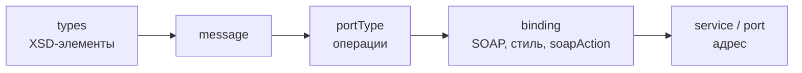

---
tags:
  - Junior
  - Middle
  - Senior
  - Сети
  - Spring
  - Безопасность
---

# SOAP и XML-интеграции

SOAP живёт там, где интеграциям по двадцать лет: банки, страхование, госсистемы, платёжные шлюзы. На собесе по такому пункту в резюме спрашивают, как устроено сообщение и WSDL, чем JAXB генерирует классы из XSD, что такое SOAP Fault и как сделать обмен отказоустойчивым: таймауты, повторы без двойного списания, валидация и логи для разбора инцидентов. Стили API поверх HTTP в целом и выбор между REST и gRPC — на странице [REST, gRPC и WebSocket](api-styles.md).

## Протокол { #protocol }

### Что такое SOAP и чем он отличается от REST? { #soap-vs-rest }

**Уровень:** Junior

!!! abstract "Ответ вслух"
    SOAP (Simple Object Access Protocol) — протокол обмена XML-сообщениями со строгим контрактом в WSDL. REST — архитектурный стиль поверх HTTP, где формат и контракт не навязаны. SOAP тяжелее, но из коробки даёт контракт с XSD-типами, стандартный формат ошибок и защиту на уровне сообщения, поэтому его до сих пор требуют банки и госсистемы.

SOAP — это не «старый REST», а протокол: у сообщения фиксированная структура, а у сервиса — машиночитаемый контракт. Из контракта генерируется клиент, и типы данных проверяются по XSD-схеме ещё до бизнес-логики.

| | **SOAP** | **REST** |
|---|---|---|
| **Что это** | Протокол со спецификацией W3C | Архитектурный стиль |
| **Формат** | Только XML в конверте (envelope) | Любой, обычно JSON |
| **Контракт** | WSDL + XSD, обязателен | OpenAPI, по желанию |
| **Транспорт** | Обычно HTTP POST, бывает JMS и SMTP | HTTP с разными методами |
| **Операции** | Имя операции внутри сообщения | HTTP-метод + URL ресурса |
| **Ошибки** | Стандартный SOAP Fault | Коды статусов, формат на твой выбор |
| **Безопасность** | TLS + WS-Security: подпись и шифрование самого сообщения | TLS, токены (OAuth 2, JWT) |
| **HTTP-кэш** | Не работает: всё через POST | Работает для GET |
| **Где встречается** | Банки, страхование, госсистемы, ERP | Почти все новые API |

Почти все SOAP-вызовы идут как `POST` на один URL сервиса, а операция определяется содержимым сообщения. Поэтому прокси, кэши и балансировщики видят только «POST на `/ws`», без смысла запроса.

!!! warning "Ловушка: «SOAP устарел, значит, плохой»"
    На собесе это звучит как незнание контекста. Банк выбирает SOAP не из консерватизма: ему нужны строгий контракт, проверка схемы на обеих сторонах и подпись сообщения, которую можно хранить как юридическое доказательство. В REST всё это приходится собирать вручную.

??? question "Проверь себя"
    1. Почему SOAP называют протоколом, а REST — стилем?
    2. Что даёт SOAP из коробки по сравнению с REST?
    3. Почему HTTP-кэш не помогает SOAP-сервису?

### Как устроено SOAP-сообщение? { #soap-envelope }

**Уровень:** Junior

!!! abstract "Ответ вслух"
    Сообщение — XML-документ с корнем `Envelope`. В нём необязательный `Header` для служебных данных (подпись, идентификатор сообщения, адресация) и обязательный `Body` с полезной нагрузкой. Ошибку сервер возвращает элементом `Fault` внутри `Body`.

```xml
<soapenv:Envelope
        xmlns:soapenv="http://schemas.xmlsoap.org/soap/envelope/"
        xmlns:pay="http://bank.example/payments/v1">
    <soapenv:Header>
        <!-- Служебное: идентификатор запроса, подпись WS-Security, адресация -->
        <pay:RequestId>7d1f3c2a-5b0e-4c8e-9a51-1f2b9d3e4c77</pay:RequestId>
    </soapenv:Header>
    <soapenv:Body>
        <!-- Полезная нагрузка: один элемент, описанный в XSD -->
        <pay:GetStatementRequest>
            <pay:AccountNumber>40702810900000000001</pay:AccountNumber>
            <pay:DateFrom>2026-10-01</pay:DateFrom>
            <pay:DateTo>2026-10-25</pay:DateTo>
        </pay:GetStatementRequest>
    </soapenv:Body>
</soapenv:Envelope>
```

Версий две, и они несовместимы: сервис SOAP 1.1 отклонит конверт 1.2 с ошибкой `VersionMismatch`.

| | **SOAP 1.1** | **SOAP 1.2** |
|---|---|---|
| **Namespace конверта** | `http://schemas.xmlsoap.org/soap/envelope/` | `http://www.w3.org/2003/05/soap-envelope` |
| **Content-Type** | `text/xml` | `application/soap+xml` |
| **Операция в HTTP** | Отдельный заголовок `SOAPAction` | Параметр `action` в `Content-Type` |
| **Коды Fault** | `Client`, `Server` | `Sender`, `Receiver` |

У блока заголовка может стоять атрибут `mustUnderstand="1"`. Получатель, который не умеет обрабатывать такой блок, обязан вернуть Fault `MustUnderstand`, а не молча его проигнорировать.

!!! warning "Ловушка: пустой или чужой `SOAPAction`"
    Многие сервисы SOAP 1.1 выбирают операцию по заголовку `SOAPAction`, а не по телу. Тело верное, а в ответ Fault «операция не найдена» — первым делом сверь `SOAPAction` с атрибутом `soapAction` в WSDL. В Spring WS его задают через `SoapActionCallback`.

??? question "Проверь себя"
    1. Какие элементы есть в SOAP-конверте и какие из них обязательны?
    2. Как отличить сообщение SOAP 1.1 от 1.2?
    3. Что делает атрибут `mustUnderstand`?

### Что такое WSDL и чем contract-first отличается от code-first? { #wsdl }

**Уровень:** Middle

!!! abstract "Ответ вслух"
    WSDL (Web Services Description Language) — XML-контракт сервиса: типы данных в XSD, операции, привязка к SOAP и адрес. Contract-first — сначала пишут WSDL и XSD, из них генерируют Java-классы. Code-first — пишут Java-код, а WSDL генерирует фреймворк; для интеграции с банком почти всегда contract-first, потому что контракт диктует банк.

Из чего состоит WSDL 1.1, от абстрактного к конкретному:

| Элемент | Что описывает |
|---|---|
| `types` | XSD-схемы элементов запросов и ответов |
| `message` | Сообщение: ссылка на элемент из `types` |
| `portType` | Интерфейс: операции и их входные, выходные и fault-сообщения |
| `binding` | Как операции ложатся на протокол: SOAP 1.1 или 1.2, стиль, `soapAction` |
| `service` / `port` | Конкретный адрес, по которому живёт `binding` |



**Contract-first.** Контракт — первичный артефакт, его согласуют стороны. Классы генерируются плагином сборки: `cxf-codegen-plugin` (wsdl2java) — из WSDL целиком, `jaxb-maven-plugin` (xjc) — только из XSD.

**Code-first.** Аннотируешь Java-класс `@WebService`, и JAX-WS-фреймворк (Apache CXF, Metro) сам публикует WSDL. Быстро для своего сервиса, но контракт меняется от рефакторинга Java-кода: переименовал поле — сломал всех клиентов.

!!! warning "Ловушка: WSDL по ссылке в рантайме"
    Клиент, сгенерированный JAX-WS, по умолчанию может скачивать WSDL с сервера банка при создании прокси. Сервис банка недоступен — твоё приложение не стартует. Держи WSDL и XSD в ресурсах проекта, а адрес сервиса задавай в конфигурации.

??? question "Проверь себя"
    1. Из каких частей состоит WSDL 1.1?
    2. Где в WSDL задаётся адрес сервиса, а где — набор операций?
    3. Почему для интеграции с внешней системой выбирают contract-first?

### Чем отличаются стили document/literal и RPC/encoded? { #soap-styles }

**Уровень:** Senior

!!! abstract "Ответ вслух"
    Стиль задаёт, как тело сообщения связано со схемой. В document/literal тело — XML-документ, который целиком проверяется по XSD; RPC/encoded описывает вызов метода с типами из спецификации SOAP и по XSD не валидируется. Стандарт де-факто — document/literal wrapped: он совместим с профилем WS-I и проверяется схемой.

| Стиль | Тело сообщения | Валидация по XSD | Где встретишь |
|---|---|---|---|
| **RPC/encoded** | Вызов метода, типы помечены `xsi:type` | Нет | Очень старые системы, WS-I запрещает |
| **RPC/literal** | Элемент с именем операции, параметры внутри | Частично | Редко |
| **Document/literal** | Произвольный документ по схеме | Да | Часто |
| **Document/literal wrapped** | Элемент-обёртка с именем операции, описан в XSD | Да | Стандарт по умолчанию |

В wrapped-стиле корневой элемент `Body` называется как операция (`GetStatementRequest`), поэтому сервер по нему понимает, что вызывать. При этом весь `Body` — обычный документ по XSD, его можно проверить валидатором.

!!! warning "Ловушка: генератор не понимает RPC/encoded"
    Современные JAX-WS-инструменты RPC/encoded не поддерживают: wsdl2java падает или генерирует пустые классы. С такой системой работают вручную через SAAJ или собирают XML по шаблону, а на собесе стоит сказать, что это наследие времён Axis 1.

??? question "Проверь себя"
    1. Почему document/literal можно валидировать по XSD, а RPC/encoded — нет?
    2. Чем wrapped-стиль отличается от простого document/literal?
    3. Что делать, если внешний сервис работает в RPC/encoded?

## XML в Java { #xml-java }

### Как JAXB превращает XML в объекты? { #jaxb }

**Уровень:** Middle

=== "Коротко"

    !!! abstract "Ответ вслух"
        JAXB (Jakarta XML Binding) отображает XML на Java-классы по аннотациям: unmarshalling — XML в объект, marshalling — обратно. Классы обычно генерирует xjc из XSD. `JAXBContext` дорогой и потокобезопасный, его создают один раз, а `Marshaller` и `Unmarshaller` дешёвые и непотокобезопасные — новый на каждую операцию.

=== "Подробно"

    С Java 11 JAXB убрали из JDK (JEP 320), теперь это отдельная зависимость Jakarta: пакет `jakarta.xml.bind`, реализация `org.glassfish.jaxb:jaxb-runtime`. Старый код с `javax.xml.bind` нужно мигрировать, иначе на Spring Boot 3 он не соберётся.

    ```java
    // Класс, сгенерированный xjc из XSD (упрощённо)
    @XmlRootElement(name = "GetStatementRequest", namespace = "http://bank.example/payments/v1")
    @XmlAccessorType(XmlAccessType.FIELD)
    @XmlType(propOrder = {"accountNumber", "dateFrom", "dateTo"})
    public class GetStatementRequest {

        @XmlElement(name = "AccountNumber", required = true)
        private String accountNumber;

        @XmlElement(name = "DateFrom", required = true)
        @XmlSchemaType(name = "date")
        private XMLGregorianCalendar dateFrom; // xs:date по умолчанию → XMLGregorianCalendar

        @XmlElement(name = "DateTo", required = true)
        @XmlSchemaType(name = "date")
        private XMLGregorianCalendar dateTo;

        // геттеры и сеттеры
    }
    ```

    ```java
    public class StatementXmlMapper {

        // ✅ Один контекст на приложение: создание сканирует классы и стоит десятки миллисекунд
        private static final JAXBContext CONTEXT = createContext();

        private static JAXBContext createContext() {
            try {
                return JAXBContext.newInstance(GetStatementRequest.class, GetStatementResponse.class);
            } catch (JAXBException e) {
                throw new IllegalStateException(e);
            }
        }

        public String toXml(GetStatementRequest request) throws JAXBException {
            Marshaller marshaller = CONTEXT.createMarshaller(); // ✅ новый на каждый вызов
            marshaller.setProperty(Marshaller.JAXB_FORMATTED_OUTPUT, true);
            StringWriter out = new StringWriter();
            marshaller.marshal(request, out);
            return out.toString();
        }

        public GetStatementResponse fromXml(Source xml) throws JAXBException {
            return CONTEXT.createUnmarshaller()
                .unmarshal(xml, GetStatementResponse.class)
                .getValue();
        }
    }
    ```

    Генерация в Maven — плагин xjc читает XSD при сборке и кладёт классы в `target/generated-sources`. Через файл привязок (bindings, `.xjb`) xjc можно попросить генерировать `LocalDate` вместо `XMLGregorianCalendar` и `BigDecimal` для `xs:decimal` (это по умолчанию).

    Деньги в XSD — `xs:decimal`, и JAXB отображает их на `BigDecimal`. Если в своей модели ты переложишь сумму в `double`, при формировании выписки вылезут копейки вида `1234.5699999`.

!!! warning "Ловушка: нет `@XmlRootElement`"
    Если в XSD элемент объявлен отдельно от своего `complexType`, xjc генерирует класс без `@XmlRootElement`, и `marshal()` падает с ошибкой «missing an @XmlRootElement annotation». Объект нужно завернуть в `JAXBElement` через сгенерированную `ObjectFactory`: `factory.createGetStatementRequest(request)`.

!!! warning "Ловушка: `Marshaller` в поле бина"
    `Marshaller` и `Unmarshaller` хранят состояние и непотокобезопасны. Синглтон-бин с `Unmarshaller` в поле под нагрузкой начинает выдавать перемешанные объекты или падать на ровном месте. Кэшируй только `JAXBContext`.

??? question "Проверь себя"
    1. Какие объекты JAXB потокобезопасны и какие создают на каждую операцию?
    2. Что делать, если у сгенерированного класса нет `@XmlRootElement`?
    3. Почему JAXB перестал работать после перехода на Java 11 и Spring Boot 3?

### Как валидировать XML по XSD? { #xsd-validation }

**Уровень:** Middle

!!! abstract "Ответ вслух"
    Компилируешь XSD один раз в потокобезопасный объект `Schema` и передаёшь его в `Unmarshaller` и `Marshaller` через `setSchema()`. Без схемы JAXB снисходителен: незнакомые элементы пропускает, а отсутствующие обязательные поля оставляет `null`. Проверять стоит и входящие, и исходящие сообщения: исходящее с ошибкой банк всё равно отклонит, но позже и с менее понятной причиной.

```java
// Schema неизменяемая и потокобезопасная: компилируем один раз
SchemaFactory factory = SchemaFactory.newInstance(XMLConstants.W3C_XML_SCHEMA_NS_URI);
Schema schema = factory.newSchema(new StreamSource(getClass().getResourceAsStream("/xsd/payments.xsd")));

Unmarshaller unmarshaller = context.createUnmarshaller();
unmarshaller.setSchema(schema); // входящее сообщение проверяется при разборе

Marshaller marshaller = context.createMarshaller();
marshaller.setSchema(schema);   // исходящее — до отправки

try {
    unmarshaller.unmarshal(source);
} catch (UnmarshalException e) {
    // В сообщении: строка, колонка и нарушенное правило схемы
    log.warn("Ответ банка не прошёл XSD: {}", e.getLinkedException().getMessage());
    throw new BankContractViolationException(e);
}
```

В Spring WS то же делает перехватчик: для клиента `PayloadValidatingInterceptor` из пакета `org.springframework.ws.client.support.interceptor` с флагами `validateRequest` и `validateResponse`, для сервера — одноимённый перехватчик эндпоинта.

**Что даёт валидация в проде.** Ошибка формата ловится на границе, а не превращается в `NullPointerException` в середине отчёта. В логе сразу видно нарушенное правило: «элемент `Amount`: значение `-0` не проходит `minExclusive`».

!!! warning "Ловушка: молчаливый `null` без схемы"
    Банк переименовал элемент `Amount` в `TotalAmount` в новой версии схемы. Без валидации JAXB просто не найдёт `Amount`, поле останется `null`, и в PDF-выписку уйдёт пустая сумма. С `setSchema()` это ошибка разбора с понятным сообщением.

!!! warning "Ловушка: `Validator` на всё приложение"
    `Schema` потокобезопасна, а `Validator`, который из неё получается, — нет. Создавай `schema.newValidator()` на каждую проверку или используй `setSchema()` у `Unmarshaller`.

??? question "Проверь себя"
    1. Что делает JAXB с незнакомыми и отсутствующими элементами без схемы?
    2. Какие объекты валидации можно переиспользовать между потоками?
    3. Зачем проверять исходящие сообщения, если их всё равно проверит банк?

### Чем опасен разбор XML от внешней системы? { #xxe }

**Уровень:** Senior

!!! abstract "Ответ вслух"
    XML поддерживает DTD и сущности (entities), и парсер с настройками по умолчанию их раскрывает. Внешняя сущность заставляет сервер прочитать локальный файл или сходить по внутреннему URL — это XXE (XML External Entity). Вложенные сущности раздувают документ в памяти до гигабайт — атака billion laughs. Защита — запретить DTD в парсере.

```xml
<!-- XXE: парсер подставит содержимое файла в элемент -->
<!DOCTYPE foo [ <!ENTITY xxe SYSTEM "file:///etc/passwd"> ]>
<GetStatementRequest><AccountNumber>&xxe;</AccountNumber></GetStatementRequest>
```

```java
// ✅ StAX: запретить DTD и внешние сущности
XMLInputFactory xif = XMLInputFactory.newFactory();
xif.setProperty(XMLInputFactory.SUPPORT_DTD, false);
xif.setProperty(XMLInputFactory.IS_SUPPORTING_EXTERNAL_ENTITIES, false);
XMLStreamReader reader = xif.createXMLStreamReader(inputStream);
GetStatementResponse response = unmarshaller.unmarshal(reader, GetStatementResponse.class).getValue();

// ✅ DOM и SAX: запретить DOCTYPE целиком
DocumentBuilderFactory dbf = DocumentBuilderFactory.newInstance();
dbf.setFeature("http://apache.org/xml/features/disallow-doctype-decl", true);
```

SOAP-сообщениям DTD не нужен вообще: спецификация SOAP запрещает DOCTYPE в конверте. В Spring `Jaxb2Marshaller` по умолчанию не поддерживает DTD и не раскрывает внешние сущности (`supportDtd` и `processExternalEntities` равны `false`).

!!! warning "Ловушка: «это же доверенный банк»"
    XML приходит не только от банка: те же классы разбирают файлы из загрузки, тестовые заглушки и ответы через прокси. Безопасные настройки парсера — свойство кода, а не контрагента. Внешняя сущность с URL ещё и превращает парсер в SSRF: сервер пойдёт во внутреннюю сеть от своего имени.

??? question "Проверь себя"
    1. Как работает XXE и что с его помощью можно прочитать?
    2. Что такое billion laughs?
    3. Какие настройки парсера закрывают обе атаки?

### Чем DOM отличается от SAX и StAX? { #dom-sax-stax }

**Уровень:** Middle

!!! abstract "Ответ вслух"
    DOM читает документ целиком в дерево в памяти: удобно ходить по нему и менять, но память — в разы больше размера файла. SAX — потоковый push-парсер: он сам вызывает твои колбэки на каждый тег. StAX — потоковый pull-парсер: ты сам тянешь следующее событие курсором; его используют для больших документов вместе с JAXB.

| | **DOM** | **SAX** | **StAX** |
|---|---|---|---|
| **Модель** | Дерево в памяти | Push: парсер зовёт колбэки | Pull: код двигает курсор |
| **Память** | O(размер документа), с накладными расходами в разы больше | O(1) | O(1) |
| **Навигация** | Произвольная, XPath | Только вперёд | Только вперёд |
| **Запись** | Да | Нет | Да (`XMLStreamWriter`) |
| **Когда** | Маленькие документы, правка и подпись | Простые фильтры по большим файлам | Большие ответы, разбор по частям |

Банк отдаёт выписку на 200 тысяч операций одним ответом — DOM или `unmarshal()` всего документа съест сотни мегабайт кучи. StAX позволяет пройти до каждой `Operation` и разобрать JAXB только её:

```java
XMLStreamReader reader = secureInputFactory.createXMLStreamReader(inputStream);
Unmarshaller unmarshaller = context.createUnmarshaller();

while (reader.hasNext()) {
    if (reader.next() == XMLStreamConstants.START_ELEMENT
            && "Operation".equals(reader.getLocalName())) {
        // Разбираем один элемент, курсор встаёт после него
        Operation op = unmarshaller.unmarshal(reader, Operation.class).getValue();
        reportWriter.append(op); // сразу в отчёт, в памяти — одна операция
    }
}
```

!!! warning "Ловушка: `next()` после `unmarshal()`"
    `unmarshal(reader)` сам сдвигает курсор за конец элемента. Если две операции идут подряд без пробелов, лишний `reader.next()` в цикле перешагнёт начало следующей `Operation`, и она молча потеряется. Проверяй событие под курсором перед вызовом `next()`.

??? question "Проверь себя"
    1. Чем push-парсер отличается от pull-парсера?
    2. Какой парсер выбрать для ответа на сотни мегабайт?
    3. Как сочетать StAX и JAXB?

## SOAP-клиент в проде { #soap-client }

### Как вызвать SOAP-сервис из Spring? { #spring-ws-client }

**Уровень:** Middle

=== "Коротко"

    !!! abstract "Ответ вслух"
        В Spring WS клиент — это `WebServiceTemplate` с `Jaxb2Marshaller`: передаёшь JAXB-объект запроса, получаешь JAXB-объект ответа, конверт собирается сам. Альтернатива — JAX-WS-клиент Apache CXF, сгенерированный из WSDL: там вызываешь Java-интерфейс, как локальный метод. Транспорт, таймауты и перехватчики настраиваются на шаблоне один раз.

=== "Подробно"

    ```java
    @Configuration
    public class BankClientConfig {

        @Bean
        Jaxb2Marshaller bankMarshaller() {
            Jaxb2Marshaller marshaller = new Jaxb2Marshaller();
            marshaller.setContextPath("example.bank.payments.v1"); // пакет, сгенерированный xjc
            return marshaller;
        }

        @Bean
        WebServiceTemplate bankTemplate(Jaxb2Marshaller bankMarshaller, BankProperties props) {
            WebServiceTemplate template = new WebServiceTemplate(bankMarshaller);
            template.setDefaultUri(props.url());

            // Таймауты обязательны; в проде обычно HttpComponents с пулом соединений
            HttpUrlConnectionMessageSender sender = new HttpUrlConnectionMessageSender();
            sender.setConnectionTimeout(Duration.ofSeconds(3));
            sender.setReadTimeout(Duration.ofSeconds(20));
            template.setMessageSender(sender);

            template.setInterceptors(new ClientInterceptor[] {
                validatingInterceptor(), // XSD для запроса и ответа
                loggingInterceptor()     // обмен в лог с маскированием
            });
            return template;
        }
    }
    ```

    ```java
    @Component
    @RequiredArgsConstructor
    public class BankClient {

        private final WebServiceTemplate bankTemplate;

        public GetStatementResponse getStatement(GetStatementRequest request) {
            return (GetStatementResponse) bankTemplate.marshalSendAndReceive(
                request,
                new SoapActionCallback("http://bank.example/payments/v1/GetStatement"));
        }
    }
    ```

    Spring Boot подключает всё это стартером `spring-boot-starter-web-services`. Он же позволяет поднять свой SOAP-эндпоинт через `@Endpoint` и `@PayloadRoot`, если банк сам шлёт тебе уведомления.

!!! warning "Ловушка: шаблон без таймаутов"
    Таймауты по умолчанию у HTTP-клиентов либо бесконечные, либо измеряются минутами. Каждый зависший вызов держит поток, и через несколько минут медленного банка у приложения кончаются потоки для всех запросов, а не только для выписок.

??? question "Проверь себя"
    1. Что делает `Jaxb2Marshaller` в `WebServiceTemplate`?
    2. Зачем передавать `SoapActionCallback`?
    3. Чем клиент Apache CXF отличается от `WebServiceTemplate`?

### Что такое SOAP Fault и как его обработать? { #soap-fault }

**Уровень:** Middle

!!! abstract "Ответ вслух"
    SOAP Fault — стандартный формат ошибки: элемент `Fault` в `Body` с кодом, текстом и блоком `detail` для бизнес-подробностей. Код говорит, кто виноват: `Client` или `Sender` — запрос неверный, повторять бессмысленно; `Server` или `Receiver` — сбой на стороне сервиса, повтор может помочь. В Spring WS Fault приходит исключением `SoapFaultClientException`.

```xml
<soapenv:Body>
    <soapenv:Fault>
        <faultcode>soapenv:Client</faultcode>
        <faultstring>Счёт не найден</faultstring>
        <detail>
            <pay:BankError>
                <pay:Code>ACC_NOT_FOUND</pay:Code>
                <pay:Retryable>false</pay:Retryable>
            </pay:BankError>
        </detail>
    </soapenv:Fault>
</soapenv:Body>
```

Fault приходит не с кодом 200: SOAP 1.1 возвращает его с HTTP 500, SOAP 1.2 — с 400 для `Sender` и 500 для остального. `WebServiceTemplate` понимает это сам и разделяет ошибки по типам:

| Исключение | Что случилось | Повторять? |
|---|---|---|
| `SoapFaultClientException` с кодом `Client` / `Sender` | Запрос не прошёл проверку банка | Нет |
| `SoapFaultClientException` с кодом `Server` / `Receiver` | Сбой у банка | Если `detail` или документация банка это разрешают |
| `WebServiceTransportException` | HTTP-ошибка без Fault: 502, 503, 404 | 502 и 503 — да |
| `WebServiceIOException` | Нет соединения или истёк таймаут | Зависит от того, какой таймаут — см. [таймауты и повторы](#soap-timeouts-retry) |

```java
try {
    return bankClient.getStatement(request);
} catch (SoapFaultClientException e) {
    BankError error = readDetail(e);              // разбор detail через тот же Jaxb2Marshaller
    if (isSenderFault(e.getFaultCode())) {
        throw new BankRejectedException(error);   // ошибка наших данных: в алерт, не ретраим
    }
    throw new BankTemporaryException(error, error.isRetryable());
}

private BankError readDetail(SoapFaultClientException e) {
    SoapFaultDetail detail = e.getSoapFault().getFaultDetail();
    if (detail == null) {
        return BankError.unknown(e.getFaultStringOrReason());
    }
    SoapFaultDetailElement entry = detail.getDetailEntries().next();
    return (BankError) marshaller.unmarshal(entry.getSource());
}
```

!!! warning "Ловушка: ретраить все исключения подряд"
    `@Retryable` на весь метод повторяет и Fault «счёт не найден», и ошибку валидации. Запрос гарантированно упадёт ещё N раз, банк увидит всплеск ошибок, а реальная проблема затеряется в логах. Повторяй только транспортные сбои и Fault с явно временной причиной.

??? question "Проверь себя"
    1. Из каких частей состоит SOAP Fault?
    2. С каким HTTP-статусом приходит Fault в SOAP 1.1 и 1.2?
    3. Какие ошибки SOAP-вызова имеет смысл повторять?

### Как настроить таймауты и повторы для SOAP-вызова? { #soap-timeouts-retry }

**Уровень:** Senior

=== "Коротко"

    !!! abstract "Ответ вслух"
        Нужны два таймаута: на соединение (секунды) и на чтение ответа (по SLA банка). Повтор после таймаута соединения безопасен — запрос до банка не дошёл. После таймаута чтения запрос мог выполниться, поэтому повторять можно только идемпотентную операцию: с тем же идентификатором запроса, по которому банк отсеет дубль, или после проверки статуса.

=== "Подробно"

    **Два таймаута — две разные ситуации.**

    - **Connect timeout** — TCP-соединение не установилось. Банк запрос не получал, повтор безопасен.
    - **Read timeout** — соединение есть, запрос ушёл, ответа нет. Банк мог провести платёж и не успеть ответить, или ответ потерялся в сети.

    ```mermaid
    flowchart TD
        E[Ошибка вызова] --> C{Какая?}
        C -->|Connect timeout,<br/>connection refused| R1[Повторить с backoff]
        C -->|HTTP 502 / 503| R1
        C -->|Fault Client / Sender,<br/>ошибка XSD| N[Не повторять,<br/>ошибка наших данных]
        C -->|Read timeout| Q{Операция идемпотентна?}
        Q -->|Чтение: выписка, статус| R1
        Q -->|Платёж с RequestId| R2[Повторить с тем же RequestId<br/>или запросить статус]
        Q -->|Платёж без идентификатора| M[Не повторять:<br/>статус «неизвестен», разбор вручную]
    ```

    **Идемпотентность.** Генерируй `RequestId` один раз при создании платежа, сохраняй в своей БД и отправляй в каждом повторе. Если банк поддерживает дедупликацию по нему, второй запрос вернёт результат первого. Если не поддерживает — после read timeout вызывай операцию статуса (`GetPaymentStatus`) и только потом решай, отправлять ли платёж снова.

    ```java
    @Retry(name = "bankStatement")                   // чтение: повторы безопасны
    @CircuitBreaker(name = "bank", fallbackMethod = "statementUnavailable")
    public GetStatementResponse getStatement(GetStatementRequest request) {
        return bankClient.getStatement(request);
    }
    ```

    ```yaml
    resilience4j:
      retry:
        instances:
          bankStatement:
            max-attempts: 3
            wait-duration: 1s
            enable-exponential-backoff: true
            exponential-backoff-multiplier: 2
            enable-randomized-wait: true          # jitter
            retry-exceptions:
              - org.springframework.ws.client.WebServiceIOException
              - example.bank.BankTemporaryException
            ignore-exceptions:
              - example.bank.BankRejectedException
    ```

    **Бюджет времени.** Три попытки по 20 секунд чтения плюс паузы — больше минуты. Если твой сервис сам отвечает пользователю за 30 секунд, суммарное время повторов не должно его превышать. Тяжёлые операции (выписка за год) уводят в асинхронную обработку: принять запрос, сходить в банк в фоне, отдать отчёт по готовности.

    Circuit breaker поверх повторов перестаёт дёргать банк, когда тот лежит целиком, и сразу отдаёт fallback. Общая теория — в [Микросервисы → timeout и retry](../architecture/microservices.md#timeout-retry) и [circuit breaker](../architecture/microservices.md#circuit-breaker).

!!! warning "Ловушка: повтор платежа после read timeout"
    Самая дорогая ошибка в банковской интеграции. Платёж ушёл, банк его провёл, ответ не дошёл за 20 секунд, клиент повторил — деньги списаны дважды. Неизвестный результат — это отдельный статус платежа, а не ошибка, которую можно молча повторить.

!!! warning "Ловушка: read timeout меньше времени обработки у банка"
    Банк по SLA отвечает за 30 секунд, а у клиента read timeout 10. Каждый медленный запрос заканчивается таймаутом и повтором, а банк обрабатывает уже три копии. Таймаут берут из SLA контрагента с запасом, а не «чтобы быстрее».

??? question "Проверь себя"
    1. Почему после connect timeout повтор безопасен, а после read timeout — нет?
    2. Как сделать повтор платежа безопасным?
    3. Как связаны число повторов, таймаут чтения и время ответа твоего сервиса?

### Как логировать SOAP-обмен для разбора инцидентов? { #soap-logging }

**Уровень:** Middle

=== "Коротко"

    !!! abstract "Ответ вслух"
        Через `ClientInterceptor` пишешь в лог запрос и ответ вместе с идентификатором корреляции, длительностью и итогом вызова. Номера карт, паспорта и прочие персональные данные маскируешь до записи, а размер тела ограничиваешь. В Spring WS для отладки есть готовые логгеры `MessageTracing`, но в проде их не включают: они пишут всё как есть.

=== "Подробно"

    ```java
    public class BankLoggingInterceptor implements ClientInterceptor {

        private static final int MAX_BODY = 16 * 1024;

        @Override
        public boolean handleRequest(MessageContext ctx) {
            ctx.setProperty("startNanos", System.nanoTime());
            log.info("bank → {}", mask(asString(ctx.getRequest())));
            return true;
        }

        @Override
        public boolean handleResponse(MessageContext ctx) {
            log.info("bank ← {} ms={}", mask(asString(ctx.getResponse())), elapsedMs(ctx));
            return true;
        }

        @Override
        public boolean handleFault(MessageContext ctx) {
            log.warn("bank ← FAULT {} ms={}", mask(asString(ctx.getResponse())), elapsedMs(ctx));
            return true;
        }

        @Override
        public void afterCompletion(MessageContext ctx, Exception ex) {
            if (ex != null) {
                // Таймауты и обрывы сюда тоже попадают: ответа нет, но запись об итоге есть
                log.error("bank ✗ ms={} error={}", elapsedMs(ctx), ex.toString());
            }
        }

        private String asString(WebServiceMessage message) {
            ByteArrayOutputStream out = new ByteArrayOutputStream();
            try {
                message.writeTo(out);
            } catch (IOException e) {
                return "<unreadable: " + e.getMessage() + ">";
            }
            String xml = out.toString(StandardCharsets.UTF_8);
            return xml.length() > MAX_BODY ? xml.substring(0, MAX_BODY) + "…[truncated]" : xml;
        }

        // mask(): номер карты → 4111********1111, паспорт и ФИО → ***
    }
    ```

    Чтобы найти конкретный вызов, нужен сквозной идентификатор: `traceId` из MDC в каждой строке лога и тот же `RequestId` в заголовке SOAP. Тогда по жалобе «платёж 7d1f… завис» за минуту находишь запрос, ответ банка и время. Про сквозные трейсы и корреляцию — в [Observability](../infrastructure/observability.md#observability).

    Кроме логов, полезны метрики: число вызовов по операциям, доля Fault по кодам, перцентили времени ответа. Их снимают Micrometer-таймером в том же перехватчике.

!!! warning "Ловушка: полное тело в лог"
    Лог с открытыми номерами карт нарушает PCI DSS, а с паспортными данными — закон о персональных данных. Логи уходят в общую систему, к которой есть доступ у десятков людей. Маскирование делается до записи, а не «потом почистим индекс».

!!! warning "Ловушка: логирующий перехватчик ломает подпись"
    Если перехватчик форматирует XML или пересобирает сообщение, а подпись WS-Security уже поставлена, банк получит документ с невалидной подписью. Перехватчик должен только читать сообщение, а порядок перехватчиков — ставить логирование после подписи на запросе.

??? question "Проверь себя"
    1. Какие методы `ClientInterceptor` вызываются при успешном ответе, Fault и таймауте?
    2. Как связать запись в логе с конкретным платежом?
    3. Что нужно сделать с телом сообщения перед записью в лог?

### Чем WS-Security отличается от TLS? { #ws-security }

**Уровень:** Senior

!!! abstract "Ответ вслух"
    TLS защищает канал между двумя точками: после терминации на балансировщике сообщение снова открытое. WS-Security защищает само сообщение: подпись XML Signature, шифрование XML Encryption, токены и метка времени лежат в заголовке SOAP и путешествуют вместе с ним. Банки обычно требуют и то и другое: взаимный TLS (mTLS) для канала и подпись сообщения для неотказуемости.

| | **TLS / mTLS** | **WS-Security** |
|---|---|---|
| **Уровень** | Транспорт, точка-точка | Сообщение, end-to-end |
| **Что защищает** | Канал до следующего узла | Конкретные элементы XML |
| **Переживает прокси и шину** | Нет, после терминации — открытый текст | Да |
| **Доказательство для спора** | Нет: после сеанса ничего не остаётся | Подписанный документ можно хранить |
| **Стоимость** | Дёшево, делает сетевой стек | Дорого: канонизация XML и криптография на каждое сообщение |

Типичный заголовок от банка: `Timestamp` (защита от повтора старого сообщения), `BinarySecurityToken` с сертификатом и `Signature` над `Body` и `Timestamp`. В Spring WS это `Wss4jSecurityInterceptor` с ключами из keystore.

!!! warning "Ловушка: часы и `Timestamp`"
    Банк проверяет, что `Timestamp` свежий, обычно с окном в несколько минут. На сервере без синхронизации времени (NTP) часы уходят, и однажды все запросы начинают падать с Fault о просроченном сообщении. Первое, что проверяют при массовых ошибках подписи, — время на хосте.

??? question "Проверь себя"
    1. Почему TLS не защищает сообщение после балансировщика?
    2. Что лежит в заголовке WS-Security?
    3. Зачем банку подпись сообщения, если канал уже зашифрован mTLS?

### Как передать большой файл через SOAP? { #mtom }

**Уровень:** Senior

!!! abstract "Ответ вслух"
    Внутри XML бинарные данные кодируются в Base64, а это плюс треть к размеру и весь файл в памяти при разборе. MTOM (Message Transmission Optimization Mechanism) выносит бинарь в отдельную MIME-часть HTTP-запроса, а в XML оставляет ссылку на неё. Так передают сканы документов, архивы и готовые PDF-отчёты.

```xml
<!-- Без MTOM: файл внутри XML, +33% к размеру -->
<pay:Document>JVBERi0xLjcKJeLjz9MKNSAwIG9iago8PC9GaWx0ZXIvRmxhdGVEZWNvZGUv...</pay:Document>

<!-- С MTOM: ссылка на MIME-часть, байты идут как есть -->
<pay:Document>
    <xop:Include xmlns:xop="http://www.w3.org/2004/08/xop/include" href="cid:report-1@bank.example"/>
</pay:Document>
```

В JAXB такое поле — `DataHandler` или `byte[]` с аннотацией `@XmlMimeType`, в Spring WS MTOM включается флагом `mtomEnabled` у `Jaxb2Marshaller`. Обе стороны должны поддерживать MTOM, иначе сервер увидит вместо данных пустой элемент со ссылкой.

!!! warning "Ловушка: `byte[]` для файлов на сотни мегабайт"
    `byte[]` держит весь файл в куче, а Base64-строка во время разбора — ещё раз столько же. Пачка параллельных выгрузок — и `OutOfMemoryError`. Для больших файлов — MTOM с `DataHandler` и потоковое чтение.

??? question "Проверь себя"
    1. Во сколько раз Base64 увеличивает размер данных?
    2. Как MTOM передаёт бинарные данные?
    3. Что будет, если MTOM включён только на одной стороне?

### Как протестировать интеграцию с SOAP-сервисом? { #soap-testing }

**Уровень:** Middle

!!! abstract "Ответ вслух"
    Клиент на `WebServiceTemplate` тестируют через `MockWebServiceServer` из `spring-ws-test`: он подменяет транспорт, проверяет отправленный запрос и отдаёт заготовленный ответ, Fault или исключение. Так без сети проверяются маппинг, разбор Fault и логика повторов. Интеграционные тесты с настоящим HTTP делают на WireMock, а против песочницы банка гоняют контракт.

```java
@SpringBootTest
class BankClientTest {

    @Autowired WebServiceTemplate bankTemplate;
    @Autowired BankClient bankClient;

    MockWebServiceServer server;

    @BeforeEach
    void setUp() {
        server = MockWebServiceServer.createServer(bankTemplate);
    }

    @Test
    void sendsValidRequestAndParsesResponse() {
        server.expect(validPayload(new ClassPathResource("xsd/payments.xsd")))
              .andRespond(withPayload(new ClassPathResource("soap/statement-response.xml")));

        GetStatementResponse response = bankClient.getStatement(request());

        assertThat(response.getOperations()).hasSize(3);
        server.verify(); // все ожидаемые запросы действительно ушли
    }

    @Test
    void doesNotRetrySenderFault() {
        server.expect(anything())
              .andRespond(withClientOrSenderFault("Счёт не найден", Locale.ROOT));

        assertThatThrownBy(() -> bankClient.getStatement(request()))
            .isInstanceOf(BankRejectedException.class);
        server.verify(); // ровно один запрос: повтора не было
    }
}
```

Тесты ловушек обязательны: повтор после `withException(new SocketTimeoutException())`, отсутствие повтора на Fault отправителя, разбор `detail`. Именно эти ветки ломаются при рефакторинге и обнаруживаются в проде.

!!! warning "Ловушка: ответы-заглушки, написанные руками"
    Заготовка ответа, придуманная разработчиком, проходит тест, а реальный банк присылает другие namespace или лишние элементы. Берите ответы из песочницы банка или из его документации и прогоняйте их через `validPayload` по той же XSD.

??? question "Проверь себя"
    1. Что подменяет `MockWebServiceServer`?
    2. Как проверить, что Fault отправителя не повторяется?
    3. Откуда брать XML для ответов-заглушек?

## Шпаргалка { #cheatsheet }

<!-- --8<-- [start:cheatsheet] -->
| Тема | Запомнить |
|---|---|
| **SOAP vs REST** | Протокол с WSDL-контрактом, XML-конвертом и SOAP Fault против стиля без навязанного формата |
| **Конверт** | `Envelope` → `Header` (необязательный) + `Body`. 1.1: `text/xml` + `SOAPAction`; 1.2: `application/soap+xml` |
| **WSDL** | `types` → `message` → `portType` → `binding` → `service`. Contract-first для внешних интеграций |
| **Стиль** | Document/literal wrapped — стандарт, валидируется по XSD. RPC/encoded — наследие |
| **JAXB** | `JAXBContext` — один на приложение, потокобезопасный. `Marshaller` / `Unmarshaller` — на каждый вызов |
| **XSD** | `Schema` потокобезопасна, `setSchema()` на входе и выходе. Без схемы JAXB молча даёт `null` |
| **XXE** | Запретить DTD и внешние сущности в парсере. Иначе чтение файлов, SSRF и billion laughs |
| **DOM / SAX / StAX** | Дерево в памяти / push-колбэки / pull-курсор. Большие ответы — StAX + JAXB по элементу |
| **SOAP Fault** | `Client`/`Sender` — не ретраить, `Server`/`Receiver` — можно. HTTP 500 (1.2: 400 для `Sender`) |
| **Таймауты** | Connect — повтор безопасен. Read — запрос мог выполниться: только идемпотентно, с `RequestId` или после проверки статуса |
| **Логи** | `ClientInterceptor`, корреляция по `traceId` и `RequestId`, маскирование PAN и ПДн до записи |
| **WS-Security** | Подпись и шифрование сообщения end-to-end. TLS — только канал. Проверь NTP при ошибках `Timestamp` |
| **MTOM** | Бинарь отдельной MIME-частью вместо Base64 (+33%) |
| **Тесты** | `MockWebServiceServer`: `validPayload`, `withPayload`, `withClientOrSenderFault`, `withException` |

<!-- --8<-- [end:cheatsheet] -->
