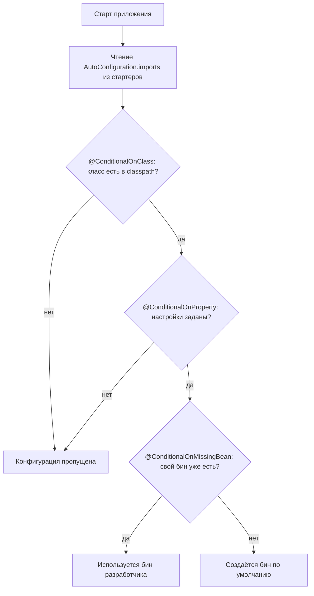

# Spring Boot

Что Spring Boot добавляет поверх Spring: автоконфигурацию, стартеры, управление версиями и внешнюю конфигурацию. На собесе чаще всего просят объяснить, как работает `@EnableAutoConfiguration`, чем стартер отличается от автоконфигурации, зачем BOM и в каком порядке читаются настройки.

## Зачем нужен Spring Boot { #why-boot }

### Зачем Spring Boot, если есть Spring? { #boot-vs-spring }

**Уровень:** Junior

!!! abstract "Ответ вслух"
    Spring Boot — не новый фреймворк, а оболочка над Spring Core по принципу Convention over Configuration: разумные настройки по умолчанию, вмешиваешься только когда нужно. Он убирает ручную конфигурацию инфраструктуры, подбор совместимых версий библиотек и деплой на внешний сервер — Tomcat встроен прямо в `.jar`.

Без Spring Boot (на чистом Spring Framework) было три проблемы:

1. **Конфигурация:** огромные XML-файлы или Java-классы `@Configuration` только чтобы подружить Spring с базой данных — создать `DataSource`, `TransactionManager`, настроить Hibernate.
2. **Зависимости:** самостоятельный подбор версий библиотек, совместимых друг с другом.
3. **Деплой:** сборка в `.war`, перенос на внешний Tomcat/WildFly и ручной запуск.

**Spring Boot — это не новый фреймворк,** а оболочка над тем же Spring Core. Его философия — **Convention over Configuration**: _«В 90% случаев всем нужны одинаковые настройки. Я сделаю всё по умолчанию. Вмешивайся, только когда хочешь что-то изменить»_.

Плюс — **встроенные серверы (embedded servers)**. Tomcat работает _внутри_ твоего `.jar`: `java -jar app.jar` — и приложение поднимает себя само.

!!! warning "Ловушка: «Spring Boot заменяет Spring»"
    Boot не заменяет Spring Core: IoC, DI, AOP и жизненный цикл бинов те же самые (см. [Spring Core](spring-core.md)). Boot только создаёт бины и настройки за тебя.

??? question "Проверь себя"
    1. Какие три проблемы чистого Spring решает Spring Boot?
    2. Что значит Convention over Configuration?
    3. Как запускается приложение со встроенным Tomcat?

## Автоконфигурация { #auto-configuration }

### Что внутри `@SpringBootApplication`? { #springbootapplication }

**Уровень:** Junior

!!! abstract "Ответ вслух"
    Это аннотация-композит из трёх: `@SpringBootConfiguration` (класс — конфигурация), `@ComponentScan` (сканировать компоненты в текущем пакете и ниже) и `@EnableAutoConfiguration` (включить автоконфигурацию).

```java
@SpringBootConfiguration    // этот класс — конфигурация
@ComponentScan              // сканировать @Service, @Component в текущем пакете
@EnableAutoConfiguration    // главное: включает автоконфигурацию Spring Boot
```

`@SpringBootConfiguration` — специализация `@Configuration`, поэтому в шпаргалках часто пишут «`@Configuration` + `@ComponentScan` + `@EnableAutoConfiguration`».

!!! warning "Ловушка: пакет главного класса"
    `@ComponentScan` без параметров сканирует пакет класса с `@SpringBootApplication`. Компоненты в соседнем пакете, не вложенном в него, Spring не найдёт.

??? question "Проверь себя"
    1. Из каких трёх аннотаций состоит `@SpringBootApplication`?
    2. Какая из них включает автоконфигурацию?
    3. Где `@ComponentScan` ищет компоненты по умолчанию?

### Как работает автоконфигурация? { #how-autoconfig }

**Уровень:** Middle

!!! abstract "Ответ вслух"
    При старте Spring Boot читает из стартеров файл `AutoConfiguration.imports` со списком конфигурационных классов. Каждая конфигурация защищена условиями `@Conditional`: нужный класс есть в classpath, в properties есть настройки, а разработчик ещё не создал свой бин (`@ConditionalOnMissingBean`). Только при выполнении условий бины создаются.

Ты добавил в `pom.xml` зависимость Kafka и не написал ни строчки кода — а Spring уже создал `KafkaTemplate`. Как?

**Шаг 1. Чтение списка конфигураций.** При старте Spring Boot читает специальные файлы внутри JAR-архивов стартеров:

- **До Spring Boot 2.7:** `META-INF/spring.factories` — большой текстовый файл со списком конфигурационных классов.
- **Spring Boot 2.7+ и 3.x:** `META-INF/spring/org.springframework.boot.autoconfigure.AutoConfiguration.imports` — современный формат, список классов построчно.

Spring Boot берёт этот список и пытается загрузить все конфигурации в память.

**Шаг 2. Условные аннотации (`@Conditional`).** Spring Boot не создаёт бины бездумно — каждая автоконфигурация защищена условиями. Он смотрит в classpath и задаёт вопросы:

```java
@ConditionalOnClass(KafkaTemplate.class)
// "Есть ли класс KafkaTemplate в проекте?"
// Зависимость добавлена → класс найден → идём дальше.
// Зависимости нет → игнорируем всю конфигурацию.

@ConditionalOnProperty(prefix = "spring.kafka", name = "bootstrap-servers")
// "Прописал ли разработчик адреса серверов в application.yml?"

@ConditionalOnMissingBean(KafkaTemplate.class)
// ← САМАЯ ВАЖНАЯ для собеса
// "Создал ли разработчик свой KafkaTemplate руками?"
// Создал → отступаем, не мешаем.
// Не создал → создаём дефолтный за него.
```



!!! tip "Как отвечать на собесе"
    «Автоконфигурация работает за счёт сканирования classpath и аннотаций `@Conditional`. Spring Boot находит файл `AutoConfiguration.imports`, берёт список конфигураций и применяет их, только если выполняются условия: нужная библиотека есть в classpath (`@ConditionalOnClass`), в properties прописаны настройки, и разработчик ещё не создал свой бин (`@ConditionalOnMissingBean`).»

!!! warning "Ловушка: `spring.factories` в Spring Boot 3"
    С Spring Boot 2.7 список автоконфигураций читается из `AutoConfiguration.imports`. Ответ «Boot читает `spring.factories`» верен только для версий до 2.7.

??? question "Проверь себя"
    1. Из какого файла Spring Boot 3 читает список автоконфигураций?
    2. Какие три условия проверяются для `KafkaTemplate`?
    3. Почему `@ConditionalOnMissingBean` — самая важная аннотация для собеса?

### Как отключить или переопределить автоконфигурацию? { #override-autoconfig }

**Уровень:** Middle

!!! abstract "Ответ вслух"
    Отключить — через `exclude` в `@SpringBootApplication` или свойство `spring.autoconfigure.exclude`. Переопределить — просто объявить свой бин: `@ConditionalOnMissingBean` увидит его и не создаст дефолтный. Что именно применилось и почему, показывает Conditions Evaluation Report (`--debug`) или `/actuator/conditions`.

```java
// Отключить конкретную автоконфигурацию
@SpringBootApplication(exclude = { DataSourceAutoConfiguration.class })
public class App { }

// Или через application.yml
// spring.autoconfigure.exclude: org.springframework.boot.autoconfigure.jdbc.DataSourceAutoConfiguration
```

```java
// Переопределить дефолтный бин — просто создай свой
// @ConditionalOnMissingBean увидит его и не будет создавать дефолтный
@Configuration
public class MyKafkaConfig {
    @Bean
    public KafkaTemplate<String, String> kafkaTemplate(ProducerFactory<String, String> pf) {
        // своя кастомная настройка
        return new KafkaTemplate<>(pf);
    }
}
```

Как посмотреть, что именно сконфигурировал Spring Boot:

```bash
# Запустить с флагом — в логах будет полный отчёт:
# Conditions Evaluation Report: что применилось и почему
java -jar app.jar --debug

# Или через Actuator (если подключён):
# GET /actuator/conditions
```

!!! warning "Ловушка: «почему мой бин не создался?»"
    Если автоконфигурация молча не сработала, не гадай — открой Conditions Evaluation Report. В нём для каждой конфигурации написано, какое условие не выполнилось.

??? question "Проверь себя"
    1. Как отключить `DataSourceAutoConfiguration`?
    2. Как заменить дефолтный `KafkaTemplate` своим?
    3. Где посмотреть, какие автоконфигурации применились?

## Зависимости: стартеры и BOM { #dependencies }

### Что такое стартер? { #starters }

**Уровень:** Junior

!!! abstract "Ответ вслух"
    Стартер — пустой JAR без Java-кода: заранее собранный `pom.xml`, который транзитивно подтягивает набор библиотек для одной задачи. Одна зависимость `spring-boot-starter-web` вместо 15 приносит Spring MVC, Tomcat, Jackson и Validation.

**Dependency Hell.** Во времена чистого Spring для простого веб-приложения нужно было вручную добавлять 30–40 зависимостей: `spring-core`, `spring-web`, `spring-webmvc`, `spring-context`, `jackson-core`, `jackson-databind`, Tomcat, `slf4j`, `logback`... И указывать каждую версию руками: взял `spring-webmvc` 4.3 и `jackson-databind` 2.2 — получи `ClassNotFoundException` при запуске.

```xml
<!-- Одна строчка вместо 15 -->
<dependency>
    <groupId>org.springframework.boot</groupId>
    <artifactId>spring-boot-starter-web</artifactId>
</dependency>
<!-- Транзитивно подтягивает: Spring MVC, Tomcat, Jackson, Validation -->

<dependency>
    <groupId>org.springframework.boot</groupId>
    <artifactId>spring-boot-starter-data-jpa</artifactId>
</dependency>
<!-- Транзитивно подтягивает: Hibernate, Spring Data, HikariCP, Transaction Manager -->
```

Стартеры смещают фокус с _технологий_ на _возможности_: не «мне нужен Tomcat и Jackson», а «я хочу писать REST API».

| Стартер | Что даёт |
|---|---|
| `spring-boot-starter-web` | Spring MVC, Tomcat, Jackson |
| `spring-boot-starter-data-jpa` | Hibernate, Spring Data, HikariCP |
| `spring-boot-starter-security` | Spring Security |
| `spring-boot-starter-test` | JUnit 5, Mockito, AssertJ |
| `spring-boot-starter-actuator` | Метрики, health checks, мониторинг |
| `spring-boot-starter-validation` | Bean Validation (Hibernate Validator) |
| `spring-boot-starter-cache` | Абстракция кэширования |

!!! warning "Ловушка: в стартере нет кода"
    Стартер ничего не настраивает и бинов не создаёт — он только приносит JAR-файлы. Бины создаёт автоконфигурация (см. [разницу](#starter-vs-autoconfig)).

??? question "Проверь себя"
    1. Что лежит внутри стартера?
    2. Что транзитивно подтягивает `spring-boot-starter-web`?
    3. Что такое Dependency Hell?

### Почему в зависимостях Spring Boot не пишут `<version>`? { #bom }

**Уровень:** Middle

!!! abstract "Ответ вслух"
    Версии берутся из BOM (Bill of Materials) — `spring-boot-dependencies`, который подключается через `spring-boot-starter-parent`. Команда Spring тестирует библиотеки в разных комбинациях и прописывает в BOM совместимые версии. Maven или Gradle подставляют их сами.

Интервьюер спросит: _«Стартер подтянул библиотеки. Но как гарантируется, что их версии не конфликтуют? Почему мы не пишем `<version>`?»_ Ответ — **BOM (Bill of Materials)**.

Под капотом любого Spring Boot-проекта есть `spring-boot-dependencies`. Команда Spring тестирует тысячи библиотек в разных комбинациях и прописывает совместимые версии:

```xml
<!-- В твоём pom.xml -->
<parent>
    <groupId>org.springframework.boot</groupId>
    <artifactId>spring-boot-starter-parent</artifactId>
    <version>3.2.0</version>
</parent>

<!-- Теперь можно не указывать версии — BOM подставит их сам -->
<dependency>
    <groupId>org.springframework.boot</groupId>
    <artifactId>spring-boot-starter-data-jpa</artifactId>
    <!-- Версия подставится автоматически: Hibernate 6.x, HikariCP 5.x, и т.д. -->
</dependency>
```

Maven/Gradle идут в BOM, смотрят версию Spring Boot и подставляют совместимые версии всех зависимостей.

!!! tip "Итог"
    Dependency Hell побеждён тем, что подбор и тестирование версий делегированы команде Spring. Проект всегда использует проверенный совместимый набор.

!!! warning "Ловушка: своя версия поверх BOM"
    Если явно указать `<version>` у управляемой зависимости, она перебьёт версию из BOM, и гарантия совместимости пропадёт. Делай так, только когда точно знаешь зачем.

??? question "Проверь себя"
    1. Что такое BOM и как он называется в Spring Boot?
    2. Как BOM подключается в `pom.xml`?
    3. Почему не нужно писать `<version>` у стартеров?

### Чем стартер отличается от автоконфигурации? { #starter-vs-autoconfig }

**Уровень:** Middle

!!! abstract "Ответ вслух"
    Стартер работает на этапе сборки и приносит в проект JAR-файлы библиотек. Автоконфигурация работает на этапе запуска и создаёт бины на основе этих библиотек. Стартер приносит байты, автоконфигурация превращает их в объекты.

Эти понятия часто путают, а разница между ними показывает понимание архитектуры Boot.

| | **Starter** | **Auto-configuration** |
|---|---|---|
| **За что отвечает** | Приносит `.jar` файлы библиотек в проект | Создаёт бины (объекты) на основе этих библиотек |
| **Когда работает** | Этап сборки (Maven / Gradle) | Этап запуска (Spring Context) |
| **Пример** | Скачивает Kafka-клиент | Видит Kafka-клиент и создаёт `KafkaTemplate` |

Они работают в паре: стартер приносит байты, автоконфигурация превращает их в объекты.

!!! warning "Ловушка: «стартер создаёт `KafkaTemplate`»"
    Нет: `KafkaTemplate` создаёт автоконфигурация, когда видит класс Kafka-клиента в classpath. Стартер только положил этот класс туда.

??? question "Проверь себя"
    1. На каком этапе работает стартер, а на каком — автоконфигурация?
    2. Кто создаёт `KafkaTemplate`?
    3. Как они связаны между собой?

## Конфигурация приложения { #configuration }

### В каком порядке Spring Boot читает настройки? { #config-priority }

**Уровень:** Junior

!!! abstract "Ответ вслух"
    Источников много, и более специфичный перебивает общий. Аргументы командной строки важнее переменных окружения, те важнее `application-{profile}.yml`, тот важнее общего `application.yml`, а в самом низу — значения по умолчанию из автоконфигурации.

Порядок приоритетов (выше — важнее):

| Приоритет | Источник | Пример |
|---|---|---|
| 1 | Аргументы командной строки | `java -jar app.jar --server.port=9090` |
| 2 | Переменные окружения (OS) | `SERVER_PORT=9090` |
| 3 | `application-{profile}.yml` | `application-prod.yml` |
| 4 | `application.yml` / `application.properties` | — |
| 5 | Дефолтные значения из автоконфигурации | — |

!!! warning "Ловушка: переменная окружения перебивает yml"
    `SERVER_PORT=9090` в окружении контейнера победит `server.port` из `application-prod.yml`. Если настройка «не применяется», первым делом проверь переменные окружения и аргументы запуска.

??? question "Проверь себя"
    1. Что важнее: переменная окружения или `application.yml`?
    2. Какой источник имеет наивысший приоритет?
    3. Где в этом списке значения по умолчанию из автоконфигурации?

### Как работают профили? { #profiles }

**Уровень:** Junior

!!! abstract "Ответ вслух"
    Профиль — именованный набор настроек и бинов для окружения: `dev`, `prod`. Настройки кладут в `application-{profile}.yml` или в документ с `spring.config.activate.on-profile`, а бины помечают `@Profile`. Активный профиль задают через `spring.profiles.active` — аргументом или переменной окружения.

```yaml
# application.yml — общие настройки
spring:
  application:
    name: habit-tracker

---
# application-dev.yml
spring:
  config:
    activate:
      on-profile: dev
  datasource:
    url: jdbc:h2:mem:devdb  # in-memory БД для разработки

---
# application-prod.yml
spring:
  config:
    activate:
      on-profile: prod
  datasource:
    url: jdbc:postgresql://prod-server:5432/habits
```

```bash
# Активировать профиль
java -jar app.jar --spring.profiles.active=prod
# Или через переменную окружения
SPRING_PROFILES_ACTIVE=prod java -jar app.jar
```

```java
// Бин только для конкретного профиля
@Service
@Profile("dev")
public class MockEmailSender implements EmailSender {
    @Override
    public void send(String to, String body) {
        log.info("[DEV] Письмо не отправлено, только лог: {} → {}", to, body);
    }
}

@Service
@Profile("prod")
public class SmtpEmailSender implements EmailSender { ... }
```

!!! warning "Ловушка: ни один профиль не активен"
    Если профиль не задан, бины с `@Profile("dev")` и `@Profile("prod")` не создадутся оба. Сервис, которому нужен `EmailSender`, упадёт на старте с ошибкой «бин не найден».

??? question "Проверь себя"
    1. Как активировать профиль `prod` при запуске?
    2. Как сделать бин, который создаётся только в `dev`?
    3. Где хранить настройки конкретного профиля?

### `@Value` или `@ConfigurationProperties`? { #value-vs-configprops }

**Уровень:** Middle

!!! abstract "Ответ вслух"
    `@Value` подходит для одиночного значения — быстро и просто. Для группы связанных настроек лучше `@ConfigurationProperties`: один типобезопасный класс на префикс, поддержка IDE, валидация через `@Validated` и простое тестирование.

```yaml
# application.yml
app:
  habits:
    max-per-user: 50
    reminder-hour: 9
    allowed-categories:
      - HEALTH
      - PRODUCTIVITY
      - LEARNING
```

```java
// ❌ @Value — работает, но многословно и хрупко
@Service
public class HabitService {
    @Value("${app.habits.max-per-user}")
    private int maxPerUser;

    @Value("${app.habits.reminder-hour}")
    private int reminderHour;
    // И так для каждого свойства...
}

// ✅ @ConfigurationProperties — типобезопасно, IDE-поддержка, валидация
@ConfigurationProperties(prefix = "app.habits")
@Validated  // включает Bean Validation
public class HabitProperties {
    @Min(1) @Max(100)
    private int maxPerUser = 10;       // дефолтное значение

    @Min(0) @Max(23)
    private int reminderHour = 8;

    private List<String> allowedCategories = new ArrayList<>();

    // геттеры/сеттеры или record
}

// Зарегистрировать:
@SpringBootApplication
@EnableConfigurationProperties(HabitProperties.class)
public class App { }

// Использование:
@Service
public class HabitService {
    private final HabitProperties props;

    public HabitService(HabitProperties props) {
        this.props = props;
    }

    public void createHabit(Habit habit) {
        if (habitCount >= props.getMaxPerUser()) {
            throw new LimitExceededException("Максимум " + props.getMaxPerUser() + " привычек");
        }
    }
}
```

!!! tip "Когда что использовать"
    `@Value` — для одиночных значений, быстро и просто. `@ConfigurationProperties` — для группы связанных настроек: типобезопасно, поддержка IDE, валидация, легко тестировать.

!!! warning "Ловушка: класс свойств не зарегистрирован"
    Сам по себе `@ConfigurationProperties` бин не создаёт. Класс нужно зарегистрировать — например, через `@EnableConfigurationProperties(HabitProperties.class)`, как в примере выше. Без регистрации внедрить `HabitProperties` не получится.

??? question "Проверь себя"
    1. Когда достаточно `@Value`?
    2. Какие плюсы у `@ConfigurationProperties`?
    3. Как включить валидацию для класса свойств?

## Actuator и мониторинг { #actuator }

`spring-boot-starter-actuator` даёт HTTP-эндпоинты мониторинга из коробки: `/actuator/health`, `/actuator/metrics`, `/actuator/conditions` и другие. Эндпоинты, их настройка, безопасность и метрики Micrometer разобраны в [Инструменты → Actuator и Micrometer](spring-tools.md#actuator-micrometer), а концепции наблюдаемости (метрики, логи, трейсы) — в [System Design → Observability](../system-design/system-design.md#observability).

## Шпаргалка { #cheatsheet }

| Тема | Запомнить |
|---|---|
| **Spring Boot vs Spring** | Boot — оболочка над Spring. Convention over Configuration. Embedded Tomcat |
| **`@SpringBootApplication`** | Композит из `@Configuration` + `@ComponentScan` + `@EnableAutoConfiguration` |
| **Автоконфигурация** | Читает `AutoConfiguration.imports` → применяет через `@Conditional` → `@ConditionalOnMissingBean` позволяет переопределить |
| **Отладка автоконфигурации** | `--debug` или `/actuator/conditions` — Conditions Evaluation Report |
| **Стартер** | Пустой JAR — только зависимости. Работает на этапе сборки |
| **BOM** | Spring тестирует совместимые версии и прописывает их. Мы версии не указываем |
| **Стартер vs Автоконфигурация** | Стартер приносит байты, автоконфигурация превращает их в объекты |
| **Приоритет конфигурации** | CLI args > env vars > `application-{profile}.yml` > `application.yml` > дефолты |
| **Профили** | `application-{profile}.yml`, `@Profile`, `spring.profiles.active` |
| **`@Value` vs `@ConfigurationProperties`** | Value — одиночное значение. ConfigurationProperties — группа настроек с валидацией |
| **Actuator** | Мониторинг из коробки — подробно в [Инструментах](spring-tools.md#actuator-micrometer) |
