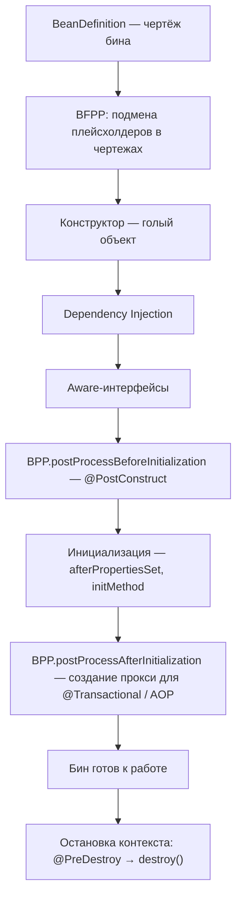
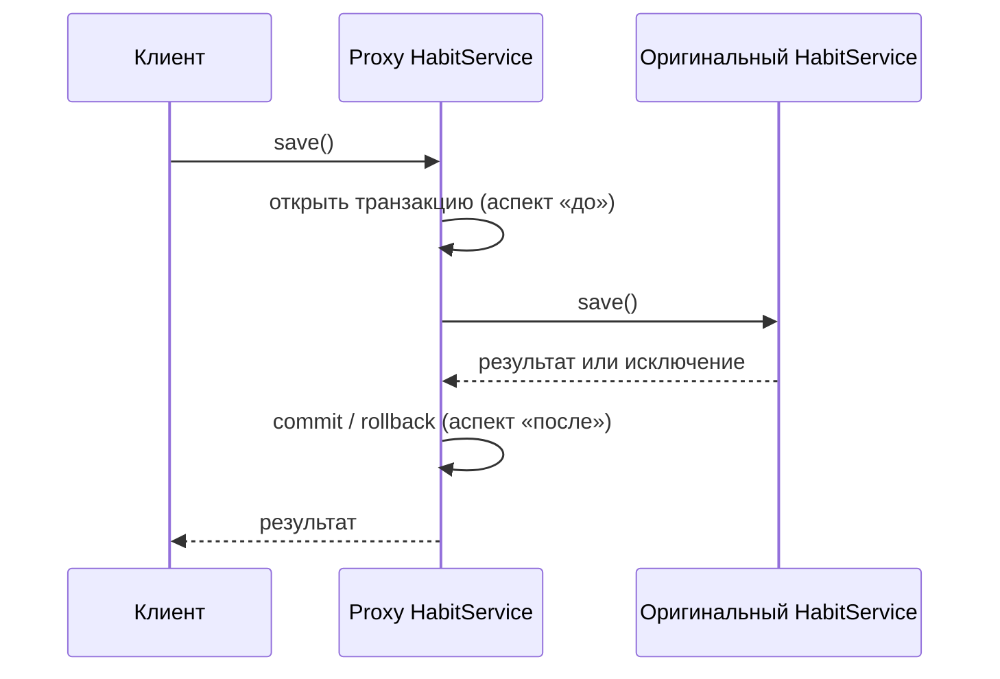

---
tags:
  - Junior
  - Middle
  - Spring
---

# Spring Core

Как Spring создаёт объекты, связывает их и оборачивает в прокси: IoC-контейнер, внедрение зависимостей, жизненный цикл и скоупы бинов, AOP. Чаще всего спрашивают разницу IoC и DI, почему внедрение через конструктор лучше, жизненный цикл бина, prototype внутри singleton и почему `@Transactional` не срабатывает при вызове через `this`.

## IoC и DI { #ioc-di }

### Что такое IoC и чем он отличается от DI? { #ioc-vs-di }

**Уровень:** Junior

!!! abstract "Ответ вслух"
    IoC (Inversion of Control) — архитектурный принцип: объекты создаёт и связывает не твой код, а контейнер. DI (Dependency Injection) — конкретный паттерн, которым этот принцип реализован: класс объявляет, что ему нужно, а Spring находит подходящую реализацию и подставляет её.

**IoC — инверсия контроля.** Это принцип, а не конкретный код. Его описывает «голливудский принцип»: _«Не звоните нам, мы сами вам позвоним»_.

- **Прямой контроль (как было):** код сам создаёт объекты. Если `HabitService` нужен репозиторий, ты пишешь `HabitRepository repo = new HabitRepositoryImpl()`, и сервис жёстко привязан к конкретной реализации.
- **Инверсия контроля (как стало):** ты забираешь у класса право создавать объекты через `new` и отдаёшь его фреймворку — IoC-контейнеру (`ApplicationContext`). Spring сам решает, когда создать бины, как их настроить и когда уничтожить. Твой код просто ждёт, когда ему дадут всё необходимое.

**DI — внедрение зависимостей.** Если IoC — общая стратегия, то DI — конкретная тактика (паттерн) её реализации. `HabitService` говорит: _«Мне нужен любой класс, реализующий `HabitRepository`»_. При старте Spring видит это требование, находит подходящую реализацию в контексте и передаёт её в сервис.

!!! warning "Ловушка: IoC и DI — не синонимы"
    IoC отвечает на вопрос «кто управляет созданием объектов», DI — «как зависимость попадает в объект». На собесе ждут именно это разделение: принцип и паттерн.

??? question "Проверь себя"
    1. Что такое «голливудский принцип» и как он связан с IoC?
    2. Чем IoC отличается от DI?
    3. Что делает Spring, когда видит, что сервису нужен `HabitRepository`?

### Почему внедрение через конструктор лучше, чем через поле? { #constructor-injection }

**Уровень:** Junior

!!! abstract "Ответ вслух"
    Через конструктор поле можно сделать `final`, класс тестируется обычным `new` без Spring, а раздутый список зависимостей сразу виден. Внедрение через поле (`@Autowired` на поле) не даёт `final`, требует рефлексии в тестах и привязывает класс к DI-контейнеру.

#### ❌ Внедрение через поле (Field Injection) — антипаттерн { #field-injection }

```java
@Service
public class HabitService {
    @Autowired
    private HabitRepository habitRepository; // так делать не надо
}
```

Почему плохо:

1. **Нельзя `final`** — поле не защищено от изменений после создания.
2. **Сложно тестировать** — поле приватное, конструктора нет. Чтобы подсунуть мок в юнит-тесте без Spring-контекста, нужна рефлексия.
3. **Скрывает God Object** — легко добавить 15–20 зависимостей, и никто не заметит. Нарушение [SRP](../design/solid.md#srp) становится невидимым.
4. **Привязка к фреймворку** — класс физически не работает без DI-контейнера, а это нарушает принципы чистой архитектуры.

#### ✅ Внедрение через конструктор (Constructor Injection) — стандарт { #constructor-injection-good }

```java
@Service
public class HabitService {
    private final HabitRepository habitRepository; // поле final!

    // С Spring 4.3 @Autowired не нужен, если конструктор один
    public HabitService(HabitRepository habitRepository) {
        this.habitRepository = habitRepository;
    }
}
```

На практике конструктор руками почти никто не пишет — его генерирует `@RequiredArgsConstructor` из Lombok.

Почему это правильно:

1. **Иммутабельность** — поля `final`, инициализируются один раз и защищены от изменений. Thread-safe.
2. **Чистая Java** — в юнит-тесте просто `new HabitService(mockRepository)`, никакого Spring.
3. **Fail-fast** — циклическая зависимость падает на старте, а не прячется (подробно — в [следующей теме](#circular-dependencies)).
4. **Видимый запах кода** — конструктор с 10 параметрами сразу бросается в глаза. Это сигнал разбить класс.

!!! warning "Ловушка: `@Autowired` на единственном конструкторе"
    С Spring 4.3 аннотация на единственном конструкторе не нужна — Spring использует его сам. Если конструкторов несколько, нужный придётся пометить `@Autowired` явно.

??? question "Проверь себя"
    1. Назови четыре минуса внедрения через поле.
    2. Как протестировать сервис с внедрением через конструктор без Spring?
    3. С какой версии Spring можно не писать `@Autowired` над конструктором?

### Что будет при циклической зависимости бинов? { #circular-dependencies }

**Уровень:** Middle

!!! abstract "Ответ вслух"
    При внедрении через конструктор цикл A → B → A неразрешим: приложение падает на старте с `BeanCurrentlyInCreationException`. При внедрении через поле Spring раньше тихо разрывал цикл ранней ссылкой на недособранный бин. С Spring Boot 2.6 циклы запрещены по умолчанию при любом способе внедрения.

- **Конструктор.** Чтобы создать A, нужен готовый B, а чтобы создать B — готовый A. Разрешить это невозможно в принципе, поэтому контекст падает с `BeanCurrentlyInCreationException`.
- **Поле.** `StackOverflowError` здесь нет: Spring разрывает цикл сам — отдаёт B ссылку на ещё недособранный A (раннюю ссылку из кэша синглтонов). Цикл тихо работает и прячет плохой дизайн.
- **Spring Boot 2.6+.** Циклы запрещены по умолчанию: при любом виде внедрения приложение падает на старте с ошибкой _«The dependencies of some of the beans in the application context form a cycle»_.

```yaml
# Вернуть старое поведение — костыль, а не решение
spring:
  main:
    allow-circular-references: true
```

!!! warning "Ловушка: лечить цикл настройкой"
    `spring.main.allow-circular-references=true` возвращает старое поведение, но цикл остаётся. Правильнее разорвать его в дизайне: вынести общую логику в третий бин или развернуть зависимость.

??? question "Проверь себя"
    1. Почему цикл при внедрении через конструктор неразрешим?
    2. Как Spring раньше разрывал цикл при внедрении через поле?
    3. Что изменилось в Spring Boot 2.6?

## Контейнер { #container }

### Чем `ApplicationContext` отличается от `BeanFactory`? { #applicationcontext-vs-beanfactory }

**Уровень:** Junior

!!! abstract "Ответ вслух"
    Оба — IoC-контейнеры, `ApplicationContext` наследует `BeanFactory`. `BeanFactory` даёт только DI и создаёт бины лениво, по `getBean()`. `ApplicationContext` создаёт синглтоны при старте и добавляет AOP, события, i18n, веб-скоупы и автоматическую регистрацию `BeanPostProcessor`.

Оба контейнера читают конфигурацию, создают бины и связывают их.

- **`BeanFactory`** — базовый контейнер, только DI. Корень всего Spring.
- **`ApplicationContext`** — наследник `BeanFactory` со всеми его возможностями плюс корпоративные фичи.

**Стратегия загрузки бинов:**

- **`BeanFactory` (lazy)** — создаёт бин только при явном `getBean()`. Экономит память, но ошибки конфигурации всплывут в рантайме.
- **`ApplicationContext` (eager)** — создаёт все синглтон-бины при старте контекста. Если забыл зависимость или ошибся в `@Value`, приложение упадёт сразу. Так ловится 90% ошибок конфигурации.

**Корпоративные фичи `ApplicationContext`:**

1. **AOP** — поддержка аспектов (транзакции, логирование) из коробки.
2. **`MessageSource` (i18n)** — интернационализация.
3. **Публикация событий (Event Publication)** — механизм событий, паттерн [Observer](../java/patterns.md#observer).
4. **Веб-скоупы** — `request`, `session`, интеграция с `DispatcherServlet`.
5. **Авторегистрация BPP** — `BeanPostProcessor`-ы регистрируются автоматически (в `BeanFactory` — вручную).

| **Характеристика** | **`BeanFactory`** | **`ApplicationContext`** |
|---|---|---|
| **Инициализация** | Lazy (по запросу) | Eager (при старте) |
| **Регистрация BPP** | Вручную | Автоматически |
| **AOP** | Нет | Да |
| **События** | Нет | Да |
| **Где используется** | Легаси / IoT / ограниченные ресурсы | Все современные приложения |

`ApplicationContext` — стандарт де-факто: `SpringApplication.run()` возвращает именно его.

!!! warning "Ловушка: «lazy — значит лучше»"
    Ленивая загрузка экономит память на старте, но ошибка конфигурации всплывёт только при первом обращении к бину — уже в проде. Eager-создание синглтонов в `ApplicationContext` — осознанный выбор в пользу fail-fast.

??? question "Проверь себя"
    1. Когда `BeanFactory` создаёт бин, а когда — `ApplicationContext`?
    2. Какие возможности добавляет `ApplicationContext`?
    3. Что возвращает `SpringApplication.run()`?

## Жизненный цикл бина { #bean-lifecycle }

### Через какие этапы проходит бин? { #bean-lifecycle-phases }

**Уровень:** Middle

!!! abstract "Ответ вслух"
    Сначала Spring строит чертежи — `BeanDefinition`, и их правят `BeanFactoryPostProcessor`-ы. Затем вызывается конструктор, внедряются зависимости, вызываются Aware-методы. Дальше `BeanPostProcessor`-ы: до инициализации срабатывает `@PostConstruct`, после — создаётся прокси; при остановке контекста вызывается `@PreDestroy`.



**Фаза 0. Чертежи и BFPP.** Прежде чем создать хоть один объект, Spring сканирует код и создаёт **`BeanDefinition`** — чертёж будущего бина (класс, скоуп, зависимости). Затем работает **`BeanFactoryPostProcessor` (BFPP)** — он правит чертежи, а не объекты (подробнее — в [следующей теме](#bfpp-vs-bpp)).

**Фаза 1. Создание и DI.**

1. **Instantiation** — Spring вызывает конструктор через рефлексию. Создаётся «голый» Java-объект без зависимостей.
2. **Populate Properties** — внедряются зависимости. При внедрении через конструктор шаги 1 и 2 сливаются в один.
3. **Aware-интерфейсы** — если бину нужно знать своё имя или получить ссылку на `ApplicationContext`, Spring вызывает методы Aware-интерфейсов (`setBeanName()`, `setApplicationContext()` и т.д.).

**Фаза 2. BPP и инициализация.** Объект с зависимостями проходит через **`BeanPostProcessor` (BPP)** — интерфейс с двумя методами.

1. **`postProcessBeforeInitialization`** — здесь `InitDestroyAnnotationBeanPostProcessor` находит метод с `@PostConstruct` и выполняет его.
2. **Инициализация** — вызывается `afterPropertiesSet()` (если реализован `InitializingBean`) или метод из `@Bean(initMethod = "...")`. Это легаси-способы, сейчас используют `@PostConstruct`.
3. **`postProcessAfterInitialization`** — здесь создаются прокси-объекты (подробнее — в [теме про прокси](#proxy-creation)).

**Фаза 3. Работа и уничтожение.**

- **Использование** — бин готов, лежит в контейнере и обрабатывает запросы.
- **Уничтожение** — при остановке контекста Spring вызывает `@PreDestroy` (через BPP), затем `destroy()` (если реализован `DisposableBean`). Здесь закрывают коннекты к БД и открытые файлы.

!!! warning "Ловушка: порядок `@PostConstruct` и `afterPropertiesSet()`"
    `@PostConstruct` выполняется в `postProcessBeforeInitialization`, то есть **раньше** `afterPropertiesSet()` и `initMethod`. А прокси появляется **после** всех init-методов — внутри `@PostConstruct` ты работаешь с оригинальным объектом, а не с прокси.

??? question "Проверь себя"
    1. Перечисли этапы жизненного цикла бина по порядку.
    2. Когда вызывается `@PostConstruct` относительно `afterPropertiesSet()`?
    3. Что Spring вызывает при остановке контекста?

### Чем `BeanFactoryPostProcessor` отличается от `BeanPostProcessor`? { #bfpp-vs-bpp }

**Уровень:** Middle

!!! abstract "Ответ вслух"
    BFPP работает с чертежами (`BeanDefinition`) до создания любых объектов. BPP работает с уже созданными объектами: до и после их инициализации. Пример BFPP — подстановка значений в `@Value`, пример BPP — обработка `@PostConstruct` и создание прокси.

| | **`BeanFactoryPostProcessor`** | **`BeanPostProcessor`** |
|---|---|---|
| **С чем работает** | С чертежами (`BeanDefinition`) | С объектами бинов |
| **Когда** | До создания любых бинов | До и после инициализации каждого бина |
| **Пример** | `PropertySourcesPlaceholderConfigurer` | `InitDestroyAnnotationBeanPostProcessor`, создатели прокси |

Пример BFPP из жизни: `@Value("${db.password}")`. В чертеже лежит строка-плейсхолдер. Встроенный BFPP `PropertySourcesPlaceholderConfigurer` читает `application.yml` и подменяет `${db.password}` на реальное значение ещё до создания бина.

!!! warning "Ловушка: BFPP работает до создания бинов"
    BFPP вызывается, когда обычные бины ещё не созданы, — он видит только чертежи. Всё, что меняет готовые объекты (обёртки, прокси, init-логика), делается в BPP.

??? question "Проверь себя"
    1. С чем работает BFPP, а с чем — BPP?
    2. Какой BFPP подставляет значения в `@Value`?
    3. Какой BPP вызывает `@PostConstruct`?

### На каком этапе создаётся прокси? { #proxy-creation }

**Уровень:** Middle

!!! abstract "Ответ вслух"
    В `postProcessAfterInitialization` — последнем шаге BPP. Если на бине или его методах висят `@Transactional`, `@Async` или AOP-аспекты, Spring оборачивает оригинальный объект в прокси и кладёт в контейнер именно прокси. Все, кто запрашивает этот бин, получают обёртку.

`postProcessAfterInitialization` — критичный этап: здесь рождаются прокси-объекты. Spring проверяет, нужны ли бину аспекты, и если да — возвращает в контейнер не оригинал, а обёртку.

Все остальные бины, запрашивающие `HabitService`, получат не оригинал, а прокси, который умеет открывать транзакции. Как прокси устроен — в разделе [AOP и прокси](#aop).

!!! warning "Ловушка: прокси создаётся после init-методов"
    Внутри `@PostConstruct` прокси ещё нет. Вызов `@Transactional`-метода из `@PostConstruct` идёт по `this` и выполнится без транзакции.

??? question "Проверь себя"
    1. В каком методе BPP создаётся прокси?
    2. Какие аннотации приводят к созданию прокси?
    3. Что получают другие бины, которые внедряют проксируемый бин?

## Скоупы { #scopes }

### Какие бывают скоупы бинов? { #bean-scopes }

**Уровень:** Junior

!!! abstract "Ответ вслух"
    По умолчанию `singleton` — один экземпляр на весь контекст, он обязан быть stateless. `prototype` создаётся заново при каждом обращении к контейнеру, и `@PreDestroy` для него не вызывается. В веб-приложениях есть ещё `request` (на HTTP-запрос) и `session` (на HTTP-сессию).

**Базовые скоупы:**

- **`singleton` (по умолчанию)** — один экземпляр на весь `ApplicationContext`.
- **`prototype`** — новый экземпляр при каждом обращении к контейнеру. Spring создаёт прототип, отдаёт и забывает: методы уничтожения (`@PreDestroy`) для прототипов **не вызываются**, память чистит GC.

**Веб-скоупы** доступны только в веб-приложениях (когда поднят `DispatcherServlet`):

- **`request`** — новый экземпляр на каждый HTTP-запрос. Запрос обработан — бин уничтожен. Подходит для `traceId` и данных текущего запроса.
- **`session`** — один экземпляр на всю HTTP-сессию пользователя.

!!! warning "Ловушка: состояние в синглтоне"
    Синглтон общий для всех потоков, поэтому **в нём нельзя хранить состояние** — поля, которые меняются в процессе работы. Если сохранить `private User currentUser`, Вася увидит данные Пети при параллельном запросе. Синглтоны обязаны быть stateless.

??? question "Проверь себя"
    1. Какой скоуп у бина по умолчанию?
    2. Почему синглтон должен быть stateless?
    3. Вызывается ли `@PreDestroy` для прототипа?

### Что будет, если внедрить prototype в singleton? { #prototype-in-singleton }

**Уровень:** Middle

!!! abstract "Ответ вслух"
    Прототип создастся один раз и навсегда останется в синглтоне. Синглтон создаётся один раз, DI для него тоже проходит один раз, поэтому Spring честно создаёт один экземпляр прототипа и вшивает его в конструктор. Фактически прототип становится синглтоном.

```java
@Component
@Scope("prototype")
public class PrototypeBean { }

@Service // singleton по умолчанию
public class SingletonService {
    private final PrototypeBean prototypeBean;

    public SingletonService(PrototypeBean prototypeBean) {
        this.prototypeBean = prototypeBean; // инжект происходит ОДИН РАЗ
    }

    public void doWork() {
        // сколько раз ни вызывай — prototypeBean один и тот же!
    }
}
```

Вопрос на собесе: _«Сколько экземпляров `PrototypeBean` создастся при 10 вызовах `doWork()`?»_

- **Частый неверный ответ:** 10 — ведь стоит `@Scope("prototype")`.
- **Правильный ответ:** **один.** `SingletonService` создаётся один раз при старте, DI тоже проходит один раз. Больше этот конструктор не вызывается.

!!! warning "Ловушка: prototype не значит «новый при каждом вызове метода»"
    Прототип новый при каждом обращении **к контейнеру**, а не при каждом обращении к полю. Чтобы получать свежий экземпляр, нужно каждый раз ходить в контейнер — способы в [следующей теме](#fresh-prototype).

??? question "Проверь себя"
    1. Сколько экземпляров прототипа создастся при 10 вызовах метода синглтона?
    2. Почему DI в синглтон происходит один раз?
    3. «Новый при каждом обращении» — к чему именно?

### Как получать новый prototype при каждом вызове? { #fresh-prototype }

**Уровень:** Middle

!!! abstract "Ответ вслух"
    Рекомендуемый способ — `ObjectProvider<T>`: каждый `getObject()` возвращает новый экземпляр, и его легко замокать. Альтернатива — `@Lookup`, метод, который Spring переопределяет через CGLIB. Для веб-скоупов используют scoped proxy с `proxyMode = TARGET_CLASS`.

**Решение А: `ObjectProvider` — современно и тестируемо (рекомендуется)**

```java
@Service
public class SingletonService {
    private final ObjectProvider<PrototypeBean> provider;

    public SingletonService(ObjectProvider<PrototypeBean> provider) {
        this.provider = provider;
    }

    public void doWork() {
        PrototypeBean fresh = provider.getObject(); // новый экземпляр каждый раз
    }
}
```

**Решение Б: `@Lookup` — переопределение метода через CGLIB**

```java
@Service
public class SingletonService {

    @Lookup // Spring переопределит этот метод через CGLIB Proxy
    public PrototypeBean getPrototypeBean() {
        return null; // эта строка никогда не выполнится
    }

    public void doWork() {
        PrototypeBean fresh = getPrototypeBean(); // вернёт новый объект из контейнера
    }
}
```

**Решение В: Scoped Proxy (для веб-скоупов)**

```java
@Component
@Scope(
    value = WebApplicationContext.SCOPE_REQUEST,
    proxyMode = ScopedProxyMode.TARGET_CLASS
)
public class RequestScopedBean { }
```

Spring внедрит в синглтон не сам объект, а прокси-заглушку. При каждом вызове она сама ищет актуальный объект в текущем HTTP-запросе.

!!! warning "Ловушка: почему `@Lookup` хуже `ObjectProvider`"
    Метод с `@Lookup` нельзя сделать `private` или `final` — CGLIB его не переопределит. В юнит-тесте без Spring-контекста метод вернёт `null`. С `ObjectProvider` мок подставляется тривиально.

??? question "Проверь себя"
    1. Как `ObjectProvider` решает проблему прототипа в синглтоне?
    2. Почему метод с `@Lookup` не может быть `final`?
    3. Как request-scoped бин попадает в синглтон?

## AOP и прокси { #aop }

### Зачем нужен AOP? { #why-aop }

**Уровень:** Junior

!!! abstract "Ответ вслух"
    AOP (аспектно-ориентированное программирование) выносит сквозную функциональность — логирование, проверку прав, транзакции — в отдельные классы-аспекты. Бизнес-код остаётся чистым, а Spring оборачивает бины нужным кодом сам, когда видит аннотацию вроде `@Transactional`.

В 50 сервисах нужно логировать время выполнения, проверять права и открывать транзакции. Если писать это руками, бизнес-логика тонет в техническом коде. Это **сквозная функциональность (cross-cutting concerns)**.

AOP позволяет вынести технический код в отдельный класс — **аспект (aspect)**. Вешаешь `@Transactional` — Spring сам оборачивает класс нужным кодом.

!!! warning "Ловушка: Spring AOP — не AspectJ"
    Spring не модифицирует байт-код твоих классов, как AspectJ. Он создаёт прокси-обёртки, поэтому аспект срабатывает только на вызовах, которые проходят через прокси (подробно — в [теме про самовызов](#self-invocation)).

??? question "Проверь себя"
    1. Что такое сквозная функциональность?
    2. Что такое аспект?
    3. Чем подход Spring AOP отличается от AspectJ?

### Как Spring оборачивает бины в прокси? { #proxy }

**Уровень:** Middle

!!! abstract "Ответ вслух"
    Через паттерн Proxy: вместо оригинального бина другим бинам отдаётся обёртка. Прокси перехватывает вызов, выполняет код аспекта «до» (например, открывает транзакцию), вызывает оригинальный метод и выполняет код «после» — commit или rollback.

Когда другой бин запрашивает `HabitService`, Spring отдаёт ему **не оригинал, а прокси**. При вызове метода `save()`:



!!! warning "Ловушка: прокси видит только внешние вызовы"
    Код аспекта выполняется только тогда, когда вызов пришёл снаружи через прокси. Вызов метода изнутри того же объекта прокси не видит — это [самовызов](#self-invocation).

??? question "Проверь себя"
    1. Какой паттерн использует Spring AOP?
    2. Что получает бин, который внедряет `HabitService` с `@Transactional`?
    3. В какой момент прокси открывает и закрывает транзакцию?

### Чем JDK Dynamic Proxy отличается от CGLIB? { #jdk-proxy-vs-cglib }

**Уровень:** Middle

!!! abstract "Ответ вслух"
    JDK Dynamic Proxy встроен в Java и работает через рефлексию, но требует интерфейса: прокси реализует тот же интерфейс. CGLIB генерирует байт-код подкласса и переопределяет публичные методы, поэтому не работает с `final`-классами и `final`/`private`-методами. С Spring Boot 2.0 по умолчанию используется CGLIB.

**JDK Dynamic Proxy** (встроен в Java, через Reflection):

- **Условие:** класс **обязан** реализовывать интерфейс.
- Spring генерирует новый класс, реализующий тот же интерфейс. Через прокси доступны только методы интерфейса.

**CGLIB** (генерация байт-кода):

- **Условие:** класс **не** реализует интерфейс, или принудительно задано `proxyTargetClass = true`.
- CGLIB генерирует подкласс (наследника) твоего класса и переопределяет все публичные методы.

Начиная с Spring Boot 2.0, CGLIB используется по умолчанию для **всех** бинов, даже если у них есть интерфейсы. Это избавило от странных ошибок при приведении типов (casting). Но разницу между JDK Proxy и CGLIB всё равно спрашивают на собесах.

!!! warning "Ловушка: `final` и `private` для CGLIB"
    CGLIB работает через наследование, поэтому **не может обернуть `final`-классы и `final`/`private`-методы**. Если повесить `@Transactional` на `private`-метод, Spring молча проигнорирует аннотацию — транзакция не откроется.

??? question "Проверь себя"
    1. Какое условие нужно для JDK Dynamic Proxy?
    2. Как CGLIB создаёт прокси и что он не может обернуть?
    3. Какой механизм Spring Boot использует по умолчанию с версии 2.0?

### Почему не срабатывает `@Transactional` при вызове метода через `this`? { #self-invocation }

**Уровень:** Middle

=== "Коротко"

    !!! abstract "Ответ вслух"
        Аспект живёт в прокси, а вызов `this.method()` изнутри бина идёт напрямую в оригинальный объект, минуя прокси. Поэтому `@Transactional`, `@Async`, `@Cacheable` и любые другие аспекты на таком вызове не срабатывают. Лечится выносом метода в отдельный бин или self-injection.

=== "Подробно"

    Это самовызов (self-invocation) — классический баг, на котором теряют часы дебага даже опытные разработчики.

    ```java
    @Service
    public class OrderService {

        public void createOrder() {
            // ...бизнес-логика...
            saveToDatabase(); // внутренний вызов!
        }

        @Transactional
        public void saveToDatabase() {
            // Откроется ли транзакция?
        }
    }
    ```

    Вопрос на собесе: _«Откроется ли транзакция при вызове `saveToDatabase()` изнутри `createOrder()`?»_ Ответ: **нет.**

    ```mermaid
    sequenceDiagram
        participant Client as Внешний код
        participant Proxy as Proxy OrderService
        participant Target as Оригинальный OrderService
        Client->>Proxy: createOrder()
        Note over Proxy: над createOrder() нет аспекта
        Proxy->>Target: createOrder()
        Target->>Target: this.saveToDatabase() — мимо прокси
        Note over Target: транзакция не открыта
    ```

    Внешний код вызывает `createOrder()` через прокси, и прокси пробрасывает вызов в реальный объект. Дальше `createOrder()` внутри реального объекта вызывает `this.saveToDatabase()` — **напрямую, минуя прокси**. Аспект транзакции не задействован.

    **Как чинить:**

    ```java
    // Вариант 1 — разнести по разным сервисам (лучший)
    @Service
    public class OrderPersistenceService {
        @Transactional
        public void saveToDatabase(Order order) { ... }
    }

    // Вариант 2 — Self-injection (получить свой же Proxy)
    @Service
    public class OrderService {
        @Lazy
        @Autowired
        private OrderService self; // Spring заинжектит Proxy, а не this

        public void createOrder() {
            self.saveToDatabase(); // теперь вызов идёт через Proxy
        }

        @Transactional
        public void saveToDatabase() { ... }
    }
    ```

    `@Lazy` в варианте 2 разрывает циклическую зависимость при внедрении бина в самого себя. Для транзакций есть и третий способ — программное управление через `TransactionTemplate`; чем самовызов опасен именно для транзакций, разобрано в [Spring Data JPA → Самовызов и транзакции](spring-data-jpa.md#self-invocation-transactions).

!!! warning "Ловушка: касается любого аспекта, не только транзакций"
    `@Cacheable`, `@Async`, свои аспекты — всё это работает через тот же прокси. `this.findById()` внутри класса с `@Cacheable` минует прокси, и кэш не сработает.

??? question "Проверь себя"
    1. Почему вызов `this.saveToDatabase()` не открывает транзакцию?
    2. Назови два способа починить самовызов.
    3. Зачем при self-injection нужен `@Lazy`?

## Шпаргалка { #cheatsheet }

<!-- --8<-- [start:cheatsheet] -->
| Тема | Запомнить |
|---|---|
| **IoC vs DI** | IoC — принцип (кто управляет созданием). DI — конкретный паттерн реализации IoC |
| **Field vs Constructor Injection** | Только конструктор. Field — антипаттерн: нет `final`, сложно тестировать, скрывает нарушения SRP |
| **Циклические зависимости** | Конструктор — `BeanCurrentlyInCreationException`. С Spring Boot 2.6 запрещены при любом внедрении |
| **`BeanFactory` vs `ApplicationContext`** | BF — lazy, без AOP и событий. AC — eager, все фичи. В 99% случаев используем AC |
| **Жизненный цикл** | BFPP → конструктор → DI → Aware → `@PostConstruct` (BPP before) → initMethod → прокси (BPP after) → работа → `@PreDestroy` |
| **BFPP vs BPP** | BFPP правит чертежи (`@Value`), BPP — объекты (`@PostConstruct`, прокси) |
| **Singleton vs Prototype** | Singleton — один на контекст, stateless. Prototype — новый при каждом обращении к контейнеру, `@PreDestroy` не вызывается |
| **Prototype в singleton** | Фактически становится синглтоном. Решение: `ObjectProvider`, `@Lookup`, scoped proxy |
| **JDK Proxy vs CGLIB** | JDK — нужен интерфейс, через рефлексию. CGLIB — наследник класса, не работает с `final`/`private`. Дефолт с Boot 2.0 — CGLIB |
| **Самовызов** | `this.method()` минует прокси → `@Transactional`, `@Cacheable`, `@Async` не работают. Решение: разные сервисы или self-injection |

<!-- --8<-- [end:cheatsheet] -->
