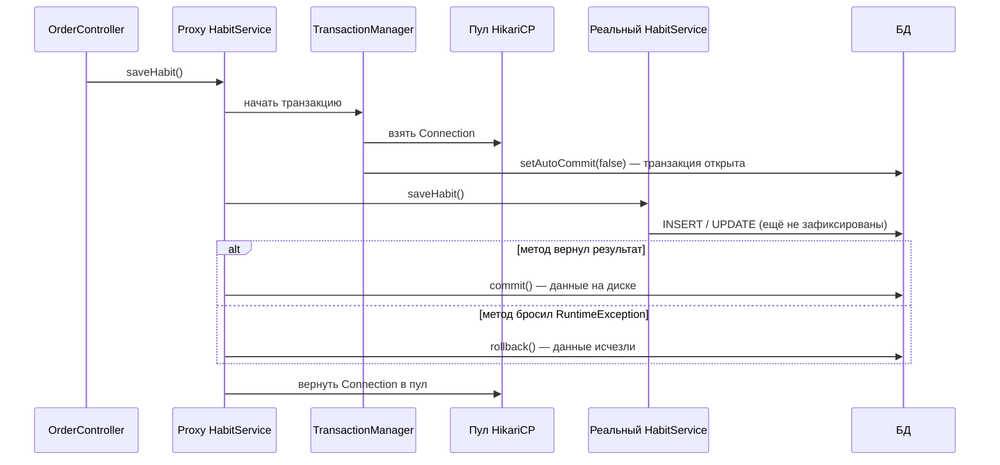
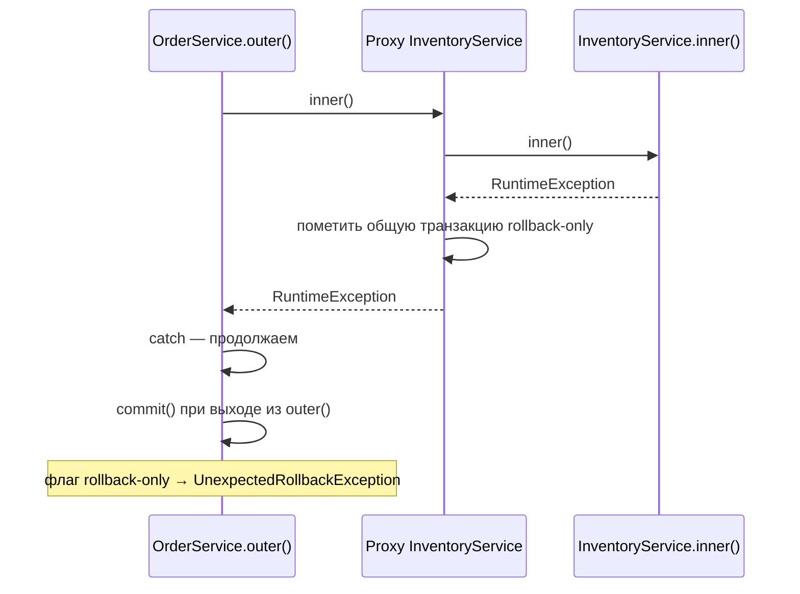
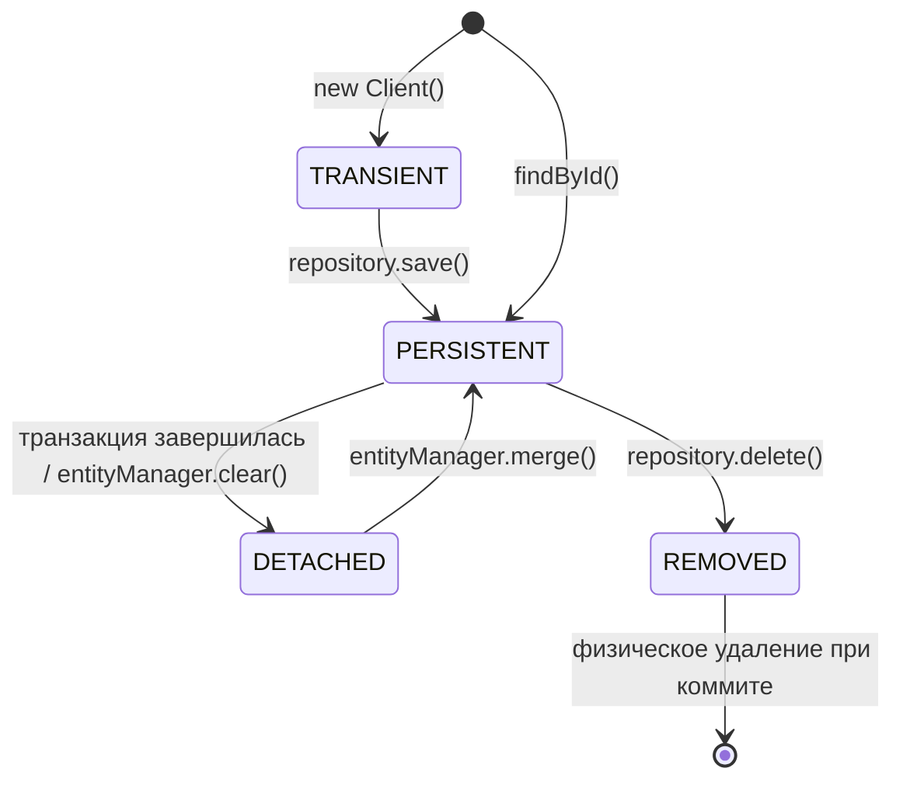

---
tags:
  - Junior
  - Middle
  - Senior
  - Spring
  - Базы данных
  - Транзакции
---

# Spring Data JPA и транзакции

Как Spring управляет транзакциями и что Hibernate делает с сущностями: `@Transactional`, propagation, блокировки, N+1, жизненный цикл Entity и кэши. На собесе чаще всего спрашивают, почему транзакция не откатилась, что будет при самовызове, разницу `REQUIRED`, `REQUIRES_NEW` и `NESTED`, оптимистичную и пессимистичную блокировку и проблему N+1.

## Как работает `@Transactional` { #transactional }

### Что происходит при вызове `@Transactional`-метода? { #transactional-flow }

**Уровень:** Middle

!!! abstract "Ответ вслух"
    `@Transactional` — AOP-аспект, реализованный через прокси (обычно CGLIB). Прокси через `TransactionManager` берёт соединение из пула, выключает auto-commit и вызывает реальный метод. Метод завершился успешно — `commit()`, бросил `RuntimeException` — `rollback()`, после чего соединение возвращается в пул.

Как устроены прокси, разобрано в [Spring Core → AOP и прокси](spring-core.md#aop). Здесь — что прокси делает с транзакцией, когда `OrderController` вызывает `habitService.saveHabit()`:



Вызов приходит не в реальный объект, а в прокси. Всё, что между `setAutoCommit(false)` и `commit()`, — одна транзакция на одном соединении.

!!! warning "Ловушка: соединение занято на всё время метода"
    Пока метод с `@Transactional` выполняется, он держит соединение из пула. Долгий HTTP-вызов внутри транзакции держит соединение всё это время — при нагрузке пул быстро заканчивается.

??? question "Проверь себя"
    1. Через какой механизм Spring реализует `@Transactional`?
    2. Откуда прокси берёт соединение и что с ним делает перед вызовом метода?
    3. Когда вызывается `commit()`, а когда — `rollback()`?

### При каких исключениях Spring откатывает транзакцию? { #rollback-rules }

**Уровень:** Junior

!!! abstract "Ответ вслух"
    По умолчанию — только при `RuntimeException` и `Error`. Если метод бросит checked-исключение, например `IOException`, Spring закоммитит транзакцию. Чтобы откатывать на любое исключение, пишут `@Transactional(rollbackFor = Exception.class)`.

```java
// ❌ IOException не откатит транзакцию
@Transactional
public void save(Habit habit) throws IOException {
    habitRepository.save(habit);
    throw new IOException("упс"); // коммит всё равно произойдёт!
}

// ✅ Откат на любое исключение
@Transactional(rollbackFor = Exception.class)
public void save(Habit habit) throws IOException { ... }
```

Почему в Spring предпочитают unchecked-исключения — в [Исключения → Свои исключения](../java/exceptions.md#custom-exceptions).

!!! warning "Ловушка: checked-исключение коммитит транзакцию"
    `throws IOException` или `throws Exception` в сигнатуре не делают откат автоматическим. Без `rollbackFor` данные, записанные до исключения, будут зафиксированы.

??? question "Проверь себя"
    1. При каких исключениях Spring откатывает транзакцию по умолчанию?
    2. Что произойдёт с данными, если метод бросит `IOException`?
    3. Как включить откат для любого исключения?

### Чем опасен самовызов для транзакций? { #self-invocation-transactions }

**Уровень:** Middle

!!! abstract "Ответ вслух"
    При вызове `this.method()` прокси не участвует, поэтому `@Transactional` на вызываемом методе игнорируется. Для транзакций это значит, что Hibernate работает в режиме auto-commit и данные сохраняются кусками: часть бизнес-процесса записалась, часть упала — и ничего не откатилось.

Сам механизм самовызова и общие способы лечения разобраны в [Spring Core → Самовызов](spring-core.md#self-invocation). Здесь — последствия для данных.

```java
@Service
public class HabitService {

    // Контроллер вызывает этот метод — БЕЗ @Transactional
    public void createHabitWithNotification(Habit habit) {
        saveToDb(habit);    // внутренний вызов через this
        sendEmail(habit);   // бросит RuntimeException
    }

    @Transactional
    public void saveToDb(Habit habit) {
        habitRepository.save(habit);
    }

    private void sendEmail(Habit habit) {
        throw new RuntimeException("Почта сломалась!");
    }
}
```

Вопрос на собесе: _«Откатятся ли данные, если при отправке письма упадёт ошибка?»_

**Ответ: нет.** Транзакция вообще не откроется: привычка сохранится в базу, письмо не отправится — бизнес-процесс сломан. Контроллер вызывает `createHabitWithNotification()` через прокси, а над этим методом нет `@Transactional`, поэтому прокси просто пробрасывает вызов. Внутри реального объекта `this.saveToDb()` вызывается напрямую, никакого `setAutoCommit(false)` нет.

**Как лечить:**

- **Разнести по разным сервисам** — самый правильный, архитектурный способ: `HabitPersistenceService.saveToDb()` с `@Transactional`, вызов через его прокси.
- **Self-injection** — рабочий костыль: `@Autowired @Lazy private HabitService self`, вызов `self.saveToDb()`.
- **`TransactionTemplate`** — программное управление транзакцией, без прокси вовсе:

```java
@Service
public class HabitService {
    private final TransactionTemplate txTemplate;

    public void createHabitWithNotification(Habit habit) {
        txTemplate.execute(status -> {         // явно открываем транзакцию
            habitRepository.save(habit);
            return null;
        });
        sendEmail(habit);
    }
}
```

Код первых двух способов — в [Spring Core → Самовызов](spring-core.md#self-invocation).

!!! warning "Ловушка: propagation тоже работает только через прокси"
    Не только «открыть транзакцию», но и `REQUIRES_NEW`, `NESTED`, `rollbackFor` и любые другие настройки `@Transactional` применяет прокси. При вызове через `this` все они игнорируются — примеры ниже, в разделе [Propagation](#propagation).

??? question "Проверь себя"
    1. Откатится ли сохранение, если `saveToDb()` вызвать через `this`, а потом упадёт отправка письма?
    2. В каком режиме работает Hibernate, если транзакция не открылась?
    3. Как `TransactionTemplate` обходит проблему самовызова?

## Propagation: распространение транзакций { #propagation }

### Как работает `REQUIRED` и откуда берётся `UnexpectedRollbackException`? { #required }

**Уровень:** Senior

!!! abstract "Ответ вслух"
    `REQUIRED` — значение по умолчанию: есть внешняя транзакция — присоединяемся, нет — создаём новую. Транзакция одна, на одном соединении. Если внутренний метод упал, прокси помечает общую транзакцию как `rollback-only`, и даже если внешний метод поймал исключение, при попытке коммита Spring бросит `UnexpectedRollbackException`.

**Суть:** «Давай вместе». Под капотом **одно соединение (Connection)** к БД и один физический `commit()` в конце внешнего метода.

Внешний метод вызывает внутренний. Внутренний падает с ошибкой, но внешний оборачивает вызов в `try-catch` и пытается продолжить. Что будет?

```java
@Slf4j
@Service
@RequiredArgsConstructor
public class OrderService {
    private final InventoryService inventoryService; // другой бин → вызов пойдёт через его Proxy

    @Transactional
    public void outer() {
        try {
            inventoryService.inner(); // падает с RuntimeException
        } catch (Exception e) {
            log.error("поймал ошибку, продолжаю...");
        }
        // пытаемся дойти до конца и закоммитить
    }
}

@Service
public class InventoryService {

    @Transactional // REQUIRED — присоединяется к транзакции outer()
    public void inner() {
        throw new RuntimeException("упс");
    }
}
```



**Ответ:** приложение упадёт с `UnexpectedRollbackException`, потому что транзакция одна. Прокси `InventoryService` поймал исключение из `inner()` и пометил общую транзакцию флагом `rollback-only`. Внешний метод поймал ошибку в `catch`, дошёл до конца и попытался сделать `commit()` — Spring видит флаг («кто-то внутри уже забраковал эту транзакцию») и бросает исключение.

!!! warning "Ловушка: если `inner()` в том же классе"
    `inner()` вынесен в отдельный бин не случайно. Если бы `outer()` и `inner()` лежали в одном классе, вызов шёл бы через `this`, **минуя прокси** — это [самовызов](#self-invocation-transactions). `@Transactional` над `inner()` был бы проигнорирован, флаг `rollback-only` никто бы не поставил: исключение просто поймалось бы в `catch`, и `outer()` спокойно закоммитился бы без `UnexpectedRollbackException`.

??? question "Проверь себя"
    1. Сколько соединений и физических коммитов при `REQUIRED`?
    2. Почему внешний метод получает `UnexpectedRollbackException`, хотя поймал исключение?
    3. Что изменится, если `inner()` будет в том же классе, что и `outer()`?

### Когда нужен `REQUIRES_NEW`? { #requires-new }

**Уровень:** Middle

!!! abstract "Ответ вслух"
    Когда операция должна закоммититься независимо от внешней транзакции — например, запись аудита о попытке перевода, даже если сам перевод откатился. `REQUIRES_NEW` приостанавливает внешнюю транзакцию и открывает новую на втором соединении. Цена — два соединения на один запрос и риск исчерпания пула.

**Суть:** «Я сам по себе». Всегда создаёт новую транзакцию, внешняя ставится на паузу (suspend). Под капотом **два соединения** из пула: первое висит и ждёт, пока внутренний метод работает на втором.

**Бизнес-кейс:** аудит и логирование операций. Если основной бизнес-процесс (перевод денег) откатился, запись о **попытке** перевода всё равно должна закоммититься.

```java
@Transactional
public void transfer(Account from, Account to, BigDecimal amount) {
    debit(from, amount);  // может упасть
    credit(to, amount);
}

@Transactional(propagation = Propagation.REQUIRES_NEW) // независимая транзакция
public void logAudit(AuditEvent event) {
    auditRepository.save(event); // закоммитится даже если transfer() откатится
}
```

`logAudit()` должен вызываться через прокси другого бина — иначе это самовызов и `REQUIRES_NEW` будет проигнорирован.

!!! warning "Ловушка: исчерпание пула соединений (Connection Pool Exhaustion)"
    В пуле 10 соединений, пришло 10 одновременных запросов. Каждый держит одно соединение во внешней транзакции и просит второе для `REQUIRES_NEW`. Все 10 запросов ждут второе соединение, которого никогда не будет, — пул мёртв, дедлок.

??? question "Проверь себя"
    1. Сколько соединений использует `REQUIRES_NEW`?
    2. Для какого бизнес-кейса он подходит?
    3. Как `REQUIRES_NEW` может положить пул соединений?

### Чем `NESTED` отличается от `REQUIRES_NEW`? { #nested }

**Уровень:** Senior

!!! abstract "Ответ вслух"
    `NESTED` работает внутри внешней транзакции на том же соединении, но перед стартом ставит savepoint. Ошибка внутри откатывает только до savepoint, и внешняя транзакция живёт дальше; а если откатится внешняя — откатится и вложенная. `REQUIRES_NEW` же полностью независим и берёт второе соединение.

**Суть:** «С тобой, но с подстраховкой». Под капотом **одно соединение** и `connection.setSavepoint()` перед стартом внутреннего метода. При ошибке — `rollback` только до savepoint.

```java
@Slf4j
@Service
@RequiredArgsConstructor
public class OrderService {
    private final OrderRepository orderRepository;
    private final NotificationService notificationService; // отдельный бин

    @Transactional
    public void processOrder(Order order) {
        orderRepository.save(order);
        try {
            notificationService.sendNotification(order); // может упасть — но не сломает всё
        } catch (Exception e) {
            log.warn("Уведомление не отправлено, заказ всё равно сохранён");
        }
    }
}

@Service
@RequiredArgsConstructor
public class NotificationService {
    private final NotificationRepository notificationRepository;

    @Transactional(propagation = Propagation.NESTED)
    public void sendNotification(Order order) {
        // если упадёт — откат только до Savepoint, не весь processOrder
        notificationRepository.save(new Notification(order));
    }
}
```

| Propagation | Соединений к БД | Ошибка внутри | Откат внешней → внутренняя |
|---|---|---|---|
| **`REQUIRED`** | 1 (общее) | Ломает всю транзакцию | Откатываются обе |
| **`REQUIRES_NEW`** | 2 (независимые) | Внешняя выживает (при `try-catch`) | Не влияет (полная независимость) |
| **`NESTED`** | 1 + savepoint | Внешняя выживает (откат до savepoint) | Внутренняя тоже откатится |

!!! warning "Ловушка: `NESTED` через `this` не ставит savepoint"
    Savepoint ставит `TransactionInterceptor` в прокси бина `NotificationService`. Если оставить `sendNotification()` в `OrderService` и вызвать его как `this.sendNotification()`, прокси не участвует: `NESTED` игнорируется, savepoint не создаётся, и метод просто выполняется внутри транзакции `processOrder()`. То же касается `REQUIRES_NEW` и любых других настроек `@Transactional`.

??? question "Проверь себя"
    1. Что делает `NESTED` перед стартом внутреннего метода?
    2. Что будет с вложенной транзакцией, если откатится внешняя?
    3. Почему `sendNotification()` вынесен в отдельный бин?

### Какие ещё бывают типы propagation? { #other-propagation }

**Уровень:** Junior

!!! abstract "Ответ вслух"
    Кроме `REQUIRED`, `REQUIRES_NEW` и `NESTED` есть ещё четыре. `MANDATORY` требует готовую транзакцию, `NEVER` — её отсутствие; `SUPPORTS` работает в транзакции, если она есть, а `NOT_SUPPORTED` приостанавливает текущую и работает без неё.

- **`MANDATORY`** — ожидает готовую транзакцию. Нет транзакции → исключение.
- **`SUPPORTS`** — есть транзакция → работает в ней. Нет → работает без неё (auto-commit).
- **`NOT_SUPPORTED`** — приостанавливает текущую транзакцию и работает без неё.
- **`NEVER`** — если вызвали в контексте транзакции → исключение.

!!! warning "Ловушка: `SUPPORTS` не открывает транзакцию"
    Метод с `SUPPORTS`, вызванный без внешней транзакции, работает в auto-commit: каждый запрос коммитится сам, и откатить их вместе нельзя.

??? question "Проверь себя"
    1. Чем `MANDATORY` отличается от `NEVER`?
    2. Как ведёт себя `SUPPORTS` без внешней транзакции?
    3. Что делает `NOT_SUPPORTED` с текущей транзакцией?

## Изоляция и блокировки { #isolation-locking }

### Как задать уровень изоляции в Spring? { #isolation }

**Уровень:** Middle

!!! abstract "Ответ вслух"
    Через атрибут `isolation` у `@Transactional`, например `@Transactional(isolation = Isolation.REPEATABLE_READ)`. Значение по умолчанию `Isolation.DEFAULT` означает «использовать уровень, настроенный в самой БД». На практике жёсткие уровни изоляции поднимают редко, а конкуренцию за строки решают блокировками JPA.

Аномалии чтения, уровни изоляции, особенности PostgreSQL и цена `SERIALIZABLE` разобраны в [SQL → Уровни изоляции](../database/sql.md#isolation-levels). Здесь — только то, что относится к Spring.

```java
@Service
public class ReportService {

    @Transactional(isolation = Isolation.REPEATABLE_READ) // явно задать уровень
    public Report buildMonthlyReport() { ... }

    @Transactional // isolation = Isolation.DEFAULT — уровень из настроек БД
    public void saveReport(Report report) { ... }
}
```

Вместо жёстких уровней изоляции в Enterprise чаще используют блокировки Hibernate — [оптимистичную](#optimistic-locking) и [пессимистичную](#pessimistic-locking).

!!! warning "Ловушка: `READ_UNCOMMITTED` в PostgreSQL"
    Spring передаст уровень в БД как есть, но Postgres не поддерживает `READ_UNCOMMITTED` и молча работает на `READ_COMMITTED`. Что именно гарантирует уровень, решает СУБД, а не Spring.

??? question "Проверь себя"
    1. Как задать уровень изоляции для метода?
    2. Что означает `Isolation.DEFAULT`?
    3. Чем в Enterprise обычно заменяют высокие уровни изоляции?

### Как работает оптимистичная блокировка? { #optimistic-locking }

**Уровень:** Middle

!!! abstract "Ответ вслух"
    В Entity добавляют поле `@Version`, и Hibernate дописывает проверку версии в `WHERE` каждого `UPDATE`. Если другая транзакция уже обновила строку, `UPDATE` затронет 0 строк, и Hibernate бросит `OptimisticLockException`. Блокировок в БД нет — подходит, когда конфликты редки, а читают много.

**Девиз:** «Я верю, что конфликтов не будет. Если возникнут — разберёмся по факту». Никаких реальных блокировок на уровне БД.

```java
@Entity
public class Habit {
    @Id
    private Long id;

    private String name;

    @Version  // Hibernate управляет этим полем сам
    private Integer version;
}
```

При `UPDATE` Hibernate добавляет проверку версии в SQL:

```sql
UPDATE habit SET name = 'Бег', version = 2 WHERE id = 1 AND version = 1;
-- Если другая транзакция уже обновила запись (version стал 2),
-- WHERE не найдёт строку → 0 updated rows → OptimisticLockException
```

**Когда использовать:** вероятность коллизий **низкая**, но читают много.

_Пример:_ CRM с календарём записей. Администратор и клиент одновременно бронируют одно окошко: шанс коллизии мал, но возможен, а блокировать всю строку — замедлить систему. Второй получит `OptimisticLockException`, мы поймаем его и покажем: «Это время только что заняли, выберите другое».

!!! warning "Ловушка: исключение нужно обработать"
    Оптимистичная блокировка не предотвращает конфликт, а обнаруживает его. Если не поймать `OptimisticLockException` и не сделать повтор или понятное сообщение, пользователь получит 500.

??? question "Проверь себя"
    1. Что Hibernate добавляет в `UPDATE` при наличии `@Version`?
    2. Что происходит, если версия уже изменилась?
    3. В каких сценариях выбирают оптимистичную блокировку?

### Как работает пессимистичная блокировка? { #pessimistic-locking }

**Уровень:** Middle

!!! abstract "Ответ вслух"
    Это реальная блокировка строки в СУБД: `@Lock(PESSIMISTIC_WRITE)` превращается в `SELECT ... FOR UPDATE`, и другие транзакции с `FOR UPDATE` ждут, пока первая не закончит. Выбирают, когда конфликты частые, а цена ошибки высокая — например, списания с одного счёта.

**Девиз:** «Никому не доверяю. Пока я работаю с данными — никто не прикоснётся».

```java
public interface HabitRepository extends JpaRepository<Habit, Long> {

    @Lock(LockModeType.PESSIMISTIC_WRITE)
    @Query("SELECT h FROM Habit h WHERE h.id = :id")
    Optional<Habit> findByIdForUpdate(@Param("id") Long id);
}
```

Hibernate генерирует:

```sql
SELECT * FROM habit WHERE id = 1 FOR UPDATE;
-- Строка заблокирована. Другие транзакции с FOR UPDATE зависнут и будут ждать.
```

**Когда использовать:** вероятность коллизий **высокая**, цена ошибки критична.

_Пример:_ банковский перевод. У пользователя 10 000 тенге, одновременно списываются платёж по кредиту, подписка и перевод другу. Оптимистичная блокировка с бесконечными повторами положит платёжный шлюз, а `SELECT FOR UPDATE` выстроит транзакции в строгую очередь — каждая работает с актуальным остатком.

| | **Optimistic** | **Pessimistic** |
|---|---|---|
| **Блокировка в БД** | Нет | Да (`SELECT FOR UPDATE`) |
| **Механизм** | `@Version` поле | `@Lock(PESSIMISTIC_WRITE)` |
| **При коллизии** | `OptimisticLockException` (retry) | Ожидание (hang) |
| **Производительность** | Высокая при низкой конкуренции | Деградирует при высокой конкуренции |
| **Когда** | Читаем много, пишем редко | Конкуренция высокая, цена ошибки критична |

!!! warning "Ловушка: блокировка живёт до конца транзакции"
    `FOR UPDATE` держит строку до коммита или отката. Если метод с такой выборкой ещё и ходит во внешние сервисы, все конкурирующие транзакции ждут его целиком.

??? question "Проверь себя"
    1. Во что превращается `@Lock(PESSIMISTIC_WRITE)`?
    2. Что происходит с другими транзакциями, которые хотят ту же строку?
    3. Почему для частых списаний со счёта пессимистичная блокировка лучше оптимистичной?

## Hibernate под капотом { #hibernate }

### Что такое проблема N+1 и как её решить? { #n-plus-one }

**Уровень:** Middle

!!! abstract "Ответ вслух"
    Один запрос загружает N родительских сущностей, а потом при обращении к ленивой связи Hibernate делает ещё по запросу на каждую — итого N+1. Лечится `JOIN FETCH` или `@EntityGraph`, которые грузят связь одним запросом, а когда JOIN невозможен — `@BatchSize`, который грузит связи пачками через `IN`.

```java
// У Client есть @OneToMany с Appointment (LAZY по умолчанию)
List<Client> clients = clientRepository.findAll(); // 1 SELECT — 10 клиентов

for (Client client : clients) {
    // ❌ На каждой итерации — отдельный SELECT в appointments!
    int count = client.getAppointments().size();
}
// Итого: 1 + 10 = 11 запросов. При 1000 клиентах — 1001 запрос. База ляжет.
```

**Способ 1 — `JOIN FETCH` (классика):**

```java
@Repository
public interface ClientRepository extends JpaRepository<Client, Long> {

    @Query("SELECT c FROM Client c JOIN FETCH c.appointments")
    List<Client> findAllWithAppointments();
    // Один SELECT с INNER JOIN — всё сразу
}
```

**Способ 2 — `@EntityGraph` (современный подход):**

```java
@EntityGraph(attributePaths = {"appointments"})
List<Client> findAll(); // для этого вызова связь становится EAGER, один JOIN
```

**Способ 3 — `@BatchSize` (когда JOIN невозможен):**

```java
@Entity
public class Client {
    @OneToMany
    @BatchSize(size = 50) // вместо 1000 запросов — 20 (батчи по 50)
    private List<Appointment> appointments;
}
// Hibernate использует IN (id1, id2, ..., id50) вместо отдельных запросов
```

!!! warning "Ловушка: несколько `JOIN FETCH` в одном запросе"
    При нескольких `JOIN FETCH` в одном запросе можно получить декартово произведение — огромный результат. В таком случае правильное решение — `@BatchSize`.

??? question "Проверь себя"
    1. Сколько запросов выполнится для 1000 клиентов с ленивой связью?
    2. Чем `@EntityGraph` отличается от `JOIN FETCH`?
    3. Когда `@BatchSize` лучше `JOIN FETCH`?

### Какие состояния бывают у Entity? { #entity-lifecycle }

**Уровень:** Middle

!!! abstract "Ответ вслух"
    Четыре: transient — Hibernate не знает об объекте; persistent — объект в Persistence Context, и изменения отслеживаются; detached — объект в памяти, но уже не под наблюдением; removed — запланирован к удалению при коммите. Detached-объект возвращают под наблюдение через `merge()`.



| Состояние | Где объект | Что с изменениями |
|---|---|---|
| **TRANSIENT** | Только в памяти, Hibernate о нём не знает | Не попадут в БД |
| **PERSISTENT** | В Persistence Context | Hibernate следит за изменениями |
| **DETACHED** | В памяти, но не под наблюдением | Не попадут в БД |
| **REMOVED** | Запланирован к удалению | Строка физически удалится при коммите |

!!! warning "Ловушка: изменения detached-объекта теряются"
    После конца транзакции объект становится detached. `setName()` на нём ничего не запишет в БД — сначала нужно вернуть его в Persistence Context через `merge()`.

??? question "Проверь себя"
    1. Как объект переходит из transient в persistent?
    2. Когда persistent-объект становится detached?
    3. Как вернуть detached-объект под наблюдение?

### Что такое dirty checking? { #dirty-checking }

**Уровень:** Middle

!!! abstract "Ответ вслух"
    Это механизм, которым Hibernate отслеживает изменения persistent-объектов. При коммите он сравнивает текущие поля с сохранённым снимком и сам генерирует `UPDATE` для изменённых сущностей. Поэтому внутри транзакции после `setName()` вызывать `save()` не нужно.

```java
@Transactional
public void updateName(Long id, String newName) {
    Client client = clientRepository.findById(id).get(); // PERSISTENT
    client.setName(newName); // просто меняем поле

    // ✅ НЕ нужно вызывать save()!
    // При коммите транзакции Hibernate сам увидит изменение
    // и сгенерирует UPDATE
}
```

!!! warning "Ловушка: dirty checking работает только в транзакции"
    Hibernate сравнивает снимки и генерирует `UPDATE` при flush и коммите транзакции. Без `@Transactional` на методе коммита, в котором это произошло бы, нет — изменения полей никуда не попадут.

??? question "Проверь себя"
    1. Нужно ли вызывать `save()` после изменения persistent-объекта?
    2. Когда Hibernate генерирует `UPDATE` при dirty checking?
    3. Почему без транзакции dirty checking не сработает?

### Чем `save()` отличается от `saveAndFlush()`? { #save-vs-saveandflush }

**Уровень:** Middle

!!! abstract "Ответ вслух"
    `save()` делает сущность persistent, но SQL может отложить до flush или коммита. `saveAndFlush()` сразу отправляет все накопленные `INSERT` и `UPDATE` в БД, но транзакцию не коммитит. ID есть уже после `save()`: при `IDENTITY` Hibernate выполняет `INSERT` сразу, при `SEQUENCE` берёт ID из `nextval`.

```java
@Transactional
public void example() {
    Habit habit = new Habit("Бег");
    habitRepository.save(habit); // для новой сущности это entityManager.persist()
    System.out.println(habit.getId()); // ID уже есть!
    // IDENTITY: Hibernate выполнил INSERT сразу — иначе БД не выдаст ID
    // SEQUENCE: Hibernate взял ID из последовательности (nextval),
    //           а сам INSERT отложен до flush / коммита

    habit.setName("Утренний бег");
    habitRepository.saveAndFlush(habit);
    // flush(): все накопленные INSERT/UPDATE отправлены в БД прямо сейчас
    // НО! Транзакция ещё не закоммичена.
    // Если метод упадёт ниже — rollback, данные исчезнут.
}
```

**Почему ID есть сразу после `save()`:** `persist()` обязан сделать сущность persistent, а Persistence Context хранит объекты по ID. Значит, ID нужен немедленно:

- **`GenerationType.IDENTITY`** (автоинкремент, `BIGSERIAL`) — ID знает только БД, поэтому Hibernate выполняет `INSERT` прямо внутри `save()`, не дожидаясь flush. Побочный эффект: JDBC-батчинг вставок для таких сущностей не работает.
- **`GenerationType.SEQUENCE`** — Hibernate делает `SELECT nextval(...)` (с `allocationSize` — один раз на пачку ID) и присваивает ID объекту. `INSERT` остаётся в очереди до flush, поэтому вставки можно батчить.

!!! tip "Когда нужен `saveAndFlush()`"
    Не ради `id` — он есть и после `save()`. `saveAndFlush()` нужен, когда SQL должен выполниться **до следующей строки кода**:

    - Нарушение ограничения (unique, FK) нужно поймать здесь и сейчас, а не при коммите за пределами метода.
    - На таблице висят триггеры, которые должны отработать немедленно.
    - Дальше код ходит в БД в обход Hibernate (`JdbcTemplate`, хранимая процедура) и должен увидеть изменения.

!!! warning "Ловушка: flush — не commit"
    После `saveAndFlush()` данные уже в БД, но транзакция открыта. Если метод упадёт ниже, будет rollback, и данные исчезнут.

??? question "Проверь себя"
    1. Почему ID доступен сразу после `save()`?
    2. Почему с `IDENTITY` не работает JDBC-батчинг вставок?
    3. В каких случаях действительно нужен `saveAndFlush()`?

### Чем кэш первого уровня отличается от второго? { #hibernate-cache }

**Уровень:** Middle

!!! abstract "Ответ вслух"
    Кэш первого уровня (L1) — это Persistence Context: он живёт в рамках одной транзакции, включён всегда и не отключается. Кэш второго уровня (L2) общий для всего приложения, по умолчанию выключен и требует внешнего провайдера. В микросервисах L2 используют редко — вместо него распределённый кэш через `@Cacheable`.

| | **L1 (Persistence Context)** | **L2 (Second-level Cache)** |
|---|---|---|
| **Область видимости** | Одна транзакция (EntityManager) | Всё приложение (SessionFactory) |
| **По умолчанию** | **Включён всегда**, нельзя отключить | Отключён |
| **Что кэширует** | Объекты в рамках транзакции | Объекты между транзакциями |
| **Реализация** | Встроено в Hibernate | Внешний провайдер (Ehcache, Hazelcast) |

```java
@Transactional
public void example() {
    Client c1 = clientRepository.findById(1L).orElseThrow(); // SELECT в БД
    Client c2 = clientRepository.findById(1L).orElseThrow(); // Из L1-кэша, SELECT нет!
    // c1 == c2 (один и тот же объект)
}
```

Встроенный L2-кэш Hibernate крайне редко используют в Enterprise-архитектуре. Вместо него — **Redis** через `@Cacheable` в Spring: прозрачный распределённый кэш, независимый от ORM. Как настроить `@Cacheable`, разобрано в [Инструменты → Кэширование](spring-tools.md#cacheable), а стратегии кэширования — в [System Design → Caching](../system-design/system-design.md#caching).

!!! warning "Ловушка: L2-кэш при нескольких инстансах"
    При нескольких инстансах микросервиса у каждого свой L2-кэш, и инвалидация между ними становится отдельной большой проблемой. Поэтому в распределённых системах кэш выносят наружу — в Redis.

??? question "Проверь себя"
    1. Можно ли отключить кэш первого уровня?
    2. Почему второй `findById(1L)` в той же транзакции не идёт в БД?
    3. Почему в микросервисах L2 заменяют на Redis?

## Шпаргалка { #cheatsheet }

<!-- --8<-- [start:cheatsheet] -->
| Тема | Запомнить |
|---|---|
| **`@Transactional`** | Прокси → `TransactionManager` → соединение из пула → `setAutoCommit(false)` → commit / rollback |
| **Rollback** | По умолчанию только на `RuntimeException` и `Error`. Для всего — `rollbackFor = Exception.class` |
| **Самовызов** | `this.method()` минует прокси → транзакция не откроется, данные сохраняются кусками. Решение: разные сервисы или `TransactionTemplate` |
| **`REQUIRED`** | 1 соединение, общая транзакция. Ошибка внутри + `catch` снаружи → `UnexpectedRollbackException` |
| **`REQUIRES_NEW`** | 2 соединения, независимые транзакции. Риск исчерпания пула |
| **`NESTED`** | 1 соединение + savepoint. Внутренняя откатывается независимо |
| **Isolation** | `@Transactional(isolation = ...)`, `DEFAULT` — уровень БД. Теория — в [SQL](../database/sql.md#isolation-levels) |
| **Optimistic Lock** | Поле `@Version`, без блокировки БД. Для низкой конкуренции |
| **Pessimistic Lock** | `SELECT FOR UPDATE`, физическая блокировка. Для критичных операций |
| **N+1** | `JOIN FETCH` → `@EntityGraph` → `@BatchSize` |
| **Состояния Entity** | Transient → Persistent → Detached / Removed; `merge()` возвращает detached |
| **Dirty Checking** | Persistent-объект: `setName()` без `save()` — `UPDATE` при коммите |
| **`save()` vs `saveAndFlush()`** | После `save()` ID уже есть (`IDENTITY` — `INSERT` сразу, `SEQUENCE` — `nextval`). `saveAndFlush()` — flush немедленно, но не коммитит |
| **L1 / L2 Cache** | L1 — транзакция, всегда включён. L2 в Enterprise заменяют на Redis + `@Cacheable` |

<!-- --8<-- [end:cheatsheet] -->
