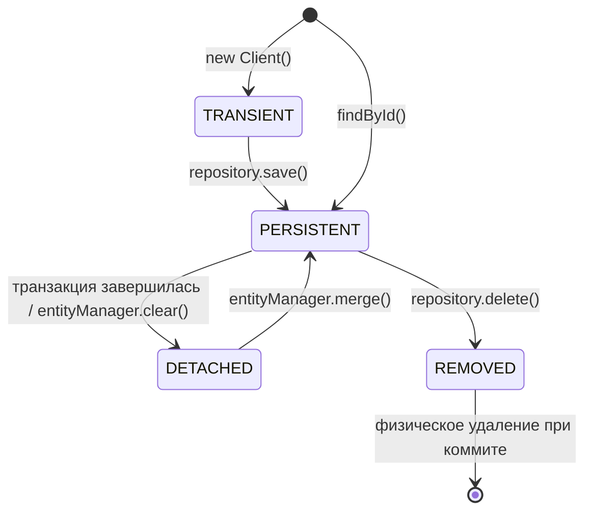

---
tags:
  - Middle
  - Spring
  - Базы данных
---

# Spring Data JPA и Hibernate

Что Hibernate делает с сущностями под Spring Data JPA: N+1, жизненный цикл Entity, dirty checking, `save()` против `saveAndFlush()` и кэши. На собесе чаще всего спрашивают проблему N+1 и как её решить, состояния Entity и почему изменения сохраняются без вызова `save()`. Транзакции — на странице [Транзакции в Spring](spring-transactions.md), блокировки `@Version` и `@Lock` — в [Блокировках и конкурентных обновлениях](../database/locking.md).

## Hibernate под капотом { #hibernate }

### Что такое проблема N+1 и как её решить? { #n-plus-one }

**Уровень:** Middle

!!! abstract "Ответ вслух"
    Один запрос загружает N родительских сущностей, а потом при обращении к ленивой связи Hibernate делает ещё по запросу на каждую — итого N+1. Лечится `JOIN FETCH` или `@EntityGraph`, которые грузят связь одним запросом, а когда JOIN невозможен — `@BatchSize`, который грузит связи пачками через `IN`.

```java
// У Client есть @OneToMany с Appointment (LAZY по умолчанию)
List<Client> clients = clientRepository.findAll(); // 1 SELECT — 10 клиентов

for (Client client : clients) {
    // ❌ На каждой итерации — отдельный SELECT в appointments!
    int count = client.getAppointments().size();
}
// Итого: 1 + 10 = 11 запросов. При 1000 клиентах — 1001 запрос. База ляжет.
```

**Способ 1 — `JOIN FETCH` (классика):**

```java
@Repository
public interface ClientRepository extends JpaRepository<Client, Long> {

    @Query("SELECT c FROM Client c JOIN FETCH c.appointments")
    List<Client> findAllWithAppointments();
    // Один SELECT с INNER JOIN — всё сразу
}
```

**Способ 2 — `@EntityGraph` (современный подход):**

```java
@EntityGraph(attributePaths = {"appointments"})
List<Client> findAll(); // для этого вызова связь становится EAGER, один JOIN
```

**Способ 3 — `@BatchSize` (когда JOIN невозможен):**

```java
@Entity
public class Client {
    @OneToMany
    @BatchSize(size = 50) // вместо 1000 запросов — 20 (батчи по 50)
    private List<Appointment> appointments;
}
// Hibernate использует IN (id1, id2, ..., id50) вместо отдельных запросов
```

!!! warning "Ловушка: несколько `JOIN FETCH` в одном запросе"
    При нескольких `JOIN FETCH` в одном запросе можно получить декартово произведение — огромный результат. В таком случае правильное решение — `@BatchSize`.

??? question "Проверь себя"
    1. Сколько запросов выполнится для 1000 клиентов с ленивой связью?
    2. Чем `@EntityGraph` отличается от `JOIN FETCH`?
    3. Когда `@BatchSize` лучше `JOIN FETCH`?

### Какие состояния бывают у Entity? { #entity-lifecycle }

**Уровень:** Middle

!!! abstract "Ответ вслух"
    Четыре: transient — Hibernate не знает об объекте; persistent — объект в Persistence Context, и изменения отслеживаются; detached — объект в памяти, но уже не под наблюдением; removed — запланирован к удалению при коммите. Detached-объект возвращают под наблюдение через `merge()`.



| Состояние | Где объект | Что с изменениями |
|---|---|---|
| **TRANSIENT** | Только в памяти, Hibernate о нём не знает | Не попадут в БД |
| **PERSISTENT** | В Persistence Context | Hibernate следит за изменениями |
| **DETACHED** | В памяти, но не под наблюдением | Не попадут в БД |
| **REMOVED** | Запланирован к удалению | Строка физически удалится при коммите |

!!! warning "Ловушка: изменения detached-объекта теряются"
    После конца транзакции объект становится detached. `setName()` на нём ничего не запишет в БД — сначала нужно вернуть его в Persistence Context через `merge()`.

??? question "Проверь себя"
    1. Как объект переходит из transient в persistent?
    2. Когда persistent-объект становится detached?
    3. Как вернуть detached-объект под наблюдение?

### Что такое dirty checking? { #dirty-checking }

**Уровень:** Middle

!!! abstract "Ответ вслух"
    Это механизм, которым Hibernate отслеживает изменения persistent-объектов. При коммите он сравнивает текущие поля с сохранённым снимком и сам генерирует `UPDATE` для изменённых сущностей. Поэтому внутри транзакции после `setName()` вызывать `save()` не нужно.

```java
@Transactional
public void updateName(Long id, String newName) {
    Client client = clientRepository.findById(id).get(); // PERSISTENT
    client.setName(newName); // просто меняем поле

    // ✅ НЕ нужно вызывать save()!
    // При коммите транзакции Hibernate сам увидит изменение
    // и сгенерирует UPDATE
}
```

!!! warning "Ловушка: dirty checking работает только в транзакции"
    Hibernate сравнивает снимки и генерирует `UPDATE` при flush и коммите транзакции. Без `@Transactional` на методе коммита, в котором это произошло бы, нет — изменения полей никуда не попадут.

??? question "Проверь себя"
    1. Нужно ли вызывать `save()` после изменения persistent-объекта?
    2. Когда Hibernate генерирует `UPDATE` при dirty checking?
    3. Почему без транзакции dirty checking не сработает?

### Чем `save()` отличается от `saveAndFlush()`? { #save-vs-saveandflush }

**Уровень:** Middle

!!! abstract "Ответ вслух"
    `save()` делает сущность persistent, но SQL может отложить до flush или коммита. `saveAndFlush()` сразу отправляет все накопленные `INSERT` и `UPDATE` в БД, но транзакцию не коммитит. ID есть уже после `save()`: при `IDENTITY` Hibernate выполняет `INSERT` сразу, при `SEQUENCE` берёт ID из `nextval`.

```java
@Transactional
public void example() {
    Habit habit = new Habit("Бег");
    habitRepository.save(habit); // для новой сущности это entityManager.persist()
    System.out.println(habit.getId()); // ID уже есть!
    // IDENTITY: Hibernate выполнил INSERT сразу — иначе БД не выдаст ID
    // SEQUENCE: Hibernate взял ID из последовательности (nextval),
    //           а сам INSERT отложен до flush / коммита

    habit.setName("Утренний бег");
    habitRepository.saveAndFlush(habit);
    // flush(): все накопленные INSERT/UPDATE отправлены в БД прямо сейчас
    // НО! Транзакция ещё не закоммичена.
    // Если метод упадёт ниже — rollback, данные исчезнут.
}
```

**Почему ID есть сразу после `save()`:** `persist()` обязан сделать сущность persistent, а Persistence Context хранит объекты по ID. Значит, ID нужен немедленно:

- **`GenerationType.IDENTITY`** (автоинкремент, `BIGSERIAL`) — ID знает только БД, поэтому Hibernate выполняет `INSERT` прямо внутри `save()`, не дожидаясь flush. Побочный эффект: JDBC-батчинг вставок для таких сущностей не работает.
- **`GenerationType.SEQUENCE`** — Hibernate делает `SELECT nextval(...)` (с `allocationSize` — один раз на пачку ID) и присваивает ID объекту. `INSERT` остаётся в очереди до flush, поэтому вставки можно батчить.

!!! tip "Когда нужен `saveAndFlush()`"
    Не ради `id` — он есть и после `save()`. `saveAndFlush()` нужен, когда SQL должен выполниться **до следующей строки кода**:

    - Нарушение ограничения (unique, FK) нужно поймать здесь и сейчас, а не при коммите за пределами метода.
    - На таблице висят триггеры, которые должны отработать немедленно.
    - Дальше код ходит в БД в обход Hibernate (`JdbcTemplate`, хранимая процедура) и должен увидеть изменения.

!!! warning "Ловушка: flush — не commit"
    После `saveAndFlush()` данные уже в БД, но транзакция открыта. Если метод упадёт ниже, будет rollback, и данные исчезнут.

??? question "Проверь себя"
    1. Почему ID доступен сразу после `save()`?
    2. Почему с `IDENTITY` не работает JDBC-батчинг вставок?
    3. В каких случаях действительно нужен `saveAndFlush()`?

### Чем кэш первого уровня отличается от второго? { #hibernate-cache }

**Уровень:** Middle

!!! abstract "Ответ вслух"
    Кэш первого уровня (L1) — это Persistence Context: он живёт в рамках одной транзакции, включён всегда и не отключается. Кэш второго уровня (L2) общий для всего приложения, по умолчанию выключен и требует внешнего провайдера. В микросервисах L2 используют редко — вместо него распределённый кэш через `@Cacheable`.

| | **L1 (Persistence Context)** | **L2 (Second-level Cache)** |
|---|---|---|
| **Область видимости** | Одна транзакция (EntityManager) | Всё приложение (SessionFactory) |
| **По умолчанию** | **Включён всегда**, нельзя отключить | Отключён |
| **Что кэширует** | Объекты в рамках транзакции | Объекты между транзакциями |
| **Реализация** | Встроено в Hibernate | Внешний провайдер (Ehcache, Hazelcast) |

```java
@Transactional
public void example() {
    Client c1 = clientRepository.findById(1L).orElseThrow(); // SELECT в БД
    Client c2 = clientRepository.findById(1L).orElseThrow(); // Из L1-кэша, SELECT нет!
    // c1 == c2 (один и тот же объект)
}
```

Встроенный L2-кэш Hibernate крайне редко используют в Enterprise-архитектуре. Вместо него — **Redis** через `@Cacheable` в Spring: прозрачный распределённый кэш, независимый от ORM. Как настроить `@Cacheable`, разобрано в [Кэширование → `@Cacheable`](spring-caching.md#cacheable), а стратегии кэширования — в [Строительные блоки → Caching](../system-design/building-blocks.md#caching).

!!! warning "Ловушка: L2-кэш при нескольких инстансах"
    При нескольких инстансах микросервиса у каждого свой L2-кэш, и инвалидация между ними становится отдельной большой проблемой. Поэтому в распределённых системах кэш выносят наружу — в Redis.

??? question "Проверь себя"
    1. Можно ли отключить кэш первого уровня?
    2. Почему второй `findById(1L)` в той же транзакции не идёт в БД?
    3. Почему в микросервисах L2 заменяют на Redis?

## Шпаргалка { #cheatsheet }

<!-- --8<-- [start:cheatsheet] -->
| Тема | Запомнить |
|---|---|
| **N+1** | `JOIN FETCH` → `@EntityGraph` → `@BatchSize` |
| **Состояния Entity** | Transient → Persistent → Detached / Removed; `merge()` возвращает detached |
| **Dirty Checking** | Persistent-объект: `setName()` без `save()` — `UPDATE` при коммите |
| **`save()` vs `saveAndFlush()`** | После `save()` ID уже есть (`IDENTITY` — `INSERT` сразу, `SEQUENCE` — `nextval`). `saveAndFlush()` — flush немедленно, но не коммитит |
| **L1 / L2 Cache** | L1 — транзакция, всегда включён. L2 в Enterprise заменяют на Redis + `@Cacheable` |

<!-- --8<-- [end:cheatsheet] -->
