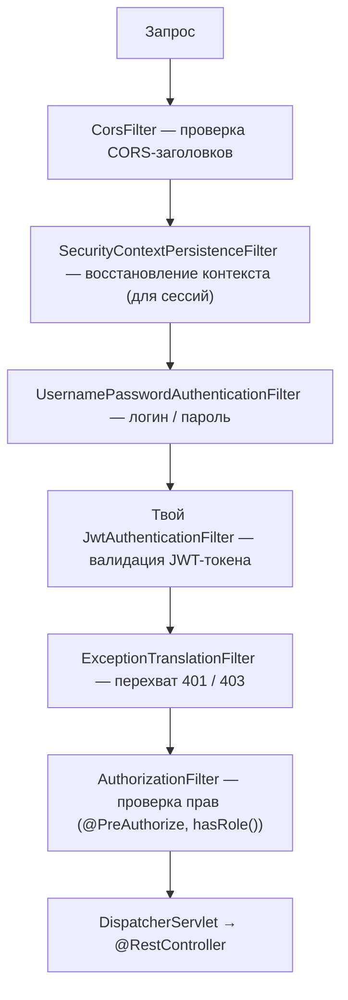

---
tags:
  - Middle
  - Senior
  - Spring
  - Безопасность
  - Kafka
  - Архитектура
---

# Spring: экосистема и архитектура

Spring Security, Spring Kafka и место Spring в гексагональной архитектуре. На собесе чаще всего спрашивают, как устроена цепочка фильтров Security, как работает JWT и почему его нельзя отозвать, как настроить `@KafkaListener` и куда ставить `@Transactional`, если домен не знает про Spring.

## Spring Security { #security }

### Как устроен Spring Security? { #security-filter-chain }

**Уровень:** Middle

!!! abstract "Ответ вслух"
    Spring Security — не монолитный блок, а `SecurityFilterChain`: цепочка сервлет-фильтров, каждый из которых решает одну задачу. Один проверяет CORS, другой ищет JWT-токен, третий проверяет права, четвёртый превращает ошибки в 401 и 403. Всё это происходит до `DispatcherServlet`.



Почему фильтры, а не интерсепторы, и чем они отличаются, — в [Spring MVC → Filter vs Interceptor](spring-mvc.md#filter-vs-interceptor).

!!! warning "Ловушка: «Security работает на интерсепторах»"
    Нет: Spring Security — это `FilterChainProxy` и цепочка **фильтров**. Он отбивает запрос ещё до того, как `DispatcherServlet` начнёт работу.

??? question "Проверь себя"
    1. Что такое `SecurityFilterChain`?
    2. Какой фильтр превращает ошибки безопасности в 401 и 403?
    3. Срабатывает Security до или после `DispatcherServlet`?

### Как проходит аутентификация? { #authentication }

**Уровень:** Middle

!!! abstract "Ответ вслух"
    Фильтр создаёт черновик `Authentication` с логином и паролем и передаёт его `AuthenticationManager`. Тот опрашивает `AuthenticationProvider`-ы: провайдер грузит пользователя через `UserDetailsService` и сверяет пароль через `PasswordEncoder`. Подтверждённый `Authentication` с ролями кладётся в `SecurityContextHolder` — `ThreadLocal`-хранилище текущего потока.

Аутентификация отвечает на вопрос «Кто ты?».

```java
// Пользователь прислал логин и пароль:
// 1. UsernamePasswordAuthenticationFilter создаёт черновик Authentication
// 2. Передаёт AuthenticationManager
// 3. Manager опрашивает провайдеров:

@Component
public class CustomAuthProvider implements AuthenticationProvider {

    private final UserDetailsService userDetailsService;
    private final PasswordEncoder passwordEncoder;

    @Override
    public Authentication authenticate(Authentication auth) throws AuthenticationException {
        String username = auth.getName();
        String rawPassword = auth.getCredentials().toString();

        UserDetails user = userDetailsService.loadUserByUsername(username);
        // UserDetailsService идёт в БД и возвращает UserDetails

        if (!passwordEncoder.matches(rawPassword, user.getPassword())) {
            throw new BadCredentialsException("Неверный пароль");
        }

        // Возвращаем подтверждённый Authentication с ролями
        return new UsernamePasswordAuthenticationToken(user, null, user.getAuthorities());
    }

    @Override
    public boolean supports(Class<?> authClass) {
        return UsernamePasswordAuthenticationToken.class.isAssignableFrom(authClass);
    }
}
```

При успехе подтверждённый `Authentication` кладётся в **`SecurityContextHolder`** — `ThreadLocal`-хранилище, доступное из любой точки приложения в текущем потоке.

```java
// Получить текущего пользователя из любого места кода
SecurityContext ctx = SecurityContextHolder.getContext();
Authentication auth = ctx.getAuthentication();
String username = auth.getName();
Collection<? extends GrantedAuthority> roles = auth.getAuthorities();
```

!!! warning "Ловушка: `SecurityContextHolder` привязан к потоку"
    Это `ThreadLocal`, поэтому в другом потоке контекста нет. Как это ломает `@Async` и `CompletableFuture`, — в [теме про асинхронность](#security-context-async).

??? question "Проверь себя"
    1. Кто сверяет пароль при аутентификации?
    2. Что делает `UserDetailsService`?
    3. Где хранится подтверждённый `Authentication`?

### Как настроить авторизацию? { #authorization }

**Уровень:** Junior

!!! abstract "Ответ вслух"
    Авторизация отвечает на вопрос «Что тебе можно?». Правила по URL задают в бине `SecurityFilterChain` через `authorizeHttpRequests`, а правила на уровне метода — через `@PreAuthorize` после `@EnableMethodSecurity`. Нет аутентификации — 401 Unauthorized, нет прав — 403 Forbidden.

```java
@Configuration
@EnableWebSecurity
@EnableMethodSecurity  // включает @PreAuthorize, @PostAuthorize
public class SecurityConfig {

    @Bean
    public SecurityFilterChain filterChain(HttpSecurity http) throws Exception {
        return http
            .csrf(AbstractHttpConfigurer::disable)  // для REST API
            .sessionManagement(s -> s.sessionCreationPolicy(STATELESS))  // без сессий
            .authorizeHttpRequests(auth -> auth
                .requestMatchers("/api/auth/**").permitAll()         // открытые эндпоинты
                .requestMatchers("/api/admin/**").hasRole("ADMIN")   // только ADMIN
                .requestMatchers(HttpMethod.GET, "/api/**").hasAnyRole("USER", "ADMIN")
                .anyRequest().authenticated()                        // всё остальное — аутентифицированным
            )
            .addFilterBefore(jwtFilter, UsernamePasswordAuthenticationFilter.class)
            .exceptionHandling(ex -> ex
                .authenticationEntryPoint(/* 401 handler */)
                .accessDeniedHandler(/* 403 handler */)
            )
            .build();
    }
}

// Авторизация на уровне метода
@RestController
public class AdminController {

    @GetMapping("/api/admin/users")
    @PreAuthorize("hasRole('ADMIN')")
    public List<UserDto> getAllUsers() { ... }

    @DeleteMapping("/api/habits/{id}")
    @PreAuthorize("#id == authentication.principal.id or hasRole('ADMIN')")
    public void delete(@PathVariable Long id) { ... } // владелец или ADMIN
}
```

При отказе:

- Нет аутентификации → `AuthenticationException` → **401 Unauthorized**.
- Нет прав → `AccessDeniedException` → **403 Forbidden**.

!!! warning "Ловушка: 401 и 403 путают"
    401 значит «я не знаю, кто ты» — нет или невалиден токен. 403 значит «я знаю, кто ты, но тебе нельзя» — не хватает роли.

??? question "Проверь себя"
    1. Что включает `@EnableMethodSecurity`?
    2. Как открыть `/api/auth/**` для всех?
    3. Когда возвращается 401, а когда 403?

### Как встроить JWT в Spring Security? { #jwt-filter }

**Уровень:** Middle

!!! abstract "Ответ вслух"
    Пишут свой фильтр на базе `OncePerRequestFilter` и ставят его перед `UsernamePasswordAuthenticationFilter`. Фильтр достаёт токен из заголовка `Authorization: Bearer`, проверяет подпись и срок, берёт имя и роли из claims без похода в БД и кладёт собранный `Authentication` в `SecurityContextHolder`.

```java
@Component
public class JwtAuthenticationFilter extends OncePerRequestFilter {

    private final JwtService jwtService;
    private final UserDetailsService userDetailsService;

    @Override
    protected void doFilterInternal(HttpServletRequest request,
                                    HttpServletResponse response,
                                    FilterChain chain) throws ServletException, IOException {

        // 1. Извлечь токен из заголовка
        String header = request.getHeader("Authorization");
        if (header == null || !header.startsWith("Bearer ")) {
            chain.doFilter(request, response);
            return;
        }

        String token = header.substring(7);

        // 2. Валидировать подпись и срок действия
        if (!jwtService.isValid(token)) {
            chain.doFilter(request, response);
            return;
        }

        // 3. Достать данные из claims — БЕЗ ПОХОДА В БД!
        String username = jwtService.extractUsername(token);
        List<String> roles = jwtService.extractRoles(token);

        // 4. Собрать Authentication и положить в контекст
        var authorities = roles.stream()
            .map(SimpleGrantedAuthority::new)
            .collect(toList());

        var auth = new UsernamePasswordAuthenticationToken(username, null, authorities);
        auth.setDetails(new WebAuthenticationDetailsSource().buildDetails(request));
        SecurityContextHolder.getContext().setAuthentication(auth);

        chain.doFilter(request, response);
        // Контроллеры думают, что юзер аутентифицирован стандартным способом
    }
}
```

Это stateless-подход для REST API: сервер не хранит сессию, всё нужное лежит в самом токене.

!!! warning "Ловушка: невалидный токен — не повод отвечать здесь"
    При отсутствии или невалидности токена фильтр не пишет ответ сам, а просто передаёт запрос дальше без `Authentication`. Отказ (401) сформирует `ExceptionTranslationFilter`, когда `AuthorizationFilter` увидит неаутентифицированный запрос к защищённому URL.

??? question "Проверь себя"
    1. Перед каким фильтром ставят JWT-фильтр?
    2. Почему JWT-фильтру не нужно ходить в БД?
    3. Что фильтр делает, если токена нет?

### Почему теряется `SecurityContext` в асинхронном коде? { #security-context-async }

**Уровень:** Senior

!!! abstract "Ответ вслух"
    `SecurityContextHolder` хранит данные в `ThreadLocal`, привязанном к потоку Tomcat. Новый поток из `@Async` или `CompletableFuture` про него ничего не знает, и `getAuthentication()` вернёт `null`. Решение — обернуть пул потоков в `DelegatingSecurityContextExecutorService`, который переносит контекст в дочерние потоки.

```java
// ❌ Контекст потеряется
CompletableFuture.runAsync(() -> {
    SecurityContextHolder.getContext().getAuthentication(); // null!
});

// ✅ DelegatingSecurityContextExecutor прокидывает контекст в дочерние потоки
@Bean
public Executor securityAwareExecutor() {
    return new DelegatingSecurityContextExecutorService(
        Executors.newFixedThreadPool(10)
    );
}
```

!!! warning "Ловушка: `runAsync` без своего executor"
    `CompletableFuture.runAsync()` без второго аргумента выполняет задачу в общем `ForkJoinPool`, а не в твоём обёрнутом пуле. Чтобы контекст перенёсся, executor нужно передать явно.

??? question "Проверь себя"
    1. Почему в `@Async`-методе `getAuthentication()` возвращает `null`?
    2. Как перенести контекст безопасности в дочерний поток?
    3. Где по умолчанию выполняется `CompletableFuture.runAsync()`?

### Как сделать logout, если используется JWT? { #jwt-logout }

**Уровень:** Senior

!!! abstract "Ответ вслух"
    Напрямую инвалидировать JWT нельзя: он проверяется математически, без обращения к хранилищу. Поэтому делают короткоживущий access token на 5–15 минут и долгоживущий refresh token в БД или Redis; при логауте удаляют refresh token, а access сам истекает. В критичных системах добавляют blacklist отозванных токенов в Redis.

Вопрос на собесе: _«Как реализовать logout, если мы используем JWT?»_

- **Short-lived Access Token (5–15 мин)** + **Long-lived Refresh Token** в БД/Redis.
- При логауте удаляем refresh token из хранилища. Access token сам истечёт.
- В критичных системах (финтех) — **blacklist в Redis**: JWT-фильтр при каждом запросе проверяет, не отозван ли токен.

```java
// JWT-фильтр с проверкой blacklist
if (redisBlacklist.contains(token)) {
    response.setStatus(HttpStatus.UNAUTHORIZED.value());
    return;
}
```

!!! warning "Ловушка: долгоживущий access token"
    Главный минус JWT — его нельзя отозвать. Чем дольше живёт access token, тем дольше украденный или «разлогиненный» токен остаётся рабочим.

??? question "Проверь себя"
    1. Почему JWT нельзя инвалидировать напрямую?
    2. Что удаляют при логауте в схеме access + refresh?
    3. Зачем нужен blacklist в Redis и какова его цена?

## Spring Kafka { #spring-kafka }

Физика Kafka, группы потребителей и гарантии доставки разобраны в разделе Kafka: [брокер](../kafka/kafka.md), [Consumer и Producer](../kafka/kafka-consumer-producer.md), [надёжность](../kafka/kafka-reliability.md). Здесь — только настройка `@KafkaListener` в Spring.

### Как работает `@KafkaListener`? { #kafka-listener }

**Уровень:** Middle

!!! abstract "Ответ вслух"
    `@KafkaListener` — обёртка над бесконечным циклом `consumer.poll()`. Spring находит аннотацию на бине и просит `ConcurrentKafkaListenerContainerFactory` создать контейнер с рабочими потоками; параметр `concurrency` задаёт число потоков-консьюмеров. Метод получает уже десериализованное сообщение и, при ручном коммите, объект `Acknowledgment`.

`@KafkaListener` — это `while (true) { consumer.poll(...) }`, который пишет за тебя Spring. Он сканирует бины, находит аннотацию и просит `ConcurrentKafkaListenerContainerFactory` создать рабочий поток (или несколько, если `concurrency > 1`).

```java
@Component
public class HabitEventConsumer {

    @KafkaListener(
        topics = "habit-created",
        groupId = "notification-service",
        concurrency = "3"   // 3 потока-консюмера для этого топика
    )
    public void consume(HabitCreatedEvent event, Acknowledgment ack) {
        try {
            notificationService.sendReminder(event);
            ack.acknowledge(); // коммитим оффсет только после успешной обработки
        } catch (Exception e) {
            log.error("Ошибка обработки события", e);
            // не вызываем ack → при рестарте сообщение придёт снова
        }
    }
}
```

!!! warning "Ловушка: `concurrency` больше числа партиций"
    Одну партицию в группе читает только один консьюмер. Если `concurrency = 3`, а у топика 2 партиции, третий поток будет простаивать (см. [Consumer Groups](../kafka/kafka-consumer-producer.md)).

??? question "Проверь себя"
    1. Что скрывается за `@KafkaListener`?
    2. Что задаёт параметр `concurrency`?
    3. Когда в листенере вызывают `ack.acknowledge()`?

### Как настроить коммит оффсетов и обработку ошибок листенера? { #listener-config }

**Уровень:** Middle

!!! abstract "Ответ вслух"
    Для бизнес-данных выключают авто-коммит (`enable-auto-commit: false`) и ставят `ack-mode: MANUAL`, чтобы оффсет коммитился вызовом `ack.acknowledge()` только после успешной обработки. Ошибки листенера обрабатывает бин `DefaultErrorHandler`: повторы с backoff, а затем перекладывание в DLQ. Долгую работу из потока листенера выносят, чтобы не превысить `max.poll.interval.ms`.

```yaml
# application.yml — правильная настройка
spring:
  kafka:
    consumer:
      enable-auto-commit: false
      auto-offset-reset: earliest
    listener:
      ack-mode: MANUAL  # коммитим только вручную через ack.acknowledge()
```

Где разобрано подробно:

- **Почему авто-коммит теряет сообщения**, чем `MANUAL` отличается от `MANUAL_IMMEDIATE` и что даёт at-least-once — в [Гарантии доставки → Управление оффсетами](../kafka/kafka-reliability.md#offset-commit).
- **Идемпотентность консьюмера** — дубли при at-least-once неизбежны — в [Гарантии доставки → Идемпотентность](../kafka/kafka-reliability.md#idempotent-consumer).
- **Retry и DLQ** через `DefaultErrorHandler` и `DeadLetterPublishingRecoverer` — в [Гарантии доставки → DLQ](../kafka/kafka-reliability.md#dlq).
- **`max.poll.interval.ms` и ребаланс** при зависшем листенере — в [Consumer и Producer → Два пульса](../kafka/kafka-consumer-producer.md#heartbeats).

!!! warning "Ловушка: долгая синхронная работа в листенере"
    Если листенер завис на внешнем вызове дольше `max.poll.interval.ms` (по умолчанию 5 минут), брокер сочтёт консьюмер мёртвым и запустит ребаланс. Долгие задачи выносят в отдельный пул потоков и ставят таймауты на внешние вызовы.

??? question "Проверь себя"
    1. Какие две настройки включают ручной коммит в Spring Kafka?
    2. Какой бин отвечает за повторы и DLQ?
    3. Что будет, если листенер обрабатывает сообщение дольше `max.poll.interval.ms`?

## Spring в гексагональной архитектуре { #spring-ddd }

Концепции DDD и гексагональной архитектуры (порты, адаптеры, направление зависимостей) разобраны в [Архитектура → Гексагональная архитектура](../architecture/architecture.md#hexagonal). Здесь — где в такой архитектуре ставить аннотации Spring и JPA.

### В каких слоях живут аннотации Spring? { #where-annotations }

**Уровень:** Middle

=== "Коротко"

    !!! abstract "Ответ вслух"
        Только во внешнем слое — инфраструктуре. Домен и use cases — чистая Java без `@Entity`, `@Service` и `@Autowired`, порты — обычные Java-интерфейсы. Spring живёт в адаптерах (`@RestController`, `@KafkaListener`, реализации репозиториев с `@Component`) и в `@Configuration`, которая собирает чистые классы ядра через `@Bean`.

=== "Подробно"

    В классической слоистой архитектуре (`Controller → Service → Repository`) бизнес-логика в `@Service` знает про Spring, JPA и конкретные реализации. При смене БД правим сервисы, при тестировании поднимаем контекст. В гексагоне аннотации уходят наружу:

    ```mermaid
    flowchart TB
        subgraph INF["Infrastructure — здесь живёт Spring"]
            DA["Driving Adapters: @RestController, @KafkaListener"]
            DRA["Driven Adapters: JpaRepository, KafkaTemplate"]
            CFG["@Configuration: сборка ядра через @Bean"]
            subgraph APP["Application — Use Cases и Ports, без Spring"]
                IP["Incoming Ports: интерфейсы Use Case"]
                OP["Outgoing Ports: интерфейсы Repository"]
                subgraph DOM["Domain — чистая Java"]
                    D["Entity, Value Objects, Domain Services"]
                end
            end
        end
        DA --> IP
        IP --> D
        D --> OP
        DRA -. реализует .-> OP
    ```

    **Domain — ноль Spring.** Богатая доменная модель защищает инварианты бизнес-методами (почему анемичная модель — антипаттерн, разобрано в [Архитектура → Aggregates и Entities](../architecture/architecture.md#aggregate)):

    ```java
    // ❌ Анемичная модель (антипаттерн)
    @Entity
    public class Booking {
        private Long id;
        private BookingStatus status;
        // только геттеры и сеттеры, логика в сервисе
    }

    // ✅ Богатая доменная модель (Rich Domain Model)
    // Никаких @Entity, @Service, @Autowired — чистая Java
    public class Booking {
        private final BookingId id;
        private BookingStatus status;
        private final ClientId clientId;
        private final TimeSlot timeSlot;

        // Бизнес-метод защищает инварианты
        public void confirm() {
            if (this.status != BookingStatus.PENDING) {
                throw new IllegalStateException("Можно подтвердить только ожидающую запись");
            }
            this.status = BookingStatus.CONFIRMED;
        }

        public void cancel(String reason) {
            if (this.status == BookingStatus.COMPLETED) {
                throw new IllegalStateException("Нельзя отменить завершённую запись");
            }
            this.status = BookingStatus.CANCELLED;
        }
    }
    ```

    **Ports — контракты без реализации**, обычные Java-интерфейсы:

    ```java
    // Incoming Port — что умеет система (Use Case)
    public interface CreateBookingUseCase {
        Booking createBooking(CreateBookingCommand command);
    }

    public interface CancelBookingUseCase {
        void cancelBooking(BookingId id, String reason);
    }

    // Outgoing Port — что нужно ядру от внешнего мира
    public interface BookingRepository {   // обычный Java-интерфейс, не JpaRepository!
        void save(Booking booking);
        Optional<Booking> findById(BookingId id);
        List<Booking> findByClientId(ClientId clientId);
    }

    public interface NotificationPort {
        void notifyBookingConfirmed(Booking booking);
    }
    ```

    **Application — Use Cases**, тоже без Spring:

    ```java
    // Чистый Java-класс, реализует Use Case
    // Нет @Service, @Transactional, @Autowired — только бизнес-логика
    public class CreateBookingService implements CreateBookingUseCase {

        private final BookingRepository bookingRepository;   // Outgoing Port
        private final NotificationPort notificationPort;     // Outgoing Port

        // Конструктор вместо @Autowired
        public CreateBookingService(BookingRepository bookingRepository,
                                    NotificationPort notificationPort) {
            this.bookingRepository = bookingRepository;
            this.notificationPort = notificationPort;
        }

        @Override
        public Booking createBooking(CreateBookingCommand command) {
            // Только бизнес-правила
            if (bookingRepository.isSlotOccupied(command.getTimeSlot())) {
                throw new SlotAlreadyBookedException(command.getTimeSlot());
            }
            Booking booking = new Booking(command.getClientId(), command.getTimeSlot());
            bookingRepository.save(booking);
            notificationPort.notifyBookingConfirmed(booking);
            return booking;
        }
    }
    ```

!!! warning "Ловушка: `JpaRepository` как порт"
    Если outgoing port — это `JpaRepository`, ядро снова зависит от Spring Data и JPA. Порт — свой интерфейс, а `JpaRepository` используется только внутри адаптера.

??? question "Проверь себя"
    1. В каких слоях нет аннотаций Spring?
    2. Чем outgoing port отличается от `JpaRepository`?
    3. Почему `CreateBookingService` не помечен `@Service`?

### Как адаптеры и конфигурация связывают ядро со Spring? { #adapters-config }

**Уровень:** Middle

=== "Коротко"

    !!! abstract "Ответ вслух"
        Входящий адаптер — `@RestController` — зависит от интерфейса use case, а не от сервиса. Исходящий адаптер — `@Component`, реализующий доменный порт через стандартный `JpaRepository` и маппинг в JPA Entity. Чистые классы ядра Spring создаёт через `@Bean` в `@Configuration` и сам подставляет адаптеры в их конструкторы.

=== "Подробно"

    ```java
    // Driving Adapter — входящий (REST)
    @RestController
    @RequestMapping("/api/bookings")
    public class BookingController {

        private final CreateBookingUseCase createBooking; // Incoming Port, не сервис!

        public BookingController(CreateBookingUseCase createBooking) {
            this.createBooking = createBooking;
        }

        @PostMapping
        public ResponseEntity<BookingDto> create(@Valid @RequestBody CreateBookingRequest req) {
            Booking booking = createBooking.createBooking(req.toCommand());
            return ResponseEntity.status(CREATED).body(BookingDto.from(booking));
        }
    }

    // Driven Adapter — исходящий (JPA реализует наш доменный интерфейс)
    @Component
    public class JpaBookingRepository implements BookingRepository { // Outgoing Port!

        private final BookingJpaRepository jpaRepo; // стандартный JpaRepository

        @Override
        public void save(Booking booking) {
            BookingJpaEntity entity = BookingMapper.toEntity(booking); // маппинг!
            jpaRepo.save(entity);
        }

        @Override
        public Optional<Booking> findById(BookingId id) {
            return jpaRepo.findById(id.getValue())
                .map(BookingMapper::toDomain); // маппинг обратно в доменный объект
        }
    }

    // JPA Entity — только для персистентности, не бизнес-объект
    @Entity
    @Table(name = "bookings")
    public class BookingJpaEntity {
        @Id @GeneratedValue
        private Long id;
        private Long clientId;
        private LocalDateTime slotStart;
        private LocalDateTime slotEnd;
        @Enumerated(EnumType.STRING)
        private BookingStatus status;
    }
    ```

    Конфигурация склеивает всё через Spring:

    ```java
    @Configuration
    public class DomainConfig {

        // Spring создаёт чистый Java-объект и инжектит адаптеры
        @Bean
        public CreateBookingUseCase createBookingUseCase(
                BookingRepository bookingRepository,     // Spring найдёт JpaBookingRepository
                NotificationPort notificationPort) {
            return new CreateBookingService(bookingRepository, notificationPort);
        }

        @Bean
        public CancelBookingUseCase cancelBookingUseCase(BookingRepository bookingRepository) {
            return new CancelBookingService(bookingRepository);
        }
    }
    ```

!!! warning "Ловушка: контроллер зависит от реализации"
    Если `BookingController` внедряет `CreateBookingService`, а не `CreateBookingUseCase`, адаптер привязан к конкретному классу ядра. Зависимость должна идти на порт — тогда реализацию можно заменить или задекорировать.

??? question "Проверь себя"
    1. От чего зависит `BookingController`?
    2. Как `JpaBookingRepository` связан с доменным портом?
    3. Как Spring создаёт `CreateBookingService`, если на нём нет `@Service`?

### Где ставить `@Transactional`, если в ядре нет Spring? { #transactional-ddd }

**Уровень:** Senior

!!! abstract "Ответ вслух"
    Есть два подхода. Пуристский — декоратор на инфраструктурном слое: класс-обёртка реализует тот же use case, помечен `@Transactional` и делегирует чистому сервису. Прагматичный — `jakarta.transaction.Transactional` из стандарта JTA прямо в use case: транзакции — часть бизнес-требований, а зависимость от JTA некритична.

Вопрос: в ядре нет Spring, но транзакции — бизнес-требование. Куда вешать `@Transactional`?

**Подход 1 — пуристский.** Создать обёртку-[декоратор](../java/patterns.md#decorator) на инфраструктурном слое:

```java
@Component
@Primary
public class TransactionalCreateBookingUseCase implements CreateBookingUseCase {
    private final CreateBookingService delegate; // чистый сервис

    @Override
    @Transactional  // транзакция на обёртке, не в ядре
    public Booking createBooking(CreateBookingCommand command) {
        return delegate.createBooking(command);
    }
}
```

**Подход 2 — прагматичный (принятый в индустрии).** Использовать `jakarta.transaction.Transactional` прямо в use case. Это стандарт JTA, не Spring-специфичный импорт; до Spring Boot 3 / Jakarta EE 9 пакет назывался `javax.transaction`. Компромисс допустим: транзакции реально являются частью бизнес-требований (ACID), и завязка на JTA-стандарт некритична.

!!! warning "Ловушка: `@Primary` у декоратора"
    Декоратор и чистый сервис реализуют один интерфейс. Без `@Primary` (или квалификатора) Spring не поймёт, какой бин внедрять в контроллер, и упадёт с ошибкой неоднозначности.

??? question "Проверь себя"
    1. Как работает пуристский подход с декоратором?
    2. Почему `jakarta.transaction.Transactional` считается допустимым компромиссом?
    3. Как назывался пакет JTA до Spring Boot 3?

### Зачем маппить доменную модель в отдельную JPA Entity? { #double-entities }

**Уровень:** Senior

!!! abstract "Ответ вслух"
    Это цена изоляции: JPA Entity оптимизирована под таблицы — пустой конструктор, геттеры и сеттеры, аннотации связей, а доменная модель — под бизнес-правила и может вообще не иметь сеттеров. В простом CRUD двойные сущности — лишний оверхед, в сложном домене они защищают от «большого кома грязи».

Вопрос: _«Зачем маппить `Booking` → `BookingJpaEntity` → `Booking`? Это же дублирование!»_

JPA Entity требует пустого конструктора, геттеров/сеттеров и аннотаций связей — она оптимизирована под структуру таблиц. Domain Model оптимизирована под бизнес-правила: может не иметь сеттеров вообще, а её структура не обязана совпадать с таблицами.

!!! warning "Ловушка: двойные сущности в простом CRUD"
    В простых CRUD-приложениях маппинг — чистый оверхед. Он окупается в сложных доменах, где спасает от превращения кода в Big Ball of Mud («большой ком грязи»).

??? question "Проверь себя"
    1. Чем JPA Entity отличается от доменной модели по требованиям?
    2. Когда двойные сущности оправданы?
    3. Когда они лишние?

## Шпаргалка { #cheatsheet }

<!-- --8<-- [start:cheatsheet] -->
| Тема | Запомнить |
|---|---|
| **`SecurityFilterChain`** | Цепочка фильтров. Security — это фильтры, не интерсепторы |
| **Аутентификация** | `AuthenticationManager` → `AuthenticationProvider` → `UserDetailsService` + `PasswordEncoder` |
| **`SecurityContextHolder`** | `ThreadLocal`. В `@Async` нужен `DelegatingSecurityContextExecutor` |
| **401 vs 403** | 401 — не аутентифицирован, 403 — нет прав |
| **JWT-фильтр** | `OncePerRequestFilter` перед `UsernamePasswordAuthenticationFilter`, claims без похода в БД |
| **JWT Logout** | Инвалидировать нельзя. Решение: короткий access token + refresh token в Redis, blacklist |
| **`@KafkaListener`** | Обёртка над `consumer.poll()`. `concurrency` — количество потоков |
| **Ручной коммит** | `enable-auto-commit: false` + `ack-mode: MANUAL` + `ack.acknowledge()` после обработки |
| **Ошибки листенера** | `DefaultErrorHandler`: retry с backoff → DLQ. Подробно — в [Kafka](../kafka/kafka-reliability.md#dlq) |
| **`max.poll.interval.ms`** | 5 мин по умолчанию. Долгая обработка → ребаланс → не блокируй поток листенера |
| **DDD: Domain** | Чистая Java. Никаких `@Entity`, `@Service`. Богатая модель с бизнес-методами |
| **DDD: Ports** | Incoming — use cases (что умеем). Outgoing — repository и внешние сервисы |
| **DDD: Adapters** | Driving (REST/Kafka) → Driven (JPA/HTTP-клиент). Здесь живёт Spring |
| **`@Transactional` в DDD** | Декоратор (пуристы) или `jakarta.transaction.Transactional` в use case (прагматики) |

<!-- --8<-- [end:cheatsheet] -->
