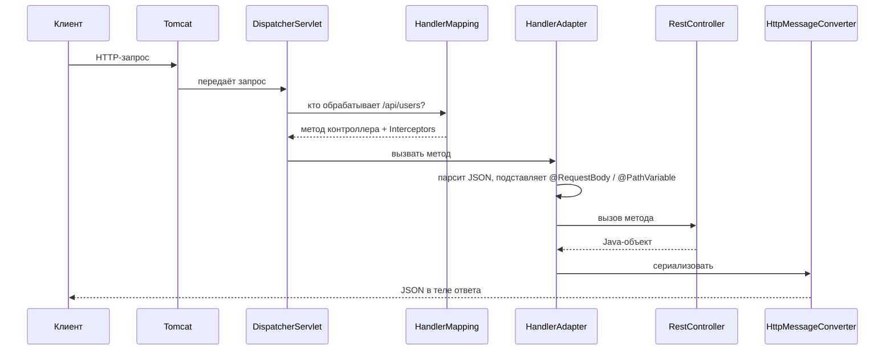
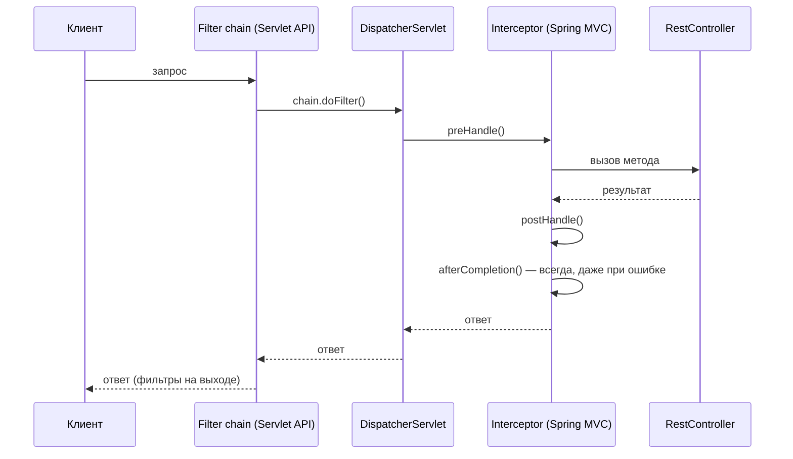

---
tags:
  - Junior
  - Middle
  - Senior
  - Spring
---

# Spring MVC и WebFlux

Как Spring MVC превращает HTTP-запрос в вызов метода контроллера и обратно: `DispatcherServlet`, обработка исключений, фильтры и интерсепторы, валидация и CORS. В конце — реактивный стек WebFlux и когда его выбирать вместо MVC. На собесе чаще всего спрашивают путь запроса через `DispatcherServlet`, `@RestControllerAdvice`, разницу между Filter и Interceptor и чем WebFlux лучше MVC.

## Путь запроса { #request-flow }

### Как `DispatcherServlet` обрабатывает запрос? { #dispatcherservlet }

**Уровень:** Middle

!!! abstract "Ответ вслух"
    `DispatcherServlet` — Front Controller: он принимает все HTTP-запросы и раздаёт работу другим компонентам. `HandlerMapping` находит метод контроллера и цепочку интерсепторов, `HandlerAdapter` разбирает запрос и вызывает метод, а `HttpMessageConverter` (Jackson) сериализует результат в JSON.

**Паттерн:** Front Controller. `DispatcherServlet` перехватывает 100% входящих HTTP-запросов и работает как регулировщик.



По шагам:

1. **Tomcat → `DispatcherServlet`** — веб-сервер принимает сырой HTTP-запрос и передаёт главному сервлету.
2. **`DispatcherServlet` → `HandlerMapping`** — «Какой метод контроллера должен обработать этот URL?» `HandlerMapping` сверяется с реестром аннотаций (`@GetMapping`, `@PostMapping`) и возвращает метод и цепочку интерсепторов (Interceptors).
3. **`DispatcherServlet` → `HandlerAdapter`** — сервлет не умеет вызывать методы напрямую. Адаптер извлекает данные из запроса, парсит JSON, подставляет аргументы и запускает метод.
4. **Выполнение в `@RestController`** — твой код: сервисы, БД. Метод возвращает Java-объект.
5. **`HttpMessageConverter`** — Jackson сериализует объект в JSON и пишет в тело ответа.

!!! warning "Ловушка: Spring Security не в этой цепочке"
    Всё, что на схеме, происходит внутри `DispatcherServlet`. Spring Security срабатывает раньше — в цепочке фильтров сервлет-контейнера (см. [Filter vs Interceptor](#filter-vs-interceptor)).

??? question "Проверь себя"
    1. Какой паттерн реализует `DispatcherServlet`?
    2. Что возвращает `HandlerMapping`?
    3. Кто превращает Java-объект в JSON?

### Зачем нужен `HandlerAdapter`? { #handler-adapter }

**Уровень:** Senior

!!! abstract "Ответ вслух"
    Чтобы отвязать `DispatcherServlet` от конкретных реализаций контроллеров. Контроллеры можно писать через аннотации или через старые интерфейсы ранних версий Spring, а адаптер скрывает эту разницу: `DispatcherServlet` работает с единым интерфейсом адаптера.

Вопрос на засыпку: _«Зачем нужен `HandlerAdapter`, если можно просто вызвать метод через рефлексию?»_

Контроллер может быть аннотированным классом с `@GetMapping` или реализацией старых интерфейсов из ранних версий Spring. Если бы `DispatcherServlet` вызывал их сам, ему пришлось бы знать про каждый вариант. Это паттерн Adapter: единый интерфейс снаружи, своя реализация вызова внутри.

!!! warning "Ловушка: «адаптер нужен только для рефлексии»"
    Рефлексивный вызов метода — лишь часть работы. Адаптер ещё разбирает аргументы (`@RequestBody`, `@PathVariable`) и обрабатывает возвращаемое значение, и делает это по-разному для разных типов контроллеров.

??? question "Проверь себя"
    1. От чего `HandlerAdapter` отвязывает `DispatcherServlet`?
    2. Какие виды контроллеров он скрывает?
    3. Что кроме вызова метода делает адаптер?

### Какие аннотации извлекают данные из запроса? { #controller-annotations }

**Уровень:** Junior

!!! abstract "Ответ вслух"
    `@PathVariable` берёт значение из пути URL, `@RequestParam` — из query-параметров, `@RequestBody` — из тела запроса (JSON), `@RequestHeader` — из заголовка, `@CookieValue` — из cookie. `@RestController` — это `@Controller` плюс `@ResponseBody` на каждом методе.

```java
@RestController               // @Controller + @ResponseBody на каждом методе
@RequestMapping("/api/habits")
public class HabitController {

    // Маппинг методов
    @GetMapping("/{id}")
    @PostMapping
    @PutMapping("/{id}")
    @DeleteMapping("/{id}")
    @PatchMapping("/{id}")

    // Извлечение данных из запроса
    public ResponseEntity<HabitDto> getHabit(
        @PathVariable Long id,              // из URL: /api/habits/42
        @RequestParam String category,      // из query: ?category=HEALTH
        @RequestBody HabitCreateDto dto,    // из тела запроса (JSON)
        @RequestHeader("X-User-Id") Long userId,  // из заголовка
        @CookieValue("session") String session    // из cookie
    ) { ... }
}
```

Пример намеренно собирает все аннотации в одном месте — в реальном коде у метода одна аннотация маппинга.

!!! warning "Ловушка: `@Controller` без `@ResponseBody`"
    Если пометить класс `@Controller`, а не `@RestController`, возвращённая строка будет воспринята как имя HTML-шаблона, а не как тело ответа.

??? question "Проверь себя"
    1. Чем `@PathVariable` отличается от `@RequestParam`?
    2. Откуда берёт данные `@RequestBody`?
    3. Из чего состоит `@RestController`?

### Как управлять статусом и заголовками ответа? { #response-entity }

**Уровень:** Junior

!!! abstract "Ответ вслух"
    Через `ResponseEntity`: в нём явно задаются статус, заголовки и тело. Для частых случаев есть фабричные методы — `ok()`, `noContent()`, `notFound()`, `badRequest()`.

```java
// Явно задаём статус, заголовки и тело
return ResponseEntity
    .status(HttpStatus.CREATED)                          // 201
    .header("Location", "/api/habits/" + habit.getId())
    .body(habitDto);

// Короткие фабричные методы
return ResponseEntity.ok(habitDto);                      // 200
return ResponseEntity.noContent().build();               // 204
return ResponseEntity.notFound().build();                // 404
return ResponseEntity.badRequest().body(errorDto);       // 400
```

Если заголовки менять не нужно, статус можно задать короче — аннотацией `@ResponseStatus` (пример — в [обработке исключений](#controller-advice)).

!!! warning "Ловушка: 201 без `Location`"
    При создании ресурса принято возвращать `201 Created` и заголовок `Location` с адресом нового ресурса. Голый `ok(dto)` вернёт `200`, и клиент не узнает, где лежит созданный объект.

??? question "Проверь себя"
    1. Как вернуть `201` с заголовком `Location`?
    2. Какой фабричный метод возвращает `204`?
    3. Когда вместо `ResponseEntity` хватит `@ResponseStatus`?

## Обработка исключений { #exception-handling }

### Как централизованно обработать исключения? { #controller-advice }

**Уровень:** Junior

=== "Коротко"

    !!! abstract "Ответ вслух"
        Вместо `try-catch` в каждом контроллере пишут один класс с `@RestControllerAdvice` и методами `@ExceptionHandler`. Исключение летит вверх, `DispatcherServlet` передаёт его `HandlerExceptionResolver`, а тот находит подходящий метод-обработчик и превращает исключение в HTTP-ответ.

=== "Подробно"

    Если метод в `@RestController` или `@Service` выбрасывает исключение, ошибка летит вверх. `DispatcherServlet` перехватывает её и передаёт `HandlerExceptionResolver`. Резолвер находит класс с `@RestControllerAdvice` и вызывает нужный метод.

    ```java
    @RestControllerAdvice  // @ControllerAdvice + @ResponseBody
    @Slf4j
    public class GlobalExceptionHandler {

        // Конкретная бизнес-ошибка — логируем на WARN
        @ExceptionHandler(UserNotFoundException.class)
        public ResponseEntity<ErrorResponse> handleUserNotFound(UserNotFoundException ex) {
            log.warn("Пользователь не найден: {}", ex.getMessage());
            return ResponseEntity
                .status(HttpStatus.NOT_FOUND)
                .body(new ErrorResponse(404, ex.getMessage(), LocalDateTime.now()));
        }

        // Ошибки валидации Bean Validation (@Valid)
        @ExceptionHandler(MethodArgumentNotValidException.class)
        public ResponseEntity<ErrorResponse> handleValidation(MethodArgumentNotValidException ex) {
            String message = ex.getBindingResult().getFieldErrors().stream()
                .map(e -> e.getField() + ": " + e.getDefaultMessage())
                .collect(Collectors.joining(", "));
            return ResponseEntity
                .status(HttpStatus.BAD_REQUEST)
                .body(new ErrorResponse(400, message, LocalDateTime.now()));
        }

        // Fallback для всего непредвиденного — логируем на ERROR со стектрейсом!
        @ExceptionHandler(Exception.class)
        public ResponseEntity<ErrorResponse> handleAll(Exception ex) {
            log.error("Внутренняя ошибка сервера", ex);
            return ResponseEntity
                .status(HttpStatus.INTERNAL_SERVER_ERROR)
                .body(new ErrorResponse(500, "Внутренняя ошибка. Мы уже чиним.", LocalDateTime.now()));
        }
    }
    ```

    Вместо `ResponseEntity` HTTP-статус можно задать аннотацией `@ResponseStatus` на методе-обработчике — так короче, если заголовки ответа менять не нужно. Обработчик ловит и checked-исключения, например `InsufficientFundsException` из [Исключения → Свои исключения](../java/exceptions.md#custom-exceptions):

    ```java
    @RestControllerAdvice
    public class GlobalExceptionHandler {

        @ExceptionHandler(OrderNotFoundException.class)
        @ResponseStatus(HttpStatus.NOT_FOUND)
        public ErrorResponse handleOrderNotFound(OrderNotFoundException ex) {
            return new ErrorResponse(404, ex.getMessage(), LocalDateTime.now());
        }

        @ExceptionHandler(InsufficientFundsException.class)
        @ResponseStatus(HttpStatus.PAYMENT_REQUIRED)
        public ErrorResponse handleInsufficientFunds(InsufficientFundsException ex) {
            return new ErrorResponse(402, ex.getMessage(), LocalDateTime.now());
        }
    }
    ```

!!! warning "Ловушка: `@ControllerAdvice` вместо `@RestControllerAdvice`"
    `@RestControllerAdvice` = `@ControllerAdvice` + `@ResponseBody`. Без `@ResponseBody` Spring воспримет возвращаемую строку как имя HTML-шаблона, а не как JSON. Для REST API всегда используй `@RestControllerAdvice`.

!!! warning "Ловушка: fallback без стектрейса"
    В обработчике `Exception.class` логируй исключение целиком — `log.error("...", ex)` — на уровне ERROR. Иначе непредвиденная ошибка превратится в безликий 500 без следов в логах.

??? question "Проверь себя"
    1. Кто передаёт исключение в `@RestControllerAdvice`?
    2. Чем `@RestControllerAdvice` отличается от `@ControllerAdvice`?
    3. Как задать HTTP-статус без `ResponseEntity`?

### Как Spring выбирает обработчик исключения? { #handler-resolution }

**Уровень:** Middle

!!! abstract "Ответ вслух"
    По наиболее точному классу исключения в иерархии. Если есть обработчик для `UserNotFoundException`, он победит обработчик для `Exception`. Порядок методов в классе роли не играет.

```java
// Упала UserNotFoundException → первый метод (точное совпадение)
// Упала NullPointerException  → провалится в Exception.class (fallback)
// Порядок методов в классе не важен — важна иерархия классов исключений
```

!!! warning "Ловушка: «сработает первый метод в классе»"
    Spring не перебирает обработчики сверху вниз, как `catch`-блоки. Он ищет ближайший по иерархии класс исключения, поэтому fallback на `Exception.class` можно объявить где угодно.

??? question "Проверь себя"
    1. Какой обработчик сработает для `UserNotFoundException`, если есть ещё `Exception.class`?
    2. Куда попадёт `NullPointerException`?
    3. Важен ли порядок методов в классе?

### Что такое `ProblemDetail`? { #problem-detail }

**Уровень:** Middle

!!! abstract "Ответ вслух"
    Это поддержка стандарта RFC 7807 в Spring Boot 3: единый формат тела ошибки с полями `type`, `title`, `status`, `detail`, `instance`. Вместо самописного `ErrorResponse` обработчик возвращает `ProblemDetail`, и все микросервисы отвечают об ошибках одинаково.

```java
// ✅ Вместо самописного ErrorResponse — стандарт RFC 7807
@ExceptionHandler(UserNotFoundException.class)
public ProblemDetail handleUserNotFound(UserNotFoundException ex) {
    ProblemDetail problem = ProblemDetail
        .forStatusAndDetail(HttpStatus.NOT_FOUND, ex.getMessage());
    problem.setTitle("Пользователь не найден");
    problem.setType(URI.create("https://api.example.com/errors/user-not-found"));
    problem.setProperty("userId", ex.getUserId()); // кастомные поля
    return problem;
}
// Поля из коробки: type, title, status, detail, instance
// Стандартизирует ответы всех микросервисов без написания велосипедов
```

!!! warning "Ловушка: свой формат ошибок в каждом сервисе"
    Если каждый сервис придумывает свой `ErrorResponse`, клиенту приходится разбирать N форматов. `ProblemDetail` решает это стандартом, а свои поля добавляются через `setProperty()`.

??? question "Проверь себя"
    1. Какой RFC реализует `ProblemDetail`?
    2. Какие поля у него есть из коробки?
    3. Как добавить своё поле в ответ?

## Фильтры и интерсепторы { #filters-interceptors }

### Чем Filter отличается от Interceptor? { #filter-vs-interceptor }

**Уровень:** Middle

!!! abstract "Ответ вслух"
    Filter — механизм Servlet API: срабатывает до `DispatcherServlet` и видит только сырой HTTP-запрос. Interceptor — механизм Spring MVC: работает внутри `DispatcherServlet` и знает, какой метод контроллера будет вызван. Filter — охранник на входе в здание, Interceptor — секретарь перед дверью конкретного кабинета.



| | **Filter** | **Interceptor** |
|---|---|---|
| **Чей механизм** | Servlet API (Jakarta EE) | Spring Web MVC |
| **Когда срабатывает** | До `DispatcherServlet` | Внутри `DispatcherServlet` |
| **Что видит** | Сырой HTTP-запрос | HTTP-запрос + метод контроллера (`handler`) |
| **Доступ к Spring-бинам** | Да (если `@Component`) | Да (Spring-компонент) |
| **Применение** | Security, CORS, GZIP, глобальный лог | Авторизация, бизнес-логика маршрутов, аудит |
| **Базовый класс** | `OncePerRequestFilter` | `HandlerInterceptor` |

!!! warning "Ловушка: Spring Security — это фильтры"
    Частая ошибка — говорить, что Spring Security работает на интерсепторах. **Это не так.** Spring Security — `FilterChainProxy`, цепочка именно **фильтров**: он должен отбить злоумышленника ещё до того, как начнёт работу `DispatcherServlet`. Подробно — в [Экосистема → Spring Security](spring-security.md#security-filter-chain).

??? question "Проверь себя"
    1. Какой из механизмов срабатывает раньше и почему?
    2. Что видит Interceptor такого, чего не видит Filter?
    3. На чём построен Spring Security?

### Как написать фильтр? { #filter }

**Уровень:** Middle

!!! abstract "Ответ вслух"
    Наследуются от `OncePerRequestFilter` и реализуют `doFilterInternal`: код до `chain.doFilter()` выполняется на входе, после — на выходе. Фильтры используют для глобальной аутентификации, CORS, логирования и сжатия.

```java
@Component
public class LoggingFilter extends OncePerRequestFilter { // не Filter напрямую!

    @Override
    protected void doFilterInternal(
            HttpServletRequest request,
            HttpServletResponse response,
            FilterChain chain) throws ServletException, IOException {

        // --- ДО запроса ---
        long start = System.currentTimeMillis();
        String requestId = UUID.randomUUID().toString();
        request.setAttribute("requestId", requestId);

        // Тело запроса можно прочитать только ОДИН РАЗ!
        // Оборачиваем в кэширующую обёртку
        ContentCachingRequestWrapper wrappedRequest =
            new ContentCachingRequestWrapper(request);

        log.info("[{}] {} {}", requestId, request.getMethod(), request.getRequestURI());

        chain.doFilter(wrappedRequest, response); // передаём управление дальше

        // --- ПОСЛЕ запроса ---
        long duration = System.currentTimeMillis() - start;
        log.info("[{}] Статус: {}, Время: {}ms", requestId, response.getStatus(), duration);
    }
}
```

Где применяется:

- Глобальная аутентификация (Spring Security — это цепочка именно фильтров).
- Настройка CORS-заголовков.
- Глобальное логирование (IP, URL, время ответа).
- Сжатие GZIP.

Почему `OncePerRequestFilter`, а не `Filter`: голый интерфейс `Filter` может вызываться несколько раз за один HTTP-цикл — например, при внутреннем `forward` или обработке ошибок контейнером. `OncePerRequestFilter` гарантирует, что логика выполнится строго один раз.

!!! warning "Ловушка: исчезнувшее тело запроса"
    `InputStream` HTTP-запроса можно прочитать только **один раз**. Если фильтр прочитает тело для логирования, до контроллера дойдёт пустой запрос, и Spring бросит `HttpMessageNotReadableException`. Решение — обернуть запрос в `ContentCachingRequestWrapper`: он буферизирует тело в память и позволяет читать его многократно.

??? question "Проверь себя"
    1. Почему фильтр наследуют от `OncePerRequestFilter`?
    2. Что будет, если прочитать тело запроса в фильтре?
    3. Для каких задач обычно пишут фильтры?

### Как написать интерсептор? { #interceptor }

**Уровень:** Middle

=== "Коротко"

    !!! abstract "Ответ вслух"
        Реализуют `HandlerInterceptor` и регистрируют через `WebMvcConfigurer.addInterceptors()`. У него три метода: `preHandle` до контроллера (вернул `false` — цепочка прервана), `postHandle` после контроллера до записи ответа и `afterCompletion`, который вызывается всегда, даже при ошибке.

=== "Подробно"

    ```java
    @Component
    public class AuthorizationInterceptor implements HandlerInterceptor {

        @Override
        public boolean preHandle(HttpServletRequest request,
                                 HttpServletResponse response,
                                 Object handler) throws Exception { // handler — ссылка на метод контроллера!

            if (handler instanceof HandlerMethod method) {
                // Доступ к аннотациям конкретного метода
                RequiresRole annotation = method.getMethodAnnotation(RequiresRole.class);
                if (annotation != null) {
                    String userRole = (String) request.getAttribute("userRole");
                    if (!annotation.value().equals(userRole)) {
                        response.setStatus(HttpStatus.FORBIDDEN.value());
                        return false; // прерываем цепочку, контроллер не вызывается
                    }
                }
            }
            return true; // пропускаем дальше
        }

        @Override
        public void postHandle(HttpServletRequest request, HttpServletResponse response,
                               Object handler, ModelAndView modelAndView) {
            // Вызывается ПОСЛЕ контроллера, но ДО записи ответа
            // Можно добавить заголовки к ответу
        }

        @Override
        public void afterCompletion(HttpServletRequest request, HttpServletResponse response,
                                    Object handler, Exception ex) {
            // Вызывается ВСЕГДА — даже если контроллер или postHandle упали с ошибкой
            // Подходит для очистки ресурсов, завершения логирования
        }
    }

    // Регистрация:
    @Configuration
    public class WebConfig implements WebMvcConfigurer {
        @Override
        public void addInterceptors(InterceptorRegistry registry) {
            registry.addInterceptor(authorizationInterceptor)
                .addPathPatterns("/api/**")
                .excludePathPatterns("/api/auth/**");
        }
    }
    ```

    Где применяется:

    - Проверка прав доступа к конкретным эндпоинтам (авторизация).
    - Логирование времени выполнения конкретного метода.
    - Обогащение контекста: достать `userId` из токена и положить в `ThreadLocal`.

!!! warning "Ловушка: очистка в `postHandle`"
    `postHandle` не вызывается, если контроллер бросил исключение. Очищать `ThreadLocal` и закрывать ресурсы нужно в `afterCompletion` — он срабатывает всегда. Почему забытое значение достаётся следующему запросу — в [ThreadLocal](../concurrency/threads.md#thread-local).

??? question "Проверь себя"
    1. Что произойдёт, если `preHandle` вернёт `false`?
    2. Чем `postHandle` отличается от `afterCompletion`?
    3. Как зарегистрировать интерсептор только для `/api/**`?

## Валидация и CORS { #validation-cors }

### Как работает `@Valid`? { #valid }

**Уровень:** Junior

!!! abstract "Ответ вслух"
    `@Valid` перед параметром контроллера запускает Bean Validation по аннотациям DTO — `@NotBlank`, `@Size`, `@Email` и другим. Если проверка не прошла, метод не вызывается, а Spring бросает `MethodArgumentNotValidException`, которую ловит `@RestControllerAdvice`. Для проверки параметров сервиса на класс вешают `@Validated`.

```java
// DTO с ограничениями
public record HabitCreateDto(
    @NotBlank(message = "Название обязательно")
    @Size(min = 2, max = 100)
    String name,

    @NotNull
    @Min(1) @Max(10)
    Integer priority,

    @Email
    String reminderEmail,

    @Future(message = "Дата должна быть в будущем")
    LocalDate startDate
) {}

// Контроллер: @Valid запускает валидацию перед вызовом метода
@PostMapping
public ResponseEntity<HabitDto> create(@Valid @RequestBody HabitCreateDto dto) {
    // если валидация не прошла — до этой строки не дойдём
    // MethodArgumentNotValidException летит в GlobalExceptionHandler
    return ResponseEntity.status(CREATED).body(habitService.create(dto));
}

// Валидация в сервисе (нужно @Validated на классе)
@Service
@Validated
public class HabitService {
    public HabitDto findByName(@NotBlank String name) { ... }
}
```

Как превратить ошибки валидации в ответ `400` — в [обработке исключений](#controller-advice).

!!! warning "Ловушка: аннотации на DTO без `@Valid`"
    `@NotBlank` и `@Size` на полях DTO сами ничего не проверяют. Без `@Valid` у параметра контроллера (или `@Validated` на классе сервиса) валидация не запустится.

??? question "Проверь себя"
    1. Какое исключение бросает Spring при ошибке валидации тела запроса?
    2. Что нужно, чтобы валидировать параметры метода сервиса?
    3. Что будет, если забыть `@Valid`?

### Как настроить CORS? { #cors }

**Уровень:** Junior

!!! abstract "Ответ вслух"
    Три способа: `@CrossOrigin` на контроллере, глобально через `WebMvcConfigurer.addCorsMappings()` или через фильтр Spring Security. Глобальная настройка предпочтительнее аннотаций, а при подключённом Security лучше настраивать CORS в нём — фильтр срабатывает раньше `DispatcherServlet`.

```java
// Вариант 1 — аннотация на контроллере
@CrossOrigin(origins = "https://myapp.com")
@RestController
public class HabitController { ... }

// Вариант 2 — глобально через конфигурацию (рекомендуется)
@Configuration
public class WebConfig implements WebMvcConfigurer {
    @Override
    public void addCorsMappings(CorsRegistry registry) {
        registry.addMapping("/api/**")
            .allowedOrigins("https://myapp.com", "https://admin.myapp.com")
            .allowedMethods("GET", "POST", "PUT", "DELETE")
            .allowedHeaders("*")
            .allowCredentials(true)
            .maxAge(3600); // браузер кэширует preflight на 1 час
    }
}

// Вариант 3 — через фильтр Spring Security (если Security подключён)
// Предпочтительно, так как фильтр срабатывает раньше DispatcherServlet
```

!!! warning "Ловушка: CORS в MVC при подключённом Security"
    Если Security подключён, preflight-запрос сначала проходит его фильтры. CORS, настроенный только в `WebMvcConfigurer`, сработает уже внутри `DispatcherServlet` — поэтому при Security его настраивают в фильтре.

??? question "Проверь себя"
    1. Назови три способа настроить CORS.
    2. Что делает `maxAge(3600)`?
    3. Почему при Spring Security CORS настраивают в его фильтре?

## Spring WebFlux { #webflux }

### Зачем нужен реактивный подход? { #why-reactive }

**Уровень:** Middle

!!! abstract "Ответ вслух"
    В Spring MVC каждый запрос занимает поток Tomcat, и большую часть времени поток просто ждёт ответа БД или другого сервиса. WebFlux использует неблокирующий ввод-вывод на Netty: небольшой пул потоков обслуживает тысячи запросов, переключаясь между ними, пока те ждут I/O.

В классическом Spring MVC каждый HTTP-запрос занимает поток Tomcat. При 1000 одновременных запросов — 1000 потоков, каждый примерно с 1 МБ стека, то есть около 1 ГБ памяти. 90% времени потоки просто **ждут** — ответа от БД или от другого сервиса.

**WebFlux** использует неблокирующий I/O (Netty вместо Tomcat): небольшой пул потоков обрабатывает тысячи запросов, переключаясь между ними, когда те ждут I/O.

!!! warning "Ловушка: реактивность не ускоряет вычисления"
    WebFlux выигрывает только там, где потоки ждут I/O. CPU-bound работу он не ускоряет — потоков для вычислений меньше не становится.

??? question "Проверь себя"
    1. Сколько памяти уходит на стеки 1000 потоков в MVC?
    2. На каком сервере работает WebFlux по умолчанию?
    3. За счёт чего WebFlux обходится небольшим пулом потоков?

### Что такое `Mono` и `Flux`? { #mono-flux }

**Уровень:** Middle

!!! abstract "Ответ вслух"
    Это основные реактивные типы. `Mono<T>` — 0 или 1 элемент, аналог `Optional` плюс `Future`; `Flux<T>` — 0..N элементов, аналог `Stream` плюс `Future`. Контроллер просто возвращает `Mono` или `Flux`, а Spring сам на них подписывается.

```java
// Mono<T> — 0 или 1 элемент (аналог Optional + Future)
Mono<HabitDto> findById(Long id) { ... }

// Flux<T> — 0..N элементов (аналог Stream + Future)
Flux<HabitDto> findAll() { ... }

// Пример реактивного сервиса
@Service
public class HabitService {

    public Mono<HabitDto> findById(Long id) {
        return habitRepository.findById(id)          // реактивный репозиторий
            .switchIfEmpty(Mono.error(new NotFoundException(id)))
            .map(HabitMapper::toDto);
    }

    public Flux<HabitDto> findAllByUser(Long userId) {
        return habitRepository.findByUserId(userId)
            .filter(h -> h.isActive())
            .map(HabitMapper::toDto);
    }
}

// Реактивный контроллер
@RestController
public class HabitController {

    @GetMapping("/api/habits/{id}")
    public Mono<HabitDto> getById(@PathVariable Long id) {
        return habitService.findById(id);  // просто возвращаем Mono, Spring сам подпишется
    }

    @GetMapping(value = "/api/habits/stream", produces = MediaType.TEXT_EVENT_STREAM_VALUE)
    public Flux<HabitDto> streamHabits() {
        return habitService.findAll();  // Server-Sent Events из коробки
    }
}
```

На собесах по WebFlux часто спрашивают разницу `map` и `flatMap` (синхронная и асинхронная трансформация) и что такое backpressure — потребитель контролирует скорость производителя.

!!! warning "Ловушка: без подписки ничего не происходит"
    `Mono` и `Flux` ленивые: цепочка операторов только описывает работу. Пока на результат никто не подписался (в контроллере это делает Spring), запрос к БД не выполнится.

??? question "Проверь себя"
    1. Чем `Mono` отличается от `Flux`?
    2. Чем `map` отличается от `flatMap`?
    3. Что такое backpressure?

### Когда выбирать WebFlux, а когда MVC? { #webflux-vs-mvc }

**Уровень:** Senior

!!! abstract "Ответ вслух"
    MVC — для обычных CRUD-сервисов на JPA/JDBC, когда команда знает MVC: просто и предсказуемо. WebFlux — когда много I/O-bound запросов, стриминг данных и высокая конкурентность, но тогда весь стек должен быть реактивным: R2DBC вместо JPA, WebClient вместо RestTemplate.

| | **Spring MVC** | **Spring WebFlux** |
|---|---|---|
| **Модель** | Блокирующая, поток на запрос | Неблокирующая, событийный цикл |
| **Сервер** | Tomcat (по умолчанию) | Netty (по умолчанию) |
| **БД** | JPA/JDBC (блокирующие) | R2DBC (реактивный драйвер) |
| **Когда** | Обычные CRUD-сервисы, команда знает MVC | Много I/O-bound запросов, стриминг данных, высокая конкурентность |
| **Сложность** | Низкая | Высокая (дебаг, стектрейсы) |

!!! warning "Ловушка: блокирующий вызов в реактивном коде"
    Если в реактивном коде есть хотя бы **одна блокирующая операция** (JDBC, синхронный HTTP-клиент, `Thread.sleep`), блокируется весь event loop, и производительность падает **ниже MVC**. WebFlux требует полностью реактивного стека: R2DBC вместо JPA, WebClient вместо RestTemplate.

??? question "Проверь себя"
    1. Какой драйвер БД нужен для WebFlux?
    2. Что будет, если в реактивном коде вызвать JDBC?
    3. Когда MVC остаётся лучшим выбором?

## Шпаргалка { #cheatsheet }

<!-- --8<-- [start:cheatsheet] -->
| Тема | Запомнить |
|---|---|
| **`DispatcherServlet`** | Front Controller. Порядок: `HandlerMapping` → `HandlerAdapter` → Controller → `HttpMessageConverter` |
| **`HandlerAdapter`** | Скрывает разницу между реализациями контроллеров. Парсит аргументы и вызывает метод |
| **Аннотации запроса** | `@PathVariable` — путь, `@RequestParam` — query, `@RequestBody` — тело, `@RequestHeader`, `@CookieValue` |
| **`ResponseEntity`** | Статус, заголовки и тело. Короче — `@ResponseStatus` |
| **`@RestControllerAdvice`** | Централизованная обработка ошибок. Для REST лучше, чем `@ControllerAdvice` |
| **Выбор обработчика** | Spring выбирает обработчик по наиболее точному классу исключения |
| **RFC 7807 / `ProblemDetail`** | Стандарт структуры ошибок в Spring Boot 3+ |
| **Filter vs Interceptor** | Filter — до `DispatcherServlet` (Servlet API). Interceptor — внутри (Spring MVC) |
| **`OncePerRequestFilter`** | Всегда наследоваться от него, не от голого `Filter` |
| **Ловушка `InputStream`** | Тело запроса читается один раз. Для логирования — `ContentCachingRequestWrapper` |
| **Spring Security** | Это цепочка **фильтров** (`FilterChainProxy`), не интерсепторов |
| **`@Valid`** | Запускает Bean Validation. Ошибки летят как `MethodArgumentNotValidException` |
| **CORS** | `@CrossOrigin`, `addCorsMappings()` или фильтр Security (предпочтительно при Security) |
| **WebFlux** | Неблокирующий I/O. Netty вместо Tomcat. `Mono` / `Flux` вместо объектов |
| **WebFlux ловушка** | Одна блокирующая операция блокирует весь event loop |

<!-- --8<-- [end:cheatsheet] -->
