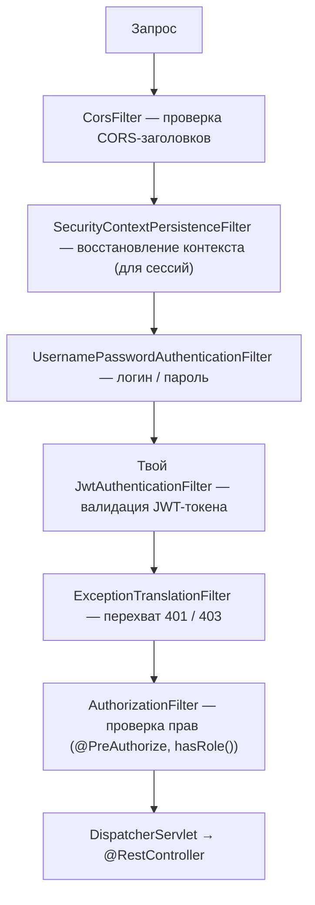

---
tags:
  - Middle
  - Senior
  - Spring
  - Безопасность
---

# Spring Security

Как Spring Security встраивается в приложение: цепочка фильтров, аутентификация и авторизация, JWT-фильтр, контекст безопасности в асинхронном коде и logout с JWT. На собесе чаще всего спрашивают, как устроена цепочка фильтров, чем 401 отличается от 403, как работает JWT и почему его нельзя отозвать.

## Spring Security { #security }

### Как устроен Spring Security? { #security-filter-chain }

**Уровень:** Middle

!!! abstract "Ответ вслух"
    Spring Security — не монолитный блок, а `SecurityFilterChain`: цепочка сервлет-фильтров, каждый из которых решает одну задачу. Один проверяет CORS, другой ищет JWT-токен, третий проверяет права, четвёртый превращает ошибки в 401 и 403. Всё это происходит до `DispatcherServlet`.



Почему фильтры, а не интерсепторы, и чем они отличаются, — в [Spring MVC → Filter vs Interceptor](spring-mvc.md#filter-vs-interceptor).

!!! warning "Ловушка: «Security работает на интерсепторах»"
    Нет: Spring Security — это `FilterChainProxy` и цепочка **фильтров**. Он отбивает запрос ещё до того, как `DispatcherServlet` начнёт работу.

??? question "Проверь себя"
    1. Что такое `SecurityFilterChain`?
    2. Какой фильтр превращает ошибки безопасности в 401 и 403?
    3. Срабатывает Security до или после `DispatcherServlet`?

### Как проходит аутентификация? { #authentication }

**Уровень:** Middle

!!! abstract "Ответ вслух"
    Фильтр создаёт черновик `Authentication` с логином и паролем и передаёт его `AuthenticationManager`. Тот опрашивает `AuthenticationProvider`-ы: провайдер грузит пользователя через `UserDetailsService` и сверяет пароль через `PasswordEncoder`. Подтверждённый `Authentication` с ролями кладётся в `SecurityContextHolder` — `ThreadLocal`-хранилище текущего потока.

Аутентификация отвечает на вопрос «Кто ты?».

```java
// Пользователь прислал логин и пароль:
// 1. UsernamePasswordAuthenticationFilter создаёт черновик Authentication
// 2. Передаёт AuthenticationManager
// 3. Manager опрашивает провайдеров:

@Component
public class CustomAuthProvider implements AuthenticationProvider {

    private final UserDetailsService userDetailsService;
    private final PasswordEncoder passwordEncoder;

    @Override
    public Authentication authenticate(Authentication auth) throws AuthenticationException {
        String username = auth.getName();
        String rawPassword = auth.getCredentials().toString();

        UserDetails user = userDetailsService.loadUserByUsername(username);
        // UserDetailsService идёт в БД и возвращает UserDetails

        if (!passwordEncoder.matches(rawPassword, user.getPassword())) {
            throw new BadCredentialsException("Неверный пароль");
        }

        // Возвращаем подтверждённый Authentication с ролями
        return new UsernamePasswordAuthenticationToken(user, null, user.getAuthorities());
    }

    @Override
    public boolean supports(Class<?> authClass) {
        return UsernamePasswordAuthenticationToken.class.isAssignableFrom(authClass);
    }
}
```

При успехе подтверждённый `Authentication` кладётся в **`SecurityContextHolder`** — `ThreadLocal`-хранилище, доступное из любой точки приложения в текущем потоке.

```java
// Получить текущего пользователя из любого места кода
SecurityContext ctx = SecurityContextHolder.getContext();
Authentication auth = ctx.getAuthentication();
String username = auth.getName();
Collection<? extends GrantedAuthority> roles = auth.getAuthorities();
```

!!! warning "Ловушка: `SecurityContextHolder` привязан к потоку"
    Это [`ThreadLocal`](../concurrency/threads.md#thread-local), поэтому в другом потоке контекста нет. Как это ломает `@Async` и `CompletableFuture`, — в [теме про асинхронность](#security-context-async).

??? question "Проверь себя"
    1. Кто сверяет пароль при аутентификации?
    2. Что делает `UserDetailsService`?
    3. Где хранится подтверждённый `Authentication`?

### Как настроить авторизацию? { #authorization }

**Уровень:** Junior

!!! abstract "Ответ вслух"
    Авторизация отвечает на вопрос «Что тебе можно?». Правила по URL задают в бине `SecurityFilterChain` через `authorizeHttpRequests`, а правила на уровне метода — через `@PreAuthorize` после `@EnableMethodSecurity`. Нет аутентификации — 401 Unauthorized, нет прав — 403 Forbidden.

```java
@Configuration
@EnableWebSecurity
@EnableMethodSecurity  // включает @PreAuthorize, @PostAuthorize
public class SecurityConfig {

    @Bean
    public SecurityFilterChain filterChain(HttpSecurity http) throws Exception {
        return http
            .csrf(AbstractHttpConfigurer::disable)  // для REST API
            .sessionManagement(s -> s.sessionCreationPolicy(STATELESS))  // без сессий
            .authorizeHttpRequests(auth -> auth
                .requestMatchers("/api/auth/**").permitAll()         // открытые эндпоинты
                .requestMatchers("/api/admin/**").hasRole("ADMIN")   // только ADMIN
                .requestMatchers(HttpMethod.GET, "/api/**").hasAnyRole("USER", "ADMIN")
                .anyRequest().authenticated()                        // всё остальное — аутентифицированным
            )
            .addFilterBefore(jwtFilter, UsernamePasswordAuthenticationFilter.class)
            .exceptionHandling(ex -> ex
                .authenticationEntryPoint(/* 401 handler */)
                .accessDeniedHandler(/* 403 handler */)
            )
            .build();
    }
}

// Авторизация на уровне метода
@RestController
public class AdminController {

    @GetMapping("/api/admin/users")
    @PreAuthorize("hasRole('ADMIN')")
    public List<UserDto> getAllUsers() { ... }

    @DeleteMapping("/api/habits/{id}")
    @PreAuthorize("#id == authentication.principal.id or hasRole('ADMIN')")
    public void delete(@PathVariable Long id) { ... } // владелец или ADMIN
}
```

При отказе:

- Нет аутентификации → `AuthenticationException` → **401 Unauthorized**.
- Нет прав → `AccessDeniedException` → **403 Forbidden**.

!!! warning "Ловушка: 401 и 403 путают"
    401 значит «я не знаю, кто ты» — нет или невалиден токен. 403 значит «я знаю, кто ты, но тебе нельзя» — не хватает роли.

??? question "Проверь себя"
    1. Что включает `@EnableMethodSecurity`?
    2. Как открыть `/api/auth/**` для всех?
    3. Когда возвращается 401, а когда 403?

### Как встроить JWT в Spring Security? { #jwt-filter }

**Уровень:** Middle

!!! abstract "Ответ вслух"
    Пишут свой фильтр на базе `OncePerRequestFilter` и ставят его перед `UsernamePasswordAuthenticationFilter`. Фильтр достаёт токен из заголовка `Authorization: Bearer`, проверяет подпись и срок, берёт имя и роли из claims без похода в БД и кладёт собранный `Authentication` в `SecurityContextHolder`.

```java
@Component
public class JwtAuthenticationFilter extends OncePerRequestFilter {

    private final JwtService jwtService;
    private final UserDetailsService userDetailsService;

    @Override
    protected void doFilterInternal(HttpServletRequest request,
                                    HttpServletResponse response,
                                    FilterChain chain) throws ServletException, IOException {

        // 1. Извлечь токен из заголовка
        String header = request.getHeader("Authorization");
        if (header == null || !header.startsWith("Bearer ")) {
            chain.doFilter(request, response);
            return;
        }

        String token = header.substring(7);

        // 2. Валидировать подпись и срок действия
        if (!jwtService.isValid(token)) {
            chain.doFilter(request, response);
            return;
        }

        // 3. Достать данные из claims — БЕЗ ПОХОДА В БД!
        String username = jwtService.extractUsername(token);
        List<String> roles = jwtService.extractRoles(token);

        // 4. Собрать Authentication и положить в контекст
        var authorities = roles.stream()
            .map(SimpleGrantedAuthority::new)
            .collect(toList());

        var auth = new UsernamePasswordAuthenticationToken(username, null, authorities);
        auth.setDetails(new WebAuthenticationDetailsSource().buildDetails(request));
        SecurityContextHolder.getContext().setAuthentication(auth);

        chain.doFilter(request, response);
        // Контроллеры думают, что юзер аутентифицирован стандартным способом
    }
}
```

Это stateless-подход для REST API: сервер не хранит сессию, всё нужное лежит в самом токене.

!!! warning "Ловушка: невалидный токен — не повод отвечать здесь"
    При отсутствии или невалидности токена фильтр не пишет ответ сам, а просто передаёт запрос дальше без `Authentication`. Отказ (401) сформирует `ExceptionTranslationFilter`, когда `AuthorizationFilter` увидит неаутентифицированный запрос к защищённому URL.

??? question "Проверь себя"
    1. Перед каким фильтром ставят JWT-фильтр?
    2. Почему JWT-фильтру не нужно ходить в БД?
    3. Что фильтр делает, если токена нет?

### Почему теряется `SecurityContext` в асинхронном коде? { #security-context-async }

**Уровень:** Senior

!!! abstract "Ответ вслух"
    `SecurityContextHolder` хранит данные в `ThreadLocal`, привязанном к потоку Tomcat. Новый поток из `@Async` или `CompletableFuture` про него ничего не знает, и `getAuthentication()` вернёт `null`. Решение — обернуть пул потоков в `DelegatingSecurityContextExecutorService`, который переносит контекст в дочерние потоки.

```java
// ❌ Контекст потеряется
CompletableFuture.runAsync(() -> {
    SecurityContextHolder.getContext().getAuthentication(); // null!
});

// ✅ DelegatingSecurityContextExecutor прокидывает контекст в дочерние потоки
@Bean
public Executor securityAwareExecutor() {
    return new DelegatingSecurityContextExecutorService(
        Executors.newFixedThreadPool(10)
    );
}
```

!!! warning "Ловушка: `runAsync` без своего executor"
    `CompletableFuture.runAsync()` без второго аргумента выполняет задачу в общем `ForkJoinPool`, а не в твоём обёрнутом пуле. Чтобы контекст перенёсся, executor нужно передать явно.

??? question "Проверь себя"
    1. Почему в `@Async`-методе `getAuthentication()` возвращает `null`?
    2. Как перенести контекст безопасности в дочерний поток?
    3. Где по умолчанию выполняется `CompletableFuture.runAsync()`?

### Как сделать logout, если используется JWT? { #jwt-logout }

**Уровень:** Senior

!!! abstract "Ответ вслух"
    Напрямую инвалидировать JWT нельзя: он проверяется математически, без обращения к хранилищу. Поэтому делают короткоживущий access token на 5–15 минут и долгоживущий refresh token в БД или Redis; при логауте удаляют refresh token, а access сам истекает. В критичных системах добавляют blacklist отозванных токенов в Redis.

Вопрос на собесе: _«Как реализовать logout, если мы используем JWT?»_

- **Short-lived Access Token (5–15 мин)** + **Long-lived Refresh Token** в БД/Redis.
- При логауте удаляем refresh token из хранилища. Access token сам истечёт.
- В критичных системах (финтех) — **blacklist в Redis**: JWT-фильтр при каждом запросе проверяет, не отозван ли токен.

```java
// JWT-фильтр с проверкой blacklist
if (redisBlacklist.contains(token)) {
    response.setStatus(HttpStatus.UNAUTHORIZED.value());
    return;
}
```

!!! warning "Ловушка: долгоживущий access token"
    Главный минус JWT — его нельзя отозвать. Чем дольше живёт access token, тем дольше украденный или «разлогиненный» токен остаётся рабочим.

??? question "Проверь себя"
    1. Почему JWT нельзя инвалидировать напрямую?
    2. Что удаляют при логауте в схеме access + refresh?
    3. Зачем нужен blacklist в Redis и какова его цена?

## Шпаргалка { #cheatsheet }

<!-- --8<-- [start:cheatsheet] -->
| Тема | Запомнить |
|---|---|
| **`SecurityFilterChain`** | Цепочка фильтров. Security — это фильтры, не интерсепторы |
| **Аутентификация** | `AuthenticationManager` → `AuthenticationProvider` → `UserDetailsService` + `PasswordEncoder` |
| **`SecurityContextHolder`** | `ThreadLocal`. В `@Async` нужен `DelegatingSecurityContextExecutor` |
| **401 vs 403** | 401 — не аутентифицирован, 403 — нет прав |
| **JWT-фильтр** | `OncePerRequestFilter` перед `UsernamePasswordAuthenticationFilter`, claims без похода в БД |
| **JWT Logout** | Инвалидировать нельзя. Решение: короткий access token + refresh token в Redis, blacklist |

<!-- --8<-- [end:cheatsheet] -->
