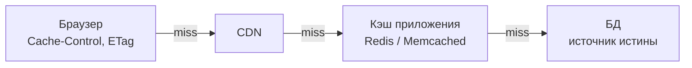
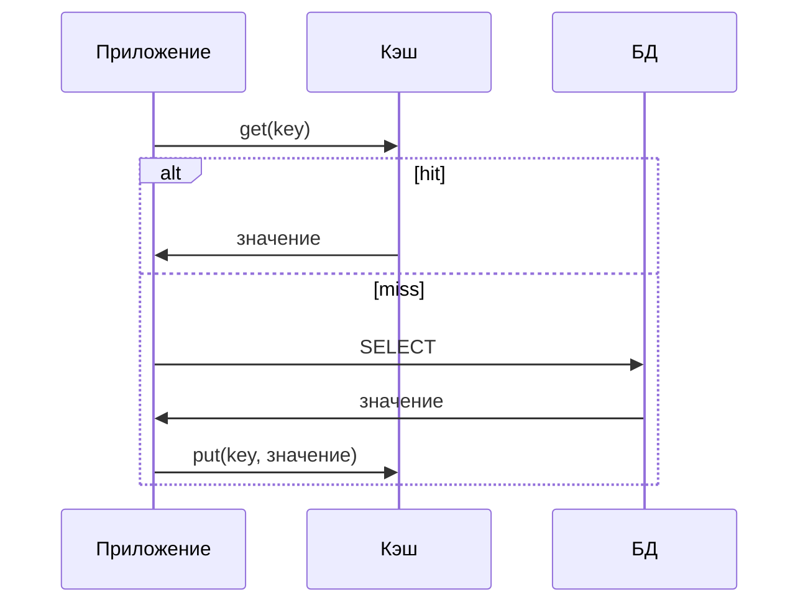
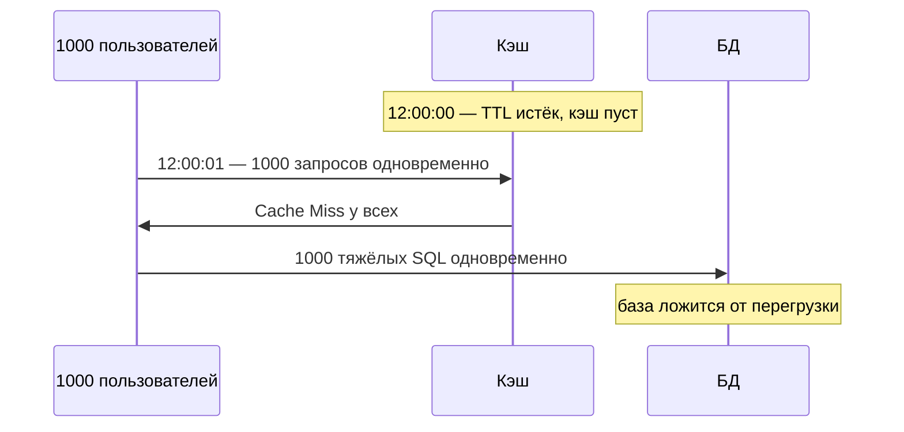

---
tags:
  - Junior
  - Middle
  - System Design
  - Кэширование
---

# Строительные блоки

Из чего собирают систему, которая держит нагрузку: балансировщики L4 и L7 и их алгоритмы, кэш и его вытеснение, cache stampede, очереди сообщений и CDN. На собесе спрашивают, чем L4 отличается от L7, почему sticky sessions — антипаттерн, как инвалидировать кэш и как не положить базу толпой запросов на истёкший ключ.

## Строительные блоки { #building-blocks }

### Чем L4-балансировщик отличается от L7? { #l4-l7 }

**Уровень:** Middle

!!! abstract "Ответ вслух"
    Балансировщик стоит перед серверами, распределяет трафик и убирает мёртвые узлы по health-check'ам. L4 видит только IP и порт и просто перекидывает пакеты — быстро и дёшево. L7 видит URL, заголовки и cookie, поэтому умеет роутить по содержимому и терминировать SSL, но тратит больше ресурсов.

Балансировщик нагрузки (load balancer) — регулировщик на перекрёстке. Он распределяет трафик так, чтобы ни один сервер не упал от перегрузки, пока другие простаивают. Это основа горизонтального масштабирования и высокой доступности.

| | **L4 (Transport — TCP/UDP)** | **L7 (Application — HTTP/HTTPS)** |
|---|---|---|
| **Что видит** | Только IP и порт | URL, заголовки, cookie, тело |
| **Скорость** | Очень быстрый | Медленнее (распаковка пакета) |
| **Ресурсы** | Минимум CPU и памяти | Больше CPU и памяти |
| **Возможности** | Просто перекидывает пакеты | Роутинг по URL, SSL termination, кэш |
| **Пример решения** | «Отправь на сервер 2» | «/images → файловый сервер, /api → бэкенд» |

L4 — простой, но быстрый. L7 — умнее, но дороже: терминирует SSL, то есть расшифровывает HTTPS на балансировщике, и роутит по содержимому. Номера L4 и L7 — уровни модели OSI, см. [Сети → OSI и TCP/IP](../networks/networks.md#osi-tcpip).

Стандартный первый ход в дизайне: «Ставим L7-балансировщик с health-check'ами перед пулом **stateless**-серверов, сессии — в Redis».

!!! warning "Ловушка: роутинг по URL на L4"
    L4-балансировщик не расшифровывает трафик и не видит HTTP, поэтому «/api на бэкенд, /images на файловый сервер» он сделать не может. Для роутинга по содержимому и SSL termination нужен L7.

??? question "Проверь себя"
    1. Что видит L4-балансировщик, а что — L7?
    2. Что такое SSL termination и на каком балансировщике она возможна?
    3. С чего начинается типичный дизайн с балансировщиком?

### Какие есть алгоритмы балансировки? { #lb-algorithms }

**Уровень:** Middle

!!! abstract "Ответ вслух"
    Round Robin раздаёт запросы по очереди и подходит, когда серверы и запросы одинаковы; Weighted Round Robin даёт мощному серверу больший вес. Least Connections шлёт трафик туда, где меньше активных подключений, — это нужно для тяжёлых долгих запросов. IP hash и consistent hashing всегда отправляют клиента на один и тот же сервер.

- **Round Robin (карусель)** — запросы раздаются по очереди: серверу 1, 2, 3, снова 1. Подходит, когда серверы одинаковы и запросы примерно равны по нагрузке. **Weighted Round Robin** даёт мощному серверу больший вес.
- **Least Connections** — трафик идёт на сервер с наименьшим числом активных подключений. Нужен для тяжёлых долгих запросов — скачивания файлов, WebSocket, сложных отчётов, — где Round Robin может добить уже занятый сервер.
- **IP hash / Consistent hashing** — один клиент всегда попадает на один сервер без sticky-куки. Про consistent hashing — в [Распределённых данных](distributed-data.md#consistent-hashing).

!!! warning "Ловушка: Round Robin и неравные запросы"
    Round Robin не знает веса запроса и продолжает слать новые на сервер, который уже занят тяжёлыми. Результат — один сервер падает от OOM, остальные простаивают. Разбор такого случая — в [кейсе с PDF-отчётами](interview.md#case-round-robin).

??? question "Проверь себя"
    1. Когда Round Robin работает хорошо?
    2. Для каких запросов нужен Least Connections?
    3. Как добиться, чтобы клиент всегда попадал на один сервер без cookie?

### Почему sticky sessions — антипаттерн? { #sticky-sessions }

**Уровень:** Junior

!!! abstract "Ответ вслух"
    Sticky sessions привязывают клиента к одному серверу через cookie, чтобы не потерять сессию в памяти сервера. Но нагрузка распределяется неравномерно, а при падении сервера все привязанные к нему пользователи теряют сессии. Правильно — хранить сессии вне сервера, например в Redis.

Пользователь залогинился, сессия в памяти Сервера А. Следующий запрос балансировщик кинул на Сервер Б — пользователь «разлогинился». Sticky sessions (липкие сессии) привязывают клиента к одному серверу через cookie.

!!! warning "Ловушка: лечить привязкой, а не хранением"
    Липкие сессии ломают равномерность — на одном сервере скапливается много пользователей. А если сервер падает, все «прилипшие» к нему теряют сессии. Правильное решение — хранить сессии не в памяти, а в Redis: тогда любой сервер обслужит любого пользователя.

??? question "Проверь себя"
    1. Какую проблему пытаются решить sticky sessions?
    2. Назови два недостатка sticky sessions.
    3. Где хранить сессии, чтобы любой сервер мог обслужить любого пользователя?

### Где и как кэшировать? { #caching }

**Уровень:** Middle

!!! abstract "Ответ вслух"
    Кэш снижает latency и разгружает БД; при соотношении чтения и записи 100:1 он решает почти всё. Уровни — браузер, CDN, кэш приложения (Redis, Memcached) и БД как источник истины. Основные паттерны записи — Cache-Aside, Write-Through и Write-Behind.

**Уровни кэша** — hit на любом из них, и дальше запрос не идёт:

До БД доходят только промахи.

**Паттерны кэширования:**

- **Cache-Aside (Lazy Loading)** — приложение сначала идёт в кэш. Hit — отдаём; miss — идём в БД, кладём результат в кэш и отдаём. Кэшируется только то, что реально запрашивают, и если кэш упадёт, система выживет, обращаясь к БД напрямую.
- **Write-Through (сквозная запись)** — пишем в кэш, кэш синхронно пишет в БД, ответ приходит, когда сохранилось в обоих местах. В кэше всегда свежие данные, но запись медленнее.
- **Write-Behind (отложенная запись)** — пишем в кэш и сразу получаем ОК, а кэш асинхронно сбрасывает данные в БД пачками. Запись максимально быстрая — подходит для счётчиков просмотров и лайков.

Cache-Aside в Spring делается аннотацией `@Cacheable` — настройка и подводные камни разобраны в [Кэширование в Spring](../spring/spring-caching.md#cacheable). Тот же паттерн на Redis — в [NoSQL](../database/nosql.md).

!!! warning "Ловушка: Write-Behind для важных данных"
    Если кэш сгорит до сброса в БД, данные потеряны. Write-Behind годится для того, что не жалко потерять, — счётчиков, лайков, просмотров. Деньги и заказы так не пишут.

??? question "Проверь себя"
    1. Как работает Cache-Aside при hit и при miss?
    2. Чем Write-Through отличается от Write-Behind?
    3. Что случится с системой на Cache-Aside, если кэш упадёт?

### Как кэш вытесняет и инвалидирует данные? { #eviction }

**Уровень:** Junior

!!! abstract "Ответ вслух"
    Когда кэш заполнен, LRU выкидывает то, к чему дольше всего не обращались, LFU — то, к чему обращались меньше всего раз. TTL удаляет записи по истечении времени жизни и обычно комбинируется с LRU. Чтобы не отдавать устаревшее, ставят короткий TTL или явно удаляют ключ при записи в БД.

**Стратегии вытеснения (eviction):**

- **LRU (Least Recently Used)** — выкидывает то, к чему дольше всего не обращались. Стандартный выбор: вчерашняя статья уйдёт и освободит место сегодняшней популярной.
- **LFU (Least Frequently Used)** — выкидывает то, к чему обращались меньше всего раз. Хорошо для статических справочников, плохо для трендов.
- **TTL** — запись удаляется по истечении времени жизни; обычно комбинируется с LRU.

**Инвалидация** — как не отдавать устаревшее после изменения в БД: короткий TTL либо явное удаление или обновление ключа при записи. Недаром шутка: «в программировании две сложные вещи — инвалидация кэша и придумывание имён».

!!! warning "Ловушка: LFU для трендов"
    LFU копит счётчики: статья, которую читали миллион раз месяц назад, вытеснит сегодняшнюю, у которой пока тысяча просмотров. Там, где популярность быстро меняется, берут LRU.

??? question "Проверь себя"
    1. Чем LRU отличается от LFU?
    2. Почему LFU плохо подходит для новостной ленты?
    3. Какими двумя способами инвалидируют кэш?

### Что такое cache stampede и как его лечить? { #cache-stampede }

**Уровень:** Senior

!!! abstract "Ответ вслух"
    Cache stampede, или thundering herd, — когда популярный ключ протухает и тысячи запросов одновременно получают miss и бьют в БД. База ложится от перегрузки. Лечат мьютексом — в БД идёт только первый поток, остальные ждут или получают устаревшую копию, — либо вероятностным ранним обновлением до истечения TTL.

Главная страница закэширована с TTL = 5 минут:

Как лечить:

- **Mutex / Lock** — когда кэш протухает, право сходить в БД получает только первый поток, захвативший лок. Остальные 999 ждут или получают чуть устаревшую копию (stale data), пока первый не обновит кэш. Приём знаком по [блокировкам в Java](../concurrency/locks.md).
- **Probabilistic early expiration** — вероятностное раннее обновление до истечения TTL, чтобы ключ не протухал у всех одновременно.

!!! warning "Ловушка: одинаковый TTL у всех ключей"
    Если кэш прогрели разом с одним TTL, все ключи протухнут одновременно — и stampede случится не на одном ключе, а на всём кэше. Именно так в [кейсе с падением базы в 10:10](interview.md#case-stampede) кэш, созданный в 10:00 с TTL 10 минут, истёк ровно в 10:10.

??? question "Проверь себя"
    1. Почему истечение одного популярного ключа может положить БД?
    2. Как мьютекс защищает от cache stampede?
    3. Что такое probabilistic early expiration?

### Зачем нужны очереди сообщений? { #message-queues }

**Уровень:** Junior

!!! abstract "Ответ вслух"
    Очередь — посредник для асинхронного общения: producer кладёт сообщение, consumer забирает в своём темпе. Она даёт развязку сервисов, буферизацию пиков и устойчивость к падению получателя. Модели две: point-to-point, где сообщение получает один consumer, и pub/sub, где его получают все подписчики.

Что даёт очередь:

- **Развязка** — сервисы не знают друг о друге.
- **Буферизация** — пик оседает в очереди, а не роняет получателя.
- **Устойчивость** — получатель упал, сообщения ждут.

Две модели:

- **Point-to-point (queue)** — сообщение получает **один** consumer из группы. Это распределение задач: обработать платёж, отправить письмо.
- **Pub/Sub (topic)** — сообщение получают **все** подписчики. Это события: «заказ создан» → склад, аналитика, почта.

| | **RabbitMQ** | **Kafka** |
|---|---|---|
| **Суть** | Классический брокер очередей | Распределённый лог событий |
| **Сообщения** | Удаляются после подтверждения | Хранятся, можно перечитать заново |
| **Сильная сторона** | Гибкая маршрутизация, модель «сделай задачу» | Огромный throughput, стриминг событий, event sourcing |

Устройство Kafka разобрано в [Брокер: топики, партиции, хранение](../kafka/kafka.md).

!!! warning "Ловушка: poison pill"
    Сломанное сообщение, которое консьюмер не может обработать, брокер будет отдавать снова и снова — и очередь встанет. Поэтому после нескольких ретраев с растущей паузой (например, 1 с, 3 с, 10 с) сообщение перекладывают в Dead Letter Queue, и очередь работает дальше. Как это настраивается, разобрано в [Kafka: Гарантии доставки](../kafka/kafka-reliability.md).

??? question "Проверь себя"
    1. Какие три свойства даёт очередь сообщений?
    2. Чем point-to-point отличается от pub/sub?
    3. Чем Kafka отличается от RabbitMQ в хранении сообщений?

### Что даёт CDN? { #cdn }

**Уровень:** Junior

!!! abstract "Ответ вслух"
    CDN (Content Delivery Network) — сеть географически распределённых edge-серверов, которые кэшируют статику рядом с пользователем. Запрос через океан идёт ~150 мс, до ближайшего edge — единицы миллисекунд. В любой системе с картинками или видео CDN появляется по умолчанию.

CDN кэширует картинки, видео, JS и CSS рядом с пользователем.

- **Pull** — CDN сам тянет контент с origin при первом промахе и кэширует. Это дефолт, просто.
- **Push** — заливаешь контент заранее сам. Больше контроля.
- Бонусы: разгрузка origin-сервера, TLS-терминация на краю, защита от DDoS.

!!! warning "Ловушка: первый запрос в Pull CDN"
    В модели Pull первый запрос к новому контенту — промах: edge идёт за ним на origin, и пользователь получает полную задержку. Если важно, чтобы контент был на краю заранее, например к релизу видео, используют Push.

??? question "Проверь себя"
    1. Почему CDN снижает задержку?
    2. Чем Pull CDN отличается от Push CDN?
    3. Что CDN даёт, кроме скорости?

## Шпаргалка { #cheatsheet }

<!-- --8<-- [start:cheatsheet] -->
| Тема | Запомнить |
|---|---|
| **L4 vs L7** | L4 — IP/порт, быстро. L7 — URL/заголовки, умный роутинг + SSL termination |
| **RR vs Least Connections** | RR — равные запросы. LC — тяжёлые долгие запросы |
| **Sticky sessions** | Антипаттерн. Лучше — сессии в Redis |
| **Cache-Aside** | Читай кэш → miss → БД → положи в кэш. В Spring — `@Cacheable` |
| **Write-Through vs Write-Behind** | Through — синхронно, свежо. Behind — async, быстро, риск потери |
| **LRU vs LFU** | LRU — давно не трогали. LFU — мало раз трогали |
| **Cache stampede** | Толпа на истёкший TTL. Лечить mutex-локом или ранним обновлением |
| **Очереди** | Point-to-point — один consumer, pub/sub — все. Битые сообщения — в DLQ |
| **CDN** | Edge рядом с пользователем: единицы мс вместо ~150 мс. Pull — дефолт |

<!-- --8<-- [end:cheatsheet] -->
