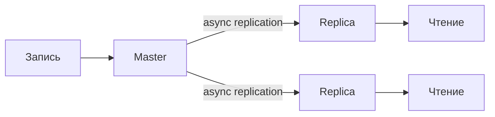
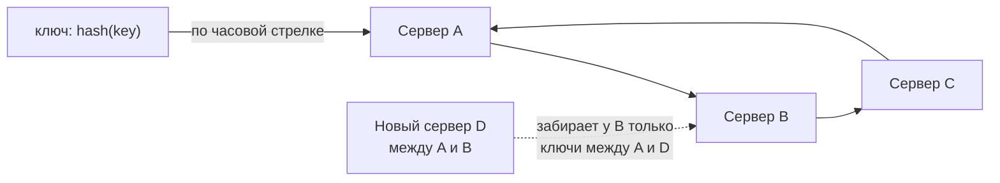
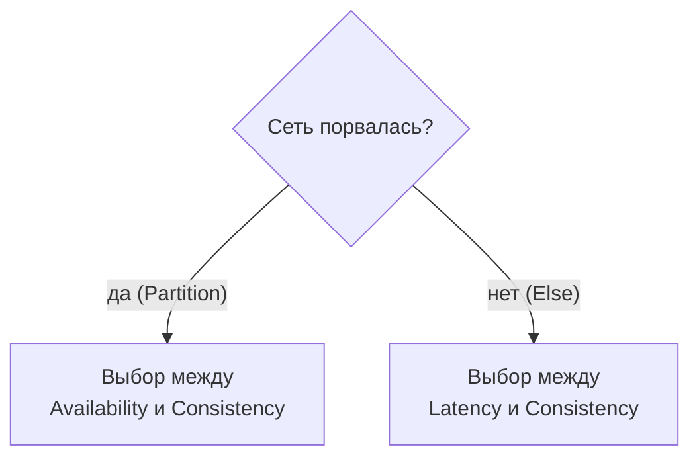
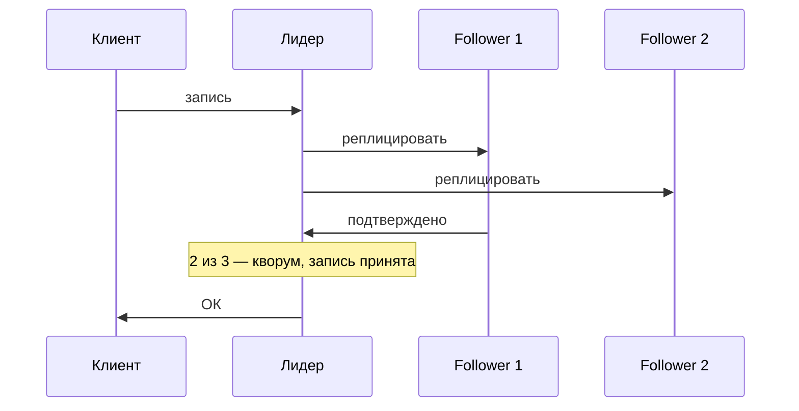

---
tags:
  - Middle
  - Senior
  - System Design
  - Базы данных
---

# Распределённые данные

Как данные живут на нескольких узлах: репликация, партиционирование и шардирование, consistent hashing, а также теория — CAP, PACELC, модели согласованности и консенсус. Это фундамент SD-интервью: спрашивают, как выбрать shard key, что такое replication lag и что выбрать, CP или AP, для конкретного сервиса.

## Репликация и шардирование { #data-scaling }

Как разнести данные по нескольким серверам, когда один уже не справляется с чтением, записью или объёмом.

### Как масштабировать БД репликацией? { #replication }

**Уровень:** Middle

!!! abstract "Ответ вслух"
    Масштабирование БД идёт в три этапа: репликация, партиционирование, шардирование — и сразу шардировать нельзя. При репликации Master принимает запись, а реплики обслуживают чтение. Это разгружает Master и даёт высокую доступность, но реплики отстают — replication lag.

Master принимает запись (INSERT, UPDATE, DELETE), реплики — только чтение (SELECT). Если Master умер, реплика становится новым Master.

- **Master-Master** — писать можно в несколько узлов: запас по записи, гео-распределение. Плата — **конфликты записи**, когда два узла изменили одно и то же по-разному; их разрешают, например, по last-write-wins с timestamp.
- **Синхронная репликация** — master ждёт подтверждения реплик перед ответом: durability, но медленно.
- **Асинхронная репликация** — master отвечает сразу: быстро, но есть lag и риск потерять хвост незареплицированных записей при падении master.

!!! warning "Ловушка: replication lag"
    Копирование с Master на реплику занимает миллисекунды, а под нагрузкой — секунды. Записал данные, тут же прочитал с реплики — а их там ещё нет. Для критичных чтений читают с Master — это модель read-your-writes.

??? question "Проверь себя"
    1. В каком порядке масштабируют БД?
    2. Чем синхронная репликация отличается от асинхронной?
    3. Что такое replication lag и как с ним жить?

### Чем партиционирование отличается от шардирования? { #partitioning }

**Уровень:** Middle

!!! abstract "Ответ вслух"
    Партиционирование делит таблицу на части внутри одного сервера: горизонтально по строкам (например, по месяцам) или вертикально по столбцам. Шардирование размазывает данные по нескольким серверам по ключу шарда. Партиционирование почти бесплатно для приложения, шардирование ломает JOIN'ы и транзакции.

Партиционирование (partitioning) происходит на **одном сервере**, внутри одной БД.

- **Горизонтальное (по строкам)** — гигантская таблица бьётся на партиции по правилу, например по месяцам. Для приложения таблица одна (`news`), но физически январь хранится отдельно от февраля. Ищем за март — БД не трогает январь.
- **Вертикальное (по столбцам)** — тяжёлые колонки (`avatar_image_bytes`, `huge_bio_text`) выносятся в отдельную таблицу `user_details` (1-к-1). В основной остаются частые `id`, `name`, `email`, и строки помещаются в кэш БД.

Шардирование — уже несколько серверов, разбор [ниже](#sharding).

!!! warning "Ловушка: шардировать то, что решается партиционированием"
    Если горячие данные — маленькая свежая часть таблицы, партиционирование по дате решает задачу на одном сервере. Шардирование здесь принесёт всю боль распределённой системы без выгоды — разобрано в [кейсе про 100M строк](interview.md#case-sharding).

??? question "Проверь себя"
    1. Где физически живут партиции, а где — шарды?
    2. Чем горизонтальное партиционирование отличается от вертикального?
    3. Как партиционирование по месяцам ускоряет запрос за март?

### Как шардировать и выбрать shard key? { #sharding }

**Уровень:** Senior

!!! abstract "Ответ вслух"
    Шардирование нужно, когда данные не помещаются на один сервер: строки распределяются по узлам на основе ключа шарда (shard key). Range-based ключ удобен для диапазонных запросов, но даёт перекос; hash-based распределяет равномерно, но диапазонные запросы идут во все шарды. Цена шардирования — JOIN'ы, распределённые транзакции и ребалансировка.

Данные размазываются по узлам на основе **shard key**: пользователи с ID 1–1M — на Сервере А, 1M–2M — на Сервере Б.

**Цена шардирования:**

1. **JOIN'ы перестают работать** — нельзя сделать JOIN между таблицами на разных серверах, джоины переезжают в Java-код.
2. **Распределённые транзакции** — перевод денег между серверами не покрыть обычным `BEGIN...COMMIT`, нужен [2PC](../architecture/distributed-transactions.md#two-phase-commit) или [Saga](../architecture/distributed-transactions.md#saga).
3. **Ребалансировка** — Сервер А заполнился, добавляем Сервер В и без остановки продакшена переносим на него часть данных.

**Выбор shard key** — ключевое решение, от него зависит равномерность:

- **Range-based** (по диапазону: дата, id, алфавит) — просто, удобны диапазонные запросы. Но легко получить перекос: весь свежий трафик бьёт в один шард.
- **Hash-based** (хэш от ключа) — равномерно. Но диапазонные запросы («все заказы за март») размазаны по всем шардам — дорого.

!!! warning "Ловушка: hotspot"
    Hotspot — шард, который получает непропорционально много трафика. Классика — «звёздный» пользователь: шард знаменитости с миллионами подписчиков перегружен. Лечится подмешиванием суффикса в ключ или выделением таких сущностей отдельно.

??? question "Проверь себя"
    1. Какие три проблемы приносит шардирование?
    2. Чем range-based shard key отличается от hash-based?
    3. Что такое hotspot и как его лечат?

### Что такое consistent hashing? { #consistent-hashing }

**Уровень:** Senior

!!! abstract "Ответ вслух"
    При наивном `hash(key) % N` добавление или удаление сервера меняет N, и почти все ключи переезжают. Consistent hashing замыкает пространство хэшей в кольцо: серверы — точки на нём, ключ обслуживает первый сервер по часовой стрелке. Новый узел забирает только соседний участок, а виртуальные узлы делают распределение равномерным.

Проблема `hash(key) % N`: добавили или убрали сервер — изменился N — **почти все ключи** переехали на новые места. Для кэша это тотальный miss, для шардов — массовая перебалансировка.

Решение — **кольцо**. Диапазон значений хэша замыкаем в круг, серверы ставим точками на нём по хэшу имени, а каждый ключ обслуживает первый сервер по часовой стрелке. Добавление или удаление узла двигает только **соседний участок** ключей — малую долю, а не всё.

Для равномерности каждый физический сервер представлен множеством **виртуальных узлов** — много точек на кольце.

Где применяется: распределённые кэши, Cassandra, DynamoDB. 16 384 хэш-слота Redis Cluster и 271 партиция Hazelcast — инженерные вариации той же идеи.

!!! warning "Ловушка: кольцо без виртуальных узлов"
    Если у каждого сервера одна точка на кольце, участки получаются разного размера, и один сервер может обслуживать в разы больше ключей. Кроме того, при падении узла весь его участок достаётся одному соседу. Виртуальные узлы размазывают и нагрузку, и последствия падения.

??? question "Проверь себя"
    1. Что не так с `hash(key) % N` при добавлении сервера?
    2. Какой сервер обслуживает ключ на кольце?
    3. Зачем нужны виртуальные узлы?

## Теория распределённых систем { #distributed }

### Что утверждает CAP-теорема? { #cap }

**Уровень:** Middle

!!! abstract "Ответ вслух"
    CAP говорит, что из согласованности (Consistency), доступности (Availability) и устойчивости к разделению сети (Partition tolerance) при сбое можно гарантировать только два. Сеть в реальном мире ломается всегда, поэтому P — не опция, и выбор идёт между C и A в момент аварии. Для платежей берут CP, для корзины и закладок — AP.

- **C (Consistency)** — каждый клиент видит самые последние данные или ошибку. Никто не видит устаревшую версию.
- **A (Availability)** — любой живой узел всегда отвечает без ошибки.
- **P (Partition tolerance)** — система работает, даже если сеть между узлами порвалась.

При обрыве связи между дата-центрами:

- **CP-система** — запрещаем запись и чтение на изолированном узле. Пользователь видит «Ошибка 500» (жертвуем A), но никто не прочитает устаревшую финансовую сводку. _Примеры: MongoDB, HBase, Redis Cluster в строгом режиме, ZooKeeper/etcd._
- **AP-система** — узел продолжает отвечать из того, что у него есть. Сайт работает, но данные могут быть устаревшими (жертвуем C). Это **eventual consistency**: когда сеть починят, узлы синхронизируются. _Примеры: Cassandra, DynamoDB, Hazelcast._

CAP с точки зрения семейств NoSQL разобрана в [NoSQL](../database/nosql.md).

!!! warning "Ловушка: «выбираем CA»"
    CA-системы в распределённом мире не бывает: разделение сети случится, и тогда придётся выбрать, отказать или отдать устаревшее. Правильная формулировка: «поскольку P неизбежно, вопрос — чем жертвуем при разделении».

??? question "Проверь себя"
    1. Почему P в CAP — не опция?
    2. Как ведёт себя CP-система при разделении сети, а как — AP?
    3. Что выбрать для сервиса закладок и что — для платежей?

### Что добавляет PACELC? { #pacelc }

**Уровень:** Senior

!!! abstract "Ответ вслух"
    CAP описывает только момент аварии, а 99.9% времени сеть работает. PACELC добавляет вторую половину: если разделение (P) — выбираем между A и C, иначе (E, else) — между задержкой (L, latency) и согласованностью (C). Быстрый ответ без ожидания реплик — это L, ожидание подтверждения от всех узлов — это C.

Сеть в порядке, пользователь публикует срочный пресс-релиз:

- **Выбрал Latency** — узел записал к себе и сразу ответил ОК. Быстро, но пока данные асинхронно летят на другие узлы, кто-то прочитает старую версию.
- **Выбрал Consistency** — узел записал, дождался записи на всех узлах и только потом ответил ОК. Согласованность полная, но задержка большая.

!!! warning "Ловушка: обсуждать только аварию"
    Если на вопрос о согласованности отвечать только через CAP, упускаешь основной режим работы системы. Большую часть времени выбор стоит между latency и consistency — его и надо проговорить для каждой операции.

??? question "Проверь себя"
    1. Что означают буквы в PACELC?
    2. Какой выбор приходится делать, когда сеть работает?
    3. Что выберет сервис закладок при рабочей сети?

### Какие бывают модели согласованности? { #consistency-models }

**Уровень:** Senior

!!! abstract "Ответ вслух"
    От строгих к слабым: strong (линеаризуемость), causal, read-your-writes, monotonic reads и eventual. Чем строже модель, тем больше координации и тем медленнее система. Задача дизайна — выбрать минимально достаточную модель под каждую операцию, а не тащить strong везде.

Спектр гарантий — от строгих (медленно, нужна координация) к слабым (быстро):

- **Strong (линеаризуемость)** — любое чтение видит последнюю запись, как будто копия одна. Деньги, остатки товара на складе.
- **Causal** — причинно-связанные события все видят в правильном порядке: ответ на комментарий не появится раньше самого комментария. Независимые события могут расходиться.
- **Read-your-writes** — **свои** изменения видишь всегда, даже если чужие ещё догоняют. Лечит «написал коммент → обновил страницу → его нет» при replication lag.
- **Monotonic reads** — данные не «прыгают назад во времени»: раз увидел значение, более старое уже не покажут.
- **Eventual** — реплики расходятся ненадолго, но сойдутся. Лайки, лента, счётчики просмотров.

!!! warning "Ловушка: strong consistency везде"
    Строгая согласованность требует координации узлов на каждую операцию и стоит latency и availability. Для лайков и счётчиков просмотров хватает eventual, а read-your-writes закрывает самую заметную пользователю проблему — пропавший собственный комментарий.

??? question "Проверь себя"
    1. Чем causal consistency отличается от strong?
    2. Какую проблему решает read-your-writes?
    3. Какая модель достаточна для счётчика лайков?

### Как узлы договариваются: Raft и Paxos? { #consensus }

**Уровень:** Senior

!!! abstract "Ответ вслух"
    Консенсус — способ узлам договориться об одном значении или порядке операций, несмотря на сбои. В Raft узлы выбирают лидера, лидер упорядочивает и реплицирует записи, и запись принята, когда её подтвердило большинство — кворум N/2+1. Поэтому кластеры делают нечётного размера: 3 или 5 узлов.

**Paxos** — классический алгоритм, известный тем, что его трудно понять; **Raft** сделан понятным. Интуиция Raft:

1. Узлы выбирают **лидера** (leader election).
2. Лидер принимает все записи, упорядочивает и реплицирует.
3. Запись принята, когда её подтвердило **большинство** — кворум, N/2+1.

Следствия:

- Кластеры делают **нечётного размера** (3, 5) — большинство определяется однозначно.
- Кластер переживает падение меньшинства узлов, но встаёт без большинства.
- Два конфликтующих решения не могут победить одновременно — любые два большинства пересекаются.

Raft используют etcd, Consul, Kafka KRaft, CP Subsystem в Hazelcast; он же выбирает новый Master при failover. **ZooKeeper** использует не Raft, а собственный протокол **ZAB** (ZooKeeper Atomic Broadcast) с той же идеей: лидер, кворум, упорядоченная репликация. Реализовывать это самому не надо — надо понимать, что внутри этих систем и зачем.

!!! warning "Ловушка: кластер из 4 узлов"
    Кворум для 4 узлов — 3, поэтому кластер переживает падение только одного узла, ровно как кластер из 3. Четвёртый узел добавляет стоимость, но не отказоустойчивость. Поэтому размер кластера — нечётный.

??? question "Проверь себя"
    1. Из каких трёх шагов состоит интуиция Raft?
    2. Почему кластеры консенсуса делают нечётного размера?
    3. Какой протокол консенсуса использует ZooKeeper?

## Шпаргалка { #cheatsheet }

<!-- --8<-- [start:cheatsheet] -->
| Тема | Запомнить |
|---|---|
| **Replication** | Master пишет, реплики читают. Replication lag → read-your-writes с master |
| **Partitioning** | Один сервер. Горизонтальное (строки) / вертикальное (столбцы) |
| **Sharding** | Много серверов. Боль: джоины, распределённые транзакции, ребаланс. Hotspot от «звёзд» |
| **Consistent hashing** | Кольцо: новый узел двигает только соседний участок. Виртуальные узлы для равномерности |
| **CAP** | Сеть рвётся всегда → выбор C vs A в аварию. CP — деньги, AP — корзина и закладки |
| **PACELC** | Без аварии — выбор между latency и consistency |
| **Модели согласованности** | Strong → causal → read-your-writes → monotonic → eventual. Бери минимально достаточную |
| **Консенсус** | Кворум N/2+1, кластеры нечётные (3/5); Raft — etcd/Consul/KRaft, ZAB — ZooKeeper |

<!-- --8<-- [end:cheatsheet] -->
