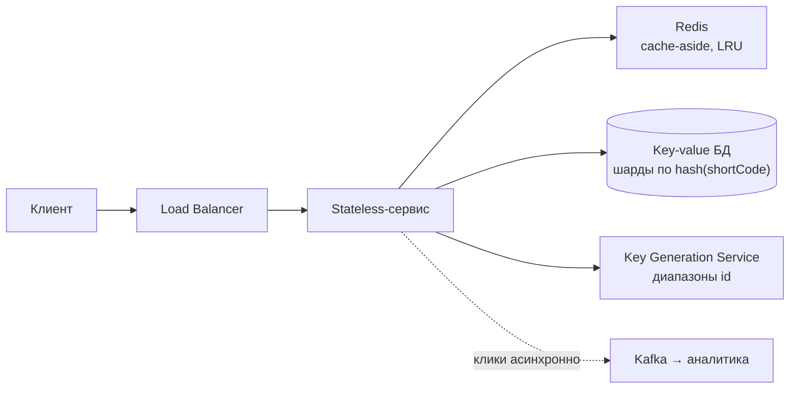

---
tags:
  - Junior
  - Middle
  - Senior
  - System Design
---

# Интервью и оценка нагрузки

Как проходит интервью по system design: требования и метрики системы, оценка нагрузки «на салфетке», масштабирование сервиса, методология из шести шагов, классические задачи вроде URL shortener и разбор кейсов. Отдельные блоки, из которых собирают дизайн, — на страницах [Строительные блоки](building-blocks.md) и [Распределённые данные](distributed-data.md).

## Требования и оценки { #fundamentals }

### Какими метриками описывают систему? { #metrics }

**Уровень:** Junior

!!! abstract "Ответ вслух"
    Latency — время одного запроса, его меряют перцентилями p50, p95, p99, а не средним. Throughput — сколько запросов система обрабатывает в единицу времени (QPS, RPS). Availability — доля времени, когда система работает: 99.9% — это около 8,8 часа простоя в год.

- **Latency** — время **одного** запроса. Смотрим **перцентили** (p50/p95/p99), а не среднее: p99 = 200 мс значит «1% запросов медленнее 200 мс». Именно хвост портит UX.
- **Throughput** — запросов в **единицу времени** (QPS/RPS). Latency — про один запрос, throughput — про поток.
- **Availability** — доля времени, когда система работает:

| Девятки | Downtime в год |
|---|---|
| 99% | ~3.65 дня |
| 99.9% | ~8.76 часа |
| 99.99% | ~52 минуты |
| 99.999% | ~5 минут |

Каждая следующая девятка — на порядок дороже. Полезно спросить у интервьюера, какая нужна.

- **Consistency** — все ли клиенты видят одни и те же данные. Подробно — в [CAP-теореме](distributed-data.md#cap).
- **Durability** — данные не теряются после подтверждённой записи; достигается репликацией на несколько узлов.

!!! warning "Ловушка: среднее вместо перцентилей"
    Средняя latency 50 мс может скрывать 1% запросов по 2 секунды — и эти пользователи уходят. Поэтому смотрят p99. Вторая ловушка — путать durability и availability: данные могут быть целы, но временно недоступны.

??? question "Проверь себя"
    1. Что означает p99 = 200 мс?
    2. Сколько простоя в год допускает 99.99%?
    3. Чем durability отличается от availability?

### Как оценить нагрузку «на салфетке»? { #estimation }

**Уровень:** Middle

!!! abstract "Ответ вслух"
    Считаешь средний QPS из числа активных пользователей, умножаешь на 2–3 для пика, оцениваешь соотношение чтения и записи и объём хранилища на годы. Нужна не точность, а порядок величины. Из чисел делаешь архитектурный вывод: «100:1 — нужен кэш», «терабайты — нужно шардирование».

Оценка «на салфетке» (back-of-the-envelope estimation) обосновывает архитектуру числами, а не «на глаз».

**Числа, которые надо помнить:**

- Секунд в сутках ≈ 86 400 (**~10⁵**), в году ≈ **3×10⁷**.
- ASCII-символ ≈ 1 байт, UUID ≈ 16 байт, JSON-событие ≈ 1 KB, картинка ≈ 100 KB – 1 MB.
- Задержки: RAM — наносекунды, SSD — микросекунды, сеть внутри ДЦ — ~0.5 мс, через океан — ~150 мс.

**Алгоритм на примере** — Twitter-подобный сервис, 300M MAU:

1. **QPS**: DAU ≈ 150M, по 2 запроса в день → 300M / 10⁵ ≈ **3000 QPS** в среднем.
2. **Пик**: трафик неравномерен, ×2–3 → **~9000 QPS**. Мощности проектируем на пик.
3. **Read/Write**: соцсеть ≈ 100:1 → ~30 QPS записи и ~3000 чтения → **кэш обязателен**.
4. **Хранилище**: 30 твитов/с × 300 байт × 3×10⁷ с ≈ **~270 GB/год** текста. С медиа и репликацией ×3 — терабайты → **шардирование**.

!!! warning "Ловушка: считать точно и молча"
    Оценивают ход рассуждения, а не цифру. Округляй агрессивно, считай вслух и обязательно делай вывод: «100:1 → кэш», «терабайты → шардинг», «99.99% → репликация». Число без вывода ничего не даёт.

??? question "Проверь себя"
    1. Сколько секунд в сутках и в году — в порядках величины?
    2. Почему мощности проектируют на пиковый, а не средний QPS?
    3. Какой архитектурный вывод следует из соотношения чтения и записи 100:1?

### Как масштабировать сервис? { #scaling }

**Уровень:** Junior

!!! abstract "Ответ вслух"
    Вертикально — мощнее сервер: просто, но есть потолок железа и единая точка отказа. Горизонтально — больше серверов за балансировщиком; это путь по умолчанию, и он требует stateless-серверов. Когда сессии лежат в Redis или в JWT, любой инстанс обслужит любого пользователя, и работает автоскейлинг.

- **Вертикальное (scale up)** — мощнее сервер (CPU, RAM). Просто, но есть потолок железа, наверху дорого, единая точка отказа.
- **Горизонтальное (scale out)** — больше серверов за балансировщиком. Дефолтный путь. Требование — stateless.

**Stateless** — сервер не хранит состояние клиента в своей памяти: сессии — в Redis или БД либо в JWT у клиента. Тогда инстансы взаимозаменяемы, и становится возможен **autoscaling** — добавлять и убивать инстансы по CPU или QPS. Фраза для собеса: «делаем серверы stateless, состояние в Redis — и горизонтальное масштабирование становится тривиальным».

**Load shedding** — при перегрузке осознанно отбросить часть запросов, например низкоприоритетные, чтобы корректно обслужить остальные. Лучше отказать 5%, чем деградировать на 100%.

!!! warning "Ловушка: состояние в памяти инстанса"
    Локальный кэш сессий, загруженные файлы на диске контейнера, счётчики в памяти — всё это делает инстансы невзаимозаменяемыми. Автоскейлер убьёт инстанс — и пользователи потеряют данные. Состояние выносят в общие хранилища.

??? question "Проверь себя"
    1. Чем вертикальное масштабирование отличается от горизонтального?
    2. Что значит stateless и почему это условие горизонтального масштабирования?
    3. Что такое load shedding?

## Собеседование { #interview }

### Как проходить интервью по system design? { #methodology }

**Уровень:** Middle

=== "Коротко"

    !!! abstract "Ответ вслух"
        За ~40 минут пройди шесть шагов по порядку: требования, оценка масштаба, API, модель данных и high-level дизайн, deep dive, узкие места и trade-off'ы. Чаще валятся не на знаниях, а на структуре — прыгают в детали БД, не выяснив, что строят. Думай вслух и озвучивай цену каждого решения.

=== "Подробно"

    ```mermaid
    flowchart LR
        R["1. Требования<br/>~5 мин"] --> E["2. Масштаб<br/>~5 мин"]
        E --> A["3. API<br/>~5 мин"]
        A --> H["4. Данные + HLD<br/>~10 мин"]
        H --> D["5. Deep dive<br/>~10 мин"]
        D --> B["6. Bottlenecks<br/>~5 мин"]
    ```

    **1. Требования (~5 мин).** Никакого кода и квадратиков.

    - **Функциональные** — что система делает: только списываем и начисляем? Нужна история? Бронирование?
    - **Нефункциональные** — в каких условиях: какой RPS? Критична ли latency? Что важнее — availability или consistency?
    - Явно **сузь скоуп**: «фокусируюсь на X и Y, Z отмечу как расширение» — так показывают зрелость.

    Для ERP и финансов ответ про приоритет почти всегда — consistency: лучше система выдаст ошибку, чем продаст один товар двум людям.

    **2. Оценка масштаба (~5 мин).** [Back-of-the-envelope](#estimation): QPS средний и пиковый, read:write, объём на годы. Из чисел — архитектурные выводы: «100:1 → кэш», «терабайты → шардинг». Не пропускай: этот шаг обосновывает всё дальнейшее.

    **3. API (~5 мин).** Пара ключевых эндпоинтов — контракт системы:

    ```text
    POST /api/v1/inventory/reserve     — забронировать товар
    GET  /api/v1/inventory/{item_id}   — получить остатки
    ```

    Покажи понимание версионирования, идемпотентности (что будет, если клиент дважды вызовет POST из-за лага?) и правильных HTTP-статусов.

    **4. Модель данных + High-Level Design (~10 мин).** Рассуждай вслух: «Выбираю реляционную БД, потому что нужны строгие гарантии целостности и джоины для отчётов». Обсуди индексы, для критичных данных — append-only историю или Event Sourcing для аудита. Затем крупные блоки и поток данных:

    ```mermaid
    flowchart LR
        C["Клиент"] --> G["API Gateway"]
        G --> W["Warehouse Service"]
        W --> P[("PostgreSQL<br/>транзакция")]
        W --> K["Event Bus (Kafka)"]
        K --> B["Billing Service"]
        K --> A["Analytics"]
        K --> N["Notification"]
    ```

    **5. Deep dive (~10 мин).** Интервьюер начнёт ломать систему: _«А что если сервер упадёт после записи в БД, но до отправки в Kafka?»_ Здесь пригодятся [Transactional Outbox](../architecture/distributed-transactions.md#outbox), [идемпотентность консьюмеров](../architecture/distributed-transactions.md#delivery-guarantees), выбор shard key и стратегия кэша.

    **6. Bottlenecks и trade-off'ы (~5 мин).** Сам подними слабые места: единые точки отказа, hotspot'ы, поведение на пике. На этом шаге проверяют главное — видишь ли ты цену каждого выбора.

    Три правила:

    1. **Думай вслух.** Молчать 5 минут и выдать идеал хуже, чем 5 минут рассуждать о компромиссах и выдать решение с небольшим изъяном.
    2. **Нет серебряной пули.** У каждого решения есть плюсы и минусы — озвучивай их.
    3. **Озвучивай компромиссы:** «Redis для остатков даст скорость, но риск stale data — поэтому для чекаута идём в master-базу».

!!! warning "Ловушка: начать с базы данных"
    Самая частая ошибка — сразу рисовать таблицы и выбирать БД, не выяснив требования и масштаб. Тогда любое решение выглядит необоснованным, а интервьюер может сменить условия, и дизайн рассыпается. Требования и числа — всегда первые 10 минут.

??? question "Проверь себя"
    1. Назови шесть шагов интервью по system design по порядку.
    2. Зачем явно сужать скоуп на первом шаге?
    3. Что обсуждают на шаге bottlenecks?

### Как спроектировать URL shortener? { #url-shortener }

**Уровень:** Senior

!!! abstract "Ответ вслух"
    Система крайне read-heavy: ~40 QPS записи против ~4000 чтения, поэтому редирект обслуживается из кэша. Короткий код — 7 символов base62, а генерирует их Key Generation Service, раздающий серверам диапазоны id. Хранилище — key-value с шардированием по хэшу кода, аналитика кликов — асинхронно через Kafka.

Эталонный проход по [методологии](#methodology).

**1. Требования.** Функциональные: укоротить URL; редиректить по короткому. Расширения — проговорить и отложить: кастомные алиасы, TTL ссылки, аналитика кликов. Нефункциональные: крайне **read-heavy**, редирект — **очень быстрый**, высокая **availability** (редиректы лежат — все ссылки мертвы), коды уникальны.

**2. Масштаб.** 100M новых ссылок в месяц → запись ≈ **40 QPS**. Read:write 100:1 → чтение ≈ **4000 QPS** (пик ~10 000) → **агрессивный кэш**. Хранилище: запись ~500 байт × 6 млрд за 5 лет ≈ **~3 ТБ** → закладываем **шардирование**; длина кода: base62 (a–z, A–Z, 0–9), 62⁷ ≈ 3.5 трлн → **7 символов** хватит с запасом.

**3. API.**

```text
POST /shorten          body: { longUrl } → { shortUrl }
GET  /{shortCode}      → 301/302 redirect на longUrl
```

**4. High-level.** Клиент → LB → stateless-сервис → Redis (cache-aside) → БД. Запись: сгенерировать код, сохранить пару. Чтение: кэш → miss → БД → положить в кэш → редирект.



**5. Deep dive — генерация кода.** Сюда копают в первую очередь:

- **А: хэш URL (MD5) + 7 символов.** Просто, но **коллизии** — проверка в БД и перегенерация, лишние чтения при записи.
- **Б: глобальный счётчик + base62.** Уникально без коллизий, но общий счётчик — узкое место и точка отказа при многих серверах.
- **В (лучший): Key Generation Service с диапазонами.** Отдельный сервис (или Redis, ZooKeeper) выдаёт серверам **диапазоны** id пачками: A — 1–1000, B — 1001–2000. Сервер раздаёт коды локально из своего диапазона: нет общего счётчика на каждый запрос, коллизии невозможны в принципе.

**5б. Deep dive — хранилище и кэш.** Паттерн доступа — точечный lookup `shortCode → longUrl` без связей и транзакций, это **кейс для key-value NoSQL** (DynamoDB, Cassandra), который тривиально шардится. Шардирование — hash по `shortCode`: диапазонные запросы не нужны, поэтому минус hash-шардинга не мешает. Кэш — Redis с LRU: популярные ссылки живут в кэше, hit rate высокий.

**6. Bottlenecks.**

- Редирект — критический путь: кэш обязателен, очень популярные ссылки — на CDN или edge.
- KGS — точка отказа: реплицируем, а серверы держат запас предвыданного диапазона.
- Hotspot (вирусная ссылка) сглаживают кэш и CDN.
- Аналитика кликов — **не синхронно** в пути редиректа: событие в Kafka, обработка асинхронно.

!!! warning "Ловушка: 301 или 302"
    **301 (permanent)** кэшируется браузером: повторные переходы быстрее, но клики идут мимо тебя, и аналитики нет. **302 (temporary)** — каждый клик идёт к тебе: есть аналитика, но чуть медленнее. Нужна аналитика — бери 302.

??? question "Проверь себя"
    1. Почему 7 символов base62 достаточно?
    2. Чем Key Generation Service с диапазонами лучше хэша URL и глобального счётчика?
    3. Почему аналитику кликов не пишут синхронно в пути редиректа?

### Ради чего спрашивают классические задачи? { #classic-tasks }

**Уровень:** Middle

!!! abstract "Ответ вслух"
    Каждую классическую задачу спрашивают ради конкретного приёма: URL shortener — ради генерации ключей, news feed — ради fan-out, чат — ради WebSocket и порядка сообщений, такси — ради геоиндексов. Готовя задачу, отрабатывай именно её приём. Для ленты стандартный ответ — гибрид push для обычных пользователей и pull для звёзд.

| Задача | Ради чего спрашивают |
|---|---|
| **URL shortener** | Генерация уникальных ключей (KGS + диапазоны), кэш, 301 vs 302 |
| **Pastebin** | То же + object storage (S3) для больших текстов, TTL, приватность |
| **Rate limiter** | Алгоритмы (token bucket и др.), распределённый счётчик в Redis |
| **News feed / Twitter** | **Fan-out on write vs on read**, гибрид для «звёзд», eventual consistency |
| **Чат / мессенджер** | WebSocket (persistent connections), доставка и порядок сообщений, presence |
| **Uber / такси** | Геоиндексы (geohash/quadtree), real-time обновления локаций, матчинг |
| **YouTube / Netflix** | Загрузка → транскодинг через очередь → CDN, адаптивный стриминг (HLS/DASH) |
| **Google Drive / Dropbox** | Чанкинг файлов, дедупликация, синхронизация, разрешение конфликтов |
| **Автокомплит** | Префиксное дерево (trie) + топ-K, прекомпьют популярных подсказок |
| **Нотификации** | Очереди с приоритетами, идемпотентность, ретраи, DLQ |
| **Distributed cache** | Consistent hashing, репликация, LRU |

**Fan-out:**

- **On write (push)** — при публикации поста раскладываем его в ленты всех подписчиков. Чтение мгновенное, но пост звезды с 50M фолловеров — это 50M записей.
- **On read (pull)** — собираем ленту в момент запроса. Запись дешёвая, чтение дорогое.
- **Гибрид** — стандартный ответ: push для обычных пользователей, pull для звёзд.

!!! warning "Ловушка: чистый fan-out on write"
    Push-модель хороша, пока у автора сотни подписчиков. Один пост звезды с 50M фолловеров порождает 50M записей и забивает систему на минуты. Поэтому звёзд обрабатывают через pull и подмешивают их посты при чтении.

??? question "Проверь себя"
    1. Ради какого приёма спрашивают news feed?
    2. Чем fan-out on write отличается от fan-out on read?
    3. Какие приёмы ждут в задаче про такси?

## Разбор кейсов { #cases }

### Почему Round Robin убивает один сервер? { #case-round-robin }

**Уровень:** Middle

!!! abstract "Ответ вслух"
    Round Robin раздаёт запросы вслепую, не зная их веса. Если на один сервер подряд попали несколько тяжёлых PDF-запросов, они копятся, а новые продолжают приходить. Лечится Least Connections или L7-роутингом по типу запроса, а тяжёлые отчёты лучше вынести в асинхронную очередь.

**Проблема:** 3 сервера генерируют PDF-отчёты, L4 + Round Robin, трафик равномерный. Но один сервер регулярно падает от OOM, а два других загружены на 20%.

**Решение:** генерация PDF — тяжёлая долгая операция. Если на один сервер случайно попало несколько тяжёлых запросов подряд, они копятся, а Round Robin продолжает слать новые. Варианты:

1. **Least Connections** — увидит, что сервер занят.
2. **L7** — роутинг по типу запроса.
3. **Асинхронная очередь** для тяжёлых PDF — лучший вариант.

!!! warning "Ловушка: «трафик равномерный — значит, балансировка ни при чём»"
    Равномерным может быть число запросов, но не их стоимость. Round Robin выравнивает количество, а не нагрузку. Поэтому смотреть надо на распределение тяжёлых запросов, а не на QPS.

??? question "Проверь себя"
    1. Почему один сервер падает при равномерном трафике?
    2. Какие три решения подходят в этом кейсе?
    3. Почему асинхронная очередь — лучший вариант для PDF?

### Что убило базу в 10:10, если Redis-узел сгорел в 10:05? { #case-stampede }

**Уровень:** Senior

!!! abstract "Ответ вслух"
    Базу убил cache stampede: кэш создан в 10:00 с TTL 10 минут и истёк в 10:10, тысячи клиентов одновременно получили miss и ударили в PostgreSQL. Смерть Redis-узла в 10:05 кэш не положила: кластер по Gossip заметил падение и повысил реплику до Master. Но репликация асинхронная, поэтому последние записи могли потеряться.

**Проблема 1 — что убило базу в 10:10.** [Cache stampede (thundering herd)](building-blocks.md#cache-stampede): TTL = 10 минут, кэш создан в 10:00, истёк в 10:10. Тысячи брокеров одновременно получили cache miss и одновременно ударили в PostgreSQL. Лечить — мьютексом (кэш обновляет один поток) или вероятностным ранним обновлением (probabilistic early expiration).

**Проблема 2 — почему смерть Redis в 10:05 не положила кэш.** В Redis Cluster у Master есть Replica. Узлы заметили падение по Gossip, проголосовали и повысили реплику до Master. Но репликация **асинхронная**: если Master принял запись и сгорел до репликации, эти данные потеряны — для кэша это не критично, он пересоберётся из БД.

!!! warning "Ловушка: искать причину в последнем инциденте"
    Падение Redis в 10:05 выглядит очевидной причиной, но кластер его пережил. Настоящая причина — момент истечения TTL. Сопоставляй время сбоя с TTL и расписаниями, а не только с соседними событиями.

??? question "Проверь себя"
    1. Почему база упала именно в 10:10?
    2. Как Redis Cluster пережил потерю узла?
    3. Какие данные могли потеряться при failover и почему это не страшно для кэша?

### Нужно ли шардировать таблицу на 100M строк? { #case-sharding }

**Уровень:** Middle

!!! abstract "Ответ вслух"
    Нет: шардирование здесь — пушка по воробьям, оно принесёт распределённые джоины и ребалансировку ради задачи одного сервера. Бизнесу нужны быстрые свежие новости, а архивы не важны. Горизонтальное партиционирование по году и вертикальное — вынос тяжёлого тела статьи — решают задачу на одной базе.

**Проблема:** таблица `kase_news` — 100M строк за 15 лет. Бизнес: «новости 2026 — мгновенно, на архивы всё равно». DevOps: «шардируем по `year`, 15 серверов».

**Решение:**

1. **Горизонтальное партиционирование** по `year` — БД физически разделит данные, и запрос за 2026 не тронет архивы. Свежие данные — маленькая горячая партиция в RAM.
2. **Вертикальное партиционирование** — вынести тяжёлое тело статьи в отдельную таблицу, оставив в основной `id`, `title`, `date` для быстрых списков.

!!! warning "Ловушка: шардировать по дате"
    Даже если бы шардирование было нужно, `year` — плохой shard key: весь свежий трафик пришёл бы на один шард 2026 года, а 14 остальных простаивали бы. Это классический hotspot range-based ключа.

??? question "Проверь себя"
    1. Почему шардирование здесь избыточно?
    2. Как партиционирование по году ускоряет запросы к свежим новостям?
    3. Чем плох `year` в роли shard key?

### Что делать сервису «Избранное», когда перерубили кабель между ДЦ? { #case-partition }

**Уровень:** Senior

!!! abstract "Ответ вслух"
    Для закладок выбираем AP: цена ошибки низкая, пользователь максимум секунду увидит неактуальный список. Оба дата-центра продолжают принимать запросы, а после починки сети узлы синхронизируются, конфликты решаются, например, по timestamp. При рабочей сети по PACELC тоже выбираем latency.

**Проблема:** экскаватор перерубил кабель Алматы–Астана. Сервис «Избранное», БД в двух дата-центрах, network partition.

**Решение:** выбираем **AP (Availability)**. В момент аварии оба дата-центра продолжают принимать запросы, пользователь добавляет закладки, и они сохраняются локально. После починки сети — eventual consistency: узлы синхронизируются, конфликты решаются, например, по timestamp.

По [PACELC](distributed-data.md#pacelc) при рабочей сети тоже выбираем **L (Latency)**: мгновенный отклик важнее идеальной согласованности для такой некритичной фичи.

!!! warning "Ловушка: один ответ для всех сервисов"
    AP правильно для закладок, но неправильно для платежей или остатков на складе — там при разделении лучше отказать. Выбор между C и A делают для каждой фичи отдельно, исходя из цены ошибки.

??? question "Проверь себя"
    1. Почему для закладок выбирают AP?
    2. Как разрешают конфликты после восстановления сети?
    3. Что выбирает этот сервис по PACELC, когда сеть работает?

### Почему письма теряются, дублируются и блокируют очередь? { #case-emails }

**Уровень:** Senior

!!! abstract "Ответ вслух"
    Три бага — три паттерна. Потеря событий — dual write, лечится Transactional Outbox. Дубли писем — at-least-once доставка без идемпотентности, лечится idempotent consumer; блокировка очереди битым JSON — poison pill, лечится Dead Letter Queue.

**Проблема:** сервис News сохраняет новость в БД и шлёт `NewsPublished` в Kafka, EmailSender рассылает письма. Баги: 1) события теряются, 2) приходит по 3 письма, 3) сломанный JSON блокирует очередь.

**Решение — три паттерна:**

1. **[Transactional Outbox](../architecture/distributed-transactions.md#outbox)** (потеря событий) — сохранять новость и событие в одной транзакции БД, воркер надёжно перекладывает их в Kafka.
2. **[Idempotent consumer](../architecture/distributed-transactions.md#delivery-guarantees)** (дубли писем) — проверять `event_id` перед отправкой, UNIQUE constraint в БД.
3. **Dead Letter Queue** (poison pill) — после 3 ретраев перекидывать битое сообщение в DLQ, очередь работает дальше. Настройка — в [Kafka: Гарантии доставки](../kafka/kafka-reliability.md).

!!! warning "Ловушка: лечить дубли отказом от ретраев"
    Если убрать ретраи, чтобы не было дублей, получится at-most-once — и письма начнут теряться. Правильный путь — оставить at-least-once и сделать обработку идемпотентной.

??? question "Проверь себя"
    1. Какой паттерн лечит потерю событий при сохранении в БД и отправке в Kafka?
    2. Почему письма приходят по нескольку раз?
    3. Что такое poison pill и как DLQ спасает очередь?

## Шпаргалка { #cheatsheet }

<!-- --8<-- [start:cheatsheet] -->
| Тема | Запомнить |
|---|---|
| **Latency** | Смотри p99, не среднее — хвост портит UX |
| **Availability** | 99.9% ≈ 8.8 ч/год; 99.99% ≈ 52 мин/год. Каждая девятка — на порядок дороже |
| **Estimation** | Сутки ~10⁵ с, год ~3×10⁷ с; пик = ×2–3; из чисел — архитектурные выводы |
| **Stateless** | Сессии в Redis/JWT → любой сервер обслужит любого → свободный scale out |
| **Методология** | Требования → числа → API → high-level → deep dive → bottlenecks. Думай вслух |
| **URL shortener** | 7 символов base62, KGS с диапазонами, key-value + кэш, 302 ради аналитики |
| **Fan-out** | On write — быстрое чтение, дорого для звёзд → гибрид push + pull |

<!-- --8<-- [end:cheatsheet] -->
